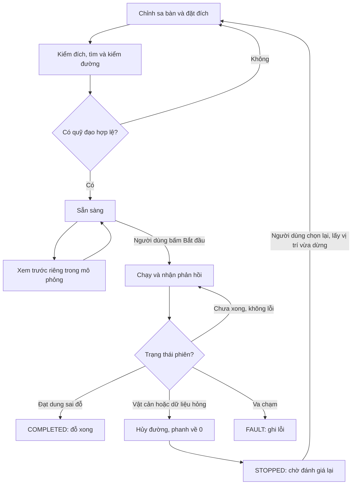
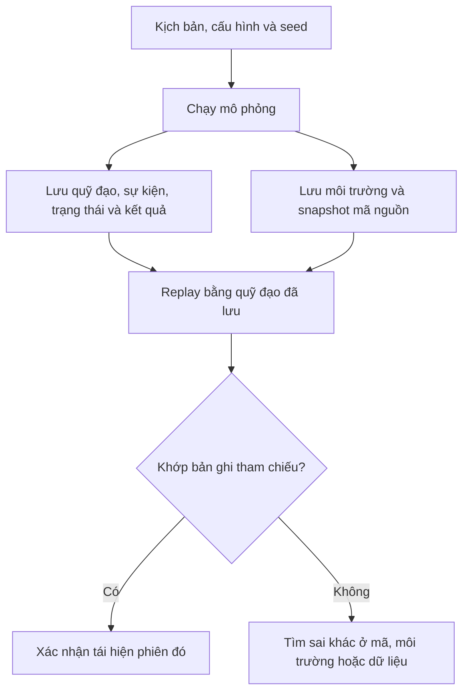

# Báo cáo giai đoạn 0 — mô phỏng tự đỗ

**Kết luận:** giai đoạn 0 đạt sáu điều kiện chuyển bước trong phạm vi mô phỏng đã kiểm ngày **20/09/2026**. Đây là báo cáo của đợt đó; tiến độ sau này nằm ở [tổng quan hiện tại](TONG_HOP_DU_AN.md).

Biên tập lại 26/09/2026 từ hồ sơ tại `9d68257`, không chạy lại phép thử và không thay số liệu.

## 1. Kết quả tổng quan

- 220/220 test pytest đạt.
- 2.880 trường hợp theo seed không ghi nhận vi phạm các điều kiện đã đặt.
- 40/40 bài planner trong chiến dịch có đường hợp lệ và thực thi hoàn thành.
- Năm phiên mẫu có video, log, cấu hình và replay khớp.

Các con số chỉ áp dụng cho tập phép thử này, không chứng minh mọi bài đỗ đều giải được hoặc xe thật đã hoạt động.

## 2. Phần mềm đã có

| Khối | Chức năng |
|---|---|
| Sa bàn và giao diện | Đặt/kéo/xoay đích, vật cản và vùng chưa quan sát |
| Tìm đường | Hybrid A*/Reeds–Shepp và các bộ tìm đường bổ sung; kiểm quỹ đạo bằng mô phỏng |
| Hình học | Toàn thân xe, phần nhô đầu/đuôi và vùng thân xe quét khi quay |
| Điều khiển | Bám đường tiến/lùi, dừng trước khi đổi chiều |
| Phản hồi giả | Trễ, nhiễu, mất mẫu theo seed; kiểm dữ liệu cũ/hỏng |
| Quản lý phiên | Xem trước, chạy, phanh, dừng, hoàn thành và lỗi |
| Lưu/phát lại | Bản đồ, quỹ đạo, cấu hình, sự kiện, môi trường và snapshot source |

Thông số xe trong [vehicle_default.json](autopark/configs/vehicle_default.json) là giả định mô phỏng, chưa phải số đo MN300.

## 3. Sáu điều kiện chuyển bước

| Điều kiện | Kết luận của đợt 20/09 |
|---|---|
| Kéo/xoay đích; từ chối đích đè vật cản | Đạt trong mô phỏng |
| Tiến/lùi và tuân thủ giới hạn lái | Đạt trong mô phỏng |
| Kiểm va chạm toàn thân xe | Đạt trong phạm vi thử |
| Vật mới vô hiệu đường; dừng trước khi lập đường mới | Đạt trong mô phỏng |
| Xem trước không phát lệnh phần cứng | Đạt |
| Cấu hình/log đủ để tái hiện | Đạt với các phiên đã ghi |

Nhánh VehicleIO được thêm sau đợt này; kết quả 220 test không bao gồm nghiệm thu nhánh đó. Xem [chế độ quan sát](autopark/docs/CHE_DO_QUAN_SAT.md).

## 4. Luồng vận hành



Sơ đồ rút gọn các nhánh thường gặp trong mô phỏng. Xem trước là tùy chọn trên giao diện; hoàn tất xem trước không tự cho xe chạy. Nhánh hết thời gian chạy được mô tả ngay dưới đây.

Sau sự kiện dừng, hệ thống không tự chạy tiếp. Đường mới lấy xuất phát tại vị trí vừa dừng. `COMPLETED` đòi đạt dung sai; đi hết danh sách điểm chưa đủ. Hết thời gian chạy phải phanh trước khi kết thúc FAULT.

## 5. Các nhóm lỗi đã sửa

| Nhóm lỗi | Hành vi sau sửa |
|---|---|
| Phiên đóng vẫn nhận lệnh | Chặn chạy/lái tay và ngừng mô phỏng sau close |
| Hết thời gian khi đang chạy hoặc phanh | Hoàn tất phanh, giữ kết quả/sự kiện đúng |
| Báo dừng hoặc đổi chiều khi còn tốc độ | Chờ tốc độ về 0 |
| NaN/Infinity trong dữ liệu/lệnh | Từ chối hoặc dừng trước khi đưa vào controller |
| Vật cản/lỗi thứ hai lúc đang phanh | Tiếp tục nhận cập nhật và lưu sự kiện |
| Xuất phát đã va chạm | Giữ cờ collision từ khởi tạo |
| Preview báo hoàn thành ngoài dung sai | Phân biệt hết đường với đỗ đúng |
| Mục tiêu tốc độ vượt cấu hình | Kẹp quỹ đạo và controller, kể cả tốc độ bò |

Lượt hồi quy ban đầu có 25 trường hợp thất bại; nhiều trường hợp cùng thuộc một nhóm lỗi, không phải 25 lỗi độc lập. [Trước sửa](autopark/docs/evidence/robustness_regressions_before.xml), [sau sửa](autopark/docs/evidence/robustness_pytest.xml).

## 6. Kết quả kiểm thử

### 6.1. Pytest

Lượt đầy đủ: **220 đạt**, khoảng 60,23 giây tại lần đo đã lưu. Lượt coverage: 210 đạt, 10 không chọn vì có ngân sách thời gian; mười test này đã chạy trong lượt đầy đủ không gắn tracer.

Một bài quay đầu chật từng TIMEOUT khi máy chịu tải. Kết quả tìm đường theo thời hạn vẫn phụ thuộc tải CPU.

### 6.2. Chiến dịch theo seed

| Nhóm | Số trường hợp |
|---|---:|
| Tư thế/hình học | 2.000 |
| Chuyển động/vùng quét | 600 |
| Phiên kín vòng và lỗi giả | 240 |
| Lập đường và thực thi | 40 |
| **Tổng** | **2.880** |

Trong **240 phiên kín vòng**: 25 COMPLETED, 185 STOPPED đúng logic, 30 FAULT do cố tình chèn vật quá gần để phanh. STOPPED và FAULT không phải đỗ thành công. Nhóm **40 ca planner** được thống kê riêng: 40 hoàn thành.

Miền thử giả định: kích thước 0,7–1,4 lần cấu hình; góc lái 22–38°; tốc độ 0,06–0,30 m/s; gia tốc 0,15–0,45 m/s²; giảm tốc 0,25–0,90 m/s²; đổi lái 35–140°/s; bước vật lý 2,5/5/10 ms.

### 6.3. Coverage

| Phạm vi ở thời điểm đo | Dòng | Nhánh |
|---|---:|---:|
| 10 module cốt lõi | 93,93% | 84,25% |
| Toàn package lúc đó | 52,52% | 38,11% |

Không dùng số của lõi để đại diện toàn repo. Coverage cao không chứng minh đã thử đủ đầu vào.

[Báo cáo chi tiết](autopark/docs/KIEM_THU_DO_BEN_GIAI_DOAN_0.md), [JUnit](autopark/docs/evidence/robustness_pytest.xml), [coverage toàn bộ](autopark/docs/evidence/coverage_robustness.json), [coverage lõi](autopark/docs/evidence/coverage_core.json).

## 7. Năm phiên mẫu và replay

**Cách giữ bằng chứng để kiểm lại:**



Replay không gọi planner tìm một đường mới. Luồng này dành cho phiên mô phỏng giai đoạn 0; không áp dụng cho phiên VehicleIO.

| Phiên | Kết quả | Thời gian mô phỏng | Sai số vị trí cuối | Replay |
|---|---|---:|---:|---|
| parking | COMPLETED | 20,265 s | 8,92 mm | Khớp |
| reverse | COMPLETED | 12,145 s | 8,52 mm | Khớp |
| noisy | COMPLETED | 12,265 s | 4,78 mm | Khớp |
| obstacle | STOPPED, không va chạm | 1,345 s | Không chấm tới đích | Khớp |
| data_loss | STOPPED, không va chạm | 1,490 s | Không chấm tới đích | Khớp |

Phiên noisy: trễ 40 ms, nhiễu vị trí 2 mm và yaw 0,2°, mất mẫu 2%, seed 42.

Dữ liệu đầy đủ ở `autopark/runs/phase0_after_robustness/` trên máy tạo bằng chứng, không nằm trong Git. Replay dùng quỹ đạo lưu sẵn để tránh phụ thuộc ngân sách tìm đường mới.

[Ảnh đang chạy](autopark/docs/evidence/ui_running.png), [ảnh đã dừng](autopark/docs/evidence/ui_stopped.png).

## 8. Dữ liệu công khai

Giai đoạn này đã chuẩn bị danh mục, công cụ tải/kiểm và dữ liệu cho bước AI tiếp theo. Đó không phải bằng chứng AI đã hoạt động trong mô phỏng.

[Danh mục dataset](autopark/datasets/DANH_MUC_DATASET.md), [trạng thái và cách kiểm](autopark/datasets/TAI_VA_KIEM_TRA.md).

## 9. AI nằm ngoài kết quả nghiệm thu giai đoạn 0

Ngày 20/09 chưa có lượt huấn luyện hoàn chỉnh. Baseline được huấn luyện từ 21/09; báo cáo riêng ở [HUAN_LUYEN.md](HUAN_LUYEN.md).

Nghiên cứu AI sử dụng **[Valeo WoodScape Dataset](https://github.com/valeoai/WoodScape)**. [Hồ sơ giấy phép](autopark/docs/GIAY_PHEP_DU_LIEU.md).

## 10. Môi trường và mã nguồn

Máy đợt mô phỏng: Windows 11, Python 3.12.10, i7-12700H, RTX 3050 Ti Laptop 4 GB. [Môi trường ghi lúc đo](autopark/docs/evidence/environment.json).

Mã chính: [session](autopark/autopark/application/session.py), [simulation](autopark/autopark/simulation/), [planning](autopark/autopark/planning/), [tracker](autopark/autopark/control/tracker.py), [oracle va chạm](autopark/autopark/evaluation/collision_oracle.py).

Đơn vị mét/giây/radian; pose ở tâm trục sau, x trước, y trái, yaw dương ngược chiều kim đồng hồ.

## 11. Cách tự kiểm chứng

Cài môi trường theo [hướng dẫn chạy](autopark/README.md). Từ thư mục có `pyproject.toml`:

```powershell
./.venv/Scripts/python.exe -X utf8 -m pytest
./.venv/Scripts/python.exe -X utf8 -m autopark.evaluation.phase0 --out runs/phase0_kiem_lai
./.venv/Scripts/python.exe -X utf8 -m autopark.evaluation.replay runs/phase0_kiem_lai/obstacle
./.venv/Scripts/python.exe -X utf8 -m autopark.evaluation.robustness --out runs/robustness_kiem_lai
```

Chạy tuần tự, chọn thư mục mới. Bộ test hiện tại đã lớn hơn 220; chạy lại trên mã hiện tại là một lượt kiểm mới, không tái tạo nguyên số lượng test ngày 20/09.

## 12. Giới hạn và bước tiếp theo

Chưa chứng minh: thông số MN300, phản hồi/định vị thật, quãng phanh, E-stop, tự đỗ thật, AI sa bàn. Vật xuất hiện quá gần có thể gây FAULT. Preview dùng rollout lý tưởng, chưa thể hiện đủ lỗi phần cứng.

Giữ các test làm hồi quy; khi đo được MN300 thì thay cấu hình và chạy lại. Tiếp tục kiểm cảm biến theo [kế hoạch](KE_HOACH_TRIEN_KHAI_XE_TU_DO_v3.1.md).

[Báo cáo trước biên tập](https://github.com/thbn12082/autopark/blob/9d68257/BAO_CAO_GIAI_DOAN_0.md) lưu đầy đủ hồ sơ lịch sử.
