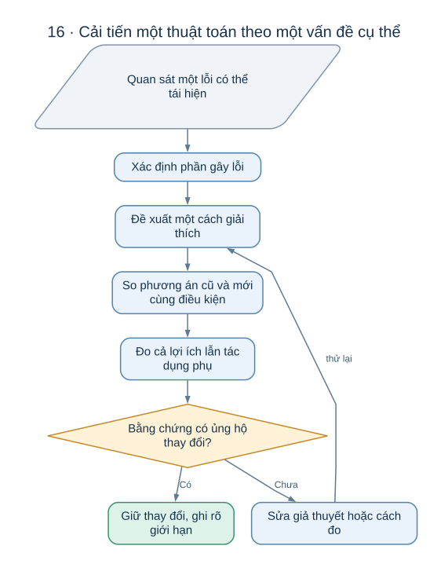
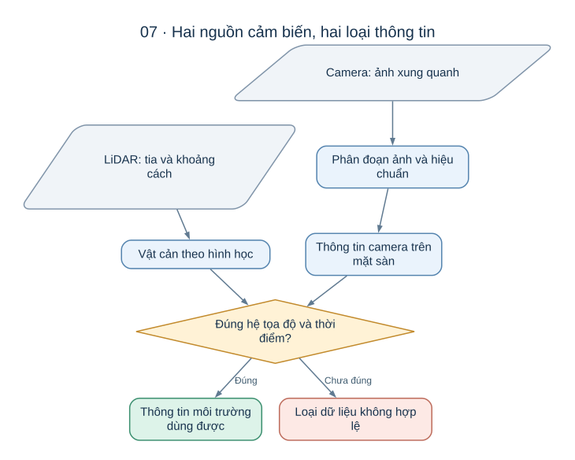

# Cách tham gia giải quyết bài toán AutoPark

Bạn có thể đóng góp cho AutoPark bằng cách hiểu một vấn đề nhỏ, đề xuất cách giải và giúp cả nhóm biết cách giải ấy có hiệu quả hay không. Đo một đặc tính của xe, giải thích một thuật toán bằng hình, tìm một tình huống khó hoặc chỉ ra một giả định chưa đúng đều là đóng góp có giá trị.

Trước hết, đọc [giới thiệu dự án](README.md) và [hệ thống qua sơ đồ](autopark/docs/SO_DO_HE_THONG.md). Điều cần nắm là chuỗi **cảm nhận → bản đồ và tư thế → lập đường → bám đường → chuyển động → quan sát lại**. Khi xe làm chưa tốt, tìm xem mắt xích nào đang thiếu thông tin hoặc dựa trên một giả định sai.

## 1. Bắt đầu từ một tình huống cụ thể

“Làm AI tốt hơn” hay “đỗ chính xác hơn” quá rộng để biết cần làm gì. Một câu hỏi cụ thể giúp chọn dữ liệu và thuật toán phù hợp hơn:

| Tình huống | Câu hỏi có thể nhận làm |
| --- | --- |
| Vật nhỏ nằm thấp hơn mặt phẳng quét LiDAR | Camera có phát hiện được vật đó đủ sớm trước khi xe đến gần? |
| Hai đoạn tường giống nhau | Bộ định vị có nhận ra khi có nhiều vị trí cùng phù hợp? |
| Khe đỗ rất hẹp | Đường tìm được có để đủ khoảng hở cho sai số thực tế? |
| Xe vào cua đúng nhưng trôi khỏi đường | Nguyên nhân là tư thế trễ, góc lái chậm hay phần sửa sai quá yếu? |
| Vật cản xuất hiện lúc xe đang lùi | Xe nhận biết sau bao lâu và còn đi thêm bao xa? |
| Mô phỏng đỗ được, xe thật chưa rõ | Giả định nào về kích thước, góc lái và chuyển động chưa được đo? |

Một bài toán phù hợp cho người mới có phạm vi đủ nhỏ để giải thích bằng một hình và có kết quả quan sát được. Có thể chỉ cần làm rõ nguyên nhân trước khi đề xuất thay thuật toán.

## 2. Mỗi đề xuất cần có mạch lập luận

*Đặt câu hỏi và cách đo trước giúp nhóm tránh thay đổi nhiều thứ rồi không biết yếu tố nào tạo ra kết quả.*

Một đề xuất dễ trao đổi thường trả lời sáu ý:

1. **Vấn đề:** xe gặp khó trong tình huống nào, ảnh hưởng tới kết quả gì?
2. **Giả thuyết:** nguyên nhân có thể là gì, bằng chứng nào khiến ta nghĩ vậy?
3. **Cách giải:** thuật toán hoặc thay đổi nào xử lý đúng nguyên nhân ấy?
4. **Đánh đổi:** cách giải có thể làm tăng độ trễ, báo nhầm hay chi phí tính toán ra sao?
5. **Cách đánh giá:** so với phương án nào, trên tình huống nào, bằng thước đo nào?
6. **Giới hạn kết luận:** đã kiểm ở mô phỏng, bàn thử hay xe thật; còn điều gì chưa biết?

Ví dụ, nếu muốn lọc vật cản qua nhiều ảnh liên tiếp, cần giải thích rằng bộ lọc nhằm loại bỏ nhận định thoáng qua. Đồng thời phải xét việc vật thật cũng cần chờ thêm ảnh mới được xác nhận. Một cách lọc bớt báo nhầm nhưng khiến xe thấy vật quá muộn có thể không phù hợp với bài đỗ.

## 3. Ví dụ: giúp xe nhận ra một vật thấp

**Tình huống minh họa:** đặt một khối thấp cạnh đường lùi vào ô đỗ. Mặt quét LiDAR đi phía trên khối, còn camera vẫn nhìn thấy nó. Câu hỏi là camera có bổ sung được thông tin hữu ích cho quyết định dừng hay không. Đây là một đề bài nghiên cứu, chưa phải kết quả dự án đã đạt.

### Quan sát và giả thuyết

Trước tiên cần phân biệt ba khả năng: camera không nhìn thấy khối, mô hình nhìn thấy nhưng không đánh dấu là vật cản, hoặc mô hình đánh dấu đúng nhưng chiếu xuống bản đồ sai vị trí. Ba lỗi này dẫn tới ba cách giải khác nhau. Huấn luyện thêm ảnh không sửa được lỗi gá camera sai góc.

Một giả thuyết có thể là: “Khối nhỏ bị bỏ sót vì chỉ chiếm ít điểm ảnh; hạ ngưỡng nhận vật cản có thể tăng số lần phát hiện, nhưng sẽ tăng báo nhầm trên bóng đổ.” Giả thuyết này nêu cả lợi ích lẫn cái giá cần kiểm.

### Đề xuất phép so sánh

So sánh phương án hiện tại với phương án thay đổi ngưỡng trên **cùng một tập cảnh**. Giữ các điều kiện khác như vị trí camera, ánh sáng và bộ lọc thời gian như nhau. Nếu đồng thời đổi ngưỡng, hiệu chuẩn và bộ lọc, sẽ khó biết yếu tố nào thực sự cải thiện kết quả.

Tập cảnh cần có khối thật ở nhiều khoảng cách và hướng, cùng những cảnh không có khối nhưng có bóng hoặc họa tiết dễ gây nhầm. Tách những cảnh dùng để lựa chọn phương án khỏi những cảnh dùng để đánh giá cuối cùng. Các ảnh liền nhau của cùng một lần ghi rất giống nhau; chia chúng sang hai nhóm có thể khiến kết quả trông tốt hơn khả năng gặp cảnh mới.

### Đo điều liên quan đến bài toán đỗ

| Thước đo | Giúp trả lời điều gì? |
| --- | --- |
| Số tình huống có vật nhưng bị bỏ sót | Còn những vật nào xe không nhận ra? |
| Số tình huống trống nhưng báo có vật | Xe có phải dừng không cần thiết? |
| Thời gian từ lúc vật xuất hiện đến lúc bản đồ có vật | Hệ thống có nhận ra đủ sớm? |
| Sai lệch vị trí và kích thước trên bản đồ | Đường tránh có đi đúng chỗ, hay vẫn quệt vào mép vật? |
| Khoảng cách xe còn cách vật khi quyết định dừng | Phát hiện có còn kịp cho chuyển động hiện tại? |

Đếm đúng, sai trên ảnh chỉ trả lời một phần. Để đánh giá việc dừng xe còn cần kiểm cả phép chiếu ảnh xuống mặt đất, độ trễ xử lý và quãng dừng thực tế. Camera chưa đủ hiệu chuẩn chỉ có thể hỗ trợ một số kết luận về ảnh; chưa đủ để kết luận về vị trí vật trên sa bàn.

### Viết kết luận có phạm vi

Một kết luận hữu ích có dạng: “Trong các cảnh đã đánh giá, phương án mới phát hiện thêm được nhóm vật nhỏ ở xa, nhưng tăng báo nhầm khi có bóng. Kết quả hiện đo trên ảnh ghi lại; chưa biết độ trễ của toàn luồng và chưa thử dừng trên xe.” Khi có số liệu, ghi rõ số tình huống và số lần đúng, sai bên cạnh nhận xét.

Nếu phương án không tốt hơn, giữ lại những cảnh làm nó thất bại. Chúng giúp nhóm hiểu giới hạn của mô hình và tránh lặp lại một hướng đã thử.

## 4. Những hướng đóng góp không đòi hỏi bắt đầu từ mã nguồn

| Hướng tham gia | Sản phẩm có thể đóng góp | Vì sao nhóm cần? |
| --- | --- | --- |
| Giải thích ý tưởng | Một hình kèm ví dụ về bán kính quay, sai số hướng hoặc khớp quét | Giúp người mới cùng hiểu các giả định |
| Đo xe và cơ cấu | Kích thước, góc lái thực tế, độ trễ, phản ứng khi đổi chiều | Thay thông số giả định bằng số đo |
| Cảm nhận | Bộ cảnh có vật nhỏ, bóng, che khuất và mô tả điều kiện | Phát hiện điểm yếu của LiDAR và camera |
| Định vị | Các cảnh lặp, hành lang, ít mốc và số đo tham chiếu | Kiểm lúc nào hệ thống phải báo thiếu tin cậy |
| Lập đường | Một sa bàn khó với giải thích vì sao khó | So sánh khả năng tìm đường và khoảng hở |
| Điều khiển | So sánh sai số khi thêm trễ hoặc đổi tốc độ | Biết bộ bám nhạy với điều kiện nào |
| Kiểm chứng | Tiêu chí rõ, cách đo độc lập và mô tả các lần thất bại | Giúp kết luận có thể được người khác kiểm tra lại |

Nếu muốn tìm hiểu thuật toán trước khi chọn hướng, đọc [cảm nhận và định vị](autopark/docs/CAM_NHAN_VA_DINH_VI.md) hoặc [thuật toán tìm và bám đường](autopark/docs/THUAT_TOAN_DUONG_DI.md). [Tổng hợp dự án](TONG_HOP_DU_AN.md) cho biết câu hỏi nào đang cần bằng chứng tiếp theo.

## 5. Các nguyên tắc giúp nhóm hiểu kết quả giống nhau

**Phân biệt điều dự định với điều đã đo.** “Có thuật toán”, “đạt trong mô phỏng”, “đo được trên bàn” và “đạt trên xe thật” là bốn mức khác nhau. Một bo ảo xử lý lệnh dừng đúng chưa cho biết motor thật sẽ dừng trong bao lâu.

**Giữ nguồn và tuổi dữ liệu.** Một tọa độ từ mô phỏng, một tọa độ ước lượng bằng LiDAR và một tọa độ tham chiếu có ý nghĩa khác nhau. Một số đo cũ không thành số đo mới chỉ vì vẫn hiện trên màn hình.

**Giữ những trường hợp chưa biết.** Khi không quan sát được một vùng, ghi là chưa biết. Khi không có tham chiếu độc lập, chưa kết luận độ chính xác thật. Điều này giúp nhóm biết bước đo tiếp theo cần bổ sung gì.

**Tôn trọng khả năng dừng của hệ thống.** Với thiết kế hiện tại, đường mất hiệu lực hoặc dữ liệu không đủ tin dẫn đến dừng và đánh giá lại. Đề xuất chạy tiếp trong tình huống ấy là thay đổi giả định của hệ thống, cần lý do và bằng chứng tương ứng.

**Mô tả đủ để người khác hiểu lại.** Một đóng góp nên kèm hình tình huống, điều kiện quan sát, phương án so sánh, thước đo, kết quả và giới hạn. Người đọc cần thấy được vì sao nhóm chọn cách giải ấy, kể cả khi chưa đọc mã nguồn.
