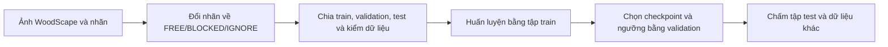

# AI trong AutoPark: hiểu mô hình và chạy một thử nghiệm

AI của dự án nhận ảnh camera và dự đoán **pixel nào là vùng trống, pixel nào là vật cản**. Phần tìm đường sau đó dùng thông tin môi trường để chọn lộ trình cho xe. Vì vậy, học nhánh AI bắt đầu từ ảnh và nhãn, rồi mới tới việc đưa kết quả vào phiên đỗ.

Tài liệu này dành cho người làm dữ liệu, mô hình hoặc đánh giá. Để chạy mô phỏng đỗ xe lần đầu, dùng [Hướng dẫn chạy](autopark/README.md). Để nối AI với phiên đỗ, xem [AI tạo vật cản](autopark/docs/AI_DIEU_KHIEN_XE.md).

Các kết quả dưới đây lấy từ các đợt thử **21–29/09/2026**, với phần đối chiếu hồ sơ ngày 30/09. Ngày biên tập lại tài liệu: **17/10/2026**. Đọc số đo cùng máy, tập dữ liệu và điều kiện ghi bên cạnh.

## Bạn cần biết trước

- Mô hình tham chiếu là **L-RASPP + MobileNetV3-Large**, lưu ở `runs/ai_woodscape_rtx4000_v1/best.pt`.
- Dataset, cache ảnh đã xử lý và tệp `.pt` nằm ngoài Git. Cần lấy chúng riêng hoặc chuẩn bị và huấn luyện lại.
- Mô hình có điểm tốt trên tập WoodScape nội bộ, nhưng đã thấy lỗi với vật nhỏ và cảnh tối. Chưa chấm trên ảnh sa bàn có nhãn.
- Ngưỡng 0,50 cho điểm mIoU tốt nhất trong phép quét đã làm; ngưỡng 0,15 giảm bỏ sót vật cản và được dùng trong nhánh AI camera của phiên đỗ. Ngưỡng cho nghiệm thu sa bàn còn cần chốt.

Nếu mới nhận việc, đọc mục 1–4 rồi làm một lượt **kiểm dữ liệu → train thử một epoch → chấm validation**. Các mục 8–19 dùng khi so sánh mô hình hoặc tái hiện nghiên cứu cũ.

## Các từ cần hiểu

| Từ | Ý nghĩa trong tài liệu |
|---|---|
| FREE / BLOCKED / IGNORE | Vùng trống / vật cản / pixel bỏ qua khi học và chấm; IGNORE có giá trị 255 |
| Train / validation / test | Tập để học / tập để chọn mô hình và ngưỡng / tập đánh giá cuối sau khi chốt |
| Checkpoint | Tệp trọng số đã học; `best.pt` là bản tốt nhất theo validation |
| Baseline | Mô hình dùng làm mốc so sánh |
| Epoch / batch | Một lượt qua tập train / nhóm ảnh xử lý cùng lúc |
| mIoU | Trung bình độ trùng giữa vùng dự đoán và nhãn đúng của các lớp |
| Recall vật cản | Tỷ lệ pixel vật cản thật được phát hiện |
| Precision vật cản | Tỷ lệ đúng trong số pixel mà mô hình gọi là vật cản |
| Bỏ sót | Pixel vật cản bị gọi thành FREE |
| Báo nhầm | Pixel FREE bị gọi thành vật cản |
| Seed | Giá trị khởi tạo ngẫu nhiên; chạy nhiều seed để xem kết quả ổn định đến đâu |

Ví dụ: mô hình nhận ra hầu hết một chiếc xe lớn vẫn có thể bỏ sót hộp nhỏ trước bánh xe. Do đó cần xem ảnh sai và lỗi theo loại vật, cùng với điểm trung bình. Thuật ngữ khác ở [bảng tra](autopark/docs/THUAT_NGU.md).

## 1. Kết quả mô hình làm mốc

L-RASPP + MobileNetV3-Large được chỉnh để dự đoán hai lớp, dùng ảnh đầu vào 512×384 và huấn luyện 30 epoch.

| Tập nội bộ | Ảnh | mIoU | IoU FREE | IoU BLOCKED | Recall vật cản | Precision vật cản | Bỏ sót |
|---|---:|---:|---:|---:|---:|---:|---:|
| Validation | 1.235 | 0,9700 | 0,9741 | 0,9659 | 0,9830 | 0,9824 | 1,70% |
| Test | 1.235 | 0,9692 | 0,9735 | 0,9650 | 0,9825 | 0,9818 | 1,75% |

Bảng dùng ngưỡng 0,50. Đây là cách chia dữ liệu nội bộ của dự án. Nhóm ảnh được suy ra từ thời gian chụp và ảnh gần trùng; chưa có mã chuyến ghi xác nhận, nên vẫn có thể có cùng tuyến phố trong nhiều tập. Điểm này chưa chứng minh kết quả trên sa bàn.

Lịch sử đã chấm tập test của mô hình nền hai lần: ngưỡng 0,50 ngày 21/09 và 0,15 ngày 22/09. Khi báo cáo, giữ đúng lịch sử này.

## 2. Dữ liệu và cách mô hình được tạo ra



Mô hình dự đoán nhãn ảnh. Để dùng trong phiên đỗ, còn cần hiệu chuẩn camera, chiếu về mặt sàn và kiểm dữ liệu còn mới.

### 2.1. Môi trường

Các lượt chính ngày 21–24/09 chạy trên máy bàn i9-14900, RTX 4000 Ada 20 GB, RAM 64 GB, Windows 11, Python 3.12.10. Máy Dell Precision 3680 dùng từ 29/09 có cùng CPU, GPU và RAM, nhưng mỗi máy vẫn cần đo lại.

Ngày 29/09, trên máy mới, nhóm đã kiểm cache, chấm validation, dự đoán một ảnh và train thử một epoch. Validation mIoU vẫn là 0,9700; lượt train thử có 360 update trong 102,7 s. Chưa chạy lại đủ 30 epoch hoặc phép đo độ trễ mục 12 trên máy đó. [Biên bản kiểm máy](autopark/docs/evidence/chuyen_may_20260929/kiem_may_20260929.md) lưu số chi tiết.

Dùng môi trường `.venv-train` riêng, cài bằng `autopark/cai_dat_train.cmd` theo [Hướng dẫn chạy, mục 5](autopark/README.md). Script dùng bộ thư viện khóa trong `requirements-train.lock`, bản PyTorch CUDA 12.8 và Python 3.12. Máy cần driver NVIDIA phù hợp cho đường chạy GPU này. Lần đầu dùng trọng số khởi tạo Torchvision có thể cần mạng để tải chúng.

### 2.2. Dữ liệu đã kiểm

Cache WoodScape có **8.234 ảnh**, chia **5.764 train / 1.235 validation / 1.235 test**. Hồ sơ đã kiểm mã băm ảnh/nhãn gốc, nhóm giữa các tập, giá trị nhãn và dựng lại 256 mẫu để so từng bit.

Pixel tập train gồm FREE 27,4%, BLOCKED 18,0%, IGNORE 54,6%. Trong phần pixel được học, FREE và BLOCKED chiếm khoảng 60:40.

Tệp có trong Git: [manifest chia tập](autopark/datasets/frozen_splits/woodscape_binary_v1/manifest.json) và [quy tắc đổi nhãn](autopark/configs/woodscape_binary_v1.json). Ảnh gốc và cache cần lấy theo [Hướng dẫn dữ liệu](autopark/datasets/TAI_VA_KIEM_TRA.md).

### 2.3. Luồng huấn luyện

Chương trình lấy trọng số có sẵn của Torchvision rồi thay đầu phân lớp thành hai lớp. Khi xoay, lật hoặc đổi kích thước ảnh để học, nhãn được biến đổi cùng ảnh. Phần ngoài ảnh mang nhãn IGNORE.

Sau mỗi đợt đánh giá, chương trình chọn `best.pt` theo validation mIoU. `latest.pt` dùng để tiếp tục một lượt bị dừng. `status.json` ghi lượt đang chạy, đã dừng, thất bại hay hoàn tất. Trainer chỉ dùng train và validation trong quá trình học.

### 2.4. Kiểm thử luồng dữ liệu và huấn luyện

Các test kiểm chia tập, đổi nhãn, mẫu toàn IGNORE và việc dừng/tiếp tục giữa epoch. Hồ sơ 21/09 có 29 test đạt; đến commit `54cb3e2`, hai tệp liên quan có 30 test. Đây là các mốc lịch sử. Khi sửa mã mới, chạy lại test tương ứng trong `autopark/tests/test_perception_data.py` và `test_perception_training.py` bằng môi trường AI.

### 2.5. Chọn số ảnh xử lý mỗi lần

Đã đo batch 8/16/32 trên GPU tham chiếu: lần lượt 200/247/226 ảnh train mỗi giây. Chọn **batch 16**, với VRAM giữ chỗ đỉnh 2,38 GB trong phép đo đó. Trên GPU khác, chạy benchmark lại trước khi chọn.

Tùy chọn `channels_last` từng làm chậm trên máy thử nên đã bỏ. Kết quả này phụ thuộc tổ hợp phần cứng và thư viện.

### 2.6. Kiểm trước khi train dài

Nhóm đã thử cho mô hình học thuộc 32 ảnh, dừng/tiếp tục trên GPU và xem ảnh dự đoán. Những bước này phát hiện lỗi luồng dữ liệu và lưu checkpoint. Chúng chưa đo khả năng nhận biết trên ảnh mới.

### 2.7. Lượt huấn luyện chính

Cấu hình gốc ở [train_woodscape_rtx4000_baseline.json](autopark/configs/train_woodscape_rtx4000_baseline.json). Những giá trị cần khi tái hiện:

| Tham số | Giá trị |
|---|---|
| Seed, batch | 20260920, 16 |
| Bộ tối ưu | AdamW; tốc độ học backbone 1e-4, đầu phân lớp 1e-3; weight decay 1e-4 |
| Lịch tốc độ học | Warmup 300 update, sau đó poly 0,9 |
| Tính toán | AMP fp16, giới hạn gradient 10, patience 8 |
| Kết quả lượt gốc | 30 epoch, 10.800 update, 901 s; epoch tốt nhất 30 |
| Bộ nhớ GPU | Đỉnh 1,92 GB cấp phát / 2,76 GB giữ chỗ |

Có một update bị AMP bỏ qua, không ghi nhận loss vô hạn. Cấu hình đầy đủ sau khi điền mặc định nằm trong `config_resolved.json` của từng lượt.

### 2.8. Kết quả khác nhau theo camera

Ở test, ngưỡng 0,50: mIoU camera trước/sau/trái/phải là 0,9757 / 0,9706 / 0,9593 / 0,9590. Tỷ lệ bỏ sót tương ứng 1,21 / 1,76 / 2,52 / 2,52%.

Ảnh tệ nhất `00105_RV` sai 35,06% pixel và bỏ sót 46,9% pixel vật cản. Hồ sơ cho thấy nhãn gốc thiếu vùng thân xe (`ego_vehicle`), khiến thân xe và viền ảnh bị gọi là vật cản. Khi gặp điểm thấp bất thường, kiểm cả nhãn đúng dùng để chấm. Nguồn: `runs/ai_woodscape_rtx4000_v1/eval_test/per_image.csv`, ngoài Git.

## 3. Các giới hạn cần hiểu khi dùng kết quả

WoodScape là ảnh đường phố từ camera góc rộng trên ô tô. Camera USB, vật nhỏ và ánh sáng trên sa bàn có thể khác nhiều. Một pixel FREE cũng chưa nói được toàn thân xe có đi qua đó hay không.

Điểm phân đoạn chưa bao gồm sai số hiệu chuẩn, phép chiếu, vị trí xe và độ trễ toàn hệ thống. Khi đưa AI vào phiên đỗ, phải kiểm thêm các phần này.

## 4. Tự chạy một lượt thử

Mở PowerShell trong **`autopark/` có `pyproject.toml`**. Cần cài `.venv-train`, có ảnh WoodScape gốc và cache ở đúng vị trí theo mục 2.2.

Đầu tiên kiểm môi trường và tệp dữ liệu:

```powershell
.\.venv-train\Scripts\python.exe -c "import torch; print('CUDA:', torch.cuda.is_available())"
Test-Path datasets/prepared/woodscape_binary_v1/manifest.json
.\.venv-train\Scripts\python.exe -X utf8 -m autopark.perception.verify_cache
```

Đường chạy GPU cần `CUDA: True`. `Test-Path` cần trả `True`; bước `verify_cache` phải hoàn tất thành công. Nếu thiếu dữ liệu, quay lại hướng dẫn chuẩn bị dữ liệu trước khi train.

**Lượt đầu chỉ kiểm luồng bằng một epoch.** Chọn tên thư mục chưa tồn tại:

```powershell
.\.venv-train\Scripts\python.exe -X utf8 -m autopark.perception.train --config configs/train_woodscape_rtx4000_baseline.json --out runs/ai_lan_dau --set epochs=1
.\.venv-train\Scripts\python.exe -X utf8 -m autopark.perception.evaluate --checkpoint runs/ai_lan_dau/best.pt --split val --out runs/ai_lan_dau/eval_val
```

Kết quả cần thấy: thư mục run có `best.pt`, `latest.pt`, `status.json`; thư mục đánh giá có `metrics.json`. Đọc trạng thái hoàn tất và xem ảnh dự đoán. Điểm của một epoch chỉ dùng kiểm luồng.

Khi đã kiểm được luồng, tái hiện lượt đầy đủ bằng thư mục mới:

```powershell
.\.venv-train\Scripts\python.exe -X utf8 -m autopark.perception.benchmark --config configs/train_woodscape_rtx4000_baseline.json --out runs/ai_luot_moi/benchmark.json
.\.venv-train\Scripts\python.exe -X utf8 -m autopark.perception.train --config configs/train_woodscape_rtx4000_baseline.json --out runs/ai_luot_moi
.\.venv-train\Scripts\python.exe -X utf8 -m autopark.perception.evaluate --checkpoint runs/ai_luot_moi/best.pt --split val --out runs/ai_luot_moi/eval_val
```

Chỉ chấm test sau khi chốt mô hình và ngưỡng. Lệnh đánh giá test yêu cầu `--split test --final-test` và lưu lịch sử chấm. Kết quả test dùng báo cáo cuối; chọn mô hình/ngưỡng bằng validation.

Muốn dừng có lưu trạng thái, tạo tệp rỗng `STOP` trong thư mục run. Trước khi tiếp tục, bỏ tệp STOP rồi chạy:

```powershell
.\.venv-train\Scripts\python.exe -X utf8 -m autopark.perception.train --out runs/ai_luot_moi --resume runs/ai_luot_moi/latest.pt
```

Mỗi lượt mới dùng thư mục mới. Trainer từ chối ghi đè lượt đã có `status.json`.

## 5. Bàn giao một thử nghiệm gồm những gì?

Gửi đường dẫn tới thư mục run và phần giải thích ngắn: thay gì, vì sao, dữ liệu nào, kết quả tốt/xấu ở đâu. Giữ `best.pt`, `latest.pt`, `config_resolved.json`, `run_manifest.json`, `status.json`, `source.zip`, lịch sử chấm test, chỉ số và ảnh lỗi.

Các tệp lớn nằm ngoài Git; ghi rõ nơi người khác có thể lấy và cách kiểm lại. Chỉ đưa bản tóm tắt nhỏ vào Git theo [Hướng dẫn tham gia](CONTRIBUTING.md).

## 6. Những phép kiểm còn thiếu

Chưa chấm trên ảnh sa bàn có nhãn, chưa đo AI trên laptop trình diễn, chưa nghiệm thu AI tạo vật cản với camera đã hiệu chuẩn và gá lên xe.

## 7. Việc nên làm tiếp

Thu ảnh đúng camera, vị trí gá và ánh sáng của dự án. Tạo một tập nhãn độc lập bằng [quy trình gán nhãn](autopark/docs/GAN_NHAN_SA_BAN.md), rồi so các checkpoint và ngưỡng trên tập đó. Đây là bước để biết mô hình nào phù hợp sa bàn.

## 8. Mô hình gặp ảnh khác dữ liệu học thì sao?

Mô hình nền, ngưỡng 0,50, chấm ở độ phân giải nhãn gốc:

| Bộ ảnh | Số ảnh | mIoU | Bỏ sót vật cản |
|---|---:|---:|---:|
| ACDC trời quang (`val_ref`) | 203 | 0,966 | 1,59% |
| ACDC thời tiết xấu (`val`) | 406 | 0,908 | 4,42% |
| ACDC ban đêm | 106 | 0,899 | 8,38% |
| RoadObstacle21 validation | 30 | 0,520 | 31,7% |

Mapping ACDC bỏ qua vỉa hè/địa hình và vùng invalid. Nếu tính vỉa hè/địa hình là BLOCKED, bỏ sót trên ACDC val tăng lên 14,5%. Trong thời tiết xấu, tỷ lệ bỏ sót pixel xe là 12,4%, người 6,4%, xe hai bánh khoảng 19%. Trên RoadObstacle21 có vật nhỏ, mô hình không thấy vật trong 11/30 ảnh.

RoadAnomaly21 chỉ có 10 ảnh validation có nhãn được chấm; 100 ảnh test không có nhãn công khai chỉ được đếm. Nền ảnh chưa được định nghĩa là FREE, nên phép chấm chỉ đo recall vật bất thường:

| Ngưỡng | Recall, trung bình ± độ lệch chuẩn ba seed | Bỏ sót |
|---|---:|---:|
| 0,50 | 89,6 ± 1,2% | 10,4 ± 1,2% |
| 0,15 | 94,5 ± 0,4% | 5,5 ± 0,4% |

Phép chấm này không có mIoU, precision hay báo động giả để so với bảng xếp hạng SMIYC. Hồ sơ đợt RoadAnomaly21 chưa được lưu đủ vào `runs/`.

Công cụ `evaluate` mặc định `--train-overlap refuse`: từ chối khi trùng tập train hoặc không kiểm được nguồn manifest. Nếu dùng `warn`, giữ cảnh báo trong báo cáo. Tập đã dùng để chọn checkpoint cần được ghi đúng vai trò đó.

## 9. Kết quả có ổn định giữa các lần học?

Ngưỡng 0,50:

| Seed | Val mIoU tốt nhất | Test mIoU | Test bỏ sót |
|---|---:|---:|---:|
| 20260920 | 0,9700 | 0,9692 | 1,75% |
| 20260921 | 0,9706 | 0,9693 | 1,79% |
| 20260922 | 0,9702 | 0,9693 | 1,77% |

Trung bình test mIoU là 0,9693 ± 0,0001. Độ lệch chuẩn ở đây mô tả dao động giữa các seed. Khi đánh giá một thay đổi nhỏ, chạy nhiều seed và xem cả lỗi theo lớp.

## 10. Ngưỡng quyết định ảnh hưởng thế nào?

Mô hình trả xác suất BLOCKED cho từng pixel. Với bộ phân lớp hai lớp, xác suất từ ngưỡng trở lên được gọi là BLOCKED. Hạ ngưỡng làm mô hình gọi nhiều pixel là vật cản hơn.

Quét ngưỡng trên validation ngày 22/09 cho hai lựa chọn: **0,50** tối đa mIoU; **0,15** tối đa F2 của BLOCKED, ưu tiên giảm bỏ sót. Trên validation ở 0,15, bỏ sót 0,63% và báo nhầm 3,10%.

| Tập, mô hình nền | Bỏ sót: 0,50 → 0,15 | Báo nhầm: 0,50 → 0,15 |
|---|---:|---:|
| WoodScape test | 1,75% → 0,69% | 1,37% → 3,09% |
| ACDC val | 4,42% → 2,28% | 3,47% → 7,70% |
| RoadObstacle21 | 31,7% → 18,2% | 4,57% → 7,79% |

Báo nhầm ở đây là tỷ lệ pixel FREE bị gọi thành vật cản. Số đúng của WoodScape test ở 0,15 là **3,09%** (2.001.596/64.749.995 pixel). Các bản cũ trước 30/09 ghi 3,97% do dùng `1 − precision`, một đại lượng khác. Nguồn: `eval_val_sweep/threshold_sweep.json`, `eval_val_thr015/metrics.json`, `eval_test_thr015/metrics.json` trong run tham chiếu, ngoài Git.

| Nơi dùng | Ngưỡng mặc định |
|---|---|
| `evaluate`, `predict`, `evaluate_external` | BLOCKED 0,50 |
| Lớp tô AI của giao diện bàn thử | 0,50; có lựa chọn 0,15 để quan sát |
| Nhập nhãn nháp AI | 0,50 |
| AI camera trong phiên đỗ | `t_free=0,05`, `t_blocked=0,15` |
| Công cụ BEV | `t_free=0,15`, `t_blocked=0,50` |

Với hai ngưỡng BEV/camera AI: xác suất ≤ `t_free` thành FREE, ≥ `t_blocked` thành BLOCKED, phần ở giữa là UNKNOWN. Vì thế số 0,15 ở hai cấu hình trên có vai trò khác nhau. Ngưỡng nghiệm thu sa bàn còn chờ dữ liệu để chốt. Xem [AI tạo vật cản](autopark/docs/AI_DIEU_KHIEN_XE.md) và [BEV](autopark/docs/BEV.md).

## 11. Tăng trọng số vật cản khi học

Lượt dùng trọng số lớp khoảng 0,83/1,26 giảm bỏ sót validation từ 1,70% xuống 1,35% ở ngưỡng 0,50. Mô hình nền chỉ cần hạ ngưỡng về 0,40 đã cho 1,36%, gần tương đương. Lượt thêm trọng số chưa tạo lý do thay mô hình nền nên không chấm test cho nó.

## 12. Tốc độ chạy và định dạng ONNX

Mô hình đã xuất sang ONNX opset 17, 12,9 MB. So 16 ảnh validation với PyTorch: lệch logit tối đa 7×10⁻⁵, kết quả argmax trùng 99,9999%.

Thời gian trung vị mỗi ảnh sau khi làm nóng, đo ngày 22/09 trên máy bàn i9/RTX 4000 Ada khi GPU rảnh:

| Cách chạy | Thời gian/ảnh |
|---|---:|
| ONNX Runtime CPU fp32 | 7,6 ms |
| PyTorch CPU fp32 | 23,6 ms |
| PyTorch CUDA fp32 | 4,4 ms |
| PyTorch CUDA fp16 | 5,5 ms |
| Tiền xử lý → mạng fp16 → xác suất về CPU, ảnh 1280×966 | 7,8 ms |

Mỗi cách đo 200 lượt; riêng PyTorch CPU 40 lượt và phép đo cả chuỗi 100 lượt. Các số này chưa tính đủ độ trễ từ cảnh thật đến quyết định của xe. Chưa đo lại phép này trên máy bàn sau 29/09 hoặc laptop RTX 3050 Ti. [Hướng dẫn kiểm laptop](autopark/docs/MAY_NOP_DO_AN.md).

## 13. Các sửa đổi sau lượt học đầu

Đã sửa các nhóm lỗi về che khuất bản đồ, kích thước nhãn/hiệu chuẩn, xác suất đúng 0,5, thời gian/ảnh cũ, lật nhãn và giá trị scan. Hồ sơ 22/09 ghi 260 test đạt, 4 bỏ qua ở môi trường mô phỏng và 65 test nhận thức đạt; dùng chúng như số của đợt đó.

Môi trường AI đã khai báo PySide6 và Shapely để chạy cả phần mô phỏng. Khi sửa mã, cài đúng môi trường và chạy lại nhóm test liên quan.

## 14. Kết luận từ các phép đánh giá ngoài tập học

Mô hình nền là mốc so sánh hữu ích. Vật nhỏ, cảnh tối và khác biệt giữa đường phố với sa bàn là các điểm cần kiểm tiếp. Hạ ngưỡng giúp giảm bỏ sót nhưng tăng báo nhầm; vẫn cần ảnh sa bàn để quyết định cấu hình dùng trong dự án.

## 15. Thử thêm dữ liệu AVM-SS và ACDC

Các lượt này giữ kiến trúc và cách biến đổi ảnh, thay dữ liệu hoặc trọng số lớp theo cấu hình từng lượt.

| Cache | Train / val / test | Điều cần nhớ |
|---|---:|---|
| WoodScape | 5.764 / 1.235 / 1.235 | Nhóm ảnh được suy ra khi chia tập |
| AVM-SS | 4.713 / 1.050 / 1.000 | Chia theo khối 50 ID; còn dấu hiệu ảnh gần trùng |
| ACDC | 1.600 / 406 / 0 | Train/val có thể cùng chuỗi GoPro |
| WoodScape + AVM | 10.477 / 2.285 / 2.235 | Validation ghép dùng chọn checkpoint |
| WoodScape + AVM + ACDC | 12.077 / 2.691 / 2.235 | ACDC val đã tham gia chọn mô hình |

## 16. So sánh các nhóm mô hình

Ngưỡng 0,50. Nhóm ba seed ghi trung bình ± độ lệch chuẩn; lượt một seed chưa có số dao động.

| Nhóm | Số seed | ACDC val mIoU | ACDC bỏ sót | RO21 recall |
|---|---:|---:|---:|---:|
| WoodScape nền | 3 | 0,914 ± 0,005 | 4,1 ± 0,4% | 67,0 ± 2,3% |
| AVM riêng | 1 | 0,209 | 82,7% | 34,1% |
| WoodScape + AVM | 3 | 0,781 ± 0,021 | 13,5 ± 2,8% | 63,0 ± 1,6% |
| WoodScape + AVM + ACDC | 1 | 0,983* | 0,5%* | 48,8% |
| WoodScape + AVM, có trọng số | 3 | 0,790 ± 0,105 | 11,2 ± 9,2% | 69,6 ± 3,1% |

*Lượt học ACDC có liên hệ chuỗi với ACDC val; các số có dấu sao không đo khả năng tổng quát hóa sang dữ liệu độc lập. AVM val của lượt trộn cũng đã dùng để chọn checkpoint.*

### 16.1. Xem theo loại vật

Trộn AVM làm lỗi ACDC tăng ở tường, nhà, cây và xe lớn. Thêm trọng số giảm bỏ sót người và ô tô nhưng tăng báo nhầm và dao động. Bảng đủ 11 lớp và từng seed ở [báo cáo gốc, mục 16](https://github.com/thbn12082/autopark/blob/9d68257/HUAN_LUYEN.md).

## 17. Cách hiểu kết quả trộn dữ liệu

AVM có ích trên chính kiểu ảnh nhìn từ trên xuống của AVM. Các lượt trộn đã thử lại làm ACDC xấu hơn mô hình nền. Một số chênh lệch recall trên RO21 còn nhỏ so với dao động giữa seed và cỡ tập chỉ 30 ảnh, nên chưa đủ kết luận cải thiện chung.

### 17.1. Đổi ngưỡng và trọng số

Ở ngưỡng 0,15, bỏ sót ACDC của nhóm nền là 2,2 ± 0,2%; nhóm trộn 7,1 ± 1,5%; nhóm trộn có trọng số 6,5 ± 6,1%. Thêm trọng số chưa cho kết quả ổn định. Khi kết luận, xem nhiều seed, từng loại vật và từng điều kiện ánh sáng.

## 18. Mô hình đang được giữ làm tham chiếu

Giữ **`runs/ai_woodscape_rtx4000_v1/best.pt`**. Các lượt thêm dữ liệu chưa chứng minh vượt nền trên cả ACDC và RO21 độc lập với việc học/chọn mô hình.

Khi có ảnh sa bàn, tạo tập chấm tô tay từ đầu, tách khỏi huấn luyện. Nhãn chỉnh từ dự đoán mô hình nền có thể thiên về mô hình đó, nên không dùng làm căn cứ duy nhất để so các mô hình.

AI đã chạy trực tiếp để quan sát trên bàn thử. Nhánh biến AI thành vật cản trong phiên đỗ mới được kiểm bằng nguồn giả, dữ liệu tổng hợp và phát lại. Camera thật chưa hiệu chuẩn nên nhánh này còn bị chặn.

Nghiên cứu dùng **[Valeo WoodScape Dataset](https://github.com/valeoai/WoodScape)**. Quyết định nội bộ ngày 25/09 cho dùng mô hình WoodScape trong vòng điều khiển được lưu tại [Hồ sơ giấy phép](autopark/docs/GIAY_PHEP_DU_LIEU.md); Valeo chưa xác nhận cách diễn giải điều khoản. Quyết định đó không áp dụng cho checkpoint dùng AVM-SS hoặc nhãn nháp AI.

## 19. Chạy lại thử nghiệm thêm dữ liệu

Cần dữ liệu thô tương ứng theo [Hướng dẫn tải](autopark/datasets/TAI_VA_KIEM_TRA.md), cache WoodScape và môi trường AI. Chạy từ thư mục có `pyproject.toml`:

```powershell
.\.venv-train\Scripts\python.exe -X utf8 -m autopark.perception.prepare_extra avm --out datasets/prepared/avm_ss_binary_v1
.\.venv-train\Scripts\python.exe -X utf8 -m autopark.perception.prepare_extra acdc --out datasets/prepared/acdc_binary_v1
.\.venv-train\Scripts\python.exe -X utf8 -m autopark.perception.prepare_extra combine --caches datasets/prepared/woodscape_binary_v1 datasets/prepared/avm_ss_binary_v1 --out datasets/prepared/ws_avm_v1
.\.venv-train\Scripts\python.exe -X utf8 -m autopark.perception.train --config configs/train_woodscape_rtx4000_baseline.json --out runs/ai_ws_avm_moi --set prepared_manifest=datasets/prepared/ws_avm_v1/manifest.json --set seed=20260922
.\.venv-train\Scripts\python.exe -X utf8 -m autopark.perception.evaluate_external --checkpoint runs/ai_ws_avm_moi/best.pt --dataset acdc --split val --out runs/ai_ws_avm_moi/eval_acdc
.\.venv-train\Scripts\python.exe -X utf8 -m autopark.perception.evaluate_external --checkpoint runs/ai_ws_avm_moi/best.pt --dataset road_obstacle --out runs/ai_ws_avm_moi/eval_ro21
```

Thêm `--threshold 0.15` và chọn thư mục kết quả khác để chấm ngưỡng thấp. RoadAnomaly21 dùng `--dataset road_anomaly`. Thử trọng số lớp bằng `--set class_weights=train_inverse_frequency` với thư mục run mới.

Mapping ACDC cũ có chuỗi `purpose` là `EVALUATION ONLY`, dù hiện còn được dùng tạo cache train. Khi tái hiện hồ sơ cũ, giữ nguyên byte của [tệp mapping](autopark/configs/acdc_cityscapes_to_binary_v1.json), kể cả kiểu xuống dòng: hash của cache/checkpoint phụ thuộc chúng. Hồ sơ gốc được tạo từ checkout CRLF.

## Tra hồ sơ cũ

Các mục 1–19 giữ số để các tài liệu khác còn dẫn được. Bản `9d68257` lưu bảng chi tiết theo camera/lớp/seed; bản `ff4a018` là trước các sửa số liệu ngày 30/09; bản `8be69fb` là trước lần viết lại hướng dẫn này. Có thể đọc từng bản bằng lịch sử Git.
