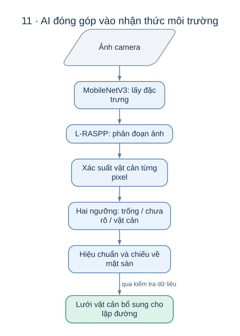
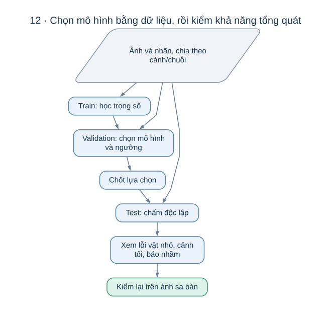

# AI nhìn thấy gì, và kết quả đó giúp xe đỗ như thế nào?

Hãy hình dung xe đang lùi vào chỗ đỗ và có một hộp nhỏ nằm gần bánh sau. Camera gửi về một bức ảnh, nhưng bộ tìm đường cần biết **hộp chiếm vùng nào trên sàn**. Nhánh AI của AutoPark giải quyết phần đầu của khoảng cách đó: nhận ra vùng ảnh có khả năng là vật cản. Hình học camera chuyển kết quả ấy sang bản đồ; bộ tìm đường mới quyết định xe đi thế nào.

AI trong dự án cung cấp thêm bằng chứng về môi trường cho hệ thống đỗ xe. Người đọc nên bắt đầu từ [ý tưởng toàn dự án](README.md), rồi dùng tài liệu này để hiểu cách nhận biết vật cản và cách đánh giá lựa chọn đó.

*Mỗi bước giải quyết một câu hỏi khác nhau: ảnh có gì, vật ở đâu, rồi xe có thể đi qua đâu.*

Tài liệu biên tập ngày **17/10/2026**. Số đo dưới đây thuộc các đợt thử **21–29/09/2026**, có đính chính ngày 30/09; chúng không phải kết quả thử mới.

## 1. Vì sao chọn phân đoạn ảnh?

Một cách quen thuộc để tìm vật là vẽ khung quanh nó và đặt tên: người, xe, cột. Cách đó gọi là **phát hiện đối tượng**. Với bài toán đỗ, ta còn cần ranh giới vùng trống giữa các vật. Một khung chữ nhật bao quanh chiếc ghế có thể chứa cả sàn trống; tên “ghế” cũng không tự cho biết bánh xe có đi qua được hay không.

AutoPark dùng **phân đoạn ngữ nghĩa**: mỗi pixel của ảnh nhận một dự đoán. Mô hình đang có hai lớp:

| Dự đoán | Cách hiểu trong bài toán |
|---|---|
| FREE | Vùng ảnh giống mặt đường hoặc vạch trên mặt đường; là ứng viên vùng trống |
| BLOCKED | Vùng ảnh giống vật cản hoặc vùng không nên đi vào |

Chọn hai lớp giúp kết quả gần với câu hỏi “có cản đường xe không?”. Xe chưa cần phân biệt mọi loại ô tô để tránh chúng. Đổi lại, hai lớp làm mất thông tin về loại vật và chuyển động của nó. Một pixel FREE cũng chưa chứng minh cả thân xe lọt qua vùng đó; việc kiểm tra kích thước xe thuộc phần hình học và lập đường.

Đây là lý do thiết kế phù hợp với đầu ra hiện có của dự án. Hồ sơ chưa có phép so sánh trực tiếp đủ để kết luận phân đoạn luôn tốt hơn phát hiện đối tượng trong mọi tình huống đỗ xe.

## 2. Mô hình học cách phân biệt sàn và vật cản như thế nào?

Mô hình tham chiếu là **L-RASPP với MobileNetV3-Large**. Có thể hiểu nó qua hai nhiệm vụ nối tiếp:

- **MobileNetV3 lấy đặc trưng:** biến màu sắc ban đầu thành các dấu hiệu như cạnh, hoa văn và hình dạng. Các lớp sâu hơn kết hợp dấu hiệu trong vùng ảnh rộng hơn.
- **L-RASPP tạo bản đồ phân đoạn:** kết hợp đặc trưng ở mức thấp và mức cao để đưa ra dự đoán theo vị trí. Đầu ra cuối cùng được đưa về kích thước ảnh cần dùng.

Ý nghĩa của việc kết hợp hai mức là giữ được chi tiết vị trí đồng thời xét bối cảnh xung quanh. Một vệt tối trên sàn có thể là bóng, cũng có thể thuộc thân vật; chỉ nhìn một màu riêng lẻ khó phân biệt được.

Torchvision cung cấp sẵn kiến trúc này và trọng số đã học trên phần COCO có các nhãn Pascal VOC. Dự án dùng bộ trọng số đó để khởi tạo, rồi thay **cả hai nhánh phân lớp** thành FREE/BLOCKED và huấn luyện tiếp bằng dữ liệu của mình. Tên và nguồn trọng số được mô tả trong [tài liệu chính thức Torchvision](https://docs.pytorch.org/vision/2.0/models/generated/torchvision.models.segmentation.lraspp_mobilenet_v3_large.html).

**Vì sao lựa chọn này hợp lý ở đây?** Dự án cần xử lý ảnh liên tục và đã có một mô hình gọn làm mốc so sánh. Học tiếp từ trọng số có sẵn giúp tái sử dụng đặc trưng hình ảnh đã học, thay vì khởi đầu hoàn toàn ngẫu nhiên. Đây là cách giải thích thiết kế từ cấu trúc và luồng huấn luyện hiện có; dự án chưa có bảng đối chiếu nhiều kiến trúc trên cùng sa bàn để khẳng định đây là lựa chọn tối ưu.

Quá trình học có thể hình dung như sửa bài: mô hình tô ảnh, so với vùng người gán nhãn, rồi điều chỉnh trọng số để giảm lỗi. Phần đã học sẵn được điều chỉnh với tốc độ nhỏ hơn phần phân lớp mới. Chương trình hiện dùng hàm mất mát cross-entropy và bộ tối ưu AdamW; hai tên này mô tả cách tính lỗi và cập nhật trọng số, không thay thế nhu cầu có nhãn đúng.

## 3. Vì sao dữ liệu quan trọng hơn một điểm số đẹp?

Mô hình tham chiếu học từ **Valeo WoodScape**, bộ ảnh camera góc rộng quanh ô tô. Dự án đổi nhiều nhãn gốc thành hai nhóm cần thiết: mặt đường/vạch đường thành FREE; xe, người, cột và nhiều vùng bị chặn thành BLOCKED. Các vùng không dùng được để học được đánh dấu IGNORE. Quy tắc cụ thể được giữ trong [bảng đổi nhãn](autopark/configs/woodscape_binary_v1.json); nguồn dữ liệu là [Valeo WoodScape Dataset](https://github.com/valeoai/WoodScape).

**IGNORE khác UNKNOWN.** IGNORE là pixel được bỏ qua khi huấn luyện và chấm điểm, chẳng hạn bầu trời hoặc phần thân xe. UNKNOWN là trạng thái của bản đồ khi hệ thống chưa đủ bằng chứng. Mô hình hai lớp hiện tại không được huấn luyện thêm một lớp “vật chưa từng gặp”.

Cache WoodScape của đợt thử có 8.234 ảnh, chia thành 5.764 ảnh học, 1.235 ảnh validation và 1.235 ảnh test. Mỗi nhóm có một vai trò:

| Nhóm ảnh | Câu hỏi cần trả lời |
|---|---|
| Train | Mô hình học được quy luật nào từ các ví dụ? |
| Validation | Nên giữ phiên bản và ngưỡng quyết định nào? |
| Test | Sau khi chốt lựa chọn, kết quả trên phần ảnh giữ lại ra sao? |

Các ảnh gần nhau trong cùng một video có thể rất giống nhau. Nếu ảnh gần trùng xuất hiện cả ở tập học lẫn tập chấm, mô hình có thể được kiểm tra trên một cảnh nó gần như đã thấy. Dự án đã nhóm ảnh theo thời gian và độ giống, nhưng chưa có mã chuyến ghi xác nhận việc tách hoàn toàn. Điểm test vì thế phải được đọc cùng giới hạn này.

Khác biệt quan trọng hơn là **đường phố và sa bàn không cùng kiểu dữ liệu**. Hộp nhỏ, camera gắn thấp, nền thảm và ánh sáng trong phòng có thể khác ảnh ô tô ngoài đường. Hiện tượng đó gọi là khác biệt miền dữ liệu. Điểm cao trên WoodScape chưa trả lời được câu hỏi “xe có thấy chiếc hộp trên sa bàn của chúng ta không?”.

## 4. Từ xác suất đến quyết định: vì sao có ngưỡng?

Với mỗi pixel, mô hình tạo một giá trị từ 0 đến 1 thể hiện mức nghiêng về BLOCKED. Ví dụ, 0,8 nghiêng về vật cản hơn 0,2. Đó là đầu ra của mô hình; không nên diễn giải máy móc rằng pixel có giá trị 0,8 thì chắc chắn đúng trong 80% mọi trường hợp trên sa bàn.

Để quyết định, ta chọn một **ngưỡng**. Nếu ngưỡng là 0,50 thì pixel từ 0,50 trở lên được gọi là vật cản. Hạ ngưỡng xuống 0,15 làm nhiều vùng được gọi là vật cản hơn: có thể tìm thêm vật bị bỏ sót, đồng thời chặn nhầm cả phần sàn trống.

| Hậu quả | Ví dụ khi đỗ xe |
|---|---|
| Bỏ sót vật cản | Hộp trước bánh xe bị coi là sàn; thông tin tránh hộp bị thiếu |
| Báo nhầm vật cản | Hoa văn trên sàn bị coi là hộp; xe có thể dừng hoặc không tìm được đường |

Đợt quét ngưỡng trên validation ngày 22/09 cho **0,50 đạt mIoU cao nhất**, còn **0,15 đạt F2 của lớp BLOCKED cao nhất**. F2 ưu tiên recall hơn precision, nên lựa chọn thứ hai nhấn mạnh giảm bỏ sót. Đây là hai mục tiêu khác nhau, và đều cần xem thêm mức báo nhầm.

| Bộ ảnh, mô hình tham chiếu | Bỏ sót: ngưỡng 0,50 → 0,15 | Báo nhầm: ngưỡng 0,50 → 0,15 |
|---|---:|---:|
| WoodScape test | 1,75% → 0,69% | 1,37% → 3,09% |
| ACDC thời tiết xấu | 4,42% → 2,28% | 3,47% → 7,70% |
| RoadObstacle21 | 31,7% → 18,2% | 4,57% → 7,79% |

Bỏ sót là phần pixel vật cản thật bị gọi thành FREE. Báo nhầm là phần pixel FREE thật bị gọi thành BLOCKED. Con số **3,09%** ở bảng đã được sửa ngày 30/09; số 3,97% trong hồ sơ cũ là một đại lượng khác, bằng 1 − precision.

Khi dựng bản đồ, dự án còn giữ một khoảng **chưa rõ** giữa hai ngưỡng:

| Cách dùng | Chắc là trống | Chưa rõ | Có bằng chứng vật cản |
|---|---:|---:|---:|
| BEV dùng để phân tích | p ≤ 0,15 | 0,15 < p < 0,50 | p ≥ 0,50 |
| Nhánh camera tạo vật cản cho phiên đỗ | p ≤ 0,05 | 0,05 < p < 0,15 | p ≥ 0,15 |

Hai dòng có mục đích khác nhau. Trong nhánh tạo vật cản, chỉ các ô có vật cản được đưa qua cầu nối tới bộ tìm đường. Các ngưỡng trên vẫn cần được đánh giá bằng ảnh sa bàn; chưa phải tiêu chuẩn đã nghiệm thu trên xe thật.

## 5. Đo gì để biết mô hình có ích?

*Chọn mô hình bằng validation, rồi đánh giá phần dữ liệu giữ lại và điều kiện sử dụng thật.*

**IoU** đo mức chồng khớp giữa vùng dự đoán và vùng đúng: phần giao chia cho phần hợp của hai vùng. **mIoU** là trung bình IoU của các lớp. **Recall vật cản** đo phần vật cản thật được tìm thấy; **precision vật cản** đo phần dự đoán vật cản thực sự đúng.

Ví dụ minh họa: có 100 pixel vật cản thật, mô hình nhận đúng 90 pixel và gọi nhầm thêm 30 pixel sàn là vật cản. Recall là 90/100 = 90%; precision là 90/120 = 75%. Một chỉ số cao không tự kéo chỉ số kia cao theo.

Mô hình tham chiếu được học với ảnh 512 × 384 trong 30 lượt qua tập học. Kết quả ở ngưỡng 0,50:

| Tập nội bộ | mIoU | IoU FREE | IoU BLOCKED | Recall vật cản | Precision vật cản |
|---|---:|---:|---:|---:|---:|
| Validation, 1.235 ảnh | 0,9700 | 0,9741 | 0,9659 | 0,9830 | 0,9824 |
| Test, 1.235 ảnh | 0,9692 | 0,9735 | 0,9650 | 0,9825 | 0,9818 |

Ba lần học với ba giá trị khởi tạo ngẫu nhiên cho test mIoU trung bình 0,9693 ± 0,0001. Sai khác nhỏ cho thấy kết quả ổn định trong các lần thử này; nó chưa đo độ ổn định khi đổi camera hoặc đổi sa bàn. Lịch sử đã chấm test của mô hình nền hai lần, ở ngưỡng 0,50 ngày 21/09 và 0,15 ngày 22/09; không mô tả đây là một lần test duy nhất sau toàn bộ lựa chọn.

Điểm trung bình còn có thể che mất lỗi nguy hiểm. Một mô hình tô rất đúng chiếc xe lớn vẫn có thể bỏ qua chiếc hộp nhỏ. Vì vậy cần xem từng ảnh sai, từng loại vật, và vật xuất hiện ở vùng nào so với đường xe sẽ đi.

## 6. Những lần thử đã chỉ ra giới hạn gì?

Mô hình nền, ngưỡng 0,50, được chấm thêm trên các bộ ảnh khác ở độ phân giải nhãn gốc:

| Điều kiện | Ảnh | mIoU | Bỏ sót pixel vật cản |
|---|---:|---:|---:|
| ACDC trời quang | 203 | 0,966 | 1,59% |
| ACDC thời tiết xấu | 406 | 0,908 | 4,42% |
| Riêng ACDC ban đêm | 106 | 0,899 | 8,38% |
| RoadObstacle21, có vật nhỏ | 30 | 0,520 | 31,7% |

Nhóm ban đêm thuộc nhóm thời tiết xấu, không phải một tập độc lập để cộng số ảnh. Trên RoadObstacle21, mô hình không thấy vật trong 11/30 ảnh. Đây là lý do trực tiếp để coi vật nhỏ là điểm yếu cần giải quyết.

Quy tắc đổi nhãn cũng làm thay đổi ý nghĩa số đo: phép chấm ACDC ở trên bỏ qua vỉa hè, địa hình và vùng không hợp lệ. Nếu coi vỉa hè/địa hình là BLOCKED, bỏ sót trên ACDC thời tiết xấu tăng lên 14,5%. Vì vậy hai báo cáo chỉ so sánh được khi chúng dùng cùng định nghĩa vùng đúng.

RoadAnomaly21 có một phép thử khác trên **10 ảnh validation có nhãn**, ba lần khởi tạo. Recall vật bất thường đạt 89,6 ± 1,2% ở ngưỡng 0,50 và 94,5 ± 0,4% ở ngưỡng 0,15. Nền ảnh chưa được định nghĩa là FREE, nên phép thử này **không cung cấp mIoU, precision hoặc tỷ lệ báo nhầm**. Nó không tương đương một kết quả trên bảng xếp hạng SMIYC; hồ sơ kết quả của đợt này cũng chưa được lưu đầy đủ.

Nhóm đã thử thêm dữ liệu AVM-SS và ACDC. Các kết quả tiêu biểu ở ngưỡng 0,50:

| Cách dùng dữ liệu | Số lần khởi tạo | ACDC mIoU | ACDC bỏ sót | RoadObstacle21 recall |
|---|---:|---:|---:|---:|
| WoodScape làm mốc | 3 | 0,914 ± 0,005 | 4,1 ± 0,4% | 67,0 ± 2,3% |
| Chỉ AVM-SS | 1 | 0,209 | 82,7% | 34,1% |
| WoodScape + AVM-SS | 3 | 0,781 ± 0,021 | 13,5 ± 2,8% | 63,0 ± 1,6% |
| WoodScape + AVM-SS + ACDC | 1 | 0,983* | 0,5%* | 48,8% |
| WoodScape + AVM-SS, tăng trọng số lớp | 3 | 0,790 ± 0,105 | 11,2 ± 9,2% | 69,6 ± 3,1% |

Các số có dấu * đã dùng ACDC validation để chọn mô hình và còn có liên hệ chuỗi giữa dữ liệu học/chấm. Chúng không chứng minh tổng quát hóa sang ACDC độc lập. Số trung bình ba lần của mô hình nền cũng khác số của một lần riêng trong bảng trước.

Bài học rút ra từ các thử nghiệm là **thêm ảnh chưa chắc làm mô hình phù hợp hơn**. Kiểu góc nhìn, quy tắc nhãn và độ giống với cảnh sử dụng đều quan trọng. Các lần trộn dữ liệu chưa chứng minh cải thiện đồng thời trên các phép đánh giá độc lập, nên dự án vẫn giữ mô hình WoodScape ban đầu làm tham chiếu. Việc tăng trọng số lớp vật cản cũng chưa cho ưu thế rõ so với điều chỉnh ngưỡng: ở validation, tăng trọng số cho bỏ sót 1,35%; mô hình nền với ngưỡng 0,40 đã đạt 1,36%.

## 7. Vì sao dự đoán nhanh chưa có nghĩa xe phản ứng nhanh?

Xe cần một chuỗi hoàn chỉnh: thu ảnh → xử lý ảnh → AI → chiếu xuống sàn → ghép vào bản đồ → kiểm tra đường → gửi lệnh dừng. Thời gian chỉ chạy mạng là một phần của chuỗi này.

Trong phép đo ngày 22/09 trên i9-14900 và RTX 4000 Ada 20 GB khi GPU rảnh, trung vị thời gian một ảnh là 4,4 ms với PyTorch CUDA fp32, 23,6 ms với PyTorch CPU và 7,6 ms với ONNX Runtime CPU. Chuỗi tiền xử lý, mạng fp16 và đưa xác suất về CPU đạt 7,8 ms trên ảnh 1280 × 966. Các phép đo đã làm nóng trước; số lượt tương ứng là 200, 40, 200 và 100.

ONNX là một cách biểu diễn mô hình để dùng bộ thực thi khác. Bản xuất của dự án được so trên 16 ảnh: nhãn argmax trùng 99,9999%, sai khác logit lớn nhất 7 × 10⁻⁵. Điều đó kiểm tra sự tương đương trong phép thử, chưa chứng minh độ trễ của cả hệ thống trên laptop trình diễn. Các phép đo tốc độ trên cũng chưa được lặp đầy đủ trên máy bàn sau ngày 29/09 hoặc laptop RTX 3050 Ti.

## 8. Khi nào kết quả AI đủ để góp vào bản đồ?

Một mảng đỏ tô đúng chiếc hộp chỉ có ý nghĩa với bộ tìm đường khi hệ thống biết mảng đó ở đâu. Cần có nội tham camera, vị trí/góc gá so với xe, vùng ảnh đáng tin và tư thế xe trong sa bàn. Cũng phải biết ảnh còn mới hay đã chụp từ lúc xe ở chỗ khác. Phần này được giải thích bằng hình trong [Cảm nhận và định vị](autopark/docs/CAM_NHAN_VA_DINH_VI.md).

Nhánh camera hiện dùng AI để **bổ sung vật cản**. Vùng FREE từ camera không xóa vật cản của LiDAR hoặc của kịch bản. Một ô cần được nhận là có vật cản ở ít nhất 2 trong 3 lô gần nhất mới được giữ lại, nhằm giảm chớp nhiễu. Cách lọc này có cái giá là cần thêm thời gian xác nhận và có thể bỏ qua vật chỉ hiện trong một lô.

Theo hồ sơ hiện có, AI đã được quan sát trực tiếp trên bàn thử. Nhánh đưa AI vào phiên đỗ mới được kiểm bằng nguồn giả, dữ liệu tổng hợp và phát lại; chưa có nghiệm thu với camera thật đã hiệu chuẩn và gá trên xe. Mô hình cũng chưa được chấm trên bộ ảnh sa bàn có nhãn độc lập.

Mô hình tham chiếu nằm tại `runs/ai_woodscape_rtx4000_v1/best.pt`; trọng số và ảnh lớn được lưu ngoài Git. Hồ sơ về phạm vi sử dụng WoodScape và quyết định nội bộ ngày 25/09 được giữ tại [Giấy phép dữ liệu](autopark/docs/GIAY_PHEP_DU_LIEU.md); quyết định đó chưa có xác nhận từ Valeo.

## 9. Người tham gia nhánh AI cần suy nghĩ về vấn đề nào?

Đóng góp hữu ích bắt đầu từ một giả thuyết có thể kiểm tra. Ví dụ: “mô hình nhầm hoa văn sàn thành vật cản”, “hộp thấp bị mất khi thu nhỏ ảnh”, hoặc “ảnh ngược sáng làm chân vật biến mất”. Khi đó, cần ảnh đại diện, nhãn độc lập, và kết quả phân biệt được lỗi AI với lỗi phép chiếu.

Một bộ ảnh sa bàn tốt cần giữ lại các cảnh chưa dùng để chọn mô hình; có vật nhỏ, vùng sát xe, góc nhìn khác nhau và các điều kiện sáng thực tế. Nhãn chấm nên được tô độc lập từ đầu để giảm thiên lệch về mô hình đã tạo nhãn nháp. Khi kết luận, xem đồng thời bỏ sót, báo nhầm, lỗi theo từng vật và tác động lên đường đi.

Câu hỏi cần trả lời cuối cùng là: **thông tin bổ sung từ camera giúp xe tránh được tình huống nào, với sai số và thời gian phản ứng bao nhiêu?** Trả lời được câu đó mới nối kết quả học máy với mục đích của AutoPark.

Các hồ sơ cũ dẫn “mục 10”, “mục 18”… dùng cách đánh số của [bản trước khi viết lại](https://github.com/thbn12082/autopark/blob/21cdb2ddac030471163da80e64edca95a5db2662/HUAN_LUYEN.md).
