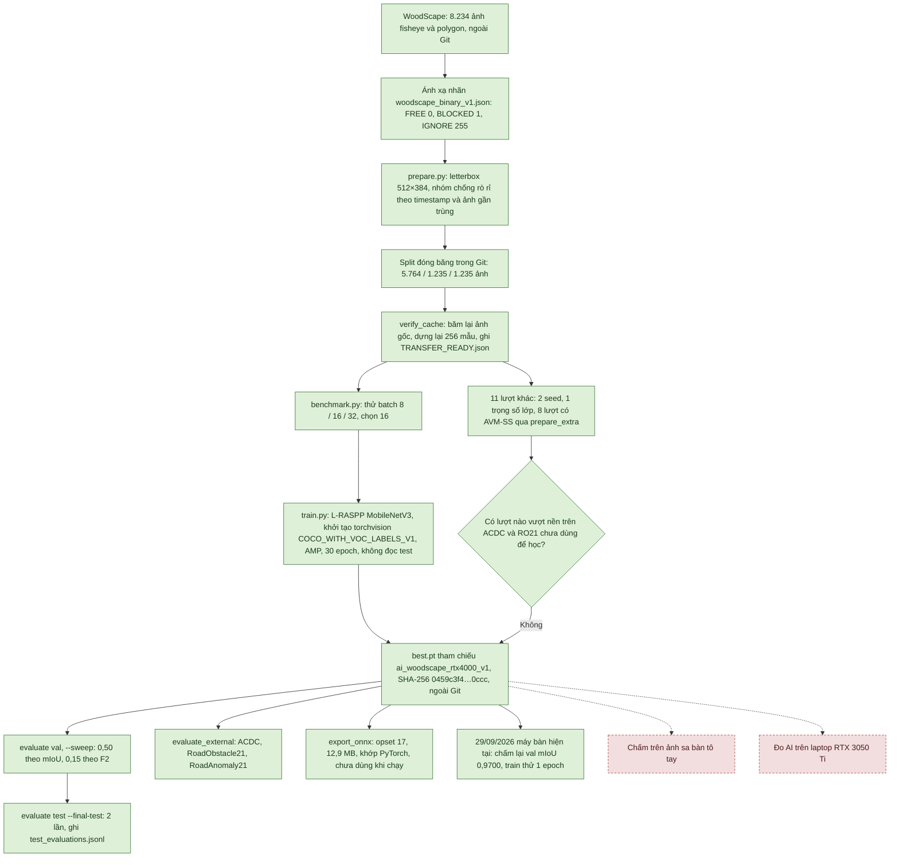
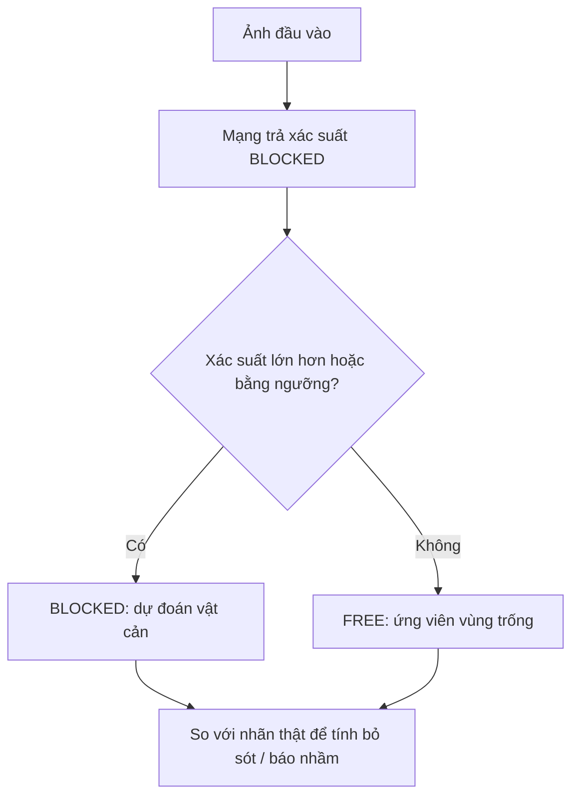
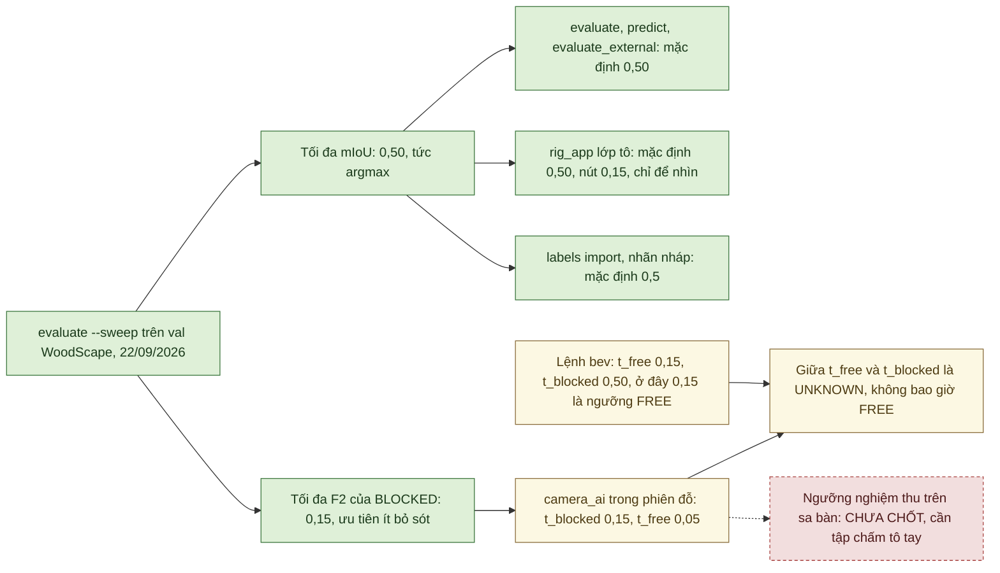

# Huấn luyện và đánh giá AI nhận thức

Tài liệu này ghi cách huấn luyện và đánh giá mô hình AI phân đoạn ảnh của AutoPark. Mô hình xếp mỗi pixel ảnh camera vào vùng trống (FREE) hoặc vật cản (BLOCKED). Tài liệu dành cho người cần biết mô hình học trên dữ liệu nào, tốt đến đâu, yếu ở đâu và chạy lại thế nào. Cách AI được dùng trong phiên đỗ nằm ở [AI camera trong vòng điều khiển](autopark/docs/AI_DIEU_KHIEN_XE.md).

## Tóm tắt

Trạng thái tính đến 30/09/2026:

- **Checkpoint tham chiếu** vẫn là `runs/ai_woodscape_rtx4000_v1/best.pt`: L-RASPP + MobileNetV3-Large, học trên WoodScape (mục 1, 18).
- **Trên WoodScape nội bộ** mô hình cho kết quả tốt: test mIoU 0,9692 ở ngưỡng 0,50 (mục 1). Đây là split nội bộ, không phải test chính thức.
- **Điểm yếu đã thấy:** bỏ sót vật nhỏ và yếu ở cảnh tối (mục 8, 14).
- **Chưa làm:** chưa chấm bằng ảnh sa bàn có nhãn, chưa đo trên laptop trình diễn (mục 6).
- **Ngưỡng:** 0,50 tối đa mIoU; 0,15 tối đa F2 của BLOCKED, ưu tiên ít bỏ sót, và là ngưỡng mà AI camera trong phiên đỗ dùng (mục 10).
- **Nguồn số liệu:** các đợt 21–24/09/2026 trên máy bàn trước. Ngày 29/09/2026 checkpoint được chấm lại trên máy bàn hiện tại và cho cùng số val tới bốn chữ số thập phân (mục 2.1).

Nghiên cứu sử dụng **[Valeo WoodScape Dataset](https://github.com/valeoai/WoodScape)**. Ngày 25/09 người làm khóa luận quyết định dùng mô hình trong vòng điều khiển; Valeo chưa xác nhận cách diễn giải điều khoản. Quyết định này không áp dụng cho checkpoint dùng AVM-SS hoặc nhãn nháp AI. [Hồ sơ giấy phép](autopark/docs/GIAY_PHEP_DU_LIEU.md).

## Cách đọc báo cáo

- **FREE:** pixel được dự đoán là vùng trống; chưa bảo đảm thân xe đi qua được.
- **BLOCKED:** pixel vật cản/vùng bị chặn.
- **IGNORE = 255:** không tính vào loss và chỉ số.
- **mIoU:** trung bình mức trùng khớp của hai lớp; càng cao càng tốt.
- **Recall vật cản:** tỷ lệ pixel vật cản được phát hiện.
- **Vật cản → FREE:** tỷ lệ bỏ sót pixel vật cản; cần theo dõi cùng từng loại vật.
- **FREE → vật cản:** báo nhầm vùng trống; làm hệ thống thận trọng hơn nhưng có thể dừng không cần thiết.
- **Seed:** giá trị điều khiển ngẫu nhiên khi huấn luyện. Trung bình ± độ lệch chuẩn ở đây phản ánh dao động giữa các seed, không phải sai số do cỡ tập ảnh.

Muốn chạy lại, xem mục 4 và 19.

## 1. Kết quả baseline

Mô hình: **L-RASPP + MobileNetV3-Large**, hai lớp, đầu vào 512×384, 30 epoch.

| Tập nội bộ | Số ảnh | mIoU | IoU FREE | IoU BLOCKED | Recall vật cản | Precision vật cản | Vật cản → FREE |
|---|---:|---:|---:|---:|---:|---:|---:|
| Validation | 1.235 | 0,9700 | 0,9741 | 0,9659 | 0,9830 | 0,9824 | 1,70% |
| Test | 1.235 | 0,9692 | 0,9735 | 0,9650 | 0,9825 | 0,9818 | 1,75% |

Các số này ở ngưỡng 0,50. Tập test của checkpoint nền được chấm ở 0,50 ngày 21/09 và thêm ở 0,15 ngày 22/09. Vì vậy không mô tả toàn bộ lịch sử là “chỉ chấm test một lần”.

Đây là split nội bộ, không phải test chính thức WoodScape. Nhóm ảnh được suy ra từ timestamp và ảnh gần trùng, chưa có recording ID xác nhận, nên không loại trừ cùng một tuyến phố xuất hiện ở nhiều tập. Kết quả chưa chứng minh khả năng tổng quát hóa sang sa bàn.

## 2. Dữ liệu, cấu hình và quá trình huấn luyện

**Từ dữ liệu tới checkpoint tham chiếu và các phép chấm.** Sơ đồ theo đúng các lệnh trong `autopark/perception/`; số chi tiết ở các mục 2.2–2.7, 8–12 và 15–18.



Xanh: đã có và đã kiểm/đo · Vàng: chỉ trong mô phỏng/giả lập · Đỏ viền đứt: chưa làm hoặc chưa thử trên thiết bị.

Mọi ô xanh là việc trên máy tính với ảnh lưu sẵn, không phải trên xe. Validation và test không cập nhật gradient; trainer không đọc test. Tập test của checkpoint nền được chấm đúng hai lần (mục 1), sau khi đã chốt mô hình. Kết quả test không được dùng để chỉnh ngược lại mô hình hay ngưỡng (mục 4). Hai ô đỏ là việc chưa làm (mục 6). Xem thêm sơ đồ 5.1 trong [Sơ đồ hệ thống](autopark/docs/SO_DO_HE_THONG.md).

### 2.1. Môi trường

Các lượt huấn luyện, đánh giá và đo độ trễ của tài liệu này (21–24/09/2026) chạy trên máy bàn trước, dùng tới 25/09/2026: i9-14900, RTX 4000 Ada 20 GB, RAM 64 GB, Windows 11; Python 3.12.10. Máy bàn hiện tại (từ 29/09/2026, Dell Precision 3680) có cùng CPU, GPU và RAM. Trên máy này chưa chạy lại lượt huấn luyện đủ 30 epoch, chưa chấm test và chưa đo lại độ trễ của mục 12. Vì vậy các số của tài liệu là của máy bàn trước, trừ bảng dưới. [Biên bản chuyển máy](autopark/docs/CHUYEN_MAY_BAN.md).

**Kiểm lại trên máy bàn hiện tại, 29/09/2026 15:08–15:19.** Mã `b37e9ee`; hồ sơ gốc ở `autopark/runs/kiem_may_20260929/` (ngoài Git); [tóm tắt](autopark/docs/evidence/chuyen_may_20260929/kiem_may_20260929.md).

| Lệnh | Kết quả | Đối chiếu |
|---|---|---|
| `verify_cache` | Đạt trong 29,9 s: manifest trùng bản đóng băng, 8.234 cặp ảnh và nhãn gốc đúng SHA-256, 256 mẫu dựng lại trùng từng bit | Như mục 2.2 |
| `evaluate` val, checkpoint tham chiếu, ngưỡng 0,50 | mIoU 0,9700, bỏ sót 1,70%, báo nhầm 1,33%; không ảnh nào trùng tập train | Trùng mục 1 tới bốn chữ số thập phân (chi tiết dưới bảng) |
| `predict` một ảnh (`00000_FV.png`), ngưỡng 0,15 | Chạy được trên CUDA | Chỉ kiểm lệnh |
| `train --set epochs=1`, cấu hình lượt nền | 360 update, 102,7 s, val mIoU 0,9505; VRAM đỉnh 1,92 / 2,55 GB; không đọc test | Chỉ kiểm pipeline, không phải kết quả mô hình |
| `rig.bench`, bốn camera thật + LiDAR + AI, 640×480, 30 s | 716 lô AI, 23,86 bộ/s, lô trung vị 15,3 ms, 0 khung hỏng | Khớp lượt `may_moi` cùng ngày (dưới bảng) |
| Bước `ai` của `rig.may_moi`: lô 4 ảnh ngẫu nhiên 640×480 | Lượt 15:15: trung vị 12,7 ms, p95 21,8 ms. Ba lần lặp 15:19: trung vị 11,0 / 10,8 / 10,8 ms | Lượt 12:59 cùng ngày, tham chiếu `may_moi`: 10,8 / 12,1 ms ([biên bản chuyển máy](autopark/docs/CHUYEN_MAY_BAN.md) mục 2) |

Chi tiết đối chiếu:

- **`evaluate` val:** kết quả trùng từng pixel với lần chấm val ngày 22/09/2026 trên máy bàn trước. Chỉ khi so với lần chấm 21/09 mới lệch 2 trên 113.096.842 pixel. Lần 21/09 còn chấm bằng argmax, trước khi đổi quy tắc hòa 0,5 (mục 13). Nguồn: [tóm tắt](autopark/docs/evidence/chuyen_may_20260929/kiem_may_20260929.md) mục 2.4.
- **`rig.bench`:** cùng máy, cùng ngày, lượt `may_moi` lúc 15:15 (120 s) được 23,87 bộ/s, lô trung vị 15,3 ms ([tóm tắt](autopark/docs/evidence/chuyen_may_20260929/kiem_may_20260929.md) mục 2.9). Trên máy bàn trước, phiên u01 ngày 23/09 (120 s, trước khi đổi quy tắc chờ camera ngày 24/09) được 23,8 bộ/s, 16,4 ms ([bàn thử](autopark/docs/GIAI_DOAN_2_BAN_THU.md) mục 3.3).

**Cài môi trường AI.** Dùng `autopark\cai_dat_train.cmd` theo [hướng dẫn môi trường AI](autopark/README.md) và `requirements-train.lock`; không chép nguyên venv từ máy khác. Nếu `.venv-train` chép sang mà không chạy được, script đổi tên nó thành `.venv-train.hong-tu-may-cu` rồi tạo mới. Máy chưa có trọng số pretrained của Torchvision trong `%USERPROFILE%\.cache\torch` thì lần train, benchmark hay `--resume` đầu tiên cần mạng. Máy bàn hiện tại đã có tệp này từ lượt train thử ngày 29/09/2026.

### 2.2. Dữ liệu đã xác minh

WoodScape có 8.234 ảnh dùng trong cache: **5.764 train / 1.235 val / 1.235 test**. Đã kiểm manifest, hash ảnh/nhãn, split không giao nhau theo nhóm, mapping và giá trị mask. Đã dựng lại 256 mẫu khớp cache từng bit.

Pixel train: FREE 27,4%, BLOCKED 18,0%, IGNORE 54,6%; trong pixel hợp lệ, tỷ lệ khoảng 60:40. [Manifest đóng băng](autopark/datasets/frozen_splits/woodscape_binary_v1/manifest.json), [mapping](autopark/configs/woodscape_binary_v1.json).

### 2.3. Pipeline

Nạp trọng số phân đoạn chính thức của Torchvision, rồi thay cả hai đầu phân lớp thành hai lớp. Augment ảnh và mask dùng cùng biến đổi; vùng ngoài ảnh thành IGNORE.

Trainer dùng AMP, AdamW và ghi checkpoint nguyên tử; chọn `best.pt` theo validation mIoU. Trainer không đọc test. `latest.pt` phục vụ tiếp tục chạy; `status.json` phân biệt running/stopped/failed/completed.

### 2.4. Kiểm thử pipeline

Hồ sơ 21/09 ghi 29 test đạt cho dữ liệu và huấn luyện, gồm resume giữa epoch khớp trọng số trên CPU, loss toàn IGNORE, mapping và tách tập. Đến `54cb3e2` hai tệp liên quan có 30 test. Đây là số theo từng thời điểm.

### 2.5. Chọn batch bằng phép đo

Trên GPU tham chiếu, batch 8/16/32 đạt tương ứng 200/247/226 ảnh train mỗi giây. Chọn **batch 16**; đỉnh VRAM giữ chỗ trong phép benchmark đó là 2,38 GB.

`channels_last` từng làm train chậm trên tổ hợp phần mềm của máy bàn trước nên đã bỏ. Không suy rộng kết quả đó sang mọi GPU hay phần mềm.

### 2.6. Kiểm trước lượt dài

Đã thử overfit 32 ảnh, STOP/resume trên GPU và xem ảnh dự đoán để kiểm luồng. Các phép thử này kiểm pipeline, không dùng làm độ chính xác mô hình.

### 2.7. Lượt chính

Seed 20260920; batch 16; AdamW backbone LR 1e-4/head LR 1e-3, weight decay 1e-4; warmup 300 update rồi poly 0,9; clip 10; AMP fp16; patience 8.

30 epoch, 10.800 update, 901 giây; epoch tốt nhất là 30. Đỉnh VRAM 1,92 GB cấp phát / 2,76 GB giữ chỗ. Một update bị AMP bỏ qua; không ghi loss vô hạn.

[Cấu hình trong repo](autopark/configs/train_woodscape_rtx4000_baseline.json). Cấu hình đã giải đầy đủ nằm ở `config_resolved.json` của run.

### 2.8. Khác biệt giữa các camera

Test @0,50: mIoU FV 0,9757; RV 0,9706; MVL 0,9593; MVR 0,9590. Bỏ sót vật cản tương ứng 1,21 / 1,76 / 2,52 / 2,52%.

Ảnh test tệ nhất (00105_RV) sai 35,06% pixel và bỏ sót 46,9% pixel vật cản. Nguyên nhân chính nằm ở nhãn gốc: ảnh này là 1 trong 2 ảnh RV (trên 1.986) không có polygon `ego_vehicle`, nên thân xe và viền ảnh bị gán là vật cản. Số trung bình không đại diện cho mọi ảnh. Nguồn: `runs/ai_woodscape_rtx4000_v1/eval_test/per_image.csv` (ngoài Git).

## 3. Giới hạn

Dữ liệu huấn luyện là đường phố chụp từ camera fisheye trên ô tô, không phải camera USB của xe mô hình. FREE có thể gồm mặt phẳng mà xe không nên đi vào; vật nhỏ hoặc tối dễ bị bỏ sót. Độ chính xác pixel chưa bao gồm sai số hiệu chuẩn, phép chiếu, vị trí xe và độ trễ.

## 4. Chạy lại baseline

Chạy từ thư mục `autopark` chứa `pyproject.toml`, sau khi có dataset và cache:

```powershell
./.venv-train/Scripts/python.exe -X utf8 -m autopark.perception.verify_cache
./.venv-train/Scripts/python.exe -X utf8 -m autopark.perception.benchmark --config configs/train_woodscape_rtx4000_baseline.json --out runs/ai_luot_moi/benchmark.json
./.venv-train/Scripts/python.exe -X utf8 -m autopark.perception.train --config configs/train_woodscape_rtx4000_baseline.json --out runs/ai_luot_moi
./.venv-train/Scripts/python.exe -X utf8 -m autopark.perception.evaluate --checkpoint runs/ai_luot_moi/best.pt --split val --out runs/ai_luot_moi/eval_val
```

Chỉ chấm test sau khi chốt mô hình. Lệnh chấm test yêu cầu `--split test --final-test` và ghi lịch sử chấm. Không dùng kết quả test để chỉnh tiếp mô hình hay ngưỡng.

Dừng có kiểm soát: tạo tệp rỗng `STOP` trong thư mục run. Bỏ tệp STOP trước khi tiếp tục:

```powershell
./.venv-train/Scripts/python.exe -X utf8 -m autopark.perception.train --out runs/ai_luot_moi --resume runs/ai_luot_moi/latest.pt
```

Dùng thư mục mới cho lượt mới; trainer từ chối ghi đè run đã có `status.json`.

## 5. Sản phẩm cần bàn giao

`best.pt`, `latest.pt`, `config_resolved.json`, `run_manifest.json`, `status.json`, `source.zip`, lịch sử đánh giá test, metrics và ảnh lỗi. Các tệp run và checkpoint không nằm trong Git.

## 6. Chưa làm

- Chưa chấm trên ảnh sa bàn có nhãn.
- Chưa đo hiệu năng AI trực tiếp trên laptop trình diễn.
- Chưa nghiệm thu AI tạo vật cản trên camera và gá thật.

## 7. Bước tiếp theo

Thu ảnh đúng góc và độ cao camera của dự án, gán nhãn một tập đánh giá độc lập, chấm các checkpoint và ngưỡng, rồi mới chọn cho sa bàn. [Quy trình nhãn](autopark/docs/GAN_NHAN_SA_BAN.md).

## 8. Đánh giá trên dữ liệu khác

Baseline @0,50, chấm tại độ phân giải nhãn gốc:

| Tập | Ảnh | mIoU | Vật cản → FREE |
|---|---:|---:|---:|
| ACDC val_ref, trời quang | 203 | 0,966 | 1,59% |
| ACDC val, thời tiết xấu | 406 | 0,908 | 4,42% |
| ACDC ban đêm | 106 | 0,899 | 8,38% |
| RoadObstacle21 val | 30 | 0,520 | 31,7% |

Mapping của ACDC để sidewalk/terrain và vùng invalid ở IGNORE. Vì thế bảng không chứng minh mô hình phân biệt được vỉa hè với đường. Khi coi sidewalk/terrain là BLOCKED, lỗi bỏ sót trên ACDC val tăng lên 14,5%.

Ở ACDC thời tiết xấu, baseline bỏ sót pixel xe 12,4%, người 6,4%, xe hai bánh khoảng 19%. Chỉ số gộp 4,42% che mất khác biệt giữa các loại vật.

RoadObstacle21 có vật nhỏ: baseline không thấy vật trong 11/30 ảnh. Không suy rộng kết quả trời quang sang mọi miền ảnh.

**RoadAnomaly21:** chấm 10 ảnh validation có nhãn; 100 ảnh test không có nhãn công khai nên chỉ được đếm. Nhãn nền ở đây không có nghĩa FREE, nên chỉ chấm recall của vật bất thường:

| Ngưỡng | Recall, trung bình ± độ lệch chuẩn ba seed | Vật bất thường → FREE |
|---|---:|---:|
| 0,50 | 89,6 ± 1,2% | 10,4 ± 1,2% |
| 0,15 | 94,5 ± 0,4% | 5,5 ± 0,4% |

Cách chấm này không định nghĩa mIoU, precision hay báo động giả, nên không so với bảng xếp hạng SMIYC. Recall cao trên vật lớn không chứng minh phát hiện tốt vật nhỏ. Kết quả đợt này được ghi ở thư mục tạm, chưa lưu đủ hồ sơ vào `runs/`.

`evaluate.py` mặc định `--train-overlap refuse`: từ chối khi trùng tập train hoặc không kiểm được nguồn manifest. Đổi sang `warn` thì phải giữ cảnh báo trong kết quả. Kiểm không trùng train vẫn không biến một tập từng dùng để chọn checkpoint thành tập đánh giá độc lập.

## 9. Độ dao động giữa seed

| Seed | Val mIoU tốt nhất | Test mIoU | Test vật cản → FREE |
|---|---:|---:|---:|
| 20260920 | 0,9700 | 0,9692 | 1,75% |
| 20260921 | 0,9706 | 0,9693 | 1,79% |
| 20260922 | 0,9702 | 0,9693 | 1,77% |

Ngưỡng 0,50. Trung bình test mIoU 0,9693 ± 0,0001. Khi so mô hình, cần nhiều seed và xem cả lỗi theo lớp; không kết luận từ một cải thiện nhỏ của một lượt.

## 10. Ngưỡng quyết định

**Một pixel được phân loại như thế nào?**



Sơ đồ mô tả phân lớp ảnh. Muốn thành vật cản trên bản đồ còn cần hiệu chuẩn, ROI, phép chiếu BEV và kiểm thời gian dữ liệu; FREE trên ảnh chưa cho phép xe đi qua.

Ngưỡng được chọn bằng cách quét trên validation ngày 22/09/2026:

- chọn theo F2 của BLOCKED, ưu tiên recall, cho **0,15**. Trên val ở 0,15, bỏ sót 0,63% và báo nhầm 3,10%;
- chọn theo mIoU cho 0,50.

Nguồn: `eval_val_sweep/threshold_sweep.json` và `eval_val_thr015/metrics.json` trong `runs/ai_woodscape_rtx4000_v1/` (ngoài Git).

| Tập, checkpoint nền | Bỏ sót @0,50 → @0,15 | Báo nhầm FREE @0,50 → @0,15 |
|---|---:|---:|
| WoodScape test | 1,75% → 0,69% | 1,37% → 3,09% |
| ACDC val | 4,42% → 2,28% | 3,47% → 7,70% |
| RoadObstacle21 | 31,7% → 18,2% | 4,57% → 7,79% |

Cột báo nhầm là tỷ lệ pixel FREE bị gọi là vật cản. Trên WoodScape test ở 0,15, tỷ lệ này là 2.001.596 / 64.749.995 pixel = 3,09% (`runs/ai_woodscape_rtx4000_v1/eval_test_thr015/metrics.json`, ngoài Git). Các bản trước ngày 30/09/2026 ghi 3,97%; đó là 1 − precision BLOCKED, không phải tỷ lệ này.

Hạ ngưỡng giảm bỏ sót nhưng tăng báo nhầm. 0,15 chưa phải ngưỡng nghiệm thu trên sa bàn. Ngăn AI camera dùng 0,15 làm ngưỡng BLOCKED. Đừng nhầm với `t_free=0,15` của cấu hình BEV mặc định: ở đó 0,15 có ý nghĩa khác. [AI camera](autopark/docs/AI_DIEU_KHIEN_XE.md).

**Ngưỡng nào được dùng ở đâu?** Mỗi công cụ có ngưỡng mặc định riêng. Xác suất đúng bằng ngưỡng BLOCKED (`--threshold`, `t_blocked`) luôn tính là BLOCKED. Riêng `t_free` (lệnh `bev`, `camera_ai`) thì xác suất đúng bằng `t_free` tính là FREE.



Xanh: đã có và đã kiểm/đo · Vàng: chỉ trong mô phỏng/giả lập · Đỏ viền đứt: chưa làm hoặc chưa thử trên thiết bị.

Các ô vàng: ngăn AI camera mới chạy với nguồn giả, rig tổng hợp và bản ghi phát lại, vì chưa có hiệu chuẩn camera thật (mục 18). Lệnh `bev` mới chạy trên rig tổng hợp và ảnh WoodScape ([BEV.md](autopark/docs/BEV.md)). Mã: `perception/engine.py` (`decide`), `fusion/camera_ai.py`, `perception/bev.py`, `ui/rig_app.py`, `perception/labels.py`. Ngưỡng nghiệm thu đề xuất: [NGUONG_NGHIEM_THU_DE_XUAT.md](autopark/docs/NGUONG_NGHIEM_THU_DE_XUAT.md). Xem thêm sơ đồ 5.7 trong [Sơ đồ hệ thống](autopark/docs/SO_DO_HE_THONG.md).

## 11. Loss có trọng số lớp

Lượt WoodScape có trọng số lớp khoảng 0,83/1,26 giảm bỏ sót validation từ 1,70% xuống 1,35% ở ngưỡng 0,50. Baseline hạ ngưỡng về 0,40 cho 1,36%, gần tương đương. Lượt này chưa tạo lý do thay checkpoint nền, nên không chấm test cho nó.

## 12. Độ trễ và ONNX

Đã xuất ONNX opset 17, 12,9 MB. Đối chiếu 16 ảnh val: lệch logit tối đa 7×10⁻⁵, argmax trùng 99,9999%.

Bảng dưới là thời gian trung vị (p50) mỗi ảnh sau khi làm nóng, đo ngày 22/09/2026 trên máy bàn trước (i9/RTX 4000 Ada, dùng tới 25/09/2026) khi GPU rảnh. Mỗi cách chạy đo 200 lượt; riêng Torch CPU 40 lượt, còn đầu-cuối 1280×966 là 100 lượt.

| Cách chạy | Thời gian/ảnh |
|---|---:|
| ONNX Runtime CPU fp32 | 7,6 ms |
| Torch CPU fp32 | 23,6 ms |
| Torch CUDA fp32 | 4,4 ms |
| Torch CUDA fp16 | 5,5 ms |
| Tiền xử lý → mạng fp16 → softmax về CPU, ảnh 1280×966 | 7,8 ms |

Đây không phải độ trễ từ sự kiện ngoài đời tới quyết định của xe. Chưa đo trên laptop RTX 3050 Ti; tải GPU làm số thay đổi. [Đo máy trình diễn](autopark/docs/MAY_NOP_DO_AN.md). Trên máy bàn hiện tại chưa chạy lại phép đo này. Máy đó chỉ có độ trễ lô 4 ảnh 640×480 của lệnh kiểm máy mới và bàn thử (mục 2.1); đó là phép đo khác.

## 13. Kiểm thử và các sửa đổi sau baseline

Hồ sơ 22/09 ghi 260 test đạt, 4 bỏ qua ở môi trường mô phỏng và 65 test nhận thức đạt. Đó là lượt lịch sử, không phải tổng hiện tại.

Các nhóm sửa gồm che khuất costmap, kích thước mask/calibration, xác suất hòa 0,5, timestamp/ảnh cũ, mirror nhãn, giá trị scan và phân tích theo lớp. Môi trường AI hiện đã có PySide6 và Shapely, nên nhận xét cũ “không chạy được mô phỏng vì thiếu Shapely” đã lỗi thời.

## 14. Kết luận đánh giá mở rộng

Baseline dùng được làm mốc so sánh. Cảnh tối, vỉa hè và vật nhỏ là các điểm yếu đã thấy. Hạ ngưỡng là một cách đánh đổi giữa bỏ sót và báo nhầm, không giải quyết sai miền dữ liệu. Cần ảnh sa bàn để quyết định cho dự án.

## 15. Thử thêm AVM-SS và ACDC

| Cache | Train / val / test | Điều cần biết |
|---|---:|---|
| WoodScape | 5.764 / 1.235 / 1.235 | Split nội bộ theo nhóm suy ra |
| AVM-SS | 4.713 / 1.050 / 1.000 | Chia lại theo khối 50 ID; vẫn còn dấu hiệu ảnh gần trùng |
| ACDC | 1.600 / 406 / 0 | Train/val có thể cùng chuỗi GoPro |
| WoodScape + AVM | 10.477 / 2.285 / 2.235 | Val ghép dùng chọn checkpoint |
| WoodScape + AVM + ACDC | 12.077 / 2.691 / 2.235 | ACDC val không còn là đánh giá ngoài miền độc lập |

Giữ nguyên kiến trúc và augment; mỗi lượt chỉ thay dữ liệu hoặc trọng số lớp như ghi trong lượt đó.

## 16. Kết quả các nhóm mô hình

Ngưỡng 0,50. Nhóm ba seed ghi trung bình ± độ lệch chuẩn; các lượt một seed không có ước lượng dao động.

| Nhóm | Seed | ACDC val mIoU | ACDC vật cản → FREE | RO21 recall |
|---|---:|---:|---:|---:|
| WoodScape nền | 3 | 0,914 ± 0,005 | 4,1 ± 0,4% | 67,0 ± 2,3% |
| AVM riêng | 1 | 0,209 | 82,7% | 34,1% |
| WoodScape + AVM | 3 | 0,781 ± 0,021 | 13,5 ± 2,8% | 63,0 ± 1,6% |
| WoodScape + AVM + ACDC | 1 | 0,983* | 0,5%* | 48,8% |
| WoodScape + AVM, trọng số | 3 | 0,790 ± 0,105 | 11,2 ± 9,2% | 69,6 ± 3,1% |

*Lượt học ACDC có liên hệ chuỗi với ACDC val, nên không trích số này như khả năng tổng quát hóa ngoài miền. AVM val của lượt trộn cũng đã dùng để chọn checkpoint, không phải tập kiểm tra cuối độc lập.

### 16.1. Kết quả theo loại vật

Trộn AVM làm lỗi trên ACDC tăng ở tường, nhà, cây và xe lớn. Dùng trọng số giảm bỏ sót người và ô tô, nhưng làm báo nhầm và dao động cao. Bảng theo 11 lớp và từng seed được giữ trong [báo cáo gốc, mục 16](https://github.com/thbn12082/autopark/blob/9d68257/HUAN_LUYEN.md).

## 17. Diễn giải

AVM giúp với ảnh nhìn từ trên xuống của chính miền AVM, nhưng các lượt trộn làm kết quả ACDC xấu hơn baseline. Chênh recall RO21 giữa một số nhóm còn nhỏ so với dao động và cỡ tập 30 ảnh, chưa đủ để kết luận cải thiện chung.

### 17.1. Đổi ngưỡng và trọng số có khắc phục được không?

Ở 0,15, bỏ sót ACDC của nhóm nền là 2,2 ± 0,2%, nhóm trộn là 7,1 ± 1,5%, nhóm trộn có trọng số là 6,5 ± 6,1%. Trọng số không ổn định giữa các seed và chưa giải quyết tác động của dữ liệu khác miền.

Không kết luận từ riêng seed đầu cho ban đêm, cũng không kết luận từ recall gộp.

## 18. Checkpoint tham chiếu và giới hạn sử dụng

Giữ **`runs/ai_woodscape_rtx4000_v1/best.pt`**. Không lượt thêm dữ liệu nào chứng minh vượt nền trên cả ACDC và RO21 chưa dùng để học hay chọn mô hình.

Khi có ảnh sa bàn, so các nhóm bằng tập tô tay từ đầu, tách khỏi huấn luyện. Không dùng nhãn sửa từ dự đoán của mô hình nền để kết luận mô hình nền tốt hơn mô hình khác.

AI đã chạy trực tiếp để quan sát trên bàn thử: trên máy bàn trước từ 23/09/2026, trên máy bàn hiện tại ngày 29/09/2026 (mục 2.1). Nhánh AI tạo vật cản trong phiên đỗ mới kiểm bằng nguồn giả, rig tổng hợp và replay. Vì chưa có hiệu chuẩn camera thật nên nhánh này vẫn bị chặn.

## 19. Chạy lại thử nghiệm mở rộng

Cần dữ liệu thô tương ứng và môi trường AI. Lệnh PowerShell, chạy từ thư mục có `pyproject.toml`:

```powershell
./.venv-train/Scripts/python.exe -X utf8 -m autopark.perception.prepare_extra avm --out datasets/prepared/avm_ss_binary_v1
./.venv-train/Scripts/python.exe -X utf8 -m autopark.perception.prepare_extra acdc --out datasets/prepared/acdc_binary_v1
./.venv-train/Scripts/python.exe -X utf8 -m autopark.perception.prepare_extra combine --caches datasets/prepared/woodscape_binary_v1 datasets/prepared/avm_ss_binary_v1 --out datasets/prepared/ws_avm_v1
./.venv-train/Scripts/python.exe -X utf8 -m autopark.perception.train --config configs/train_woodscape_rtx4000_baseline.json --out runs/ai_ws_avm_moi --set prepared_manifest=datasets/prepared/ws_avm_v1/manifest.json --set seed=20260922
./.venv-train/Scripts/python.exe -X utf8 -m autopark.perception.evaluate_external --checkpoint runs/ai_ws_avm_moi/best.pt --dataset acdc --split val --out runs/ai_ws_avm_moi/eval_acdc
./.venv-train/Scripts/python.exe -X utf8 -m autopark.perception.evaluate_external --checkpoint runs/ai_ws_avm_moi/best.pt --dataset road_obstacle --out runs/ai_ws_avm_moi/eval_ro21
```

Để chấm ngưỡng thấp, thêm `--threshold 0.15` và chọn thư mục kết quả khác. Với RoadAnomaly21 dùng `--dataset road_anomaly`. Với lượt có trọng số dùng `--set class_weights=train_inverse_frequency` và một thư mục run mới.

**Lưu ý tái hiện ACDC.** Chuỗi `purpose` trong mapping cũ ghi “EVALUATION ONLY”; chuỗi này đã lỗi thời vì tệp còn được dùng để tạo cache train. Đừng sửa tùy tiện nội dung hay kiểu xuống dòng của [mapping](autopark/configs/acdc_cityscapes_to_binary_v1.json). Hash tính trên nguyên byte, gồm cả LF/CRLF, nên một thay đổi có thể làm cache hay checkpoint không khớp dù ánh xạ lớp giống nhau. Hồ sơ gốc được dựng từ checkout CRLF.

## Ghi chú về các bản cũ

- [Bản `9d68257`](https://github.com/thbn12082/autopark/blob/9d68257/HUAN_LUYEN.md) (trước 26/09/2026) giữ bảng đầy đủ theo camera/lớp/seed, đường dẫn các lượt, chẩn đoán hiệu năng và lịch sử sửa lỗi. Các mục 1–19 giữ số thứ tự như bản đó để tài liệu khác dẫn được.
- [Bản `ff4a018`](https://github.com/thbn12082/autopark/blob/ff4a018/HUAN_LUYEN.md) là bản ngay trước 30/09/2026. Các bản trước ngày đó đọc sai hai số từ hồ sơ; nay đã sửa theo tệp kết quả: tỷ lệ báo nhầm ở ngưỡng 0,15 trên test (mục 10) và ảnh test tệ nhất (mục 2.8).
