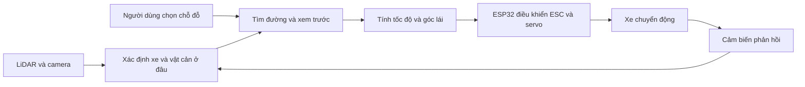

# Kế hoạch triển khai AutoPark — v3.1

**Tài liệu này giúp chọn việc tiếp theo và biết khi nào một giai đoạn thật sự hoàn thành.** Người mới nên chạy thử theo [README](README.md), rồi đọc mục 1–3 và giai đoạn mình phụ trách. Không cần đọc hết kế hoạch trong ngày đầu.

AutoPark hướng tới một chiếc xe mô hình tự đỗ: người dùng chọn chỗ đỗ, máy tính tìm đường, xe chạy có phản hồi và dừng khi gặp vật cản hoặc mất dữ liệu cần thiết.

**Mốc thông tin:** viết lại ngày 17/10/2026, dựa trên hồ sơ kỹ thuật đến 06/10/2026. Đây không phải lần thử phần cứng hay kiểm kê mới. Theo hồ sơ, GĐ 0 đạt ở mức mô phỏng; GĐ 1–10 chưa đạt cổng; V1 đạt **0/10** điều kiện. Đã có LiDAR, bốn camera và hub; chưa ghi nhận có xe MN300 hay bo ESP32-S3 thật.

Giữ số mục 1–18 để tài liệu cũ vẫn tra cứu được. Số đo nằm trong [tổng quan tiến độ](TONG_HOP_DU_AN.md); lệnh chạy ở [hướng dẫn phần mềm](autopark/README.md).

| Từ gặp trong kế hoạch | Nghĩa |
|---|---|
| GĐ; V1 | Giai đoạn; phiên bản đầu cần hoàn thành |
| Cổng chuyển bước | Các điều kiện phải có bằng chứng đạt trước khi chuyển sang bước phụ thuộc |
| Tư thế (pose) | Vị trí và hướng của xe trên sa bàn |
| Planner; BEV | Phần mềm tìm đường; bản đồ nhìn từ trên xuống suy ra từ camera |
| Nội tham; ngoại tham; ROI | Thông số quang học camera; vị trí/góc gá; vùng ảnh được phép dùng |
| Telemetry | Số đo và trạng thái bo gửi về máy tính |
| ESC; servo; E-stop; watchdog | Bộ điều tốc động cơ; cơ cấu chấp hành lái; nút dừng khẩn; bộ giám sát phát hiện quá hạn |
| Bo mô phỏng; bo ảo | Bản Python mô phỏng bo; firmware C++ thật chạy trong QEMU. Cả hai chưa phải bo vật lý |
| M0–M3 | Các mức thử từ chỉ cắm USB tới chạy xe trên sàn |
| T1–T15; R1–R7 | Mã công cụ nghiệm thu; mã phương pháp đo độc lập |
| DO-, DV-, LD-, TC-1 | Mã bài thử đỗ, định vị, chạy dài, kiểm tham chiếu trên cao |
| N-…; L1–L16 | Mã ngưỡng; mã bài thử lỗi nguồn và dừng |

Tra mã tại [kịch bản nghiệm thu](autopark/docs/KICH_BAN_NGHIEM_THU.md) và [nguồn/dừng](autopark/docs/GIAI_DOAN_6_CHUAN_BI.md).

## 1. Cấu hình và phạm vi

### 1.1. Các thành phần đã chọn

| Thành phần | Vai trò |
|---|---|
| MN300 Tank300 1/12 4WD RTR | Xe nền; bộ điện thực giao cần kiểm |
| Laptop | Xử lý ảnh và bản đồ, tìm vị trí xe, tìm/bám đường, giao diện và log |
| RPLIDAR C1/C1M1 | Quét khoảng cách để dựng bản đồ, tìm vị trí xe và vật cản |
| Bốn camera USB UVC | Quan sát trước/sau/trái/phải, nhận thức cục bộ |
| Hub và dây USB | Truyền bốn luồng; phải đo tải/nguồn thực |
| Một ESP32-S3 chính | Đọc cảm biến, gửi trạng thái, điều khiển tốc độ/lái và xử lý mất lệnh |
| AS5600 + nam châm | Phản hồi cơ cấu lái sau khi gá/hiệu chuẩn |
| MT6701 hoặc encoder phù hợp | Tốc độ/quãng đường sau khi xác định tỷ số truyền |
| BNO085 | Hỗ trợ ước lượng hướng/chuyển động |
| Khoảng bốn VL53L1X | Khoảng cách gần; thử hai trước |
| Nguồn, cầu chì, E-stop, phần tử ngắt | Cấp điện và dừng theo thiết kế đã đo |

Chưa tự ý thay xe bằng HSP, thay camera bằng ESP32-CAM/Wi-Fi, bỏ LiDAR hay thay laptop. USB giữa laptop và ESP32 là phương án thử trên bàn; đường điều khiển khi tích hợp xe chưa chốt.

Theo [kiểm kê](autopark/docs/hardware_inventory.md), đã nhận RPLIDAR C1 kèm bộ chuyển CP2102N (22/09/2026), bốn camera USB và hub UGREEN (23/09/2026). Hồ sơ đến 30/09/2026 ghi chưa nhận MN300, ESP32-S3, BNO085, VL53L1X, AS5600, MT6701/encoder, nguồn, cầu chì, E-stop LA38 và phần tử ngắt.

Máy phát triển chính từ 29/09/2026 là máy bàn Dell Precision 3680 (i9-14900, RTX 4000 Ada 20 GB). Mọi số đo cảm biến, AI và bàn thử đến nay làm trên máy bàn: máy bàn trước đến 25/09/2026, máy bàn hiện tại từ 29/09/2026 ([chuyển máy bàn](autopark/docs/CHUYEN_MAY_BAN.md)). Laptop RTX 3050 Ti là máy trình diễn và nộp đồ án. Trên laptop mới chạy mô phỏng giai đoạn 0 (20/09/2026), chưa đo LiDAR, camera hay AI ([máy nộp đồ án](autopark/docs/MAY_NOP_DO_AN.md)).

### 1.2. V1 phải làm gì?

Người dùng đặt vị trí và hướng đỗ. Xe tìm và chạy đường tiến/lùi phù hợp cơ cấu lái, dùng LiDAR và camera để nhận biết môi trường. Khi có vật cản hoặc dữ liệu không hợp lệ, xe dừng và đánh giá lại.

V1 không bắt buộc tự tìm ô, nhận diện vạch, tự lái đến bãi, điều khiển neural end-to-end, MPC nâng cao, dự đoán người hay tái dựng 3D.

### 1.3. Nguyên tắc giữ nguyên

Kết quả mô phỏng, bàn thử và xe thật ghi riêng. Ngưỡng chưa đo hoặc chưa duyệt phải để “cần chốt”. Có thể làm phần mềm khi thiếu thiết bị, nhưng chưa được đánh dấu đạt phép thử thật.

Nguồn và dừng phải chuẩn bị trước khi thử chấp hành. Giai đoạn 6 xác nhận toàn hệ thống trước khi chạy tự động trên sàn. Có thể mua sớm ESP32-S3 chính duy nhất ở đợt 3 để đọc cảm biến.

AI nhận thức dùng [Valeo WoodScape Dataset](https://github.com/valeoai/WoodScape). Quyết định và giới hạn sử dụng nằm trong [giấy phép dữ liệu](autopark/docs/GIAY_PHEP_DU_LIEU.md).

## 2. Luồng hệ thống và cách triển khai

### 2.1. Luồng khi hoàn chỉnh

Đây là luồng **mục tiêu**. Phần tìm/bám đường đã chạy trong mô phỏng; firmware chạy trong QEMU với xe mô phỏng phía laptop. LiDAR và camera đã chạy trên bàn; chưa có vòng điều khiển qua xe thật.

AI camera đã nối tới phiên đỗ nhưng dữ liệu thật bị chặn vì chưa hiệu chuẩn. Nguồn tư thế LiDAR đã có trong mô phỏng và trên bản ghi C1 đứng yên; START với bo thật còn cần đo gá và đạt p04, DV-2, DV-1. Đọc [AI trong điều khiển](autopark/docs/AI_DIEU_KHIEN_XE.md), [nguồn tư thế LiDAR](autopark/docs/NGUON_TU_THE_LIDAR.md), [QEMU](autopark/docs/MO_PHONG_FIRMWARE.md).

Giám sát lỗi chạy cùng vòng điều khiển. E-stop vật lý có đường ngắt động lực riêng. Sơ đồ mô-đun mã ở mục 1.1–1.2 của [sơ đồ hệ thống](autopark/docs/SO_DO_HE_THONG.md).

### 2.2. Những việc có thể làm đồng thời

| Nhánh | Thứ tự chính | Điểm tích hợp |
|---|---|---|
| Phần mềm | GĐ 0: mô phỏng, giao diện, AI từ dữ liệu sẵn có | GĐ 8 |
| Cảm biến | GĐ 1: LiDAR/camera mẫu → GĐ 2: bốn camera → GĐ 3: hợp nhất trên bàn | GĐ 7: gá lên xe → GĐ 8 |
| Xe và điều khiển | GĐ 4: đo xe → GĐ 5: điều khiển phản hồi | GĐ 7 cần số đo xe; GĐ 8 cần điều khiển đã kiểm |
| Nguồn và dừng | Chuẩn bị cho từng phép thử → GĐ 6: kiểm toàn hệ thống | Phải sẵn sàng trước thử chấp hành; GĐ 6 phải đạt trước GĐ 9 |
| Tích hợp | GĐ 7 → GĐ 8 → GĐ 9: tự đỗ → GĐ 10: nghiệm thu | Kết quả của các nhánh trên |

Có thể chuẩn bị phần mềm, thiết kế và hồ sơ nghiệm thu sớm. Đợt mua và giai đoạn không tương ứng một-một. Không cần hoàn tất toàn bộ GĐ 6 mới bắt đầu GĐ 5, nhưng nguồn/dừng cho **phép thử chấp hành đang làm** phải sẵn sàng; mức M2 cần đường dừng phần cứng và phần tử ngắt đã lắp.

### 2.3. Cách ghi tiến độ

Mỗi việc ghi bốn ý: đã làm gì, tạo ra tệp/kết quả nào, kiểm bằng cách nào, còn thiếu gì. Cổng cần log hoặc biên bản làm bằng chứng. Không tính phần trăm hoàn thành từ số tệp hay số test.

## 3. Sáu đợt mua

| Đợt | Chuẩn bị | Điều kiện trước khi mở rộng | Trạng thái 30/09/2026 |
|---|---|---|---|
| 1 | LiDAR + bộ nối, một camera mẫu, dây ngắn, nguồn bàn thử | Camera dùng được ở vùng gần xe | Đã nhận RPLIDAR C1 kèm bộ chuyển CP2102N (22/09/2026). Camera chưa thử ở vùng gần xe (ghi chú dưới bảng) |
| 2 | Thêm ba camera, hub/nguồn/gá | Thử cả bốn đồng thời, rồi mới thêm dây dài | Đã nhận đủ bốn camera USB và hub UGREEN (23/09/2026). Đã thử bốn camera đồng thời trên bàn; chưa có gá, chưa thử dây dài |
| 3 | BNO085, hai ToF, dây; đề xuất mua sớm ESP32-S3 chính | Đối chiếu nguồn/giao tiếp, đọc ổn từng cảm biến | Chưa nhận. Firmware đã biên dịch (29/09/2026), chờ bo để nạp |
| 4 | MN300 đúng gói pin/sạc/phụ kiện | Đo xe để chọn phản hồi/gá và cách điều khiển | Chưa nhận; phiếu kiểm kê và bảng đo đã soạn, chưa điền |
| 5 | AS5600, encoder, gá; thêm ToF nếu cần | Có nguồn/dừng phù hợp trước thử chấp hành; không mua trùng ESP32 | Chưa nhận |
| 6 | Nguồn theo tải, E-stop + phần ngắt, cầu chì/dây/gá cuối | Mất lệnh, dừng, reset, tải đồng thời đạt trước tự đỗ | Chưa nhận; bảng tải và 16 kịch bản lỗi là bản nháp, chưa thử |

Ghi chú cho đợt 1–2:

- Camera mẫu của đợt 1 về cùng đợt 2. Kiểm kê chưa ghi dây ngắn và nguồn bàn thử. Camera chưa thử ở vùng gần xe vì chưa gá, chưa hiệu chuẩn.
- Các phiên đã ghi đều cấp nguồn hub qua USB, chưa thử adapter. Bốn camera chạy đồng thời trên bàn dùng được ở 640×480.

Thực tế đã mua đủ bốn camera trước khi hoàn tất phép thử camera mẫu. Đây là khác biệt so với trình tự dự kiến, không phải bằng chứng camera mẫu đã đạt. Nguồn của cột trạng thái: [kiểm kê](autopark/docs/hardware_inventory.md), [phiếu MN300](autopark/docs/mn300_inventory.md), [chuẩn bị đo xe](autopark/docs/GIAI_DOAN_4_CHUAN_BI.md), [chuẩn bị nguồn và dừng](autopark/docs/GIAI_DOAN_6_CHUAN_BI.md), [README firmware](autopark/firmware/esp32_vehicle/README.md).

Đợt 3 mở việc đọc cảm biến và thử bo; đợt 4 mở đo xe; đợt 5 mở phản hồi và gá; đợt 6 cung cấp nguồn/dừng. Quan hệ đầy đủ ở sơ đồ 8.1–8.2 của [sơ đồ hệ thống](autopark/docs/SO_DO_HE_THONG.md).

## 4. Giai đoạn 0 — mô phỏng

**Mục đích:** kiểm đường đi, cách bám đường và phản ứng với lỗi trên máy tính.

**Đã có:** sáu điều kiện dưới đây đạt trong mô phỏng ngày 20/09/2026 trên laptop, với kích thước xe giả định. Ngày 29/09, năm phiên `evaluation.phase0` trên máy bàn cho kết quả trùng từng giá trị ([biên bản](autopark/docs/evidence/chuyen_may_20260929/kiem_may_20260929.md), mục 2.1).

**Việc làm:** tạo sa bàn/đích, mô hình chuyển động, tìm/bám đường, kiểm toàn thân và vùng xe quét qua, thử lỗi giả, ghi/phát lại. Sửa lỗi hình học hoặc logic ngay trong mô phỏng.

**Đầu ra:** cấu hình ghi rõ giả định, test, log, video và bản phát lại. Đọc [báo cáo](BAO_CAO_GIAI_DOAN_0.md), [biên bản](autopark/docs/GIAI_DOAN_0.md), [danh mục dataset](autopark/datasets/DANH_MUC_DATASET.md).

### Mục tiêu cần đạt / điều kiện chuyển bước

- [x] Kéo và xoay đích được; đích nằm trong vật cản bị từ chối.
- [x] Xe ảo chạy tiến/lùi; đường tuân thủ giới hạn lái đặt trong cấu hình.
- [x] Kiểm tra va chạm xét toàn thân xe.
- [x] Vật cản mới làm đường cũ mất hiệu lực; xe ảo dừng trước khi thử đường mới.
- [x] Xem trước không phát lệnh đến phần cứng.
- [x] Ghi lại đủ cấu hình và log để chạy lại cùng kịch bản.

**Kết quả 20/09/2026:** sáu điều kiện trên đã kiểm chứng ở mức mô phỏng trong `autopark`. Xem [báo cáo](BAO_CAO_GIAI_DOAN_0.md), [biên bản và giới hạn](autopark/docs/GIAI_DOAN_0.md), [dataset và kiểm tra nhãn](autopark/datasets/DANH_MUC_DATASET.md). Không diễn giải thành kết quả xe thật.

## 5. Giai đoạn 1 — LiDAR và camera mẫu

**Mục đích:** biết cảm biến đo được gì, sai bao nhiêu và chạy ổn ở cấu hình nào.

**Đã có:** C1 khoảng 10 Hz; bản đồ lưới tĩnh; định vị trên bản ghi. Đã đo mode ảnh, FPS và lỗi camera trên máy bàn. Ngày 02/10 kiểm thêm định vị C1 đứng yên trực tiếp, nhưng chưa đối chiếu bằng thước. [Cổng 1 chưa đạt](autopark/docs/gate_01.md).

**Làm tiếp:** đo LiDAR với vật có khoảng cách biết trước; kiểm lưu/nạp bản đồ và định vị bằng tham chiếu độc lập. Đặt camera ở độ cao/góc dự kiến, đo độ nét, hiệu chuẩn, chấm AI trên ảnh sa bàn có nhãn; sau đó đo lại trên laptop. Khi thiếu đồ, dùng bản ghi và thống nhất định dạng dữ liệu.

**Đầu ra:** kiểm kê, mode camera, hiệu chuẩn, bản ghi/bản đồ, log/video, biên bản cổng. Nội tham hiện lưu ở `calibration/cam_p<cổng>.json`; YAML trong kế hoạch cũ chỉ là tên dự kiến.

Đọc [LiDAR](autopark/docs/GIAI_DOAN_1_LIDAR.md), [camera](autopark/docs/GIAI_DOAN_1_CAMERA.md), [định vị](autopark/docs/DINH_VI_LIDAR.md). Báo riêng ba việc: đọc scan, dựng bản đồ, định vị trên bản đồ.

### Mục tiêu cần đạt / điều kiện chuyển bước

- [ ] Laptop nhận LiDAR và camera ổn ở mode đã ghi rõ. *Máy bàn: LiDAR đạt (Standard, 460800 bps); bốn camera qua hub chỉ dùng được ở 640×480. Laptop: chưa thử.*
- [ ] Có dữ liệu và phép thử lưu/nạp bản đồ; phần định vị chưa đạt được báo riêng. *Có phép thử lưu/nạp ở mức bản đồ lưới tĩnh. Định vị báo riêng, chưa đạt vì chưa có vị trí tham chiếu đo bằng thước.*
- [ ] Camera đủ nét trong vùng làm việc; hiệu chuẩn được và chạy AI trên ảnh thật. *Mã hiệu chuẩn fisheye mới kiểm trên ảnh tổng hợp. AI chạy trực tiếp trên bốn camera để đo thời gian, chưa đo lỗi vì chưa có ảnh sa bàn có nhãn.*
- [ ] Có số đo, không chỉ nhận xét video “mượt”. *Đã có tần số, tia/vòng, FPS, khung hỏng, thời gian suy luận. Chưa đo sai số khoảng cách LiDAR, độ trễ từ sự kiện thật tới khung ảnh, và chưa có số nào trên laptop.*
- [ ] **Chỉ quyết định mua thêm ba camera sau khi mẫu vượt kiểm tra đơn camera.** *Đã mua đủ bốn trước khi thử (mục 3). Bài thử đơn camera ngày 23/09/2026 đạt về mode và FPS, chưa đạt về vùng làm việc và hiệu chuẩn.*

## 6. Giai đoạn 2 — bốn camera và BEV

**Mục đích:** ghép bốn hướng thành bản đồ quanh xe có vị trí đo được.

**Đã có:** bàn thử camera + LiDAR + AI và ghi/phát lại, mặc định 640×480. Ngày 29/09: 2.861 bộ ảnh/120 s, 23,85 bộ AI/s, 0 khung hỏng (không ghi cảnh camera). Ngày 02/10 chạy đủ 30 phút trên máy bàn, chưa đủ điều kiện LD-1. Chưa có nội tham, ngoại tham, ROI và gá thật; BEV mới kiểm bằng cấu hình camera tổng hợp.

**Làm tiếp:** đo tải USB/nguồn và thời gian bốn luồng; ghi camera nào nhìn hướng nào; hiệu chuẩn/ROI; đặt vật có tọa độ đã đo để chấm BEV và vùng mù; so dây ngắn/dài. Khi thiếu thiết bị, dùng bản ghi, hàng đợi có giới hạn và đo từng khối.

720p30 MJPEG còn là cấu hình khảo sát: từng có khung bị cắt. Cùng FPS chưa có nghĩa chụp cùng lúc. Khi chiếu ảnh xuống sàn cần lấy chân vật; chiếu cả vật cao không cho đúng diện tích vật chiếm trên sàn.

**Đầu ra:** hiệu chuẩn đúng gá, sơ đồ USB, log, vùng quan sát, sai số BEV. Đọc [bàn thử](autopark/docs/GIAI_DOAN_2_BAN_THU.md), [BEV](autopark/docs/BEV.md), [ghi/phát lại](autopark/docs/GHI_PHAT_LAI_BAN_THU.md), [chuyển máy](autopark/docs/CHUYEN_MAY_BAN.md).

### Mục tiêu cần đạt / điều kiện chuyển bước

- [ ] Bốn camera chạy đồng thời ở mode đã thống nhất; có báo cáo tải và mất hình. *Có số đo ở 640×480 trên máy bàn. Ở 720p khung MJPEG bị cắt khi bốn camera chạy chung; 480p cũng từng có đợt khung hỏng chưa rõ nguyên nhân. Chưa đo trên laptop.*
- [ ] Đọc đúng camera theo đúng hướng sau khi khởi động lại. *Máy bàn trước (23/09/2026): sau khởi động lại, định danh theo cổng hub giữ nguyên còn chỉ số OpenCV đổi, nên chọn camera theo cổng. Máy bàn hiện tại chưa khởi động lại để kiểm (N-C5). Camera chưa gá.*
- [ ] Có bộ hiệu chuẩn đa camera gắn với gá thực. *Chưa có tệp nội tham nào; ngoại tham `v0` là giả định.*
- [ ] Vật mẫu xuất hiện tại vị trí có thể đối chiếu trên BEV, không chỉ hiện một ô màu bất kỳ. *Chưa: BEV chưa chạy trên camera dự án.*
- [ ] Vùng chưa quan sát hoặc thiếu tin cậy được giữ là `UNKNOWN`, không mặc định `FREE`. *Có trong mã BEV và hợp nhất, kiểm trên rig tổng hợp; chưa kiểm với camera thật.*
- [ ] Có thử riêng dây kéo dài trước khi đưa vào vận hành xe. *Chưa; kiểm kê chưa ghi loại và chiều dài dây camera.*

## 7. Giai đoạn 3 — hợp nhất trên bàn

**Mục đích:** đưa cảm biến về cùng tọa độ và xử lý dữ liệu thiếu hoặc mâu thuẫn.

**Đã có:** lớp bản đồ `fusion/layers.py`, quy tắc `fusion/fuse.py`, cầu nối `fusion/bridge.py`. LiDAR đứng yên tạo vật cản cho xe ảo; lượt 02/10 hoàn thành nhưng vật mới ngoài đường nên chưa kiểm dừng vì vật thật chắn đường. AI camera đã nối qua `fusion/camera_ai.py`, song chưa hiệu chuẩn nên mọi lô bị chặn. ToF → `NearFieldReading` mới kiểm bằng bo mô phỏng/cổng serial giả; chưa có IMU/ToF thật.

**Làm tiếp:** kiểm thời hạn dữ liệu, đổi tọa độ và chuỗi phát hiện vật → dừng → cập nhật. Khi có đồ, đọc từng cảm biến qua ESP32, đo dấu/trục IMU; thử ToF với nhiều vật liệu, khoảng cách và khi quá hạn; đối chiếu vật biết vị trí. Bước đọc cảm biến chưa nối ESC/servo.

**Đầu ra:** firmware cảm biến, sơ đồ dây, telemetry có thời gian/cờ hợp lệ, log đồng bộ, bản đồ/BEV và bài thử vật cản. Xem [chuẩn bị hợp nhất](autopark/docs/GIAI_DOAN_3_CHUAN_BI.md), [AI trong điều khiển](autopark/docs/AI_DIEU_KHIEN_XE.md). Giai đoạn này chưa chứng minh quãng dừng hay độ chính xác đỗ thật.

### Mục tiêu cần đạt / điều kiện chuyển bước

- [ ] IMU/ToF thật được đọc qua một đường giao tiếp đã xác định. *Chưa có thiết bị; firmware chưa có mã đọc cảm biến.*
- [ ] Mỗi số đo có thời gian và trạng thái; lỗi sensor không bị biến thành giá trị khoảng cách “an toàn”. *Có trong giao thức và phần mềm: số đo không hợp lệ gửi 0 kèm cờ hợp lệ 0. Mới kiểm bằng nguồn giả.*
- [ ] Global map và local BEV đặt được vào cùng phép mô tả tọa độ. *Có phép biến đổi và test với vị trí biết trước; chưa có BEV từ camera thật.*
- [ ] Vật mới làm đường mất hiệu lực; phần mềm phát dừng và phân biệt đường bị chắn với chính đích bị chiếm. *Hủy đường và dừng có trong mô phỏng và với nguồn quét kịch bản; chưa thử với vật thật đặt vào đường khi xe ảo đang chạy.*
- [ ] Có log cho `STOP → quan sát lại → cập nhật → replan/chờ`. *Chuỗi trạng thái có trong mô phỏng (`MAP_CHANGED`, `WAIT_REPLAN`). Từ 02/10/2026 mỗi quyết định dừng của phiên chạy qua `VehicleIO` thành một dòng `session_stop` trong `events.csv`; đó là công cụ T13 của [kịch bản nghiệm thu](autopark/docs/KICH_BAN_NGHIEM_THU.md) mục 7. Mới kiểm với bo mô phỏng và cổng serial giả, chưa thử với cảm biến thật.*

## 8. Giai đoạn 4 — nhận và đo MN300

**Mục đích:** thay thông số xe giả định bằng số đo của chiếc xe thực tế.

**Đã có:** [phiếu kiểm kê](autopark/docs/mn300_inventory.md), bảng B0–B8 còn CHƯA ĐO; `evaluation/sensitivity.py` và hai lượt thử độ nhạy kích thước giả định ngày 24/09 ([báo cáo](autopark/docs/DO_NHAY_KICH_THUOC_XE.md)). Chưa nhận xe. `vehicle_default.json` chưa phải thông số MN300.

**Làm tiếp khi xe về:** kiểm gói giao/cơ khí/bộ điện; đo thân xe, chiều dài cơ sở, góc lái, bán kính quay, tốc độ thấp, phanh/lùi và vị trí gá. Xác định góc cảm biến tương ứng góc bánh ra sao.

**Đầu ra:** ảnh kiểm kê, số đo và cấu hình xe có nguồn gốc. Xem [hướng dẫn đo](autopark/docs/GIAI_DOAN_4_CHUAN_BI.md).

### Mục tiêu cần đạt / điều kiện chuyển bước

- [ ] Hiểu được hoạt động xe nguyên bản và có dữ liệu chạy chậm, không chỉ biết tốc độ quảng cáo.
- [ ] Có kích thước thực dùng cho planner.
- [ ] Có phương án can thiệp ESC/servo được xác minh hoặc danh sách thông tin còn thiếu rõ ràng.
- [ ] Xác định được phương án gá encoder/góc lái đủ cơ sở để đặt linh kiện.
- [ ] Nếu phải đổi một cụm điện/cơ khí, quyết định dựa trên phép thử, không mua thay đồng loạt.

## 9. Giai đoạn 5 — ESP32 và điều khiển có phản hồi

**Mục đích:** bo nhận lệnh đúng, đo chuyển động thực và điều khiển ESC/servo tới giá trị yêu cầu.

**Đã có:** giao thức, `FirmwareModel`, `VehicleIO`; lõi C++ khớp Python qua 703 phép kiểm trên máy tính ngày 29/09 (g++ 16.1.0, cmake 4.4.1). Firmware build bằng PlatformIO, espressif32 7.1.3/Arduino-ESP32 2.0.17, không lỗi/cảnh báo ([log host](autopark/docs/evidence/chuyen_may_20260929/firmware_host_20260929.txt), [log build](autopark/docs/evidence/chuyen_may_20260929/firmware_esp32_20260929.txt)).

QEMU chạy firmware thật từ 30/09; từ 02/10 chọn được trong giao diện và chạy phiên đỗ với xe mô phỏng phía laptop. Bộ QEMU có 14 test, 7 test chạy firmware thật. **Chưa nạp bo thật.** Firmware chưa đọc encoder, AS5600, BNO085, VL53L1X hay điện áp nguồn.

QEMU không kiểm PWM/LEDC, GPIO vào/E-stop, I2C, USB-CDC thật hay task watchdog khi kích hoạt. Xe nghiệm thu giới hạn 100 mm/s lệch giới hạn 300 mm/s biên dịch cứng: START qua VehicleIO bị từ chối `LIMITS_MISMATCH` theo mã; chưa làm firmware 100 mm/s. Lịch sử kiểm ở [QEMU](autopark/docs/MO_PHONG_FIRMWARE.md).

**Làm tiếp:** thử M0 (USB, PWM tắt), đo tín hiệu trước nối ESC/servo; đọc encoder/góc lái, kiểm dấu/đơn vị/phản hồi, thử mất lệnh/reset. Nguồn/dừng phải sẵn sàng cho từng mức thử. Cơ chế chốt sau `COMMAND_TIMEOUT` còn là đề xuất.

**Đầu ra:** firmware đã nạp, hiệu chuẩn, log đáp ứng, giao thức khớp laptop. START trên xe cần tư thế thật; chế độ quan sát tính nhưng không gửi lệnh chuyển động. Đọc [firmware](autopark/firmware/esp32_vehicle/README.md), [giao thức](autopark/docs/GIAO_THUC_XE.md), [quan sát](autopark/docs/CHE_DO_QUAN_SAT.md).

### Mục tiêu cần đạt / điều kiện chuyển bước

- [ ] Nhận lệnh đúng đơn vị và chỉ chạy khi được cho phép. *Đã kiểm ở bản Python, test host và bo ảo QEMU: ARM rồi COMMAND có enable → RUNNING; COMMAND khi DISARMED bị từ chối BAD_STATE. Trên bo: chưa thử.*
- [ ] Đo được tốc độ/góc lái; đã kiểm tra dấu và hệ số quy đổi. *Chưa có encoder, AS5600; firmware chưa có mã đọc.*
- [ ] Có số đo sai số bám tốc độ/góc ở miền thử nghiệm. *Chưa (cần xe và phản hồi).*
- [ ] Đổi tiến/lùi theo trình tự đã kiểm chứng trên bộ điện thực. *Chưa có ESC thật (chưa nhận xe).*
- [ ] Mất lệnh/reset làm hệ thống về trạng thái đã thiết kế; reconnect không tự chạy tiếp. *Hết hạn lệnh, laptop im lặng và reset chip đã kiểm trong bo ảo QEMU (30/09/2026). Trên bo: chưa thử.*

## 10. Giai đoạn 6 — nguồn và dừng

**Mục đích:** thiết bị đủ điện khi chạy chung và xe dừng đúng khi có lỗi.

**Đã có:** nháp bảng tải, sơ đồ nguồn/dừng, định mức cần đo, 16 kịch bản L1–L16 theo mức R, M0–M3. Chưa có phần cứng nguồn/dừng, chưa đo điện áp/dòng; cả 16 kịch bản chưa thử.

Hết hạn lệnh và watchdog liên lạc 500 ms đã kiểm bằng Python, C++ trên máy tính và QEMU. Logic chốt E-stop đã kiểm với đầu vào giả. `output_guard`, móc xử lý panic, task watchdog khi kích hoạt và E-stop thật chưa kiểm; QEMU không kiểm được các phần này.

**Làm tiếp:** đo từng nhánh và tải chung; kiểm sụt áp, reset, nhiệt; chọn phần tử ngắt; thử dừng phần mềm, mất lệnh, E-stop, kết nối lại. Đo xe thực sự dừng sau bao lâu/bao xa.

**Đầu ra:** bảng đo, sơ đồ đúng như đã lắp, log từng lỗi. Đọc [nguồn/dừng](autopark/docs/GIAI_DOAN_6_CHUAN_BI.md).

### Mục tiêu cần đạt / điều kiện chuyển bước

- [ ] Có sơ đồ cấp điện và ngắt động lực khớp thiết bị thực.
- [ ] Không reset/disconnect ngoài dự kiến trong bộ thử tải đã định.
- [ ] Các đường dừng đã thử, không chỉ tồn tại trên sơ đồ.
- [ ] Đo được khoảng dừng trong điều kiện thử; không coi cắt nguồn là đứng yên tức thì.
- [ ] Phần nguồn/dừng được xác nhận trước tự đỗ thật.

## 11. Giai đoạn 7 — gá cảm biến lên xe

**Mục đích:** cố định cảm biến để phép đo không đổi theo dây rung hoặc gá lệch.

**Hiện có:** gá sơ bộ; ngoại tham `camera_rig_extrinsics_v0.json` là giả định. Chưa có xe. Công cụ ngoại tham/ROI mới kiểm với ảnh tổng hợp.

**Làm tiếp:** dựa trên số đo xe để thiết kế gá; lắp cứng, giữ vùng nhìn, buộc dây; đo lại ngoại tham/ROI và vùng mù; kiểm lúc rung/chuyển động.

**Đầu ra:** bản vẽ/ảnh gá, hệ tọa độ, hiệu chuẩn trên xe và log kiểm. Đọc [đo xe](autopark/docs/GIAI_DOAN_4_CHUAN_BI.md) mục 6, [ngoại tham/ROI](autopark/docs/NGOAI_THAM_VA_ROI.md).

### Mục tiêu cần đạt / điều kiện chuyển bước

- [ ] Sensor và dây không cản chuyển động.
- [ ] Vùng bị che đã được ghi lại; không tự khẳng định bốn camera phủ kín mọi điểm quanh xe.
- [ ] Bộ hiệu chuẩn đúng phiên bản gá và mode ảnh.
- [ ] Sai lệch khi xe chuyển động nằm trong giới hạn đã chọn cho bước tích hợp.

## 12. Giai đoạn 8 — hợp nhất khi xe chuyển động

**Mục đích:** biết vật cản ở đâu ngay cả khi xe đang tiến, lùi hoặc quay.

**Đã có:** phần mềm và nguồn tư thế LiDAR trong mô phỏng/bản ghi C1 đứng yên. Ngày 02/10 đã chọn bản đồ cố định + định vị trên bản đồ + kiểm chéo bằng khớp vòng quét; ngưỡng còn đề xuất. Chưa phải SLAM, chưa kiểm trên xe. Xem [so sánh phương án](autopark/docs/SO_SANH_DINH_VI_SLAM.md), [nguồn tư thế](autopark/docs/NGUON_TU_THE_LIDAR.md).

**Đang chặn:** 4/9 sa bàn với LiDAR mô phỏng dừng `POSE_LOST`; lề đường có lúc nhỏ hơn sai số định vị. Với bo thật, START bị chặn `START_POSE_UNVERIFIED` tới khi đo gá và đạt p04, DV-2, DV-1. Chi tiết ở tổng quan mục 4.15.

**Làm tiếp:** kiểm bản ghi có trễ/mất dữ liệu, tọa độ và mâu thuẫn các lớp. Khi có xe, đồng bộ thời gian, chuyển số đo về đúng thời điểm, đo tư thế bằng tham chiếu độc lập; kiểm cả tiến/lùi/quay.

**Đầu ra:** tư thế, bản đồ, BEV và log khi xe chuyển động, báo cáo sai số/vùng dùng được.

### Mục tiêu cần đạt / điều kiện chuyển bước

- [ ] Vật mẫu có vị trí hợp lý trên map khi xe đổi tư thế.
- [ ] Phát hiện được mâu thuẫn giữa cảm biến hoặc mất độ tin cậy.
- [ ] Dữ liệu cần thiết bị cũ/mất thì không cho tiếp tục mù.
- [ ] Planner nhận môi trường hiện hành và kết quả cũ bị loại đúng.
- [ ] Có đánh giá định vị/BEV bằng tham chiếu độc lập, không dùng cùng một đầu ra tự xác nhận chính nó.

## 13. Giai đoạn 9 — tự đỗ và vật cản

**Mục đích:** hoàn thành bài đỗ thật trong phạm vi đã kiểm chứng.

**Hiện có:** `OBSERVE` và kiểm trước START, mới thử với bo mô phỏng/cổng serial giả. OBSERVE tính đường/lệnh, giữ bo DISARMED, không gửi COMMAND. Chưa có cấu hình xe đã đo, chưa tự đỗ thật. Đọc [quan sát](autopark/docs/CHE_DO_QUAN_SAT.md).

**Làm tiếp:** đưa số đo xe vào mô phỏng, chuẩn bị bài thử. Khi đủ điều kiện, quan sát trước, kiểm trạng thái đầu/xem trước rồi thử ở tốc độ/phạm vi đã xác nhận. Thử vật cản trước, sau, hông và chiếm đích.

Luồng xử lý: **phát hiện → hủy hiệu lực đường → dừng → cập nhật → tìm đường lại hoặc giữ dừng**. V1 chưa cần tự lách liên tục qua vật đang chuyển động.

**Đầu ra:** video đồng bộ log, sai số cuối vị trí/hướng, khoảng hở, số đổi chiều, lý do thất bại. Đọc [bài nghiệm thu](autopark/docs/KICH_BAN_NGHIEM_THU.md).

### Mục tiêu cần đạt / điều kiện chuyển bước

- [ ] Tự đỗ từ nhiều tư thế xuất phát trong phạm vi đã định, không chỉ phát chuỗi lệnh theo thời gian.
- [ ] Có kết quả đỗ vuông góc và song song; mọi thất bại đều được ghi.
- [ ] Kiểm tra cả sai số cuối vị trí, hướng và khoảng hở.
- [ ] Vật cản chắn đường hoặc chiếm đích tạo hành vi khác nhau đúng thiết kế.
- [ ] Không có đường phù hợp thì giữ dừng, không ép planner phải trả một đường bất kỳ.

## 14. Giai đoạn 10 — đánh giá và khóa luận

**Mục đích:** chứng minh kết quả bằng phép đo người khác kiểm lại được.

**Đã có:** [dàn ý khóa luận](autopark/docs/DAN_Y_KHOA_LUAN.md), [37 kịch bản nháp](autopark/docs/KICH_BAN_NGHIEM_THU.md) trong chín nhóm, [ngưỡng đề xuất](autopark/docs/NGUONG_NGHIEM_THU_DE_XUAT.md). Chưa nghiệm thu bài nào; V1 vẫn 0/10. Chưa biết mẫu trường, kiểu trích dẫn, giới hạn trang, quy định khai báo AI.

Đã có phần lớn công cụ T1–T15. T2 (tư thế), T3 (ghi trong phiên), T4 (camera trên cao) đã có phần mềm từ 02/10, chủ yếu kiểm bằng mô phỏng/nguồn giả/ảnh tổng hợp. T7 (LED trên bo) chưa có; T8 mới có cầu nối laptop, firmware chưa đọc cảm biến. Bảng từng công cụ ở tổng quan mục 4.15.

**Làm tiếp:** chốt cách chấm, tập ảnh độc lập, ngưỡng, mẫu báo cáo; kiểm camera trên cao bằng TC-1. Sau tích hợp, chạy bộ bài đã chốt và lưu cả lần thất bại; ghi điều kiện thử và giới hạn.

**Đầu ra:** báo cáo, dữ liệu/cấu hình tái hiện, video, hướng dẫn bàn giao.

### Mục tiêu cần đạt

- [ ] Có chỉ số định lượng và định nghĩa cách đo. *Có bản nháp ngưỡng N-… và cách đo, chưa duyệt; nhóm điều khiển N-K1…N-K4 còn ghi CHƯA ĐỀ XUẤT.*
- [ ] Có tham chiếu độc lập cho sai số vị trí/hướng/khoảng cách. *Chưa: bảy phương pháp đo độc lập R1–R7 mới là bản nháp; chưa có camera trên cao (R1), phép kiểm tham chiếu TC-1 chưa làm.*
- [ ] Không chỉ chọn các lần demo thành công.
- [ ] Phân biệt bài toán đã giải quyết với phần chưa đạt hoặc ngoài phạm vi.
- [ ] Người khác đọc hướng dẫn có thể tái lập một phiên thử trong điều kiện đã nêu.

## 15. Khi thiếu linh kiện

| Thiếu | Vẫn làm được |
|---|---|
| Camera | AI trên dữ liệu lưu sẵn, nguồn phát lại, LiDAR |
| LiDAR | Camera, hiệu chuẩn, nhãn, mô phỏng |
| IMU/ToF/ESP32 | Hợp đồng telemetry, nguồn giả, test logic; test host lõi C++ và bo ảo QEMU chạy firmware thật (có từ 29–30/09/2026) |
| MN300 | Bàn thử, bảng đo, độ nhạy cấu hình |
| Nguồn/gá cuối | Thiết kế, test host, mô phỏng; chưa nghiệm thu chấp hành/xe |

Bo ảo QEMU không có PWM, GPIO vào và cảm biến. Không thay phép thử phần cứng bằng kết quả mô phỏng để đánh dấu đạt cổng. Kết quả trong bo ảo QEMU cũng là giả lập, không thay phép thử trên bo.

## 16. Đo lường và hoàn thành V1

### 16.1. Mốc khảo sát ban đầu

720p30 MJPEG là mode dự kiến khảo sát; hiện bốn camera mặc định 480p. Phiên khoảng 30 phút là bước sàng lọc dài hạn được đề xuất (kịch bản LD-1). Ngày 02/10/2026 LD-1 đã chạy đủ 30 phút trên máy bàn nhưng chưa đạt toàn bộ điều kiện; chi tiết ở [tổng quan](TONG_HOP_DU_AN.md) mục 4.5. Miền tốc độ 0,05–0,15 m/s là miền cần khảo sát, không phải tốc độ đã nghiệm thu.

Cấu hình nghiệm thu riêng giới hạn tốc độ mục tiêu 0,10 m/s; N-V1 đề xuất tốc độ đo không quá 0,12 m/s. Đây chưa phải tốc độ đã nghiệm thu trên xe.

### 16.2. Ngưỡng cần chốt

| Nhóm | Đại lượng |
|---|---|
| Camera | FPS, độ trễ p50/p95, khoảng đứng hình, lệch thời gian |
| Hình học | Sai số BEV, lệch giữa camera, vùng dùng được |
| AI | mIoU/precision/recall, vật cản bị gọi FREE, UNKNOWN |
| Định vị | Sai số vị trí/hướng, ổn định, định vị lại |
| Điều khiển | Sai số tốc độ/góc, đổi chiều, trễ, quãng dừng |
| Tự đỗ | Sai số cuối, khoảng hở, tỷ lệ hoàn thành, thời gian, số đổi chiều |
| Lỗi | Thời điểm phát hiện/phát lệnh/dừng thực, reconnect |

p50 là trung vị; p95 là mức mà 95% số đo không vượt quá.

[Bảng ngưỡng đề xuất](autopark/docs/NGUONG_NGHIEM_THU_DE_XUAT.md) chưa phải ngưỡng đã được duyệt. Tính đến 02/10/2026 mọi ngưỡng N-… mang trạng thái ĐỀ XUẤT – CHỜ CHỐT; riêng N-K1…N-K4 (điều khiển) còn chưa đề xuất số. Từ 02/10/2026 công cụ chấm một lần chạy (T5) dùng bản sao của các ngưỡng này ở `autopark/configs/nguong_nghiem_thu.json`, cùng trạng thái. Khi chốt ngưỡng thì sửa cả hai nơi.

UNKNOWN gồm vùng chưa quan sát, không hợp lệ, bị che khuất hoặc thiếu tin cậy. Thêm tên lớp không tự bảo đảm nhận ra vật lạ.

### 16.3. Bộ kịch bản

[Bản nháp nghiệm thu](autopark/docs/KICH_BAN_NGHIEM_THU.md) có 37 kịch bản trong chín nhóm, gồm đỗ cơ sở, nhận thức, vật cản mới, lỗi cảm biến/liên lạc và nguồn/dừng. Theo hồ sơ đến 06/10/2026 chưa kịch bản nào được công nhận đạt nghiệm thu. Vài kịch bản làm được ngay trên bàn thử: DV-1, DV-2, LD-1; TC-1 khi có camera trên cao.

Cần ghi vùng làm việc, ánh sáng, vật thử, tốc độ và khoảng phát hiện. Không cam kết phát hiện mọi vật trong mọi điều kiện.

### 16.4. Mười điều kiện hoàn thành

- [ ] Bản đồ/định vị LiDAR hoạt động trong khu vực thử đã định.
- [ ] Bốn camera USB cùng hoạt động và có hiệu chuẩn đúng gá.
- [ ] AI/CV cung cấp thông tin cục bộ cho planner, có đo sai số/nhầm lẫn.
- [ ] Người dùng chọn vị trí/hướng, xem trước và ra lệnh bắt đầu được.
- [ ] Quỹ đạo xét giới hạn lái và toàn thân xe.
- [ ] Xe thực thi có phản hồi tốc độ/góc, không chỉ chạy theo thời gian.
- [ ] Hoàn thành các bài đỗ theo tiêu chí đã chốt.
- [ ] Vật cản/dữ liệu không hợp lệ làm dừng hoặc từ chối chạy đúng thiết kế.
- [ ] Nguồn, watchdog và E-stop đã kiểm chứng.
- [ ] Có dữ liệu, cấu hình và hướng dẫn để tái hiện kết quả.

**Theo hồ sơ đến 06/10/2026: 0/10 điều kiện đạt.** Có phần mềm tương ứng chưa đủ hoàn thành điều kiện trên xe.

| Điều kiện | Bằng chứng đã có | Phần còn thiếu chính |
|---|---|---|
| 1 | Bản đồ LiDAR thật; định vị tĩnh/mô phỏng | Sai số tham chiếu, bản đồ sa bàn, kiểm trên xe |
| 2 | Bốn camera chạy chung | Hiệu chuẩn, gá và kiểm trên laptop |
| 3 | AI chấm trên dữ liệu công khai | Tập sa bàn có nhãn; hiệu chuẩn để tạo vật cản đúng vị trí |
| 4 | Chọn đích/xem trước/START mô phỏng | Kiểm trên hệ thống thật |
| 5 | Giới hạn lái/toàn thân trong mô phỏng | Số đo xe và kiểm đường thực tế |
| 6 | Cảm biến giả của bo mô phỏng | Firmware đọc cảm biến và điều khiển phản hồi; QEMU hiện chạy hở |
| 7 | Bài đỗ mô phỏng | Chốt tiêu chí và chạy xe thật |
| 8 | Dừng/từ chối chạy mô phỏng | Kiểm vật cản/lỗi trên hệ thống thật |
| 9 | Watchdog liên lạc, logic E-stop giả | Nguồn, ngắt động lực, E-stop thật, task watchdog, `output_guard`, móc panic |
| 10 | Ghi/phát lại bàn thử, quyết định VehicleIO | Manifest GD1 (bảng kê hồ sơ) từng lần chạy và hướng dẫn tái hiện đầy đủ |

Ở điều kiện 9, bo ARMED/RUNNING về DISARMED nếu 500 ms không có thông điệp hợp lệ (`LINK_TIMEOUT`). Đã kiểm bằng Python, C++ trên máy tính và QEMU. Logic chốt E-stop kiểm bằng đầu vào giả; các đường dừng vật lý chưa kiểm. Căn cứ: [dàn ý](autopark/docs/DAN_Y_KHOA_LUAN.md) bảng 4.12, [nguồn/dừng](autopark/docs/GIAI_DOAN_6_CHUAN_BI.md) mục 3–3.1, [QEMU](autopark/docs/MO_PHONG_FIRMWARE.md). Bài thử/ngưỡng cho từng điều kiện ở [bảng ngưỡng](autopark/docs/NGUONG_NGHIEM_THU_DE_XUAT.md) mục 11.2.

## 17. Bàn giao và bước tiếp theo

### 17.1. Hồ sơ cần giữ

Mã và commit, môi trường, cấu hình xe, hiệu chuẩn, nguồn dữ liệu và giấy phép, log/video đồng bộ, phép đo độc lập, kết quả cả đạt lẫn thất bại. Dataset, checkpoint và `runs/` không nằm trong Git nên cần bàn giao riêng. Việc sao lưu `runs/`, checkpoint và dataset ra ngoài ổ D vẫn còn mở ([dàn ý khóa luận](autopark/docs/DAN_Y_KHOA_LUAN.md) mục 7, việc 3; [máy nộp đồ án](autopark/docs/MAY_NOP_DO_AN.md) mục 1).

### 17.2. Các lựa chọn còn mở

Các lựa chọn sau chưa chốt:

- ngưỡng và kiểm chứng nguồn tư thế LiDAR thật (phương án đã chọn ngày 02/10);
- gá, encoder, nguồn, E-stop;
- đường điều khiển giữa laptop và bo;
- loại bo ESP32-S3 và chân ESC/servo/E-stop trong firmware;
- ngưỡng nghiệm thu;
- chốt firmware sau `COMMAND_TIMEOUT` (đề xuất, chưa làm);
- sức khỏe ToF;
- sau vật cản thông thường, xe tự tiếp tục hay chờ xác nhận;
- chính sách AI bắt buộc và nhãn nháp AI;
- máy chạy khi nghiệm thu, camera trên cao và nơi lưu biên bản.

Trước khi thay đổi một lựa chọn, đọc [tổng quan](TONG_HOP_DU_AN.md) và tài liệu chuyên đề: [README firmware](autopark/firmware/esp32_vehicle/README.md) mục “CHƯA CHỐT theo bo thực”, [kịch bản nghiệm thu](autopark/docs/KICH_BAN_NGHIEM_THU.md) mục 8.

### 17.3. Năm việc làm tiếp

Việc 1–4 dùng thiết bị hiện có và chưa có bằng chứng hoàn thành trong hồ sơ; việc 5 cần thiết bị mới. Lệnh và nơi ghi kết quả ở [việc tại chỗ thiết bị](autopark/docs/VIEC_TAI_CHO_THIET_BI.md).

1. Hiệu chuẩn camera, ngoại tham và ROI.
2. Đo sai số LiDAR/BEV bằng vị trí tham chiếu.
3. Thu và gán nhãn tập sa bàn độc lập.
4. Đo bàn thử trên laptop trình diễn.
5. Khi có ESP32-S3 (đợt 3): nạp firmware đã biên dịch (29/09/2026; đã chạy trong bo ảo QEMU 30/09/2026) và làm trình tự thử trên bo từ mức M0: chỉ cắm USB, PWM tắt ([README firmware](autopark/firmware/esp32_vehicle/README.md) mục “Trình tự thử trên bo”, [mức thử](autopark/docs/GIAI_DOAN_6_CHUAN_BI.md) mục 5.1). Nhận và đo xe (đợt 4) để mở các bước tích hợp.

### 17.4. Trạng thái chuyển bước

Theo hồ sơ đến 06/10/2026: giai đoạn 0 đạt ở mức mô phỏng (20/09/2026). Giai đoạn 1 chưa đạt theo [biên bản cổng 1](autopark/docs/gate_01.md); giai đoạn 2–10 chưa có cổng đạt. V1 đạt 0/10 điều kiện ở mục 16.4.

- Đạt ở mức mô phỏng: GĐ 0.
- Đang làm với thiết bị hiện có, cổng chưa đạt: GĐ 1, GĐ 2; GĐ 10 ở phần tài liệu, kịch bản và ngưỡng.
- Có phần mềm hoặc giả lập, chờ thiết bị: GĐ 3, GĐ 5 (firmware đã biên dịch, chạy trong bo ảo QEMU, chưa nạp bo), GĐ 8.
- Chờ thiết bị, mới có bản nháp: GĐ 4, GĐ 6.
- Chưa làm trên thiết bị: GĐ 7; GĐ 9 (mới có chế độ quan sát và kiểm trước START trong mô phỏng).

[Bảng tiến độ từng giai đoạn](TONG_HOP_DU_AN.md) là nơi đọc số đo và kết quả; sơ đồ 8.1 trong [Sơ đồ hệ thống](autopark/docs/SO_DO_HE_THONG.md) vẽ cùng trạng thái. Kế hoạch không lặp nhật ký commit trong từng dòng.

## 18. Nguồn mua đã được cung cấp

Các liên kết dưới giữ từ kế hoạch gốc để đối chiếu. Giá, tồn kho, biến thể và tính tương thích chưa được kiểm lại; ngân sách chưa chốt lại.

| Hạng mục | Link đã cung cấp | Ghi chú dùng trong kế hoạch |
|---|---|---|
| MN300 Tank300 | https://shopee.vn/product/49222047/24674768117 | Xe nền hiện hành; xác nhận gói pin/sạc thực giao. |
| RPLIDAR C1M1 | https://shopee.vn/product/1419756587/45651899727 | Hỏi rõ bộ nối laptop. |
| Camera USB AdaChoi | https://shopee.vn/product/1264216444/55807744269 | Mẫu theo BOM: 130°; mua một trước. |
| UGREEN 50985 | https://shopee.vn/product/1283561216/28453158757 | Hub ứng viên; không mặc định đủ tải bốn camera. |
| Cáp UGREEN 90722 | https://shopee.vn/product/60169370/22378467940 | Thử sau cấu hình dây ngắn; không bắt buộc mua đợt 1. |
| ESP32-S3 chính | https://shopee.vn/product/107147748/40425371167 | Một bo duy nhất; có thể mua sớm để đọc IMU/ToF trên bench. |
| AS5600 | https://shopee.vn/product/578443443/11880418419 | Xác minh bộ nam châm, giao tiếp và gá. |
| MT6701 | https://shopee.vn/product/1257696740/40455544497 | Xác minh chân/mode và gá trước chốt. |
| GY-BNO085 | https://shopee.vn/product/81431289/27362128544 | Đúng phân loại BNO085 theo danh sách người dùng. |
| VL53L1X | https://shopee.vn/product/237617462/26162878906 | Mẫu hàn sẵn chân; thử hai trước. |
| UBEC ứng viên | https://shopee.vn/product/75359161/7525834451 | Chỉ chọn theo điện áp/tải thực; không khẳng định mọi phân loại tương đương. |
| XL4015 ứng viên cũ | https://shopee.vn/product/27117857/349326027 | Chưa bắt buộc mua; chọn nguồn sau bảng tải. |
| Nút LA38 | https://shopee.vn/product/1097845497/25309631912 | Phải phối hợp với đường dừng/phần tử ngắt phù hợp. |
| Cầu chì/đế | https://shopee.vn/product/265439065/18077814935 | Không chốt 15 A chỉ từ link. |
| XT60 dây sẵn | https://shopee.vn/product/27693865/40306450328 | Kiểm tra tương thích đầu nối hệ nguồn. |

## Ghi chú về các bản cũ

- [Bản `9d68257`](https://github.com/thbn12082/autopark/blob/9d68257/KE_HOACH_TRIEN_KHAI_XE_TU_DO_v3.1.md) (trước 26/09/2026) giữ toàn bộ danh sách thao tác, tên đầu ra dự kiến và nhật ký tiến độ cũ. Số mục 1–18 giữ như bản đó. Các biên bản chuyên sâu dẫn “mục X bước N”, tên đoạn như “Khi chưa có xe” hoặc trích nguyên văn kế hoạch theo bản đó.
- [Bản `ff4a018`](https://github.com/thbn12082/autopark/blob/ff4a018/KE_HOACH_TRIEN_KHAI_XE_TU_DO_v3.1.md) là bản ghi trạng thái theo `9d68257`, riêng giai đoạn 5 đã cập nhật tới 30/09/2026.
