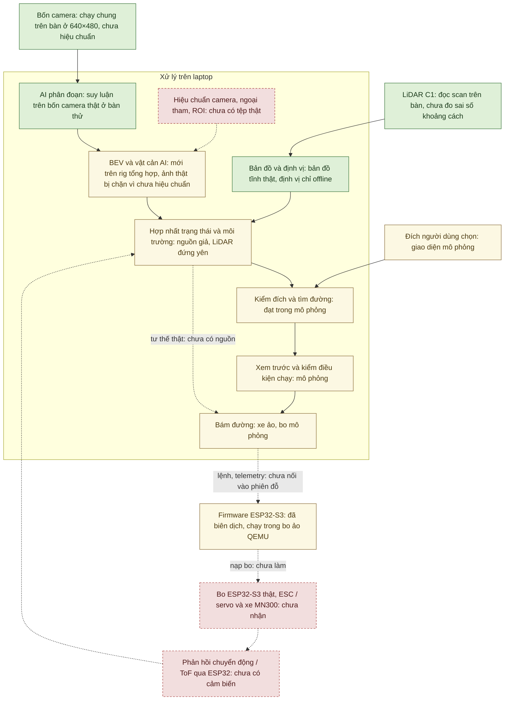
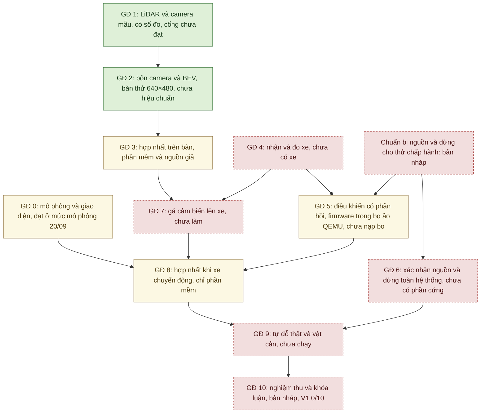
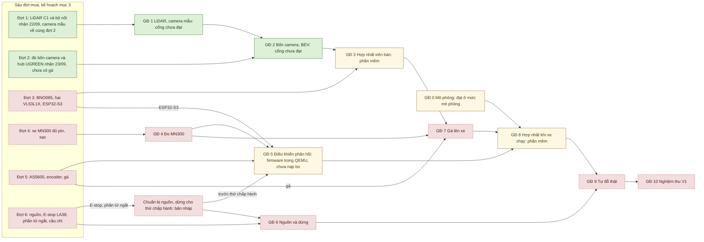
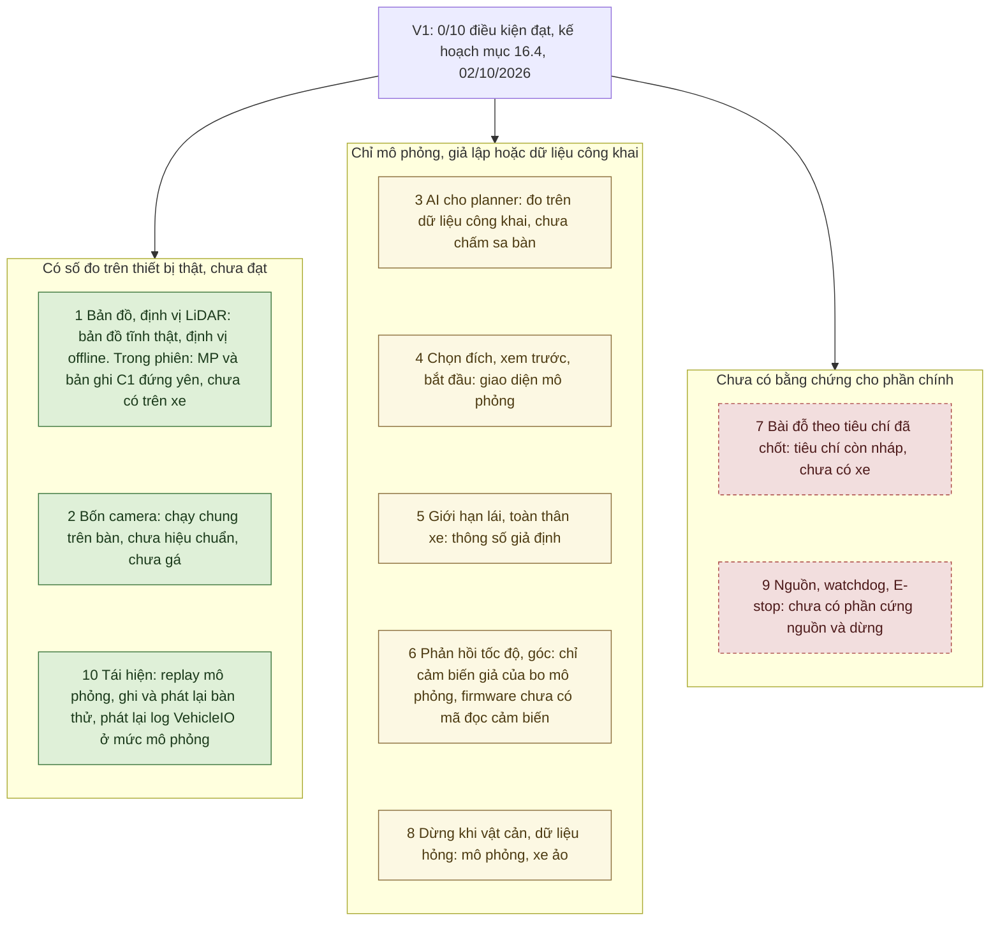

# Kế hoạch triển khai AutoPark — v3.1

**Mục tiêu:** hoàn thành xe mô hình tự đỗ có phản hồi, có kiểm chứng bằng số đo. Triển khai phần mềm và bàn thử trước, rồi tích hợp xe thật.

Biên tập 30/09/2026 theo mã tại `ff4a018` (mã giống `ebbec83`); cập nhật 02/10/2026 ở mục 7, 14, 16.2 và 16.4 cho các công cụ nghiệm thu (commit `d3e1555`). Cấu hình, 11 giai đoạn, sáu đợt mua và các điều kiện chuyển bước giữ như kế hoạch gốc; lần biên tập này chỉ cập nhật trạng thái và dữ kiện, kèm ngày và nguồn. Kế hoạch không chứa phép đo mới: số đo nằm ở [tổng quan](TONG_HOP_DU_AN.md) và các biên bản được dẫn. Bản trước đợt này: <https://github.com/thbn12082/autopark/tree/ff4a018>; bản trước đợt biên tập 26/09/2026: <https://github.com/thbn12082/autopark/tree/9d68257>.

**Hiện trạng 30/09/2026:** giai đoạn 0 đạt ở mức mô phỏng (20/09/2026). Giai đoạn 1–2 đang làm với LiDAR và bốn camera trên bàn thử; cổng chưa đạt. Giai đoạn 3, 5, 8 mới có phần mềm hoặc giả lập; trong đó firmware ESP32-S3 của giai đoạn 5 đã biên dịch (29/09/2026) và chạy trong bo ảo QEMU (30/09/2026), **CHƯA nạp bo**. Giai đoạn 4, 6 là bản nháp; giai đoạn 7, 9 chưa làm; giai đoạn 10 có bản nháp, chưa nghiệm thu. V1 đạt 0/10 điều kiện (mục 16.4). Đã nhận phần chính của đợt mua 1–2 (LiDAR, bốn camera, hub); đợt 3–6 chưa nhận (mục 3).

[Tiến độ và kết quả hiện có](TONG_HOP_DU_AN.md) · [Cách chạy](autopark/README.md) · [Mục lục kỹ thuật](autopark/docs/README.md) · [Sơ đồ hệ thống](autopark/docs/SO_DO_HE_THONG.md)

Nghiên cứu nhận thức sử dụng **[Valeo WoodScape Dataset](https://github.com/valeoai/WoodScape)**. [Quyết định và giới hạn sử dụng](autopark/docs/GIAY_PHEP_DU_LIEU.md).

## 1. Cấu hình và phạm vi

### 1.1. Các thành phần đã chọn

| Thành phần | Vai trò |
|---|---|
| MN300 Tank300 1/12 4WD RTR | Xe nền; bộ điện thực giao cần kiểm |
| Laptop | AI, bản đồ/định vị, hợp nhất, tìm/bám đường, giao diện, log |
| RPLIDAR C1/C1M1 | Scan cho bản đồ, định vị, hình học vật cản |
| Bốn camera USB UVC | Quan sát trước/sau/trái/phải, nhận thức cục bộ |
| Hub và dây USB | Truyền bốn luồng; phải đo tải/nguồn thực |
| Một ESP32-S3 chính | Cảm biến, telemetry, ESC/servo, giám sát mất lệnh |
| AS5600 + nam châm | Phản hồi cơ cấu lái sau khi gá/hiệu chuẩn |
| MT6701 hoặc encoder phù hợp | Tốc độ/quãng đường sau khi xác định tỷ số truyền |
| BNO085 | Hỗ trợ ước lượng hướng/chuyển động |
| Khoảng bốn VL53L1X | Khoảng cách gần; thử hai trước |
| Nguồn, cầu chì, E-stop, phần tử ngắt | Cấp điện và dừng theo thiết kế đã đo |

Chưa tự thay xe bằng HSP, camera bằng ESP32-CAM/Wi-Fi, bỏ LiDAR hoặc thay laptop. USB laptop–ESP32 là phương án thử trên bàn; đường điều khiển khi tích hợp xe chưa chốt.

Theo [kiểm kê](autopark/docs/hardware_inventory.md): đã nhận RPLIDAR C1 kèm bộ chuyển CP2102N (22/09/2026), bốn camera USB và hub UGREEN (23/09/2026). Hồ sơ đến 30/09/2026 ghi chưa nhận MN300, ESP32-S3, BNO085, VL53L1X, AS5600, MT6701/encoder, nguồn, cầu chì, E-stop LA38 và phần tử ngắt.

Máy phát triển chính từ 29/09/2026 là máy bàn Dell Precision 3680 (i9-14900, RTX 4000 Ada 20 GB). Mọi số đo cảm biến, AI và bàn thử đến nay làm trên máy bàn: máy bàn trước đến 25/09/2026, máy bàn hiện tại từ 29/09/2026 ([chuyển máy bàn](autopark/docs/CHUYEN_MAY_BAN.md)). Laptop RTX 3050 Ti là máy trình diễn và nộp đồ án; trên máy này mới chạy mô phỏng giai đoạn 0 (20/09/2026), chưa đo LiDAR, camera hay AI ([máy nộp đồ án](autopark/docs/MAY_NOP_DO_AN.md)).

### 1.2. V1 phải làm gì?

Người dùng đặt vị trí/hướng đỗ. Xe tìm và chạy đường tiến/lùi phù hợp cơ cấu lái, dùng LiDAR và camera để nhận biết môi trường, dừng và đánh giá lại khi có vật cản hoặc dữ liệu không hợp lệ.

Không bắt buộc tự tìm ô, nhận diện vạch, tự lái đến bãi, điều khiển neural end-to-end, MPC nâng cao, dự đoán người hoặc tái dựng 3D.

### 1.3. Nguyên tắc giữ nguyên

Kết quả mô phỏng, bàn thử và xe thật ghi riêng. Ngưỡng chưa đo/chưa duyệt phải để “cần chốt”. Có thể làm phần mềm khi thiếu thiết bị, nhưng chưa được đánh dấu đạt phép thử thật.

Nguồn/dừng phải chuẩn bị trước khi thử chấp hành; giai đoạn 6 xác nhận toàn hệ thống trước chạy tự động trên sàn. Có thể mua sớm chính ESP32-S3 duy nhất ở đợt 3 để đọc cảm biến.

## 2. Luồng hệ thống và cách triển khai

### 2.1. Luồng khi hoàn chỉnh

Sơ đồ dưới là luồng của hệ thống hoàn chỉnh. Màu và phần chữ sau dấu hai chấm cho biết mỗi khối đang ở mức bằng chứng nào ngày 30/09/2026.

Màu ở sơ đồ này: xanh là khối đã chạy với thiết bị thật trên bàn thử (LiDAR C1, bốn camera, AI suy luận trên camera thật, bản đồ tĩnh từ LiDAR thật), chưa phải đạt cổng, chưa chạy trên xe · vàng là khối mới chạy với xe, bo mô phỏng hoặc trong bo ảo QEMU · đỏ viền đứt là chưa làm. Mũi tên đứt: đoạn nối chưa có trong phiên đỗ hôm nay.

Cả sơ đồ là luồng dữ liệu/lệnh của hệ thống hoàn chỉnh. Mũi tên liền là đoạn đã có trong phiên đỗ hôm nay (với xe, bo mô phỏng hoặc thiết bị trên bàn thử), không có nghĩa đã chạy trên xe thật. Hiện chưa có vòng kín nào qua xe thật: tư thế xe trong phiên đỗ lấy từ mô phỏng, và với bo thật lệnh START bị từ chối vì chưa có nguồn tư thế thật ([chế độ quan sát](autopark/docs/CHE_DO_QUAN_SAT.md)). Bo ảo QEMU mới dùng được từ Python qua `SerialVehicleIO` (test và lệnh `qemu_board`), chưa chọn được từ giao diện và chưa nối vào phiên đỗ ([mô phỏng firmware](autopark/docs/MO_PHONG_FIRMWARE.md)). AI camera đã nối vào phiên đỗ làm nguồn vật cản thứ hai (25/09/2026) nhưng chặn mọi lô vì chưa có hiệu chuẩn camera thật ([AI trong vòng điều khiển](autopark/docs/AI_DIEU_KHIEN_XE.md)). Bản tô màu chi tiết theo từng khối: sơ đồ 1.1; kiến trúc theo mô-đun mã: sơ đồ 1.2 trong [Sơ đồ hệ thống](autopark/docs/SO_DO_HE_THONG.md).

Giám sát lỗi chạy cùng vòng điều khiển. E-stop vật lý là đường dừng riêng với giao diện laptop.

### 2.2. Những việc có thể làm đồng thời

Mô phỏng/AI từ dữ liệu sẵn có; kiểm cảm biến/bàn thử; đo xe/điều khiển/nguồn. Ba nhánh gặp nhau ở tích hợp và nghiệm thu. Đợt mua không tương đương giai đoạn phần mềm.

**Các nhánh công việc và điểm tích hợp** (trạng thái 30/09/2026):

Xanh: đã có và đã kiểm/đo · Vàng: chỉ trong mô phỏng/giả lập · Đỏ viền đứt: chưa làm hoặc chưa thử trên thiết bị. GĐ 1–2 tô xanh vì có số đo trên thiết bị thật ở bàn thử; cổng của cả hai chưa đạt. GĐ 0 đạt, nhưng chỉ ở mức mô phỏng.

Sơ đồ chỉ các phụ thuộc chính khi tích hợp. Phần mềm, thiết kế và hồ sơ nghiệm thu có thể chuẩn bị sớm; các bước thử chấp hành vẫn phải có nguồn/dừng phù hợp trước khi thực hiện. Trạng thái chi tiết ở dòng “Hiện tại” của từng giai đoạn (mục 4–14) và mục 17.4.

### 2.3. Cách ghi tiến độ

Mỗi giai đoạn ghi việc đã làm, đầu ra, kết quả đo và thứ còn chặn. “Đang làm” không có nghĩa cổng chuyển bước đã đạt. Dùng log và biên bản để xác nhận; không tự tính phần trăm hoàn thành từ số lượng tệp.

## 3. Sáu đợt mua

| Đợt | Chuẩn bị | Điều kiện trước khi mở rộng | Trạng thái 30/09/2026 |
|---|---|---|---|
| 1 | LiDAR + bộ nối, một camera mẫu, dây ngắn, nguồn bàn thử | Camera dùng được ở vùng gần xe | Đã nhận RPLIDAR C1 kèm bộ chuyển CP2102N (22/09/2026); camera mẫu về cùng đợt 2. Kiểm kê chưa ghi dây ngắn, nguồn bàn thử. Camera chưa thử ở vùng gần xe (chưa gá, chưa hiệu chuẩn) |
| 2 | Thêm ba camera, hub/nguồn/gá | Thử cả bốn đồng thời, rồi mới thêm dây dài | Đã nhận đủ bốn camera USB và hub UGREEN (23/09/2026); các phiên đã ghi đều cấp nguồn hub qua USB, chưa thử adapter; chưa có gá. Đã thử bốn camera đồng thời trên bàn (dùng được ở 640×480); chưa thử dây dài |
| 3 | BNO085, hai ToF, dây; đề xuất mua sớm ESP32-S3 chính | Đối chiếu nguồn/giao tiếp, đọc ổn từng cảm biến | Chưa nhận. Firmware đã biên dịch (29/09/2026), chờ bo để nạp |
| 4 | MN300 đúng gói pin/sạc/phụ kiện | Đo xe để chọn phản hồi/gá và cách điều khiển | Chưa nhận; phiếu kiểm kê và bảng đo đã soạn, chưa điền |
| 5 | AS5600, encoder, gá; thêm ToF nếu cần | Có nguồn/dừng phù hợp trước thử chấp hành; không mua trùng ESP32 | Chưa nhận |
| 6 | Nguồn theo tải, E-stop + phần ngắt, cầu chì/dây/gá cuối | Mất lệnh, dừng, reset, tải đồng thời đạt trước tự đỗ | Chưa nhận; bảng tải và 16 kịch bản lỗi là bản nháp, CHƯA THỬ |

Thực tế đã mua đủ bốn camera trước khi hoàn tất phép thử mẫu. Đây là khác biệt so với trình tự dự kiến, không phải bằng chứng camera mẫu đã đạt. Nguồn của cột trạng thái: [kiểm kê](autopark/docs/hardware_inventory.md), [phiếu MN300](autopark/docs/mn300_inventory.md), [chuẩn bị đo xe](autopark/docs/GIAI_DOAN_4_CHUAN_BI.md), [chuẩn bị nguồn và dừng](autopark/docs/GIAI_DOAN_6_CHUAN_BI.md), [README firmware](autopark/firmware/esp32_vehicle/README.md).

Đợt mua nào mở khóa giai đoạn nào, và vì sao giai đoạn 4–9 đang chờ thiết bị:

Xanh: đã có và đã kiểm/đo · Vàng: chỉ trong mô phỏng/giả lập · Đỏ viền đứt: chưa làm hoặc chưa thử trên thiết bị. Ở sơ đồ này, đợt tô xanh là đã nhận phần chính, đợt tô đỏ là chưa nhận; giai đoạn tô xanh là có số đo trên thiết bị thật, chưa phải đạt cổng; bước chuẩn bị nguồn, dừng tô đỏ vì mới là bản nháp.

Mũi tên từ đợt mua tới giai đoạn là điều kiện cần có thiết bị, không phải việc đã làm. Bước chuẩn bị nguồn, dừng phải xong trước khi thử chấp hành ở giai đoạn 5 (mức thử M2 cần đường dừng phần cứng sẵn sàng và phần tử ngắt đã lắp, [chuẩn bị nguồn và dừng](autopark/docs/GIAI_DOAN_6_CHUAN_BI.md) mục 5.1); giai đoạn 6 xác nhận toàn hệ thống trước chạy tự động trên sàn (mục 1.3), không phải điều kiện trước giai đoạn 5. Lộ trình và các đợt mua cũng có ở sơ đồ 8.1–8.2 trong [Sơ đồ hệ thống](autopark/docs/SO_DO_HE_THONG.md).

## 4. Giai đoạn 0 — mô phỏng

**Hiện tại (30/09/2026):** đạt sáu điều kiện chuyển bước ở mức mô phỏng ngày 20/09/2026 (chạy trên laptop, thông số xe giả định). Ngày 29/09/2026 `phase0` chạy lại trên máy bàn hiện tại (mã `b37e9ee`) cho năm phiên trùng từng giá trị với đợt 20/09, vẫn chỉ là mô phỏng ([tóm tắt kiểm lại](autopark/docs/evidence/chuyen_may_20260929/kiem_may_20260929.md) mục 2.1).

**Làm:** sa bàn, đích, động học, tìm/bám đường, toàn thân/vùng quét, lỗi giả, log/replay. Khi có thiết bị có thể thử từng cảm biến độc lập.

**Đầu ra:** cấu hình giả định ghi rõ, test, log, video và replay. [Báo cáo](BAO_CAO_GIAI_DOAN_0.md).

### Mục tiêu cần đạt / điều kiện chuyển bước

- [x] Kéo và xoay đích được; đích nằm trong vật cản bị từ chối.
- [x] Xe ảo chạy tiến/lùi; đường tuân thủ giới hạn lái đặt trong cấu hình.
- [x] Kiểm tra va chạm xét toàn thân xe.
- [x] Vật cản mới làm đường cũ mất hiệu lực; xe ảo dừng trước khi thử đường mới.
- [x] Xem trước không phát lệnh đến phần cứng.
- [x] Ghi lại đủ cấu hình và log để chạy lại cùng kịch bản.

**Kết quả 20/09/2026:** sáu điều kiện trên đã kiểm chứng ở mức mô phỏng trong `autopark`; xem [báo cáo](BAO_CAO_GIAI_DOAN_0.md), [biên bản và giới hạn](autopark/docs/GIAI_DOAN_0.md), [dataset và kiểm tra nhãn](autopark/datasets/DANH_MUC_DATASET.md). Không diễn giải thành kết quả xe thật.

**Nếu chưa đạt:** sửa dữ liệu/hình học/logic tại mô phỏng. Không cần mua thêm cảm biến để xử lý một lỗi thuần phần mềm.

## 5. Giai đoạn 1 — LiDAR và camera mẫu

**Hiện tại (30/09/2026):** đang làm; [cổng 1 CHƯA ĐẠT](autopark/docs/gate_01.md). Ba kết quả LiDAR: đọc scan **đạt** trên máy bàn (22/09 và 24/09/2026 trên máy bàn trước; 29/09/2026 trên máy bàn hiện tại, COM3, 10,00 Hz, trung vị 508 tia/vòng); tạo map **một phần** (bản đồ lưới tĩnh từ một vị trí); định vị lại **chưa** (công cụ mới chạy offline trên bản ghi, chưa có tham chiếu độc lập). Chưa đo sai số khoảng cách so với thước. Camera đã đo mode, FPS và bốn luồng trên máy bàn; chưa đặt ở độ cao/góc dự kiến, chưa hiệu chuẩn, chưa chấm AI trên ảnh thật. Laptop trình diễn chưa thử. [Thử LiDAR](autopark/docs/GIAI_DOAN_1_LIDAR.md), [thử camera](autopark/docs/GIAI_DOAN_1_CAMERA.md), [định vị](autopark/docs/DINH_VI_LIDAR.md), [kiểm trên máy bàn hiện tại](autopark/docs/CHUYEN_MAY_BAN.md) mục 2.

**Khi chờ đồ:** nguồn phát lại, hợp đồng dữ liệu, khảo sát đầu vào của phương án mapping/định vị.

**Có đồ:** kiểm kê; đo mode/FPS/lỗi; đo khoảng cách LiDAR bằng vật biết vị trí; lưu/nạp map; định vị với tham chiếu độc lập; kiểm camera ở độ cao/góc dự kiến và hiệu chuẩn.

Tách ba kết quả LiDAR: đọc scan, tạo map, định vị lại. Scan tốt chưa chứng minh định vị tốt.

**Đầu ra:** kiểm kê, mode camera, hiệu chuẩn, bản ghi/map, log/video, biên bản cổng. Mã hiện dùng nội tham `calibration/cam_p<cổng>.json`; tên YAML trong kế hoạch cũ là tên dự kiến.

### Mục tiêu cần đạt / điều kiện chuyển bước

- [ ] Laptop nhận LiDAR và camera ổn ở mode đã ghi rõ. *Máy bàn: LiDAR đạt (Standard, 460800 bps); bốn camera qua hub chỉ dùng được ở 640×480. Laptop: chưa thử.*
- [ ] Có dữ liệu và phép thử lưu/nạp bản đồ; phần định vị chưa đạt được báo riêng. *Có phép thử lưu/nạp ở mức bản đồ lưới tĩnh; định vị báo riêng, chưa đạt vì chưa có vị trí tham chiếu đo bằng thước.*
- [ ] Camera đủ nét trong vùng làm việc; hiệu chuẩn được và chạy AI trên ảnh thật. *Mã hiệu chuẩn fisheye mới kiểm trên ảnh tổng hợp; AI chạy trực tiếp trên bốn camera để đo thời gian, chưa đo lỗi vì chưa có ảnh sa bàn có nhãn.*
- [ ] Có số đo, không chỉ nhận xét video “mượt”. *Có tần số, tia/vòng, FPS, khung hỏng, thời gian suy luận; chưa đo sai số khoảng cách LiDAR, độ trễ từ sự kiện thật tới khung ảnh và mọi số trên laptop.*
- [ ] **Chỉ quyết định mua thêm ba camera sau khi mẫu vượt kiểm tra đơn camera.** *Đã mua đủ bốn trước khi thử (mục 3); bài thử đơn camera ngày 23/09/2026 đạt về mode và FPS, chưa đạt về vùng làm việc và hiệu chuẩn.*

**Nếu camera chưa đạt:** thử cấu hình hoặc model khác trước khi nhân số lượng. **Nếu LiDAR đến trước:** làm scan/map và tiếp tục AI với dữ liệu lưu sẵn; không chờ camera.

## 6. Giai đoạn 2 — bốn camera và BEV

**Hiện tại (30/09/2026):** đang làm, cổng chưa đạt. Bàn thử bốn camera + LiDAR + AI chạy trên máy bàn, mặc định 640×480. Lượt kiểm máy bàn hiện tại ngày 29/09/2026 (`do_may_moi.cmd`, mã `9d68257`): 480p + LiDAR + AI trong 120 s được 2.861 bộ ảnh, 0 khung hỏng, 23,85 bộ AI/s; cảnh camera lúc đo không ghi lại. Có ghi và phát lại phiên bàn thử. Còn thiếu hiệu chuẩn nội tham, ngoại tham, ROI và gá thật; BEV mới kiểm trên rig tổng hợp. [Bàn thử](autopark/docs/GIAI_DOAN_2_BAN_THU.md), [BEV](autopark/docs/BEV.md), [ghi/phát lại](autopark/docs/GHI_PHAT_LAI_BAN_THU.md), [kiểm trên máy bàn hiện tại](autopark/docs/CHUYEN_MAY_BAN.md) mục 2.

**Khi chờ:** nguồn phát lại bốn hướng, hàng đợi giới hạn, đo từng khối và kiểm sai lệch thời gian.

**Có đồ:** thử cả bốn với LiDAR + AI; ghi USB/nguồn/cách gán hướng; đo nội/ngoại tham; dựng ROI; đặt vật có tọa độ biết trước để chấm BEV và vùng che khuất. Thử A/B dây ngắn–dài.

720p30 MJPEG là mục tiêu khảo sát ban đầu; mặc định triển khai hiện là **640×480** vì các phiên 720p có khung cắt. Cùng FPS không chứng minh ảnh chụp đồng thời.

**Đầu ra:** gá, bộ hiệu chuẩn, USB topology, log, vùng quan sát, sai số BEV. Không chiếu toàn bộ vật cao xuống sàn rồi coi đó là footprint đúng.

### Mục tiêu cần đạt / điều kiện chuyển bước

- [ ] Bốn camera chạy đồng thời ở mode đã thống nhất; có báo cáo tải và mất hình. *Có số đo ở 640×480 trên máy bàn; ở 720p khung MJPEG bị cắt khi bốn camera chạy chung; 480p cũng từng có đợt khung hỏng chưa rõ nguyên nhân. Chưa đo trên laptop.*
- [ ] Đọc đúng camera theo đúng hướng sau khi khởi động lại. *Máy bàn trước (23/09/2026): sau khởi động lại, định danh theo cổng hub giữ nguyên, chỉ số OpenCV đổi, nên chọn camera theo cổng. Máy bàn hiện tại chưa khởi động lại để kiểm (N-C5). Camera chưa gá.*
- [ ] Có bộ hiệu chuẩn đa camera gắn với gá thực. *Chưa có tệp nội tham nào; ngoại tham `v0` là giả định.*
- [ ] Vật mẫu xuất hiện tại vị trí có thể đối chiếu trên BEV, không chỉ hiện một ô màu bất kỳ. *Chưa: BEV chưa chạy trên camera dự án.*
- [ ] Vùng chưa quan sát/thiếu tin cậy được giữ là `UNKNOWN`, không mặc định `FREE`. *Có trong mã BEV và hợp nhất, kiểm trên rig tổng hợp; chưa kiểm với camera thật.*
- [ ] Có thử riêng dây kéo dài trước khi đưa vào vận hành xe. *Chưa; kiểm kê chưa ghi loại và chiều dài dây camera.*

**Nếu chưa đạt:** quay về bài thử cổng/nguồn/mode từng bước. Không mặc định đổi hub đắt hơn sẽ giải quyết mọi vấn đề; ghi nguyên nhân và bằng chứng trước khi mua lại.

## 7. Giai đoạn 3 — hợp nhất trên bàn

**Hiện tại (30/09/2026):** mới có phần mềm, kiểm bằng nguồn giả; chờ IMU, ToF và ESP32-S3 (đợt 3). Có các lớp bản đồ (`fusion/layers.py`), quy tắc hợp nhất (`fusion/fuse.py`) và cầu nối vào phiên đỗ (`fusion/bridge.py`). Đầu vào thật duy nhất đang tạo vật cản là LiDAR C1 đứng yên trên bàn: xe ảo lập đường quanh đồ vật thật và đỗ xong (22/09/2026); chưa thử đưa vật vào đường khi xe ảo đang chạy. AI camera cũng đã nối vào phiên đỗ làm nguồn vật cản thứ hai (`fusion/camera_ai.py`, `b01dea4`, 25/09/2026), nhưng chưa camera nào được hiệu chuẩn nên mọi lô bị chặn, không tạo vật cản nào; mới kiểm bằng nguồn giả, rig tổng hợp và phát lại bản ghi thật, chưa thử với camera đang chạy ([AI trong vòng điều khiển](autopark/docs/AI_DIEU_KHIEN_XE.md)). Cầu nối ToF → `NearFieldReading` mới thử với telemetry của bo mô phỏng qua cổng serial giả; chưa có số đo IMU hay ToF thật nào. [Chuẩn bị hợp nhất](autopark/docs/GIAI_DOAN_3_CHUAN_BI.md).

**Khi chờ:** telemetry giả, thời hạn dữ liệu, đổi hệ tọa độ và logic vật mới → dừng → đánh giá lại.

**Có đồ:** đọc từng cảm biến qua ESP32; đo dấu/trục IMU; thử ToF với vật liệu/khoảng cách/timeout; chuyển về hệ rig; đối chiếu vật biết vị trí. Chưa nối chấp hành ở bước kiểm đọc cảm biến.

**Đầu ra:** firmware cảm biến, dây, telemetry có timestamp/cờ hợp lệ, log đồng bộ, map/BEV và bài thử vật cản.

### Mục tiêu cần đạt / điều kiện chuyển bước

- [ ] IMU/ToF thật được đọc qua một đường giao tiếp đã xác định. *Chưa có thiết bị; firmware chưa có mã đọc cảm biến.*
- [ ] Mỗi số đo có thời gian và trạng thái; lỗi sensor không bị biến thành giá trị khoảng cách “an toàn”. *Có trong giao thức và phần mềm (số đo không hợp lệ gửi 0 kèm cờ hợp lệ 0), mới kiểm bằng nguồn giả.*
- [ ] Global map và local BEV đặt được vào cùng phép mô tả tọa độ. *Có phép biến đổi và test với vị trí biết trước; chưa có BEV từ camera thật.*
- [ ] Vật mới làm đường mất hiệu lực; phần mềm phát dừng và phân biệt đường bị chắn với chính đích bị chiếm. *Hủy đường và dừng có trong mô phỏng và với nguồn quét kịch bản; chưa thử với vật thật đặt vào đường khi xe ảo đang chạy.*
- [ ] Có log cho `STOP → quan sát lại → cập nhật → replan/chờ`. *Chuỗi trạng thái có trong mô phỏng (`MAP_CHANGED`, `WAIT_REPLAN`). Từ 02/10/2026 mỗi quyết định dừng của phiên chạy qua `VehicleIO` thành một dòng `session_stop` của `events.csv` (công cụ T13 của [kịch bản nghiệm thu](autopark/docs/KICH_BAN_NGHIEM_THU.md) mục 7), mới kiểm với bo mô phỏng và cổng serial giả; chưa thử với cảm biến thật.*

**Giới hạn bằng chứng:** giai đoạn này chứng minh nhận thức và logic; chưa chứng minh quãng đường dừng hoặc độ chính xác đỗ thật.

## 8. Giai đoạn 4 — nhận và đo MN300

**Hiện tại (30/09/2026):** chờ xe (đợt 4). Phần “khi chờ” đã làm: [phiếu kiểm kê MN300](autopark/docs/mn300_inventory.md) và bảng đo B0–B8 đã soạn, mọi ô CHƯA ĐO; công cụ `evaluation/sensitivity.py` và hai lượt thử độ nhạy planner theo kích thước giả định (chỉ mô phỏng, 24/09/2026, [độ nhạy kích thước xe](autopark/docs/DO_NHAY_KICH_THUOC_XE.md)). Chưa nhận, chưa đo xe; `configs/vehicle_default.json` là giả định, không phải thông số MN300.

**Khi chờ:** chuẩn bị phiếu B0–B8 và kiểm độ nhạy planner với kích thước giả định.

**Có xe:** kiểm gói thực giao, cơ khí/bộ điện; đo thân xe, chiều dài cơ sở, góc lái, bán kính quay, tốc độ thấp, đặc tính phanh/lùi và vị trí gá. Xác định quan hệ góc cảm biến với góc bánh.

**Đầu ra:** ảnh kiểm kê, số đo và cấu hình xe có nguồn gốc. [Hướng dẫn đo](autopark/docs/GIAI_DOAN_4_CHUAN_BI.md).

### Mục tiêu cần đạt / điều kiện chuyển bước

- [ ] Hiểu được hoạt động xe nguyên bản và có dữ liệu chạy chậm, không chỉ biết tốc độ quảng cáo.
- [ ] Có kích thước thực dùng cho planner.
- [ ] Có phương án can thiệp ESC/servo được xác minh hoặc danh sách thông tin còn thiếu rõ ràng.
- [ ] Xác định được phương án gá encoder/góc lái đủ cơ sở để đặt linh kiện.
- [ ] Nếu phải đổi một cụm điện/cơ khí, quyết định dựa trên phép thử, không mua thay đồng loạt.

**Nếu chưa đạt:** tiếp tục hoàn thiện phần mềm trên rig; không đẩy lỗi xe chạy giật sang việc đổi thuật toán AI.

## 9. Giai đoạn 5 — ESP32 và điều khiển có phản hồi

**Hiện tại (30/09/2026):** có phần mềm và giả lập, chờ bo ESP32-S3 (đợt 3) và xe (đợt 4). **CHƯA NẠP, CHƯA CHẠY trên bo nào.** Đã xong:

- giao thức, bo mô phỏng (`FirmwareModel`) và `VehicleIO` có test; phiên đỗ xe chạy qua `VehicleIO` với bo mô phỏng ([giao thức](autopark/docs/GIAO_THUC_XE.md), [chế độ quan sát](autopark/docs/CHE_DO_QUAN_SAT.md));
- lõi C++ `src/core` biên dịch và khớp bản Python qua test host: 703 check, 0 lệch (29/09/2026, máy bàn, g++ 16.1.0, cmake 4.4.1; [bằng chứng](autopark/docs/evidence/chuyen_may_20260929/firmware_host_20260929.txt));
- cả firmware biên dịch cho ESP32-S3 bằng PlatformIO (`pio run -e esp32s3`, espressif32 7.1.3 = Arduino-ESP32 2.0.17): 0 lỗi, 0 cảnh báo (29/09/2026; [bằng chứng](autopark/docs/evidence/chuyen_may_20260929/firmware_esp32_20260929.txt));
- firmware thật chạy trong bo ảo QEMU (env `esp32s3_qemu`, `Serial` qua UART0), laptop nói chuyện bằng đúng `SerialVehicleIO`; `tests/test_firmware_qemu.py` (13 test, 6 trong đó chạy firmware thật trong QEMU) đạt cả 10/10 lượt chạy lặp trên commit `ebbec83` (30/09/2026; [mô phỏng firmware](autopark/docs/MO_PHONG_FIRMWARE.md)).

Bo ảo không có PWM/LEDC, GPIO vào (E-stop), I2C, USB-CDC thật và không cho watchdog phần cứng (task watchdog) kích hoạt, nên không thay được đo trên bo. Firmware chưa có mã đọc cảm biến (encoder, AS5600, BNO085, VL53L1X, điện áp nguồn); giao diện chưa chọn được bo ảo. [README firmware](autopark/firmware/esp32_vehicle/README.md).

**Khi chờ:** đặc tả giao thức, bo giả, test vector, kiểm trạng thái kết nối và lệnh hết hạn; biên dịch/test host khi có toolchain. Các việc này đã làm: toolchain có trên máy bàn từ 29/09/2026, bo ảo QEMU từ 30/09/2026. Còn thiếu bo để nạp và đo.

**Có đồ:** đo tín hiệu/giới hạn ESC–servo; đọc encoder/góc lái; kiểm hướng và điều khiển phản hồi; thử mất lệnh/reset. Chỉ thử chấp hành khi phần nguồn/dừng của bước thử đã sẵn sàng.

**Đầu ra:** firmware đã biên dịch/nạp, hiệu chuẩn, log đáp ứng và giao thức khớp laptop. START trên xe cần nguồn tư thế thật; quan sát không gửi lệnh chạy.

### Mục tiêu cần đạt / điều kiện chuyển bước

- [ ] Nhận lệnh đúng đơn vị và chỉ chạy khi được cho phép. *Đã kiểm ở bản Python, test host và bo ảo QEMU (ARM rồi COMMAND có enable → RUNNING; COMMAND khi DISARMED bị từ chối BAD_STATE); trên bo: CHƯA THỬ.*
- [ ] Đo được tốc độ/góc lái; đã kiểm tra dấu và hệ số quy đổi. *Chưa có encoder, AS5600; firmware chưa có mã đọc.*
- [ ] Có số đo sai số bám tốc độ/góc ở miền thử nghiệm. *Chưa (cần xe và phản hồi).*
- [ ] Đổi tiến/lùi theo trình tự đã kiểm chứng trên bộ điện thực. *Chưa có ESC thật (chưa nhận xe).*
- [ ] Mất lệnh/reset làm hệ thống về trạng thái đã thiết kế; reconnect không tự chạy tiếp. *Hết hạn lệnh, laptop im và reset chip đã kiểm trong bo ảo QEMU (30/09/2026); trên bo: CHƯA THỬ.*

**Nếu chưa đạt:** phân biệt lỗi đo, cơ khí, nguồn và bộ điều khiển; không tăng gain tùy tiện để bù một encoder lắp sai hoặc tín hiệu không hợp lệ.

## 10. Giai đoạn 6 — nguồn và dừng

**Hiện tại (30/09/2026):** chờ thiết bị (đợt 6). Có bản nháp ngày 24/09/2026: bảng tải, sơ đồ cấp điện và đường dừng, bảng định mức cần kiểm, 16 kịch bản lỗi L1–L16 với các mức thử R, M0–M3; mọi kịch bản CHƯA THỬ. Chưa có phần cứng nguồn hay dừng nào; chưa đo điện áp hay dòng của thiết bị nào. Tác dụng của `output_guard`, móc panic, task watchdog khi kích hoạt và ngõ vào E-stop thật của firmware chưa được kiểm ở đâu (bo ảo QEMU không có LEDC, GPIO vào và không cho watchdog phần cứng kích hoạt). Chỉ phần logic đã kiểm trên máy tính: watchdog liên lạc 500 ms (`LINK_TIMEOUT`) và hết hạn lệnh ở bản Python, test host và bo ảo QEMU; logic chốt E-stop (vector `estop_latch`) ở bản Python và test host (mục 16.4).

**Khi chờ:** bảng tải, sơ đồ cấp điện/đường dừng, định mức cần kiểm, kịch bản lỗi.

**Có đồ:** đo từng nhánh và tải chung; kiểm sụt áp/reset/nhiệt; dừng phần mềm, mất lệnh, E-stop và reconnect. Xác định phần tử ngắt động lực; nút E-stop và cờ FAULT không tự chứng minh xe đã dừng.

**Đầu ra:** bảng đo, sơ đồ hoàn công, kịch bản lỗi có log. [Hướng dẫn nguồn/dừng](autopark/docs/GIAI_DOAN_6_CHUAN_BI.md).

### Mục tiêu cần đạt / điều kiện chuyển bước

- [ ] Có sơ đồ cấp điện và ngắt động lực khớp thiết bị thực.
- [ ] Không reset/disconnect ngoài dự kiến trong bộ thử tải đã định.
- [ ] Các đường dừng đã thử, không chỉ tồn tại trên sơ đồ.
- [ ] Đo được khoảng dừng trong điều kiện thử; không coi cắt nguồn là đứng yên tức thì.
- [ ] Phần nguồn/dừng được xác nhận trước tự đỗ thật.

## 11. Giai đoạn 7 — gá cảm biến lên xe

**Hiện tại (30/09/2026):** chưa làm; chờ xe (đợt 4) và số đo xe (giai đoạn 4). Phương án gá mới ở mức khái niệm ([chuẩn bị đo xe](autopark/docs/GIAI_DOAN_4_CHUAN_BI.md) mục 6). Ngoại tham camera trong `configs/rig/camera_rig_extrinsics_v0.json` là giả định; công cụ đo ngoại tham và dựng ROI đã có nhưng mới kiểm trên ảnh tổng hợp ([ngoại tham và ROI](autopark/docs/NGOAI_THAM_VA_ROI.md)).

**Khi chờ:** thiết kế sơ bộ và quy ước tọa độ từ số đo xe.

**Có đồ:** gá cứng, giữ vùng nhìn, quản lý dây, đo lại ngoại tham/ROI và các vùng mù, kiểm khi rung/chuyển động.

**Đầu ra:** bản vẽ/ảnh gá, hệ tọa độ, bộ hiệu chuẩn trên xe và log kiểm.

### Mục tiêu cần đạt / điều kiện chuyển bước

- [ ] Sensor và dây không cản chuyển động.
- [ ] Vùng bị che đã được ghi lại; không tự khẳng định bốn camera phủ kín mọi điểm quanh xe.
- [ ] Bộ hiệu chuẩn đúng phiên bản gá và mode ảnh.
- [ ] Sai lệch khi xe chuyển động nằm trong giới hạn đã chọn cho bước tích hợp.

## 12. Giai đoạn 8 — hợp nhất khi xe chuyển động

**Hiện tại (30/09/2026):** mới có phần mềm chuẩn bị, chưa kiểm trên xe. Tư thế xe trong phiên đỗ lấy từ mô phỏng; với bo thật, START bị từ chối (`START_NO_POSE_SOURCE`) vì chưa có nguồn tư thế thật. Định vị LiDAR trên bản đồ tĩnh và odometry khớp scan mới chạy offline trên bản ghi C1 đứng yên, chưa có tham chiếu độc lập, chưa nối vào phiên ([định vị](autopark/docs/DINH_VI_LIDAR.md); [so sánh phương án](autopark/docs/SO_SANH_DINH_VI_SLAM.md), ĐỀ XUẤT – CHỜ CHỐT).

**Khi chờ:** phát lại có trễ/mất dữ liệu, kiểm đổi hệ tọa độ và phản ứng khi các lớp mâu thuẫn.

**Có xe:** đồng bộ thời gian, ước lượng tư thế, chuyển dữ liệu về đúng thời điểm/hệ tọa độ, đo sai số bằng tham chiếu độc lập, kiểm khi tiến/lùi/quay.

**Đầu ra:** pose/map/BEV/log trên xe chuyển động, sai số và giới hạn công bố.

### Mục tiêu cần đạt / điều kiện chuyển bước

- [ ] Vật mẫu có vị trí hợp lý trên map khi xe đổi tư thế.
- [ ] Phát hiện được mâu thuẫn giữa cảm biến hoặc mất độ tin cậy.
- [ ] Dữ liệu cần thiết bị cũ/mất thì không cho tiếp tục mù.
- [ ] Planner nhận môi trường hiện hành và kết quả cũ bị loại đúng.
- [ ] Có đánh giá định vị/BEV bằng tham chiếu độc lập, không dùng cùng một đầu ra tự xác nhận chính nó.

## 13. Giai đoạn 9 — tự đỗ và vật cản

**Hiện tại (30/09/2026):** chưa chạy thật (chưa có xe, bo và nguồn tư thế thật). Phần “khi chờ” đã có ở mức mô phỏng: chế độ quan sát (`OBSERVE`: phần mềm tính đường và lệnh, không gửi COMMAND nào, bo giữ DISARMED) và kiểm trạng thái trước START, mới chạy với bo mô phỏng và cổng serial giả ([chế độ quan sát](autopark/docs/CHE_DO_QUAN_SAT.md)). Các bài thử nằm trong [kịch bản nghiệm thu nháp](autopark/docs/KICH_BAN_NGHIEM_THU.md), CHƯA THỬ. Chưa có cấu hình xe đo được để dùng trong mô phỏng.

**Khi chờ:** dùng cấu hình xe đo được trong mô phỏng; chuẩn bị chế độ quan sát và bài thử.

**Có đủ điều kiện:** quan sát trước; kiểm trạng thái đầu, xem trước; thử đỗ ở phạm vi/tốc độ đã xác nhận, rồi thử vật cản trước/sau/hông/chiếm đích.

Luồng phản ứng: **phát hiện → vô hiệu đường → dừng → quan sát/cập nhật → lập lại đường hoặc giữ dừng**. V1 không cần tự lách liên tục qua vật đang chuyển động.

**Đầu ra:** video đồng bộ log, sai số cuối, khoảng hở, số đổi chiều, lý do thất bại.

### Mục tiêu cần đạt / điều kiện chuyển bước

- [ ] Tự đỗ từ nhiều tư thế xuất phát trong phạm vi đã định, không chỉ phát chuỗi lệnh theo thời gian.
- [ ] Có kết quả đỗ vuông góc và song song; mọi thất bại đều được ghi.
- [ ] Kiểm tra cả sai số cuối vị trí, hướng và khoảng hở.
- [ ] Vật cản chắn đường hoặc chiếm đích tạo hành vi khác nhau đúng thiết kế.
- [ ] Không có đường phù hợp thì giữ dừng, không ép planner phải trả một đường bất kỳ.

## 14. Giai đoạn 10 — đánh giá và khóa luận

**Hiện tại (30/09/2026):** có [dàn ý khóa luận](autopark/docs/DAN_Y_KHOA_LUAN.md) (đề xuất, chưa phải khóa luận), kết quả từng khối, [37 kịch bản nghiệm thu nháp](autopark/docs/KICH_BAN_NGHIEM_THU.md) trong 9 nhóm (mọi kịch bản CHƯA THỬ) và [ngưỡng đề xuất](autopark/docs/NGUONG_NGHIEM_THU_DE_XUAT.md) (mọi ngưỡng ĐỀ XUẤT – CHỜ CHỐT). Chưa nghiệm thu; V1 đạt 0/10 điều kiện (mục 16.4). Chưa biết mẫu của trường, kiểu trích dẫn, giới hạn trang và quy định khai báo công cụ AI. Ngày 02/10/2026 có thêm phần lớn công cụ phần mềm cho nghiệm thu ([kịch bản nghiệm thu](autopark/docs/KICH_BAN_NGHIEM_THU.md) mục 7): chấm một lần chạy (T5), tiêm lỗi có kiểm soát ở mức mô phỏng (T6), phát lại log lần chạy qua `VehicleIO` (T9), khoảng hở cuối phiên của camera (T10), camera ngoài hub (T11), giới hạn số lần đổi chiều (T12), ghi sự kiện dừng (T13), dấu đồng bộ video–log (T14), nút CLEAR_FAULT (T15); tất cả mới kiểm bằng test và mô phỏng. Còn thiếu nguồn tư thế thật (T2), ghi cảm biến trong phiên đỗ (T3), công cụ tham chiếu trên cao (T4, mới có định dạng tệp tư thế) và LED trên bo (T7); mã đọc cảm biến trong firmware (T8) vẫn chưa có, mới có cầu nối phía laptop.

**Khi chờ:** chốt cách chấm, tập ảnh sa bàn độc lập, mẫu báo cáo và cách ghi thất bại.

**Khi tích hợp xong:** thực hiện bộ bài đã chốt, so cấu hình, lưu cả lỗi, viết rõ vùng làm việc và giới hạn.

**Đầu ra:** báo cáo, dữ liệu/cấu hình tái hiện, video, hướng dẫn bàn giao.

### Mục tiêu cần đạt

- [ ] Có chỉ số định lượng và định nghĩa cách đo. *Có bản nháp ngưỡng N-… và cách đo, chưa duyệt; nhóm điều khiển N-K1…N-K4 còn ghi CHƯA ĐỀ XUẤT.*
- [ ] Có tham chiếu độc lập cho sai số vị trí/hướng/khoảng cách. *Chưa: bảy phương pháp đo độc lập R1–R7 mới là bản nháp; chưa có camera trên cao (R1), phép kiểm tham chiếu TC-1 chưa làm.*
- [ ] Không chỉ chọn các lần demo thành công.
- [ ] Phân biệt bài toán đã giải quyết với phần chưa đạt hoặc ngoài phạm vi.
- [ ] Người khác đọc hướng dẫn có thể tái lập một phiên thử trong điều kiện đã nêu.

## 15. Khi thiếu linh kiện

| Thiếu | Vẫn làm được |
|---|---|
| Camera | AI trên dữ liệu lưu sẵn, nguồn phát lại, LiDAR |
| LiDAR | Camera, hiệu chuẩn, nhãn, mô phỏng |
| IMU/ToF/ESP32 | Hợp đồng telemetry, nguồn giả, test logic; test host lõi C++ và bo ảo QEMU chạy firmware thật (đã có từ 29–30/09/2026; bo ảo không có PWM, GPIO vào, cảm biến) |
| MN300 | Bàn thử, bảng đo, độ nhạy cấu hình |
| Nguồn/gá cuối | Thiết kế, test host, mô phỏng; chưa nghiệm thu chấp hành/xe |

Không thay phép thử phần cứng bằng kết quả mô phỏng để đánh dấu đạt cổng. Kết quả trong bo ảo QEMU cũng là giả lập, không thay phép thử trên bo.

## 16. Đo lường và hoàn thành V1

### 16.1. Mốc khảo sát ban đầu

720p30 MJPEG là mode dự kiến khảo sát; hiện bốn camera mặc định 480p. Phiên khoảng 30 phút là bước sàng lọc dài hạn được đề xuất (kịch bản LD-1, CHƯA THỬ). Miền tốc độ 0,05–0,15 m/s là miền cần khảo sát, không phải tốc độ đã nghiệm thu.

### 16.2. Ngưỡng cần chốt

| Nhóm | Đại lượng |
|---|---|
| Camera | FPS, độ trễ p50/p95, khoảng đứng hình, lệch thời gian |
| Hình học | Sai số BEV, lệch giữa camera, vùng dùng được |
| AI | mIoU/precision/recall, vật cản bị gọi FREE, UNKNOWN |
| Định vị | Sai số vị trí/hướng, ổn định, định vị lại |
| Điều khiển | Sai số tốc độ/góc, đổi chiều, trễ, quãng dừng |
| Tự đỗ | Sai số cuối, khoảng hở, tỷ lệ hoàn thành, thời gian, số đổi chiều |
| Lỗi | Thời điểm phát hiện/phát lệnh/dừng thực, reconnect |

[Bảng ngưỡng đề xuất](autopark/docs/NGUONG_NGHIEM_THU_DE_XUAT.md) chưa phải ngưỡng đã được duyệt: tính đến 02/10/2026 mọi ngưỡng N-… là ĐỀ XUẤT – CHỜ CHỐT, riêng N-K1…N-K4 (điều khiển) còn CHƯA ĐỀ XUẤT số. Từ 02/10/2026 công cụ chấm một lần chạy (T5) dùng bản sao của các ngưỡng này ở `autopark/configs/nguong_nghiem_thu.json`, cùng trạng thái; chốt ngưỡng thì sửa cả hai. UNKNOWN gồm vùng chưa quan sát/không hợp lệ/che khuất/thiếu tin cậy; thêm tên lớp không tự bảo đảm nhận ra vật lạ.

### 16.3. Bộ kịch bản

[Bản nháp nghiệm thu](autopark/docs/KICH_BAN_NGHIEM_THU.md) có 37 kịch bản trong chín nhóm, gồm đỗ cơ sở, nhận thức, vật cản mới, lỗi cảm biến/liên lạc và nguồn/dừng. Tính đến 30/09/2026 chưa kịch bản nào thử ở mức nghiệm thu; vài kịch bản làm được ngay trên bàn thử (DV-1, DV-2, LD-1; TC-1 khi có camera trên cao).

Cần ghi vùng làm việc, ánh sáng, vật thử, tốc độ và khoảng phát hiện; không cam kết phát hiện mọi vật trong mọi điều kiện.

### 16.4. Mười điều kiện hoàn thành

- [ ] Bản đồ/định vị LiDAR hoạt động trong khu vực thử đã định.
- [ ] Bốn camera USB cùng hoạt động và có hiệu chuẩn đúng gá.
- [ ] AI/CV cung cấp thông tin cục bộ cho planner, có đo sai số/nhầm lẫn.
- [ ] Người dùng chọn vị trí/hướng, xem trước và ra lệnh bắt đầu được.
- [ ] Quỹ đạo xét giới hạn lái và toàn thân xe.
- [ ] Xe thực thi có phản hồi tốc độ/góc, không chỉ chạy theo thời gian.
- [ ] Hoàn thành các bài đỗ theo tiêu chí đã chốt.
- [ ] Vật cản/dữ liệu không hợp lệ làm dừng hoặc từ chối chạy đúng thiết kế.
- [ ] Nguồn, watchdog và E-stop đã kiểm chứng.
- [ ] Có dữ liệu, cấu hình và hướng dẫn để tái hiện kết quả.

Tính đến 30/09/2026, V1 đạt 0/10 điều kiện. Sơ đồ dưới xếp mỗi điều kiện theo mức bằng chứng cao nhất hiện có cho phần chính của điều kiện, để không đọc kết quả mô phỏng thành kết quả xe:

Màu ở sơ đồ này theo tên nhóm: xanh là có số đo trên thiết bị thật nhưng chưa đạt · vàng là chỉ mô phỏng, giả lập hoặc dữ liệu công khai · đỏ viền đứt là chưa có bằng chứng cho phần chính của điều kiện. Điều kiện 3 xếp nhóm vàng vì sai số AI mới đo trên dữ liệu công khai; AI camera đã nối vào phiên đỗ nhưng chặn mọi lô vì chưa có hiệu chuẩn camera thật. Điều kiện 6 xếp nhóm vàng chỉ nhờ cảm biến giả của bo mô phỏng; bo ảo QEMU không có phản hồi tốc độ, góc: firmware chưa có mã đọc cảm biến nên telemetry báo không có số đo và vòng tốc độ chạy hở. Điều kiện 10 vẫn chưa đạt: phát lại log của lần chạy qua `VehicleIO` (T9, 02/10/2026) mới ở mức mô phỏng và chỉ tái hiện quyết định của phần mềm, không tái hiện xe; còn thiếu manifest GD1 của từng lần chạy và hướng dẫn tái hiện.

Điều kiện 9: watchdog liên lạc (bo ở ARMED/RUNNING mà 500 ms không nhận thông điệp hợp lệ thì về DISARMED, `LINK_TIMEOUT`) đã kiểm trong bản tham chiếu Python, test host lõi C++ và bo ảo QEMU; logic chốt E-stop (vector `estop_latch`) đã kiểm ở bản Python và test host. Task watchdog kích hoạt, `output_guard`, móc panic và ngõ vào E-stop thật chưa được kiểm ở đâu; chưa có phần cứng nguồn và dừng. Căn cứ: bảng 4.12 của [dàn ý khóa luận](autopark/docs/DAN_Y_KHOA_LUAN.md), sơ đồ dừng và bảng các đường dừng (mục 3, 3.1) của [chuẩn bị nguồn và dừng](autopark/docs/GIAI_DOAN_6_CHUAN_BI.md), [mô phỏng firmware](autopark/docs/MO_PHONG_FIRMWARE.md). Ngưỡng đề xuất và kịch bản (CHƯA THỬ) của từng điều kiện: mục 11.2 của [ngưỡng đề xuất](autopark/docs/NGUONG_NGHIEM_THU_DE_XUAT.md).

## 17. Bàn giao và bước tiếp theo

### 17.1. Hồ sơ cần giữ

Mã/commit, môi trường, cấu hình xe, hiệu chuẩn, nguồn dữ liệu/giấy phép, log/video đồng bộ, phép đo độc lập, kết quả cả đạt lẫn thất bại. Dataset, checkpoint và `runs/` cần bàn giao riêng vì không trong Git. Việc sao lưu `runs/`, checkpoint và dataset ra ngoài ổ D còn mở ([dàn ý khóa luận](autopark/docs/DAN_Y_KHOA_LUAN.md) mục 7, việc 3; [máy nộp đồ án](autopark/docs/MAY_NOP_DO_AN.md) mục 1).

### 17.2. Các lựa chọn còn mở

Nguồn tư thế thật; gá/encoder/nguồn/E-stop; đường điều khiển laptop–bo; loại bo ESP32-S3 và chân ESC/servo/E-stop trong firmware; ngưỡng nghiệm thu; chốt firmware sau `COMMAND_TIMEOUT` (đề xuất, CHƯA LÀM); sức khỏe ToF; xe tự tiếp tục hay chờ xác nhận sau vật cản thông thường; chính sách AI bắt buộc và nhãn nháp AI; máy chạy khi nghiệm thu, camera trên cao và nơi lưu biên bản. Đọc [tổng quan](TONG_HOP_DU_AN.md) và tài liệu chuyên đề ([README firmware](autopark/firmware/esp32_vehicle/README.md) mục “CHƯA CHỐT theo bo thực”, [kịch bản nghiệm thu](autopark/docs/KICH_BAN_NGHIEM_THU.md) mục 8) trước khi thay.

### 17.3. Năm việc làm tiếp

Việc 1–4 làm được với thiết bị hiện có và chưa làm tính đến 30/09/2026; việc 5 cần thiết bị mới.

1. Hiệu chuẩn camera, ngoại tham và ROI.
2. Đo sai số LiDAR/BEV bằng vị trí tham chiếu.
3. Thu và gán nhãn tập sa bàn độc lập.
4. Đo bàn thử trên laptop trình diễn.
5. Khi có ESP32-S3 (đợt 3): nạp firmware đã biên dịch (29/09/2026; đã chạy trong bo ảo QEMU 30/09/2026) và làm trình tự thử trên bo từ mức M0, chỉ cắm USB, PWM tắt ([README firmware](autopark/firmware/esp32_vehicle/README.md) mục “Trình tự thử trên bo”, [mức thử](autopark/docs/GIAI_DOAN_6_CHUAN_BI.md) mục 5.1). Nhận và đo xe (đợt 4) để mở các bước tích hợp.

### 17.4. Trạng thái chuyển bước

Tính đến 30/09/2026: giai đoạn 0 đạt ở mức mô phỏng (20/09/2026). Giai đoạn 1 chưa đạt theo [biên bản cổng 1](autopark/docs/gate_01.md); giai đoạn 2–10 chưa có cổng đạt. V1 đạt 0/10 điều kiện ở mục 16.4.

- Đạt ở mức mô phỏng: GĐ 0.
- Đang làm với thiết bị hiện có, cổng chưa đạt: GĐ 1, GĐ 2; GĐ 10 ở phần tài liệu, kịch bản và ngưỡng.
- Có phần mềm hoặc giả lập, chờ thiết bị: GĐ 3, GĐ 5 (firmware đã biên dịch, chạy trong bo ảo QEMU, chưa nạp bo), GĐ 8.
- Chờ thiết bị, mới có bản nháp: GĐ 4, GĐ 6.
- Chưa làm trên thiết bị: GĐ 7; GĐ 9 (mới có chế độ quan sát và kiểm trước START trong mô phỏng).

[Bảng tiến độ từng giai đoạn](TONG_HOP_DU_AN.md) là nơi đọc số đo và kết quả; sơ đồ 8.1 trong [Sơ đồ hệ thống](autopark/docs/SO_DO_HE_THONG.md) vẽ cùng trạng thái. Không lặp nhật ký commit trong từng dòng kế hoạch.

## 18. Nguồn mua đã được cung cấp

Các liên kết dưới giữ từ kế hoạch gốc để đối chiếu. Lần biên tập này không kiểm giá, tồn kho, biến thể hoặc tính tương thích; không chốt lại ngân sách.

| Hạng mục | Link đã cung cấp | Ghi chú dùng trong kế hoạch |
|---|---|---|
| MN300 Tank300 | https://shopee.vn/product/49222047/24674768117 | Xe nền hiện hành; xác nhận gói pin/sạc thực giao. |
| RPLIDAR C1M1 | https://shopee.vn/product/1419756587/45651899727 | Hỏi rõ bộ nối laptop. |
| Camera USB AdaChoi | https://shopee.vn/product/1264216444/55807744269 | Mẫu theo BOM: 130°; mua một trước. |
| UGREEN 50985 | https://shopee.vn/product/1283561216/28453158757 | Hub ứng viên; không mặc định đủ tải bốn camera. |
| Cáp UGREEN 90722 | https://shopee.vn/product/60169370/22378467940 | Thử sau cấu hình dây ngắn; không bắt buộc mua đợt 1. |
| ESP32-S3 chính | https://shopee.vn/product/107147748/40425371167 | Một bo duy nhất; có thể mua sớm để đọc IMU/ToF trên bench. |
| AS5600 | https://shopee.vn/product/578443443/11880418419 | Xác minh bộ nam châm, giao tiếp và gá. |
| MT6701 | https://shopee.vn/product/1257696740/40455544497 | Xác minh chân/mode và gá trước chốt. |
| GY-BNO085 | https://shopee.vn/product/81431289/27362128544 | Đúng phân loại BNO085 theo danh sách người dùng. |
| VL53L1X | https://shopee.vn/product/237617462/26162878906 | Mẫu hàn sẵn chân; thử hai trước. |
| UBEC ứng viên | https://shopee.vn/product/75359161/7525834451 | Chỉ chọn theo điện áp/tải thực; không khẳng định mọi phân loại tương đương. |
| XL4015 ứng viên cũ | https://shopee.vn/product/27117857/349326027 | Chưa bắt buộc mua; chọn nguồn sau bảng tải. |
| Nút LA38 | https://shopee.vn/product/1097845497/25309631912 | Phải phối hợp với đường dừng/phần tử ngắt phù hợp. |
| Cầu chì/đế | https://shopee.vn/product/265439065/18077814935 | Không chốt 15 A chỉ từ link. |
| XT60 dây sẵn | https://shopee.vn/product/27693865/40306450328 | Kiểm tra tương thích đầu nối hệ nguồn. |

[Bản kế hoạch trước đợt biên tập 26/09/2026](https://github.com/thbn12082/autopark/blob/9d68257/KE_HOACH_TRIEN_KHAI_XE_TU_DO_v3.1.md) giữ toàn bộ danh sách thao tác, tên đầu ra dự kiến và nhật ký tiến độ cũ. Số mục 1–18 giữ như bản đó; các biên bản chuyên sâu dẫn “mục X bước N”, tên đoạn như “Khi chưa có xe” hoặc trích nguyên văn kế hoạch theo bản đó. [Bản trước đợt biên tập 30/09/2026](https://github.com/thbn12082/autopark/blob/ff4a018/KE_HOACH_TRIEN_KHAI_XE_TU_DO_v3.1.md) là bản ghi trạng thái theo `9d68257`, riêng giai đoạn 5 đã cập nhật tới 30/09/2026.
