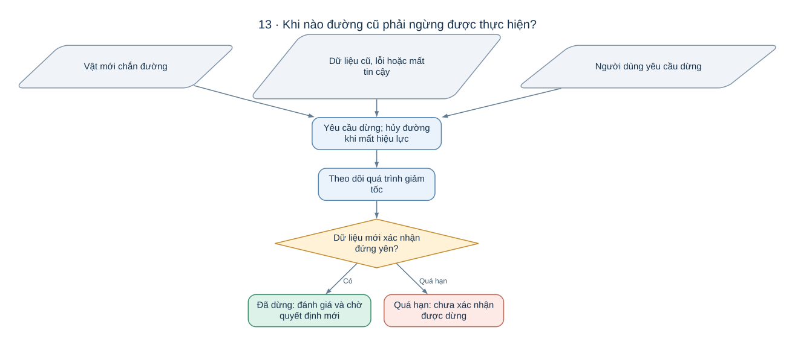

# AutoPark — từ bài toán đỗ xe đến các thuật toán giải quyết nó

Một chiếc xe đang ở lối đi, bên cạnh là hàng xe đã đỗ. Người dùng chọn một ô trống và muốn xe tự lùi vào đó. Xe phải biết mình đang ở đâu, chỗ nào có vật cản, nên đánh lái thế nào và khi nào phải dừng.

**AutoPark nghiên cứu cách ghép những lời giải nhỏ đó thành một hệ thống tự đỗ cho xe mô hình.** Mục tiêu đầu tiên là đỗ ở tốc độ thấp trên sa bàn có giới hạn, với vị trí và hướng đỗ do người dùng chọn.

## Vì sao “đi từ A đến B” lại khó?

Nếu chỉ là một chấm trên mặt phẳng, ta có thể nối vị trí đầu với vị trí cuối. Nhưng một chiếc xe có những ràng buộc khác:

- Xe có chiều dài và bề rộng. Tâm xe đi qua được chưa chắc đầu xe, đuôi xe đi qua được.
- Xe không thể trượt ngang vào ô. Góc lái có giới hạn, nên đôi khi phải tiến ra rồi mới lùi vào.
- Xe cần đến đúng **vị trí lẫn hướng**, và phải đứng yên ở cuối lượt đỗ.
- Vị trí đo được luôn có sai số; dữ liệu cảm biến cũng có độ trễ.
- Một vật mới có thể xuất hiện sau khi đường đã được tính.

Chính các ràng buộc này quyết định cách chọn thuật toán. Một lời giải tốt phải vừa tìm được đường, vừa giúp chiếc xe thực sự đi theo đường đó trong điều kiện thông tin không hoàn hảo.

*Sơ đồ mô tả cách tổ chức hệ thống mục tiêu. Mức đã thử của từng phần được trình bày ở cuối trang.*

## Tách một bài toán lớn thành sáu câu hỏi

| Câu hỏi | Cách AutoPark tiếp cận | Vì sao cần phần này? |
|---|---|---|
| Xung quanh xe có gì? | LiDAR đo hình học; camera và AI bổ sung thông tin từ ảnh | Hai nguồn nhìn môi trường theo những cách khác nhau |
| Xe đang ở đâu và quay hướng nào? | Khớp vòng quét LiDAR với bản đồ tĩnh, kiểm chéo bằng chuyển động giữa các vòng quét | Điều khiển chỉ có ý nghĩa khi biết tư thế hiện tại của xe |
| Đường nào xe có thể đi? | Thử nhiều cách tìm đường có xét tiến/lùi, góc lái và toàn thân xe | Khoảng trống hình học chưa đủ để xe quay vào được |
| Đường tìm được có bám được không? | Cho mô hình xe và bộ điều khiển chạy thử đường ứng viên | Phát hiện đường hợp lệ về hình học nhưng khó thực hiện |
| Trong lúc chạy phải sửa lệnh ra sao? | Kết hợp góc lái dự kiến với phản hồi sai lệch vị trí/hướng | Bù sai số tích lũy thay vì giả sử xe luôn đi đúng |
| Khi nào phải ngừng chạy? | Giám sát vật cản, độ mới dữ liệu, phản hồi và trạng thái bo | Một đường từng đúng có thể không còn an toàn |

Các phần này dùng chung một cách biểu diễn môi trường và một định nghĩa vị trí xe. Nếu camera đặt vật cản sai chỗ hoặc bộ định vị báo xe lệch vài centimet, thuật toán tìm đường tốt đến đâu cũng có thể đưa ra quyết định sai.

## Vì sao dùng nhiều thuật toán thay vì một thuật toán “tự lái” duy nhất?

Dự án chọn cách chia hệ thống thành các phần có vai trò rõ. AI giúp đọc ảnh; thuật toán hình học xét xe có chạm vật không; bộ tìm đường quyết định chuỗi tiến/lùi; bộ điều khiển biến đường đó thành tốc độ và góc lái.

Cách tổ chức này cho phép hỏi chính xác **lỗi xuất hiện ở đâu**. Xe suýt chạm cột có thể vì không nhận ra cột, định vị sai, kiểm thiếu phần đầu xe hoặc bám đường kém. Những nguyên nhân đó cần những cách sửa khác nhau.

Đó cũng là lý do hệ thống chưa đặt mục tiêu cho một mạng học trực tiếp từ ảnh ra lệnh lái. Với phạm vi xe mô hình trên sa bàn, các phần tách rõ giúp giải thích hành vi và kiểm tra từng giả định. Đây là lý do thiết kế phù hợp phạm vi dự án, chưa phải kết luận rằng cách này luôn tốt hơn các hệ thống học đầu-cuối.

## Vì sao việc tìm đường cần nhiều cách thử?

Một ô đỗ rộng có thể được giải nhanh bằng vài động tác tiến/lùi. Một khe hẹp hoặc lối vào bị chắn có thể buộc xe đi vòng và đổi chiều nhiều lần.

Vì vậy AutoPark dùng một **chuỗi các bộ tìm đường**: bắt đầu bằng cách tìm trên lưới với các động tác gộp, tăng mức tìm kiếm khi cần, rồi thử RRT-Connect kết hợp đường Reeds–Shepp và Hybrid A* mịn. Mỗi cách có ưu, nhược điểm riêng; đường tìm được còn phải qua bước thử bám đường.

Đây là một lựa chọn thực dụng: dùng cách nhanh cho bài dễ, dành phần tính toán còn lại cho bài khó. Hết thời gian tìm kiếm chỉ có nghĩa chưa tìm được lời giải được chấp nhận trong lượt đó, chưa chứng minh ô đỗ không thể vào.

Đọc tiếp [Vì sao chọn các thuật toán tìm và bám đường?](autopark/docs/THUAT_TOAN_DUONG_DI.md) để hiểu từng cách bằng ví dụ.

## Một tình huống cho thấy các phần phải phối hợp

Giả sử xe đã tìm được đường lùi vào ô. Khi xe đang lùi, một hộp nhỏ được đặt gần đầu xe — phần đầu đang quét ra ngoài do đánh lái.

LiDAR hoặc camera phải phát hiện được thay đổi. Hệ thống cần đưa hộp về đúng vị trí trên bản đồ, xét nó với **toàn thân xe và đường còn lại**, rồi quyết định dừng nếu đường không còn dùng được. Sau khi đứng yên, hệ thống đánh giá lại và chờ một đường mới. Tiếp tục đi theo đường cũ chỉ vì trước đó đã tìm thành công là một quyết định sai.

## Nên đọc tiếp theo thứ tự nào?

1. [Một lần đỗ xe diễn ra như thế nào?](autopark/README.md) — theo một ví dụ từ lúc chọn ô đến lúc đứng yên trong ô.
2. [Cảm nhận và định vị](autopark/docs/CAM_NHAN_VA_DINH_VI.md) — vì sao cần LiDAR, camera, bản đồ và kiểm độ tin cậy.
3. [Tìm và bám đường](autopark/docs/THUAT_TOAN_DUONG_DI.md) — xe chuyển động thế nào, vì sao dùng lưới, RRT, Reeds–Shepp và phản hồi.
4. [AI giải quyết phần nào của bài toán?](HUAN_LUYEN.md) — phân đoạn ảnh, chọn mô hình, chọn ngưỡng và khoảng cách từ dữ liệu đường phố tới sa bàn.
5. [Toàn bộ hệ thống bằng lưu đồ](autopark/docs/SO_DO_HE_THONG.md) — xem lại cách các phần nối với nhau.

[Từ điển thuật ngữ](autopark/docs/THUAT_NGU.md) giải thích các khái niệm ngay bằng ví dụ đỗ xe. [Tham gia giải quyết bài toán](CONTRIBUTING.md) gợi ý cách chọn một vấn đề, đặt giả thuyết và thiết kế phép kiểm.

## Ý tưởng đã được chứng minh đến đâu?

Theo hồ sơ kỹ thuật tới **06/10/2026**, phần mềm đã hoàn thành các lượt đỗ trong mô phỏng. LiDAR, bốn camera và AI đã chạy trên bàn thử. Firmware đã chạy trong trình giả lập QEMU. **Chưa có bằng chứng xe MN300 cùng bo ESP32-S3 thật hoàn thành lượt tự đỗ.**

Nguồn tư thế LiDAR còn thất bại ở một số ca mô phỏng; camera chưa có bộ hiệu chuẩn thật để dùng trong phiên đỗ; các ngưỡng nghiệm thu còn cần chốt. Bản viết ngày **17/10/2026** giải thích lựa chọn dựa trên mã và hồ sơ hiện có, không bổ sung kết quả chạy xe thật.

[Tổng hợp các lựa chọn và giới hạn](TONG_HOP_DU_AN.md) nối từng ý tưởng với phần đã kiểm chứng. [Lộ trình triển khai](KE_HOACH_TRIEN_KHAI_XE_TU_DO_v3.1.md) giải thích vì sao cần chứng minh các phần nhỏ trước khi ghép chúng lên xe.

Nhánh AI sử dụng [Valeo WoodScape Dataset](https://github.com/valeoai/WoodScape); các điều khoản và quyết định sử dụng được lưu trong [hồ sơ dữ liệu](autopark/docs/GIAY_PHEP_DU_LIEU.md).
