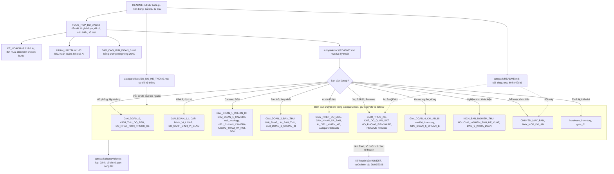
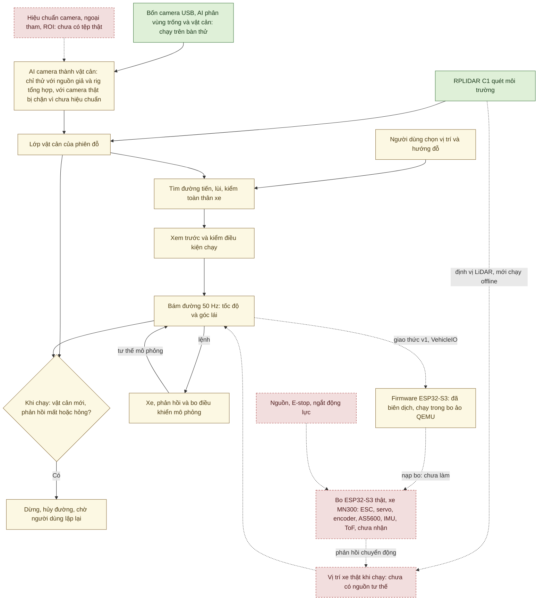

# AutoPark — xe mô hình tự đỗ

AutoPark là đồ án xe mô hình tự đỗ trên sa bàn: xe nền MN300 tỉ lệ 1/12, laptop xử lý cảm biến, AI và lập đường, một
ESP32-S3 điều khiển ESC và servo. Người dùng chọn vị trí và hướng đỗ; phần mềm tìm đường tiến/lùi, bám đường và dừng khi
gặp vật cản mới hoặc mất dữ liệu cần thiết. Bản đầu tiên cần đạt gọi là **V1**, có mười điều kiện hoàn thành
([kế hoạch](KE_HOACH_TRIEN_KHAI_XE_TU_DO_v3.1.md) mục 16.4).

Biên tập 30/09/2026 theo mã tại `ff4a018` (mã giống `ebbec83`). Lúc viết, cây làm việc còn sửa chưa commit: sửa chữ
(docstring, chú thích trong mã, một tooltip trong `ui/main_window.py`, mô tả gói trong `pyproject.toml`; không đổi
hành vi) và sửa cách đếm khung của `python -m autopark.transport.qemu_board kiem`. Ngày biên tập không phải ngày đo:
mỗi số đo ghi ngày và máy đo trong hồ sơ gốc. Bản trước đợt này: [ff4a018](https://github.com/thbn12082/autopark/tree/ff4a018);
bản trước đợt 26/09/2026: [9d68257](https://github.com/thbn12082/autopark/tree/9d68257). Cập nhật 02/10/2026 cho các
công cụ nghiệm thu của đợt dựng trên `3148014` (gạch đầu dòng cuối của phần hiện trạng, dòng "Điều khiển xe" và dòng "Nghiệm thu" của bảng).

Nghiên cứu nhận thức sử dụng **[Valeo WoodScape Dataset](https://github.com/valeoai/WoodScape)**
([phạm vi sử dụng](autopark/docs/GIAY_PHEP_DU_LIEU.md), mục "Dữ liệu và ghi công" cuối trang).

**Hiện trạng 30/09/2026.** Chưa có gì chạy trên xe thật; mọi số đo thiết bị dưới đây là trên bàn làm việc.

- **Đã đo trên thiết bị thật (bàn thử):** RPLIDAR C1 và bốn camera USB qua hub chạy cùng AI trên máy bàn. Lệnh kiểm
  máy mới `do_may_moi.cmd` ngày 29/09/2026 lúc 12:59 (mã `9d68257`): LiDAR 10,00 Hz, trung vị 508 tia/vòng; bốn camera
  640×480 + LiDAR + AI trong 120 s được 2.861 bộ ảnh, 0 khung hỏng, 23,85 bộ AI/s
  ([biên bản chuyển máy](autopark/docs/CHUYEN_MAY_BAN.md) mục 2).
- **Đã kiểm trên máy tính:** toàn bộ test tự động trên commit `ebbec83` (30/09/2026, máy bàn): `.venv` 1.380 đạt,
  8 bỏ qua (cần torch), 0 hỏng; `.venv-train` 1.442 đạt, 0 hỏng
  ([tóm tắt](autopark/docs/evidence/mo_phong_20260930/chay_tren_commit_ebbec83.txt)). Lõi C++ của firmware khớp bản
  tham chiếu Python (703 check, 0 lệch) và cả firmware biên dịch được cho ESP32-S3 (29/09/2026;
  [biên bản chuyển máy](autopark/docs/CHUYEN_MAY_BAN.md) mục 6–7).
- **Chỉ mô phỏng hoặc giả lập:** giai đoạn 0 đạt sáu điều kiện chuyển bước ở mức mô phỏng (20/09/2026, laptop). Trong
  ứng dụng, xe, phản hồi và bo điều khiển đều là mô phỏng. Firmware thật chạy trong bo ảo QEMU (30/09/2026), mới kiểm ở
  mức VehicleIO (13 test, 6 trong đó chạy firmware thật trong QEMU;
  [mô phỏng firmware](autopark/docs/MO_PHONG_FIRMWARE.md) mục 1); giao diện chưa chọn được bo ảo và bo ảo chưa nối vào
  phiên đỗ. AI camera tạo vật cản mới thử bằng nguồn giả, rig tổng hợp và phát lại bản ghi; với cấu hình camera thật,
  nó chặn mọi lô (phát lại bản ghi o03) vì chưa có hiệu chuẩn thật.
- **Chưa làm:** chưa nhận MN300, ESP32-S3, IMU, ToF, AS5600, encoder, phần nguồn và nút dừng; firmware CHƯA nạp bo;
  chưa hiệu chuẩn camera; chưa đo sai số LiDAR so với thước; laptop trình diễn mới chạy mô phỏng giai đoạn 0.
  V1 đạt 0/10 điều kiện hoàn thành.
- **Thêm ngày 02/10/2026, chỉ kiểm bằng test và mô phỏng:** phần lớn công cụ phần mềm cho nghiệm thu: chấm một lần chạy
  theo ngưỡng đề xuất, phát lại log lần chạy qua VehicleIO, ghi sự kiện dừng của phiên vào log, dấu đồng bộ video–log,
  nút "Xóa lỗi bo (CLEAR_FAULT)", giới hạn số lần đổi chiều (mặc định tắt), diễn tập tiêm lỗi trên mô phỏng. Các công cụ
  này chưa chạy với LiDAR, camera hay bo thật ([tổng quan](TONG_HOP_DU_AN.md) mục 4.15, 5.4); số test toàn bộ trên mã
  này ghi sau lượt chạy trên commit. Cùng ngày đo EcoQoS của ứng dụng giao diện: cửa sổ
  thu nhỏ thì lập đường hết hạn 8 s ở 4/4 lượt, tiến trình tự tắt EcoQoS thì hết ([biên bản chuyển
  máy](autopark/docs/CHUYEN_MAY_BAN.md) mục 10; ứng dụng chưa tự tắt EcoQoS, chờ quyết định).

## Bắt đầu từ đâu?

| Bạn cần gì? | Tài liệu |
|---|---|
| Người mới: dự án đang ở đâu, việc còn thiếu, việc tiếp theo | [Tổng quan và tiến độ](TONG_HOP_DU_AN.md) |
| Nhìn các luồng của hệ thống bằng sơ đồ: kiến trúc, phiên đỗ, cảm biến, AI, firmware, an toàn, tiến độ | [Sơ đồ hệ thống](autopark/docs/SO_DO_HE_THONG.md) |
| Cài đặt, mở mô phỏng, chạy test; lệnh LiDAR, camera, bàn thử, bo ảo | [Hướng dẫn chạy](autopark/README.md) |
| Thứ tự triển khai, sáu đợt mua, điều kiện chuyển bước và điều kiện V1 | [Kế hoạch v3.1](KE_HOACH_TRIEN_KHAI_XE_TU_DO_v3.1.md) |
| Kết quả AI và cách huấn luyện lại | [Huấn luyện AI](HUAN_LUYEN.md) |
| Bằng chứng mô phỏng giai đoạn 0 (đợt 20/09/2026) | [Báo cáo giai đoạn 0](BAO_CAO_GIAI_DOAN_0.md) |
| Hướng dẫn và biên bản theo chuyên đề: camera, LiDAR, ESP32, nguồn, nghiệm thu, khóa luận | [Mục lục kỹ thuật](autopark/docs/README.md) |
| Firmware ESP32-S3 và bo ảo QEMU | [Mô phỏng firmware](autopark/docs/MO_PHONG_FIRMWARE.md), [README firmware](autopark/firmware/esp32_vehicle/README.md) |
| Đổi máy, chuẩn bị laptop trình diễn | [Chuyển máy bàn](autopark/docs/CHUYEN_MAY_BAN.md), [máy nộp đồ án](autopark/docs/MAY_NOP_DO_AN.md) |
| Giảng viên, hội đồng: lần theo một con số tới tệp bằng chứng | [Tổng quan](TONG_HOP_DU_AN.md) mục 7, bằng chứng nhỏ trong Git ở [autopark/docs/evidence/](autopark/docs/evidence/) |

Thứ tự đọc cho người mới: README này, rồi tổng quan, rồi hướng dẫn chạy; sơ đồ tra ở tệp sơ đồ hệ thống; khi làm một
việc cụ thể thì mở biên bản chuyên đề qua mục lục kỹ thuật. Bản đồ dưới là bản gọn, cùng ý với sơ đồ 9.4 trong
[Sơ đồ hệ thống](autopark/docs/SO_DO_HE_THONG.md):



Biên bản chuyên đề giữ ngày đo và lịch sử. Tên đoạn hay "bước N" của kế hoạch mà chúng dẫn là theo bản kế hoạch
`9d68257`. Tệp lớn (`runs/`, dataset, checkpoint, môi trường Python) không có trong Git.

## Hệ thống gồm những gì?

| Thành phần | Vai trò trong V1 | Tình trạng 30/09/2026 |
|---|---|---|
| Xe MN300 Tank300 1/12 4WD RTR | Xe nền dự kiến | CHƯA nhận |
| Laptop | Xử lý cảm biến, AI, bản đồ, định vị, tìm và bám đường, giao diện, log | Phát triển trên máy bàn Dell Precision 3680 (i9-14900, RTX 4000 Ada 20 GB, Windows 11) từ 29/09/2026; laptop RTX 3050 Ti để trình diễn, mới chạy mô phỏng giai đoạn 0 |
| RPLIDAR C1 | Đo hình học môi trường cho bản đồ, định vị, vật cản | Nhận 22/09/2026; máy bàn đọc ở COM3 |
| Bốn camera USB và hub UGREEN | Quan sát trước, sau, trái, phải; AI phân vùng trống và vật cản | Nhận 23/09/2026; chưa hiệu chuẩn, chưa gá |
| ESP32-S3 | Đọc phản hồi, nhận lệnh tốc độ và góc lái, điều khiển ESC và servo, giám sát mất lệnh | CHƯA nhận; firmware biên dịch 29/09/2026, chạy trong bo ảo QEMU 30/09/2026 |
| BNO085 (IMU), VL53L1X (ToF), AS5600, encoder | Hướng, khoảng cách gần, góc lái, tốc độ | CHƯA nhận |
| Nguồn, cầu chì, E-stop, phần tử ngắt | Cấp điện; E-stop vật lý là đường dừng riêng, không qua giao diện laptop | CHƯA có; bản nháp thiết kế |

AI nhận diện vùng trống và vật cản trên ảnh; bộ tìm đường và bộ bám đường tính quỹ đạo, tốc độ và góc lái. Chi tiết
thiết bị: [kiểm kê](autopark/docs/hardware_inventory.md), [kế hoạch](KE_HOACH_TRIEN_KHAI_XE_TU_DO_v3.1.md) mục 1.1.

Luồng V1 mục tiêu, tô màu theo hiện trạng từng khối ngày 30/09/2026. Đây là bản rút gọn của sơ đồ 1.1 trong
[Sơ đồ hệ thống](autopark/docs/SO_DO_HE_THONG.md):



Màu ở sơ đồ này (nghĩa hẹp hơn chú giải chuẩn của Sơ đồ hệ thống): xanh là khối đã chạy với thiết bị thật trên bàn thử
(LiDAR C1, bốn camera, AI suy luận trên ảnh camera thật) · vàng là khối mới chạy với xe, bo mô phỏng hoặc trong bo ảo
QEMU (chọn đích, tìm đường, lớp vật cản của phiên, AI camera tạo vật cản, xem trước và kiểm trước START, bám đường,
dừng, firmware trong bo ảo) · đỏ viền đứt là chưa làm (nguồn tư thế thật, tệp hiệu chuẩn camera, bo ESP32-S3 thật, xe
MN300 và cảm biến, nguồn và E-stop).

Không khối nào đã chạy trên xe, và xanh không có nghĩa là cổng chuyển bước đã đạt. Mũi tên nét đứt là đường chưa có
trong hệ thống chạy hôm nay; đường từ bám đường tới firmware trong bo ảo nét đứt vì bo ảo chưa nối vào phiên đỗ. Mọi
sơ đồ khác (kiến trúc mô-đun, phiên đỗ, lập đường, cảm biến, AI, liên kết laptop–bo, an toàn, tiến độ, quy trình) nằm
ở [Sơ đồ hệ thống](autopark/docs/SO_DO_HE_THONG.md).

## Đã có gì, còn thiếu gì?

| Phần | Đã có | Còn thiếu để dùng trên xe |
|---|---|---|
| Mô phỏng, lập đường | Đặt đích, tìm đường tiến/lùi, bám đường, dừng khi có vật cản mới hoặc mất dữ liệu, lưu và phát lại; giai đoạn 0 đạt ở mức mô phỏng (20/09/2026) | Thông số MN300 đo thật (`configs/vehicle_default.json` còn là giả định) |
| LiDAR | Đọc, ghi, phát lại scan; bản đồ tĩnh; định vị và khớp scan chạy offline trên bản ghi C1 đứng yên | Sai số khoảng cách so với thước; bản ghi khi di chuyển; tham chiếu độc lập |
| Camera | Bốn luồng 640×480 qua hub cùng LiDAR và AI trên bàn thử; ghi và phát lại | Hiệu chuẩn nội tham, ngoại tham, ROI; gá thật; 720p còn khung MJPEG bị cắt tùy cảnh; ảnh sa bàn có nhãn |
| AI tạo vật cản | Nối vào phiên đỗ ở mức phần mềm (ngăn AI camera của `ui.lidar_app --camera-ai`, từ 25/09/2026); phát lại bản ghi thật o03: 1.163 lô bị chặn, 0 vật cản, vì chưa có hiệu chuẩn thật ([AI camera](autopark/docs/AI_DIEU_KHIEN_XE.md) mục 3, 8.2) | Bộ hiệu chuẩn thật; chấm AI trên ảnh sa bàn có nhãn; thử với camera live |
| Điều khiển xe | Giao thức v1, VehicleIO, bo mô phỏng; lõi C++ qua test host (703 check, 0 lệch) và cả firmware biên dịch cho ESP32-S3 (29/09/2026); firmware chạy trong bo ảo QEMU (30/09/2026; 13 test, 6 trong đó chạy firmware thật trong QEMU); nút "Xóa lỗi bo (CLEAR_FAULT)" (02/10/2026, chỉ thử với bo mô phỏng và cổng serial giả) | ESP32-S3 thật, nạp và đo trên bo; nguồn tư thế thật (chọn cổng COM thì **Bắt đầu đỗ** bị từ chối); cảm biến phản hồi; chọn bo ảo từ giao diện |
| Nguồn và dừng | Bản nháp bảng tải, sơ đồ nguồn và dừng, 16 kịch bản lỗi L1–L16 ([nguồn và dừng](autopark/docs/GIAI_DOAN_6_CHUAN_BI.md) mục 5) | Lắp và đo trên phần cứng; cả 16 kịch bản CHƯA THỬ |
| Nghiệm thu | Bản nháp 37 kịch bản trong 9 nhóm ([kịch bản nghiệm thu](autopark/docs/KICH_BAN_NGHIEM_THU.md) mục 0) và bảng ngưỡng đề xuất ([ngưỡng](autopark/docs/NGUONG_NGHIEM_THU_DE_XUAT.md)); từ 02/10/2026 công cụ chấm một lần chạy, phát lại log, ghi sự kiện dừng, dấu đồng bộ video–log, diễn tập tiêm lỗi (công cụ T5, T6, T9–T15 của kịch bản mục 7), mới kiểm bằng test và mô phỏng ([hướng dẫn chạy](autopark/README.md) mục 4) | Chốt ngưỡng; thử các kịch bản (tất cả CHƯA THỬ ở mức nghiệm thu); nguồn tư thế thật (T2), ghi cảm biến trong phiên đỗ (T3), tham chiếu trên cao và công cụ trích tư thế từ video (T4), LED trên bo cho đồng bộ video (T7) |

**Tiến độ 11 giai đoạn:** GĐ 0 đạt ở mức mô phỏng; chưa cổng nào từ GĐ 1 đến GĐ 10 đạt. GĐ 1–2 đang làm, có số đo
LiDAR và bốn camera trên bàn thử. GĐ 3, 5, 8 mới có phần mềm hoặc giả lập, chờ thiết bị. GĐ 4, 6 là bản nháp. GĐ 7, 9
chưa làm. GĐ 10 có dàn ý khóa luận, kịch bản và ngưỡng nháp, chưa nghiệm thu. **V1: 0/10 điều kiện hoàn thành.** Bảng
từng giai đoạn: [tổng quan](TONG_HOP_DU_AN.md) mục 3; sơ đồ 8.1 và 8.3 trong
[Sơ đồ hệ thống](autopark/docs/SO_DO_HE_THONG.md).

Số test là kiểm trên máy tính, không thay số đo thiết bị. Lượt mới nhất (commit `c03ff94`, cây làm việc sạch, máy bàn,
offscreen, 01/10/2026): [tóm tắt](autopark/docs/evidence/bien_tap_20261001/chay_tren_commit_c03ff94.txt); các lượt trước
và giới hạn: [tổng quan](TONG_HOP_DU_AN.md) mục 7.

## Chạy mô phỏng trên Windows

Thư mục làm việc: thư mục `autopark` bên trong repo, nơi có `pyproject.toml` và `run_app.py` (trên máy bàn:
`D:\xetulai\autopark\autopark`). Cần Python từ 3.11 (môi trường đã kiểm dùng 3.12.10) và mạng khi cài thư viện. Mô
phỏng không cần cảm biến, GPU hay checkpoint AI.

1. Chạy `cai_dat.cmd`: tạo `.venv` theo `requirements-phase0.lock` và cài gói `autopark`. Nếu `.venv` chép từ máy khác
   không chạy được, lệnh đổi tên nó thành `.venv.hong-tu-may-cu` rồi tạo môi trường mới.
2. Chạy `chay_app.cmd` để mở giao diện sa bàn.
3. Đặt hoặc xoay đích → **Tìm đường đỗ** → **Xem trước** → **Bắt đầu đỗ**. Khi xe đang chạy, thử **Vật cản giả** hoặc
   **Mất dữ liệu**: xe dừng; chọn lại vị trí rồi lập đường mới.

Cửa sổ này không mở LiDAR, camera hay AI. Ngăn LiDAR và ngăn AI camera nằm ở `python -m autopark.ui.lidar_app`
(thêm `--camera-ai`); bàn thử bốn camera là `autopark.rig.bench` và `autopark.ui.rig_app`
([hướng dẫn chạy](autopark/README.md) mục 7).

**Kiểm nhanh không mở giao diện** (PowerShell, cùng thư mục):

```powershell
./.venv/Scripts/python.exe -X utf8 -m autopark.evaluation.phase0 --out runs/thu_nghiem_moi
./.venv/Scripts/python.exe -X utf8 -m autopark.evaluation.replay runs/thu_nghiem_moi/obstacle
```

Lệnh đầu chạy năm phiên mẫu: `parking`, `reverse`, `noisy` phải kết thúc COMPLETED; `obstacle` (vật cản mới) và
`data_loss` (mất dữ liệu) phải STOPPED; mỗi phiên được phát lại và so log, sai thì lệnh báo lỗi. Mỗi lượt dùng một thư
mục đầu ra mới. Lệnh thứ hai chạy lại phiên `obstacle` từ cấu hình và quỹ đạo đã lưu, báo lỗi nếu kết quả khác bản ghi.
Ngày 29/09/2026, trong lượt chạy lại các lệnh trên máy bàn hiện tại (15:08–15:19, mã `b37e9ee`), lệnh `phase0` cho
đúng năm kết quả này ([tóm tắt lượt đó](autopark/docs/evidence/chuyen_may_20260929/kiem_may_20260929.md); tệp gốc
git-ignore ở `autopark/runs/kiem_may_20260929/`).

**Toàn bộ bộ test:**

```powershell
$env:QT_QPA_PLATFORM = "offscreen"
./.venv/Scripts/python.exe -X utf8 -m pytest
Remove-Item Env:QT_QPA_PLATFORM
```

Lượt `.venv` trên commit `ebbec83` (máy bàn, 30/09/2026) mất 365 s. Test cần torch được bỏ qua trong `.venv`; chạy
cùng lệnh bằng `./.venv-train/Scripts/python.exe` (tạo bằng `cai_dat_train.cmd`) để gồm cả chúng. Test lập đường có hạn
giờ phụ thuộc cách Windows xếp lịch tiến trình, nên `tests/conftest.py` tắt EcoQoS cho tiến trình pytest; vẫn nên chạy
khi máy rảnh. Lệnh từng bước, môi trường AI và cách xử lý lỗi: [hướng dẫn chạy](autopark/README.md) mục 2–5 và 11.

Bản clone không kèm môi trường Python, checkpoint AI, dataset đầy đủ và các phiên trong `runs/`; cần tạo lại hoặc chép
từ máy đã làm dự án ([hướng dẫn chạy](autopark/README.md) mục 5). Mô phỏng cơ bản không cần checkpoint AI.

Chép cả thư mục sang máy khác: chạy lại `cai_dat.cmd` và `cai_dat_train.cmd`; venv chép sang mà hỏng được đổi tên thành
`*.hong-tu-may-cu` rồi tạo lại. Thiết bị gắn với máy khai ở một tệp,
[autopark/configs/thiet_bi.json](autopark/configs/thiet_bi.json): khóa `lidar_port` (số COM của LiDAR trên máy đó, hoặc
`"auto"` để tự tìm bộ chuyển CP210x; đổi máy thì sửa dòng này) và, từ 30/09/2026, đường dẫn QEMU và PlatformIO của bo ảo
([mô phỏng firmware](autopark/docs/MO_PHONG_FIRMWARE.md)). Các bước đổi máy và kết quả kiểm trên máy bàn hiện tại:
[biên bản chuyển máy](autopark/docs/CHUYEN_MAY_BAN.md) mục 5 và mục 2.

## Dữ liệu và ghi công

Nghiên cứu nhận thức sử dụng **[Valeo WoodScape Dataset](https://github.com/valeoai/WoodScape)**.

Hồ sơ ngày 25/09/2026 ghi quyết định của người làm khóa luận: dùng mô hình huấn luyện trên WoodScape trong vòng điều
khiển xe mô hình. **Valeo chưa xác nhận cách diễn giải điều khoản của dự án.** Quyết định không bao gồm checkpoint dùng
AVM-SS hoặc nhãn nháp AI. Hồ sơ cũng ghi điều kiện dùng AVM-SS, DROW v2 và trọng số khởi tạo của torchvision. Xem
[hồ sơ giấy phép](autopark/docs/GIAY_PHEP_DU_LIEU.md).
