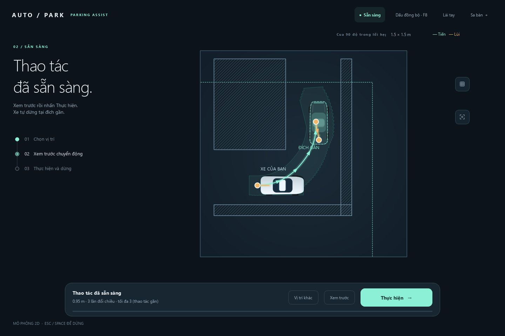

# AutoPark — thao tác gần trong chỗ hẹp

Người lái đưa xe tới chỗ khó và chọn **vị trí, hướng đích gần**. Xe tự đánh lái, tiến/lùi một đoạn ngắn rồi dừng; người lái chọn bước tiếp từ nơi vừa dừng. Bài toán gồm cua hẹp, qua cửa, lách cột và chỉnh xe vào khe. Đỗ xe là một ứng dụng gần; dẫn xe qua cả bãi, tìm ô tự động và đi tới đích xa nằm ngoài phạm vi.

**Trạng thái 28/10/2026:** chặng 1 — bộ đánh giá phần mềm/mô phỏng — đã hoàn tất. Bộ 44 tình huống qua ba seed đạt 132/132 kỳ vọng, gồm đến đích, từ chối và dừng được chấm riêng. [Kết quả và các chặng còn lại](autopark/docs/KIEM_THU_VA_LO_TRINH.md); bước tiếp theo là firmware/phản hồi thật, đo xe và hiệu chuẩn.

## Chạy thử

Cần Python 3.11 trở lên. Windows: chạy `autopark/cai_dat.cmd` lần đầu, sau đó mở `autopark/chay_app.cmd`. Hoặc từ thư mục `autopark/`:

```powershell
.\.venv\Scripts\python.exe run_app.py
.\.venv\Scripts\python.exe run_app.py scenarios/thao_tac_lui_vao_khe.json
```

Mặc định mở **Cua 90 độ trong lối hẹp**. Nhấp sàn hoặc kéo xe đích, kéo nút xoay để đặt hướng. Chọn **Tính thao tác → Xem trước (tùy chọn) → Thực hiện**. Khi xe dừng, **Chọn đích tiếp** giữ tư thế vừa dừng và yêu cầu đường mới.



*Ảnh chụp app ở chế độ SIM sau khi tính và kiểm bám thành công: đường tiến/lùi, vùng thân xe quét và đích gần. [Luồng thao tác và cảnh lùi vào khe](autopark/docs/VAN_HANH.md#luong-thao-tac).*

## Cấu hình thử hiện tại

| Đại lượng | Giá trị trong hai cảnh mẫu |
|---|---|
| Khoảng cách từ xuất phát đến đích | ≤ 0,70 m |
| Vùng thao tác | Vuông quanh xuất phát, nửa cạnh 0,75 m, cắt theo biên sa bàn; chứa toàn thân xe |
| Tổng đường tiến + lùi | ≤ 1,40 m |
| Số lần đổi chiều | ≤ 3 |
| Tốc độ tối đa của xe đi kèm | 0,10 m/s |

Đây là **tham số thử có thể điều chỉnh trên xe mô hình giả định**, không phải trần sản phẩm hay ngưỡng nghiệm thu. Đường phải qua kiểm giới hạn, vùng quét và khả năng bám; trong lượt còn kiểm quãng đường/mép vùng có xét phanh.

Đã có mô phỏng, bàn thử cảm biến và firmware QEMU. **Chưa chạy thao tác này trên xe thật.** Kịch bản cũ thiếu `maneuver` hoặc dùng `slot` còn đọc/chấm được nhưng bị từ chối khi thực hiện/runtime replay.

[Chạy bộ đánh giá và đọc báo cáo](autopark/docs/VAN_HANH.md#danh-gia-mo-phong): một lệnh chạy hàng loạt, xuất JSON/CSV và tái hiện từng lượt đã ghi.

## Tài liệu

Bộ hướng dẫn chỉ gồm trang này và năm trang sau:

- [Kiến trúc](autopark/docs/KIEN_TRUC.md): cảm nhận, định vị, AI, tìm/bám đường.
- [Vận hành và phát triển](autopark/docs/VAN_HANH.md): cài đặt, kịch bản, lệnh, log/phát lại.
- [Phần cứng và hiệu chuẩn](autopark/docs/PHAN_CUNG_VA_HIEU_CHUAN.md): camera, LiDAR, xe, giao thức/firmware và dừng.
- [Kiểm thử và lộ trình](autopark/docs/KIEM_THU_VA_LO_TRINH.md): tình huống cần kiểm, tiêu chí và việc tiếp theo.
- [Dữ liệu và giấy phép](autopark/docs/DU_LIEU_VA_GIAY_PHEP.md): nguồn, số đo lịch sử và bằng chứng gốc.
