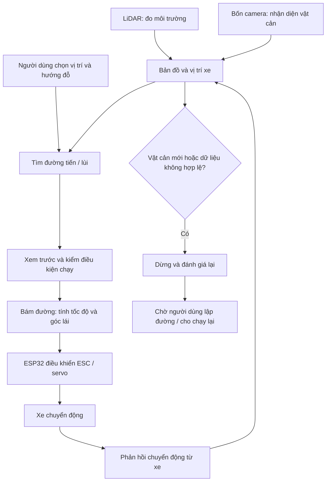

# AutoPark — xe mô hình tự đỗ

AutoPark là đồ án xe mô hình tự đỗ trên sa bàn. Người dùng chọn vị trí và hướng đỗ; phần mềm tìm đường tiến/lùi, bám đường và dừng khi gặp vật cản hoặc mất dữ liệu cần thiết.

**Hiện trạng:** phần mô phỏng đã được kiểm thử; LiDAR và bốn camera đã chạy trên bàn thử. Dự án chưa hoàn thành tích hợp và nghiệm thu xe thật.

Biên tập ngày **26/09/2026**, dựa trên mã nguồn và hồ sơ đến commit `9d68257`; cập nhật **29/09/2026** sau khi chuyển sang máy bàn mới ([biên bản chuyển máy](autopark/docs/CHUYEN_MAY_BAN.md)) và **30/09/2026** với bo ảo QEMU ([mô phỏng firmware](autopark/docs/MO_PHONG_FIRMWARE.md)). Ngày biên tập không phải ngày đo; mỗi số đo ghi ngày và máy đo trong hồ sơ gốc.

## Bắt đầu từ đâu?

| Bạn muốn làm gì? | Tài liệu |
|---|---|
| Hiểu dự án và biết việc còn thiếu | [Tổng quan và tiến độ](TONG_HOP_DU_AN.md) |
| Cài đặt, mở mô phỏng, chạy kiểm thử | [Hướng dẫn chạy](autopark/README.md) |
| Biết thứ tự triển khai | [Kế hoạch v3.1](KE_HOACH_TRIEN_KHAI_XE_TU_DO_v3.1.md) |
| Xem kết quả AI và huấn luyện lại | [Huấn luyện AI](HUAN_LUYEN.md) |
| Xem bằng chứng mô phỏng | [Báo cáo giai đoạn 0](BAO_CAO_GIAI_DOAN_0.md) |
| Tìm hướng dẫn camera, LiDAR, ESP32, nghiệm thu | [Mục lục kỹ thuật](autopark/docs/README.md) |

## Hệ thống gồm những gì?

- **MN300 Tank300 1/12:** xe nền dự kiến.
- **Laptop:** xử lý cảm biến, AI, bản đồ, định vị, tìm đường và giao diện.
- **RPLIDAR C1:** đo hình học môi trường, phục vụ bản đồ và định vị.
- **Bốn camera USB:** quan sát trước, sau, trái, phải; AI phân vùng trống/vật cản.
- **ESP32-S3:** đọc phản hồi, nhận lệnh tốc độ/góc lái và điều khiển ESC/servo.

Luồng mục tiêu khi tích hợp đầy đủ:

Sơ đồ mô tả kiến trúc V1 dự kiến. Nhánh ESP32 → xe thật chưa được nghiệm thu.

AI nhận diện vật cản. Bộ tìm đường và bộ bám đường tính quỹ đạo, tốc độ và góc lái.

## Đã có gì, còn thiếu gì?

| Phần | Đã có | Còn thiếu để dùng trên xe |
|---|---|---|
| Mô phỏng | Đặt đích, tìm đường, tiến/lùi, dừng, lưu và phát lại | Thông số MN300 đo thật |
| LiDAR | Đọc/ghi scan, bản đồ tĩnh, công cụ định vị và khớp scan | Đo sai số độc lập, thử khi di chuyển |
| Camera | Bốn luồng ảnh, AI trực tiếp, ghi/phát lại | Hiệu chuẩn, gá thật, USB ổn định, ảnh sa bàn có nhãn |
| AI tạo vật cản | Đã nối vào phiên đỗ ở mức phần mềm | Bộ hiệu chuẩn thật và phép kiểm trên sa bàn |
| Điều khiển xe | Giao thức, bo mô phỏng, firmware C++ biên dịch được (29/09/2026), chạy trong bo ảo QEMU (30/09/2026) | Nạp và đo trên bo, cảm biến thật, nguồn tư thế thật |
| Nguồn và dừng | Bản nháp thiết kế và kịch bản lỗi | Lắp và đo trên phần cứng |

**Giai đoạn 0 đạt ở mức mô phỏng. Các giai đoạn 1–10 chưa đạt điều kiện chuyển bước.**

## Chạy mô phỏng trên Windows

Mở thư mục `autopark` bên trong repository:

1. Chạy `cai_dat.cmd` để tạo môi trường và cài thư viện. Nếu thư mục được chép từ máy khác và `.venv` chép kèm không chạy được, lệnh tự đổi tên nó thành `.venv.hong-tu-may-cu` rồi tạo môi trường mới.
2. Chạy `chay_app.cmd`.
3. Chọn đích → **Tìm đường đỗ** → **Xem trước** → **Bắt đầu đỗ**.

Dự án yêu cầu Python từ 3.11; môi trường đã kiểm trong hồ sơ dùng Python 3.12.10. [Hướng dẫn PowerShell và xử lý lỗi](autopark/README.md).

Bản clone không kèm môi trường Python, checkpoint AI, dataset đầy đủ hoặc phiên trong `runs/`. Cần tạo hoặc chuyển các tệp này từ máy đã làm dự án. Mô phỏng cơ bản không cần checkpoint AI.

Khi chép cả thư mục sang máy khác, chạy lại `cai_dat.cmd` và `cai_dat_train.cmd`: venv chép sang mà hỏng được đổi tên thành `*.hong-tu-may-cu` rồi tạo lại. Cổng COM của LiDAR đặt ở một chỗ, khóa `lidar_port` trong [autopark/configs/thiet_bi.json](autopark/configs/thiet_bi.json) (số COM của máy đó, hoặc `"auto"` để tự tìm bộ chuyển CP210x); đổi máy thì sửa dòng này. Cùng tệp giữ đường dẫn QEMU và PlatformIO của bo ảo (từ 30/09/2026, [mô phỏng firmware](autopark/docs/MO_PHONG_FIRMWARE.md)). Các bước đổi máy và kết quả kiểm trên máy bàn hiện tại: [biên bản chuyển máy 29/09/2026](autopark/docs/CHUYEN_MAY_BAN.md).

## Dữ liệu và ghi công

Nghiên cứu nhận thức sử dụng **[Valeo WoodScape Dataset](https://github.com/valeoai/WoodScape)**.

Hồ sơ 25/09 ghi quyết định của người làm khóa luận dùng mô hình WoodScape trong vòng điều khiển xe mô hình. **Valeo chưa xác nhận cách diễn giải điều khoản của dự án.** Quyết định không bao gồm checkpoint dùng AVM-SS hoặc nhãn nháp AI. Xem [hồ sơ giấy phép](autopark/docs/GIAY_PHEP_DU_LIEU.md).

[Lịch sử tài liệu trước lần biên tập](https://github.com/thbn12082/autopark/tree/9d68257).
