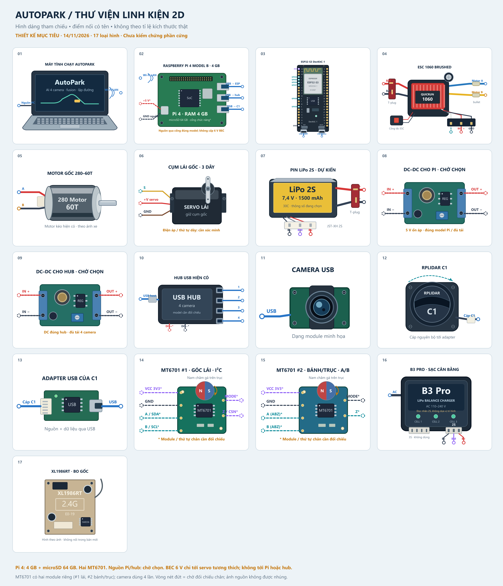
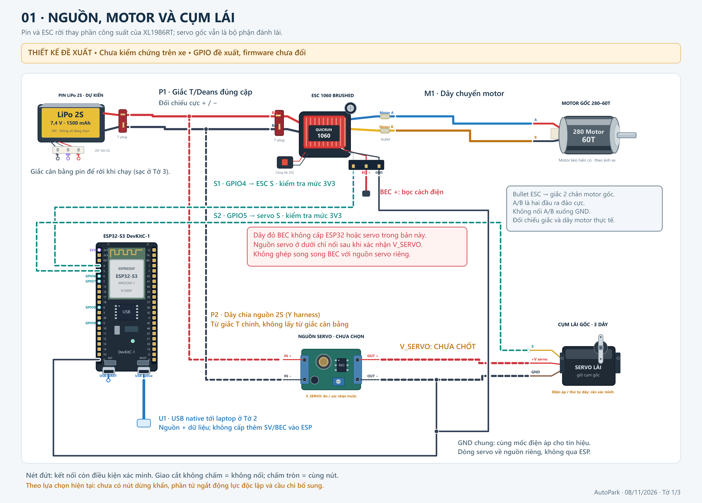
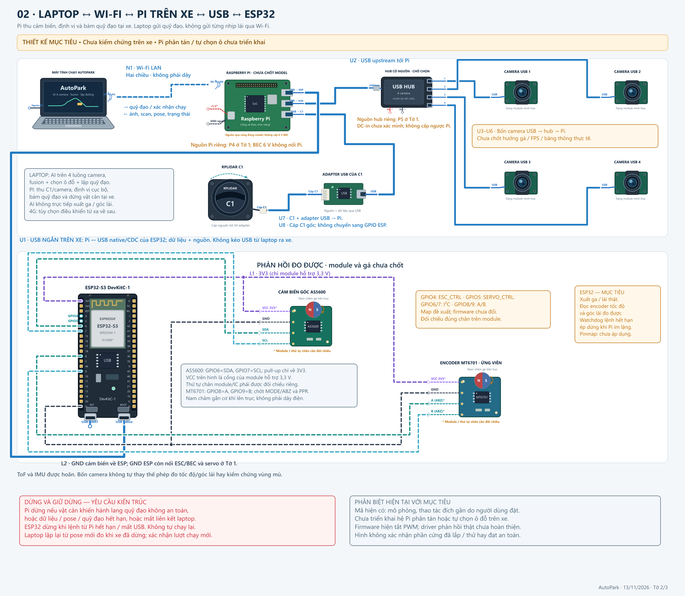
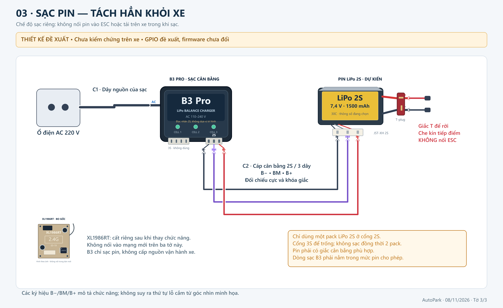

# AutoPark — hỗ trợ xoay trở trong chỗ hẹp

AutoPark giúp xe mô hình tự thực hiện thao tác ngắn ở tốc độ thấp. Người lái chọn vị trí và hướng đích gần; xe đánh lái, tiến hoặc lùi rồi dừng. Bước tiếp theo do người lái quyết định từ nơi xe vừa dừng.

Phạm vi gồm cua hẹp, qua cửa, lách cột và chỉnh xe vào khe. Đỗ xe là một ứng dụng gần; tìm ô tự động và dẫn xe tới đích xa nằm ngoài phạm vi.

## Một lượt sử dụng

Chọn đích gần, tính thao tác, xem trước nếu cần rồi xác nhận thực hiện. Người lái có thể yêu cầu dừng bất cứ lúc nào. Muốn tiếp tục phải đợi xe đứng yên và xác nhận một lượt mới.


*Ảnh ứng dụng trong mô phỏng: xe đã có đường tiến/lùi và vùng thân xe sẽ quét qua. Đây chưa phải lượt chạy xe thật.*

## Giới hạn thử của hai cảnh mẫu

| Đại lượng | Giá trị |
|---|---|
| Khoảng cách từ điểm xuất phát đến đích | Tối đa 70 cm |
| Vùng thao tác | Khung vuông cạnh 1,5 m quanh điểm xuất phát, chỉ dùng phần nằm trong sa bàn |
| Tổng quãng đường tiến và lùi | Tối đa 1,40 m |
| Số lần đổi chiều | Tối đa 3 |
| Tốc độ | Tối đa 0,10 m/s |

Các giá trị trên dùng cho xe mô hình giả định và có thể điều chỉnh. Toàn thân xe phải nằm trong vùng được phép; khi cua còn phải xét đầu, đuôi và hai sườn xe quét qua đâu.

## Trạng thái hiện tại

Đến ngày 28/10/2026, chặng đánh giá phần mềm trong mô phỏng đã hoàn tất với 44 tình huống. Hệ thống đã có giao diện, tìm và bám đường, xử lý dừng, ghi lại và phát lại lượt chạy.

**Chưa có kết quả thao tác trên xe thật.** Việc tiếp theo là hoàn thiện điều khiển và phản hồi trên bo, đo xe và quãng phanh, hiệu chuẩn cảm biến, rồi thử từng thao tác chậm.

Bộ tài liệu gồm sáu phần: Tổng quan, Kiến trúc, Vận hành, Phần cứng và hiệu chuẩn, Kiểm thử và lộ trình, Dữ liệu và giấy phép.

## Thiết kế kết nối điện 2D và cách lắp

Ngày thiết kế: 08/11/2026. Cấu hình tham chiếu: ESP32-S3-DevKitC-1 N16R8 và Hobbywing QuicRun 1060 Brushed giắc T, theo xác nhận trong phiên thiết kế.

**Đây là thiết kế kết nối và bản đồ chân đề xuất, chưa phải kết quả lắp chạy trên xe.** Hình dáng motor, cụm lái và bo gốc được đối chiếu với ảnh người dùng. Các linh kiện dự định mua được vẽ theo hình dáng tham chiếu; vị trí chân trên module cảm biến, đầu nối servo và điện áp servo vẫn cần đối chiếu với hàng thực nhận. Màu cam/nét đứt chỉ phần chờ xác minh, không phải dây đã được phép cấp điện.

### Linh kiện và các chân nối



*Hình dáng tham chiếu và các đầu nối có tên. Chân ESP32 theo DevKitC-1; các module chưa chốt được đánh dấu nét đứt. Hình không theo tỷ lệ kích thước thật.*

### Kết nối nguồn, ESC, motor và servo



*Pin 2S cấp ESC và nhánh ổn áp servo. ESP32 dùng nguồn USB. Dây BEC đỏ của ESC được cách điện; điện áp nguồn servo còn phải xác minh.*

### Kết nối USB, cảm biến và chân điều khiển



*Laptop kết nối ESP32, LiDAR và hub camera qua USB. AS5600 và encoder cung cấp phản hồi cho ESP32; GPIO, chế độ module và cách gá cần được đối chiếu trước khi lắp.*

### Kết nối sạc pin riêng



*Pin tách khỏi toàn bộ tải trên xe. B3 dùng giắc cân bằng ba chân ở cổng 2S; giắc T không nối ESC trong khi sạc.*

### Những bộ phận được giữ và thay

| Bộ phận | Vai trò trong bản thiết kế |
|---|---|
| Laptop chạy AutoPark | Xử lý LiDAR/camera, chọn và bám thao tác; giao tiếp với ESP32 qua USB |
| ESP32-S3-DevKitC-1 N16R8 | Nhận lệnh, phát tín hiệu ga/lái, đọc phản hồi tốc độ và góc lái |
| QuicRun 1060 Brushed bản T | Điều khiển công suất cho motor kéo |
| Motor 280–60T trên xe | Giữ motor và truyền động hiện có |
| Cụm lái gốc nối ba dây | Dự kiến giữ; cần xác minh model, nguồn và tín hiệu trước khi nối |
| Encoder tốc độ | Ứng viên MT6701 ở chế độ A/B, kèm nam châm và gá; chưa chốt module thực nhận |
| Cảm biến góc lái | Ứng viên AS5600 qua I²C, kèm nam châm và gá; chưa chốt module thực nhận |
| LiDAR C1, adapter USB, bốn camera và hub | Tận dụng thiết bị theo hồ sơ; phải hiệu chuẩn và đo vị trí gá |
| Pin LiPo 2S 7,4 V, 1.500 mAh, giắc T | Pin dự định dùng; tối đa 8,4 V khi đầy, kích thước phải vừa xe |
| Sạc B3 Pro | Sạc riêng qua giắc cân bằng 2S; không nối trong lúc chạy xe |
| XL1986RT | Tháo khỏi đường điều khiển trong phương án này và cất riêng; không nối song song đầu motor với ESC mới |

Theo lựa chọn của người dùng, sơ đồ không bố trí nút dừng khẩn, phần tử ngắt động lực độc lập hoặc cầu chì bổ sung. ToF và IMU được để ngoài cấu hình bản đầu. Do đó bản này không có đường ngắt động lực độc lập khi bộ điều khiển lỗi. Tay điều khiển nguyên bản không còn điều khiển ga/lái theo sơ đồ này.

### Nguồn điện: ba đường có vai trò khác nhau

**Nguồn motor:** pin 2S đi qua giắc T tới ESC; hai đầu ra motor của ESC nối vào motor 280 qua dây chuyển đúng loại. Không cho dòng motor đi qua chân ESP32, dây tín hiệu hoặc breadboard. Hai dây motor không phải dây nguồn cố định +/−: ESC đảo cực để đổi chiều quay.

Dòng khởi động/kẹt trục của motor, dòng servo và định mức dây/giắc thực nhận chưa được đo hoặc xác nhận. Các số dòng công bố của ESC hay pin không thay cho bước đối chiếu tải và đầu nối thực tế.

**Nguồn ESP32:** bản thiết kế dùng nguồn và dữ liệu qua USB laptop tới cổng USB native của DevKitC-1. Cổng này phải được đối chiếu bằng chữ in trên bo và cấu hình USB CDC; không dựa vào vị trí trái/phải của hình minh họa. Không đồng thời cấp thêm nguồn vào chân 5V hoặc 3V3 của ESP32 theo sơ đồ này. Các chân 3V3 chỉ cấp cho module cảm biến 3,3 V đã xác minh và trong giới hạn nguồn của bo.

**Nguồn servo:** dùng một bộ ổn áp riêng nhận nguồn 2S, đầu ra ký hiệu `V_SERVO`. Chưa chốt điện áp hoặc dòng vì chưa xác minh servo gốc. Chỉ nối nhánh này sau khi xác nhận điện áp servo và đo nguồn không tải/có tải. Bộ ổn áp cần đáp ứng dòng khởi động/giữ lái thực tế; hình module trong sơ đồ chỉ biểu diễn các cổng chức năng `IN+`, `IN−`, `OUT+`, `OUT−`, không xác nhận thứ tự chân của một sản phẩm cụ thể.

Nhánh ổn áp lấy từ đường nguồn chính của pin bằng dây chia nguồn/Y-harness đúng cực và đủ dòng, có thể đặt làm sẵn để hạn chế hàn. Không lấy nguồn servo từ giắc cân bằng ba chân của pin.

Hobbywing công bố BEC của mẫu 1060 tham chiếu là 6 V/3 A. **Trong bản thiết kế này, dây BEC đỏ được rút khỏi vỏ giắc một cách phù hợp và bọc cách điện, không cấp cho ESP32 hoặc servo.** Không nối BEC song song với bộ ổn áp servo. Nếu sau này muốn dùng BEC cho servo, cần xác minh nguồn servo rồi cập nhật sơ đồ thành phương án một nguồn duy nhất trước khi lắp.

Các GND của ESP32, tín hiệu ESC, module cảm biến và nguồn/servo phải có cùng tham chiếu. Điểm nối GND dùng dây thích hợp ở vùng phân phối nguồn; dòng hồi motor và servo đi về ESC/nguồn tương ứng, không đi xuyên qua bo ESP32. Bộ ổn áp servo được giả định là loại không cách ly; nếu dùng loại khác cần kiểm lại đường GND.

### Bản đồ chân ESP32 đề xuất

Các số J1 dưới đây đối chiếu header DevKitC-1 chính thức. Hình bo nhìn từ phía linh kiện, nhưng khi lắp vẫn phải đọc chữ in trên bo thực. Chỉ áp dụng bảng khi bo đúng DevKitC-1 và các chân đó còn trống.

| Chức năng | Chân ESP32 đề xuất | Vị trí header tham chiếu | Đầu bên kia | Trạng thái |
|---|---|---|---|---|
| `ESC_CTRL` | GPIO4 | J1-4 | Signal của giắc điều khiển ESC | Chờ xác minh ESC nhận mức 3,3 V |
| `SERVO_CTRL` | GPIO5 | J1-5 | Signal của servo | Chờ xác minh giao tiếp và mức tín hiệu servo |
| `AS_SDA` | GPIO6 | J1-6 | SDA của AS5600 | Module phải có I²C mức 3,3 V |
| `AS_SCL` | GPIO7 | J1-7 | SCL của AS5600 | Điện trở kéo lên chỉ tới 3,3 V |
| `ENC_A` | GPIO8 | J1-12 | A của module MT6701 cấu hình A/B | Chờ module, chế độ và gá thực |
| `ENC_B` | GPIO9 | J1-15 | B của module MT6701 cấu hình A/B | Chờ module, chế độ và gá thực |
| Nguồn cảm biến | 3V3 | J1-1 hoặc J1-2 | Nguồn 3,3 V của module đã xác minh | Không phải đầu vào nguồn 6 V |
| Tham chiếu logic | GND | J1-22 | GND chung | Đối chiếu thông mạch khi chưa cấp nguồn |

Đây là lựa chọn chân của bản thiết kế, không phải chức năng tự có của GPIO4…9. Firmware phải cấu hình chúng tương ứng. Không dùng GPIO19/20 cho các tín hiệu trên vì dành cho USB native; không dùng chân strapping hoặc chân bộ nhớ của biến thể N16R8 trong bảng này.

### Các giắc dễ nhầm

| Đầu nối | Cách dùng trong sơ đồ |
|---|---|
| T/Deans hai cực | Pin → ESC; đúng cặp đầu nối và đúng cực mới được nối |
| Giắc cân bằng LiPo 2S ba chân | Chỉ tới cổng 2S của B3 khi pin đã tách khỏi xe; là các điểm cell, không phải Signal/nguồn/GND của servo |
| Ba dây nhỏ của ESC | Signal → GPIO4; GND → GND chung; BEC đỏ → đầu bọc cách điện riêng |
| Ba dây của servo | Signal → GPIO5; nguồn → `V_SERVO`; GND → GND chung. Màu nâu/đỏ/vàng trong ảnh chỉ là dấu nhận diện, chưa xác nhận pinout |
| Bullet ở đầu motor ESC | Nối sang giắc motor hai chân bằng dây chuyển được xác nhận; chiều tiến/lùi được kiểm và hiệu chuẩn sau |
| USB C1 | C1 giữ adapter USB đang có; adapter nối laptop. Không nối UART của C1 sang chân ESP trong phương án này |
| USB camera | Bốn camera nối hub rồi tới laptop. CAM1…CAM4 là số minh họa, chưa xác nhận tương ứng trước/sau/trái/phải |

Nếu ESC hoặc servo không nhận mức tín hiệu 3,3 V, cần chọn mạch đệm/chuyển mức đúng loại rồi cập nhật đường Signal. Sơ đồ không tự giả định 5 V hoặc 6 V là mức tín hiệu hợp lệ cho ESP32.

### Lắp cơ khí và phản hồi

Encoder tốc độ đo góc/số vòng ở trục hoặc bánh được chọn, rồi quy đổi ra tốc độ và quãng đường bằng tỷ số truyền, đường kính bánh và chiều quay đã đo. Với MT6701, phải chốt đúng module và chế độ A/B; các chân A/B có thể dùng chung chức năng với giao tiếp khác tùy chế độ. Không lấy thứ tự pad trên hình minh họa làm pinout của mọi module MT6701.

Tên MT6701 chưa đủ để xác nhận độ phân giải: một số biến thể mặc định chỉ có 1 xung/vòng ở đầu ra A/B. Cần chọn hoặc cấu hình đúng số xung/vòng (PPR) rồi kiểm lại ở tốc độ thấp trên vị trí gá thực. Ưu tiên module đã được cấu hình và kiểm PPR; không tự nâng nguồn 3V3 của ESP32 để lập trình EEPROM cho cảm biến.

AS5600 đo góc nam châm gắn với cơ cấu lái. Gá phải giữ khoảng cách/hướng nam châm đúng yêu cầu cảm biến và hiệu chuẩn ra góc bánh xe. Đường nét đứt giữa nam châm và trục/cảm biến biểu diễn liên hệ cơ khí/từ trường, không phải dây điện.

Hub hiện có chưa được xác nhận model và khả năng nhận nguồn phụ. Chỉ dùng cổng nguồn phụ nếu đúng thiết kế của hub, đúng điện áp và cách cấp nguồn; không tự ghép nguồn vào dây USB. Gá LiDAR/camera chắc chắn rồi đo vị trí, hướng, vùng che và hiệu chuẩn trước khi dùng làm tư thế/vật cản cho xe thật.

### Trình tự lắp và kiểm tra

1. Ghi lại bo, ESC, servo, module cảm biến và tất cả đầu giắc thực nhận. Đối chiếu chữ in chân và dấu cực; tách pin khỏi xe trong lúc đi dây.
2. Bố trí cơ khí motor/servo giữ nguyên, gá các cảm biến. Xác định tuyến dây để tránh trục quay, bánh và hệ treo.
3. Lắp dây motor → ESC và dây nguồn pin → ESC nhưng chưa cắm pin. Đấu nhánh nguồn servo riêng, để đầu ra `V_SERVO` chưa nối servo cho tới khi kiểm xong điện áp.
4. Cách điện dây BEC đỏ của ESC. Đấu các GND và dây Signal theo nhãn chức năng; đo xác nhận không nối nguồn 2S/BEC vào 3V3 hoặc GPIO.
5. Cấp riêng USB cho ESP32, hoàn thiện và kiểm firmware với đầu ra động lực chưa kết nối. Đọc được cảm biến, đúng chiều/dấu/đơn vị; đo xung ga/lái và mức điện áp tín hiệu.
6. Khi nguồn, tín hiệu và firmware đã được xác minh, kết nối từng bộ chấp hành và thử với bánh kê khỏi mặt bàn. Hiệu chuẩn trung tính ga, chiều quay, hành trình servo và giới hạn cơ khí theo hàng thực nhận.
7. Sau đó mới đo tốc độ thấp, phanh, phản hồi mất lệnh/reset và tư thế thực trên sa bàn để quyết định điều kiện chạy. Sơ đồ này không chứng minh xe đã đạt các phép đo đó.

#### Trạng thái firmware tại lúc vẽ

Mã hiện tại vẫn đặt `kPinEsc`, `kPinServo`, `kPinEstop` bằng `-1` và `AP_ENABLE_PWM_OUTPUTS=0`. Khi bật PWM, mã còn kiểm tĩnh yêu cầu cấu hình chân E-stop. Vì bản thiết kế này theo lựa chọn bỏ E-stop, **không thể chỉ đổi cờ PWM thành 1 rồi coi là chạy được**; cần thiết kế và kiểm nhánh cấu hình firmware phù hợp. Không gán một chân giả chỉ để vượt kiểm tra đó.

Phần đọc cảm biến thật trong `read_inputs()` chưa hoàn thiện. Phần mềm laptop còn yêu cầu số đo tốc độ/góc lái và nguồn tư thế thật hợp lệ trước START. Giới hạn tốc độ mô phỏng 0,10 m/s cũng chưa tự thay các hằng số giới hạn trong firmware bo. Đợt tạo bản vẽ không sửa hoặc bật firmware điều khiển xe.

### Sạc pin: sơ đồ riêng, không chạy xe đồng thời

1. Ngắt pin khỏi ESC và mọi nhánh nguồn trên xe.
2. Kết nối nguồn AC của B3 theo hướng dẫn bộ sạc; AC không đi tới ESP32 hay ESC.
3. Nối giắc cân bằng ba chân của pin LiPo 2S vào đúng cổng 2S. Cổng 3S để trống. Giắc T của pin không dùng trong sơ đồ sạc B3 và được giữ tránh chạm chập.
4. Chỉ nối một pack mỗi lần; pin phải cho phép dòng sạc của chiếc B3 thực nhận. Theo dõi quá trình sạc và ngắt khi hoàn tất theo chỉ báo của bộ sạc.

Không coi giắc cân bằng ba chân là SM3P nguồn chỉ vì có cùng số chân. Không dùng sơ đồ này để sạc khối Li-ion 18650 nguyên bản: bản vẽ sạc dành riêng cho pack LiPo 2S đang chọn.

### Nguồn tham khảo và phạm vi xác nhận

- [Espressif — ESP32-S3-DevKitC-1 v1.1](https://documentation.espressif.com/api/resource/path/docs/projects/esp-dev-kits/en/latest/esp32s3/esp32-s3-devkitc-1/user_guide_v1.1.html): header và các lựa chọn nguồn. Hình bo là tham chiếu; đối chiếu lại PCB thực.
- [Hobbywing — QuicRun 1060 Brushed](https://www.hobbywingdirect.com/products/quicrun-10-brushed-esc): giắc T, motor chổi than, nguồn 2S/3S và BEC 6 V/3 A của model được công bố.
- [Hobbywing — hướng dẫn 1625/1060/860](https://www.hobbywing.com/en/uploads/file/20240315/e8525a6a27f4e1dcbe3af554c06deac0.pdf): dây motor/nguồn, chế độ F/R và thao tác hiệu chuẩn. Chưa tìm thấy ngưỡng đầu vào chứng minh 3,3 V cho chiếc ESC thực nhận.
- [B3 Pro — hướng dẫn của imaxRC, bản lưu tại RC Factory](https://www.rc-factory.cz/assets/docs/da21c8a03bc75ae73c4b5362c3acef7c/1321-1/b3-pro-manual.pdf): hai cổng cân bằng 2S/3S và dòng công bố. Tên trên gian hàng không tự xác nhận chất lượng chiếc sạc.
- [MagnTek — MT6701](https://www.magntek.com.cn/136/108) và [datasheet Rev1.8](https://www.magntek.com.cn/upload/pdf/202407/MT6701_Rev.1.8.pdf): cảm biến góc từ, các kiểu đầu ra và PPR theo biến thể; module, nam châm, chế độ và gá của dự án chưa chốt.
- [ams OSRAM — AS5600, tài liệu evaluation board](https://look.ams-osram.com/m/4f8342513a447495/original/AS5600_UG000254_2-00.pdf): tham chiếu giao tiếp I²C và chế độ 3,3 V. Không thay pinout của module người dùng mua.
- [SLAMTEC — RPLIDAR C1](https://www.slamtec.com/en/c1/spec): giao tiếp của cảm biến; hệ thống này dùng adapter USB hiện có.
- Ảnh xe người dùng tại thư mục `ảnh mạch/`: xác nhận nhãn 280–60T, bo XL1986RT và vị trí cụm lái. Ảnh gốc không được nhúng vào bản vẽ hay tự đưa lên GitHub.

### Kết quả kiểm tra bản vẽ

Bộ tài liệu được thực hiện qua bốn vai trò: vẽ linh kiện, ghép dây, kiểm tra độc lập, xuất ảnh và xuất bản. Đã kiểm bốn ảnh PNG, 61 đầu mút dây/điểm cách điện, các mạng nguồn/tín hiệu/sạc và tính nhất quán giữa nguồn SVG với ảnh PNG.

**Kết quả: đạt trong phạm vi bản thiết kế.** Điện áp servo, khả năng nhận tín hiệu 3,3 V, module cảm biến, dòng tải và firmware vẫn cần kiểm chứng trên thiết bị thật. Kết quả này không phải nghiệm thu điện hoặc chạy xe.

Bản vẽ dùng SVG dựng bằng Python rồi xuất PNG độ phân giải cao. Các pad có tọa độ xác định để đối chiếu dây; đây là mô hình minh họa kết nối, không phải mô phỏng điện đã chạy.

### Dựng lại ảnh

Từ thư mục dự án Python `autopark/`:

```powershell
.\.venv\Scripts\python.exe docs/hardware/wiring-v1/render_png.py
```

Lệnh dựng lại bốn SVG, xuất PNG ở tỷ lệ 2× và ghi bảng hash kiểm tra. Không mở thiết bị hoặc gọi mạng. Mã vẽ linh kiện, mã ghép dây, danh sách mạng dây và báo cáo kiểm tra nằm trong `autopark/docs/hardware/wiring-v1/`.
