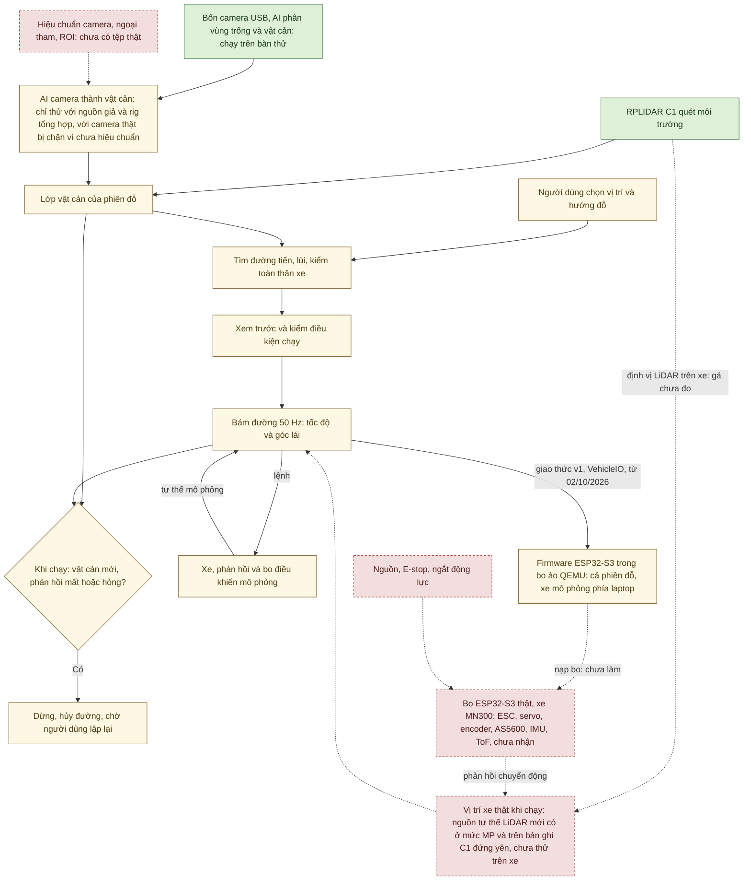

# AutoPark — xe mô hình tự đỗ

AutoPark là đồ án làm một chiếc xe mô hình biết tự đỗ trên sa bàn. Xe nền dự kiến là MN300 tỉ lệ 1/12. Laptop đặt trên
xe làm phần việc nặng: đọc LiDAR và bốn camera, chạy AI, tìm đường và bám đường. Một bo ESP32-S3 nhận lệnh tốc độ và góc
lái từ laptop rồi điều khiển ESC và servo.

Người dùng chỉ cần chọn chỗ đỗ và hướng đỗ. Phần mềm tìm một đường đi (có thể gồm cả đoạn tiến lẫn đoạn lùi), cho xe bám
theo đường đó, và dừng xe khi gặp vật cản mới hoặc mất dữ liệu cần thiết. Bản đầu tiên cần đạt gọi là **V1**, gồm mười
điều kiện hoàn thành ([kế hoạch](KE_HOACH_TRIEN_KHAI_XE_TU_DO_v3.1.md) mục 16.4).

Nghiên cứu nhận thức sử dụng **[Valeo WoodScape Dataset](https://github.com/valeoai/WoodScape)**
([phạm vi sử dụng](autopark/docs/GIAY_PHEP_DU_LIEU.md); xem thêm mục "Dữ liệu và ghi công" cuối trang).

## Dự án đang ở đâu?

*Hiện trạng tính đến 06/10/2026. Mã nguồn trên nhánh `main` giống commit `470abb3`.*

Nói ngắn gọn: **chưa có gì chạy trên xe thật**, vì xe, bo ESP32-S3 và phần lớn cảm biến chưa về. Phần mềm đã chạy được
trọn một lượt đỗ trong mô phỏng. LiDAR và bốn camera đã chạy với thiết bị thật trên bàn thử. **V1 hiện đạt 0/10 điều
kiện hoàn thành.**

Dự án luôn tách kết quả theo mức bằng chứng. Bốn nhóm dưới đây đi từ chắc chắn nhất tới chưa có gì.

**1. Đã đo trên thiết bị thật** (bàn thử trên máy bàn, chưa phải trên xe):

- LiDAR RPLIDAR C1 và bốn camera USB qua hub chạy cùng AI. Lần kiểm máy ngày 29/09/2026: LiDAR quay 10,00 Hz, trung vị
  508 tia mỗi vòng; bốn camera 640×480 cùng LiDAR và AI trong 120 s cho 2.861 bộ ảnh, không khung nào hỏng, AI xử lý
  23,85 bộ/s.
- Ngày 02/10/2026, bàn thử chạy liền 30 phút (kịch bản LD-1), không có người ở cạnh. Lần thứ ba chạy đủ 1800 s: mỗi
  camera 23,85 khung/s, không khung hỏng; LiDAR 18 015 vòng (10,008 Hz), không lỗi; AI 23,75 bộ/s. Lần thứ nhất bị dừng
  giữa chừng vì một phiên tác tử Claude khác trên cùng máy dừng nhầm tiến trình (nguyên nhân tìm ra ngày 06/10/2026).
  Lần thứ hai LiDAR không nhận được vòng nào vì byte cũ còn kẹt ở cổng; mã đọc C1 đã được sửa và thử lại trên C1 thật.
- Giới hạn: không ai kiểm camera nhìn thấy gì trong lúc chạy, và laptop trình diễn chưa chạy phép đo này.

Nguồn: [biên bản chuyển máy](autopark/docs/CHUYEN_MAY_BAN.md) mục 2, 12 và 16.

**2. Đã kiểm trên máy tính** (test tự động, biên dịch):

- Lượt chạy toàn bộ test gần nhất (06/10/2026, commit `470abb3`): môi trường `.venv` 2.105 đạt, 10 bỏ qua, 0 hỏng;
  `.venv-train` 2.168 đạt, 1 hỏng. Test hỏng là một test bo ảo: test chạy trước để lại bo ảo còn đang giảm dần tham chiếu
  tốc độ về 0, nên cổng START từ chối, đúng như thiết kế; phải sửa ở phía test. Riêng tiến trình pytest của `.venv` thoát bất thường (mã
  0xC0000005) sau khi đã chạy xong và ghi kết quả; nguyên nhân chưa rõ ([biên bản chuyển
  máy](autopark/docs/CHUYEN_MAY_BAN.md) mục 15, 16).
- Lõi C++ của firmware khớp bản tham chiếu Python (703 phép kiểm, 0 lệch), và cả firmware biên dịch được cho ESP32-S3
  (29/09/2026).
- Vòng điều khiển 50 Hz của ứng dụng được đo ngày 02/10/2026 khi cửa sổ để thường, thu nhỏ hay bị che (xe và bo mô
  phỏng). Cả 32/32 lần chạy xong. Khi cửa sổ thu nhỏ, chế độ tiết kiệm EcoQoS của Windows làm mỗi bước tính chậm đi
  khoảng 1,7 lần; ứng dụng nay tự tắt EcoQoS nên hiện tượng này hết. Khi thu nhỏ, khoảng hở lớn nhất giữa hai nhịp điều
  khiển là 46–47 ms, không lần nào quá 0,15 s ([biên bản chuyển máy](autopark/docs/CHUYEN_MAY_BAN.md) mục 10, 13).

**3. Chỉ chạy trong mô phỏng hoặc giả lập:**

- Giai đoạn 0 (mô phỏng) đạt cả sáu điều kiện chuyển bước ngày 20/09/2026, trên laptop
  ([báo cáo giai đoạn 0](BAO_CAO_GIAI_DOAN_0.md)).
- Trong ứng dụng, xe và phản hồi của xe đều là mô phỏng. Bo điều khiển là bo mô phỏng (bản Python của firmware), hoặc
  từ 02/10/2026 là **bo ảo**: firmware C++ thật chạy trong trình giả lập QEMU. Một lần chạy ứng dụng bằng script, không
  người bấm, đã đỗ xong 2/2 lần qua bo ảo; lái tay trên cửa sổ thật chưa thử ([biên bản chuyển
  máy](autopark/docs/CHUYEN_MAY_BAN.md) mục 14, [mô phỏng firmware](autopark/docs/MO_PHONG_FIRMWARE.md) mục 1.1).
- Nguồn tư thế từ LiDAR (định vị xe trên bản đồ, kiểm chéo bằng odometry khớp scan) chạy được với LiDAR mô phỏng và
  trên bản ghi C1 đứng yên. Nó chưa dùng được cho nghiệm thu mô phỏng: 4/9 kịch bản dừng vì lạc định vị (POSE_LOST).
- AI camera biến vùng bị chắn trên ảnh thành vật cản trong phiên đỗ. Phần này mới thử bằng nguồn giả, bàn thử tổng hợp
  và phát lại bản ghi. Với cấu hình camera thật, mọi lô ảnh đều bị chặn vì camera chưa được hiệu chuẩn.
- Các công cụ phục vụ nghiệm thu (chấm một lần chạy, phát lại log, tiêm lỗi, dấu đồng bộ video–log, ghi cảm biến trong
  phiên, tham chiếu trên cao…), cấu hình xe nghiệm thu 0,10 m/s và 9 tệp sa bàn nghiệm thu mới được kiểm bằng test, mô
  phỏng, bo ảo hay ảnh tổng hợp ([tổng quan](TONG_HOP_DU_AN.md) mục 4.15, 5.4).
- Firmware vẫn biên dịch cứng giới hạn 300 mm/s, nên ở nhánh VehicleIO bo ảo và ESP32-S3 sẽ từ chối xe
  nghiệm thu 0,10 m/s (lỗi LIMITS_MISMATCH, hướng an toàn). Điều này suy ra từ mã, chưa chạy thử; bản firmware 100 mm/s chưa làm.

**4. Chưa làm:**

- Chưa nhận xe MN300, ESP32-S3, IMU, cảm biến khoảng cách ToF, cảm biến góc lái AS5600, encoder, phần nguồn và nút dừng
  khẩn. Vì vậy firmware chưa được nạp vào bo nào.
- Chưa hiệu chuẩn camera; chưa đo sai số LiDAR so với thước; chưa đo vị trí gá LiDAR; chưa chọn camera trên cao để làm
  tham chiếu độc lập.
- Laptop trình diễn mới chạy mô phỏng giai đoạn 0.

Những việc cần có người ở cạnh thiết bị được xếp theo thứ tự nên làm trong [việc tại chỗ
thiết bị](autopark/docs/VIEC_TAI_CHO_THIET_BI.md). Bức tranh đầy đủ theo từng mảng nằm ở
[tổng quan và tiến độ](TONG_HOP_DU_AN.md).

## Bắt đầu từ đâu?

| Bạn cần gì? | Đọc tài liệu |
|---|---|
| Dự án đang ở đâu, còn thiếu gì, việc tiếp theo | [Tổng quan và tiến độ](TONG_HOP_DU_AN.md) |
| Cài đặt, mở mô phỏng, chạy test; lệnh cho LiDAR, camera, bàn thử, bo ảo | [Hướng dẫn chạy](autopark/README.md) |
| Xem hệ thống bằng sơ đồ: kiến trúc, phiên đỗ, cảm biến, AI, firmware, an toàn | [Sơ đồ hệ thống](autopark/docs/SO_DO_HE_THONG.md) |
| Thứ tự triển khai, sáu đợt mua, điều kiện chuyển bước, điều kiện V1 | [Kế hoạch v3.1](KE_HOACH_TRIEN_KHAI_XE_TU_DO_v3.1.md) |
| Kết quả AI và cách huấn luyện lại | [Huấn luyện AI](HUAN_LUYEN.md) |
| Bằng chứng mô phỏng giai đoạn 0 (20/09/2026) | [Báo cáo giai đoạn 0](BAO_CAO_GIAI_DOAN_0.md) |
| Tài liệu theo chuyên đề: camera, LiDAR, ESP32, nguồn, nghiệm thu, khóa luận | [Mục lục kỹ thuật](autopark/docs/README.md) |
| Firmware ESP32-S3 và bo ảo QEMU | [Mô phỏng firmware](autopark/docs/MO_PHONG_FIRMWARE.md), [README firmware](autopark/firmware/esp32_vehicle/README.md) |
| Đổi máy, chuẩn bị laptop trình diễn | [Chuyển máy bàn](autopark/docs/CHUYEN_MAY_BAN.md), [máy nộp đồ án](autopark/docs/MAY_NOP_DO_AN.md) |
| Lần tới ở cạnh bàn thử: việc cần người tại chỗ | [Việc tại chỗ thiết bị](autopark/docs/VIEC_TAI_CHO_THIET_BI.md) |
| Giảng viên, hội đồng: lần theo một con số tới tệp bằng chứng | [Tổng quan](TONG_HOP_DU_AN.md) mục 7 và thư mục [autopark/docs/evidence/](autopark/docs/evidence/) |

Người mới nên đọc theo thứ tự: trang này, rồi [tổng quan](TONG_HOP_DU_AN.md), rồi [hướng dẫn
chạy](autopark/README.md). Khi làm một việc cụ thể, mở tài liệu chuyên đề qua [mục lục kỹ
thuật](autopark/docs/README.md). Các tài liệu chuyên đề giữ ngày đo và diễn biến thử nghiệm, nên đọc chúng như biên bản.
Tệp lớn (thư mục `runs/`, dataset, checkpoint AI, môi trường Python) không có trong Git.

## Hệ thống gồm những gì?

| Thành phần | Vai trò trong V1 | Tình trạng (06/10/2026) |
|---|---|---|
| Xe MN300 Tank300 1/12 4WD RTR | Xe nền | Chưa nhận |
| Laptop | Xử lý cảm biến, AI, bản đồ, định vị, tìm và bám đường, giao diện, ghi log | Hiện phát triển trên máy bàn; laptop trình diễn mới chạy mô phỏng giai đoạn 0 |
| RPLIDAR C1 | Đo hình học xung quanh cho bản đồ, định vị, vật cản | Nhận 22/09/2026; chạy 30 phút liền không lỗi trên máy bàn (02/10/2026) |
| Bốn camera USB và hub UGREEN | Nhìn trước, sau, trái, phải; AI tách vùng trống và vật cản | Nhận 23/09/2026; chạy 30 phút liền trên máy bàn; chưa hiệu chuẩn, chưa gá |
| ESP32-S3 | Đọc phản hồi, nhận lệnh, điều khiển ESC và servo, tự dừng khi mất lệnh | Chưa nhận; firmware đã biên dịch và chạy trong bo ảo QEMU |
| BNO085 (IMU), VL53L1X (ToF), AS5600, encoder | Hướng xe, khoảng cách gần, góc lái, tốc độ | Chưa nhận |
| Nguồn, cầu chì, nút dừng khẩn, phần tử ngắt | Cấp điện; nút dừng khẩn cắt động lực bằng phần cứng, không qua laptop | Chưa có; mới có bản nháp thiết kế |

Máy phát triển hiện nay là máy bàn Dell Precision 3680 (i9-14900, RTX 4000 Ada 20 GB, Windows 11), dùng từ 29/09/2026.
Laptop RTX 3050 Ti dùng để trình diễn. Chi tiết thiết bị: [kiểm kê](autopark/docs/hardware_inventory.md),
[kế hoạch](KE_HOACH_TRIEN_KHAI_XE_TU_DO_v3.1.md) mục 1.1.

Sơ đồ dưới là luồng V1 mục tiêu, tô màu theo hiện trạng của từng khối. Đây là bản rút gọn của sơ đồ 1.1 trong
[Sơ đồ hệ thống](autopark/docs/SO_DO_HE_THONG.md):



Cách đọc màu ở sơ đồ này:

- **Xanh:** đã chạy với thiết bị thật trên bàn thử (LiDAR C1, bốn camera, AI suy luận trên ảnh camera thật). Xanh không
  có nghĩa là cổng chuyển bước đã đạt.
- **Vàng:** mới chạy với xe mô phỏng, bo mô phỏng hoặc bo ảo QEMU. Gồm: chọn đích, tìm đường, lớp vật cản của phiên, AI
  camera tạo vật cản, xem trước và kiểm trước khi chạy, bám đường, dừng, firmware trong bo ảo.
- **Đỏ viền đứt:** chưa làm hoặc chưa thử trên thiết bị (vị trí xe thật khi chạy, tệp hiệu chuẩn camera, bo ESP32-S3
  thật, xe MN300 và cảm biến, nguồn và nút dừng).
- **Mũi tên nét đứt:** đường nối chưa có hoặc chưa chạy.

Không khối nào đã chạy trên xe. Đường từ bám đường tới firmware trong bo ảo là nét liền vì từ 02/10/2026 bo ảo chạy được
cả phiên đỗ, nhưng tốc độ, góc lái và tư thế vẫn lấy từ xe mô phỏng phía laptop, nên đó vẫn là giả lập. Khối "vị trí xe
thật" còn đỏ vì nguồn tư thế LiDAR chưa thử với LiDAR gá trên xe đang chạy. Các sơ đồ khác (kiến trúc mô-đun, phiên đỗ,
lập đường, cảm biến, AI, liên kết laptop–bo, an toàn, tiến độ, quy trình) nằm trong
[Sơ đồ hệ thống](autopark/docs/SO_DO_HE_THONG.md).

## Đã có gì, còn thiếu gì?

| Mảng | Đã có | Còn thiếu để dùng trên xe |
|---|---|---|
| Mô phỏng, lập đường | Đặt đích, tìm đường tiến/lùi, bám đường, dừng khi có vật cản mới hoặc mất dữ liệu, lưu và phát lại; xe nghiệm thu 0,10 m/s | Thông số MN300 đo thật (cấu hình xe hiện là giả định) |
| LiDAR | Đọc, ghi, phát lại; bản đồ tĩnh; định vị trên bản ghi đứng yên; bản đồ nhiều chỗ đặt; nguồn tư thế LiDAR trong phiên (mức mô phỏng) | Sai số so với thước; bản ghi khi di chuyển; tham chiếu độc lập; đo gá LiDAR; bản đồ sa bàn thật |
| Camera | Bốn luồng 640×480 cùng LiDAR và AI trên bàn thử; ghi và phát lại; chạy 30 phút liền | Hiệu chuẩn nội tham, ngoại tham, ROI; gá thật; ảnh sa bàn có nhãn; kiểm camera đúng hướng sau khi khởi động lại; 720p còn khung bị cắt |
| AI tạo vật cản | Nối vào phiên đỗ ở mức phần mềm; phát lại bản ghi thật o03: cả 1.163 lô bị chặn vì chưa hiệu chuẩn | Hiệu chuẩn thật; chấm AI trên ảnh sa bàn có nhãn; thử với camera trực tiếp |
| Điều khiển xe | Giao thức v1, VehicleIO, bo mô phỏng; firmware qua test host, biên dịch, chạy trong bo ảo cả phiên đỗ | ESP32-S3 thật; mã đọc cảm biến phản hồi; nguồn tư thế thật trên xe; firmware 100 mm/s |
| Nguồn và dừng | Bản nháp bảng tải, sơ đồ nguồn và dừng, 16 kịch bản lỗi L1–L16 | Lắp và đo trên phần cứng; cả 16 kịch bản chưa thử |
| Nghiệm thu | 37 kịch bản nháp, bảng ngưỡng đề xuất, phần lớn công cụ nghiệm thu (mới kiểm bằng test); LD-1 chạy đủ 30 phút trên máy bàn | Chốt ngưỡng; thử các kịch bản; nguồn tư thế thật trên xe; camera trên cao và phép kiểm TC-1; LED đồng bộ video trên bo; LiDAR mô phỏng đủ tốt cho nghiệm thu mô phỏng |

Chi tiết từng mảng, kèm số đo và nguồn: [tổng quan](TONG_HOP_DU_AN.md) mục 4.

**Tiến độ 11 giai đoạn.** Giai đoạn 0 đạt ở mức mô phỏng. Chưa giai đoạn nào từ 1 đến 10 đạt cổng chuyển bước. Giai đoạn
1–2 đang làm và đã có số đo LiDAR, bốn camera trên bàn thử. Giai đoạn 3, 5, 8 mới có phần mềm hoặc giả lập, đang chờ thiết
bị. Giai đoạn 4, 6 mới là bản nháp. Giai đoạn 7, 9 chưa làm. Giai đoạn 10 có dàn ý khóa luận, kịch bản và ngưỡng nháp,
chưa nghiệm thu. Bảng từng giai đoạn: [tổng quan](TONG_HOP_DU_AN.md) mục 3; sơ đồ 8.1 và 8.3 trong
[Sơ đồ hệ thống](autopark/docs/SO_DO_HE_THONG.md).

## Chạy mô phỏng trên Windows

Mô phỏng không cần cảm biến, GPU hay checkpoint AI. Cần Python 3.11 trở lên (môi trường đã kiểm dùng 3.12.10) và có mạng
khi cài thư viện. Mọi lệnh chạy trong thư mục `autopark` bên trong repo, tức thư mục có `pyproject.toml` và
`run_app.py`.

1. Chạy `cai_dat.cmd`. Lệnh này tạo môi trường `.venv` theo `requirements-phase0.lock` và cài gói `autopark`. Nếu `.venv`
   chép từ máy khác không chạy được, lệnh đổi tên nó thành `.venv.hong-tu-may-cu` rồi tạo môi trường mới.
2. Chạy `chay_app.cmd` để mở giao diện sa bàn.
3. Đặt hoặc xoay đích, rồi bấm lần lượt **Tìm đường đỗ** → **Xem trước** → **Bắt đầu đỗ**. Khi xe đang chạy, thử bấm
   **Vật cản giả** hoặc **Mất dữ liệu**: xe phải dừng. Sau đó chọn lại vị trí và lập đường mới.

Cửa sổ này không mở LiDAR, camera hay AI. Các công cụ đó có lệnh riêng, ví dụ `python -m autopark.ui.lidar_app` (thêm
`--camera-ai` để bật AI camera) và bàn thử bốn camera `autopark.rig.bench`, `autopark.ui.rig_app`
([hướng dẫn chạy](autopark/README.md) mục 7).

Thư mục `scenarios/nghiem_thu/` có 9 tệp sa bàn dựng sẵn cho các kịch bản đỗ nghiệm thu DO-1 … DO-6, ở mức mô phỏng. Ví
dụ `chay_app.cmd scenarios\nghiem_thu\do1.json`. Mỗi tệp tự dùng xe nghiệm thu 0,10 m/s và giới hạn số lần đổi chiều của
kịch bản đó (các giới hạn này còn là đề xuất). Muốn chạy kịch bản khác với xe nghiệm thu, thêm
`--vehicle-config configs\vehicle_nghiem_thu.json` ([hướng dẫn chạy](autopark/README.md) mục 3).

**Kiểm nhanh không mở giao diện** (PowerShell, cùng thư mục):

```powershell
./.venv/Scripts/python.exe -X utf8 -m autopark.evaluation.phase0 --out runs/thu_nghiem_moi
./.venv/Scripts/python.exe -X utf8 -m autopark.evaluation.replay runs/thu_nghiem_moi/obstacle
```

Lệnh thứ nhất chạy năm phiên mẫu. Ba phiên `parking`, `reverse`, `noisy` phải kết thúc COMPLETED; hai phiên `obstacle`
(vật cản mới) và `data_loss` (mất dữ liệu) phải STOPPED. Mỗi phiên được phát lại và so với log; sai lệch thì lệnh báo lỗi.
Lệnh thứ hai chạy lại phiên `obstacle` từ cấu hình và quỹ đạo đã lưu, và báo lỗi nếu kết quả khác bản ghi. Mỗi lượt nên
dùng một thư mục đầu ra mới. Lượt chạy lại trên máy bàn ngày 29/09/2026 cho đúng năm kết quả này ([tóm tắt lượt
đó](autopark/docs/evidence/chuyen_may_20260929/kiem_may_20260929.md)).

**Chạy toàn bộ bộ test:**

```powershell
$env:QT_QPA_PLATFORM = "offscreen"
./.venv/Scripts/python.exe -X utf8 -m pytest
Remove-Item Env:QT_QPA_PLATFORM
```

Các test cần torch được bỏ qua trong `.venv`. Muốn chạy cả chúng, dùng cùng lệnh với `./.venv-train/Scripts/python.exe`
(tạo môi trường này bằng `cai_dat_train.cmd`). Một số test lập đường có hạn giờ, nên kết quả phụ thuộc cách Windows xếp
lịch tiến trình. Vì vậy `tests/conftest.py` tự tắt EcoQoS cho tiến trình pytest; ứng dụng và các công cụ đo cũng tự tắt
EcoQoS cho chính mình. Đặt `AUTOPARK_KEEP_ECOQOS=1` nếu muốn giữ mặc định của Windows. Vẫn nên chạy test khi máy rảnh.

Lượt mới nhất (06/10/2026, commit `470abb3`, cây làm việc sạch, máy bàn) có [tóm
tắt ở đây](autopark/docs/evidence/dot2_20261006/chay_tren_commit_470abb3.txt). Các lượt trước và giới hạn của chúng:
[tổng quan](TONG_HOP_DU_AN.md) mục 7. Lệnh từng bước, môi trường AI và cách xử lý lỗi: [hướng dẫn
chạy](autopark/README.md) mục 2–5 và 11.

**Bản clone và máy mới.** Bản clone không kèm môi trường Python, checkpoint AI, dataset đầy đủ và các phiên trong
`runs/`; cần tạo lại hoặc chép từ máy đã làm dự án ([hướng dẫn chạy](autopark/README.md) mục 5). Khi chép cả thư mục sang
máy khác, chạy lại `cai_dat.cmd` và `cai_dat_train.cmd`. Thiết bị gắn với từng máy được khai ở một tệp duy nhất,
[autopark/configs/thiet_bi.json](autopark/configs/thiet_bi.json): khóa `lidar_port` là cổng COM của LiDAR trên máy đó
(hoặc `"auto"` để tự tìm bộ chuyển CP210x), các khóa còn lại là đường dẫn QEMU và PlatformIO cho bo ảo. Các bước đổi máy:
[biên bản chuyển máy](autopark/docs/CHUYEN_MAY_BAN.md) mục 5.

## Dữ liệu và ghi công

Nghiên cứu nhận thức sử dụng **[Valeo WoodScape Dataset](https://github.com/valeoai/WoodScape)**.

Ngày 25/09/2026, người làm khóa luận quyết định dùng mô hình huấn luyện trên WoodScape trong vòng điều khiển xe mô hình.
**Valeo chưa xác nhận cách dự án diễn giải điều khoản.** Quyết định này không áp dụng cho checkpoint có dùng AVM-SS hay
nhãn nháp do AI tạo. Hồ sơ cũng ghi điều kiện dùng AVM-SS, DROW v2 và trọng số khởi tạo của torchvision. Xem
[hồ sơ giấy phép](autopark/docs/GIAY_PHEP_DU_LIEU.md).

## Ghi chú về các bản cũ

Các biên bản chuyên đề viết trước 26/09/2026 có chỗ dẫn tên đoạn hay "bước N" của kế hoạch. Những tên đó theo bản kế
hoạch tại [`9d68257`](https://github.com/thbn12082/autopark/tree/9d68257), bản cũng giữ nhật ký chi tiết tới 25/09/2026.
