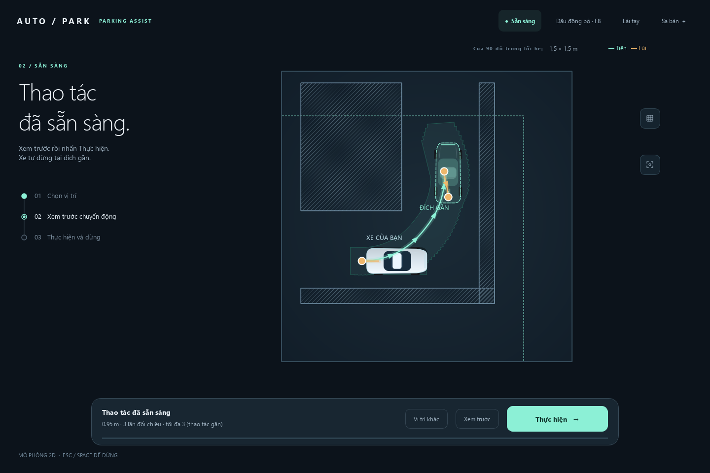

# AutoPark — đỗ xe và xoay trở cho xe mô hình

AutoPark hướng tới xe mô hình tự tìm ô đỗ phù hợp, tính đường tiến/lùi và thực hiện ở tốc độ thấp. **Kiến trúc mục tiêu gồm laptop chạy AI và lập đường, Raspberry Pi trên xe thu cảm biến và bám đường, ESP32 điều khiển cơ cấu thật.** Người dùng xem phương án và xác nhận trước mỗi lượt chạy.

**Hiện tại, phần mềm chủ yếu phục vụ mô phỏng và thử từng khối:** người dùng chọn vị trí, hướng đích gần; ứng dụng tính đường, bám đường, dừng và lưu/phát lại lượt chạy. Chưa triển khai hệ phân tán Laptop–Pi–ESP32, chưa tự chọn ô đỗ và chưa có kết quả hoàn thành thao tác trên xe thật. Các sơ đồ dưới đây mô tả thiết kế mục tiêu, không phải bằng chứng phần cứng đã lắp hoặc chạy đạt.

## Phần cứng đã chốt ngày 14/11/2026

| Thành phần | Cấu hình / nhiệm vụ |
|---|---|
| Máy tính trên xe | **Raspberry Pi 4 Model B, RAM 4 GB** |
| Lưu trữ trên Pi | **microSD 64 GB** cho hệ điều hành, chương trình, cấu hình và log; video ưu tiên lưu ở laptop |
| Cảm biến góc lái | **MT6701 #1**, đọc góc tuyệt đối qua I²C vào ESP32; gá tại cơ cấu lái |
| Cảm biến chuyển động | **MT6701 #2**, xuất xung A/B vào ESP32; gá trên bánh hoặc trục truyền động |
| Điều khiển cơ cấu | ESP32-S3 + ESC QuicRun 1060 + servo lái |
| Quan sát | LiDAR C1 và bốn camera USB; AI xử lý trên laptop |

**Dùng hai MT6701 riêng, kèm hai nam châm và hai vị trí gá.** Cảm biến #1 trả góc lái; cảm biến #2 trả chuyển động trục để quy đổi tốc độ/quãng đường. Hai module dùng khác chế độ, không đấu chung A/B của module #2 vào bus I²C của module #1. Tên chip đã chốt; module thương mại, chân thực tế, PPR và gá vẫn phải đối chiếu.

Pi 4 không lưu hệ điều hành trong RAM: cần thẻ microSD. Nguồn Pi dự kiến USB-C ổn áp 5,1 V/3 A; tổng tải USB trực tiếp phải nằm trong giới hạn 1,2 A của Pi 4. Hub bốn camera có nguồn phù hợp riêng; đo tải C1/ESP32, độ trễ và CPU trước khi chốt FPS. Xem [hướng dẫn lắp và nguồn tham khảo](autopark/docs/LAP_RAP_DIEN_2D.md).

## Hiện có và cần phát triển

| Hạng mục | Hiện có trong repository | Phần cần phát triển theo thiết kế mục tiêu |
|---|---|---|
| Thao tác và đích đến | Giao diện chọn đích gần, lập và bám đường trong ứng dụng; mô phỏng cua hẹp, lách vật cản, chỉnh vào khe | Laptop nhận biết, đánh giá và chọn ô đỗ từ dữ liệu cảm biến |
| Cảm nhận | Các khối camera/AI, LiDAR, hợp nhất vật cản và ước lượng tư thế; công cụ hiệu chuẩn, ghi và phát lại | Tích hợp thu cảm biến trên Pi, chuyển dữ liệu tới laptop và kiểm độ mới giữa các máy |
| Thực hiện quỹ đạo | Bộ bám và xử lý dừng chạy trong ứng dụng hiện tại | Pi nhận quỹ đạo, định vị và bám đường cục bộ; giám sát vật cản và liên kết |
| Bo điều khiển | Giao thức và logic firmware có xử lý hết hạn lệnh; PWM còn tắt, đọc encoder/góc lái thật chưa hoàn thiện | Hoàn thiện đầu ra ESC/servo, phản hồi thật và kiểm watchdog trên xe |

Kết quả mô phỏng đã ghi nhận nằm trong [Kiểm thử và lộ trình](autopark/docs/KIEM_THU_VA_LO_TRINH.md). Kết quả đó chỉ áp dụng cho mô hình và bộ tình huống đã thử.

## Phân công trong kiến trúc mục tiêu

| Thiết bị | Công việc chính | Dữ liệu trao đổi |
|---|---|---|
| **Laptop** | Chạy AI trên ảnh từ bốn camera; hợp nhất dữ liệu cảm biến; nhận biết và chọn ô đỗ; lập và kiểm tra quỹ đạo | Nhận ảnh, dữ liệu LiDAR, tư thế và trạng thái từ Pi; gửi quỹ đạo cùng điều kiện thực hiện xuống Pi |
| **Pi 4 Model B · 4 GB trên xe** | Thu cảm biến; ước lượng vị trí và hướng xe; bám quỹ đạo theo phản hồi; chủ động yêu cầu dừng khi vùng chuyển động không an toàn hoặc dữ liệu/liên kết quá hạn | Nhận quỹ đạo qua Wi-Fi; gửi lệnh tốc độ/góc lái có hạn hiệu lực tới ESP32 qua USB ngắn; nhận phản hồi thật |
| **ESP32 trên xe** | Phát tín hiệu tới ESC và servo; đọc MT6701 #2 qua A/B và MT6701 #1 qua I²C; giám sát hạn lệnh và đưa cơ cấu về trạng thái dừng khi hết hạn | Nhận lệnh từ Pi; trả số đo và trạng thái lỗi về Pi |

**AI không phát lệnh lái trực tiếp.** Laptop gửi quỹ đạo để Pi thực hiện; Pi tự tính các nhịp điều khiển tại xe. Wi-Fi không phải đường truyền từng nhịp đánh lái từ laptop.

Laptop và Pi kết nối **Wi-Fi trong cùng mạng LAN**, có thể qua router hoặc điểm phát tại chỗ. **Không cần Internet hay 4G để vận hành cấu hình này.** 4G chỉ là lựa chọn truy cập từ xa về sau, chưa nằm trong cấu hình vận hành hiện tại.

Trên xe, LiDAR C1 dùng adapter USB nối Pi; bốn camera USB nối qua hub tới Pi; Pi nối ESP32 bằng cáp USB ngắn. Pi chuyển dữ liệu cần thiết lên laptop để xử lý AI và lập đường. Băng thông camera, độ trễ, khả năng cấp nguồn của hub và tải xử lý trên Pi còn cần đo khi tích hợp.

## Hai luồng cần đọc trước

### Nhận biết vật cản và dừng

Pi thu LiDAR, ảnh camera và phản hồi chuyển động. Laptop chạy AI và hợp nhất bằng chứng vật cản; Pi duy trì định vị và giám sát cục bộ vùng mà toàn thân xe sắp đi qua. Khi vật cản làm vùng này không an toàn, dữ liệu cần thiết quá hạn hoặc liên kết mất quá ngưỡng giám sát, xe phải dừng. ESP32 có thêm watchdog để xử lý lệnh từ Pi hết hạn.


Đọc [Luồng vật cản](autopark/docs/LUONG_VAT_CAN.md) để theo dõi nguồn dữ liệu, nơi xử lý và trách nhiệm dừng của từng thiết bị.

### Chọn ô đỗ, tính đường và thực hiện

Laptop dùng bản đồ vật cản và tư thế đo được để đánh giá ô đỗ, tính đường tiến/lùi và kiểm khoảng trống cho toàn thân xe. Sau khi người dùng xác nhận, laptop gửi quỹ đạo xuống Pi. Pi kiểm điều kiện thực hiện, bám đường bằng phản hồi tại xe và gửi lệnh ngắn hạn tới ESP32.


**Xe không tự chạy lại khi vật cản biến mất hoặc mạng/dữ liệu phục hồi.** Sau khi xác nhận xe đứng yên, Pi cung cấp tư thế mới đo được; laptop tính lại đường từ tư thế đó. Người dùng phải xác nhận lượt chạy mới. Nếu chưa có tư thế hoặc dữ liệu hợp lệ, xe tiếp tục đứng yên.

Đọc [Luồng tính đường](autopark/docs/LUONG_TINH_DUONG.md) để phân biệt chọn ô, lập quỹ đạo, bám đường và tính lại sau khi dừng. Tự chọn ô và phân chia công việc qua Pi là phần dự kiến; cách dùng phần mềm hiện có vẫn là chọn đích gần thủ công.

## Phần cứng và nguồn điện

Chi tiết linh kiện, chân GPIO đề xuất, đầu nối, điều kiện tương thích, cách gá phản hồi và trình tự kiểm tra được giữ tại [Lắp ráp điện 2D](autopark/docs/LAP_RAP_DIEN_2D.md). Đây là tài liệu cần đối chiếu trước khi đi dây.

Ba nhánh nguồn cần phân biệt:

- **Motor:** pin LiPo 2S cấp ESC QuicRun 1060; ESC cấp motor kéo.
- **Servo:** dự kiến lấy nguồn từ BEC 6 V của ESC, chỉ nối sau khi xác minh servo chịu được 6 V và BEC đáp ứng dòng tải lái. Chưa xác nhận tương thích servo gốc.
- **Pi và thiết bị USB:** Pi cần nguồn ổn áp riêng phù hợp model và tổng tải. **Không cấp Pi bằng BEC 6 V của ESC.** ESP32 dùng USB từ Pi theo thiết kế; nguồn cho hub/camera và khả năng cấp dòng của từng cổng phải được kiểm tra.

Bộ hình được dựng từ mã thành SVG và PNG để đọc trên GitHub. Các hình là bản thiết kế, chưa xác nhận lắp ráp hoặc kiểm thử phần cứng.


*Nhận diện linh kiện và đầu nối; module, điện áp và cách gá chưa chốt phải được đối chiếu với thiết bị thực nhận.*


*Nguồn Pi tách biệt với nhánh BEC cấp servo; BEC chỉ dùng khi đã xác minh tương thích.*


*C1 và hub bốn camera nối Pi; Pi nối ESP32 bằng USB ngắn. MT6701 #1 (I²C, góc lái) và MT6701 #2 (A/B, chuyển động) trả phản hồi về ESP32.*


*Sạc B3 dùng giắc cân bằng 2S khi pin đã tách khỏi ESC và mọi tải trên xe. Không chạy xe đồng thời với sạc.*

## Chạy mô phỏng hiện có

Từ thư mục gốc repository, dùng Python 3.11 trở lên trong PowerShell:

```powershell
cd autopark
python -m venv .venv
.\.venv\Scripts\python.exe -m pip install -e .
.\.venv\Scripts\python.exe run_app.py scenarios/thao_tac_cua_hep.json
```

Có thể thay kịch bản bằng `scenarios/thao_tac_lui_vao_khe.json`. Trong giao diện, chọn vị trí và hướng đích gần, tính thao tác, xem trước rồi xác nhận thực hiện trong mô phỏng. Cách chạy này chưa triển khai dịch vụ trên Pi hoặc điều khiển xe thật.



*Ảnh mô phỏng đường tiến/lùi và vùng thân xe quét qua. Giới hạn của các cảnh mẫu thuộc cấu hình mô phỏng, chưa phải thông số đã đo trên xe.*

## Đọc tiếp theo công việc

| Bạn muốn tìm hiểu | Tài liệu |
|---|---|
| Cách dữ liệu trở thành vật cản và yêu cầu dừng | [Luồng vật cản](autopark/docs/LUONG_VAT_CAN.md) |
| Cách chọn ô, tính đường và chạy một lượt | [Luồng tính đường](autopark/docs/LUONG_TINH_DUONG.md) |
| Cấu trúc các khối phần mềm | [Kiến trúc](autopark/docs/KIEN_TRUC.md) |
| Cách dùng, lưu và phát lại mô phỏng | [Vận hành](autopark/docs/VAN_HANH.md) |
| Đi dây, cấp nguồn và đối chiếu chân | [Lắp ráp điện 2D](autopark/docs/LAP_RAP_DIEN_2D.md) |
| Đo xe, gá và hiệu chuẩn cảm biến | [Phần cứng và hiệu chuẩn](autopark/docs/PHAN_CUNG_VA_HIEU_CHUAN.md) |
| Bằng chứng hiện có và các bước còn thiếu | [Kiểm thử và lộ trình](autopark/docs/KIEM_THU_VA_LO_TRINH.md) |
| Nguồn dữ liệu và điều kiện sử dụng | [Dữ liệu và giấy phép](autopark/docs/DU_LIEU_VA_GIAY_PHEP.md) |
