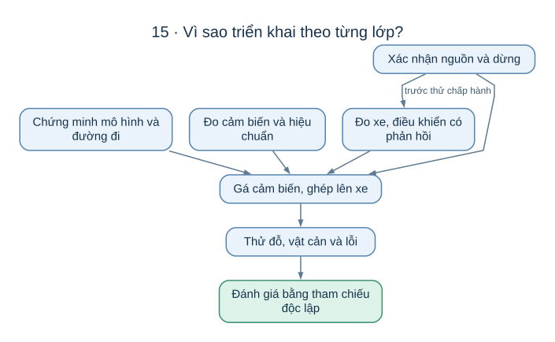
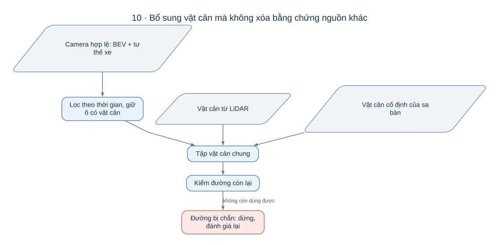
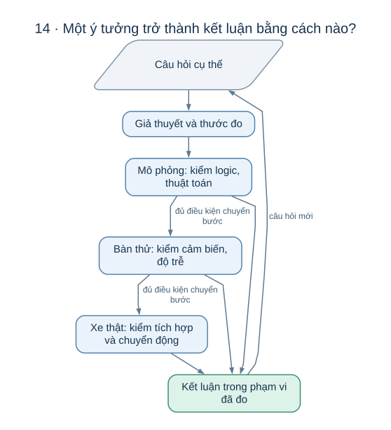

# AutoPark: các lựa chọn thiết kế và những câu hỏi còn mở

Tài liệu này nối **mỗi vấn đề của xe tự đỗ** với **cách dự án đang giải quyết**, rồi chỉ ra điều còn phải chứng minh. Điểm bắt đầu là [câu chuyện một lần đỗ](autopark/README.md); phần giải thích sâu nằm ở [cảm nhận và định vị](autopark/docs/CAM_NHAN_VA_DINH_VI.md), [tìm và bám đường](autopark/docs/THUAT_TOAN_DUONG_DI.md).

Bản viết ngày 17/10/2026 dựa trên mã hiện có và hồ sơ thử tới 06/10/2026. Các lý do lựa chọn được giải thích trong phạm vi xe mô hình chạy chậm trên sa bàn; chúng chưa chứng minh một phương án tốt nhất cho mọi hệ thống tự lái.

## 1. Mục tiêu V1, phạm vi và mức bằng chứng

V1 là phiên bản đầu: người dùng chọn vị trí và hướng đỗ, hệ thống đưa xe tới đó bằng các động tác tiến/lùi, tránh vật cản và dừng khi thiếu điều kiện để tiếp tục. Bài toán có điểm đầu, điểm cuối và khu vực hoạt động giới hạn.

Việc tự tìm một bãi đỗ từ xa, hiểu mọi tình huống giao thông hoặc học trực tiếp ảnh thành lệnh lái chưa thuộc mục tiêu này. Giới hạn phạm vi giúp dự án tập trung vào những khó khăn cốt lõi: **ràng buộc chuyển động, nhận thức có sai số, điều khiển có phản hồi và quyết định dừng**.

Một kết quả phải gắn với mức thử. Xe ảo đỗ được chứng minh được một phần thuật toán; cảm biến chạy ổn trên bàn chứng minh được một phần thu dữ liệu; xe thật đỗ đúng còn cần cơ khí, điện và thời gian thực cùng hoạt động. Theo hồ sơ, giai đoạn mô phỏng đã đạt các điều kiện riêng, còn V1 chưa đạt 10 điều kiện nghiệm thu trên hệ thống mục tiêu.

## 2. Vì sao chia việc giữa laptop, cảm biến và bo điều khiển?

| Thành phần | Vấn đề nó giải quyết | Lý do phù hợp với cách tổ chức hiện tại |
|---|---|---|
| Laptop | Xử lý ảnh, ước lượng môi trường, tìm đường | Các phép tính lớn và thay đổi thường xuyên được đặt cùng nơi để dễ phân tích |
| LiDAR | Hình học và khoảng cách tới bề mặt | Cung cấp phép đo không phụ thuộc vào việc AI gọi đúng tên vật |
| Bốn camera | Quan sát nhiều phía và bổ sung thông tin từ ảnh | Hướng tiến và lùi khác nhau; một camera đơn khó bao quát cả vùng quanh xe |
| ESP32-S3 | Giao tiếp với cơ cấu xe và xử lý điều kiện cục bộ | Bo có thể xử lý lệnh hết hạn khi laptop hoặc liên kết gặp vấn đề |
| Cảm biến tốc độ, góc lái, quán tính, khoảng cách gần | Phản hồi điều xe thực sự đang làm | Lệnh đã gửi không phải phép đo chuyển động đã xảy ra |
| Phần nguồn và dừng khẩn | Giữ khả năng dừng khi phần mềm gặp lỗi | Một nút trên màn hình không đủ nếu máy tính không còn đáp ứng |

Đây là lý do phân chia trách nhiệm, chưa phải bằng chứng rằng các linh kiện đã chọn hoạt động tốt khi ghép trên xe. Hồ sơ hiện có ghi nhận LiDAR và camera trên bàn; xe MN300, bo ESP32-S3 và nhiều phần cảm biến/nguồn còn chưa được thử thành hệ thống thật.

## 3. Vì sao cần chứng minh từng lớp trước khi ghép hệ thống?

Nếu ghép mọi thứ ngay từ đầu, một lần xe lệch ô có quá nhiều cách giải thích: hình học sai, cảm biến sai, vị trí sai, điều khiển sai hoặc động cơ không đáp ứng. Kiểm từng lớp làm giảm số nguyên nhân có thể gây ra lỗi.

Trình tự vì thế đi từ mô hình chuyển động và thuật toán, sang cảm biến đã đo, rồi phản hồi trên xe, cuối cùng mới đánh giá tự đỗ. Nguồn điện và khả năng dừng được chuẩn bị theo từng phép thử chuyển động. [Kế hoạch triển khai](KE_HOACH_TRIEN_KHAI_XE_TU_DO_v3.1.md) ghi các điều kiện chuyển bước cụ thể.

## 4. Các ý tưởng chính theo từng mảng

### 4.1. Mô phỏng và lập đường

Xe được mô tả bằng mô hình động học kiểu xe đạp: ở tốc độ thấp, góc lái và chiều dài cơ sở quyết định độ cong của chuyển động. Mô hình đủ đơn giản để thử rất nhiều động tác, đồng thời thể hiện việc xe không thể trượt ngang.

Dự án thử nhiều bộ tìm đường theo thứ tự: lưới với nhịp tiến/lùi gộp, tìm kỹ hơn trên cùng cách biểu diễn, RRT-Connect kết hợp Reeds–Shepp, rồi Hybrid A* mịn. Cách nhanh được dùng trước; các cách còn lại mở thêm cơ hội ở bài khó. Mỗi ứng viên còn phải qua mô phỏng bám đường.

Lý do của bước kiểm bám nằm ngay trong ràng buộc xe: tận dụng hết góc lái có thể tạo ra một đường hình học vừa đủ vào ô, nhưng bộ điều khiển sẽ còn ít khả năng sửa sai. Vì thế **tồn tại đường** và **xe thực hiện được đường** là hai câu hỏi riêng. Xem [các thuật toán đường đi](autopark/docs/THUAT_TOAN_DUONG_DI.md).

### 4.2. AI nhận thức, dữ liệu và giấy phép

AI phân đoạn ảnh thành vùng trống và vùng bị chắn, để bổ sung thông tin môi trường. Cách này phù hợp câu hỏi “vùng nào nên tránh?” mà không buộc hệ thống phải đặt tên đúng mọi chiếc hộp hoặc vật lạ.

Mô hình L-RASPP với MobileNetV3-Large là một mốc tham chiếu tương đối gọn. Việc giữ mô hình hiện tại dựa vào các kết quả đánh giá đã có; dự án chưa có thí nghiệm đủ rộng để kết luận nó tối ưu hơn mọi kiến trúc khác. [Bài AI](HUAN_LUYEN.md) giải thích cấu trúc, dữ liệu và cách đọc kết quả.

### 4.3. LiDAR RPLIDAR C1

Một vòng quét LiDAR cung cấp khoảng cách theo nhiều hướng. Từ đó hệ thống có thể mô tả vật cản hoặc so vòng quét với bản đồ để suy ra vị trí. Hai việc này dùng cùng dữ liệu nhưng trả lời hai câu hỏi khác nhau.

Dự án chọn định vị trên bản đồ tĩnh, có dự đoán và kiểm chéo chuyển động giữa các vòng quét. Sa bàn giới hạn giúp việc xây dựng và kiểm bản đồ riêng trở nên khả thi. Đây là một cách giảm độ phức tạp so với đồng thời xây bản đồ khi xe đang chạy, đổi lại bản đồ phải phù hợp và có thể thiếu thông tin khi cảnh thay đổi. [Cảm nhận và định vị](autopark/docs/CAM_NHAN_VA_DINH_VI.md) giải thích cách khớp từ thô tới tinh và lý do phải nhận ra tình huống mơ hồ.

### 4.4. Camera và độ tin cậy của ảnh

Ảnh có nhiều chi tiết nhưng chịu ảnh hưởng của ánh sáng, méo ống kính, che khuất và thời điểm chụp. Hình đẹp trên màn hình chưa có nghĩa hệ thống biết vật cách xe bao nhiêu.

Bởi vậy dự án xem chất lượng ảnh, hiệu chuẩn và độ mới dữ liệu là một phần của bài toán thuật toán. Một dự đoán đúng trên khung ảnh cũ vẫn có thể dẫn tới hành động sai ở hiện tại.

### 4.5. Kết hợp bốn camera, LiDAR và AI

Các cảm biến chạy đồng thời tạo ra một bài toán thời gian: một ảnh mới và một vòng quét cũ có thể mô tả hai vị trí xe khác nhau. Mục tiêu của bàn thử là biết độ trễ, tính ổn định và khả năng ghép dữ liệu, trước khi yêu cầu xe dùng chúng để chuyển động.

Theo hồ sơ ngày 02/10, một lượt bàn thử đã chạy đủ 30 phút. Kết quả đó hỗ trợ nhận định về thu dữ liệu liên tục trên máy đã đo; nó chưa thay thế thử cảm biến khi gắn lên xe đang chạy. Nguồn: [biên bản chuyển máy, các lượt thiết bị](autopark/docs/CHUYEN_MAY_BAN.md).

### 4.6. Hiệu chuẩn camera

Hiệu chuẩn nội tham trả lời “ống kính biến một tia nhìn thành pixel như thế nào?”. Ngoại tham trả lời “camera đang ở đâu và nhìn theo hướng nào so với xe?”. Khi hai quan hệ này sai, vật cản trên bản đồ cũng có thể sai vị trí dù AI nhận ra vật đúng.

Vì vậy thiếu hiệu chuẩn phải được coi là thiếu điều kiện để sử dụng thông tin hình học. Đó là lý do nhánh AI camera hiện còn chặn dữ liệu thật chưa có hiệu chuẩn phù hợp.

### 4.7. Gán nhãn ảnh sa bàn

Nhãn do con người tạo giúp định nghĩa điều mô hình cần nhận ra trong môi trường thực của dự án. Đây là cách biến một nhận xét như “AI hay bỏ sót hộp” thành câu hỏi đo được.

Tập đánh giá nên được tạo độc lập với mô hình đang so. Nếu chỉ sửa nhãn từ dự đoán của mô hình nền, dữ liệu đánh giá có thể giữ thiên lệch có lợi cho mô hình đó. [Quy trình nhãn](autopark/docs/GAN_NHAN_SA_BAN.md) lưu chi tiết chuyên đề.

### 4.8. Hợp nhất cảm biến

Mục tiêu là đưa vật cản từ các nguồn về cùng hệ tọa độ và thời gian. Dự án giữ thông tin theo nguồn, để một kết quả camera gọi là vùng trống không xóa một vật cản LiDAR đã thấy.

Cầu nối camera hiện đưa các ô được xác định có vật cản vào bộ lập đường. Vùng chưa rõ của camera cần được diễn giải theo quy tắc riêng, không thể suy ra rằng toàn bộ vùng đó đã trở thành vật cản hay đã được chứng minh trống.

### 4.9. Giao tiếp xe, điều khiển và firmware

Bộ bám đường cần vị trí, hướng, tốc độ và góc lái được phản hồi để tính lệnh tiếp theo. Phần điều khiển hiện dùng góc lái dự kiến của đường cộng phần sửa lệch ngang và lệch hướng; nó không dùng Pure Pursuit làm luật lái chính.

Tách phần tính đường khỏi phần điều khiển bo giúp hệ thống kiểm cả độ phù hợp của lệnh và tình trạng thực thi. Lệnh có thời hạn để bo không tiếp tục giữ vô hạn một yêu cầu cũ nếu mất liên lạc.

Firmware đã chạy trong QEMU nhưng chuyển động đi cùng vẫn là mô phỏng. Các giới hạn phải khớp giữa bên tính lệnh và bên thực hiện: chẳng hạn firmware hiện giới hạn 0,30 m/s, trong khi xe nghiệm thu đề xuất 0,10 m/s; sự không phù hợp này khiến nhánh điều khiển từ chối bắt đầu. Chặn cấu hình không khớp là một hành vi chủ ý, chưa phải bằng chứng đã vận hành bo thật.

### 4.10. Nguồn và an toàn

Dừng xe có nhiều lớp: phần quyết định trên laptop, cơ chế quá hạn ở firmware và đường dừng khẩn bằng phần cứng. Mỗi lớp xử lý một nhóm hỏng khác nhau.

Điểm quan trọng là phân biệt **yêu cầu dừng** với **đã xác nhận đứng yên**. Nếu phản hồi mất, phần mềm không nên coi việc đã gửi lệnh dừng là bằng chứng xe đã dừng. Hiệu quả ngắt động lực và quãng dừng còn phải đo trên phần cứng.

### 4.11. Ghi và phát lại dữ liệu

Một lỗi xuất hiện một lần rất khó giải thích. Giữ dữ liệu theo thời gian giúp đưa cùng đầu vào cho các phương án khác nhau và xem thay đổi nào thật sự có tác dụng.

Phát lại hữu ích để so thuật toán cảm nhận, định vị và quyết định. Tuy nhiên nó không tạo lại mọi tương tác vật lý: thay lệnh điều khiển có thể làm xe thật nhìn cảnh khác. Vì thế phát lại và thử kín vòng có vai trò bổ sung.

### 4.12. Nhìn môi trường từ trên xuống — BEV

Bộ lập đường cần thông tin trên mặt bằng quanh xe. BEV đưa thông tin ảnh về cách biểu diễn đó, bằng quan hệ đã hiệu chuẩn giữa camera và mặt sàn.

Phép chiếu có giả định về mặt sàn và phải xử lý che khuất. Vật nhô cao hoặc vùng phía sau một vật có thể không được biểu diễn đúng nếu chỉ coi mọi pixel nằm trên sàn. Đây là một lý do camera bổ sung cho phép đo hình học của LiDAR thay vì tự thay thế toàn bộ môi trường.

### 4.13. Đo xe MN300

Chiều dài cơ sở, bề rộng, phần đầu/đuôi nhô ra và góc lái cực đại quyết định xe quay được ở đâu. Một thay đổi nhỏ có thể biến một ô đỗ từ vào được thành không đủ chỗ.

Các thông số mô phỏng hiện là giả định. Đo xe thật là bước nối mô hình toán với vật đang chuyển động; dùng một bộ số thuận tiện để làm mô phỏng đạt không chứng minh chiếc xe thật cũng đạt.

### 4.14. Viết khóa luận như một lập luận

Mỗi chương nên trả lời một câu hỏi: vấn đề là gì, phương án nào được cân nhắc, vì sao chọn cách hiện tại, đo bằng gì và kết luận được tới đâu. Hình lưu đồ giúp trình bày quan hệ giữa các phần; số đo giúp kiểm xem lý do thiết kế có đứng vững hay không.

Một danh sách thuật toán chỉ cho biết hệ thống có gì. Một lập luận tốt còn giải thích được vì sao các thuật toán đó cần có để giải quyết cùng bài toán đỗ xe.

### 4.15. Nghiệm thu V1

Một lượt đỗ cần đánh giá vị trí, hướng, thời gian, số lần đổi chiều, khoảng hở và hành vi khi có lỗi. Điểm cuối đẹp nhưng xe đã va chạm giữa đường vẫn là thất bại.

Dự án có chín sa bàn nghiệm thu mô phỏng và các ngưỡng đề xuất. Với nguồn tư thế LiDAR mô phỏng, bốn trong chín ca đã dừng do mất định vị. Ở một ca khe hẹp, thân xe còn chạm vật sau khi đã yêu cầu dừng. Kết quả này cho thấy khoảng hở hình học, sai số định vị và khả năng giảm tốc phải được đánh giá cùng nhau. Nguồn: [Nguồn tư thế LiDAR](autopark/docs/NGUON_TU_THE_LIDAR.md).

Nghiệm thu trên xe còn cần tham chiếu độc lập. Nếu dùng chính ước lượng vị trí của hệ thống để tuyên bố hệ thống định vị đúng, phép đánh giá có thể tự xác nhận sai lầm của mình.

### 4.16. AI camera trong vòng điều khiển

Nhận ra vật trên ảnh là bước đầu. Để vật đó ảnh hưởng đến chuyển động, dữ liệu phải đủ mới, camera phải được hiệu chuẩn, vùng ảnh phải hợp lệ và vị trí vật phải được chuyển đúng về bản đồ.

Khi một vật mới làm đường còn lại không dùng được, phiên đỗ yêu cầu dừng rồi đánh giá lại. Chính chuỗi điều kiện này giải thích vì sao thêm AI vào xe cần nhiều hơn việc đặt một mô hình phân đoạn bên cạnh bộ tìm đường.

## 5. Những câu hỏi đáng làm tiếp

| Câu hỏi | Cách kiểm giúp trả lời |
|---|---|
| Vì sao LiDAR mất định vị trong ô hẹp? | So từng vị trí với tham chiếu độc lập; phân biệt thiếu đặc trưng, đối xứng và sai bản đồ |
| Hộp nhỏ bị bỏ sót ở bước nào? | Kiểm riêng ảnh, nhãn AI, phép chiếu và quyết định dừng |
| Đường có khoảng hở bao nhiêu là đủ? | Đặt cùng sai số định vị, độ trễ và quãng dừng vào phép thử |
| Thêm thời gian tìm có đáng không? | So tỷ lệ tìm được đường bám đạt với thời gian chờ và số lần đổi chiều |
| Lệnh lái được thực hiện chính xác tới đâu? | Đo tốc độ/góc lái thật và đáp ứng khi đổi yêu cầu |
| Kết quả có lặp lại trên laptop và trên xe? | Giữ bài thử giống nhau, ghi khác biệt điều kiện và so phân bố kết quả |

Đây là các câu hỏi nghiên cứu và kỹ thuật, chưa phải tuyên bố về nguyên nhân đã được xác nhận. [Cách tham gia](CONTRIBUTING.md) minh họa cách thu hẹp một câu hỏi thành phép thử có ích.

## 6. Bản đồ đọc tài liệu

| Muốn hiểu | Tài liệu |
|---|---|
| Một lần đỗ từ đầu tới cuối | [Câu chuyện một lượt đỗ](autopark/README.md) |
| Cảm biến, bản đồ, vị trí xe | [Cảm nhận và định vị](autopark/docs/CAM_NHAN_VA_DINH_VI.md) |
| Lưới, RRT, Reeds–Shepp và phản hồi | [Thuật toán đường đi](autopark/docs/THUAT_TOAN_DUONG_DI.md) |
| Mô hình AI và lựa chọn từ dữ liệu | [AI trong bài toán đỗ xe](HUAN_LUYEN.md) |
| Các quan hệ trong hệ thống | [Lưu đồ hệ thống](autopark/docs/SO_DO_HE_THONG.md) |
| Điều kiện để mở rộng thử nghiệm | [Kế hoạch triển khai](KE_HOACH_TRIEN_KHAI_XE_TU_DO_v3.1.md) |

## 7. Cách đọc bằng chứng

Mô phỏng giai đoạn 0 đã có bằng chứng trong [báo cáo](BAO_CAO_GIAI_DOAN_0.md). LiDAR/camera có các lượt bàn thử trong [biên bản thiết bị](autopark/docs/CHUYEN_MAY_BAN.md). Firmware có kiểm trên máy tính và QEMU trong [hồ sơ mô phỏng firmware](autopark/docs/MO_PHONG_FIRMWARE.md). Các nguồn này trả lời những câu hỏi khác nhau.

Các kết quả cho thấy nhiều phần của ý tưởng đã hoạt động riêng hoặc trong mô phỏng. Phần còn mở là độ chính xác khi gá thật, sự phù hợp của điều khiển với xe thật và hành vi toàn hệ thống khi dữ liệu hoặc phần cứng gặp vấn đề. Chưa có cơ sở gọi V1 đã hoàn thành.

Những số đo và lịch sử chi tiết tiếp tục được lưu trong [hồ sơ bằng chứng](autopark/docs/evidence/) và tài liệu chuyên đề. Các trích dẫn số mục của bản tổng hợp cũ có thể tra ở [bản trước lần viết lại này](https://github.com/thbn12082/autopark/blob/21cdb2d/TONG_HOP_DU_AN.md).
