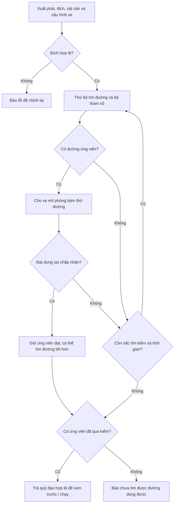
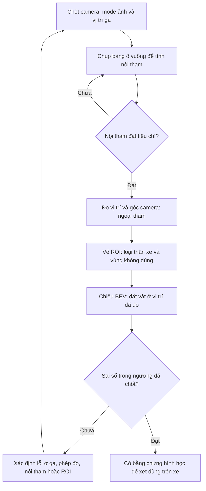
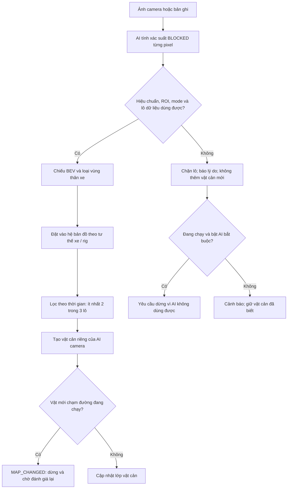

# Tổng quan và tiến độ AutoPark

Tài liệu này giải thích dự án đang ở đâu và cần làm gì tiếp theo. [Cách cài/chạy](autopark/README.md) và [mục lục kỹ thuật](autopark/docs/README.md) nằm riêng để dễ tra.

Biên tập 26/09/2026 theo hồ sơ đến commit `9d68257`; cập nhật 29/09/2026 sau khi chuyển sang máy bàn mới ([biên bản chuyển máy](autopark/docs/CHUYEN_MAY_BAN.md)). Các số lấy từ hồ sơ có ngày: mô phỏng giai đoạn 0 (20/09) chạy trên laptop; số cảm biến, AI và bàn thử đến 25/09 đo trên máy bàn trước; số ngày 29/09 đo trên máy bàn hiện tại. Lần sửa tài liệu không đo thêm.

Nghiên cứu nhận thức sử dụng **[Valeo WoodScape Dataset](https://github.com/valeoai/WoodScape)**. [Phạm vi sử dụng](autopark/docs/GIAY_PHEP_DU_LIEU.md).

## 1. Mục tiêu V1, phạm vi và mức bằng chứng

V1 cho phép chọn vị trí/hướng đỗ, tìm đường tiến/lùi phù hợp cơ cấu lái, bám đường có phản hồi, dừng và đánh giá lại khi gặp vật cản hoặc mất dữ liệu.

V1 không bắt buộc tự tìm ô đỗ, nhận diện vạch, tự lái đến bãi từ nơi khác, điều khiển từ ảnh tới lệnh bằng mạng neural, hoặc dựng cảnh 3D.

| Mức kết quả | Ý nghĩa | Đã có |
|---|---|---|
| Mô phỏng/nguồn giả | Kiểm logic và thuật toán bằng dữ liệu tạo ra | Đỗ xe, lỗi cảm biến, giao thức bo, vật cản AI |
| Bàn thử/bản ghi | Đo cảm biến thật hoặc xử lý dữ liệu đã ghi | LiDAR, bốn camera, AI trực tiếp, ghi/phát lại; định vị offline |
| Xe thật | Cảm biến và điều khiển trên xe chuyển động | Chưa có kết quả nghiệm thu |

Cổng giai đoạn 0 đã đạt ở mức mô phỏng. Chưa cổng nào từ 1 đến 10 đạt; mười điều kiện V1 chưa được đánh dấu đạt trên hệ thống thật.

## 2. Thiết bị

Tình trạng theo kiểm kê ngày 24–25/09; LiDAR và bốn camera qua hub chạy lại trên máy bàn hiện tại ngày 29/09/2026, các mục khác chưa kiểm kê lại:

| Thành phần | Tình trạng |
|---|---|
| RPLIDAR C1 + CP2102N | Đã nhận 22/09 (serial `f57ffc8bc6e598d1b59598f976dd5762`). Máy bàn hiện tại: COM3, driver CP210x 11.2.0.167, đọc được ngày 29/09. Máy bàn trước: COM4, driver 11.6.0.420 |
| Bốn camera USB “HD Camera” | Đã nhận 23/09; 130° là số nhà bán, góc nhìn thật chưa đo |
| Hub UGREEN bốn cổng | Đã nhận; camera chung nhánh USB 2.0, các phiên đã ghi dùng nguồn từ USB |
| MN300, ESP32-S3, BNO085, VL53L1X, AS5600, encoder | Hồ sơ ghi chưa nhận |
| Nguồn, cầu chì, E-stop, phần tử ngắt | Chưa có bộ hoàn chỉnh để kiểm chứng |

| Máy | Cấu hình | Vai trò |
|---|---|---|
| Máy bàn hiện tại (từ 29/09/2026) | Dell Precision 3680, i9-14900, RTX 4000 Ada 20 GB, RAM 64 GB, Windows 11 Enterprise, driver NVIDIA 596.71; repo ở `D:\gấp\autopark` | Phát triển, huấn luyện, đo cảm biến |
| Máy bàn trước (đến 25/09/2026) | i9-14900, RTX 4000 Ada 20 GB, RAM 64 GB, driver NVIDIA 596.72; repo ở `D:\ap` | Nơi đo mọi số cảm biến, AI và bàn thử đến 25/09 |
| Laptop | i7-12700H, RTX 3050 Ti 4 GB | Mang đi trình diễn; đã dùng cho mô phỏng giai đoạn 0, chưa có số đo cảm biến/AI trực tiếp |

Cổng LiDAR đặt ở một chỗ: [`autopark/configs/thiet_bi.json`](autopark/configs/thiet_bi.json), khóa `lidar_port` (hiện `"COM3"`; `"auto"` tự tìm bộ chuyển CP210x, lấy cổng đầu tiên). Các lệnh LiDAR lấy cổng từ tệp này khi không có `--port`; `--port COMx` ghi đè cho một lần chạy. `rig.bench`/`ui.rig_app` lấy cổng này khi `--lidar` không kèm giá trị; lệnh kiểm máy mới (`do_may_moi.cmd`) luôn tự tìm CP210x. Đổi máy thì sửa giá trị `lidar_port` và làm theo [biên bản chuyển máy](autopark/docs/CHUYEN_MAY_BAN.md) mục 5.

[Kiểm kê](autopark/docs/hardware_inventory.md), [phiếu nhận MN300](autopark/docs/mn300_inventory.md), [chuyển sang máy trình diễn](autopark/docs/MAY_NOP_DO_AN.md), [chuyển máy bàn](autopark/docs/CHUYEN_MAY_BAN.md).

## 3. Tiến độ theo 11 giai đoạn

| GĐ | Công việc | Trạng thái và điểm đang chặn |
|---|---|---|
| 0 | Mô phỏng | Đạt trong phạm vi phép thử; thông số xe giả định |
| 1 | LiDAR và camera mẫu | Thiếu sai số LiDAR và hiệu chuẩn camera; [cổng 1 chưa đạt](autopark/docs/gate_01.md) |
| 2 | Bốn camera, BEV | Có bàn thử/phần mềm; thiếu hiệu chuẩn và gá, USB còn lỗi khung |
| 3 | Hợp nhất trên bàn | Có lớp bản đồ; chưa có IMU/ToF/ESP32 thật |
| 4 | Đo MN300 | Có bảng đo và thử độ nhạy mô phỏng; chưa có xe để đo |
| 5 | ESP32, điều khiển phản hồi | Có giao thức/bo mô phỏng; firmware C++ chưa biên dịch trong hồ sơ |
| 6 | Nguồn và dừng | Có bản nháp/kịch bản; chưa lắp và đo |
| 7 | Gá cảm biến lên xe | Chưa làm |
| 8 | Hợp nhất khi xe chạy | Có phần mềm chuẩn bị; thiếu tư thế thật và kiểm đồng bộ |
| 9 | Tự đỗ thật | Chưa thực hiện |
| 10 | Nghiệm thu, khóa luận | Có kết quả từng khối và dàn ý; chưa nghiệm thu V1 |

[Bản kiểm toán 275 việc ngày 24/09](autopark/docs/evidence/ke_hoach/kiem_toan_ke_hoach_20260924.json) ghi 56 việc xong, 92 một phần, 27 chưa bắt đầu, 100 chờ thiết bị. Bảng có trước các bổ sung sau đó; không dùng để tính phần trăm hoàn thành hiện tại.

## 4. Nội dung theo mảng

### 4.1. Mô phỏng và lập đường

**Cách một đường đi được chấp nhận** — sơ đồ rút gọn của cấu hình mặc định:

Hết thời gian hoặc chưa tìm ra đường không chứng minh bài toán vô nghiệm.

Có chỉnh sa bàn, đặt đích, xem trước, tiến/lùi, lái tay và xuất log. Điểm vào `planning/parking.py` mặc định thử nhiều bộ tìm đường và kiểm bằng mô phỏng trước khi nhận quỹ đạo.

Hồ sơ 20/09 ghi 220 test đạt và 2.880 trường hợp theo seed không vi phạm các điều kiện đã đặt. Trong 240 phiên có lỗi giả: 25 hoàn thành, 185 dừng đúng logic, 30 FAULT do chèn vật quá gần. Không cộng ba nhóm thành số lần đỗ thành công.

Cả 16 ca khó có đường chứng trong mô hình hình học. Điều đó không có nghĩa planner tìm được trong thời hạn hoặc đường đủ thực dụng cho xe; `parallel_115` vẫn chưa được planner giải trong các lượt báo cáo.

[Báo cáo mô phỏng](BAO_CAO_GIAI_DOAN_0.md), [kiểm thử độ bền](autopark/docs/KIEM_THU_DO_BEN_GIAI_DOAN_0.md), [độ nhạy kích thước](autopark/docs/DO_NHAY_KICH_THUOC_XE.md).

### 4.2. AI nhận thức, dữ liệu và giấy phép

L-RASPP/MobileNetV3 phân ảnh thành FREE và BLOCKED. Checkpoint tham chiếu: `runs/ai_woodscape_rtx4000_v1/best.pt`, không nằm trong Git.

WoodScape test nội bộ đạt mIoU 0,9692; 1,75% pixel vật cản bị gọi FREE. Đây không phải test chính thức, chưa chứng minh độ chính xác sa bàn. Các lượt thêm AVM-SS/ACDC chưa thay thế được lượt nền trên cả hai tập đánh giá chưa dùng để học/chọn mô hình.

Ngày 25/09 người làm khóa luận quyết định dùng checkpoint WoodScape trong vòng điều khiển theo cách diễn giải của dự án; Valeo chưa xác nhận. Quyết định không bao gồm nhãn nháp AI hoặc checkpoint chứa AVM-SS.

[Huấn luyện](HUAN_LUYEN.md), [giấy phép](autopark/docs/GIAY_PHEP_DU_LIEU.md).

### 4.3. LiDAR RPLIDAR C1

Đã đọc scan, ghi/phát lại, tạo bản đồ tĩnh. Sau bỏ khởi động, các bản ghi ngày 22 và 24/09 (máy bàn trước) đạt khoảng 10 vòng/s và 510 tia/vòng. Ngày 29/09 trên máy bàn hiện tại (COM3), lệnh kiểm máy mới đo 10,00 Hz, trung vị 508 tia/vòng, tương đương lượt cùng lệnh trên máy bàn trước ngày 24/09 ([biên bản chuyển máy](autopark/docs/CHUYEN_MAY_BAN.md) mục 2). Chưa đo sai số khoảng cách so với thước.

Có công cụ định vị trên bản đồ và odometry khớp scan. Kết quả C1 hiện dùng bản ghi đứng yên; chưa có tham chiếu độc lập hoặc kiểm khi di chuyển. Khớp lại cùng chỗ chưa chứng minh sai số định vị thực.

[Thử LiDAR](autopark/docs/GIAI_DOAN_1_LIDAR.md), [định vị](autopark/docs/DINH_VI_LIDAR.md), [so sánh SLAM](autopark/docs/SO_SANH_DINH_VI_SLAM.md).

### 4.4. Camera USB và lỗi khung hình

Mặc định bàn thử **640×480** vì nhiều phiên 720p có khung MJPEG bị cắt khi bốn camera chạy chung hub. Một số phiên 720p nhìn cảnh tối không lỗi chưa đủ kết luận ổn định.

480p cũng từng có đợt lỗi; bộ đọc loại khung hỏng. Nguyên nhân chưa xác định dứt điểm. Camera được nhận diện theo cổng hub vì không có serial riêng; trên máy bàn hiện tại bốn camera vẫn cắm cổng hub 1–4, nhưng chưa khởi động lại máy để kiểm danh tính theo cổng.

[Thử camera](autopark/docs/GIAI_DOAN_1_CAMERA.md), [sơ đồ USB](autopark/docs/usb_topology.md).

### 4.5. Bàn thử bốn camera + LiDAR + AI

Có giao diện xem đồng thời, đo suy luận, độ lệch thời gian và khung lỗi. Quy tắc chờ dựa trên nhịp riêng từng camera; AI làm nóng với các cỡ lô cần dùng.

Số đo trong hướng dẫn bàn thử là của máy bàn trước. Ngày 29/09/2026, lệnh kiểm máy mới (`do_may_moi.cmd`, mã `9d68257`, LiDAR và bốn camera thật) trên máy bàn hiện tại cho: AI lô 4 ảnh 480p trung vị 10,8 ms (máy bàn trước 10,4 ms); bàn thử 480p + LiDAR + AI 120 s được 2.861 bộ ảnh, 0 khung hỏng, 23,85 bộ AI/s, như máy bàn trước; 720p chỉ camera được 715 bộ, 0 khung hỏng. Cảnh camera lúc đo không ghi lại, nên số khung hỏng chưa so được với các phiên cũ. Lượt này là tham chiếu `may_moi` hiện dùng ([`tham_chieu_20260929.json`](autopark/docs/evidence/may_ban/tham_chieu_20260929.json), người dùng chọn ngày 29/09/2026); lệnh đo trên laptop so với nó. Số máy bàn chưa thay được phép đo trên laptop trình diễn. [Hướng dẫn bàn thử](autopark/docs/GIAI_DOAN_2_BAN_THU.md), [kết quả kiểm máy mới](autopark/docs/CHUYEN_MAY_BAN.md) mục 2.

### 4.6. Hiệu chuẩn camera

Có bảng in, công cụ chụp/tính nội tham fisheye, đo ngoại tham và vẽ ROI. Công cụ mới được kiểm chủ yếu bằng ảnh tổng hợp; chưa camera dự án nào có đủ hiệu chuẩn thật.

Thứ tự: **nội tham → ngoại tham theo gá → ROI → kiểm sai số bằng vật có vị trí đo được**.

Nhánh cuối là mục tiêu kiểm chứng; hồ sơ hiện chưa có bộ hiệu chuẩn thật hoàn chỉnh.

[Nội tham](autopark/docs/HIEU_CHUAN_CAMERA.md), [ngoại tham và ROI](autopark/docs/NGOAI_THAM_VA_ROI.md).

### 4.7. Gán nhãn ảnh sa bàn

Có nhập ảnh, sửa/duyệt nhãn, xuất cache; chưa có tập sa bàn được gán nhãn để chấm mô hình. Tập đánh giá cần tô tay từ đầu và tách theo phiên chụp. Nhãn sửa từ dự đoán có thể thiên lệch về mô hình tạo nháp.

[Quy trình gán nhãn](autopark/docs/GAN_NHAN_SA_BAN.md).

### 4.8. Hợp nhất cảm biến

Có lớp bản đồ tĩnh, LiDAR, camera và cận trường; kiểm thời hạn dữ liệu; chuyển vật cản vào phiên mô phỏng. Xe ảo đã tìm đường quanh vật do LiDAR thật đứng yên quét.

ToF mới dùng gá giả định và dữ liệu mô phỏng. Chưa kiểm trên xe chuyển động. [Chuẩn bị hợp nhất](autopark/docs/GIAI_DOAN_3_CHUAN_BI.md).

### 4.9. Giao thức xe, VehicleIO và firmware ESP32-S3

Có giao thức COBS + CRC, phiên kết nối, số thứ tự, lệnh có hạn; bo mô phỏng Python, kết nối serial và mã C++.

Giao diện cho chọn cổng/kiểm kết nối. START với cấu hình serial bị chặn khi thiếu tư thế thật. Chế độ quan sát tính lệnh và ghi log nhưng không gửi lệnh chạy.

C++ chưa biên dịch/nạp bo theo hồ sơ; phần đọc cảm biến thật còn thiếu. Khoảng hở được ghi nhận: trước khi laptop nhận telemetry báo hết hạn lệnh, có thể xuất hiện enable mới. Đề xuất chốt firmware sau `COMMAND_TIMEOUT` chưa triển khai. Replay giai đoạn 0 hiện từ chối phiên VehicleIO.

[Giao thức và điểm còn mở](autopark/docs/GIAO_THUC_XE.md), [quan sát](autopark/docs/CHE_DO_QUAN_SAT.md), [firmware](autopark/firmware/esp32_vehicle/README.md).

### 4.10. Nguồn và an toàn

Có bản nháp bảng tải, sơ đồ nguồn/dừng, 16 kịch bản lỗi; chưa đo phần cứng. Ngõ E-stop của ESP32 không thay đường ngắt động lực.

[Chuẩn bị nguồn và dừng](autopark/docs/GIAI_DOAN_6_CHUAN_BI.md).

### 4.11. Ghi và phát lại phiên bàn thử

Có ghi camera + LiDAR và phát lại. Một phiên thật 60 giây trên máy bàn trước đã được đối chiếu số bộ ảnh và độ lệch thời gian khi phát lại. Bản ghi đầy đủ không trong Git.

[Quy trình ghi/phát lại](autopark/docs/GHI_PHAT_LAI_BAN_THU.md).

### 4.12. BEV từ nhiều camera

BEV là bản đồ nhìn từ trên xuống suy ra từ ảnh và hình học camera, gồm ô FREE/OCCUPIED/UNKNOWN. Phần chiếu đã tăng tốc và kiểm kết quả bằng dữ liệu tổng hợp.

Chỉ dùng khi hiệu chuẩn, ngoại tham, ROI và thời gian dữ liệu đạt kiểm tra. Giả định sàn phẳng và biên chân vật giới hạn kết quả. Ngoại tham `v0` trong Git là giả định.

[Chi tiết BEV](autopark/docs/BEV.md).

### 4.13. Đo MN300

Có phiếu kiểm kê và bảng đo kích thước, lái, tốc độ, điện, gá. Chưa có số đo xe. Không dùng `vehicle_default.json` làm thông số MN300 thật.

[Chuẩn bị đo xe](autopark/docs/GIAI_DOAN_4_CHUAN_BI.md).

### 4.14. Khóa luận

Có dàn ý và hình/bảng tham khảo. Chưa biết mẫu trường, kiểu trích dẫn, giới hạn trang và quy định khai báo AI. Kết quả mô phỏng, dữ liệu công khai, bàn thử, xe thật phải trình bày riêng.

[Dàn ý](autopark/docs/DAN_Y_KHOA_LUAN.md).

### 4.15. Nghiệm thu V1

Có nháp 37 kịch bản trong chín nhóm, cách đo độc lập và ngưỡng đề xuất. Chưa nghiệm thu các kịch bản; ngưỡng còn chờ chốt.

[Kịch bản](autopark/docs/KICH_BAN_NGHIEM_THU.md), [ngưỡng đề xuất](autopark/docs/NGUONG_NGHIEM_THU_DE_XUAT.md).

### 4.16. AI camera trong vòng điều khiển

**Từ ảnh tới vật cản** trong phần mềm hiện có:

Sơ đồ bỏ bớt chi tiết lọc/đồng bộ. Rig tổng hợp chỉ được ngoại lệ khi thử bằng replay hoặc nguồn giả, không dùng cho camera live. Quy tắc cảnh báo/dừng cũng áp dụng khi AI không có dữ liệu hoặc dữ liệu quá cũ.

Ngăn **AI camera** của `ui.lidar_app --camera-ai` chuyển ô vật cản BEV vào phiên đỗ bên cạnh LiDAR. Nó không xóa vật cản LiDAR hoặc vật do người dùng đặt.

Đã kiểm bằng nguồn giả, rig tổng hợp và phát lại o03 với mô hình thật. Với cấu hình thật chưa hiệu chuẩn: **1.163 lô bị chặn, 0 vật cản được tạo**. Chưa thử nhánh này với camera live hoặc xe thật.

Mặc định thử nghiệm: BLOCKED 0,15; xuất hiện ít nhất hai trong ba lô; tuổi lớp AI tối đa 0,5 giây. Chưa phải ngưỡng nghiệm thu. AI cũ mặc định cảnh báo; bật **AI bắt buộc** thì dừng. Tư thế đặt lô chưa nội suy về lúc chụp.

[Điều kiện bật và giới hạn](autopark/docs/AI_DIEU_KHIEN_XE.md).

## 5. Việc tiếp theo

### 5.1. Những lựa chọn còn cần chốt

Phương án định vị/nguồn tư thế thật; tốc độ và ngưỡng nghiệm thu; nguồn/E-stop/encoder/gá; chốt firmware sau `COMMAND_TIMEOUT`; báo sức khỏe ToF; xe tự tiếp tục hay chờ xác nhận sau vật cản thông thường; chính sách AI bắt buộc; việc dùng nhãn nháp AI cho huấn luyện sa bàn.

Bản viết lại không thay đổi quyết định kỹ thuật hoặc tự duyệt đề xuất.

### 5.2. Việc làm được với cảm biến hiện có

1. Hiệu chuẩn camera, đo ngoại tham, tạo ROI.
2. Dùng vật đo bằng thước để chấm LiDAR và BEV.
3. Thu ảnh sa bàn, lập tập chấm tô tay riêng.
4. Đo bốn camera + LiDAR + AI trên laptop trình diễn.
5. Ghi LiDAR khi di chuyển, đối chiếu bằng tham chiếu độc lập.
6. Trên máy bàn hiện tại: khởi động lại rồi kiểm danh tính bốn camera theo cổng hub (N-C5 trong [ngưỡng đề xuất](autopark/docs/NGUONG_NGHIEM_THU_DE_XUAT.md)); chạy `ui.lidar_app`, `fusion.demo`, `rig.bench --lidar` và các lệnh camera với thiết bị thật. Sau sửa đổi cổng LiDAR và đọc/ghi ảnh, mới có `lidar.rplidar_c1 info` được thử với thiết bị thật.
7. Mỗi lượt đo camera ghi lại cảnh camera nhìn; khung hỏng phụ thuộc cảnh nên thiếu thông tin này thì không so được giữa các lượt hay giữa các máy.

### 5.3. Việc cần thiết bị mới

Nhận/đo MN300; biên dịch/nạp ESP32; đọc phản hồi; lắp nguồn/dừng; kiểm từng phần trước khi gá lên xe. [Sáu đợt mua](KE_HOACH_TRIEN_KHAI_XE_TU_DO_v3.1.md).

### 5.4. Phần mềm có thể chuẩn bị

Biên dịch/test firmware host (máy bàn hiện tại có g++ 16.1.0 và cmake 4.4.1, chưa thử); làm nguồn tư thế thật; hoàn thiện ghi sự kiện dừng và đồng bộ video–log; xử lý công cụ thiếu T1–T15 trong [kịch bản nghiệm thu](autopark/docs/KICH_BAN_NGHIEM_THU.md). Thay đổi giao thức cần được thiết kế/kiểm riêng.

## 6. Bản đồ tài liệu

- [Cài/chạy](autopark/README.md): thao tác phần mềm.
- [Kế hoạch](KE_HOACH_TRIEN_KHAI_XE_TU_DO_v3.1.md): thứ tự, phụ thuộc, điều kiện hoàn thành.
- [Huấn luyện](HUAN_LUYEN.md): dữ liệu, kết quả, tái hiện AI.
- [Báo cáo giai đoạn 0](BAO_CAO_GIAI_DOAN_0.md): bằng chứng mô phỏng 20/09.
- [Mục lục kỹ thuật](autopark/docs/README.md): hướng dẫn/biên bản theo công việc.
- [Chuyển máy bàn](autopark/docs/CHUYEN_MAY_BAN.md): máy bàn hiện tại, cổng LiDAR, cài lại môi trường, số kiểm ngày 29/09, các bước lần sau đổi máy.

## 7. Cách đọc bằng chứng

“Đạt” gắn với phép thử, thời điểm và môi trường cụ thể. Test giả không thay số đo thiết bị. FPS không thay độ trễ từ sự kiện thật tới ảnh. Độ lặp lại không phải sai số so với thước.

| Đợt đã ghi | Kết quả | Phạm vi |
|---|---|---|
| 20/09 | 220 đạt | Bộ giai đoạn 0 lúc đó |
| 25/09, trước AI camera | `.venv`: 1.242 đạt, 7 bỏ qua; nhóm `.venv-train`: 386 đạt | Lượt đầu toàn bộ test ở môi trường mô phỏng; lượt sau nhóm chọn |
| 25/09, AI camera | 343 đạt ở mỗi môi trường | 15 tệp liên quan |
| 25/09, cuối đợt AI camera | `.venv`: 1.315 đạt, 7 bỏ qua (cần torch); `.venv-train`: 1.376 đạt | Toàn bộ test, máy bàn trước |
| 29/09, mã `9d68257` | `.venv`: 1.315 đạt, 7 bỏ qua; `.venv-train`: 1.376 đạt | Toàn bộ test, máy bàn hiện tại; trùng số máy bàn trước |
| 29/09, sau sửa đổi chuyển máy | `.venv`: 1.353 đạt, 8 bỏ qua (cần torch); `.venv-train`: 1.415 đạt; 0 hỏng | Toàn bộ test, máy bàn hiện tại, mã `9d68257` cộng sửa đổi cổng LiDAR, đọc/ghi ảnh, cài đặt |
| 29/09, commit `38f64bb` | `.venv`: 1.354 đạt, 8 bỏ qua (cần torch); `.venv-train`: 1.416 đạt; 0 hỏng | Toàn bộ test, máy bàn hiện tại, commit của đợt chuyển máy; thêm một test tệp tham chiếu `may_moi` 29/09 |

Không cộng các lượt thành tổng test. Các lượt ngày 29/09 chạy offscreen; tệp kết quả và giới hạn ở [biên bản chuyển máy](autopark/docs/CHUYEN_MAY_BAN.md) mục 2–3.

`runs/`, dataset đầy đủ, cache, checkpoint và môi trường Python không có trong Git. Bằng chứng nhỏ nằm ở `autopark/docs/evidence/`.

Trạng thái tại `9d68257` đã bao gồm mã AI camera (`b01dea4`) và quyết định giấy phép (`99e9a9e`). Các ghi chú “chưa commit” của những việc này trong tài liệu cũ đã lỗi thời. [Bản tổng hợp gốc](https://github.com/thbn12082/autopark/blob/9d68257/TONG_HOP_DU_AN.md) giữ nhật ký và toàn bộ số liệu bổ sung. Số mục 1–7, 4.1–4.16 và 5.1–5.4 giữ như bản gốc; chi tiết mà các biên bản viết trước 26/09/2026 dẫn theo số mục nhưng không còn ở bản này thì tra ở bản gốc.
