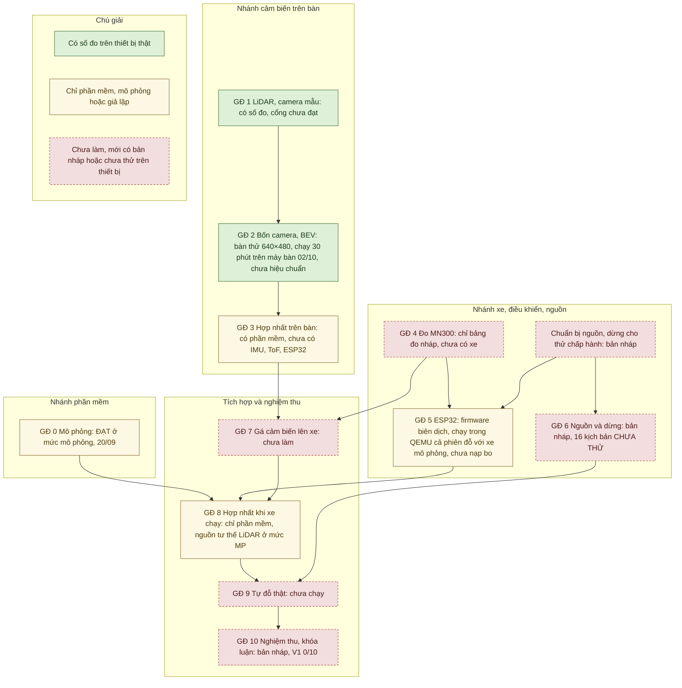
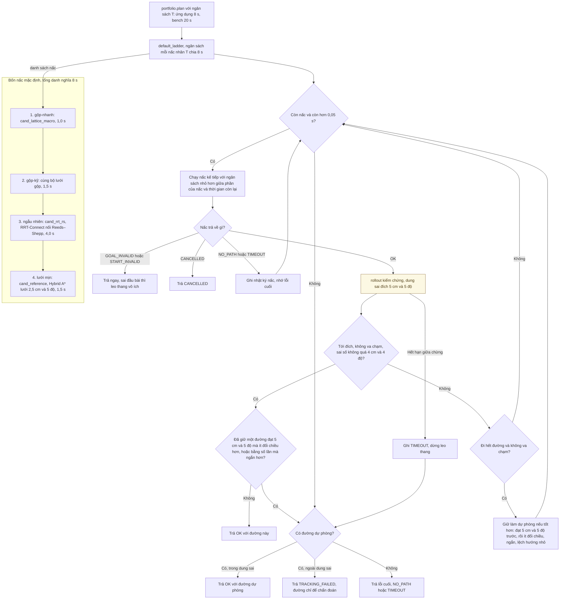
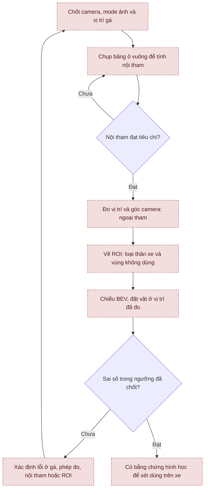
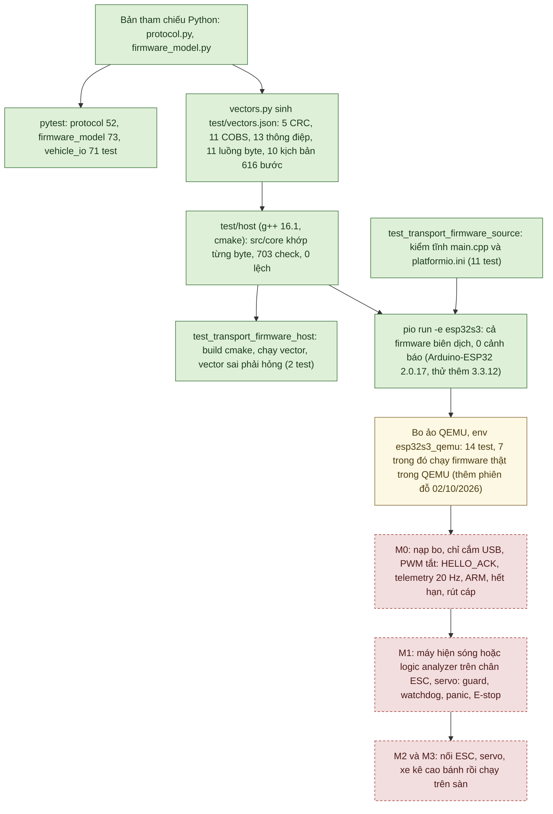
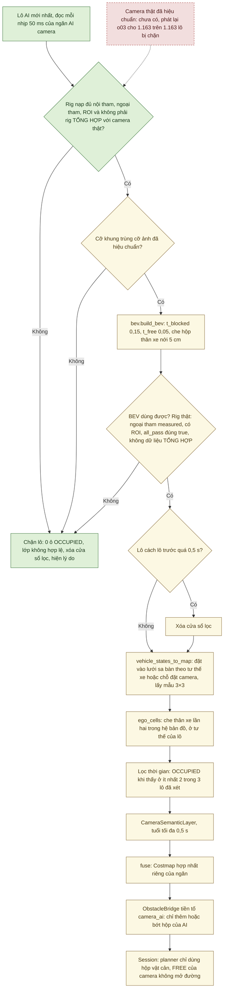

# Tổng quan và tiến độ AutoPark

Tài liệu này trả lời ba câu hỏi: dự án đang ở đâu, từng mảng đã làm được gì và đo tới mức nào, việc gì cần làm tiếp. Muốn cài đặt hay chạy thử, xem [hướng dẫn chạy](autopark/README.md). Muốn tìm biên bản chuyên đề, xem [mục lục kỹ thuật](autopark/docs/README.md). Muốn xem bằng hình, xem [sơ đồ hệ thống](autopark/docs/SO_DO_HE_THONG.md).

*Hiện trạng tính đến 06/10/2026. Mã nguồn trên nhánh `main` giống commit `470abb3`.*

Ngày ghi cạnh mỗi con số là ngày đo, không phải ngày viết tài liệu. Các phép đo được làm trên ba máy khác nhau: mô phỏng giai đoạn 0 (20/09/2026) chạy trên laptop; số đo cảm biến, AI và bàn thử tới 25/09/2026 làm trên máy bàn cũ; số đo từ 29/09/2026 làm trên máy bàn hiện tại (mục 2).

Nghiên cứu nhận thức sử dụng **[Valeo WoodScape Dataset](https://github.com/valeoai/WoodScape)**. [Phạm vi sử dụng](autopark/docs/GIAY_PHEP_DU_LIEU.md).

**Một vài viết tắt dùng trong tài liệu.** GĐ là giai đoạn. V1 là bản đầu tiên cần đạt. Ba mức thử của nghiệm thu: MP (mô phỏng), BT (bàn thử), XT (xe thật). T1–T15 là các công cụ nghiệm thu, DO-1, DV-1, LD-1… là mã kịch bản nghiệm thu, N-… là mã ngưỡng ([kịch bản nghiệm thu](autopark/docs/KICH_BAN_NGHIEM_THU.md)). "Bo mô phỏng" là bản Python của firmware chạy ngay trong ứng dụng; "bo ảo" là firmware C++ thật chạy trong trình giả lập QEMU.

## 1. Mục tiêu V1, phạm vi và mức bằng chứng

V1 phải làm được bốn việc: cho chọn vị trí và hướng đỗ; tìm đường tiến/lùi phù hợp cơ cấu lái; bám đường có phản hồi; dừng và đánh giá lại khi gặp vật cản hoặc mất dữ liệu.

V1 không bắt buộc: tự tìm ô đỗ, nhận diện vạch kẻ, tự lái tới bãi từ nơi khác, điều khiển thẳng từ ảnh ra lệnh bằng mạng neural, hay dựng cảnh 3D.

Mọi kết quả của dự án được xếp vào một trong bốn mức bằng chứng:

| Mức | Nghĩa là | Đã có (06/10/2026) |
|---|---|---|
| Mô phỏng, nguồn giả | Kiểm logic và thuật toán bằng dữ liệu tạo ra | Đỗ xe, lỗi cảm biến, giao thức với bo mô phỏng, lõi firmware C++ khớp bản Python, vật cản từ AI; nguồn tư thế LiDAR với LiDAR mô phỏng; tham chiếu trên cao trên ảnh tổng hợp |
| Giả lập firmware | Firmware thật đã biên dịch, chạy trong bo ảo QEMU và nói chuyện với phần mềm laptop | Giao thức, máy trạng thái, dốc tốc độ, hết hạn lệnh, mất liên lạc, reset chip (30/09); cả phiên đỗ từ giao diện với xe mô phỏng phía laptop (02/10) |
| Bàn thử, bản ghi | Đo cảm biến thật, hoặc xử lý dữ liệu đã ghi | LiDAR, bốn camera, AI trực tiếp, ghi và phát lại; định vị offline; chạy liền 30 phút trên máy bàn (02/10) |
| Xe thật | Cảm biến và điều khiển trên xe đang chuyển động | Chưa có: chưa có xe, chưa nạp bo |

Bo ảo không kiểm được xung ESC/servo, nút dừng khẩn, task watchdog và vòng PI tốc độ, nên mức "giả lập firmware" không thay được việc thử trên bo thật.

Giai đoạn 0 đã đạt cổng chuyển bước ở mức mô phỏng. Chưa cổng nào từ giai đoạn 1 đến 10 đạt, và V1 đạt 0/10 điều kiện hoàn thành ([kế hoạch](KE_HOACH_TRIEN_KHAI_XE_TU_DO_v3.1.md) mục 16.4, 17.4). Theo kế hoạch mục 15, kết quả mô phỏng hay giả lập không được dùng để đánh dấu đạt cổng. Mức bằng chứng của từng điều kiện V1 có ở sơ đồ 8.3 trong [Sơ đồ hệ thống](autopark/docs/SO_DO_HE_THONG.md).

## 2. Thiết bị

Tình trạng dưới đây theo kiểm kê ngày 22–25/09/2026. LiDAR và bốn camera đã chạy lại trên máy bàn hiện tại ngày 29/09 và 02/10/2026; các mục khác chưa kiểm kê lại. Tới 02/10/2026, hồ sơ không ghi nhận thêm thiết bị nào.

| Thành phần | Tình trạng |
|---|---|
| RPLIDAR C1 + CP2102N | Nhận 22/09 (serial `f57ffc8bc6e598d1b59598f976dd5762`). Trên máy bàn hiện tại: COM3, driver CP210x 11.2.0.167; chạy 30 phút liền không lỗi ngày 02/10/2026, sau khi sửa mã đọc C1 (mục 4.3). Trên máy bàn cũ: COM4, driver 11.6.0.420 |
| Bốn camera USB “HD Camera” | Nhận 23/09. Không có số serial nên được nhận diện theo cổng hub. Góc 130° là số nhà bán, góc nhìn thật chưa đo |
| Hub UGREEN bốn cổng | Nhận 23/09. Các camera chung một nhánh USB 2.0; các phiên đã ghi dùng nguồn từ USB |
| MN300, ESP32-S3, BNO085, VL53L1X, AS5600, encoder | Chưa nhận |
| Nguồn, cầu chì, nút dừng khẩn, phần tử ngắt | Chưa có bộ nào để kiểm |

| Máy | Cấu hình | Vai trò |
|---|---|---|
| Máy bàn hiện tại (từ 29/09/2026) | Dell Precision 3680, i9-14900, RTX 4000 Ada 20 GB, RAM 63,7 GB, Windows 11 Enterprise, driver NVIDIA 596.71. Repo ở `D:\xetulai\autopark` (tới chiều 29/09/2026 tên là `D:\gấp\autopark`) | Máy phát triển chính: huấn luyện, đo cảm biến, test, biên dịch firmware, bo ảo QEMU |
| Máy bàn cũ (tới 25/09/2026) | i9-14900, RTX 4000 Ada 20 GB, RAM 64 GB, driver NVIDIA 596.72; repo ở `D:\ap` | Nơi đo mọi số cảm biến, AI và bàn thử tới 25/09 |
| Laptop | i7-12700H, RTX 3050 Ti 4 GB | Máy trình diễn và nộp đồ án. Mới chạy mô phỏng giai đoạn 0 (20/09); chưa đo cảm biến, AI hay bàn thử |

**Cổng LiDAR và đường dẫn công cụ** được khai ở một chỗ: [`autopark/configs/thiet_bi.json`](autopark/configs/thiet_bi.json).

- Khóa `lidar_port` hiện là `"COM3"`. Ghi `"auto"` thì phần mềm tự tìm bộ chuyển CP210x và lấy cổng đầu tiên.
- Lệnh LiDAR không có `--port` lấy cổng từ tệp này; `--port COMx` ghi đè cho một lần chạy. `rig.bench` và `ui.rig_app` cũng lấy cổng này khi `--lidar` không kèm giá trị. Riêng lệnh kiểm máy mới `do_may_moi.cmd` luôn tự tìm CP210x.
- Các khóa `qemu_xtensa`, `platformio_python`, `platformio_core_dir` giữ đường dẫn QEMU và PlatformIO cho bo ảo. Máy không có QEMU thì test bo ảo tự bỏ qua.
- Đổi máy: sửa `lidar_port` rồi làm theo [biên bản chuyển máy](autopark/docs/CHUYEN_MAY_BAN.md) mục 5.

Các công cụ firmware trên máy bàn nằm ngoài repo: g++ 16.1.0 và cmake 4.4.1 cho test host; PlatformIO Core 6.2.0 ở `D:\xetulai\_platformio\penv`; QEMU của Espressif 9.2.2 ở `D:\xetulai\_platformio\qemu` ([biên bản chuyển máy](autopark/docs/CHUYEN_MAY_BAN.md) mục 6–8).

Đọc thêm: [kiểm kê](autopark/docs/hardware_inventory.md), [phiếu nhận MN300](autopark/docs/mn300_inventory.md), [chuyển sang máy trình diễn](autopark/docs/MAY_NOP_DO_AN.md), [chuyển máy bàn](autopark/docs/CHUYEN_MAY_BAN.md).

## 3. Tiến độ theo 11 giai đoạn

Dự án đi theo ba nhánh song song: phần mềm, cảm biến trên bàn, và xe/điều khiển/nguồn. Ba nhánh gặp nhau ở bước tích hợp. Sơ đồ dưới cho biết mỗi giai đoạn đang ở mức bằng chứng nào; quan hệ phụ thuộc lấy theo [kế hoạch](KE_HOACH_TRIEN_KHAI_XE_TU_DO_v3.1.md) mục 2.2.

Cách đọc màu ở sơ đồ này: xanh là đã có số đo trên thiết bị thật (dù cổng giai đoạn 1 và 2 vẫn chưa đạt); vàng là mới có phần mềm, mô phỏng hoặc giả lập, kể cả phần mềm chạy với nguồn giả hay bo mô phỏng; đỏ viền đứt là chưa làm, mới có bản nháp, hoặc chưa thử trên thiết bị. Mũi tên là phụ thuộc theo kế hoạch, không có nghĩa bước đó đã xong. Theo kế hoạch mục 2.2, phần chuẩn bị nguồn và dừng phải có trước khi thử chấp hành ở giai đoạn 5; giai đoạn 6 xác nhận nguồn và dừng cho toàn hệ thống, chỉ cần xong trước giai đoạn 9.

| GĐ | Công việc | Trạng thái (06/10/2026) và điểm đang chặn |
|---|---|---|
| 0 | Mô phỏng | Đạt 6 điều kiện chuyển bước ở mức mô phỏng (20/09/2026, laptop). Thông số xe vẫn là giả định |
| 1 | LiDAR và camera mẫu | Đang làm. Có số đo LiDAR và camera trên bàn. Còn thiếu: sai số khoảng cách của LiDAR, định vị có tham chiếu độc lập, hiệu chuẩn và gá camera, chấm AI trên ảnh thật có nhãn ([cổng 1 chưa đạt](autopark/docs/gate_01.md)). Mã đọc C1 đã sửa ngày 02/10/2026 (mục 4.3) |
| 2 | Bốn camera, BEV | Đang làm. Bàn thử bốn camera + LiDAR + AI chạy ở 640×480, chạy đủ 30 phút ngày 02/10/2026 (mục 4.5). Còn thiếu hiệu chuẩn và gá; 720p còn khung bị cắt tùy cảnh |
| 3 | Hợp nhất trên bàn | Có lớp bản đồ, phép hợp nhất, đường đưa vật cản LiDAR và AI camera vào phiên (phần mềm). Chưa có IMU, ToF, ESP32 thật |
| 4 | Đo MN300 | Có bảng đo nháp và thử độ nhạy trong mô phỏng. Chưa nhận xe |
| 5 | ESP32, điều khiển phản hồi | Có giao thức, bo mô phỏng, `VehicleIO`. Lõi C++ qua test host và cả firmware biên dịch cho ESP32-S3 (29/09/2026); chạy trong bo ảo QEMU từ 30/09, cả phiên đỗ từ 02/10/2026 (mục 4.9). Chưa nạp bo vì chưa có bo |
| 6 | Nguồn và dừng | Bản nháp: bảng tải, sơ đồ nguồn và dừng, 16 kịch bản lỗi chưa thử. Chưa có phần cứng |
| 7 | Gá cảm biến lên xe | Chưa làm |
| 8 | Hợp nhất khi xe chạy | Có phần mềm chuẩn bị (`VehicleLink`, chế độ quan sát). Nguồn tư thế LiDAR trong phiên chạy ở mức mô phỏng và trên bản ghi C1 đứng yên; ghi cảm biến trong phiên mới kiểm offscreen. Với bo thật, START vẫn bị từ chối cho tới khi đo gá LiDAR và đạt p04, DV-2, DV-1 (mục 4.3). Chưa kiểm đồng bộ thời gian trên thiết bị |
| 9 | Tự đỗ thật | Chưa thực hiện |
| 10 | Nghiệm thu, khóa luận | Có dàn ý khóa luận, 37 kịch bản và ngưỡng nháp; V1 đạt 0/10. Đã có phần lớn công cụ nghiệm thu, xe nghiệm thu 0,10 m/s và 9 tệp sa bàn nghiệm thu, mới kiểm bằng test và mô phỏng (mục 4.15). LD-1 chạy đủ 30 phút trên máy bàn; còn hai điều kiện cần người ở cạnh và lượt chạy trên laptop |

[Bản kiểm toán 275 việc ngày 24/09](autopark/docs/evidence/ke_hoach/kiem_toan_ke_hoach_20260924.json) ghi 56 việc xong, 92 việc làm một phần, 27 việc chưa bắt đầu và 100 việc chờ thiết bị. Bản này có trước các bổ sung sau đó, nên không dùng để tính phần trăm hoàn thành hiện nay. Sơ đồ đợt mua và thiết bị đã nhận: sơ đồ 8.2 trong [Sơ đồ hệ thống](autopark/docs/SO_DO_HE_THONG.md).

## 4. Nội dung theo mảng

### 4.1. Mô phỏng và lập đường

Phần này đã đủ để chạy trọn một lượt đỗ trên máy tính: chỉnh sa bàn, đặt đích, xem trước, chạy tiến/lùi, lái tay và xuất log. Mọi thứ chạy với xe và phản hồi mô phỏng.

Cấu hình xe `configs/vehicle_default.json` là giả định. Cấu hình xe nghiệm thu `configs/vehicle_nghiem_thu.json` giống hệt tệp mặc định, chỉ khác tốc độ tối đa `max_speed_mps` = 0,10 m/s (tệp mặc định là 0,3 m/s; planner đặt tốc độ 0,15 m/s). Kích thước xe vẫn là giả định. Chọn xe bằng cờ `--vehicle-config` hoặc ô "Cấu hình xe" của thẻ Xe (mục 4.15).

**Bộ tìm đường hoạt động thế nào.** Điểm vào là `planning/parking.py::plan_parking`. Hàm này tính đích từ ô đỗ (ô nhỏ hơn thân xe thì trả GOAL_INVALID ngay), rồi gọi "thang" `portfolio`: bốn nấc tìm đường chạy lần lượt, không song song. Mỗi đường ứng viên được xe mô phỏng bám thử trước khi nhận. Có hai ngưỡng khác nhau: đường đạt sai số 4 cm/4° thì dừng leo thang; đường đạt 5 cm/5° (dung sai đích) thì được nhận.

Vàng là phần chỉ có trong mô phỏng (xe mô phỏng bám thử đường). Các ô không tô là logic lập đường trong `planning/`, có test trên máy tính; chưa bước nào chạy trên xe thật. TRACKING_FAILED nghĩa là có đường nhưng xe mô phỏng không bám tới đích trong dung sai, khác với NO_PATH. Hết thời gian hay chưa tìm ra đường không chứng minh bài toán vô nghiệm. Luồng từ nút bấm tới quỹ đạo, nhịp chạy kín vòng và phản ứng an toàn khi chạy: sơ đồ 3.1–3.4 trong [Sơ đồ hệ thống](autopark/docs/SO_DO_HE_THONG.md).

**Hạn thời gian và EcoQoS.** Hạn thời gian tính theo đồng hồ thật (ứng dụng cho 8 s cho cả tìm lẫn kiểm chứng), nên kết quả phụ thuộc tải máy và cách Windows xếp lịch tiến trình. Ngày 30/09/2026, khi để Windows tự quyết chế độ tiết kiệm EcoQoS, cả 2/2 lượt chạy nhóm 15 test ngân sách thời gian đều có 1–3 test hỏng; khi tiến trình tự tắt EcoQoS thì 2/2 lượt đạt 15/15. Từ đó `tests/conftest.py` tắt EcoQoS cho tiến trình pytest. Ngày 02/10/2026, đo trên giao diện thật bằng `python -m autopark.evaluation.ecoqos_gui`: khi cửa sổ thu nhỏ, Windows hạ tốc tiến trình và lập đường `uturn_w46` hết hạn 8 s ở 4/4 lượt; tắt EcoQoS thì đạt 4/4; cửa sổ bị che thì không chậm (một máy, kế hoạch nguồn High performance, 4 lượt mỗi trạng thái). Sau phép đo này, ứng dụng và các công cụ đo cũng tự tắt EcoQoS (mục 5.4). Nguồn: [biên bản chuyển máy](autopark/docs/CHUYEN_MAY_BAN.md) mục 8, 10.

**Kết quả đã ghi.** Hồ sơ ngày 20/09 (laptop) ghi 220 test đạt, và 2.880 trường hợp theo seed không vi phạm các điều kiện đã đặt. Trong 240 phiên có lỗi giả: 25 phiên hoàn thành, 185 phiên dừng đúng logic, 30 phiên FAULT do vật được chèn quá gần. Không cộng ba nhóm này thành "số lần đỗ thành công". Mã lập đường, bám đường, mô phỏng và hình học không đổi từ commit đầu `bef5695` (21/09) tới `ff4a018`, trừ chữ trong docstring và chú thích. Ngày 29/09/2026 trên máy bàn hiện tại, năm phiên mẫu của `evaluation.phase0` cho kết quả trùng từng giá trị với đợt 20/09 ([tóm tắt](autopark/docs/evidence/chuyen_may_20260929/kiem_may_20260929.md) mục 2.1). Chiến dịch 2.880 ca chưa chạy lại sau 20/09.

**Ca khó và số lần đổi chiều.** Cả 16 ca khó đều có đường chứng trong mô hình hình học. Điều đó không có nghĩa planner tìm được đường trong thời hạn, hay đường đủ thực dụng cho xe; ca `parallel_115` vẫn chưa được planner giải trong các lượt báo cáo. Có thể giới hạn số lần đổi chiều khi chạy bằng `run_app.py <kịch bản> --max-cusps N` (công cụ T12): `Session.start_run` từ chối đường vượt giới hạn trước khi gửi bất kỳ lệnh nào tới bo; planner không đổi. Mặc định không chặn, giao diện chỉ cảnh báo khi đường có hơn 7 lần đổi chiều. Tệp sa bàn gắn kịch bản nghiệm thu (`scenarios/nghiem_thu`, trường `acceptance`) tự dùng trần N-D6 (b) của kịch bản đó trong `configs/nguong_nghiem_thu.json`; `--max-cusps` chỉ siết thêm. Các con số này vẫn là đề xuất, và tiêu chí "đường thực dụng" chưa chốt.

Đọc thêm: [báo cáo mô phỏng](BAO_CAO_GIAI_DOAN_0.md), [kiểm thử độ bền](autopark/docs/KIEM_THU_DO_BEN_GIAI_DOAN_0.md), [độ nhạy kích thước](autopark/docs/DO_NHAY_KICH_THUOC_XE.md).

### 4.2. AI nhận thức, dữ liệu và giấy phép

Mô hình L-RASPP/MobileNetV3 chia từng pixel của ảnh thành FREE (trống) hoặc BLOCKED (bị chắn). Checkpoint tham chiếu là `runs/ai_woodscape_rtx4000_v1/best.pt`, không có trong Git; trên máy bàn hiện tại, SHA-256 của nó trùng hồ sơ ([biên bản chuyển máy](autopark/docs/CHUYEN_MAY_BAN.md) mục 1).

Trên tập test nội bộ của WoodScape, ở ngưỡng 0,50 mô hình đạt mIoU 0,9692 và gọi nhầm 1,75% pixel vật cản thành FREE. Ở ngưỡng an toàn 0,15 (ngưỡng mà ngăn AI camera dùng), tỉ lệ bỏ sót giảm còn 0,69%, đổi lại 3,09% pixel FREE bị gọi là vật cản (so với 1,37% ở ngưỡng 0,50). Đây không phải test chính thức, và chưa chứng minh gì về độ chính xác trên sa bàn. Các lượt thử thêm dữ liệu AVM-SS/ACDC chưa thay được lượt nền trên cả hai tập đánh giá không dùng để học hay chọn mô hình.

Các số huấn luyện, chấm, ONNX và độ trễ trong [huấn luyện](HUAN_LUYEN.md) được đo ngày 21–24/09 trên máy bàn cũ. Ngày 29/09/2026 trên máy bàn hiện tại, chấm lại tập val được mIoU 0,9700, bỏ sót 1,70%, trùng số ngày 21/09; huấn luyện thử 1 epoch chạy được ([tóm tắt lượt kiểm lại](autopark/docs/evidence/chuyen_may_20260929/kiem_may_20260929.md); tệp gốc ở `autopark/runs/kiem_may_20260929/`, không có trong Git). Trên laptop trình diễn chưa đo gì của AI.

Ngày 25/09, người làm khóa luận quyết định dùng checkpoint WoodScape trong vòng điều khiển, theo cách diễn giải điều khoản của dự án. Valeo chưa xác nhận cách diễn giải này. Quyết định không bao gồm nhãn nháp do AI tạo hay checkpoint có dùng AVM-SS.

Đọc thêm: [huấn luyện](HUAN_LUYEN.md), [giấy phép](autopark/docs/GIAY_PHEP_DU_LIEU.md). Sơ đồ huấn luyện, giấy phép dữ liệu và ngưỡng quyết định: sơ đồ 5.1, 5.2, 5.7 trong [Sơ đồ hệ thống](autopark/docs/SO_DO_HE_THONG.md).

### 4.3. LiDAR RPLIDAR C1

Phần mềm đã đọc scan, ghi và phát lại, dựng bản đồ tĩnh, định vị trên bản đồ, tính odometry khớp scan, và từ 02/10/2026 làm được nguồn tư thế cho phiên đỗ.

**Số đo trên thiết bị.** Sau khi bỏ các vòng khởi động, bản ghi ngày 22 và 24/09 (máy bàn cũ) đạt khoảng 10 vòng/s và 510 tia/vòng. Ngày 29/09 trên máy bàn hiện tại (COM3), lệnh kiểm máy mới đo 10,00 Hz, trung vị 508 tia/vòng, tương đương lượt cùng lệnh trên máy bàn cũ ngày 24/09 ([biên bản chuyển máy](autopark/docs/CHUYEN_MAY_BAN.md) mục 2). Cùng ngày, bàn thử chạy 30 s nhận 301 vòng, 10,03 Hz (mục 4.11).

Độ lặp lại khoảng cách giữa hai vòng liên tiếp, tính offline trên ba bản ghi C1 đứng yên (22 và 24/09, phản hồi 0,2–4 m): trung vị |Δr| 0,75–1,5 mm, p90 4,25–7,75 mm ([thử LiDAR](autopark/docs/GIAI_DOAN_1_LIDAR.md) mục 3c). Đây là độ lặp lại, không phải sai số so với thước. Sai số so với thước chưa đo.

**Định vị và nguồn tư thế.** Ngày 02/10/2026, dự án chọn làm theo đề xuất ở mục 7 của [so sánh SLAM](autopark/docs/SO_SANH_DINH_VI_SLAM.md). Cách ghép như sau:

- Dựng bản đồ từ vài chỗ đặt LiDAR đứng yên, rồi neo bản đồ vào hệ tọa độ sa bàn (`lidar.map_builder`).
- Mỗi vòng quét được định vị trên bản đồ (bước a), rồi kiểm chéo bằng odometry khớp scan (bước b).
- Ở mức mô phỏng, vòng quét lấy từ LiDAR mô phỏng quét sa bàn.

Đây không phải SLAM: bản đồ cố định và không đóng vòng. Mọi ngưỡng của bộ ghép còn là đề xuất, chưa chốt ([nguồn tư thế LiDAR](autopark/docs/NGUON_TU_THE_LIDAR.md)). Hiện trạng:

- Đã chạy với LiDAR mô phỏng trong phiên đỗ, và offline trên bản ghi C1 đứng yên.
- Ngày 02/10/2026 kiểm tĩnh trực tiếp trên C1 thật đứng yên (bản đồ một chỗ đặt, cảnh trong phòng): 269/269 vòng OK, tư thế dao động trong 3 mm và 0,06°. Đây cũng là độ lặp lại, không phải độ chính xác ([chuyển máy](autopark/docs/CHUYEN_MAY_BAN.md) mục 12.3).
- Chưa dựng bản đồ sa bàn thật nào. Chưa nối C1 thật vào nguồn tư thế của phiên trong `ui.lidar_app`. Chưa thử với LiDAR gá trên xe đang chạy.
- Với LiDAR mô phỏng, 4 trong 9 tệp sa bàn nghiệm thu dừng vì lạc định vị (POSE_LOST; mục 4.15).

Với bo thật, nhánh VehicleIO vẫn bị từ chối (START_POSE_UNVERIFIED) cho tới khi gá LiDAR được đo và đạt ba phép kiểm: p04 (chốt dấu góc trái/phải của C1), DV-2 (hướng gốc sau khi khởi động lại mô-tơ) và DV-1 (định vị tĩnh so với thước). Khi đạt, ghi `measured: true` kèm bằng chứng vào `configs/dinh_vi_lidar_v0.json`.

**Lỗi xả cổng và bản sửa ngày 02/10/2026.** Trên máy bàn (COM3, bộ chuyển CP210x), lệnh `reset_input_buffer()` (PurgeComm) không xóa byte nào khỏi cổng: 81 byte trước và sau; khi C1 đang quét, 23 303 byte trước và sau. Lệnh `flush()` cũ cũng không xả được gì trên máy này. Vì vậy, nếu một tiến trình chết để lại C1 đang quét, mọi lần mở sau trên cùng cổng đều hỏng. Đó là điều xảy ra ở lần chạy thứ hai của LD-1: LiDAR nhận 0 vòng và báo 8151 lỗi "bad response descriptor".

Mã đọc C1 (`lidar/rplidar_c1.py`) nay tự đọc bỏ byte cũ (sau STOP, trước mỗi lệnh hỏi, trước SCAN, và trong `flush()`), RESET một lần khi lệnh hỏi hỏng, và bỏ vòng đầu tiên sau `flush()`. Kết quả thử trên C1 thật:

- giết tiến trình đang quét rồi mở lại: đạt 2/2 (đọc bỏ 58–60 byte);
- `flush()` bỏ được 12,7 / 25,5 KB trong 0,1–0,2 ms;
- lần chạy thứ ba của LD-1: 18 015 vòng trong 30 phút, 10,008 Hz, 0 lỗi.

Cổng USB CDC của bo ESP32-S3 chưa thử. Nguồn: [biên bản chuyển máy](autopark/docs/CHUYEN_MAY_BAN.md) mục 12, [chẩn đoán](autopark/docs/evidence/thiet_bi_20261002/chan_doan_lidar.txt).

Đọc thêm: [thử LiDAR](autopark/docs/GIAI_DOAN_1_LIDAR.md), [định vị](autopark/docs/DINH_VI_LIDAR.md), [so sánh SLAM](autopark/docs/SO_SANH_DINH_VI_SLAM.md), [nguồn tư thế LiDAR](autopark/docs/NGUON_TU_THE_LIDAR.md).

### 4.4. Camera USB và lỗi khung hình

Bàn thử mặc định chạy **640×480**, vì nhiều phiên 720p có khung MJPEG bị cắt khi bốn camera chạy chung hub. Vài phiên 720p nhìn cảnh tối không lỗi, nhưng chưa đủ để kết luận 720p ổn định. Ở 480p cũng từng có đợt lỗi; bộ đọc loại bỏ khung hỏng. Nguyên nhân chưa xác định dứt điểm.

Camera được nhận diện theo cổng hub vì không có số serial riêng. Trên máy bàn hiện tại, bốn camera vẫn cắm cổng hub 1–4, nhưng chưa khởi động lại máy để kiểm danh tính theo cổng.

Lần đo gần nhất là ngày 02/10/2026 trên máy bàn, không có người ở cạnh và không ai kiểm camera nhìn gì. Lệnh `video.camera_bench measure` chạy bốn camera 640×480 trong 60 s:

- mỗi camera đạt 23,8 khung/s thật; không khung nào bị cắt, xé, cũ hay đọc hỏng;
- khoảng giữa hai khung mới: trung vị 48 ms, p95 48–49 ms, lớn nhất 55–62 ms;
- tổng 95,4 khung/s; tiến trình dùng 0,21 lõi CPU;
- `camera_bench list` cùng lượt thấy bốn camera ở cổng hub 1–4.

Nguồn: [biên bản chuyển máy](autopark/docs/CHUYEN_MAY_BAN.md) mục 12, [tệp kết quả](autopark/docs/evidence/thiet_bi_20261002/m_4cam_480p_auto.measure.json). Đọc thêm: [thử camera](autopark/docs/GIAI_DOAN_1_CAMERA.md), [sơ đồ USB](autopark/docs/usb_topology.md).

### 4.5. Bàn thử bốn camera + LiDAR + AI

Bàn thử cho xem cùng lúc bốn camera, LiDAR và kết quả AI, đồng thời đo thời gian suy luận, độ lệch thời gian giữa các camera và số khung lỗi. Quy tắc chờ dựa trên nhịp riêng của từng camera; AI được làm nóng với các cỡ lô sẽ dùng. Độ lệch và độ trễ tính theo lúc dữ liệu tới máy. Độ trễ từ sự kiện thật tới lúc dữ liệu về máy chưa đo.

**Số đo trên máy bàn hiện tại (29/09/2026).** Các số trong [hướng dẫn bàn thử](autopark/docs/GIAI_DOAN_2_BAN_THU.md) là của máy bàn cũ. Lệnh kiểm máy mới (`do_may_moi.cmd`, LiDAR và bốn camera thật) trên máy bàn hiện tại cho:

- AI lô 4 ảnh 480p: trung vị 10,8 ms (máy bàn cũ: 10,4 ms);
- bàn thử 480p + LiDAR + AI trong 120 s: 2.861 bộ ảnh, 0 khung hỏng, 23,85 bộ AI/s, như máy bàn cũ;
- 720p chỉ có camera: 715 bộ, 0 khung hỏng.

Cảnh camera lúc đo không được ghi lại, nên số khung hỏng chưa so được với các phiên cũ. Lượt này là tệp tham chiếu mà lệnh `may_moi` đang dùng để so ([`tham_chieu_20260929.json`](autopark/docs/evidence/may_ban/tham_chieu_20260929.json), người dùng chọn ngày 29/09/2026); lệnh đo trên laptop sẽ so với nó. Trong lượt chạy lại các lệnh README cùng ngày, `rig.may_moi` chạy lần hai cho 23,87 bộ AI/s, bước AI trung vị 12,7 ms (p95 21,8 ms); ba lần lặp riêng bước AI cho 11,0 / 10,8 / 10,8 ms ([tóm tắt](autopark/docs/evidence/chuyen_may_20260929/kiem_may_20260929.md)). Số của máy bàn không thay được phép đo trên laptop trình diễn. Nguồn: [biên bản chuyển máy](autopark/docs/CHUYEN_MAY_BAN.md) mục 2.

**Chạy dài 30 phút (kịch bản LD-1), 02/10/2026.** Lần chạy làm trên máy bàn, không người ở cạnh; người dùng đã cho phép chạy LiDAR và camera không người trông, với điều kiện ảnh chỉ lưu trong `runs/` và không commit. Lệnh `rig.bench --record` chạy bốn camera + LiDAR + AI có ghi phiên. Ghi thử 60 s trước đó đạt 5,31 MB/s. Có ba lần chạy:

1. Tiến trình chết ở t ≈ 1050 s, không traceback, không có `.rig.json`; Git Bash báo mã thoát 127. Ngày 06/10/2026 đã tìm ra nguyên nhân: một phiên tác tử Claude khác trên cùng máy (của dự án khác) dừng nhầm tiến trình bằng `Stop-Process -Force`. Mã Windows của lệnh đó là 0xFFFFFFFF; mã 32 bit của lượt 02/10 không được ghi lại ([biên bản chuyển máy](autopark/docs/CHUYEN_MAY_BAN.md) mục 16).
2. Chạy đủ 1800 s nhưng LiDAR 0 vòng, do lỗi xả cổng ở mục 4.3.
3. Với mã đã sửa (mã đợt 2, mã đọc C1 mới), chạy đủ 1800 s:
   - mỗi camera 23,85 khung/s, 0 khung hỏng, khoảng hở lớn nhất 87–118 ms;
   - 42 751 bộ ảnh, độ lệch trung vị 25,1 ms (p95 31,7 ms, lớn nhất 54,1 ms);
   - LiDAR 10,008 Hz, 0 lỗi;
   - AI 23,75 bộ/s, thời gian mỗi lô trung vị 25,3 ms (p95 39,7 ms, lớn nhất 202 ms), tuổi kết quả AI trung vị 51,3 ms;
   - tiến trình dùng 1,21 lõi CPU và 1,57 GB RAM, GPU nóng tới 79 °C;
   - ghi 171 702 khung, 7995 MB, 4,44 MB/s, không bỏ khung; EcoQoS tắt.

LD-1 chưa được tính là đạt. Lần chạy này làm trên máy bàn, không phải laptop nộp đồ án (chưa đo). Vì không ai kiểm camera nhìn gì, hai điều kiện của LD-1 "camera nhìn sa bàn thật" và "camera đúng hướng sau mỗi lần khởi động lại" chưa kiểm. Nguồn: [biên bản chuyển máy](autopark/docs/CHUYEN_MAY_BAN.md) mục 12, [kịch bản nghiệm thu](autopark/docs/KICH_BAN_NGHIEM_THU.md) mục 5.8, [bằng chứng](autopark/docs/evidence/thiet_bi_20261002/).

**Hai thay đổi của công cụ ngày 02/10/2026.** Thứ nhất, `gap_max_ms` của từng camera trong `.rig.json` nay tính cả khoảng hở còn mở lúc chốt số (`gap_end_ms`, khi camera ngừng hẳn trước lúc hết phần đo; công cụ T10). Nghĩa cũ chuyển sang `gap_closed_max_ms`; các `.rig.json` ghi trước đó không có khóa mới. Thứ hai, `rig.bench --sync-mark` (T14) nháy dấu đồng bộ video–log trên màn hình và ghi `<name>.sync.csv` theo `perf_counter`, cùng đồng hồ với dấu thời gian của bàn thử. Cả hai mới kiểm bằng test với camera giả và giao diện offscreen, chưa chạy lại trên bàn thử thật; độ trễ hiển thị của dấu đồng bộ chưa đo ([hướng dẫn chạy](autopark/README.md) mục 7).

### 4.6. Hiệu chuẩn camera

Đã có công cụ cho cả bốn bước: bảng in, chụp và tính nội tham fisheye, đo ngoại tham, vẽ ROI. Các công cụ chủ yếu mới được kiểm bằng ảnh tổng hợp. **Chưa camera nào của dự án có hiệu chuẩn thật.** Kiểm ngày 30/09/2026: `calibration/` chưa có tệp nội tham `cam_p*.json` nào; `configs/rig/` chỉ có ngoại tham `v0` giả định; chưa có ROI `configs/roi/rig_v1/`.

Từ 02/10/2026, công cụ nội tham mở được cả camera không cắm qua hub 1–4, như camera trên cao của tham chiếu R1 (công cụ T11): `ui.calib_app --index N --camera-name TÊN`. Kết quả lưu ở `calibration/cam_<tên>.json`; nếu chế độ ảnh khác 640×480 thì tên có thêm hậu tố kích thước, ví dụ `cam_tren_cao_1280x720.json`. BEV và AI camera không đọc các tệp này; công cụ tham chiếu trên cao T4 thì đọc tệp `cam_tren_cao_*.json` (mục 4.15). Khi một số cổng có camera ở hai hub, việc chọn camera theo số cổng chỉ được chấp nhận nếu các cổng khác cho biết đâu là hub của camera xe; nếu không, công cụ báo lỗi thay vì chọn đại. Phần này mới kiểm offscreen với camera giả.

Thứ tự làm: **nội tham → ngoại tham theo gá → ROI → kiểm sai số bằng vật có vị trí đo được**.

Ở sơ đồ này mọi bước đều tô đỏ viền đứt: chưa bước nào làm với camera của dự án. Công cụ cho từng bước đã có, mới kiểm trên ảnh tổng hợp. Ô cuối là mục tiêu kiểm chứng. Hiệu chuẩn chặn AI camera như thế nào: sơ đồ 4.6 trong [Sơ đồ hệ thống](autopark/docs/SO_DO_HE_THONG.md).

Đọc thêm: [nội tham](autopark/docs/HIEU_CHUAN_CAMERA.md), [ngoại tham và ROI](autopark/docs/NGOAI_THAM_VA_ROI.md).

### 4.7. Gán nhãn ảnh sa bàn

Đã có công cụ nhập ảnh, sửa và duyệt nhãn, xuất cache. Chưa có tập ảnh sa bàn nào được gán nhãn để chấm mô hình. Tập đánh giá cần được tô tay từ đầu và tách theo phiên chụp, vì nhãn sửa từ dự đoán có thể thiên lệch về chính mô hình đã tạo nhãn nháp.

Đọc thêm: [quy trình gán nhãn](autopark/docs/GAN_NHAN_SA_BAN.md).

### 4.8. Hợp nhất cảm biến

Đã có các lớp bản đồ tĩnh, LiDAR, camera và cận trường; có kiểm thời hạn của dữ liệu; có đường chuyển vật cản vào phiên mô phỏng. Những lần chạy với thiết bị thật:

- 22/09/2026 (máy bàn cũ, COM4): xe ảo tìm được đường vòng quanh vật do LiDAR thật đứng yên quét.
- 02/10/2026 (máy bàn hiện tại, không người ở cạnh): `fusion.demo` chạy 30 s với LiDAR thật và kết thúc COMPLETED. Có 166 vòng, 0 lỗi đọc; bỏ 23 vòng khởi động mô-tơ (4,55 s), dựng nền từ 10 vòng 500–512 tia; 18 vật có sẵn, 4 vật mới nằm ngoài đường (không gây dừng), không va chạm ([biên bản chuyển máy](autopark/docs/CHUYEN_MAY_BAN.md) mục 12).
- `ui.lidar_app` chưa chạy lại với LiDAR thật kể từ khi đổi cách lấy cổng (29/09/2026).

Còn thiếu: ToF mới dùng gá giả định và dữ liệu mô phỏng; lớp cận trường chưa được phiên đỗ dùng. Phiên có nguồn tư thế LiDAR ở mức mô phỏng và trên bản ghi C1 đứng yên (mục 4.3). Khi chọn "LiDAR thật", ngăn LiDAR neo mỗi vòng quét ở tư thế định vị của chính vòng đó (mới thử với nguồn giả). Chưa kiểm trên xe chuyển động.

Đọc thêm: [chuẩn bị hợp nhất](autopark/docs/GIAI_DOAN_3_CHUAN_BI.md).

### 4.9. Giao thức xe, VehicleIO và firmware ESP32-S3

**Giao thức.** Laptop nói chuyện với bo bằng giao thức v1: khung COBS + CRC-16, có phiên, số thứ tự, và lệnh có hạn (laptop gửi hạn 150 ms, bo kẹp tối đa 300 ms). Nếu 500 ms không nhận được thông điệp hợp lệ nào, bo tự về DISARMED. Bản tham chiếu Python (`transport/protocol.py`, `transport/firmware_model.py`) là chuẩn. `VehicleIO` nói đúng các byte giao thức đó với bo mô phỏng, cổng COM hoặc `socket://` (bo ảo). Ở chế độ quan sát, phần mềm tính lệnh và ghi log nhưng không gửi lệnh chạy.

**Firmware C++ được kiểm theo từng tầng; chưa tầng nào chạm bo thật:**

Xanh là đã kiểm trên máy tính (test host và biên dịch ngày 29/09/2026); vàng là giả lập; đỏ viền đứt là chưa làm. Số test trong các ô theo lượt trên `ebbec83` (30/09/2026), trừ ô bo ảo: số test trong tệp theo mã ngày 02/10/2026. Test bo ảo chạy lặp 10 lần đạt 10/10 trên `ebbec83` (30/09/2026) và `d3e1555` (02/10/2026), lúc tệp còn 13 test. Tệp 14 test (thêm phiên đỗ qua bo ảo) đạt 14/14 ở hai lượt chạy trong ngày 02/10/2026 và 10/10 lượt chạy lặp trên `470abb3` (06/10/2026) ([mô phỏng firmware](autopark/docs/MO_PHONG_FIRMWARE.md) mục 1).

Bo ảo không có LEDC, GPIO vào (nút dừng khẩn) hay USB-CDC thật, và task watchdog không bao giờ kích hoạt. Vì vậy chạy được trong bo ảo không chứng minh gì về bo thật. M0–M3 là các mức thử trên bo ở [chuẩn bị nguồn và dừng](autopark/docs/GIAI_DOAN_6_CHUAN_BI.md) mục 5.1, dựng theo trình tự thử trên bo trong [README firmware](autopark/firmware/esp32_vehicle/README.md). Kiến trúc liên kết laptop–bo, trình tự chạy và lỗi, máy trạng thái firmware: sơ đồ 6.1–6.7 trong [Sơ đồ hệ thống](autopark/docs/SO_DO_HE_THONG.md).

**Thẻ "Bo điều khiển" trong giao diện.**

- *Chọn bo:* bo mô phỏng, bo ảo QEMU (từ 02/10/2026) hoặc một cổng COM. Nút "Kiểm kết nối bo" gửi HELLO và đọc vài khung telemetry; không ARM, không gửi lệnh.
- *Bo ảo QEMU:* nút "Khởi động bo ảo" build và chạy QEMU. Khi đó cả phiên đỗ chạy qua firmware thật trong QEMU, còn tốc độ, góc lái và tư thế lấy từ xe mô phỏng phía laptop. Vì firmware chưa đọc cảm biến, vòng PI, STALL và FEEDBACK_LOST của firmware chưa được thử. Đây chỉ là mức mô phỏng (bằng chứng `qemu_firmware_simulated_vehicle`; [mô phỏng firmware](autopark/docs/MO_PHONG_FIRMWARE.md) mục 1.1). Tệp `tests/test_firmware_qemu.py` có 14 test, 7 trong đó chạy firmware thật trong QEMU.
- *Lần chạy ứng dụng với bo ảo bằng script* (offscreen, không người bấm, các nút được gọi bằng mã; 02/10/2026 lúc 18:58): QEMU sẵn sàng sau 0,5 s; hai lần Bắt đầu đỗ trên `bai_do_xe.json` đều kết thúc COMPLETED "Đỗ xong" (≈ 21 s mỗi lần); 0 lần START bị từ chối, 0 hộp thoại; đóng cửa sổ thì QEMU tắt ([biên bản chuyển máy](autopark/docs/CHUYEN_MAY_BAN.md) mục 14, [bằng chứng](autopark/docs/evidence/bo_ao_ui_20261002/)). Lái tay trên cửa sổ thật chưa thử.
- *Xe nghiệm thu với bo ảo:* firmware biên dịch cứng `max_speed_mm_s` = 300, nên với xe nghiệm thu (0,10 m/s) bo ảo từ chối START ở nhánh VehicleIO (LIMITS_MISMATCH, hướng an toàn); ở chế độ Quan sát chỉ cảnh báo. Điều này suy ra từ mã, chưa chạy thử với bo ảo. Bản firmware 100 mm/s chưa làm.
- *Ô "Nguồn tư thế"* (T2): Mô phỏng (mặc định); LiDAR mô phỏng (chỉ với bo mô phỏng); LiDAR thật (chỉ trong `ui.lidar_app`, chỉ với bo COM). Bo ảo chỉ đi với tư thế của xe mô phỏng phía laptop, và cổng của LiDAR không được chọn làm cổng bo. Chọn cổng COM với tư thế mô phỏng thì Bắt đầu đỗ bị từ chối trước khi mở cổng, vì chưa có nguồn tư thế thật. Với "LiDAR thật", VehicleIO bị từ chối (START_POSE_UNVERIFIED) trước mọi I/O cho tới khi đo gá LiDAR và đạt p04, DV-2, DV-1. Ở chế độ Quan sát, lần Bắt đầu đỗ đầu tiên mở cổng ở bước 0c (`reopen()`) và giữ cổng mở giữa các lần chạy; "Kiểm kết nối bo" đóng cổng đó trước khi kiểm. Với bo thật: chưa thử.
- *Nút "Xóa lỗi bo (CLEAR_FAULT)"* (T15) dùng cho bo ở cổng COM, và từ đợt 2 cả bo ảo QEMU đang chạy (không hỏi xác nhận). Nút chỉ gửi CLEAR_FAULT khi bo đang FAULT và telemetry báo nút dừng khẩn đã nhả; không ARM, không gửi lệnh chuyển động; mỗi lần bấm ghi một dòng `board_actions.csv`.
- *Log của lần chạy:* mỗi quyết định dừng của phiên chạy qua `VehicleIO` được ghi vào `events.csv` (dòng `session_stop`, T13). Mỗi lần chạy qua `VehicleIO` có gói để phát lại bằng log (T9): chạy lại cùng phần mềm trên đầu vào đã ghi rồi so quyết định; không tái hiện xe.

Nút CLEAR_FAULT, dòng `session_stop` và phát lại log mới thử với bo mô phỏng và cổng serial giả; với ESP32-S3 thì chưa thử ([chế độ quan sát](autopark/docs/CHE_DO_QUAN_SAT.md)).

**Điểm còn mở của firmware.** Firmware chưa có mã đọc cảm biến (encoder, AS5600, BNO085, VL53L1X, điện áp nguồn), nên telemetry báo không có số đo. Loại bo (`esp32-s3-devkitc-1`) và các chân ESC, servo, nút dừng khẩn chưa chốt. Còn một khoảng hở suy ra từ mã, chưa có test ([giao thức](autopark/docs/GIAO_THUC_XE.md) mục 12): nếu bo vừa về ARMED vì hết hạn lệnh (`COMMAND_TIMEOUT`) mà khung telemetry báo việc đó chưa tới laptop, laptop vẫn có thể gửi enable=1 và bo chạy lại (ARMED → RUNNING). Độ dài khoảng hở và mức effort khi đó trên bo thật chưa đo. Đề xuất chốt ở phía firmware (sau `COMMAND_TIMEOUT` không nhận enable=1 cho tới khi có ARM mới) chưa làm.

Đọc thêm: [giao thức và điểm còn mở](autopark/docs/GIAO_THUC_XE.md), [quan sát](autopark/docs/CHE_DO_QUAN_SAT.md), [firmware](autopark/firmware/esp32_vehicle/README.md), [bo ảo QEMU và các trình giả lập đã thử](autopark/docs/MO_PHONG_FIRMWARE.md).

### 4.10. Nguồn và an toàn

Phần này mới có bản nháp: bảng tải, sơ đồ nguồn và dừng, 16 kịch bản lỗi L1–L16 (đều chưa thử). Chưa có phần cứng nguồn hay dừng nào, chưa đo điện áp hay dòng.

Thiết kế có ba lớp dừng: nút LA38 cắt động lực bằng phần cứng, firmware, và laptop. Phần tử ngắt có ba phương án, chưa chốt. Ngõ E-stop của ESP32 không thay cho đường ngắt động lực.

Đã kiểm và chưa kiểm:

- Watchdog liên lạc 500 ms (`LINK_TIMEOUT`) và logic chốt E-stop (với ngõ vào giả) đã kiểm bằng bản Python và test host; watchdog liên lạc còn được kiểm thêm trong bo ảo.
- Tác dụng của `output_guard`, móc panic, ngõ E-stop thật và watchdog phần cứng của chip chưa được kiểm ở đâu cả. Firmware mới biên dịch và chạy trong bo ảo, mà bo ảo không có LEDC, GPIO vào, và watchdog phần cứng không kích hoạt.
- Kịch bản L7 (vòng điều khiển của laptop bị treo) có script diễn tập ở mức mô phỏng: `python -m autopark.evaluation.fault_drill hang` (công cụ T6, có hoặc không Heartbeat). Trên bo vẫn chưa thử.

Chuỗi dừng ba lớp và sơ đồ nguồn dự kiến: sơ đồ 7.1, 7.2 trong [Sơ đồ hệ thống](autopark/docs/SO_DO_HE_THONG.md). Đọc thêm: [chuẩn bị nguồn và dừng](autopark/docs/GIAI_DOAN_6_CHUAN_BI.md).

### 4.11. Ghi và phát lại phiên bàn thử

Bàn thử ghi được camera + LiDAR và phát lại mà không cần thiết bị. Bản ghi đầy đủ không có trong Git. Chưa có bản ghi nào nhìn sa bàn thật. Các lần ghi đã kiểm:

- Phiên thật 60 giây `o03` (máy bàn cũ, 24/09, camera nhìn chỗ tối): đã đối chiếu số bộ ảnh và độ lệch thời gian khi phát lại.
- 29/09/2026 trên máy bàn hiện tại: một phiên 30 s bốn camera + LiDAR + AI ghi bằng `rig.bench --record`; phát lại đủ 3.026 khung và 301 vòng LiDAR, ra 717 bộ ảnh như lúc ghi ([tóm tắt](autopark/docs/evidence/chuyen_may_20260929/kiem_may_20260929.md)).
- 02/10/2026: LD-1 ghi 30 phút bằng `rig.bench --record` trên máy bàn: 7995 MB, 4,44 MB/s, không bỏ khung (mục 4.5); không ai kiểm camera nhìn gì.

**Ghi ngay trong phiên đỗ (T3, từ 02/10/2026).** Ngăn "Ghi cảm biến" của `ui.lidar_app` ghi cùng định dạng, cùng đồng hồ `perf_counter` với log VehicleIO và dấu đồng bộ, có mốc đồng hồ `session/clock.csv`. Mọi phần LiDAR của thư mục bản ghi đều phát lại được trong công cụ LiDAR, và hai ngăn có thể phát lại chung một đồng hồ (`--session-replay`). Mới kiểm offscreen với nguồn giả, chưa thử với thiết bị thật.

Đọc thêm: [quy trình ghi và phát lại](autopark/docs/GHI_PHAT_LAI_BAN_THU.md) (ghi trong phiên đỗ: mục 9).

### 4.12. BEV từ nhiều camera

BEV là bản đồ nhìn từ trên xuống, suy ra từ ảnh và hình học camera, gồm các ô FREE / OCCUPIED / UNKNOWN. Phần chiếu đã được tăng tốc và kiểm kết quả bằng dữ liệu tổng hợp. Từ 25/09/2026 (`b01dea4`), BEV đi vào phiên đỗ qua ngăn AI camera (mục 4.16). Lệnh `bev` mặc định gọi một ô là vật cản khi P(BLOCKED) ≥ 0,50, còn ngăn AI camera dùng ngưỡng 0,15.

BEV chỉ được dùng khi hiệu chuẩn, ngoại tham, ROI và thời gian của dữ liệu đều đạt kiểm tra. Kết quả bị giới hạn bởi giả định sàn phẳng và cách xác định biên chân vật. Ngoại tham `v0` trong Git là giả định.

Đọc thêm: [chi tiết BEV](autopark/docs/BEV.md).

### 4.13. Đo MN300

Đã có phiếu kiểm kê và bảng đo kích thước, lái, tốc độ, điện, gá. Chưa nhận xe nên chưa có số đo nào. Không dùng `vehicle_default.json` làm thông số MN300 thật.

Đọc thêm: [chuẩn bị đo xe](autopark/docs/GIAI_DOAN_4_CHUAN_BI.md).

### 4.14. Khóa luận

Đã có dàn ý và danh sách hình, bảng tham khảo; dàn ý chưa phải bản thảo. Chưa biết mẫu trình bày của trường, kiểu trích dẫn, giới hạn số trang và quy định khai báo dùng AI. Khi viết, kết quả mô phỏng, giả lập firmware, dữ liệu công khai, bàn thử và xe thật phải được trình bày tách riêng.

Đọc thêm: [dàn ý](autopark/docs/DAN_Y_KHOA_LUAN.md).

### 4.15. Nghiệm thu V1

Đã có bản nháp 37 kịch bản trong chín nhóm, cách đo độc lập và ngưỡng đề xuất. Chưa nghiệm thu kịch bản nào; ngưỡng còn chờ chốt.

**Công cụ nghiệm thu.** Kịch bản nghiệm thu mục 7 liệt kê 15 công cụ, T1–T15. Đối chiếu với mã:

| Công cụ | Trạng thái |
|---|---|
| T1 — thẻ "Bo điều khiển" | Có |
| T2 — nguồn tư thế thật | Có ở mức mô phỏng và trên bản ghi C1 đứng yên; còn đo gá LiDAR, p04, DV-2, DV-1 và thử trên xe (mục 4.3) |
| T3 — ghi cảm biến trong phiên đỗ | Có; mới kiểm offscreen |
| T4 — tham chiếu trên cao R1 | Có: tờ marker, khớp mặt sàn (kiểm trên điểm kiểm tra), TC-1, trích tư thế từ video, ghi video có dấu thời gian `perf_counter`, giao diện; mới kiểm trên ảnh tổng hợp |
| T5 — chấm một lần chạy (`evaluation/score_run.py`) | Có |
| T6 — tiêm lỗi có kiểm soát | Có, chỉ ở mức mô phỏng |
| T7 — LED trên bo cho đồng bộ video | Chưa có |
| T8 — mã đọc cảm biến trong firmware | Một phần: cầu nối phía laptop đã có, mã đọc cảm biến trong firmware chưa có |
| T9 — phát lại log lần chạy qua `VehicleIO` | Có |
| T10 — khoảng hở cuối phiên của camera | Có |
| T11 — camera ngoài hub trong công cụ hiệu chuẩn | Có |
| T12 — giới hạn số lần đổi chiều | Có; mặc định tắt, tự áp theo kịch bản cho tệp sa bàn nghiệm thu |
| T13 — sự kiện dừng của phiên trong log | Có |
| T14 — dấu đồng bộ video–log | Có |
| T15 — nút CLEAR_FAULT | Có |

Mọi công cụ thêm ngày 02/10/2026 mới được kiểm bằng test: bo mô phỏng, cổng serial giả, camera giả, giao diện offscreen, bản ghi phát lại, bo ảo QEMU, ảnh tổng hợp. Chúng chưa được dùng với LiDAR, camera thật hay ESP32-S3. Với T4 đã có, phép kiểm TC-1 giờ chỉ còn thiếu dụng cụ: camera trên cao, giá treo, tờ marker in ra, xe giả và thước thẳng dài ≥ 0,65 m. Lệnh của từng công cụ: [hướng dẫn chạy](autopark/README.md) mục 3, 4, 7, 8, 9.

**Công cụ chấm T5 và tốc độ của xe nghiệm thu.** T5 đọc log VehicleIO hoặc gói của `export_run`, cùng một tham chiếu độc lập. Nó tính các ngưỡng N-… theo `autopark/configs/nguong_nghiem_thu.json` (bản sao các ngưỡng đề xuất) rồi ghi một dòng biên bản kèm tệp chi tiết. Công cụ chỉ *đề xuất* THÀNH CÔNG hay THẤT BẠI. Nó mới chấm dữ liệu tổng hợp và lần chạy mô phỏng; chưa chấm lần chạy thật nào, vì chưa có camera trên cao, chưa làm TC-1 và chưa có xe.

Chấm thử DO-1 ở mức mô phỏng ngày 02/10/2026 (trên log tạm, không lưu trong repo) cho thấy một vấn đề. Ở tốc độ mặc định 0,15 m/s của planner, tốc độ thật lớn nhất trên đoạn 0,2 m là 0,150 m/s ở nhánh SIM và ≈ 0,18 m/s qua bo mô phỏng (số lẻ đổi theo cấu hình bo). Cả hai đều vượt N-V1 (0,12 m/s), nên công cụ đề xuất THẤT BẠI. Ngày 02/10/2026 dự án chọn cách xử lý sau:

- Thêm cấu hình xe nghiệm thu riêng `autopark/configs/vehicle_nghiem_thu.json` (giống `vehicle_default.json`, chỉ `max_speed_mps` = 0,10 m/s) và bo mô phỏng đi kèm `vehicle_io_sim_nghiem_thu.json` (`max_speed_mm_s` = 100). Tệp `vehicle_default.json` và tốc độ 0,15 m/s của planner giữ nguyên.
- Chạy bằng `run_app.py <kịch bản> --vehicle-config configs\vehicle_nghiem_thu.json` hoặc ô "Cấu hình xe" của thẻ Xe; giao diện tự chọn bo mô phỏng theo tệp xe.
- T5 kiểm thêm vế "tốc độ mục tiêu ≤ 0,10 m/s" của N-V1 từ lệnh đã gửi (`commands.csv`, RunLog), nên lần chạy ở tốc độ mặc định luôn bị đề xuất THẤT BẠI.

Với hai tệp nghiệm thu này, DO-1 ở mức mô phỏng (`bai_do_xe.json`, bo mô phỏng) được đề xuất THÀNH CÔNG. Một phần lý do là xe mô phỏng bị kẹp ở `max_speed_mps`, nên phép chấm không bắt được vọt lố của vòng tốc độ ([giao thức xe](autopark/docs/GIAO_THUC_XE.md) mục 10: đỉnh 0,150–0,154 m/s với mục tiêu 0,10 m/s khi xe mô phỏng là `vehicle_default.json`). N-V1 vẫn là đề xuất ([ngưỡng đề xuất](autopark/docs/NGUONG_NGHIEM_THU_DE_XUAT.md)). Phần này chỉ kiểm bằng test (bo mô phỏng, giao diện offscreen): `tests/test_vehicle_acceptance.py`, `tests/test_vehicle_choice_ui.py`, `tests/test_score_run.py`.

**Các việc khác của đợt 2 (02/10/2026).** Người dùng đồng ý làm theo các đề xuất; mọi ngưỡng vẫn là đề xuất, chưa chốt.

- *Tệp sa bàn nghiệm thu.* Có 9 tệp `autopark/scenarios/nghiem_thu/do1.json` … `do6.json` cho DO-1, DO-2, DO-3a/b/c, DO-4a/b, DO-5, DO-6, ở mức mô phỏng, kích thước theo xe giả định, sinh bằng `python -m autopark.evaluation.acceptance_scenarios`. Mở một tệp thì giao diện dùng xe nghiệm thu và giới hạn đổi chiều N-D6 (b) của kịch bản đó: ≤ 2 lần ở DO-1, DO-2, DO-3a, DO-4a; ≤ 7 lần ở DO-3b, DO-4b, DO-5, DO-6; DO-3c chỉ báo số. Mặc định chung vẫn không giới hạn.
- *Phát lại log (T9)* được tính là bằng chứng tái hiện quyết định của phần mềm. Điều kiện 10 của V1 (dữ liệu, cấu hình, hướng dẫn để tái hiện kết quả) vẫn chưa đủ.
- *LiDAR mô phỏng chưa dùng được cho nghiệm thu mô phỏng.* Chạy 9 tệp trên với xe nghiệm thu, bo mô phỏng và nguồn tư thế "LiDAR mô phỏng", 3 lần mỗi kịch bản (script của người sửa lỗi sau review, 02/10/2026, chỉ mô phỏng, không lưu trong repo), sau khi đã thêm bước dự đoán tư thế tới thời điểm hiện tại:
  - DO-1, DO-2, DO-4a, DO-5, DO-6 hoàn thành; DO-3a, DO-3b, DO-3c, DO-4b dừng POSE_LOST (bộ định vị (a) báo AMBIGUOUS 'second_peak' hai vòng liền).
  - DO-4a chỉ còn 0,08 cm khe hở thật. Ở DO-4b, thân xe thật chạm vật 20 ms sau khi dừng POSE_LOST, vì khe hở của đường lập (0,71 / 0,80 cm) nhỏ hơn sai số định vị của LiDAR mô phỏng (tới 2,3 cm). Trước khi thêm bước dự đoán, DO-4a va chạm 3/3.
  - Đề xuất (chưa làm): luật 'second_peak' chỉ tính đỉnh là cực đại địa phương có rãnh ngăn giữa hai đỉnh, còn sườn dài theo một hướng thì báo 'degenerate' theo hướng đó; với nguồn tư thế LiDAR, lập đường với lề ≥ sai số định vị, hoặc từ chối hay cảnh báo lúc START khi khe hở đường lập nhỏ hơn giới hạn định vị đề xuất.
  - Tới khi làm xong, nghiệm thu mức mô phỏng dùng nguồn tư thế "Mô phỏng: định vị lý tưởng"; với nguồn này cả 9 kịch bản hoàn thành trong lần review 02/10/2026 ([nguồn tư thế LiDAR](autopark/docs/NGUON_TU_THE_LIDAR.md)).
- *Tham chiếu trên cao (T4).* Video AVI chỉ có số khung/s danh định (không do `video.overhead_record` ghi) bị từ chối, trừ khi thêm `--allow-nominal-fps`; tham chiếu như vậy cần ít nhất 2 cặp đồng bộ khi chấm. Video AVI tổng hợp chép riêng, không kèm tệp của bộ ghi, thì không bị nhận ra là tổng hợp (chỉ có ghi chú); MP4 tốc độ cố định do OpenCV ghi, chép riêng, vẫn được nhận như đồng hồ "video". Độ trễ chụp của camera trên cao chưa đo ([tham chiếu trên cao](autopark/docs/THAM_CHIEU_TREN_CAO.md)).
- *LD-1* (chạy dài 30 phút) trên máy bàn chạy đủ 1800 s ở lần 3 (mục 4.5); hai điều kiện cần người ở cạnh chưa kiểm, laptop chưa đo.

Việc cần người ở cạnh thiết bị, theo thứ tự làm và kèm lệnh: [việc tại chỗ thiết bị](autopark/docs/VIEC_TAI_CHO_THIET_BI.md). Đọc thêm: [kịch bản](autopark/docs/KICH_BAN_NGHIEM_THU.md), [ngưỡng đề xuất](autopark/docs/NGUONG_NGHIEM_THU_DE_XUAT.md), [tham chiếu trên cao](autopark/docs/THAM_CHIEU_TREN_CAO.md).

### 4.16. AI camera trong vòng điều khiển

Ngăn **AI camera** của `ui.lidar_app --camera-ai` biến ô vật cản trong BEV thành vật cản của phiên đỗ, bên cạnh LiDAR. Nó chỉ *thêm* vật cản: không xóa vật cản LiDAR hay vật do người dùng đặt, và vùng FREE của camera không mở đường.

**Từ lô AI tới vật cản.** Mỗi lô ảnh phải đi qua chuỗi chặn theo đúng thứ tự trong `CameraObstacleMapper.update` (`fusion/camera_ai.py`):

Ở sơ đồ này, xanh là phần đã chạy khi phát lại bản ghi thật o03 với mô hình thật và rig thật: cả 1.163 lô đều bị chặn ngay ở ô chặn đầu tiên, vì chưa có tệp nội tham, ngoại tham đã đo và ROI. Vàng là bước kiểm cỡ khung, cổng "BEV dùng được" và nhánh tạo vật cản. Các bước này mới chạy với test, nguồn giả và rig tổng hợp (kể cả phát lại o03 với rig tổng hợp, nên vị trí vật cản khi đó vô nghĩa); nhánh chặn của hai bước kiểm này mới được kiểm bằng test. Rig tổng hợp chỉ dùng khi thử bằng bản ghi hoặc nguồn giả, không bao giờ với camera trực tiếp.

**Hộp vật cản AI vào phiên tùy theo trạng thái phiên** (sơ đồ 5.5 trong [Sơ đồ hệ thống](autopark/docs/SO_DO_HE_THONG.md)):

- đang chỉnh sa bàn (EDITING): sau mỗi lô dùng được, hộp AI được thêm hoặc bớt (chỉ hộp của AI);
- sẵn sàng (READY): bản đồ giữ cố định để lập đường và xem trước;
- đang chạy (RUNNING): hộp AI mới chạm hành lang quỹ đạo còn lại (nới 10 cm) gây MAP_CHANGED, xe dừng và chờ lập lại đường; hộp mới nằm ngoài hành lang chỉ được ghi nhớ, không thêm vào sa bàn;
- AI không dùng được khi xe đang chạy (bị chặn, chưa có kết quả, quá 0,5 s hoặc lỗi): mặc định cảnh báo và giữ vật cản đã biết; bật **AI bắt buộc** thì dừng xe.

**Mức bằng chứng.** Đã kiểm bằng nguồn giả, rig tổng hợp và phát lại o03 với mô hình thật (25/09/2026, máy bàn cũ). Với cấu hình thật chưa hiệu chuẩn: **1.163 lô bị chặn, 0 vật cản được tạo**. Chưa thử nhánh này với camera trực tiếp, qua `VehicleIO` hay trên xe thật.

Tham số thử nghiệm mặc định, chưa phải ngưỡng nghiệm thu: ngưỡng BLOCKED 0,15; vật phải xuất hiện ở ít nhất 2 trong 3 lô; tuổi tối đa của lớp AI 0,5 giây; lề thân xe 5 cm. Tư thế dùng để đặt lô chưa được nội suy về đúng lúc chụp.

Đọc thêm: [điều kiện bật và giới hạn](autopark/docs/AI_DIEU_KHIEN_XE.md).

## 5. Việc tiếp theo

### 5.1. Những lựa chọn còn cần chốt

Ngày 02/10/2026, người dùng đồng ý làm theo đề xuất ở sáu việc dưới đây. Các ngưỡng đi kèm vẫn là đề xuất, chưa chốt.

1. Ứng dụng và công cụ đo tự tắt EcoQoS; `AUTOPARK_KEEP_ECOQOS=1` giữ mặc định của Windows (mục 5.4).
2. Dùng cấu hình xe nghiệm thu riêng 0,10 m/s, không đổi cấu hình mặc định (mục 4.15).
3. Giới hạn số lần đổi chiều theo từng kịch bản nghiệm thu, N-D6 (b).
4. Phát lại log (T9) được tính là bằng chứng tái hiện quyết định của phần mềm.
5. Phương án định vị LiDAR theo đề xuất mục 7 của [so sánh SLAM](autopark/docs/SO_SANH_DINH_VI_SLAM.md) (mục 4.3).
6. Được chạy LiDAR, camera không người trông; ảnh cảnh sa bàn chỉ lưu trong `runs/`, không commit.

Những lựa chọn còn mở:

- Ngưỡng của định vị LiDAR dùng cho nghiệm thu (phương án đã quyết); còn phải đo gá LiDAR, làm p04, DV-2, DV-1.
- Ngưỡng và bộ kịch bản nghiệm thu; máy chạy khi nghiệm thu, camera trên cao, nơi lưu biên bản ([kịch bản nghiệm thu](autopark/docs/KICH_BAN_NGHIEM_THU.md) mục 8). Phần tốc độ đã quyết (xe nghiệm thu riêng, mục 4.15); N-V1 vẫn là đề xuất.
- Nguồn, nút dừng khẩn, phần tử ngắt, encoder, gá; loại bo ESP32-S3 và các chân ESC, servo, E-stop.
- Chốt phía firmware sau `COMMAND_TIMEOUT`; báo sức khỏe ToF (đổi bố cục byte, phải tăng phiên bản giao thức).
- Sau một vật cản thông thường, xe tự tiếp tục hay chờ người xác nhận.
- Chính sách AI bắt buộc và tham số của ngăn AI camera; ngăn chỉ nhận checkpoint học trên WoodScape (không AVM-SS) hay không.
- Có dùng nhãn nháp do AI tạo khi gán nhãn ảnh sa bàn hay không.
- Tiêu chí "đường thực dụng": nhịp ngắn nhất giữa hai lần đổi chiều chưa có tiêu chí. Trần số lần đổi chiều đã có số đề xuất (N-D6 (b)), áp lúc Bắt đầu đỗ cho tệp sa bàn nghiệm thu.
- Sao lưu `autopark/runs/` (checkpoint tham chiếu, bản ghi đo) và dataset ra ngoài ổ D: hồ sơ chưa ghi nhận bản sao lưu nào.

### 5.2. Việc làm được với cảm biến hiện có

Danh sách đầy đủ, xếp theo thứ tự nên làm ở lần tới bàn thử, kèm lệnh, thời gian và nơi ghi kết quả, nằm ở [việc tại chỗ thiết bị](autopark/docs/VIEC_TAI_CHO_THIET_BI.md). Tóm tắt:

1. Hiệu chuẩn camera, đo ngoại tham, tạo ROI. Đây cũng là điều kiện để AI camera bắt đầu tạo vật cản trên bàn thật (mục 4.16).
2. Dùng vật có vị trí đo bằng thước để chấm LiDAR và BEV.
3. Thu ảnh sa bàn và lập một tập chấm tô tay riêng. Kết quả chấm cũng là căn cứ để chốt ngưỡng 0,15 và bộ lọc 2/3 của ngăn AI camera.
4. Đo bốn camera + LiDAR + AI trên laptop trình diễn ([máy nộp đồ án](autopark/docs/MAY_NOP_DO_AN.md), rồi chạy `do_may_moi.cmd`).
5. Ghi LiDAR khi di chuyển, đối chiếu với tham chiếu độc lập.
6. Trên máy bàn hiện tại: khởi động lại máy rồi kiểm danh tính bốn camera theo cổng hub (N-C5 trong [ngưỡng đề xuất](autopark/docs/NGUONG_NGHIEM_THU_DE_XUAT.md)); chạy `ui.lidar_app` và `video.camera_bench record` với thiết bị thật. (`fusion.demo`, `camera_bench list` và `camera_bench measure` đã chạy lại ngày 02/10/2026, xem mục 4.4 và 4.8.)
7. Mỗi lượt đo camera, ghi lại cảnh mà camera nhìn. Số khung hỏng phụ thuộc cảnh, nên thiếu thông tin này thì không so được giữa các lượt hay giữa các máy.
8. Làm các kịch bản nghiệm thu không cần xe ([kịch bản nghiệm thu](autopark/docs/KICH_BAN_NGHIEM_THU.md) mục 6): DV-1 (định vị tĩnh so với thước), DV-2 (hướng gốc sau khi khởi động lại mô-tơ), LD-1 (chạy dài 30 phút trên máy bàn, rồi trên laptop), và TC-1 khi đã chọn được camera trên cao (công cụ T4 đã có: tờ marker ở `calibration/bang_in/aruco/`, đo mốc, khớp mặt sàn, TC-1; [tham chiếu trên cao](autopark/docs/THAM_CHIEU_TREN_CAO.md)). LD-1 trên máy bàn đã chạy ba lần, lần 3 đủ 30 phút (mục 4.5); còn hai điều kiện cần người ở cạnh và lượt trên laptop. LD-1 có ghi phiên (`--record`) cần ổ còn trống ít nhất 30 GB; ổ D của máy bàn trống 62,1 GB lúc bắt đầu và 38,5 GB sau lần 3 ([nhật ký](autopark/docs/evidence/thiet_bi_20261002/nhat_ky.txt)). Dung lượng trống thay đổi theo thời gian, nên đọc lại ngay trước khi chạy.
9. Đo gá LiDAR, làm p04, DV-2, DV-1 và dựng bản đồ sa bàn bằng `lidar.map_builder`. Đây là điều kiện để bo thật nhận nguồn tư thế LiDAR (mục 4.3; [nguồn tư thế LiDAR](autopark/docs/NGUON_TU_THE_LIDAR.md)).
10. Chạy `ui.lidar_app` với camera và LiDAR thật, bật ngăn "Ghi cảm biến" (T3), để đo MB/s với cảnh sa bàn, số khung bị bỏ, và vòng điều khiển 50 Hz khi đang ghi và khi cửa sổ thu nhỏ.

### 5.3. Việc cần thiết bị mới

Khi thiết bị về: nhận và đo MN300; nhận ESP32-S3 và nạp firmware (đã biên dịch 29/09/2026) theo các mức thử M0–M3 ([chuẩn bị nguồn và dừng](autopark/docs/GIAI_DOAN_6_CHUAN_BI.md) mục 5.1; trình tự thử trên bo trong [README firmware](autopark/firmware/esp32_vehicle/README.md)); viết mã đọc phản hồi rồi đọc encoder, góc lái, IMU, ToF; lắp nguồn và mạch dừng; kiểm từng phần trước khi gá lên xe. Danh sách mua: [sáu đợt mua](KE_HOACH_TRIEN_KHAI_XE_TU_DO_v3.1.md) (kế hoạch mục 3).

Ngoài sáu đợt mua, hồ sơ chưa ghi là dự án đã có máy hiện sóng hay logic analyzer (để đo xung ESC/servo trước khi nối), đồng hồ vạn năng, nguồn bàn hay adapter nguồn cho hub; dự án chưa có đồng hồ đo dòng USB ([chuẩn bị nguồn và dừng](autopark/docs/GIAI_DOAN_6_CHUAN_BI.md) mục 1). Nghiệm thu còn cần camera trên cao, giá treo, marker in và thước thẳng dài ít nhất 0,65 m ([kịch bản nghiệm thu](autopark/docs/KICH_BAN_NGHIEM_THU.md) mục 3.2). Tờ marker ArUco để in đã có sẵn ở `autopark/calibration/bang_in/aruco/` (PDF); còn phải in, dán và đo tâm mốc bằng thước.

### 5.4. Phần mềm có thể chuẩn bị

**Còn lại:**

- Nguồn tư thế thật trên xe (T2). Đã có ở mức mô phỏng và trên bản ghi C1 đứng yên; bước mở cổng lúc START (`reopen()`, bước 0c của `_open_run`) đã có cho cả cổng COM và bo ảo QEMU. Còn đo gá LiDAR, p04, DV-2, DV-1 và thử trên xe (mục 4.3).
- Luật AMBIGUOUS 'second_peak' của bộ định vị và lề lập đường cho nguồn tư thế LiDAR, để LiDAR mô phỏng dùng được cho nghiệm thu mô phỏng (mục 4.15; đề xuất, chưa làm).
- Mã firmware cho T7 và T8 ([kịch bản nghiệm thu](autopark/docs/KICH_BAN_NGHIEM_THU.md) mục 7).
- Đo độ trễ hiển thị của dấu đồng bộ (T14) và thử nó với màn hình, camera thật.
- Bản firmware 100 mm/s (cờ build kiểu `AP_MAX_SPEED_MM_S` hay một env PlatformIO riêng), để bo ảo QEMU và ESP32-S3 nhận xe nghiệm thu ở VehicleIO. Hiện firmware biên dịch cứng 300 mm/s nên START bị từ chối (LIMITS_MISMATCH, hướng an toàn; suy ra từ mã).
- `score_run` ở mức XT có thể từ chối thêm log VehicleIO mà nguồn tư thế không phải LiDAR thật. Đây là lớp phòng thủ thêm; ứng dụng vốn đã không cho chạy bo COM bằng vòng quét phát lại.

Mọi thay đổi giao thức cần được thiết kế và kiểm riêng.

**Đã làm ngày 02/10/2026.** Tất cả mới kiểm bằng test, mô phỏng, bo ảo QEMU hay ảnh tổng hợp; chưa thử trên thiết bị.

- Đợt công cụ nghiệm thu (commit `d3e1555`): nút CLEAR_FAULT (T15); ghi sự kiện dừng của phiên vào log `VehicleIO` (T13); dấu đồng bộ video–log (T14); phát lại lần chạy qua `VehicleIO` bằng log (T9); chấm một lần chạy (T5); tiêm lỗi có kiểm soát ở mức mô phỏng (T6); khoảng hở cuối phiên của camera (T10); camera ngoài hub trong công cụ hiệu chuẩn (T11); giới hạn số lần đổi chiều (T12); công cụ đo EcoQoS của giao diện.
- Đợt 2 (commit `470abb3`): cấu hình xe nghiệm thu 0,10 m/s, ô "Cấu hình xe", cờ `--vehicle-config` của `run_app.py`, bo mô phỏng chọn theo tệp xe và vế tốc độ mục tiêu của N-V1 trong T5; giới hạn đổi chiều theo kịch bản nghiệm thu và bộ tệp `scenarios/nghiem_thu`; bo ảo QEMU trong phiên đỗ với xe mô phỏng phía laptop; nguồn tư thế LiDAR và công cụ dựng bản đồ nhiều chỗ đặt (T2); ghi cảm biến trong phiên đỗ (T3) và phát lại chung một đồng hồ cho hai ngăn (T3b); tham chiếu trên cao R1 (T4); ứng dụng tự tắt EcoQoS.

**Ứng dụng tự tắt EcoQoS.** Mọi ứng dụng và công cụ mở thiết bị, chạy theo hạn giờ hay ghi số đo thời gian (27 điểm vào, danh sách ở `tests/test_ecoqos_policy.py`) tự tắt EcoQoS cho tiến trình của mình lúc khởi động. Trạng thái hiện trên thanh trạng thái hay dòng in, và khóa `ecoqos` được ghi vào tệp kết quả. Đặt `AUTOPARK_KEEP_ECOQOS=1` để giữ mặc định của Windows ([biên bản chuyển máy](autopark/docs/CHUYEN_MAY_BAN.md) mục 10.1). Phần này mới kiểm offscreen; tiến trình `run_app.py` thật và laptop chưa thử.

**Vòng điều khiển 50 Hz khi cửa sổ thu nhỏ.** Đo ngày 02/10/2026, 18:43–18:57, trên máy bàn, bằng `python -m autopark.evaluation.ecoqos_gui do-chay`. Lượt đo gồm kịch bản `bai_do_xe.json`, nhánh SIM và VehicleIO với bo mô phỏng, cửa sổ thường / thu nhỏ / bị che, và hai biến thể giao diện (mặc định Windows, đã tắt EcoQoS). Kết quả:

- 32/32 lần chạy xong.
- Thu nhỏ ở mặc định Windows làm thời gian tính mỗi bước chậm rõ (hệ số 1,73 ở SIM, 1,76 ở VehicleIO) vì Windows hạ tốc tiến trình; tắt EcoQoS như ứng dụng nay tự làm thì hết (1,00 / 0,96). Cửa sổ bị che không thấy chậm.
- Nhịp giao diện p95 không đổi (≈ 16,5 ms). Khoảng lớn nhất giữa hai nhịp điều khiển: 32 ms khi cửa sổ thường, 46–47 ms khi thu nhỏ, 32–33 ms khi bị che; không khoảng nào quá 0,15 s.
- Thời gian phiên chậm ≈ 2,5 % so với đồng hồ thật, do `QElapsedTimer` làm tròn tới mili giây.

Giới hạn: hạn COMMAND 0,15 s và watchdog 0,5 s của bo chạy theo đồng hồ tường (bo thật, bo ảo QEMU) không bị chạm trong lần đo này, nhưng đó mới là suy ra, chưa đo với bo theo đồng hồ tường. Nhịp 50 Hz khi có thêm camera, LiDAR, AI, ghi cảm biến (T3), luồng định vị LiDAR (T2) hay bo ảo QEMU; trên laptop; hay với kế hoạch nguồn Balanced: đều chưa đo. Nguồn: [biên bản chuyển máy](autopark/docs/CHUYEN_MAY_BAN.md) mục 13, [bằng chứng](autopark/docs/evidence/ecoqos_chay_02102026/tom_tat.txt).

## 6. Bản đồ tài liệu

- [Hướng dẫn chạy](autopark/README.md): cài đặt, thao tác phần mềm, chạy test, firmware và bo ảo.
- [Kế hoạch](KE_HOACH_TRIEN_KHAI_XE_TU_DO_v3.1.md): thứ tự, phụ thuộc, điều kiện hoàn thành.
- [Sơ đồ hệ thống](autopark/docs/SO_DO_HE_THONG.md): sơ đồ kiến trúc, luồng dữ liệu, an toàn, tiến độ và quy trình, tô màu theo trạng thái.
- [Huấn luyện](HUAN_LUYEN.md): dữ liệu, kết quả, cách tái hiện AI.
- [Báo cáo giai đoạn 0](BAO_CAO_GIAI_DOAN_0.md): bằng chứng mô phỏng ngày 20/09.
- [Mục lục kỹ thuật](autopark/docs/README.md): mọi hướng dẫn và biên bản theo chuyên đề.
- [Mô phỏng firmware](autopark/docs/MO_PHONG_FIRMWARE.md): bo ảo QEMU, các trình giả lập đã thử và giới hạn; bo ảo trong phiên đỗ (mục 1.1).
- [Firmware ESP32-S3](autopark/firmware/esp32_vehicle/README.md): kiểm trên máy tính, biên dịch, bo ảo, trình tự thử trên bo.
- [Nguồn tư thế LiDAR](autopark/docs/NGUON_TU_THE_LIDAR.md) (T2): dựng bản đồ nhiều chỗ đặt, định vị và kiểm chéo, gá và điều kiện tiên quyết, mã dừng, log, giới hạn.
- [Tham chiếu trên cao](autopark/docs/THAM_CHIEU_TREN_CAO.md) (T4): tờ marker, đo mốc, khớp mặt sàn, TC-1, trích tư thế R1 từ video, ghi video camera trên cao.
- [Việc tại chỗ thiết bị](autopark/docs/VIEC_TAI_CHO_THIET_BI.md): việc cần người ở cạnh LiDAR, camera, camera trên cao, laptop và bo, theo thứ tự làm, kèm lệnh.
- [Chuyển máy bàn](autopark/docs/CHUYEN_MAY_BAN.md): biên bản theo ngày từ 29/09 tới 06/10/2026 — cài lại máy bàn hiện tại, cổng LiDAR, firmware, bo ảo QEMU, EcoQoS, các lượt chạy toàn bộ test, lượt chạy thiết bị ngày 02/10/2026, điều tra các lần thoát bất thường; có mục lục ở đầu tệp.
- [Máy nộp đồ án](autopark/docs/MAY_NOP_DO_AN.md): cài và đo lại trên laptop trình diễn.

## 7. Cách đọc bằng chứng

Một chữ "đạt" chỉ có nghĩa trong đúng phép thử, thời điểm và môi trường đã ghi. Vài nguyên tắc khi đọc số:

- Test với dữ liệu giả không thay được số đo trên thiết bị.
- Chạy được trong bo ảo QEMU không thay được chạy trên bo thật. Bo ảo với xe mô phỏng phía laptop vẫn là mức mô phỏng.
- Lần chạy ứng dụng bằng script hay offscreen không thay được thao tác tay trên cửa sổ thật. Ảnh tổng hợp không thay được camera thật.
- FPS không thay được độ trễ từ sự kiện thật tới ảnh. Độ lặp lại không phải sai số so với thước.
- Test có hạn giờ còn đo cả cách Windows xếp lịch tiến trình. Từ trưa 30/09/2026, pytest tắt EcoQoS và tệp JUnit ghi trạng thái đó (`ecoqos`). Từ 02/10/2026, ứng dụng và công cụ đo cũng tự tắt EcoQoS và ghi khóa `ecoqos` vào tệp kết quả. Các số đo thời gian trước ngày đó (bàn thử, `may_moi`, `camera_bench`, độ nhạy, định vị) đo ở mặc định của Windows và không ghi trạng thái này, nên không kết luận "nhanh hơn" khi chưa có lượt so sánh A/B.

**Các lượt chạy test đã ghi.** Không cộng các lượt lại thành tổng số test.

| Lượt | Kết quả | Phạm vi |
|---|---|---|
| 20/09 | 220 đạt | Bộ test giai đoạn 0 lúc đó, laptop |
| 25/09, trước AI camera | `.venv`: 1.242 đạt, 7 bỏ qua; nhóm `.venv-train`: 386 đạt | Máy bàn cũ. `.venv` chạy toàn bộ; `.venv-train` chỉ chạy nhóm chọn (mô-đun cần torch, gán nhãn, bàn thử, `may_moi`, hiệu chuẩn, ngoại tham, ROI) |
| 25/09, AI camera | 343 đạt ở mỗi môi trường | 15 tệp liên quan, máy bàn cũ |
| 25/09, cuối đợt AI camera | `.venv`: 1.315 đạt, 7 bỏ qua (cần torch); `.venv-train`: 1.376 đạt | Toàn bộ test, máy bàn cũ |
| 29/09, mã `9d68257` | `.venv`: 1.315 đạt, 7 bỏ qua; `.venv-train`: 1.376 đạt | Toàn bộ test, máy bàn hiện tại; trùng số của máy bàn cũ |
| 29/09, sau sửa đổi chuyển máy | `.venv`: 1.353 đạt, 8 bỏ qua (cần torch); `.venv-train`: 1.415 đạt; 0 hỏng | `9d68257` cộng sửa đổi cổng LiDAR, đọc/ghi ảnh, cài đặt |
| 29/09, commit `38f64bb` | `.venv`: 1.354 đạt, 8 bỏ qua; `.venv-train`: 1.416 đạt; 0 hỏng | Commit của đợt chuyển máy; thêm một test cho tệp tham chiếu `may_moi` 29/09 |
| 29/09 chiều, test host firmware | `.venv`: 1.356 đạt, 8 bỏ qua; `.venv-train`: 1.418 đạt; 0 hỏng | `b37e9ee` cộng hai test build và chạy test host của firmware |
| 30/09 sáng, bo ảo QEMU | `.venv`: 1.376 đạt, 8 bỏ qua, 0 hỏng; `.venv-train`: 1.437 đạt, 1 hỏng (`uturn_w46`) ở cả hai lượt | Mã chưa commit tính tới 10:21, trước khi `tests/conftest.py` tắt EcoQoS: `b37e9ee` cộng bo ảo QEMU (13 test, 6 trong đó chạy firmware thật) và sửa `SerialVehicleIO` (7 test). `uturn_w46` đạt khi pytest tự tắt EcoQoS |
| 30/09, commit `ebbec83` | `.venv`: 1.380 đạt, 8 bỏ qua; `.venv-train`: 1.442 đạt; 0 hỏng | Mã giống `ff4a018`. Cây sạch, 365 s và 400 s; thêm 4 test EcoQoS; từ lượt này JUnit ghi `ecoqos=off` |
| 01/10, commit `c03ff94` | `.venv`: 1.380 đạt, 8 bỏ qua; `.venv-train`: 1.442 đạt; 0 hỏng | Commit đợt biên tập tài liệu (mã chỉ khác `ebbec83` ở chữ và cách đếm khung của `qemu_board kiem`; không thêm test); cây sạch, 349 s và 370 s |
| 02/10, commit `d3e1555` | `.venv`: 1.645 đạt, 8 bỏ qua; `.venv-train`: 1.707 đạt; 0 hỏng | Đợt công cụ nghiệm thu (thêm 265 test); cây sạch, 469 s và 483 s |
| 06/10, commit `470abb3` | `.venv`: 2.105 đạt, 10 bỏ qua, 0 hỏng, nhưng tiến trình thoát mã 0xC0000005 sau khi chạy hết; `.venv-train`: 2.168 đạt, 1 hỏng (test bo ảo) | Lượt mới nhất, đợt 2 (thêm 462 test); cây sạch, 640 s và 683 s, JUnit ghi `ecoqos=off`. Xem ghi chú dưới bảng |

Ghi chú về lượt 06/10/2026:

- Test hỏng là `test_parking_session_through_qemu_board`. Test chạy trước để bo ảo còn đang dốc tham chiếu tốc độ về 0, nên cổng START từ chối, đúng thiết kế. Cần sửa ở phía test, trong đợt sau.
- Lỗi thoát 0xC0000005 xảy ra sau khi đã ghi JUnit, có lẽ lúc Python tắt. Điều tra ở [biên bản chuyển máy](autopark/docs/CHUYEN_MAY_BAN.md) mục 16: thủ phạm chưa rõ; ba lượt `.venv` chạy lại có theo dõi trong cùng ngày đều thoát 0.
- Lượt chạy trên commit sau sẽ dùng bản mới của script, [chay_tren_commit.py](autopark/docs/evidence/su_co_thoat_20261006/chay_tren_commit.py). Bản này đặt ErrorMode 0x8001 để crash có sự kiện WER và minidump (LocalDumps đã bật trên máy bàn), chạy pytest với `-X faulthandler` và giữ đầu ra từng lượt.

Lượt 20/09 được ghi ở [báo cáo giai đoạn 0](BAO_CAO_GIAI_DOAN_0.md) mục 6; các lượt 25/09 ở [bản tổng hợp `9d68257`](https://github.com/thbn12082/autopark/blob/9d68257/TONG_HOP_DU_AN.md). Các lượt từ 29/09 tới 06/10 chạy offscreen; tệp kết quả và giới hạn ở [biên bản chuyển máy](autopark/docs/CHUYEN_MAY_BAN.md) mục 2, 3, 6, 8, 9, 11, 15.

`runs/`, dataset đầy đủ, cache, checkpoint và môi trường Python không có trong Git. Bằng chứng nhỏ nằm ở `autopark/docs/evidence/`. Lượt chạy lại các lệnh README trên máy bàn ngày 29/09/2026 có tệp gốc ở `autopark/runs/kiem_may_20260929/` (git-ignore) và bản tóm tắt trong Git: [kiem_may_20260929.md](autopark/docs/evidence/chuyen_may_20260929/kiem_may_20260929.md).

Mọi việc tới `470abb3` đã commit và push. Chữ "chưa commit" trong các biên bản là trạng thái lúc viết đoạn đó.

## Ghi chú về các bản cũ

[Bản tổng hợp `9d68257`](https://github.com/thbn12082/autopark/blob/9d68257/TONG_HOP_DU_AN.md) giữ nhật ký và toàn bộ số liệu bổ sung tới 25/09/2026. Các số mục 1–7, 4.1–4.16 và 5.1–5.4 được giữ nguyên qua các bản; chi tiết mà biên bản viết trước 26/09/2026 dẫn theo số mục nhưng không còn ở bản này thì tra ở bản `9d68257`. Tên đoạn và số bước của kế hoạch ("Khi nhận LiDAR", "bước N") trong các biên bản theo [bản kế hoạch `9d68257`](https://github.com/thbn12082/autopark/blob/9d68257/KE_HOACH_TRIEN_KHAI_XE_TU_DO_v3.1.md).
