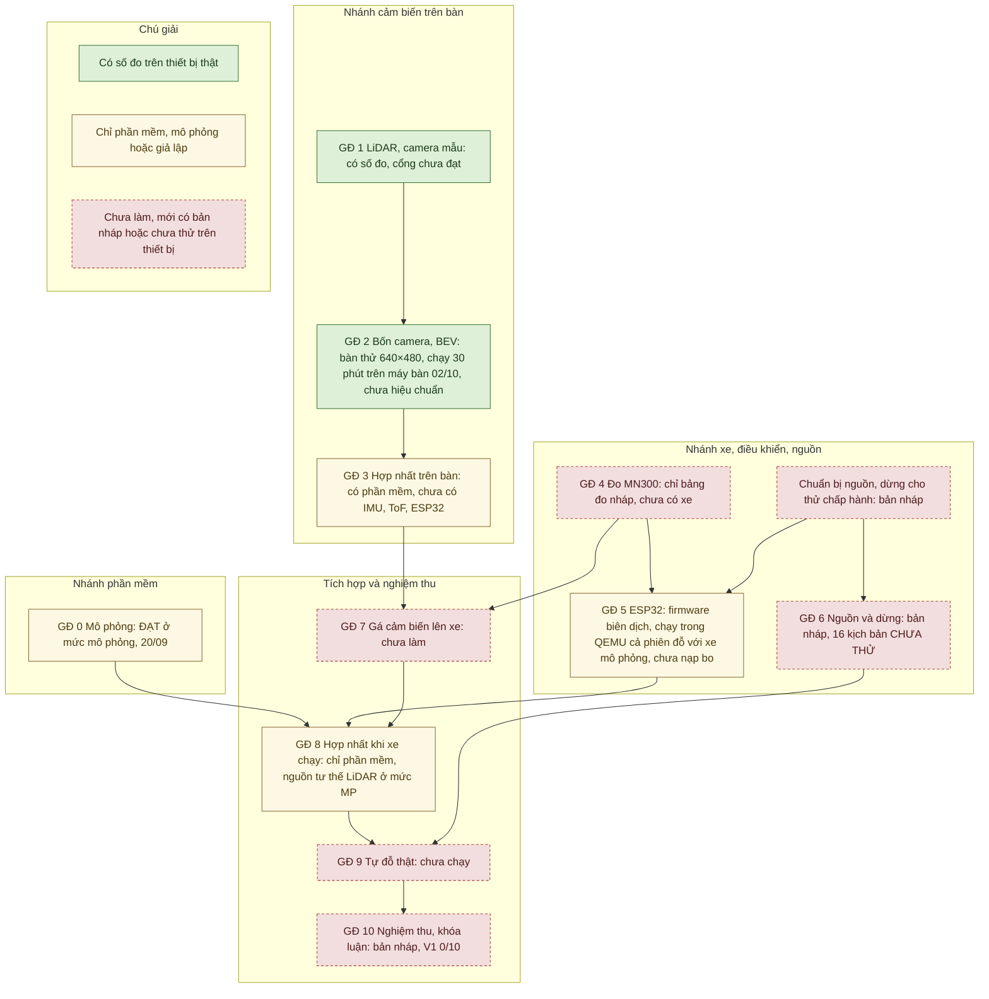
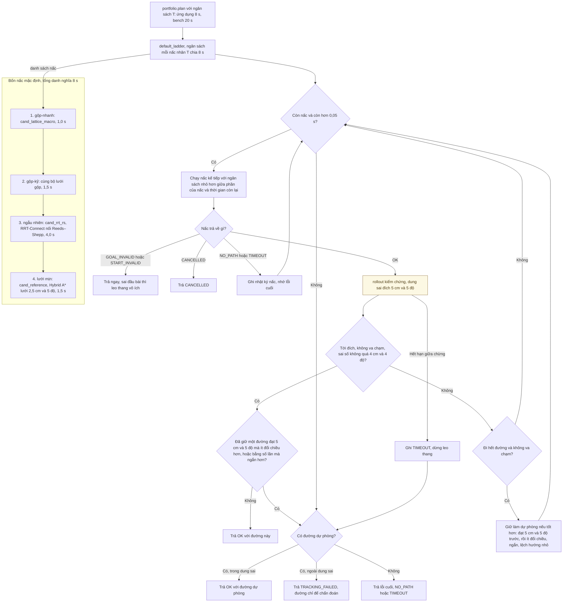
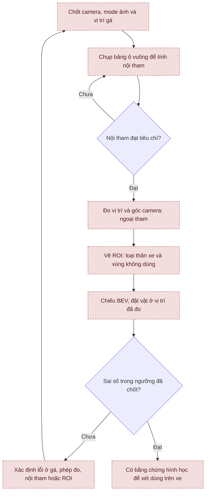
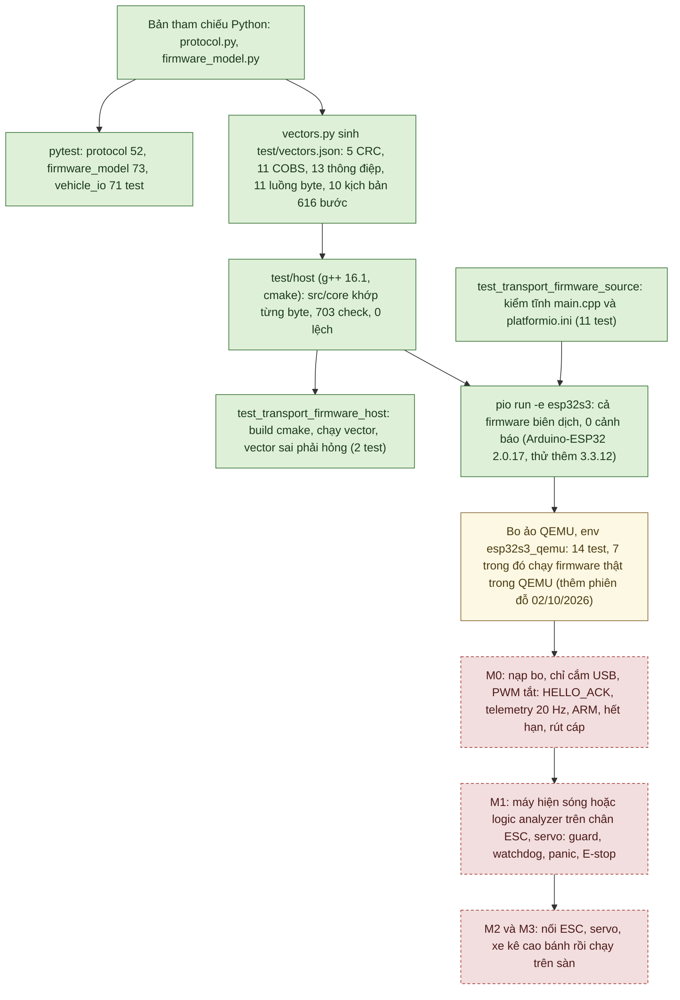
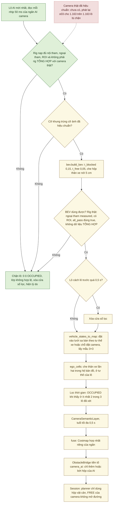

# Tổng quan và tiến độ AutoPark

Tài liệu này giải thích dự án đang ở đâu và cần làm gì tiếp theo. [Cách cài/chạy](autopark/README.md), [mục lục kỹ thuật](autopark/docs/README.md) và [sơ đồ hệ thống](autopark/docs/SO_DO_HE_THONG.md) nằm riêng để dễ tra.

Biên tập 30/09/2026 theo mã tại `ff4a018` (mã giống `ebbec83`); cây làm việc lúc viết có thêm sửa chưa commit: sửa chữ (docstring, chú thích trong mã, một tooltip trong `ui/main_window.py`, mô tả gói trong `pyproject.toml`; không đổi hành vi) và cách đếm khung của `python -m autopark.transport.qemu_board kiem`. Ngày biên tập không phải ngày đo: mô phỏng giai đoạn 0 (20/09/2026) chạy trên laptop; số cảm biến, AI và bàn thử tới 25/09/2026 đo trên máy bàn trước; số từ 29/09/2026 đo trên máy bàn hiện tại ([biên bản chuyển máy](autopark/docs/CHUYEN_MAY_BAN.md)). Bản trước đợt này: [`ff4a018`](https://github.com/thbn12082/autopark/blob/ff4a018/TONG_HOP_DU_AN.md); bản trước đợt 26/09/2026, giữ nhật ký và số liệu chi tiết tới 25/09: [`9d68257`](https://github.com/thbn12082/autopark/blob/9d68257/TONG_HOP_DU_AN.md).

Cập nhật 02/10/2026 theo mã của đợt công cụ nghiệm thu (commit `d3e1555`): mục 3 (dòng GĐ 10), 4.1, 4.5, 4.6, 4.9, 4.10, 4.15, 5.1, 5.4 và 6 (dòng Sơ đồ hệ thống). Các công cụ nghiệm thu mới chỉ được kiểm bằng test (bo mô phỏng, cổng serial giả, camera giả, giao diện offscreen, bản ghi phát lại); số test toàn bộ của đợt này ghi sau lượt chạy trên commit.

Cập nhật lần hai cùng ngày theo mã đợt 2 (gộp trên `63017a5`, chưa commit lúc viết) và các lượt chạy thiết bị ngày 02/10/2026: mục 1, 2, 3, 4.1, 4.3, 4.4, 4.5, 4.6, 4.8, 4.9, 4.11, 4.15, 5.1–5.4, 6 và 7 (đoạn đầu). Người dùng giao quyết định 02/10/2026 ("làm hết"), theo đề xuất, cho các việc ở mục 5.1; các ngưỡng vẫn ĐỀ XUẤT – CHỜ CHỐT. Phần mềm mới của đợt 2 chỉ được kiểm bằng test, mô phỏng, bo ảo QEMU hay ảnh tổng hợp; các lượt chạy thiết bị ngày 02/10/2026 làm trên máy bàn, không người ở cạnh.

Nghiên cứu nhận thức sử dụng **[Valeo WoodScape Dataset](https://github.com/valeoai/WoodScape)**. [Phạm vi sử dụng](autopark/docs/GIAY_PHEP_DU_LIEU.md).

## 1. Mục tiêu V1, phạm vi và mức bằng chứng

V1 cho phép chọn vị trí/hướng đỗ, tìm đường tiến/lùi phù hợp cơ cấu lái, bám đường có phản hồi, dừng và đánh giá lại khi gặp vật cản hoặc mất dữ liệu.

V1 không bắt buộc tự tìm ô đỗ, nhận diện vạch, tự lái đến bãi từ nơi khác, điều khiển từ ảnh tới lệnh bằng mạng neural, hoặc dựng cảnh 3D.

| Mức kết quả | Ý nghĩa | Đã có (02/10/2026) |
|---|---|---|
| Mô phỏng/nguồn giả | Kiểm logic và thuật toán bằng dữ liệu tạo ra | Đỗ xe, lỗi cảm biến, giao thức với bo mô phỏng, lõi firmware C++ khớp bản Python (test host), vật cản AI; từ 02/10 nguồn tư thế LiDAR với LiDAR mô phỏng, tham chiếu trên cao trên ảnh tổng hợp |
| Giả lập firmware | Firmware thật đã biên dịch chạy trong bo ảo QEMU, nói chuyện với phần mềm laptop | Giao thức, máy trạng thái, dốc tốc độ, hết hạn lệnh, mất liên lạc, reset chip (30/09); từ 02/10 cả phiên đỗ từ giao diện, với xe mô phỏng phía laptop; không kiểm được xung ESC/servo, E-stop, task watchdog kích hoạt, vòng PI tốc độ |
| Bàn thử/bản ghi | Đo cảm biến thật hoặc xử lý dữ liệu đã ghi | LiDAR, bốn camera, AI trực tiếp, ghi/phát lại; định vị offline; chạy dài 30 phút bốn camera + LiDAR + AI trên máy bàn (02/10) |
| Xe thật | Cảm biến và điều khiển trên xe chuyển động | Chưa có kết quả: chưa có xe, chưa nạp bo |

Cổng giai đoạn 0 đã đạt ở mức mô phỏng. Chưa cổng nào từ 1 đến 10 đạt; V1 đạt 0/10 điều kiện hoàn thành ([kế hoạch](KE_HOACH_TRIEN_KHAI_XE_TU_DO_v3.1.md) mục 16.4, 17.4). Kết quả mô phỏng hay giả lập không được dùng để đánh dấu đạt cổng (kế hoạch mục 15). Mức bằng chứng của từng điều kiện V1: sơ đồ 8.3 trong [Sơ đồ hệ thống](autopark/docs/SO_DO_HE_THONG.md).

## 2. Thiết bị

Tình trạng theo kiểm kê 22–25/09/2026; LiDAR và bốn camera qua hub chạy lại trên máy bàn hiện tại ngày 29/09/2026 và 02/10/2026, các mục khác chưa kiểm kê lại. Hồ sơ tới 02/10/2026 không ghi nhận thêm thiết bị nào:

| Thành phần | Tình trạng |
|---|---|
| RPLIDAR C1 + CP2102N | Đã nhận 22/09 (serial `f57ffc8bc6e598d1b59598f976dd5762`). Máy bàn hiện tại: COM3, driver CP210x 11.2.0.167, đọc được ngày 29/09; 02/10/2026 chạy 30 phút liền, 0 lỗi, sau khi sửa mã đọc C1 `lidar/rplidar_c1.py` (trên cổng này `reset_input_buffer()` không xóa byte nào, mục 4.3). Máy bàn trước: COM4, driver 11.6.0.420 |
| Bốn camera USB “HD Camera” | Đã nhận 23/09; không có serial nên danh tính là cổng hub; 130° là số nhà bán, góc nhìn thật chưa đo |
| Hub UGREEN bốn cổng | Đã nhận 23/09; camera chung nhánh USB 2.0, các phiên đã ghi dùng nguồn từ USB |
| MN300, ESP32-S3, BNO085, VL53L1X, AS5600, encoder | Chưa nhận |
| Nguồn, cầu chì, E-stop, phần tử ngắt | Chưa có bộ nào để kiểm chứng |

| Máy | Cấu hình | Vai trò |
|---|---|---|
| Máy bàn hiện tại (từ 29/09/2026) | Dell Precision 3680, i9-14900, RTX 4000 Ada 20 GB, RAM 63,7 GB, Windows 11 Enterprise, driver NVIDIA 596.71; repo ở `D:\xetulai\autopark` (tới chiều 29/09/2026 tên là `D:\gấp\autopark`) | Máy phát triển chính: huấn luyện, đo cảm biến, test host và biên dịch firmware, bo ảo QEMU |
| Máy bàn trước (tới 25/09/2026) | i9-14900, RTX 4000 Ada 20 GB, RAM 64 GB, driver NVIDIA 596.72; repo ở `D:\ap` | Nơi đo mọi số cảm biến, AI và bàn thử tới 25/09 |
| Laptop | i7-12700H, RTX 3050 Ti 4 GB | Máy trình diễn và nộp đồ án; mới chạy mô phỏng giai đoạn 0 (20/09), chưa đo cảm biến, AI hay bàn thử |

Cổng LiDAR đặt ở một chỗ: [`autopark/configs/thiet_bi.json`](autopark/configs/thiet_bi.json), khóa `lidar_port` (hiện `"COM3"`; `"auto"` tự tìm bộ chuyển CP210x, lấy cổng đầu tiên). Các lệnh LiDAR lấy cổng từ tệp này khi không có `--port`; `--port COMx` ghi đè cho một lần chạy. `rig.bench`/`ui.rig_app` lấy cổng này khi `--lidar` không kèm giá trị; lệnh kiểm máy mới (`do_may_moi.cmd`) luôn tự tìm CP210x. Từ 30/09/2026 cùng tệp giữ đường dẫn QEMU và PlatformIO cho bo ảo (khóa `qemu_xtensa`, `platformio_python`, `platformio_core_dir`; máy không có QEMU thì test bo ảo tự bỏ qua). Đổi máy thì sửa `lidar_port` và làm theo [biên bản chuyển máy](autopark/docs/CHUYEN_MAY_BAN.md) mục 5.

Công cụ firmware trên máy bàn, đặt ngoài repo: g++ 16.1.0 và cmake 4.4.1 cho test host; PlatformIO Core 6.2.0 ở `D:\xetulai\_platformio\penv`; QEMU của Espressif 9.2.2 ở `D:\xetulai\_platformio\qemu` ([biên bản chuyển máy](autopark/docs/CHUYEN_MAY_BAN.md) mục 6–8).

[Kiểm kê](autopark/docs/hardware_inventory.md), [phiếu nhận MN300](autopark/docs/mn300_inventory.md), [chuyển sang máy trình diễn](autopark/docs/MAY_NOP_DO_AN.md), [chuyển máy bàn](autopark/docs/CHUYEN_MAY_BAN.md).

## 3. Tiến độ theo 11 giai đoạn

Sơ đồ dưới cho thấy mỗi giai đoạn đang ở mức bằng chứng nào, và ba nhánh phần mềm, cảm biến trên bàn, xe/điều khiển/nguồn gặp nhau ở tích hợp. Phụ thuộc lấy theo [kế hoạch](KE_HOACH_TRIEN_KHAI_XE_TU_DO_v3.1.md) mục 2.2.

Xanh: đã có và đã kiểm/đo · Vàng: chỉ trong mô phỏng/giả lập · Đỏ viền đứt: chưa làm hoặc chưa thử trên thiết bị. Ở sơ đồ này, xanh chỉ có nghĩa là đã có số đo trên thiết bị thật (cổng giai đoạn 1 và 2 vẫn chưa đạt); vàng gồm cả phần mềm mới chạy với nguồn giả hoặc bo mô phỏng; đỏ viền đứt gồm cả việc mới có bản nháp. Mũi tên là phụ thuộc theo kế hoạch, không có nghĩa bước đó đã xong. Như kế hoạch mục 2.2, phần chuẩn bị nguồn và dừng phải có trước khi thử chấp hành ở GĐ 5; GĐ 6 xác nhận nguồn và dừng toàn hệ thống, chỉ cần trước GĐ 9.

| GĐ | Công việc | Trạng thái 02/10/2026 và điểm đang chặn |
|---|---|---|
| 0 | Mô phỏng | Đạt 6 điều kiện chuyển bước ở mức mô phỏng (20/09/2026, laptop); thông số xe giả định |
| 1 | LiDAR và camera mẫu | Đang làm. Có số đo LiDAR và camera trên bàn; thiếu sai số khoảng cách LiDAR, định vị có tham chiếu độc lập, hiệu chuẩn và gá camera, chấm AI trên ảnh thật có nhãn; [cổng 1 chưa đạt](autopark/docs/gate_01.md). Ngày 02/10/2026 sửa mã đọc C1 sau lỗi xả cổng, thử trên C1 thật (mục 4.3) |
| 2 | Bốn camera, BEV | Đang làm. Bàn thử bốn camera + LiDAR + AI chạy ở 640×480, ngày 02/10/2026 chạy đủ 30 phút trên máy bàn (mục 4.5); thiếu hiệu chuẩn và gá; 720p còn khung bị cắt tùy cảnh |
| 3 | Hợp nhất trên bàn | Có lớp bản đồ, phép hợp nhất và đường đưa vật cản LiDAR, AI camera vào phiên (phần mềm); chưa có IMU/ToF/ESP32 thật |
| 4 | Đo MN300 | Có bảng đo nháp và thử độ nhạy mô phỏng; chưa nhận xe |
| 5 | ESP32, điều khiển phản hồi | Có giao thức, bo mô phỏng, `VehicleIO`. Lõi C++ qua test host (703 check, 0 lệch, 29/09/2026); cả firmware biên dịch cho ESP32-S3 bằng PlatformIO (29/09/2026); chạy trong bo ảo QEMU (30/09/2026, [mô phỏng firmware](autopark/docs/MO_PHONG_FIRMWARE.md)), từ 02/10/2026 cả phiên đỗ từ giao diện với xe mô phỏng phía laptop (mục 4.9). CHƯA nạp bo vì chưa có bo |
| 6 | Nguồn và dừng | Bản nháp: bảng tải, sơ đồ nguồn/dừng, 16 kịch bản lỗi CHƯA THỬ; chưa có phần cứng |
| 7 | Gá cảm biến lên xe | Chưa làm |
| 8 | Hợp nhất khi xe chạy | Có phần mềm chuẩn bị (`VehicleLink`, chế độ quan sát); từ 02/10/2026 nguồn tư thế LiDAR trong phiên ở mức MP và trên bản ghi C1 đứng yên, ghi cảm biến trong phiên (T3) mới kiểm offscreen; START với bo thật ở VehicleIO vẫn bị từ chối tới khi đo gá LiDAR và đạt p04, DV-2, DV-1 (mục 4.3); chưa kiểm đồng bộ thời gian trên thiết bị |
| 9 | Tự đỗ thật | Chưa thực hiện |
| 10 | Nghiệm thu, khóa luận | Có dàn ý khóa luận, 37 kịch bản và ngưỡng nháp; chưa nghiệm thu V1 (0/10 điều kiện). Từ 02/10/2026 có thêm phần lớn công cụ phần mềm cho nghiệm thu (mục 4.15), mới kiểm bằng test và mô phỏng; đợt 2 cùng ngày thêm T2, T3, T4, xe nghiệm thu 0,10 m/s và 9 tệp sa bàn nghiệm thu mức MP. LD-1 chạy đủ 30 phút trên máy bàn (02/10/2026), còn hai điều kiện cần người ở cạnh và lượt trên laptop |

[Bản kiểm toán 275 việc ngày 24/09](autopark/docs/evidence/ke_hoach/kiem_toan_ke_hoach_20260924.json) ghi 56 việc xong, 92 một phần, 27 chưa bắt đầu, 100 chờ thiết bị. Bảng có trước các bổ sung sau đó; không dùng để tính phần trăm hoàn thành hiện tại. Sơ đồ đợt mua và thiết bị đã nhận: sơ đồ 8.2 trong [Sơ đồ hệ thống](autopark/docs/SO_DO_HE_THONG.md).

## 4. Nội dung theo mảng

### 4.1. Mô phỏng và lập đường

Có chỉnh sa bàn, đặt đích, xem trước, tiến/lùi, lái tay và xuất log. Mọi phần này chạy trên máy tính với xe và phản hồi mô phỏng; cấu hình xe `configs/vehicle_default.json` là giả định. Từ 02/10/2026 có thêm cấu hình xe nghiệm thu `configs/vehicle_nghiem_thu.json`: như tệp mặc định, chỉ khác `max_speed_mps` = 0,10 m/s (tệp mặc định 0,3 m/s, planner đặt tốc độ 0,15 m/s); kích thước vẫn giả định. Chọn bằng `--vehicle-config` hay ô "Cấu hình xe" của thẻ Xe (mục 4.15).

Điểm vào `planning/parking.py::plan_parking` tính đích từ ô đỗ (ô nhỏ hơn thân xe thì trả GOAL_INVALID ngay) rồi gọi thang `portfolio`: bốn nấc chạy lần lượt (không song song), mỗi đường ứng viên được xe mô phỏng bám thử trước khi nhận. Có hai ngưỡng khác nhau: đạt 4 cm/4° thì dừng leo thang, đạt 5 cm/5° (dung sai đích) thì được nhận:

Vàng: chỉ trong mô phỏng (xe mô phỏng bám thử đường). Các ô không tô là logic lập đường trong `planning/`, có test trên máy tính; chưa bước nào chạy trên xe thật. TRACKING_FAILED nghĩa là có đường nhưng xe mô phỏng không bám tới đích trong dung sai, khác NO_PATH. Hết thời gian hoặc chưa tìm ra đường không chứng minh bài toán vô nghiệm. Luồng từ nút bấm tới quỹ đạo, nhịp chạy kín vòng và phản ứng an toàn khi chạy: sơ đồ 3.1–3.4 trong [Sơ đồ hệ thống](autopark/docs/SO_DO_HE_THONG.md).

Hạn thời gian là đồng hồ thật (ứng dụng: 8 s cho cả tìm lẫn kiểm chứng), nên kết quả phụ thuộc tải máy và cách Windows xếp lịch tiến trình. Ngày 30/09/2026, khi để Windows tự quyết EcoQoS, cả 2/2 lượt nhóm 15 test ngân sách thời gian có test hỏng (1–3 test); khi tiến trình tự tắt EcoQoS, 2/2 lượt đạt 15/15. Từ đó `tests/conftest.py` tắt EcoQoS cho tiến trình pytest ([biên bản chuyển máy](autopark/docs/CHUYEN_MAY_BAN.md) mục 8). Ứng dụng chưa tắt. Đo ngày 02/10/2026 bằng `python -m autopark.evaluation.ecoqos_gui` (mở giao diện thật, đổi trạng thái cửa sổ trước mỗi lần lập đường; lệnh ở [hướng dẫn chạy](autopark/README.md) mục 4): cửa sổ thu nhỏ thì Windows hạ tốc tiến trình giao diện và lập đường `uturn_w46` hết hạn 8 s ở 4/4 lượt; tiến trình tự tắt EcoQoS thì đạt 4/4; bị che thì không chậm ([biên bản chuyển máy](autopark/docs/CHUYEN_MAY_BAN.md) mục 10; một máy, kế hoạch nguồn High performance, 4 lượt mỗi trạng thái). *(Cập nhật 02/10/2026: từ đó ứng dụng và các công cụ đo cũng tự tắt EcoQoS cho tiến trình của mình, `AUTOPARK_KEEP_ECOQOS=1` giữ mặc định của Windows; mục 5.4.)* Vòng điều khiển 50 Hz của lần chạy khi cửa sổ thu nhỏ: đo cùng ngày bằng công cụ `do-chay` (thêm 02/10/2026; kết quả ở mục 5.4).

Hồ sơ 20/09 (laptop) ghi 220 test đạt và 2.880 trường hợp theo seed không vi phạm các điều kiện đã đặt. Trong 240 phiên có lỗi giả: 25 hoàn thành, 185 dừng đúng logic, 30 FAULT do chèn vật quá gần. Không cộng ba nhóm thành số lần đỗ thành công. Mã lập đường, bám đường, mô phỏng và hình học không đổi từ commit đầu `bef5695` (21/09) tới `ff4a018`, trừ chữ trong docstring và chú thích. Ngày 29/09/2026 trên máy bàn hiện tại (mã `b37e9ee`), chạy lại năm phiên mẫu `evaluation.phase0` cho kết quả trùng từng giá trị với đợt 20/09 ([tóm tắt](autopark/docs/evidence/chuyen_may_20260929/kiem_may_20260929.md) mục 2.1); chiến dịch 2.880 ca chưa chạy lại sau 20/09.

Cả 16 ca khó có đường chứng trong mô hình hình học. Điều đó không có nghĩa planner tìm được trong thời hạn hoặc đường đủ thực dụng cho xe; `parallel_115` vẫn chưa được planner giải trong các lượt báo cáo. Từ 02/10/2026 có thể đặt giới hạn số lần đổi chiều khi chạy (`run_app.py <kịch bản> --max-cusps N`, công cụ T12): `Session.start_run` từ chối đường vượt giới hạn trước mọi lệnh tới bo, planner không đổi; mặc định không chặn, giao diện chỉ cảnh báo khi đường có hơn 7 lần đổi chiều. Tiêu chí "đường thực dụng" vẫn CHƯA CHỐT. *(Cập nhật 02/10/2026: tệp sa bàn gắn kịch bản nghiệm thu (`scenarios/nghiem_thu`, trường `acceptance`) tự dùng trần N-D6 (b) của kịch bản đó trong `configs/nguong_nghiem_thu.json`; `--max-cusps` chỉ siết thêm. Người dùng giao quyết định 02/10/2026, các số vẫn ĐỀ XUẤT – CHỜ CHỐT.)*

[Báo cáo mô phỏng](BAO_CAO_GIAI_DOAN_0.md), [kiểm thử độ bền](autopark/docs/KIEM_THU_DO_BEN_GIAI_DOAN_0.md), [độ nhạy kích thước](autopark/docs/DO_NHAY_KICH_THUOC_XE.md).

### 4.2. AI nhận thức, dữ liệu và giấy phép

L-RASPP/MobileNetV3 phân ảnh thành FREE và BLOCKED. Checkpoint tham chiếu: `runs/ai_woodscape_rtx4000_v1/best.pt`, không nằm trong Git; trên máy bàn hiện tại SHA-256 trùng hồ sơ ([biên bản chuyển máy](autopark/docs/CHUYEN_MAY_BAN.md) mục 1).

WoodScape test nội bộ ở ngưỡng 0,50 đạt mIoU 0,9692; 1,75% pixel vật cản bị gọi FREE. Ở ngưỡng an toàn 0,15 (ngưỡng mà ngăn AI camera dùng) bỏ sót còn 0,69%, còn 3,09% pixel FREE bị gọi vật cản (1,37% ở 0,50). Đây không phải test chính thức, chưa chứng minh độ chính xác sa bàn. Các lượt thêm AVM-SS/ACDC chưa thay thế được lượt nền trên cả hai tập đánh giá chưa dùng để học/chọn mô hình.

Số huấn luyện, chấm, ONNX và độ trễ trong [huấn luyện](HUAN_LUYEN.md) đo 21–24/09 trên máy bàn trước. Ngày 29/09/2026 trên máy bàn hiện tại (mã `b37e9ee`): chấm lại val được mIoU 0,9700, bỏ sót 1,70%, trùng số ngày 21/09; train thử 1 epoch chạy được ([tóm tắt lượt kiểm lại](autopark/docs/evidence/chuyen_may_20260929/kiem_may_20260929.md); tệp gốc ở `autopark/runs/kiem_may_20260929/`, không có trong Git). Trên laptop trình diễn chưa đo gì của AI.

Ngày 25/09 người làm khóa luận quyết định dùng checkpoint WoodScape trong vòng điều khiển theo cách diễn giải của dự án; Valeo chưa xác nhận. Quyết định không bao gồm nhãn nháp AI hoặc checkpoint chứa AVM-SS.

[Huấn luyện](HUAN_LUYEN.md), [giấy phép](autopark/docs/GIAY_PHEP_DU_LIEU.md). Sơ đồ huấn luyện, giấy phép dữ liệu và ngưỡng quyết định: sơ đồ 5.1, 5.2, 5.7 trong [Sơ đồ hệ thống](autopark/docs/SO_DO_HE_THONG.md).

### 4.3. LiDAR RPLIDAR C1

Đã đọc scan, ghi/phát lại, tạo bản đồ tĩnh. Sau bỏ khởi động, các bản ghi ngày 22 và 24/09 (máy bàn trước) đạt khoảng 10 vòng/s và 510 tia/vòng. Ngày 29/09 trên máy bàn hiện tại (COM3), lệnh kiểm máy mới đo 10,00 Hz, trung vị 508 tia/vòng, tương đương lượt cùng lệnh trên máy bàn trước ngày 24/09 ([biên bản chuyển máy](autopark/docs/CHUYEN_MAY_BAN.md) mục 2); cùng ngày, bàn thử 30 s lấy cổng từ `thiet_bi.json` nhận 301 vòng, 10,03 Hz (mục 4.11).

Độ lặp lại khoảng cách giữa hai vòng liên tiếp, tính offline trên ba bản ghi C1 đứng yên (22 và 24/09, phản hồi 0,2–4 m): trung vị |Δr| 0,75–1,5 mm, p90 4,25–7,75 mm ([thử LiDAR](autopark/docs/GIAI_DOAN_1_LIDAR.md) mục 3c). Đây không phải sai số so với thước; sai số khoảng cách so với thước chưa đo.

Có công cụ định vị trên bản đồ và odometry khớp scan. Kết quả C1 hiện dùng bản ghi đứng yên; chưa có tham chiếu độc lập hoặc kiểm khi di chuyển. Khớp lại cùng chỗ chưa chứng minh sai số định vị thực. Phương án định vị cho V1: người dùng giao quyết định 02/10/2026 ("làm hết"), làm theo đề xuất mục 7 của [so sánh SLAM](autopark/docs/SO_SANH_DINH_VI_SLAM.md). Từ 02/10/2026 (T2) hai công cụ này thành nguồn tư thế của phiên đỗ ở mức MP (LiDAR mô phỏng) và chạy offline trên bản ghi C1 đứng yên (BT offline); ngày 02/10/2026 kiểm tĩnh trực tiếp trên C1 thật đứng yên (bản đồ một chỗ đặt, cảnh phòng): 269/269 vòng OK, tư thế dao động trong 3 mm và 0,06° (độ lặp lại, không phải độ chính xác; [chuyển máy](autopark/docs/CHUYEN_MAY_BAN.md) mục 12.3); C1 thật nối vào nguồn tư thế của phiên (`ui.lidar_app`): CHƯA THỬ. Cách ghép: bản đồ dựng từ nhiều chỗ đặt LiDAR đứng yên, neo vào hệ sa bàn (`lidar.map_builder`); mỗi vòng quét được định vị trên bản đồ (a) và kiểm chéo bằng odometry khớp scan (b); ở mức MP vòng quét lấy từ LiDAR mô phỏng quét sa bàn. Không phải SLAM: bản đồ cố định, không đóng vòng. Mới kiểm trên vòng quét tổng hợp, LiDAR mô phỏng và bản ghi C1 đứng yên; chưa dựng bản đồ sa bàn thật nào, CHƯA THỬ với LiDAR gá trên xe chạy. Bo thật ở VehicleIO vẫn bị từ chối (START_POSE_UNVERIFIED) tới khi gá LiDAR được đo và đạt p04, DV-2, DV-1 (ghi `measured: true` kèm bằng chứng trong `configs/dinh_vi_lidar_v0.json`). Với LiDAR mô phỏng, 4 trong 9 tệp sa bàn nghiệm thu dừng POSE_LOST (mục 4.15). Mọi ngưỡng của bộ ghép là ĐỀ XUẤT – CHỜ CHỐT ([nguồn tư thế LiDAR](autopark/docs/NGUON_TU_THE_LIDAR.md)).

Ngày 02/10/2026 trên máy bàn (COM3, bộ chuyển CP210x), `reset_input_buffer()` (PurgeComm) không xóa byte nào khỏi cổng (81 → 81 byte; khi C1 đang quét 23 303 → 23 303 byte). Vì vậy C1 bị một tiến trình chết bỏ lại đang quét làm mọi lần mở sau trên cùng cổng hỏng (lần 2 của LD-1: LiDAR 0 vòng, 8151 lỗi "bad response descriptor"), và `flush()` trước đó không xả được gì trên máy này. Mã đọc C1 (`lidar/rplidar_c1.py`) nay đọc bỏ byte cũ (sau STOP, trước mỗi lệnh hỏi, trước SCAN, trong `flush()`), RESET một lần khi lệnh hỏi hỏng, và bỏ vòng đầu sau `flush()`. Thử trên C1 thật: giết tiến trình đang quét rồi mở lại đạt 2/2 (đọc bỏ 58–60 byte); `flush()` bỏ 12,7 / 25,5 KB trong 0,1–0,2 ms; lần 3 của LD-1: 18 015 vòng trong 30 phút, 10,008 Hz, 0 lỗi ([biên bản chuyển máy](autopark/docs/CHUYEN_MAY_BAN.md) mục 12, [chẩn đoán](autopark/docs/evidence/thiet_bi_20261002/chan_doan_lidar.txt)). Cổng USB CDC của bo ESP32-S3 chưa thử.

[Thử LiDAR](autopark/docs/GIAI_DOAN_1_LIDAR.md), [định vị](autopark/docs/DINH_VI_LIDAR.md), [so sánh SLAM](autopark/docs/SO_SANH_DINH_VI_SLAM.md), [nguồn tư thế LiDAR](autopark/docs/NGUON_TU_THE_LIDAR.md).

### 4.4. Camera USB và lỗi khung hình

Mặc định bàn thử **640×480** vì nhiều phiên 720p có khung MJPEG bị cắt khi bốn camera chạy chung hub. Một số phiên 720p nhìn cảnh tối không lỗi chưa đủ kết luận ổn định.

480p cũng từng có đợt lỗi; bộ đọc loại khung hỏng. Nguyên nhân chưa xác định dứt điểm. Camera được nhận diện theo cổng hub vì không có serial riêng; trên máy bàn hiện tại bốn camera vẫn cắm cổng hub 1–4, nhưng chưa khởi động lại máy để kiểm danh tính theo cổng.

Ngày 02/10/2026 trên máy bàn (không người ở cạnh, cảnh camera không ai kiểm): `video.camera_bench measure` bốn camera 640×480 trong 60 s cho mỗi camera 23,8 khung/s thật, 0 khung cắt, xé, cũ hay đọc hỏng; khoảng giữa hai khung mới trung vị 48 ms, p95 48–49 ms, lớn nhất 55–62 ms; tổng 95,4 khung/s, tiến trình dùng 0,21 lõi CPU ([biên bản chuyển máy](autopark/docs/CHUYEN_MAY_BAN.md) mục 12, [tệp kết quả](autopark/docs/evidence/thiet_bi_20261002/m_4cam_480p_auto.measure.json)). `camera_bench list` cùng lượt thấy bốn camera ở cổng hub 1–4.

[Thử camera](autopark/docs/GIAI_DOAN_1_CAMERA.md), [sơ đồ USB](autopark/docs/usb_topology.md).

### 4.5. Bàn thử bốn camera + LiDAR + AI

Có giao diện xem đồng thời, đo suy luận, độ lệch thời gian và khung lỗi. Quy tắc chờ dựa trên nhịp riêng từng camera; AI làm nóng với các cỡ lô cần dùng. Độ lệch và độ trễ tính theo lúc dữ liệu tới máy; độ trễ từ sự kiện thật tới lúc dữ liệu về máy chưa đo.

Số đo trong hướng dẫn bàn thử là của máy bàn trước. Ngày 29/09/2026, lệnh kiểm máy mới (`do_may_moi.cmd`, mã `9d68257`, LiDAR và bốn camera thật) trên máy bàn hiện tại cho: AI lô 4 ảnh 480p trung vị 10,8 ms (máy bàn trước 10,4 ms); bàn thử 480p + LiDAR + AI 120 s được 2.861 bộ ảnh, 0 khung hỏng, 23,85 bộ AI/s, như máy bàn trước; 720p chỉ camera được 715 bộ, 0 khung hỏng. Cảnh camera lúc đo không ghi lại, nên số khung hỏng chưa so được với các phiên cũ. Lượt này là tham chiếu `may_moi` hiện dùng ([`tham_chieu_20260929.json`](autopark/docs/evidence/may_ban/tham_chieu_20260929.json), người dùng chọn ngày 29/09/2026); lệnh đo trên laptop so với nó. Trong lượt chạy lại các lệnh README cùng ngày (15:08–15:19, mã `b37e9ee`), lệnh kiểm máy mới (`rig.may_moi`) chạy lần hai cho bàn thử 23,87 bộ AI/s, bước AI trung vị 12,7 ms (p95 21,8 ms); ba lần lặp riêng bước AI cho 11,0 / 10,8 / 10,8 ms ([tóm tắt](autopark/docs/evidence/chuyen_may_20260929/kiem_may_20260929.md)). Số máy bàn chưa thay được phép đo trên laptop trình diễn. [Hướng dẫn bàn thử](autopark/docs/GIAI_DOAN_2_BAN_THU.md), [kết quả kiểm máy mới](autopark/docs/CHUYEN_MAY_BAN.md) mục 2.

Từ 02/10/2026, `gap_max_ms` của từng camera trong `.rig.json` tính cả khoảng hở còn mở lúc chốt số (`gap_end_ms`: camera ngừng hẳn trước khi hết phần đo; công cụ T10), nghĩa cũ ở `gap_closed_max_ms`; `.rig.json` ghi trước đó không có khóa mới. `rig.bench --sync-mark` (T14) nháy dấu đồng bộ video–log trên màn hình và ghi `<name>.sync.csv` theo `perf_counter`, cùng đồng hồ với stamp của bàn thử. Cả hai mới kiểm bằng test với camera giả và giao diện offscreen; chưa chạy lại trên bàn thử thật, độ trễ hiển thị của dấu đồng bộ CHƯA ĐO ([hướng dẫn chạy](autopark/README.md) mục 7).

Ngày 02/10/2026, máy bàn, không người ở cạnh (người dùng cho phép chạy LiDAR, camera không người trông; ảnh chỉ lưu trong `runs/`, không commit): chạy dài 30 phút bốn camera + LiDAR + AI có ghi phiên (`rig.bench --record`, kịch bản LD-1) ba lần. Ghi thử 60 s trước đó: 5,31 MB/s. Lần 1 tiến trình chết ở t ≈ 1050 s (mã thoát 127, không traceback, không `.rig.json`; nguyên nhân CHƯA RÕ). Lần 2 chạy đủ 1800 s nhưng LiDAR 0 vòng (lỗi xả cổng ở mục 4.3). Lần 3 (mã đợt 2, mã đọc C1 đã sửa) chạy đủ 1800 s: mỗi camera 23,85 khung/s, 0 khung hỏng, hở lớn nhất 87–118 ms; 42 751 bộ ảnh, lệch trung vị 25,1 ms (p95 31,7, lớn nhất 54,1 ms); LiDAR 10,008 Hz, 0 lỗi; AI 23,75 bộ/s, lô trung vị 25,3 ms (p95 39,7, lớn nhất 202 ms), tuổi kết quả AI trung vị 51,3 ms; CPU tiến trình 1,21 lõi, RAM 1,57 GB, nhiệt GPU tới 79 °C; ghi 171 702 khung, 7995 MB, 4,44 MB/s, không bỏ khung; EcoQoS tắt. Đây là máy bàn, không phải laptop nộp đồ án (CHƯA ĐO); camera nhìn gì không ai kiểm, nên hai điều kiện của LD-1 "camera nhìn sa bàn thật" và "camera đúng hướng sau mỗi lần khởi động lại" CHƯA KIỂM ([biên bản chuyển máy](autopark/docs/CHUYEN_MAY_BAN.md) mục 12, [kịch bản nghiệm thu](autopark/docs/KICH_BAN_NGHIEM_THU.md) mục 5.8, [bằng chứng](autopark/docs/evidence/thiet_bi_20261002/)).

### 4.6. Hiệu chuẩn camera

Có bảng in, công cụ chụp/tính nội tham fisheye, đo ngoại tham và vẽ ROI. Công cụ mới được kiểm chủ yếu bằng ảnh tổng hợp; chưa camera dự án nào có hiệu chuẩn thật. Kiểm 30/09/2026: `calibration/` chưa có tệp nội tham `cam_p*.json` nào, `configs/rig/` chỉ có ngoại tham `v0` giả định, chưa có ROI `configs/roi/rig_v1/`. Từ 02/10/2026 công cụ nội tham mở được camera không qua hub 1–4 (camera trên cao của tham chiếu R1) theo index và tên (`ui.calib_app --index N --camera-name TÊN`, công cụ T11), lưu `calibration/cam_<tên>.json` (mode khác 640×480 thêm hậu tố kích thước, ví dụ `cam_tren_cao_1280x720.json`) mà BEV và AI camera không đọc (từ 02/10/2026 công cụ tham chiếu trên cao T4 đọc tệp `cam_tren_cao_*.json`, mục 4.15); khi một số cổng có camera ở hai hub, chọn camera theo cổng chỉ nhận khi các cổng khác chỉ ra hub của camera xe, không thì báo lỗi thay vì chọn đại. Phần này mới kiểm offscreen với camera giả.

Thứ tự: **nội tham → ngoại tham theo gá → ROI → kiểm sai số bằng vật có vị trí đo được**.

Xanh: đã có và đã kiểm/đo · Vàng: chỉ trong mô phỏng/giả lập · Đỏ viền đứt: chưa làm hoặc chưa thử trên thiết bị. Ở đây mọi bước đều chưa làm với camera của dự án; công cụ cho từng bước đã có, mới kiểm trên ảnh tổng hợp. Nhánh cuối là mục tiêu kiểm chứng. Hiệu chuẩn đi tới chặn AI camera thế nào: sơ đồ 4.6 trong [Sơ đồ hệ thống](autopark/docs/SO_DO_HE_THONG.md).

[Nội tham](autopark/docs/HIEU_CHUAN_CAMERA.md), [ngoại tham và ROI](autopark/docs/NGOAI_THAM_VA_ROI.md).

### 4.7. Gán nhãn ảnh sa bàn

Có nhập ảnh, sửa/duyệt nhãn, xuất cache; chưa có tập sa bàn được gán nhãn để chấm mô hình. Tập đánh giá cần tô tay từ đầu và tách theo phiên chụp. Nhãn sửa từ dự đoán có thể thiên lệch về mô hình tạo nháp.

[Quy trình gán nhãn](autopark/docs/GAN_NHAN_SA_BAN.md).

### 4.8. Hợp nhất cảm biến

Có lớp bản đồ tĩnh, LiDAR, camera và cận trường; kiểm thời hạn dữ liệu; chuyển vật cản vào phiên mô phỏng. Ngày 22/09/2026 (máy bàn trước, COM4), xe ảo đã tìm đường quanh vật do LiDAR thật đứng yên quét. Sau khi đổi cách lấy cổng LiDAR (29/09/2026), `ui.lidar_app` và `fusion.demo` chưa chạy lại với LiDAR thật. *(Cập nhật 02/10/2026: `fusion.demo` 30 s với LiDAR thật trên máy bàn, không người ở cạnh: COMPLETED, 166 vòng, 0 lỗi đọc; bỏ 23 vòng khởi động mô-tơ (4,55 s), nền dựng từ 10 vòng 500–512 tia; 18 vật có sẵn, 4 vật mới ngoài đường (không dừng), không va chạm ([biên bản chuyển máy](autopark/docs/CHUYEN_MAY_BAN.md) mục 12). `ui.lidar_app` với LiDAR thật vẫn chưa chạy lại.)*

ToF mới dùng gá giả định và dữ liệu mô phỏng; lớp cận trường chưa được phiên đỗ dùng. Từ 02/10/2026 phiên có nguồn tư thế LiDAR ở mức MP và trên bản ghi C1 đứng yên (mục 4.3); khi chọn "LiDAR thật", ngăn LiDAR neo mỗi vòng quét ở tư thế định vị của chính vòng đó (mới thử với nguồn giả). Chưa kiểm trên xe chuyển động. [Chuẩn bị hợp nhất](autopark/docs/GIAI_DOAN_3_CHUAN_BI.md).

### 4.9. Giao thức xe, VehicleIO và firmware ESP32-S3

Laptop nói với bo bằng giao thức v1: khung COBS + CRC-16, phiên, số thứ tự, lệnh có hạn (laptop gửi hạn 150 ms, bo kẹp tối đa 300 ms); bo tự về DISARMED sau 500 ms không nhận thông điệp hợp lệ nào. Bản tham chiếu Python (`transport/protocol.py`, `transport/firmware_model.py`) là chuẩn. `VehicleIO` nói cùng byte giao thức với bo mô phỏng, cổng COM hoặc `socket://`. Chế độ quan sát tính lệnh và ghi log nhưng không gửi lệnh chạy.

Firmware C++ được kiểm theo từng tầng; chưa tầng nào chạm bo thật:

Xanh: đã có và đã kiểm/đo · Vàng: chỉ trong mô phỏng/giả lập · Đỏ viền đứt: chưa làm hoặc chưa thử trên thiết bị. Xanh ở đây là đã kiểm trên máy tính (test host và biên dịch ngày 29/09/2026); số test theo lượt trên `ebbec83` (30/09/2026), trừ ô bo ảo: số test trong tệp theo mã ngày 02/10/2026. Lượt chạy lặp 10 lần của test bo ảo đạt 10/10 trên `ebbec83` (30/09/2026) và `d3e1555` (02/10/2026), khi tệp còn 13 test; tệp 14 test (thêm phiên đỗ qua bo ảo) đạt 14/14 ở hai lượt chạy trong lúc làm ngày 02/10/2026 ([mô phỏng firmware](autopark/docs/MO_PHONG_FIRMWARE.md) mục 1). Bo ảo không có LEDC, GPIO vào (E-stop) hay USB-CDC thật, và task watchdog không bao giờ kích hoạt; chạy được trong bo ảo không chứng minh gì về bo thật ([mô phỏng firmware](autopark/docs/MO_PHONG_FIRMWARE.md) mục 1). M0–M3 là các mức thử trên bo ở [chuẩn bị nguồn và dừng](autopark/docs/GIAI_DOAN_6_CHUAN_BI.md) mục 5.1, dựng theo trình tự thử trên bo của [README firmware](autopark/firmware/esp32_vehicle/README.md). Kiến trúc liên kết laptop–bo, trình tự chạy và lỗi, máy trạng thái firmware: sơ đồ 6.1–6.7 trong [Sơ đồ hệ thống](autopark/docs/SO_DO_HE_THONG.md).

Phía giao diện: thẻ "Bo điều khiển" cho chọn bo và "Kiểm kết nối bo" (HELLO, đọc vài khung telemetry, không ARM, không gửi lệnh). Tới 30/09/2026 danh sách chỉ có bo mô phỏng và cổng COM, bo ảo mới kiểm ở mức `VehicleIO` (13 test lúc đó, 6 trong đó chạy firmware thật trong QEMU). Từ 02/10/2026 danh sách có "Bo ảo QEMU (firmware xe trong giả lập)": nút "Khởi động bo ảo" build và chạy QEMU, và cả phiên đỗ chạy qua firmware thật trong QEMU với tốc độ, góc lái, tư thế lấy từ xe mô phỏng phía laptop (người dùng giao quyết định 02/10/2026; bằng chứng `qemu_firmware_simulated_vehicle`, chỉ mức MP; firmware chưa đọc cảm biến nên vòng PI, STALL, FEEDBACK_LOST của firmware không được thử; [mô phỏng firmware](autopark/docs/MO_PHONG_FIRMWARE.md) mục 1.1). `tests/test_firmware_qemu.py` nay có 14 test, 7 trong đó chạy firmware thật trong QEMU (thêm phiên đỗ qua bo ảo). Một lần chạy ứng dụng bằng script (offscreen, không người bấm, 02/10/2026 18:58; các nút được gọi bằng mã): QEMU sẵn sàng sau 0,5 s, hai lần Bắt đầu đỗ trên `bai_do_xe.json` đều COMPLETED "Đỗ xong" (≈ 21 s mỗi lần), 0 lần START bị từ chối, 0 hộp thoại, đóng cửa sổ thì QEMU tắt ([biên bản chuyển máy](autopark/docs/CHUYEN_MAY_BAN.md) mục 14, [bằng chứng](autopark/docs/evidence/bo_ao_ui_20261002/)); lái tay trên cửa sổ thật CHƯA THỬ. Firmware biên dịch cứng `max_speed_mm_s` 300, nên với xe nghiệm thu (0,10 m/s) bo ảo từ chối START ở VehicleIO (LIMITS_MISMATCH, hướng an toàn; Quan sát chỉ cảnh báo; suy ra từ mã, chưa chạy thử với bo ảo); bản firmware 100 mm/s CHƯA LÀM. Thẻ cũng có ô "Nguồn tư thế" (T2, 02/10/2026): mô phỏng (mặc định), LiDAR mô phỏng (chỉ với bo mô phỏng), LiDAR thật (chỉ trong `ui.lidar_app`, chỉ với bo COM); bo ảo chỉ đi với tư thế của xe mô phỏng phía laptop, và cổng của LiDAR không được chọn làm cổng bo. Chọn cổng COM với tư thế mô phỏng thì Bắt đầu đỗ bị từ chối trước khi mở cổng vì chưa có nguồn tư thế thật. Với "LiDAR thật", VehicleIO bị từ chối (START_POSE_UNVERIFIED) trước mọi I/O tới khi đo gá LiDAR và đạt p04, DV-2, DV-1; ở Quan sát, lần Bắt đầu đỗ đầu mở cổng ở bước 0c (`reopen()`) và giữ cổng mở giữa các lần chạy, "Kiểm kết nối bo" đóng cổng đó trước khi kiểm; với bo thật CHƯA THỬ. Từ 02/10/2026 thẻ có nút "Xóa lỗi bo (CLEAR_FAULT)" (T15) cho bo chọn ở cổng COM (từ đợt 2 cả bo ảo QEMU đang chạy, không hỏi xác nhận): chỉ gửi CLEAR_FAULT khi bo đang FAULT và telemetry báo nút dừng khẩn đã nhả, không ARM, không gửi lệnh chuyển động, mỗi lần bấm một dòng `board_actions.csv`. Cùng ngày, mỗi quyết định dừng của phiên chạy qua `VehicleIO` được ghi vào `events.csv` (dòng `session_stop`, T13), và lần chạy qua `VehicleIO` có gói phát lại bằng log (T9): chạy lại cùng phần mềm trên đầu vào đã ghi và so quyết định, không tái hiện xe. Cả ba mới thử với bo mô phỏng và cổng serial giả; với ESP32-S3: CHƯA THỬ ([chế độ quan sát](autopark/docs/CHE_DO_QUAN_SAT.md)).

Firmware chưa có mã đọc cảm biến (encoder, AS5600, BNO085, VL53L1X, điện áp nguồn): telemetry báo không có số đo. Loại bo (`esp32-s3-devkitc-1`) và các chân ESC, servo, E-stop CHƯA CHỐT. Khoảng hở còn lại (suy ra từ mã, chưa có test; [giao thức](autopark/docs/GIAO_THUC_XE.md) mục 12): nếu bo vừa về ARMED vì hết hạn lệnh (`COMMAND_TIMEOUT`) mà khung telemetry báo điều đó chưa tới laptop, laptop vẫn có thể gửi enable=1 và bo chạy lại (ARMED → RUNNING); khoảng hở và effort khi đó trên bo thật: CHƯA ĐO. Đề xuất chốt phía firmware (sau `COMMAND_TIMEOUT` không nhận enable=1 tới khi có ARM mới): CHƯA LÀM.

[Giao thức và điểm còn mở](autopark/docs/GIAO_THUC_XE.md), [quan sát](autopark/docs/CHE_DO_QUAN_SAT.md), [firmware](autopark/firmware/esp32_vehicle/README.md), [bo ảo QEMU và các trình giả lập đã thử](autopark/docs/MO_PHONG_FIRMWARE.md).

### 4.10. Nguồn và an toàn

Có bản nháp bảng tải, sơ đồ nguồn/dừng, 16 kịch bản lỗi L1–L16 (đều CHƯA THỬ); chưa có phần cứng nguồn hay dừng nào, chưa đo điện áp hay dòng. Theo thiết kế có ba lớp dừng: nút LA38 cắt động lực bằng phần cứng, firmware, laptop; phần tử ngắt có ba phương án, CHƯA CHỐT. Ngõ E-stop của ESP32 không thay đường ngắt động lực.

Tác dụng của `output_guard`, móc panic, ngõ E-stop thật và watchdog phần cứng của chip chưa được kiểm ở đâu: firmware mới biên dịch và chạy trong bo ảo, mà bo ảo không có LEDC, GPIO vào và watchdog phần cứng không kích hoạt. Watchdog liên lạc 500 ms (`LINK_TIMEOUT`) và logic chốt E-stop (với ngõ vào giả) đã kiểm bằng bản Python và test host; watchdog liên lạc kiểm thêm trong bo ảo. Chuỗi dừng ba lớp và sơ đồ nguồn dự kiến: sơ đồ 7.1, 7.2 trong [Sơ đồ hệ thống](autopark/docs/SO_DO_HE_THONG.md). Từ 02/10/2026 kịch bản L7 (vòng điều khiển của laptop treo) có script diễn tập ở mức mô phỏng (`python -m autopark.evaluation.fault_drill hang`, công cụ T6, có hoặc không Heartbeat); trên bo vẫn CHƯA THỬ.

[Chuẩn bị nguồn và dừng](autopark/docs/GIAI_DOAN_6_CHUAN_BI.md).

### 4.11. Ghi và phát lại phiên bàn thử

Có ghi camera + LiDAR và phát lại không cần thiết bị. Phiên thật 60 giây `o03` (máy bàn trước, 24/09, camera nhìn chỗ tối) đã được đối chiếu số bộ ảnh và độ lệch thời gian khi phát lại. Ngày 29/09/2026 trên máy bàn hiện tại (mã `b37e9ee`), một phiên 30 s bốn camera + LiDAR + AI ghi bằng `rig.bench --record`; phát lại đủ 3.026 khung và 301 vòng LiDAR, ra 717 bộ ảnh như lúc ghi ([tóm tắt](autopark/docs/evidence/chuyen_may_20260929/kiem_may_20260929.md)). Bản ghi đầy đủ không có trong Git. Chưa có bản ghi nhìn sa bàn thật. *(Cập nhật 02/10/2026: ghi cùng định dạng ngay trong phiên đỗ xe (T3, ngăn "Ghi cảm biến" của `ui.lidar_app`), cùng `perf_counter` với log VehicleIO và dấu đồng bộ, có mốc đồng hồ `session/clock.csv`. Mọi phần LiDAR của thư mục bản ghi phát lại được trong công cụ LiDAR, và hai ngăn phát lại chung một đồng hồ được (`--session-replay`). Mới kiểm offscreen với nguồn giả, CHƯA THỬ với thiết bị thật. Cùng ngày LD-1 ghi 30 phút bằng `rig.bench --record` trên máy bàn: 7995 MB, 4,44 MB/s, không bỏ khung (mục 4.5); camera nhìn gì lúc đó không ai kiểm.)*

[Quy trình ghi/phát lại](autopark/docs/GHI_PHAT_LAI_BAN_THU.md) (ghi trong phiên đỗ: mục 9).

### 4.12. BEV từ nhiều camera

BEV là bản đồ nhìn từ trên xuống suy ra từ ảnh và hình học camera, gồm ô FREE/OCCUPIED/UNKNOWN. Phần chiếu đã tăng tốc và kiểm kết quả bằng dữ liệu tổng hợp. Từ 25/09/2026 (`b01dea4`) BEV đi vào phiên đỗ qua ngăn AI camera (mục 4.16); lệnh `bev` mặc định gọi vật cản khi P(BLOCKED) ≥ 0,50, còn ngăn AI camera dùng 0,15.

Chỉ dùng khi hiệu chuẩn, ngoại tham, ROI và thời gian dữ liệu đạt kiểm tra. Giả định sàn phẳng và biên chân vật giới hạn kết quả. Ngoại tham `v0` trong Git là giả định.

[Chi tiết BEV](autopark/docs/BEV.md).

### 4.13. Đo MN300

Có phiếu kiểm kê và bảng đo kích thước, lái, tốc độ, điện, gá. Chưa nhận xe nên chưa có số đo xe. Không dùng `vehicle_default.json` làm thông số MN300 thật.

[Chuẩn bị đo xe](autopark/docs/GIAI_DOAN_4_CHUAN_BI.md).

### 4.14. Khóa luận

Có dàn ý và hình/bảng tham khảo; dàn ý không phải bản thảo khóa luận. Chưa biết mẫu trường, kiểu trích dẫn, giới hạn trang và quy định khai báo AI. Kết quả mô phỏng, giả lập firmware, dữ liệu công khai, bàn thử, xe thật phải trình bày riêng.

[Dàn ý](autopark/docs/DAN_Y_KHOA_LUAN.md).

### 4.15. Nghiệm thu V1

Có nháp 37 kịch bản trong chín nhóm, cách đo độc lập và ngưỡng đề xuất. Chưa nghiệm thu các kịch bản; ngưỡng còn chờ chốt.

Công cụ nghiệm thu (bảng T1–T15 của kịch bản mục 7, đối chiếu mã ngày 02/10/2026): đã có T1 (thẻ "Bo điều khiển"), T3 (ghi cảm biến trong phiên đỗ, đợt 2, chỉ kiểm offscreen), T4 (tham chiếu trên cao R1: tờ marker, khớp mặt sàn kiểm trên điểm kiểm tra, TC-1, trích tư thế từ video, ghi video với stamp perf_counter, giao diện; đợt 2, mới kiểm trên ảnh tổng hợp), T5 (chấm một lần chạy, `evaluation/score_run.py`), T6 (tiêm lỗi có kiểm soát, chỉ ở mức mô phỏng), T9 (phát lại log lần chạy qua `VehicleIO`), T10 (khoảng hở cuối phiên của camera), T11 (camera ngoài hub trong công cụ hiệu chuẩn), T12 (giới hạn số lần đổi chiều, mặc định tắt; từ 02/10/2026 theo kịch bản cho tệp sa bàn gắn nghiệm thu, kèm bộ 9 tệp `scenarios/nghiem_thu` mức MP), T13 (sự kiện dừng của phiên trong log), T14 (dấu đồng bộ video–log) và T15 (nút CLEAR_FAULT); T2 (nguồn tư thế thật) có ở mức MP và trên bản ghi C1 đứng yên, còn đo gá LiDAR, p04, DV-2, DV-1 và thử trên xe (mục 4.3); T8 có một phần; còn thiếu T7 (LED trên bo). *(Cập nhật 02/10/2026: T4 có; TC-1 giờ chỉ còn cần camera trên cao, giá treo, in tờ marker, xe giả và thước thẳng ≥ 0,65 m.)* Các công cụ thêm ngày 02/10/2026 mới kiểm bằng test: bo mô phỏng, cổng serial giả, camera giả, giao diện offscreen, bản ghi phát lại, bo ảo QEMU, ảnh tổng hợp; chưa dùng với LiDAR, camera thật hay ESP32-S3. Lệnh của từng công cụ: [hướng dẫn chạy](autopark/README.md) mục 3, 4, 7, 8, 9.

Công cụ chấm T5 đọc log VehicleIO hoặc gói của `export_run` cùng tham chiếu độc lập, tính các ngưỡng N-… theo `autopark/configs/nguong_nghiem_thu.json` (bản sao các ngưỡng ĐỀ XUẤT – CHỜ CHỐT) và ghi một dòng biên bản cùng tệp chi tiết; nó chỉ tự đề xuất THÀNH CÔNG hay THẤT BẠI. Mới chấm dữ liệu tổng hợp và lần chạy mô phỏng; chưa chấm lần chạy thật vì chưa có camera trên cao, chưa làm TC-1 (công cụ T4 có từ 02/10/2026) và chưa có xe. Chấm thử mức MP cho DO-1 (02/10/2026, trên log tạm, không lưu trong repo): ở tốc độ mặc định 0,15 m/s của planner, tốc độ thật lớn nhất trên đoạn 0,2 m là 0,150 m/s ở nhánh SIM và ≈ 0,18 m/s qua bo mô phỏng (số lẻ đổi theo cấu hình bo), vượt N-V1 (0,12 m/s), nên công cụ đề xuất THẤT BẠI; đặt `max_speed_mps` 0,10 cho xe (và bo mô phỏng) thì mọi kiểm đạt, phần này có test (`tests/test_score_run.py`, `bai_do_xe.json` qua bo mô phỏng) ([ngưỡng đề xuất](autopark/docs/NGUONG_NGHIEM_THU_DE_XUAT.md) N-V1). *(Cập nhật 02/10/2026: người dùng giao quyết định ngày 02/10/2026 (làm hết): có cấu hình xe nghiệm thu riêng `autopark/configs/vehicle_nghiem_thu.json` (giống `vehicle_default.json`, chỉ `max_speed_mps` = 0,10 m/s) và bo mô phỏng đi cùng `vehicle_io_sim_nghiem_thu.json` (`max_speed_mm_s` = 100); `vehicle_default.json` và tốc độ 0,15 m/s của planner không đổi. Chạy bằng `run_app.py <kịch bản> --vehicle-config configs\vehicle_nghiem_thu.json` hoặc ô "Cấu hình xe" của thẻ Xe; giao diện tự chọn bo mô phỏng theo tệp xe. T5 kiểm thêm vế "tốc độ mục tiêu ≤ 0,10 m/s" của N-V1 từ lệnh đã gửi (`commands.csv`, RunLog), nên lần chạy ở tốc độ mặc định luôn được đề xuất THẤT BẠI. Với hai tệp nghiệm thu, DO-1 mức MP (`bai_do_xe.json`, bo mô phỏng) được đề xuất THÀNH CÔNG; phần đạt này một phần do xe mô phỏng bị kẹp ở `max_speed_mps` nên không kiểm được vọt lố của vòng tốc độ ([giao thức xe](autopark/docs/GIAO_THUC_XE.md) mục 10: đỉnh 0,150–0,154 m/s với mục tiêu 0,10 m/s khi xe mô phỏng là `vehicle_default.json`). N-V1 vẫn ĐỀ XUẤT – CHỜ CHỐT. Chỉ kiểm bằng test (bo mô phỏng, giao diện offscreen): `tests/test_vehicle_acceptance.py`, `tests/test_vehicle_choice_ui.py`, `tests/test_score_run.py`.)*

Đợt 2 (02/10/2026; người dùng giao quyết định 02/10/2026 ("làm hết"), theo đề xuất; mọi ngưỡng vẫn ĐỀ XUẤT – CHỜ CHỐT):
- **Tệp sa bàn nghiệm thu.** 9 tệp `autopark/scenarios/nghiem_thu/do1.json` … `do6.json` (DO-1, DO-2, DO-3a/b/c, DO-4a/b, DO-5, DO-6; mức MP, kích thước theo xe GIẢ ĐỊNH), sinh bằng `python -m autopark.evaluation.acceptance_scenarios`. Mở một tệp thì giao diện dùng xe nghiệm thu và giới hạn đổi chiều N-D6 (b) của kịch bản: ≤ 2 ở DO-1, DO-2, DO-3a, DO-4a; ≤ 7 ở DO-3b, DO-4b, DO-5, DO-6; DO-3c chỉ báo số. Mặc định chung vẫn tắt.
- **Phát lại log (T9)** được tính là bằng chứng tái hiện quyết định của phần mềm; điều kiện 10 của V1 (dữ liệu, cấu hình, hướng dẫn để tái hiện kết quả) vẫn chưa đủ.
- **LiDAR mô phỏng CHƯA dùng được cho nghiệm thu MP.** Chạy 9 tệp trên với xe nghiệm thu, bo mô phỏng và nguồn tư thế "LiDAR mô phỏng", 3 lần mỗi kịch bản (script của người sửa lỗi sau review, 02/10/2026, chỉ mô phỏng, không lưu trong repo), sau khi thêm dự đoán tư thế tới thời điểm hiện tại: DO-1, DO-2, DO-4a, DO-5, DO-6 hoàn thành; DO-3a, DO-3b, DO-3c, DO-4b dừng POSE_LOST (định vị (a) báo AMBIGUOUS 'second_peak' hai vòng liền). DO-4a chỉ còn 0,08 cm khe hở thật, và ở DO-4b thân xe thật chạm vật 20 ms sau khi dừng POSE_LOST, vì khe hở của đường lập (0,71 / 0,80 cm) nhỏ hơn sai số định vị của LiDAR mô phỏng (tới 2,3 cm). Trước khi thêm dự đoán, DO-4a va chạm 3/3. Đề xuất (CHƯA LÀM): luật 'second_peak' chỉ tính đỉnh là cực đại địa phương có rãnh giữa hai đỉnh, sườn dài theo một hướng báo 'degenerate' theo hướng; với nguồn tư thế LiDAR, lập đường với lề ≥ sai số định vị, hoặc từ chối hay cảnh báo ở START khi khe hở đường lập nhỏ hơn giới hạn định vị đề xuất. Tới lúc đó nghiệm thu MP dùng nguồn tư thế "Mô phỏng: định vị lý tưởng" (với nguồn này cả 9 kịch bản hoàn thành trong lần review 02/10/2026) ([nguồn tư thế LiDAR](autopark/docs/NGUON_TU_THE_LIDAR.md)).
- **Tham chiếu trên cao (T4).** Video AVI chỉ có số khung/s danh định (không do `video.overhead_record` ghi) bị từ chối trừ khi thêm `--allow-nominal-fps`, và tham chiếu như vậy cần ít nhất 2 cặp đồng bộ khi chấm. Video AVI TỔNG HỢP chép riêng, không kèm tệp của bộ ghi, thì không nhận ra là TỔNG HỢP (chỉ có ghi chú); MP4 tốc độ cố định do OpenCV ghi, chép riêng, vẫn được nhận như đồng hồ "video". Độ trễ chụp của camera trên cao CHƯA ĐO ([tham chiếu trên cao](autopark/docs/THAM_CHIEU_TREN_CAO.md)).
- **LD-1** (chạy dài 30 phút) trên máy bàn: chạy đủ 1800 s ở lần 3 (mục 4.5); hai điều kiện cần người ở cạnh CHƯA KIỂM, laptop CHƯA ĐO.
- Việc cần người ở cạnh thiết bị, theo thứ tự làm và kèm lệnh: [việc tại chỗ thiết bị](autopark/docs/VIEC_TAI_CHO_THIET_BI.md).

[Kịch bản](autopark/docs/KICH_BAN_NGHIEM_THU.md), [ngưỡng đề xuất](autopark/docs/NGUONG_NGHIEM_THU_DE_XUAT.md), [tham chiếu trên cao](autopark/docs/THAM_CHIEU_TREN_CAO.md).

### 4.16. AI camera trong vòng điều khiển

**Từ lô AI tới vật cản** trong phần mềm hiện có: mỗi lô phải qua chuỗi chặn theo đúng thứ tự trong `CameraObstacleMapper.update` (`fusion/camera_ai.py`):

Xanh: đã có và đã kiểm/đo · Vàng: chỉ trong mô phỏng/giả lập · Đỏ viền đứt: chưa làm hoặc chưa thử trên thiết bị. Ở sơ đồ này, xanh là đã chạy khi phát lại bản ghi thật o03 với mô hình thật và rig thật: cả 1.163 lô bị chặn ngay ở ô chặn tĩnh vì chưa có tệp nội tham, ngoại tham đã đo và ROI. Vàng là bước kiểm cỡ khung, cổng "BEV dùng được" và nhánh tạo vật cản: mới chạy với test, nguồn giả và rig tổng hợp (kể cả phát lại o03 với rig tổng hợp, vị trí vật cản vô nghĩa); nhánh chặn của hai bước kiểm này mới kiểm bằng test. Rig tổng hợp chỉ được dùng khi thử bằng bản ghi hoặc nguồn giả, không bao giờ với camera live.

Ngăn **AI camera** của `ui.lidar_app --camera-ai` chuyển ô vật cản BEV vào phiên đỗ bên cạnh LiDAR. Nó chỉ thêm vật cản: không xóa vật cản LiDAR hoặc vật do người dùng đặt, và FREE của camera không mở đường. Hộp AI vào phiên theo trạng thái phiên (sơ đồ 5.5 trong [Sơ đồ hệ thống](autopark/docs/SO_DO_HE_THONG.md)):
- đang chỉnh sa bàn (EDITING): sau mỗi lô dùng được, hộp AI được thêm hoặc bớt (chỉ hộp của AI);
- sẵn sàng (READY): bản đồ giữ cố định để lập đường và xem trước;
- đang chạy (RUNNING): hộp AI mới chạm hành lang quỹ đạo còn lại (nới 10 cm) gây MAP_CHANGED, xe dừng và chờ lập lại đường; hộp mới ngoài hành lang chỉ được ghi nhớ, không thêm vào sa bàn;
- AI không dùng được khi xe chạy (bị chặn, chưa có kết quả, quá 0,5 s hoặc lỗi): mặc định cảnh báo và giữ vật cản đã biết; bật **AI bắt buộc** thì dừng xe.

Đã kiểm bằng nguồn giả, rig tổng hợp và phát lại o03 với mô hình thật (25/09/2026, máy bàn trước). Với cấu hình thật chưa hiệu chuẩn: **1.163 lô bị chặn, 0 vật cản được tạo**. Chưa thử nhánh này với camera live, qua `VehicleIO` hoặc trên xe thật.

Mặc định thử nghiệm: BLOCKED 0,15; xuất hiện ít nhất hai trong ba lô; tuổi lớp AI tối đa 0,5 giây; lề thân xe 5 cm. Chưa phải ngưỡng nghiệm thu. Tư thế đặt lô chưa nội suy về lúc chụp.

[Điều kiện bật và giới hạn](autopark/docs/AI_DIEU_KHIEN_XE.md).

## 5. Việc tiếp theo

### 5.1. Những lựa chọn còn cần chốt

*(Cập nhật 02/10/2026: người dùng giao quyết định 02/10/2026 ("làm hết"), theo đề xuất, cho sáu việc: (1) ứng dụng và công cụ đo tự tắt EcoQoS, `AUTOPARK_KEEP_ECOQOS=1` giữ mặc định của Windows (mục 5.4); (2) cấu hình xe nghiệm thu riêng 0,10 m/s, không đổi mặc định (mục 4.15); (3) giới hạn số lần đổi chiều theo từng kịch bản nghiệm thu, N-D6 (b); (4) phát lại log (T9) được tính là bằng chứng tái hiện quyết định của phần mềm; (5) phương án định vị LiDAR theo đề xuất mục 7 của [so sánh SLAM](autopark/docs/SO_SANH_DINH_VI_SLAM.md) (mục 4.3); (6) được chạy LiDAR, camera không người trông, ảnh cảnh sa bàn chỉ lưu trong `runs/`, không commit. Các ngưỡng đi kèm vẫn ĐỀ XUẤT – CHỜ CHỐT. Những dòng dưới giữ nguyên câu cũ, kèm ghi chú phần đã quyết.)*

- Phương án định vị và nguồn tư thế thật cho phiên đỗ. *(02/10/2026: người dùng giao làm theo đề xuất mục 7 của so sánh SLAM ("làm hết"), không còn trong danh sách phải chọn; ngưỡng ĐỀ XUẤT – CHỜ CHỐT dùng cho nghiệm thu; còn đo gá LiDAR, p04, DV-2, DV-1.)*
- Tốc độ, ngưỡng và bộ kịch bản nghiệm thu; máy chạy khi nghiệm thu, camera trên cao, nơi lưu biên bản ([kịch bản nghiệm thu](autopark/docs/KICH_BAN_NGHIEM_THU.md) mục 8). Tốc độ mặc định 0,15 m/s của planner vượt N-V1 khi chấm mức MP (mục 4.15): cần chọn giữa một cấu hình xe riêng cho nghiệm thu và đổi mặc định. *(Cập nhật 02/10/2026: phần tốc độ đã quyết theo ủy quyền, người dùng giao quyết định ngày 02/10/2026 (làm hết): dùng cấu hình xe riêng `configs/vehicle_nghiem_thu.json` (0,10 m/s), không đổi mặc định (mục 4.15). Ngưỡng N-V1 vẫn ĐỀ XUẤT – CHỜ CHỐT; các lựa chọn khác của dòng này vẫn mở.)*
- Nguồn, E-stop, phần tử ngắt, encoder, gá; loại bo ESP32-S3 và chân ESC, servo, E-stop.
- Chốt phía firmware sau `COMMAND_TIMEOUT`; báo sức khỏe ToF (đổi bố cục byte, phải tăng phiên bản giao thức).
- Xe tự tiếp tục hay chờ xác nhận sau vật cản thông thường.
- Chính sách AI bắt buộc và tham số của ngăn AI camera; ngăn chỉ nhận checkpoint học trên WoodScape (không AVM-SS) hay không.
- Có dùng nhãn nháp AI khi gán nhãn ảnh sa bàn không.
- Tiêu chí "đường thực dụng": trần số lần đổi chiều, nhịp ngắn nhất (công cụ giới hạn số lần đổi chiều T12 đã có, mặc định tắt). *(Cập nhật 02/10/2026: người dùng giao quyết định ('làm hết'): N-D6 (b) được áp lúc Bắt đầu đỗ cho tệp sa bàn gắn nghiệm thu. Các số vẫn là đề xuất; nhịp ngắn nhất vẫn chưa có tiêu chí.)*
- Sao lưu `autopark/runs/` (checkpoint tham chiếu, bản ghi đo) và dataset ra ngoài ổ D: hồ sơ chưa ghi nhận bản sao lưu nào.

Bản viết lại không thay đổi quyết định kỹ thuật hoặc tự duyệt đề xuất.

### 5.2. Việc làm được với cảm biến hiện có

Những việc cần người ở cạnh thiết bị, xếp theo thứ tự nên làm ở lần tới bàn thử, kèm lệnh, thời gian và nơi ghi kết quả: [việc tại chỗ thiết bị](autopark/docs/VIEC_TAI_CHO_THIET_BI.md) (thêm 02/10/2026). Danh sách dưới là tổng quan.

1. Hiệu chuẩn camera, đo ngoại tham, tạo ROI. Đây cũng là điều kiện để AI camera bắt đầu tạo vật cản trên bàn thật (mục 4.16).
2. Dùng vật đo bằng thước để chấm LiDAR và BEV.
3. Thu ảnh sa bàn, lập tập chấm tô tay riêng; kết quả chấm cũng là căn cứ chốt ngưỡng 0,15 và lọc 2/3 của ngăn AI camera.
4. Đo bốn camera + LiDAR + AI trên laptop trình diễn ([máy nộp đồ án](autopark/docs/MAY_NOP_DO_AN.md), rồi `do_may_moi.cmd`).
5. Ghi LiDAR khi di chuyển, đối chiếu bằng tham chiếu độc lập.
6. Trên máy bàn hiện tại: khởi động lại rồi kiểm danh tính bốn camera theo cổng hub (N-C5 trong [ngưỡng đề xuất](autopark/docs/NGUONG_NGHIEM_THU_DE_XUAT.md)); chạy lại `ui.lidar_app`, `fusion.demo` và lệnh camera riêng (`video.camera_bench measure`/`record`, chưa có hồ sơ chạy sau 23/09/2026; sau đó chỉ bước `camera_bench list` chạy bên trong `may_moi`, ngày 24/09/2026 trên máy bàn trước và 29/09/2026 trên máy bàn hiện tại) với thiết bị thật. Sau sửa đổi cổng LiDAR đã chạy với thiết bị thật: `lidar.rplidar_c1 info` ([biên bản chuyển máy](autopark/docs/CHUYEN_MAY_BAN.md) mục 3), rồi lượt 29/09/2026 15:08–15:19 (mã `b37e9ee`) ghi LiDAR 10 s ở COM3 và chạy `rig.bench --lidar` 30 s với bốn camera, LiDAR và AI, có ghi phiên và phát lại ([tóm tắt](autopark/docs/evidence/chuyen_may_20260929/kiem_may_20260929.md); tệp gốc `autopark/runs/kiem_may_20260929/`, không có trong Git). *(Cập nhật 02/10/2026: `fusion.demo` 30 s với LiDAR thật, `camera_bench list` và `camera_bench measure` bốn camera 60 s đã chạy lại trên máy bàn, không người ở cạnh (mục 4.4, 4.8; [biên bản chuyển máy](autopark/docs/CHUYEN_MAY_BAN.md) mục 12); còn `ui.lidar_app` với thiết bị thật, `camera_bench record` và kiểm danh tính camera sau khi khởi động lại máy.)*
7. Mỗi lượt đo camera ghi lại cảnh camera nhìn; khung hỏng phụ thuộc cảnh nên thiếu thông tin này thì không so được giữa các lượt hay giữa các máy.
8. Các kịch bản nghiệm thu làm được khi chưa có xe: DV-1 (định vị tĩnh so với thước), DV-2 (hướng gốc sau khởi động lại mô-tơ), LD-1 (chạy dài 30 phút trên máy bàn, rồi trên laptop), TC-1 khi chọn được camera trên cao (công cụ T4 đã có: in marker ở `calibration/bang_in/aruco/`, đo mốc, khớp mặt sàn, TC-1; [tham chiếu trên cao](autopark/docs/THAM_CHIEU_TREN_CAO.md)) ([kịch bản nghiệm thu](autopark/docs/KICH_BAN_NGHIEM_THU.md) mục 6). LD-1 có ghi phiên (`--record`) cần ổ còn trống ≥ 30 GB; ổ D máy bàn còn ≈ 28 GB sau khi cài PlatformIO chiều 29/09/2026, rồi ≈ 62,6 GB khi đọc lại chiều 30/09/2026 (không lưu log; [biên bản chuyển máy](autopark/docs/CHUYEN_MAY_BAN.md) mục 7). Số này đổi theo thời gian, nên đọc lại ngay trước khi chạy. *(Cập nhật 02/10/2026: LD-1 trên máy bàn đã chạy ba lần, lần 3 đủ 30 phút không lỗi, ghi 7995 MB ở 4,44 MB/s (mục 4.5); hai điều kiện cần người ở cạnh (camera nhìn sa bàn thật, camera đúng hướng sau mỗi lần khởi động lại) CHƯA KIỂM, laptop CHƯA ĐO. Ổ D trống 62,1 GB lúc bắt đầu và 38,5 GB sau lần 3 ([nhật ký](autopark/docs/evidence/thiet_bi_20261002/nhat_ky.txt)).)*
9. Đo gá LiDAR, làm p04, DV-2, DV-1 và dựng bản đồ sa bàn bằng `lidar.map_builder`: đây là điều kiện để bo thật nhận nguồn tư thế LiDAR (mục 4.3; [nguồn tư thế LiDAR](autopark/docs/NGUON_TU_THE_LIDAR.md)). *(Thêm 02/10/2026.)*
10. Chạy `ui.lidar_app` với camera và LiDAR thật, có ngăn "Ghi cảm biến" (T3): MB/s của cảnh sa bàn, khung bị bỏ, vòng điều khiển 50 Hz khi đang ghi và khi cửa sổ thu nhỏ. *(Thêm 02/10/2026.)*

### 5.3. Việc cần thiết bị mới

Nhận/đo MN300; nhận ESP32-S3, nạp firmware (đã biên dịch 29/09/2026) theo các mức M0–M3 ([chuẩn bị nguồn và dừng](autopark/docs/GIAI_DOAN_6_CHUAN_BI.md) mục 5.1; trình tự thử trên bo ở [README firmware](autopark/firmware/esp32_vehicle/README.md)); viết mã đọc phản hồi rồi đọc encoder, góc lái, IMU, ToF; lắp nguồn/dừng; kiểm từng phần trước khi gá lên xe. [Sáu đợt mua](KE_HOACH_TRIEN_KHAI_XE_TU_DO_v3.1.md) (kế hoạch mục 3).

Ngoài sáu đợt mua, tài liệu chưa ghi đã có máy hiện sóng hoặc logic analyzer (đo xung ESC/servo trước khi nối), đồng hồ vạn năng, nguồn bàn hay adapter nguồn cho hub; dự án chưa có đồng hồ đo dòng USB ([chuẩn bị nguồn và dừng](autopark/docs/GIAI_DOAN_6_CHUAN_BI.md) mục 1). Nghiệm thu còn cần camera trên cao, giá treo, marker in và thước thẳng dài ≥ 0,65 m ([kịch bản nghiệm thu](autopark/docs/KICH_BAN_NGHIEM_THU.md) mục 3.2). *(Cập nhật 02/10/2026: tờ marker ArUco để in có sẵn ở `autopark/calibration/bang_in/aruco/` (PDF); còn phải in, dán và đo tâm mốc bằng thước.)*

### 5.4. Phần mềm có thể chuẩn bị

Còn lại: nguồn tư thế thật trên xe: T2 có ở mức MP (LiDAR mô phỏng) và trên bản ghi C1 đứng yên, bước mở cổng lúc START (`reopen()`, bước 0c của `_open_run`) đã có cho cả cổng COM và bo ảo QEMU; còn đo gá LiDAR, p04, DV-2, DV-1 và thử trên xe (mục 4.3); luật AMBIGUOUS 'second_peak' của bộ định vị và lề lập đường cho nguồn tư thế LiDAR, để LiDAR mô phỏng dùng được cho nghiệm thu MP (mục 4.15; đề xuất, CHƯA LÀM); mã firmware của T7, T8 trong [kịch bản nghiệm thu](autopark/docs/KICH_BAN_NGHIEM_THU.md) mục 7; đo độ trễ hiển thị của dấu đồng bộ (T14) và thử nó với màn hình, camera thật; bản firmware 100 mm/s (cờ build kiểu `AP_MAX_SPEED_MM_S` hay env PlatformIO riêng) để bo ảo QEMU và ESP32-S3 nhận xe nghiệm thu ở VehicleIO: hiện firmware biên dịch cứng 300 mm/s nên START bị từ chối (LIMITS_MISMATCH, hướng an toàn; suy ra từ mã); `score_run` cấp XT có thể từ chối thêm log VehicleIO mà nguồn tư thế không phải LiDAR thật (phòng thủ thêm; ứng dụng đã không cho chạy bo COM bằng vòng quét phát lại). Thay đổi giao thức cần được thiết kế/kiểm riêng.

Đã làm ngày 02/10/2026, mới kiểm bằng test (bo mô phỏng, cổng serial giả, camera giả, giao diện offscreen, bản ghi phát lại), chưa thử trên thiết bị: nút CLEAR_FAULT (T15); ghi sự kiện dừng của phiên vào log `VehicleIO` (T13) và dấu đồng bộ video–log (T14); phát lại lần chạy qua `VehicleIO` bằng log (T9); công cụ chấm một lần chạy (T5), tiêm lỗi có kiểm soát ở mức mô phỏng (T6), khoảng hở cuối phiên của camera (T10), camera ngoài hub trong công cụ hiệu chuẩn (T11), giới hạn số lần đổi chiều (T12; từ 02/10/2026 cả theo kịch bản nghiệm thu, bộ tệp `scenarios/nghiem_thu`).

Đợt 2 cùng ngày (người dùng giao quyết định ngày 02/10/2026 (làm hết)), cũng chỉ kiểm bằng test, mô phỏng, bo ảo QEMU hay ảnh tổng hợp, chưa thử trên thiết bị: cấu hình xe nghiệm thu 0,10 m/s cùng ô "Cấu hình xe", cờ `--vehicle-config` của `run_app.py`, bo mô phỏng chọn theo tệp xe và vế tốc độ mục tiêu của N-V1 trong T5; bo ảo QEMU trong phiên đỗ với xe mô phỏng phía laptop (nút Khởi động bo ảo, mức MP); nguồn tư thế LiDAR và công cụ dựng bản đồ nhiều chỗ đặt (T2, mức MP và bản ghi C1 đứng yên); ghi cảm biến trong phiên đỗ (T3) và phát lại chung một đồng hồ cho hai ngăn (T3b); công cụ tham chiếu trên cao R1 (T4).

Ứng dụng tự tắt EcoQoS: ĐÃ LÀM 02/10/2026 (người dùng giao quyết định, "làm hết"). Mọi ứng dụng và công cụ mở thiết bị, chạy theo hạn giờ hay ghi số đo thời gian (27 điểm vào, danh sách ở `tests/test_ecoqos_policy.py`) tự tắt EcoQoS cho tiến trình của mình lúc khởi động. Trạng thái hiện ở thanh trạng thái hay dòng in, và khóa `ecoqos` được ghi vào tệp kết quả; `AUTOPARK_KEEP_ECOQOS=1` giữ mặc định của Windows ([biên bản chuyển máy](autopark/docs/CHUYEN_MAY_BAN.md) mục 10.1; chỉ kiểm offscreen, tiến trình `run_app.py` thật và laptop CHƯA THỬ). Đo ngày 02/10/2026 (`python -m autopark.evaluation.ecoqos_gui`): cửa sổ thu nhỏ thì lập đường hết hạn 8 s ở 4/4 lượt ([biên bản chuyển máy](autopark/docs/CHUYEN_MAY_BAN.md) mục 10). Vòng điều khiển 50 Hz khi cửa sổ thu nhỏ: có công cụ đo (`python -m autopark.evaluation.ecoqos_gui do-chay`, thêm 02/10/2026) và đã đo cùng ngày, 18:43–18:57, trên máy bàn (kịch bản `bai_do_xe.json`, nhánh SIM và VehicleIO với bo mô phỏng, cửa sổ thường / thu nhỏ / bị che, giao diện ở mặc định Windows và giao diện đã tắt EcoQoS): 32/32 lần chạy xong; thu nhỏ ở mặc định Windows làm thời gian tính mỗi bước chậm rõ (hệ số 1,73 ở SIM, 1,76 ở VehicleIO) vì Windows hạ tốc tiến trình, tắt EcoQoS như ứng dụng nay tự làm thì hết (1,00 / 0,96); bị che không thấy chậm; nhịp giao diện p95 không đổi (≈ 16,5 ms); khoảng lớn nhất giữa hai nhịp điều khiển: thường 32, thu nhỏ 46–47, bị che 32–33 ms, không khoảng nào quá 0,15 s; thời gian phiên chậm ≈ 2,5 % so với đồng hồ thật do `QElapsedTimer` làm tròn ms. Hạn COMMAND 0,15 s và watchdog 0,5 s của bo theo đồng hồ tường (bo thật, bo ảo QEMU) chưa bị chạm trong lần đo này: SUY RA, CHƯA ĐO với bo theo đồng hồ tường ([biên bản chuyển máy](autopark/docs/CHUYEN_MAY_BAN.md) mục 13, [bằng chứng](autopark/docs/evidence/ecoqos_chay_02102026/tom_tat.txt)). Nhịp 50 Hz khi có thêm camera, LiDAR, AI, ghi cảm biến (T3), luồng định vị LiDAR (T2) hay bo ảo QEMU; laptop; kế hoạch nguồn Balanced: CHƯA ĐO.

## 6. Bản đồ tài liệu

- [Cài/chạy](autopark/README.md): thao tác phần mềm, chạy test, firmware và bo ảo.
- [Kế hoạch](KE_HOACH_TRIEN_KHAI_XE_TU_DO_v3.1.md): thứ tự, phụ thuộc, điều kiện hoàn thành.
- [Sơ đồ hệ thống](autopark/docs/SO_DO_HE_THONG.md): các sơ đồ kiến trúc, luồng dữ liệu, an toàn, tiến độ và quy trình, tô màu theo trạng thái (30/09/2026, cập nhật 02/10/2026 cho các công cụ nghiệm thu và đợt 2).
- [Huấn luyện](HUAN_LUYEN.md): dữ liệu, kết quả, tái hiện AI.
- [Báo cáo giai đoạn 0](BAO_CAO_GIAI_DOAN_0.md): bằng chứng mô phỏng 20/09.
- [Mục lục kỹ thuật](autopark/docs/README.md): hướng dẫn/biên bản theo công việc.
- [Mô phỏng firmware](autopark/docs/MO_PHONG_FIRMWARE.md): bo ảo QEMU, các trình giả lập đã thử và giới hạn (29–30/09/2026); bo ảo trong phiên đỗ với xe mô phỏng phía laptop (02/10/2026, mục 1.1).
- [Firmware ESP32-S3](autopark/firmware/esp32_vehicle/README.md): kiểm trên máy tính, biên dịch, bo ảo, trình tự thử trên bo.
- [Nguồn tư thế LiDAR](autopark/docs/NGUON_TU_THE_LIDAR.md) (thêm 02/10/2026, T2): dựng bản đồ nhiều chỗ đặt, định vị (a) + kiểm chéo (b), gá và điều kiện tiên quyết, mã dừng, log, giới hạn.
- [Tham chiếu trên cao](autopark/docs/THAM_CHIEU_TREN_CAO.md) (thêm 02/10/2026, T4): tờ marker, đo mốc, khớp mặt sàn, TC-1, trích tư thế R1 từ video, ghi video camera trên cao.
- [Việc tại chỗ thiết bị](autopark/docs/VIEC_TAI_CHO_THIET_BI.md) (thêm 02/10/2026): việc cần người ở cạnh LiDAR, camera, camera trên cao, laptop và bo, theo thứ tự làm, kèm lệnh.
- [Chuyển máy bàn](autopark/docs/CHUYEN_MAY_BAN.md): máy bàn hiện tại, cổng LiDAR, cài lại môi trường, đổi tên thư mục sang `D:\xetulai`, PlatformIO, số kiểm 29/09–02/10/2026 (test host và biên dịch firmware, bo ảo QEMU, EcoQoS, số test trên `ebbec83`, `c03ff94` và `d3e1555`, đo EcoQoS của giao diện; mục 2, 3, 6–11), ứng dụng tự tắt EcoQoS (mục 10.1), lượt chạy thiết bị ngày 02/10/2026 và lỗi xả cổng LiDAR (mục 12), đo vòng điều khiển 50 Hz khi cửa sổ thu nhỏ (mục 13), ứng dụng với bo ảo QEMU không người bấm (mục 14), các bước lần sau đổi máy.
- [Máy nộp đồ án](autopark/docs/MAY_NOP_DO_AN.md): cài và đo lại trên laptop trình diễn.

## 7. Cách đọc bằng chứng

“Đạt” gắn với phép thử, thời điểm và môi trường cụ thể. Test giả không thay số đo thiết bị. Chạy được trong bo ảo QEMU không thay chạy trên bo thật. FPS không thay độ trễ từ sự kiện thật tới ảnh. Độ lặp lại không phải sai số so với thước. Test có hạn giờ đo cả cách Windows xếp lịch tiến trình: từ trưa 30/09/2026 pytest tắt EcoQoS và JUnit ghi trạng thái đó (`ecoqos`). Từ 02/10/2026 ứng dụng và các công cụ đo cũng tự tắt EcoQoS và ghi khóa `ecoqos` vào tệp kết quả; số đo thời gian trước ngày đó (bàn thử, `may_moi`, `camera_bench`, độ nhạy, định vị) đo ở mặc định của Windows và không ghi trạng thái này, nên không kết luận "nhanh hơn" khi chưa có lượt so A/B. Lần chạy ứng dụng bằng script hay offscreen không thay thao tác tay trên cửa sổ thật; bo ảo với xe mô phỏng phía laptop vẫn là mức MP; ảnh tổng hợp không thay camera thật.

| Đợt đã ghi | Kết quả | Phạm vi |
|---|---|---|
| 20/09 | 220 đạt | Bộ giai đoạn 0 lúc đó, laptop |
| 25/09, trước AI camera | `.venv`: 1.242 đạt, 7 bỏ qua; nhóm `.venv-train`: 386 đạt | Máy bàn trước. `.venv` chạy toàn bộ test; `.venv-train` chỉ chạy nhóm chọn (các mô-đun cần torch cùng test gán nhãn, bàn thử, `may_moi`, hiệu chuẩn, ngoại tham, ROI), không phải toàn bộ |
| 25/09, AI camera | 343 đạt ở mỗi môi trường | 15 tệp liên quan, máy bàn trước |
| 25/09, cuối đợt AI camera | `.venv`: 1.315 đạt, 7 bỏ qua (cần torch); `.venv-train`: 1.376 đạt | Toàn bộ test, máy bàn trước |
| 29/09, mã `9d68257` | `.venv`: 1.315 đạt, 7 bỏ qua; `.venv-train`: 1.376 đạt | Toàn bộ test, máy bàn hiện tại; trùng số máy bàn trước |
| 29/09, sau sửa đổi chuyển máy | `.venv`: 1.353 đạt, 8 bỏ qua (cần torch); `.venv-train`: 1.415 đạt; 0 hỏng | Toàn bộ test, máy bàn hiện tại, mã `9d68257` cộng sửa đổi cổng LiDAR, đọc/ghi ảnh, cài đặt |
| 29/09, commit `38f64bb` | `.venv`: 1.354 đạt, 8 bỏ qua (cần torch); `.venv-train`: 1.416 đạt; 0 hỏng | Toàn bộ test, máy bàn hiện tại, commit của đợt chuyển máy; thêm một test tệp tham chiếu `may_moi` 29/09 |
| 29/09 chiều, test host firmware | `.venv`: 1.356 đạt, 8 bỏ qua (cần torch); `.venv-train`: 1.418 đạt; 0 hỏng | `b37e9ee` cộng hai test build và chạy test host của firmware |
| 30/09 sáng, bo ảo QEMU | `.venv`: 1.376 đạt, 8 bỏ qua (cần torch), 0 hỏng; `.venv-train`: 1.437 đạt, 1 hỏng (`uturn_w46`, ngân sách thời gian) ở cả hai lượt | Mã chưa commit tính tới 10:21, trước khi `tests/conftest.py` tắt EcoQoS: `b37e9ee` cộng bo ảo QEMU (13 test, 6 trong đó chạy firmware thật trong QEMU) và sửa `SerialVehicleIO` (7 test). `uturn_w46` đạt khi tiến trình pytest tự tắt EcoQoS của Windows |
| 30/09, commit `ebbec83` | `.venv`: 1.380 đạt, 8 bỏ qua (cần torch); `.venv-train`: 1.442 đạt; 0 hỏng | Mã giống `ff4a018`. Toàn bộ test trên commit của đợt bo ảo, cây làm việc sạch, 365 s và 400 s; thêm 4 test EcoQoS; `tests/conftest.py` tắt EcoQoS cho tiến trình pytest (JUnit ghi `ecoqos=off`) |
| 01/10, commit `c03ff94` | `.venv`: 1.380 đạt, 8 bỏ qua (cần torch); `.venv-train`: 1.442 đạt; 0 hỏng | Toàn bộ test trên commit của đợt biên tập tài liệu (mã chỉ khác `ebbec83` ở chữ và cách đếm khung của `qemu_board kiem`; không thêm test), cây làm việc sạch, 349 s và 370 s, JUnit ghi `ecoqos=off` |
| 02/10, commit `d3e1555` | `.venv`: 1.645 đạt, 8 bỏ qua (cần torch); `.venv-train`: 1.707 đạt; 0 hỏng | Lượt mới nhất. Toàn bộ test trên commit của đợt công cụ nghiệm thu (T5, T6, T9–T15, đo EcoQoS của giao diện; thêm 265 test), cây làm việc sạch, 469 s và 483 s, JUnit ghi `ecoqos=off` |

Không cộng các lượt thành tổng test. Lượt 20/09 ghi ở [báo cáo giai đoạn 0](BAO_CAO_GIAI_DOAN_0.md) mục 6; các lượt 25/09 ở [bản tổng hợp `9d68257`](https://github.com/thbn12082/autopark/blob/9d68257/TONG_HOP_DU_AN.md). Các lượt ngày 29/09–02/10 chạy offscreen; tệp kết quả và giới hạn ở [biên bản chuyển máy](autopark/docs/CHUYEN_MAY_BAN.md) mục 2, 3, 6, 8, 9, 11.

`runs/`, dataset đầy đủ, cache, checkpoint và môi trường Python không có trong Git. Bằng chứng nhỏ nằm ở `autopark/docs/evidence/`. Lượt chạy lại các lệnh README trên máy bàn hiện tại ngày 29/09/2026 có tệp gốc ở `autopark/runs/kiem_may_20260929/` (git-ignore) và bản tóm tắt trong Git: [kiem_may_20260929.md](autopark/docs/evidence/chuyen_may_20260929/kiem_may_20260929.md).

Mọi việc tới `ff4a018` đã commit và push; ghi chú “chưa commit” trong các biên bản là trạng thái lúc viết đoạn đó. [Bản tổng hợp `9d68257`](https://github.com/thbn12082/autopark/blob/9d68257/TONG_HOP_DU_AN.md) giữ nhật ký và toàn bộ số liệu bổ sung tới 25/09. Số mục 1–7, 4.1–4.16 và 5.1–5.4 giữ như các bản trước; chi tiết mà các biên bản viết trước 26/09/2026 dẫn theo số mục nhưng không còn ở bản này thì tra ở bản `9d68257`. Tên đoạn và số bước của kế hoạch ("Khi nhận LiDAR", "bước N") trong các biên bản theo [bản kế hoạch `9d68257`](https://github.com/thbn12082/autopark/blob/9d68257/KE_HOACH_TRIEN_KHAI_XE_TU_DO_v3.1.md).
