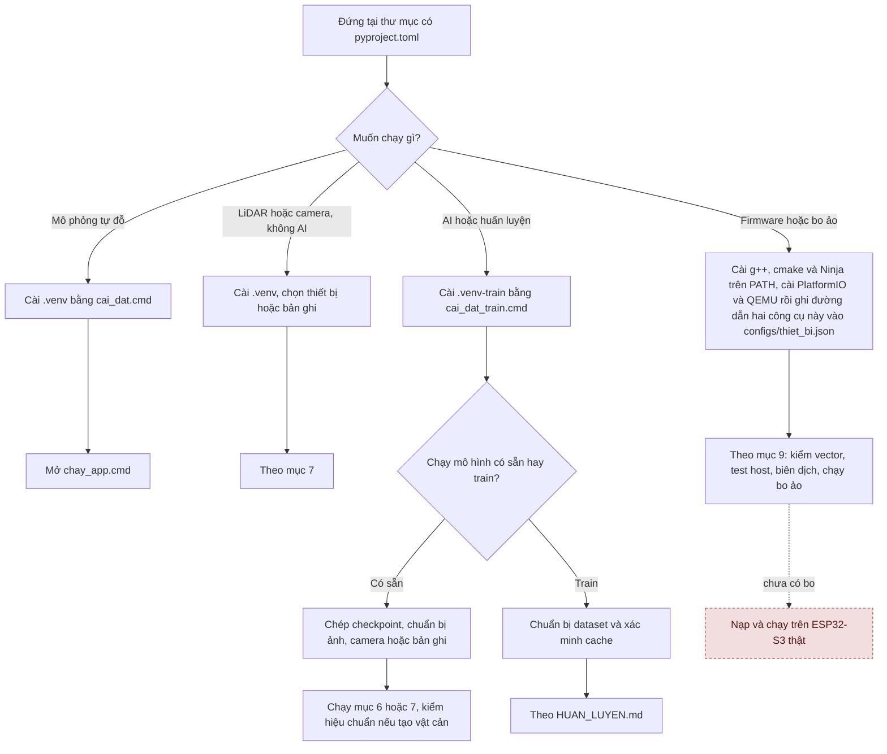
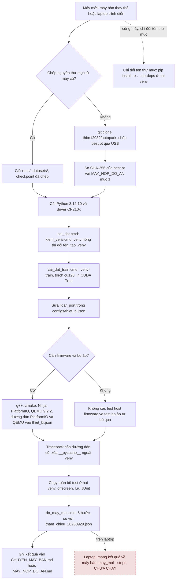
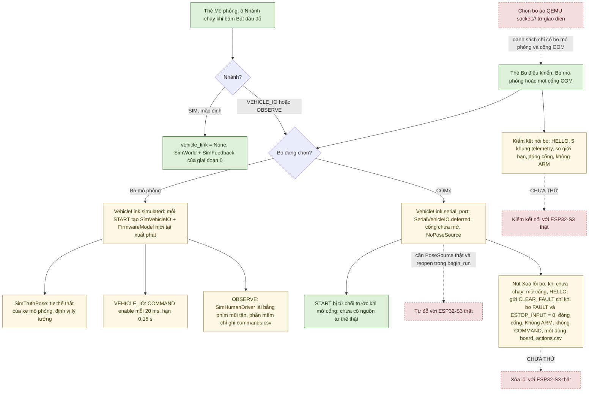

# Cài đặt và chạy AutoPark

[Cần biết tiến độ?](../TONG_HOP_DU_AN.md) · [Tài liệu kỹ thuật](docs/README.md) · [Sơ đồ hệ thống](docs/SO_DO_HE_THONG.md)

Biên tập 30/09/2026 theo mã tại `ff4a018` (mã giống `ebbec83`); cây làm việc lúc viết có thêm sửa chưa commit: sửa chữ (docstring, chú thích trong mã, một tooltip trong `ui/main_window.py`, mô tả gói trong `pyproject.toml`; không đổi hành vi) và cách đếm khung của `python -m autopark.transport.qemu_board kiem` (mục 9). Lệnh được đối chiếu với mã và script. Bản trước đợt này: [README tại `ff4a018`](https://github.com/thbn12082/autopark/blob/ff4a018/autopark/README.md); bản trước đợt 26/09/2026, còn các lệnh và nhật ký cũ: [README tại `9d68257`](https://github.com/thbn12082/autopark/blob/9d68257/autopark/README.md).

Cập nhật 02/10/2026 theo mã của đợt công cụ nghiệm thu (cây làm việc dựng trên `3148014`): lệnh của các công cụ mới ở mục 3 (dấu đồng bộ video–log, giới hạn số lần đổi chiều), mục 4 (phát lại log lần chạy qua VehicleIO, chấm một lần chạy, diễn tập tiêm lỗi, đo EcoQoS của giao diện), mục 7, 8 (dấu đồng bộ của bàn thử, camera ngoài hub) và mục 9 (nút Xóa lỗi bo). Các công cụ nghiệm thu này mới kiểm bằng test: bo mô phỏng, cổng serial giả, camera giả, giao diện offscreen, bản ghi phát lại; chưa chạy với LiDAR, camera hay bo thật. Công cụ đo EcoQoS mở giao diện thật trên máy; kết quả đo ghi ở [biên bản chuyển máy](docs/CHUYEN_MAY_BAN.md).

Máy phát triển chính từ 29/09/2026 là máy bàn Dell Precision 3680 (i9-14900, RTX 4000 Ada 20 GB, Windows 11), repo ở `D:\xetulai\autopark` ([biên bản chuyển máy](docs/CHUYEN_MAY_BAN.md)); số đo mới trong tệp này làm trên máy đó. Trên máy này đã cài lại hai môi trường (29/09/2026) và chạy toàn bộ test (lượt mới nhất ở mục 4). Ngày 29/09/2026 lúc 15:08–15:19 (mã `b37e9ee`) đã chạy lại: `phase0` (mục 4); `verify_cache`, chấm val, dự đoán, train 1 epoch (mục 6); một bản ghi LiDAR 10 s; bàn thử bốn camera + LiDAR + AI có ghi rồi phát lại (mục 7); lệnh kiểm máy mới `rig.may_moi` ([tóm tắt](docs/evidence/chuyen_may_20260929/kiem_may_20260929.md)). Laptop trình diễn mới chạy mô phỏng giai đoạn 0 ([MAY_NOP_DO_AN.md](docs/MAY_NOP_DO_AN.md)).

Nghiên cứu nhận thức sử dụng **[Valeo WoodScape Dataset](https://github.com/valeoai/WoodScape)**. [Hồ sơ giấy phép](docs/GIAY_PHEP_DU_LIEU.md).

## 1. Chọn môi trường và thư mục

| Nhu cầu | Môi trường | Cần thêm | Hiện trạng 30/09/2026 |
|---|---|---|---|
| Mô phỏng tự đỗ | `.venv` | Không cần cảm biến/AI | Chạy trên máy tính; giai đoạn 0 đạt sáu điều kiện chuyển bước ở mức mô phỏng (20/09/2026, [báo cáo](../BAO_CAO_GIAI_DOAN_0.md)) |
| LiDAR/camera không chạy AI | `.venv` | Thiết bị hoặc bản ghi theo lệnh | Đã đo với RPLIDAR C1 và bốn camera thật trên bàn thử, lần gần nhất 29/09/2026 trên máy bàn ([biên bản chuyển máy](docs/CHUYEN_MAY_BAN.md) mục 2) |
| AI, huấn luyện, bàn thử có AI | `.venv-train` | Checkpoint, dữ liệu/camera, cấu hình GPU phù hợp | Mô hình tham chiếu đã huấn luyện và chấm trên WoodScape ([HUAN_LUYEN.md](../HUAN_LUYEN.md)); AI chạy trên bàn thử và bản ghi; trong phiên đỗ AI chưa tạo vật cản từ camera thật vì chưa camera nào được hiệu chuẩn ([AI camera](docs/AI_DIEU_KHIEN_XE.md)) |
| Firmware ESP32-S3 | C++ (g++, cmake), PlatformIO | Mục 9 dưới đây; [hướng dẫn firmware](firmware/esp32_vehicle/README.md) | Lõi C++ khớp bản tham chiếu Python trên máy tính; cả firmware đã biên dịch cho ESP32-S3 (29/09/2026); CHƯA nạp, CHƯA chạy trên bo (chưa có bo) |
| Bo ảo QEMU (firmware thật trong giả lập) | `.venv` + QEMU của Espressif + PlatformIO, đường dẫn ở `configs/thiet_bi.json` | Mục 9 dưới đây; [mô phỏng firmware](docs/MO_PHONG_FIRMWARE.md) mục 1 | Firmware thật chạy trong QEMU, dùng từ dòng lệnh và pytest (30/09/2026); chỉ là giả lập, giao diện chưa chọn được bo ảo |

Chưa có xe thật: MN300, ESP32-S3, IMU, ToF, encoder/AS5600, phần nguồn và nút dừng đều chưa nhận ([kiểm kê phần cứng](docs/hardware_inventory.md)), nên chưa lệnh nào trong tệp này điều khiển bo hay xe thật.

Python tối thiểu 3.11; môi trường tham chiếu Windows dùng Python 3.12.10. Thư viện cố định trong `requirements-phase0.lock` và `requirements-train.lock`.

**Chạy lệnh tại thư mục chứa README này, `pyproject.toml` và `run_app.py`** (trừ lệnh cmake và PlatformIO của firmware, chạy trong `firmware/esp32_vehicle`):

```text
autopark/                        ← gốc repository
├── README.md
└── autopark/                    ← chạy lệnh ở đây
    ├── pyproject.toml
    ├── run_app.py
    ├── autopark/                ← package Python
    └── firmware/esp32_vehicle/  ← lệnh cmake và PlatformIO (mục 9)
```

Các lệnh dưới dùng PowerShell, gọi trực tiếp Python của từng môi trường nên không cần activate.

**Chọn đường chạy phù hợp:**



Đỏ viền đứt: chưa làm hoặc chưa thử trên thiết bị. Các ô không tô màu là bước chọn đường chạy, không nói về trạng thái.

## 2. Cài và mở mô phỏng

Cách nhanh: chạy `cai_dat.cmd` rồi `chay_app.cmd`. `cai_dat.cmd` gọi `kiem_venv.cmd` chạy thử Python của `.venv` có sẵn; venv chép từ máy khác mà không chạy được thì được đổi tên thành `.venv.hong-tu-may-cu` rồi tạo mới (tên đó đã có thì script dừng và báo).

Hoặc chạy tuần tự:

```powershell
python --version
python -m venv .venv
./.venv/Scripts/python.exe -m pip install -r requirements-phase0.lock
./.venv/Scripts/python.exe -m pip install -e . --no-deps
./.venv/Scripts/python.exe -X utf8 run_app.py
```

Nếu `python --version` không chạy được, cài/sửa đường dẫn Python trước. Cài thư viện cần mạng. `requirements-phase0.lock` có cả `pyserial` để đọc LiDAR. Mô phỏng cơ bản không cần checkpoint AI.

Máy mới, hoặc thư mục chép từ máy khác: thứ tự đủ các bước (hai môi trường, cổng LiDAR, công cụ firmware, test, kiểm máy) ở sơ đồ "Chuẩn bị một máy mới" trong mục 5.

## 3. Thử một lượt đỗ

1. Đặt/xoay đích; đích đè vật cản hoặc làm thân xe vượt sa bàn bị từ chối.
2. **Tìm đường đỗ** → **Xem trước** → kết thúc xem trước → **Bắt đầu đỗ**.
3. Thử **Vật cản giả** hoặc **Mất dữ liệu** khi xe đang chạy.
4. Khi đã dừng, bấm **Chọn lại vị trí**, chọn lại vị trí/đích và lập đường mới.
5. **Lưu phiên…** trước khi đặt lại phiên (sau khi xe dừng: từ 02/10/2026 nút khóa khi xe đang chạy).

Mặc định xe chạy ở nhánh mô phỏng giai đoạn 0; các nhánh khác ở mục 9.

Dòng đường của cockpit cảnh báo khi đường có hơn 7 lần đổi chiều. `run_app.py <kịch bản> --max-cusps N` (hay `chay_app.cmd <kịch bản> --max-cusps N`) từ chối **Bắt đầu đỗ** khi đường có hơn N lần đổi chiều, trước mọi lệnh tới bo; `--warn-cusps N` đổi mức cảnh báo. Đây là công cụ T12 của [kịch bản nghiệm thu](docs/KICH_BAN_NGHIEM_THU.md) mục 7; giới hạn CHƯA CHỐT nên mặc định không chặn. Từ 02/10/2026 `run_app.py` báo lỗi (mã thoát 2) với tham số lạ.

Khi quay video để đối chiếu với log (R3, R7 của kịch bản nghiệm thu): bấm **F8** hoặc nút **Dấu đồng bộ · F8** trước **Bắt đầu đỗ** và sau khi xe dừng. Mỗi dấu nháy một ô trắng có số trên cửa sổ trong 0,5 s và ghi một dòng có `perf_counter` vào tệp `runs/sync_marks/<giờ>_ui_app.csv`; **Lưu phiên…** ghi thêm `<tên>_sync_marks.csv` cạnh tệp CSV ([kịch bản nghiệm thu](docs/KICH_BAN_NGHIEM_THU.md) mục 2.5). Nút khóa khi xe đang chạy. Dấu đồng bộ (T14, 02/10/2026) mới kiểm offscreen; với màn hình và camera thật CHƯA THỬ, độ trễ hiển thị CHƯA ĐO.

Mở kịch bản vùng chưa quan sát:

```powershell
./.venv/Scripts/python.exe -X utf8 run_app.py scenarios/giai_doan_0_unknown.json
```

Vùng chưa quan sát được chặn như vật cản. `configs/vehicle_default.json` chứa thông số giả định, chưa phải số đo MN300.

## 4. Test, bằng chứng và replay

Chạy toàn bộ bộ test (`offscreen`: Qt không mở cửa sổ):

```powershell
$env:QT_QPA_PLATFORM = "offscreen"
./.venv/Scripts/python.exe -X utf8 -m pytest
Remove-Item Env:QT_QPA_PLATFORM
```

- Test cần torch được bỏ qua trong `.venv`; chạy cùng lệnh bằng `./.venv-train/Scripts/python.exe` để gồm cả chúng.
- Bộ test gồm cả firmware: 2 test host của lõi C++ (`tests/test_transport_firmware_host.py`, cần cmake và trình biên dịch C++ trên PATH) và `tests/test_firmware_qemu.py` của bo ảo (13 test, 6 trong đó chạy firmware thật trong QEMU, cần công cụ khai trong `configs/thiet_bi.json`). Máy thiếu công cụ thì các test cần nó tự bỏ qua: 2 test host, hoặc 6 test chạy QEMU (mục 9).
- EcoQoS: trên Windows 11, tiến trình pytest không có cửa sổ (ví dụ chạy nền) có thể chạy chậm tới ≈ 3 lần dù máy gần rảnh, đủ làm hỏng test có hạn giờ (dấu `planner_budget`; đo 30/09/2026). Vì vậy từ 30/09/2026 `tests/conftest.py` tắt EcoQoS cho tiến trình pytest; tiến trình con mà test mở thì không (riêng QEMU của bo ảo: `QemuBoard` tự tắt EcoQoS cho tiến trình QEMU). Đặt `AUTOPARK_KEEP_ECOQOS=1` để giữ mặc định của Windows, ví dụ khi muốn đo đúng điều kiện đó. Trạng thái đọc lại được ghi vào tệp JUnit (thuộc tính `ecoqos` của testsuite: `off`, `system`, `on` hoặc `unknown`) và, khi chạy thêm `-v`, vào dòng đầu báo cáo.
- Vẫn chạy test có hạn giờ khi máy rảnh, tách khỏi các chiến dịch tải CPU và không kèm coverage (mô tả dấu `planner_budget` trong `pyproject.toml` chỉ ghi phần coverage: `run without coverage tracing`).
- Thư mục tạm: `pyproject.toml` đặt `tmp_path_retention_policy = "failed"`, nên pytest xóa `tmp_path` của test đạt ngay khi test xong; lượt có test hỏng chỉ còn thư mục của test hỏng và của fixture dùng chung (`tmp_path_factory`). Giữ hết thì mỗi lượt `.venv-train` để lại ≈ 2,1 GB trong `%TEMP%`. Cần giữ để xem lại thì thêm `-o tmp_path_retention_policy=all`.
- `chay_test.cmd` gọi `.venv\Scripts\python.exe -m pytest` nhưng không đặt `offscreen` và không có `-X utf8`; muốn giống các lượt ghi trong biên bản thì dùng lệnh trên.

Chi tiết và số đo: [biên bản chuyển máy](docs/CHUYEN_MAY_BAN.md) mục 8; sơ đồ 3.7 (hạn giờ và EcoQoS) trong [Sơ đồ hệ thống](docs/SO_DO_HE_THONG.md).

**Ghi số test làm bằng chứng.** Commit mã trước; chạy toàn bộ test trên chính commit đó với cây làm việc sạch; lưu JUnit có mã commit vào `docs/evidence/<đợt>/`; cuối cùng ghi số vào tài liệu bằng một commit riêng. Thay `<đợt>` và `<mã commit>` trước khi chạy:

```powershell
$env:QT_QPA_PLATFORM = "offscreen"
./.venv/Scripts/python.exe -X utf8 -m pytest -p no:cacheprovider --junitxml docs/evidence/<đợt>/pytest_venv_<mã commit>.xml
./.venv-train/Scripts/python.exe -X utf8 -m pytest -p no:cacheprovider --junitxml docs/evidence/<đợt>/pytest_venv_train_<mã commit>.xml
Remove-Item Env:QT_QPA_PLATFORM
```

Ngày 30/09/2026 bước này chạy bằng script [chay_tren_commit.py](docs/evidence/mo_phong_20260930/chay_tren_commit.py): script chạy thêm `qemu_board kiem` và 10 lượt test bo ảo, rồi ghi thẳng vào `docs/evidence/mo_phong_20260930/`. Ngày 01/10/2026 dùng bản sửa của script đó, [docs/evidence/bien_tap_20261001/chay_tren_commit.py](docs/evidence/bien_tap_20261001/chay_tren_commit.py): ngày lấy lúc chạy, thư mục kết quả là tham số (`.venv\Scripts\python.exe -X utf8 docs\evidence\bien_tap_20261001\chay_tren_commit.py <commit> <thư mục kết quả>`). Sơ đồ 9.2 trong [Sơ đồ hệ thống](docs/SO_DO_HE_THONG.md).

Lần chạy toàn bộ gần nhất: 01/10/2026, máy bàn Dell Precision 3680 (i9-14900, RTX 4000 Ada 20 GB, Windows 11), bằng bản sửa của script ở trên (offscreen), commit `c03ff94` của đợt biên tập tài liệu, cây làm việc sạch: `.venv` 1380 đạt, 8 bỏ qua (cần torch), 0 hỏng, 349 s; `.venv-train` 1442 đạt, 0 hỏng, 370 s; cùng số test với lượt trên `ebbec83` (30/09/2026). Cả hai tệp JUnit ghi `ecoqos=off`. Số test đổi theo mã; tệp kết quả và các lượt trước ở [biên bản chuyển máy](docs/CHUYEN_MAY_BAN.md) mục 2, 3, 6, 8, 9.

Tạo phiên mẫu rồi phát lại:

```powershell
./.venv/Scripts/python.exe -X utf8 -m autopark.evaluation.phase0 --out runs/thu_nghiem_moi
./.venv/Scripts/python.exe -X utf8 -m autopark.evaluation.replay runs/thu_nghiem_moi/obstacle
```

Dùng thư mục đầu ra mới cho từng lượt. Phiên lưu cấu hình, quỹ đạo, sự kiện, telemetry, kết quả, snapshot source, ảnh/video. Replay dùng quỹ đạo đã lưu. Ngày 29/09/2026 trên máy bàn hiện tại (mã `b37e9ee`), `phase0` cho năm phiên trùng từng giá trị với đợt 20/09/2026, replay khớp cả năm ([tóm tắt](docs/evidence/chuyen_may_20260929/kiem_may_20260929.md) mục 2.1); kết quả vẫn chỉ là mô phỏng.

Kiểm mở rộng:

```powershell
./.venv/Scripts/python.exe -X utf8 -m autopark.evaluation.robustness --out runs/kiem_thu_moi
```

[Giải thích kết quả](../BAO_CAO_GIAI_DOAN_0.md). Replay trên tái mô phỏng các gói giai đoạn 0 (nhánh SIM). Gói của lần chạy qua VehicleIO dùng cùng lệnh nhưng là phát lại log (mục con dưới).

### Công cụ nghiệm thu (thêm 02/10/2026)

Ba công cụ đầu dưới đây làm theo bảng T1–T15 của [kịch bản nghiệm thu](docs/KICH_BAN_NGHIEM_THU.md) mục 7. Chúng mới kiểm bằng test: bo mô phỏng, cổng serial giả, camera giả, giao diện offscreen, bản ghi phát lại; chưa dùng với LiDAR, camera, bo ảo qua giao diện hay ESP32-S3 thật. Công cụ cuối đo EcoQoS của ứng dụng giao diện; ứng dụng vẫn không tự tắt EcoQoS.

**Phát lại log lần chạy qua VehicleIO (T9).** Sau một lần chạy ở nhánh VehicleIO hoặc Quan sát với bo mô phỏng, **Lưu phiên…**/**Xuất log CSV…** ghi tệp CSV, thư mục `<tên>_vehicle_io/` (tám tệp: `commands.csv`, `telemetry.csv`, `events.csv`, `start_refusals.csv`, `board_actions.csv`, `poses.csv`, `clock.csv`, `link.json`) và gói `<tên>_<thời điểm>/` có thêm `vehicle_io/`. Phát lại gói bằng cùng lệnh replay:

```powershell
./.venv/Scripts/python.exe -X utf8 -m autopark.evaluation.replay <thư mục gói>
```

Lệnh chạy lại cùng phần mềm (`Session`, `VehicleLink`, bộ bám) trên đầu vào đã ghi rồi so lệnh, sự kiện (kể cả dòng `session_stop`) và kết quả với bản ghi; nó in báo cáo tiếng Việt và thoát mã 0 = KHỚP, 1 = KHÁC, 2 = không phát lại được (thiếu `vehicle_io/`, log ghi trước khi có băng phát lại, gói hỏng), 3 = lỗi bất ngờ khi phát lại. Đây là tái hiện quyết định của phần mềm, không tái hiện xe; mới kiểm với bo mô phỏng và cổng serial giả ([chế độ quan sát](docs/CHE_DO_QUAN_SAT.md) mục 5.1).

**Chấm một lần chạy (T5).** `autopark.evaluation.score_run` đọc thư mục `<tên>_vehicle_io` (RunLog `<tên>.csv` bên cạnh) hoặc gói của `export_run` (SIM hay VehicleIO), cùng một tham chiếu độc lập: tệp tư thế R1 (`--reference`, định dạng ở `evaluation/reference_pose.py`), hai điểm thước R2 (`--r2-points`), hay tư thế thật của mô phỏng (`--sim-truth`, chỉ mức MP và xe ảo của BT). Công cụ tính các ngưỡng N-… theo `configs/nguong_nghiem_thu.json` (ĐỀ XUẤT – CHỜ CHỐT), ghi một dòng biên bản vào tệp `--report` (bắt buộc, trừ khi `--dry-run`) và một tệp chi tiết JSON có SHA-256 của mọi tệp đã đọc. Nó chỉ tự đề xuất THÀNH CÔNG hay THẤT BẠI; `--result` của người chấm luôn thắng. Ví dụ chấm mức MP lần DO-1 đầu tiên, chạy ở nhánh VehicleIO với bo mô phỏng (`run_app.py scenarios/bai_do_xe.json`) rồi **Xuất log CSV…** vào `runs/nghiem_thu/mo_phong/do1_l01/lan_chay.csv`:

```powershell
./.venv/Scripts/python.exe -X utf8 -m autopark.evaluation.score_run --scenario DO-1 --attempt 1 --level MP --log runs/nghiem_thu/mo_phong/do1_l01/lan_chay_vehicle_io --sim-truth --layout scenarios/bai_do_xe.json --report runs/nghiem_thu/mo_phong/bien_ban_mo_phong.csv
```

`--layout` là tệp kịch bản (hay bố trí đo bằng thước) của lần chạy. Công cụ mới chấm dữ liệu tổng hợp và lần chạy mô phỏng; chưa chấm lần chạy thật nào (chưa có tham chiếu R1, công cụ T4). Ở tốc độ mặc định 0,15 m/s của planner, lần DO-1 mô phỏng không đạt N-V1 ([ngưỡng đề xuất](docs/NGUONG_NGHIEM_THU_DE_XUAT.md) N-V1). Tham số khác: `--help`.

**Diễn tập tiêm lỗi (T6), chỉ mức mô phỏng.** `autopark.evaluation.fault_drill` gây lỗi có kiểm soát rồi kiểm phản ứng: `pose` (nguồn tư thế ngừng cập nhật, CB-6) và `hang` (vòng điều khiển của laptop treo, có hoặc không Heartbeat; CB-5 (b), L7) chạy một phiên đỗ qua bo mô phỏng và kiểm phản ứng của phiên và của bo; `camera` (một camera đứng hình, CB-2) không chạy phiên đỗ, chỉ kiểm lớp camera: camera bị báo cũ, bị bỏ khỏi bộ ảnh rồi quay lại. Lệnh chạy trên bo mô phỏng, camera giả hay bản ghi phát lại, không mở cổng COM, LiDAR hay camera:

```powershell
./.venv/Scripts/python.exe -X utf8 -m autopark.evaluation.fault_drill pose --mode hold --repeat 10 --out runs/fault_drill/<ngày> --name cb6
./.venv/Scripts/python.exe -X utf8 -m autopark.evaluation.fault_drill hang --seconds 1 --phases 0 1 2 3 --out runs/fault_drill/<ngày> --name cb5b
./.venv/Scripts/python.exe -X utf8 -m autopark.evaluation.fault_drill camera --mode stall --repeat 10 --out runs/fault_drill/<ngày> --name cb2
```

Mỗi lần chạy một thư mục `<out>/<name>_<kk>/` (lần chạy `pose`, `hang`: tám tệp log của `VehicleLink`, `faults.csv`, `drill.json`; lần chạy `camera`: chỉ `faults.csv`, `drill.json`), tóm tắt ở `<out>/<name>.drill.json`; mã thoát 0 khi mọi lần ĐẠT, 1 khi có lần KHÔNG ĐẠT, 2 khi sai tham số hay `--name` đã dùng trong `--out`. ĐẠT/KHÔNG ĐẠT là kiểm của công cụ, không phải ngưỡng nghiệm thu. `hang --heartbeat` cho biến thể có Heartbeat; `camera --replay <bản ghi> --ports 1 2 3 4 --port 2` dùng bản ghi phát lại thay camera giả.

**Đo EcoQoS của ứng dụng giao diện.** Công cụ mở giao diện thật, đặt cửa sổ thường, thu nhỏ hay bị một màn che kín bằng Win32 rồi lập đường như nút **Tìm đường đỗ**, kèm hai đối chứng (cùng giao diện tắt EcoQoS, tiến trình không cửa sổ). Lượt đầy đủ (mặc định ca `uturn_w46`, `--khoi 2 --lap 2`) mở cửa sổ thật khoảng 7–9 phút; máy phải rảnh và không ai dùng (bấm phím hay chuột trong lúc đo làm mất quyền đưa cửa sổ ra trước, các lượt sau bị loại); Esc hoặc bấm chuột đóng màn che. Kết quả lượt đo 02/10/2026: [biên bản chuyển máy](docs/CHUYEN_MAY_BAN.md) mục 10:

```powershell
./.venv/Scripts/python.exe -X utf8 -m autopark.evaluation.ecoqos_gui do --ra docs/evidence/ecoqos_giao_dien_<ngày>
./.venv/Scripts/python.exe -X utf8 -m autopark.evaluation.ecoqos_gui tom-tat --ra <thư mục đã đo>
```

`tom-tat` viết lại `tom_tat.txt` từ tệp kết quả. Lệnh thử nhanh `do --ra runs/thu_ecoqos --ca pillar_at_slot_mouth --khoi 1 --lap 1 --cho 2` (khoảng 35 s) chỉ kiểm công cụ chạy được: mỗi trạng thái chỉ có một lượt nên mọi phép so in "không đủ lượt hợp lệ để so"; muốn so cần ít nhất 2 lượt hợp lệ mỗi bên, như mặc định. Kết quả lượt đo thật ghi ở [biên bản chuyển máy](docs/CHUYEN_MAY_BAN.md).

## 5. Cài môi trường AI và lấy dữ liệu

Chạy `cai_dat_train.cmd`. Script tạo `.venv-train`, cài lock với torch CUDA 12.8 và kiểm GPU; `.venv-train` chép từ máy khác mà không chạy được thì được đổi tên thành `.venv-train.hong-tu-may-cu` rồi tạo mới, như mục 2. Môi trường này có Shapely để AI chạy cùng phiên đỗ. Môi trường tham chiếu dùng Python 3.12 và GPU NVIDIA.

[Chuyển môi trường/checkpoint sang laptop](docs/MAY_NOP_DO_AN.md). Chép cả dự án sang máy bàn khác: làm theo mục 5 của [biên bản chuyển máy](docs/CHUYEN_MAY_BAN.md), tóm trong sơ đồ dưới.

Bản clone không có:

| Tệp/dữ liệu | Cách có |
|---|---|
| `runs/ai_woodscape_rtx4000_v1/best.pt` | Chép từ máy bàn rồi so SHA-256 với [MAY_NOP_DO_AN.md](docs/MAY_NOP_DO_AN.md) mục 1, hoặc huấn luyện lại |
| `datasets/prepared/` | Chuẩn bị cache từ dataset |
| `runs/rig_recordings/` | Chép bản ghi hoặc ghi phiên mới |
| `calibration/cam_p<cổng>.json` | Hiệu chuẩn từng camera |
| `configs/rig/camera_rig_extrinsics_v1.json` | Đo ngoại tham |
| `configs/roi/rig_v1/` | Tạo ROI camera thật |

Cài thư viện không tự tạo các tệp này. Ngoại tham `v0` và ROI WoodScape không thay hiệu chuẩn camera dự án.

### Chuẩn bị một máy mới

Thứ tự làm khi chuyển sang một máy bàn khác hoặc cài laptop trình diễn, gom từ [biên bản chuyển máy](docs/CHUYEN_MAY_BAN.md) mục 5–8 và [MAY_NOP_DO_AN.md](docs/MAY_NOP_DO_AN.md) mục 2:



Đỏ viền đứt: chưa làm hoặc chưa thử trên thiết bị. Các ô không tô màu là bước làm, không nói về trạng thái. Trên máy bàn hiện tại, nhánh chép nguyên thư mục đã làm ngày 29–30/09/2026 ([biên bản chuyển máy](docs/CHUYEN_MAY_BAN.md) mục 1–8). Trên laptop, `do_may_moi.cmd` chưa chạy lần nào. Cùng sơ đồ: 9.3 trong [Sơ đồ hệ thống](docs/SO_DO_HE_THONG.md).

## 6. Huấn luyện và suy luận

Sau khi có cache:

```powershell
./.venv-train/Scripts/python.exe -X utf8 -m autopark.perception.verify_cache
./.venv-train/Scripts/python.exe -X utf8 -m autopark.perception.train --config configs/train_woodscape_rtx4000_baseline.json --out runs/ai_luot_moi
```

Với checkpoint tham chiếu đã chép vào đúng chỗ:

```powershell
./.venv-train/Scripts/python.exe -X utf8 -m autopark.perception.evaluate --checkpoint runs/ai_woodscape_rtx4000_v1/best.pt --split val --out runs/cham_val_moi
./.venv-train/Scripts/python.exe -X utf8 -m autopark.perception.predict --checkpoint runs/ai_woodscape_rtx4000_v1/best.pt --input duong_dan_anh.jpg --out runs/du_doan_moi --threshold 0.15
```

Thay `duong_dan_anh.jpg` bằng ảnh thật. Ngưỡng 0,15 chưa được nghiệm thu trên sa bàn.

Ngày 29/09/2026 trên máy bàn hiện tại (mã `b37e9ee`), cả bốn lệnh đã chạy lại: `verify_cache` đạt; `evaluate --split val` với checkpoint tham chiếu ra mIoU 0,9700, bằng số ở [HUAN_LUYEN.md](../HUAN_LUYEN.md); `predict` chạy trên một ảnh ở ngưỡng 0,15; `train` chạy với thêm `--set epochs=1`, chỉ để kiểm pipeline và GPU ([tóm tắt](docs/evidence/chuyen_may_20260929/kiem_may_20260929.md) mục 2.3–2.6).

[Huấn luyện/kết quả](../HUAN_LUYEN.md), [tải dữ liệu](datasets/TAI_VA_KIEM_TRA.md), [nhãn sa bàn](docs/GAN_NHAN_SA_BAN.md).

## 7. LiDAR, camera và bàn thử

### Mở giao diện mà chưa kết nối cảm biến

Chọn một trong hai lệnh:

```powershell
./.venv/Scripts/python.exe -X utf8 -m autopark.ui.lidar_app --no-connect
./.venv-train/Scripts/python.exe -X utf8 -m autopark.ui.lidar_app --no-connect --camera-ai
```

Lệnh không tự mở LiDAR/camera. **Bật AI camera** mở camera; **Kết nối** mở LiDAR. **Nạp lại hiệu chuẩn** khi AI tắt chỉ kiểm tệp.

### Kết nối và ghi thiết bị thật

Cổng LiDAR đặt ở một chỗ: khóa `lidar_port` trong [configs/thiet_bi.json](configs/thiet_bi.json), hiện là `"COM3"` của máy bàn. Đổi máy thì sửa dòng này theo Device Manager (mục "Silicon Labs CP210x USB to UART Bridge (COMx)"), hoặc ghi `"auto"` để tự tìm bộ chuyển CP210x; `auto` lấy cổng CP210x đầu tiên, nên tránh khi cắm thêm bo khác cũng qua CP210x. Lệnh LiDAR không có `--port` lấy cổng từ tệp; `--port COMx` ghi đè cho một lần chạy. Tệp thiếu hoặc hỏng thì lệnh báo lỗi trước khi mở thiết bị (giao diện hiện lỗi ở ngăn LiDAR lúc kết nối).

Kiểm cổng, chỉ đọc thông tin và tình trạng C1:

```powershell
./.venv/Scripts/python.exe -X utf8 -m autopark.lidar.rplidar_c1 info
```

Mở giao diện và kết nối LiDAR ở cổng của tệp:

```powershell
./.venv/Scripts/python.exe -X utf8 -m autopark.ui.lidar_app
```

Ghi bốn camera + LiDAR + AI, cần checkpoint. `--lidar` không kèm giá trị lấy cổng của tệp; `--lidar COMx` ghi đè; bỏ `--lidar` thì không dùng LiDAR:

```powershell
./.venv-train/Scripts/python.exe -X utf8 -m autopark.rig.bench --ports 1 2 3 4 --lidar --seconds 60 --name phien_moi --out runs/rig_bench/phien_moi --record runs/rig_recordings/phien_moi
```

Lệnh mở thiết bị thật. Mặc định 640×480; chất lượng bốn luồng phải đo chung trên đúng hub/máy. Sau khi đổi cách lấy cổng (29/09/2026), trên máy bàn đã chạy với thiết bị thật: `lidar.rplidar_c1 info` không `--port` mở đúng COM3 và đọc được C1 ([biên bản](docs/CHUYEN_MAY_BAN.md) mục 3); lúc 15:11–15:12 cùng ngày (mã `b37e9ee`), lệnh `rig.bench` như trên với `--lidar` không kèm cổng và `--seconds 30` chạy với bốn camera, LiDAR ở COM3 lấy từ tệp và AI, ghi phiên rồi phát lại được ([tóm tắt](docs/evidence/chuyen_may_20260929/kiem_may_20260929.md) mục 2.7–2.8; tệp gốc git-ignore ở `runs/kiem_may_20260929/rig_bench/` (số đo) và `runs/kiem_may_20260929/rig_recordings/r_kiem/` (bản ghi)). `ui.lidar_app` chưa chạy lại với thiết bị thật sau thay đổi này.

Dấu đồng bộ cho video R3 (T14, thêm 02/10/2026): thêm `--sync-mark`, ví dụ:

```powershell
./.venv-train/Scripts/python.exe -X utf8 -m autopark.rig.bench --ports 1 2 3 4 --lidar --seconds 60 --name cb1 --out runs/rig_bench/cb1 --sync-mark
```

Ô trắng có số nháy 0,5 s phủ cả màn hình chính (`--sync-screen N` chọn màn hình khác) ở đầu và cuối phần đo; nhấn Enter, Space hay m thêm một dấu, nhưng chỉ khi cửa sổ lệnh đang được chọn; phiên dài thêm `--sync-every 30` (một dấu mỗi 30 s). Lệnh ghi `<out>/<name>.sync.csv` (tệp đã có thì từ chối ngay, mã 2) và khóa `sync_marks` của `.rig.json`; không dùng với `--replay`. Tắt khóa màn hình khi chạy dài không người trông. `ui.rig_app` có nút "Dấu đồng bộ (F8)" tương tự. Chỉ kiểm offscreen; trên màn hình và với camera thật CHƯA THỬ; ảnh hưởng của cửa sổ nháy lên số đo CHƯA ĐO.

Từ 02/10/2026 (T10) `gap_max_ms` của từng camera trong `.rig.json` tính cả khoảng hở còn mở lúc chốt số (`gap_end_ms`, ví dụ camera ngừng hẳn trước khi hết phần đo), nghĩa cũ ở `gap_closed_max_ms`; `rig.bench` in "khoảng cách max … ms (hở cuối phiên … ms)". `.rig.json` ghi trước đó không có `gap_end_ms`. Mới kiểm bằng test với camera giả.

### Phát lại bản ghi

```powershell
./.venv-train/Scripts/python.exe -X utf8 -m autopark.rig.bench --replay runs/rig_recordings/phien_moi --name phat_lai --out runs/rig_bench/phat_lai
./.venv/Scripts/python.exe -X utf8 -m autopark.ui.rig_app --replay runs/rig_recordings/phien_moi --no-ai
```

Không mở thiết bị. Lệnh thứ hai chỉ xem, không chạy AI. [Ghi/phát lại](docs/GHI_PHAT_LAI_BAN_THU.md).

### AI tạo vật cản trong phiên đỗ

Cần checkpoint và nội tham/ngoại tham/ROI thật đạt kiểm tra; nếu thiếu, giao diện báo lý do chặn.

```powershell
./.venv-train/Scripts/python.exe -X utf8 -m autopark.ui.lidar_app --camera-ai --cam-ports 1 2 3 4
```

Lệnh mở LiDAR và camera thật. Nhánh kết hợp này CHƯA THỬ với camera thật đang mở (tính đến 30/09/2026; [AI camera](docs/AI_DIEU_KHIEN_XE.md) mục 8.3).

Phát lại bằng rig tổng hợp để thử luồng phần mềm:

```powershell
./.venv-train/Scripts/python.exe -X utf8 -m autopark.ui.lidar_app --no-connect --camera-ai --cam-replay runs/rig_recordings/phien_moi --camera-ai-test-rig
```

`--cam-replay` tự bật AI. Rig tổng hợp chỉ dùng với replay/nguồn giả; vị trí vật cản không phải số đo từ camera thật. [Chi tiết AI camera](docs/AI_DIEU_KHIEN_XE.md).

## 8. Chuẩn bị camera và định vị

| Công việc | Tài liệu |
|---|---|
| In bảng, chụp, tính nội tham | [Hiệu chuẩn camera](docs/HIEU_CHUAN_CAMERA.md) |
| Đo vị trí/góc, vẽ ROI | [Ngoại tham và ROI](docs/NGOAI_THAM_VA_ROI.md) |
| Kiểm bản đồ nhìn từ trên xuống | [BEV](docs/BEV.md) |
| Gán nhãn ảnh | [Nhãn sa bàn](docs/GAN_NHAN_SA_BAN.md) |
| Ghi scan, đo khoảng cách, tạo map | [LiDAR](docs/GIAI_DOAN_1_LIDAR.md) |
| Định vị trên map có sẵn | [Định vị](docs/DINH_VI_LIDAR.md) |
| So sánh định vị/khớp scan | [SLAM](docs/SO_SANH_DINH_VI_SLAM.md) |

Tham số từng công cụ: `python -m <tên_module> --help` bằng đúng môi trường.

Camera không qua hub 1–4, như camera trên cao của tham chiếu R1 (T11, thêm 02/10/2026): tra index OpenCV mỗi lần cắm hay khởi động lại, rồi hiệu chuẩn theo index và tên; tệp ra `calibration/cam_tren_cao_1280x720.json`, ảnh ở `runs/calib/<ngày giờ>_tren_cao/`:

```powershell
./.venv/Scripts/python.exe -X utf8 -m autopark.video.camera_bench list
./.venv/Scripts/python.exe -X utf8 -m autopark.ui.calib_app --index N --camera-name tren_cao --size 1280x720
```

BEV và AI camera không đọc tệp này; ngoại tham từ chối nó. Khi một số cổng có camera ở hai hub (ví dụ camera trên cao cắm thẳng cổng 2 của máy), `calib_app --port 2` báo lỗi thay vì chọn đại; khi đó cắm camera trên cao vào cổng có số khác hay rút nó ra lúc hiệu chuẩn camera xe. Chỉ kiểm offscreen với camera giả; camera trên cao thật CHƯA THỬ ([hiệu chuẩn camera](docs/HIEU_CHUAN_CAMERA.md)).

## 9. Chế độ điều khiển, firmware và bo ảo

Nhánh chạy chọn ở ô "Nhánh chạy khi bấm Bắt đầu đỗ" của thẻ **Mô phỏng**; bo nhận lệnh chọn ở thẻ **Bo điều khiển**. Hai thẻ nằm trong ngăn "Thiết lập sa bàn", mở bằng nút **Sa bàn +**. Sơ đồ dưới là đường đi trong mã hôm nay (`ui/main_window.py`, `application/vehicle_link.py`):



Xanh: có mã và đã kiểm trên máy tính (test giao diện và phiên, offscreen) · Vàng: chỉ với bo mô phỏng hoặc cổng serial giả · Đỏ viền đứt: chưa làm hoặc chưa thử trên thiết bị. Xanh và vàng ở đây hẹp hơn chú giải chuẩn: nhánh SIM tô xanh vì là đường mặc định đã kiểm, nhưng vẫn là mô phỏng; chưa lệnh nào đi tới bo hay xe thật.

| Chế độ | Hành vi |
|---|---|
| Mô phỏng giai đoạn 0 (SIM, mặc định) | Xe ảo chạy trong mô hình động học (`SimWorld` + `SimFeedback`), không qua VehicleIO |
| VehicleIO | Mỗi nhịp 20 ms gửi một COMMAND có hạn 0,15 s qua giao thức tới bo đã chọn; tốc độ và góc lái lấy từ telemetry, tư thế lấy từ mô phỏng (`SimTruthPose`). Chỉ chạy được với bo mô phỏng |
| Quan sát | Tính lệnh và ghi `commands.csv` (cột `sent` = 0); không gửi COMMAND nào, kể cả enable=0; lúc START gửi DISARM và bo phải ở DISARMED suốt lần quan sát. Trong giao diện, người lái là `SimHumanDriver` (phím mũi tên) trên bo mô phỏng |

Chọn một cổng COM thì **Bắt đầu đỗ** ở VehicleIO hay Quan sát bị từ chối trước khi mở cổng, vì chưa có nguồn tư thế thật (`NoPoseSource`). **Kiểm kết nối bo** gửi HELLO, đọc tới 5 khung telemetry, so giới hạn bo với cấu hình xe rồi đóng cổng; không ARM, không COMMAND. Nút này mới thử với bo mô phỏng và cổng serial giả, CHƯA THỬ với ESP32-S3. Danh sách bo chỉ có bo mô phỏng và cổng COM, nên giao diện chưa dùng được bo ảo QEMU.

**Xóa lỗi bo (CLEAR_FAULT)** (thêm 02/10/2026, T15) dùng chính cổng đã chọn ở nhánh VehicleIO hoặc Quan sát, khi chưa chạy: giao diện hỏi xác nhận, mở cổng nếu chưa mở, gửi HELLO, đọc khung telemetry đầu tiên bo gửi sau lúc bấm; chỉ khi bo đang FAULT và telemetry báo nút dừng khẩn đã nhả (`ESTOP_INPUT` = 0) mới gửi đúng một CLEAR_FAULT, rồi đọc khung kế tiếp và đóng cổng. Không ARM, không COMMAND; bo về DISARMED và vẫn phải ARM qua **Bắt đầu đỗ**. Mỗi lần bấm một dòng `board_actions.csv`, xuất cùng log VehicleIO (mục 4); báo cáo hiện ngay trong thẻ. Nút bị khóa với bo mô phỏng của giao diện (mỗi lần Bắt đầu đỗ tạo bo mới ở DISARMED) và khi đang chạy. Mới thử với bo mô phỏng và cổng serial giả, CHƯA THỬ với ESP32-S3; mở cổng có thể làm bo khởi động lại qua DTR/RTS (CHƯA KIỂM).

[Giao thức](docs/GIAO_THUC_XE.md), [quan sát](docs/CHE_DO_QUAN_SAT.md), [firmware](firmware/esp32_vehicle/README.md), [bo ảo QEMU và các trình giả lập đã thử](docs/MO_PHONG_FIRMWARE.md). Sơ đồ 2.3 và 2.4 (một lần chạy qua VehicleLink) trong [Sơ đồ hệ thống](docs/SO_DO_HE_THONG.md).

### Firmware và bo ảo QEMU

Hiện trạng 30/09/2026: lõi C++ `src/core` khớp bản tham chiếu Python trên máy tính (703 check, 0 lệch, 29/09/2026); cả firmware đã biên dịch cho ESP32-S3, 0 lỗi, 0 cảnh báo (29/09/2026); firmware thật chạy trong bo ảo QEMU trên máy bàn, phần mềm phía laptop (`SerialVehicleIO`, cũng chạy trên máy bàn) nói chuyện với nó qua `socket://` (30/09/2026); laptop trình diễn chưa chạy bo ảo. CHƯA nạp, CHƯA chạy trên bo thật nào vì chưa có bo. Kết quả trong bo ảo là giả lập, không phải số đo phần cứng.

Công cụ trên máy bàn, đều ngoài repo ([biên bản chuyển máy](docs/CHUYEN_MAY_BAN.md) mục 6–8): PlatformIO và QEMU ở ổ D; g++, cmake và Ninja thuộc gói WinLibs cài bằng winget cho tài khoản người dùng, ở `%LOCALAPPDATA%\Microsoft\WinGet\Packages\` trên ổ C (đường dẫn gói ở cuối [bằng chứng test host](docs/evidence/chuyen_may_20260929/firmware_host_20260929.txt); cmake và Ninja cùng thư mục `mingw64\bin`, kiểm bằng `Get-Command` ngày 30/09/2026, không lưu log):

| Công cụ | Dùng cho | Trên máy bàn |
|---|---|---|
| g++ và cmake trên PATH | Test host của lõi C++ | g++ 16.1.0 MinGW-w64 UCRT, cmake 4.4.1, Ninja: cùng gói WinLibs, ổ C |
| PlatformIO Core | Biên dịch env `esp32s3` (bản nạp vào xe) và `esp32s3_qemu` (chỉ cho bo ảo) | 6.2.0 trong venv riêng `D:\xetulai\_platformio\penv`; nền tảng ở `D:\xetulai\_platformio\core` (biến `PLATFORMIO_CORE_DIR`) |
| QEMU của Espressif 9.2.2 | Bo ảo | `D:\xetulai\_platformio\qemu` |

Đường dẫn QEMU và PlatformIO khai trong [configs/thiet_bi.json](configs/thiet_bi.json) (khóa `qemu_xtensa`, `platformio_python`, `platformio_core_dir`); đổi máy chỉ sửa tệp này. Máy không có QEMU hay PlatformIO vẫn chạy được mọi phần khác; 6 test chạy firmware thật trong QEMU tự bỏ qua. Máy không có cmake hay trình biên dịch C++ trên PATH thì 2 test host tự bỏ qua.

Kiểm vector mẫu chung Python ↔ C++, trong thư mục có `pyproject.toml`:

```powershell
./.venv/Scripts/python.exe -X utf8 -m autopark.transport.vectors --check
```

Lệnh in `... vectors.json is up to date` (mã thoát 0), hoặc báo tệp cũ (mã thoát 1) khi `firmware/esp32_vehicle/test/vectors.json` khác bản sinh lại từ Python. `--write` ghi lại tệp đó; chỉ dùng khi đã quyết định đổi hành vi của bản tham chiếu Python.

Test host của lõi C++, trong `firmware/esp32_vehicle` (`--config` và `-C` dành cho Visual Studio; Ninja bỏ qua):

```powershell
cmake -S test/host -B build/host -DCMAKE_BUILD_TYPE=Release
cmake --build build/host --config Release
ctest --test-dir build/host -C Release --output-on-failure
```

Kết quả 29/09/2026 trên máy bàn: `703 checks, 0 failures` ([bằng chứng](docs/evidence/chuyen_may_20260929/firmware_host_20260929.txt)). Nếu báo lệch: bản tham chiếu Python là chuẩn, sửa C++ cho khớp ([README firmware](firmware/esp32_vehicle/README.md), mục "Cách kiểm trên máy tính").

Biên dịch cho ESP32-S3 (không nạp), trong `firmware/esp32_vehicle`, bằng python có gói platformio (máy bàn: đường dẫn ở khóa `platformio_python`):

```powershell
D:\xetulai\_platformio\penv\Scripts\python.exe -m platformio run -e esp32s3
```

Máy khác: cài PlatformIO (`pip install platformio`) trong một venv riêng, không cài vào `.venv` hay `.venv-train`; ổ hệ thống chật thì đặt `PLATFORMIO_CORE_DIR` sang ổ khác trước lần chạy đầu ([biên bản chuyển máy](docs/CHUYEN_MAY_BAN.md) mục 5, 7); rồi chạy lệnh trên bằng python của venv đó (hoặc `pio run -e esp32s3`). Lần đầu tải nền tảng `espressif32 @ 7.1.3` (≈ 2,5 GB). Kết quả 29/09/2026: 0 lỗi, 0 cảnh báo ([bằng chứng](docs/evidence/chuyen_may_20260929/firmware_esp32_20260929.txt)). Chưa chạy lệnh nạp (`-t upload`) nào: chưa có bo.

Bo ảo, trong thư mục có `pyproject.toml` (công cụ lấy từ `configs/thiet_bi.json`):

```powershell
# build env esp32s3_qemu, chạy bo ảo, HELLO + 2 s telemetry, in kết quả rồi tắt
./.venv/Scripts/python.exe -X utf8 -m autopark.transport.qemu_board kiem
# chạy bo ảo ở socket://127.0.0.1:5555 (monitor HMP ở cổng 5556) tới khi Ctrl+C
./.venv/Scripts/python.exe -X utf8 -m autopark.transport.qemu_board chay
# 13 test, 6 trong đó chạy firmware thật trong QEMU
./.venv/Scripts/python.exe -X utf8 -m pytest tests/test_firmware_qemu.py
```

`--no-build` dùng ảnh đã build, không gọi PlatformIO; `chay` nhận thêm `--port`, `--monitor-port`, `--workdir`. `kiem` thoát 0 khi nhận ít nhất 30 khung trong cửa sổ 2 s, 1 khi ít hơn, 2 khi thiếu công cụ, build hỏng hoặc QEMU không khởi động. Lần build đầu của env mất vài phút. Khi `chay` đang chạy, từ Python: `SerialVehicleIO.open("socket://127.0.0.1:5555")`.

Kết quả trên máy bàn, 30/09/2026 (bo ảo, không phải bo thật):
- `kiem` với cách đếm đã sửa, hai lượt: 40 và 39 khung trong 2 s (≈ 20 Hz), cộng 16 khung nhận trước đó lúc chờ bo ra khỏi BOOT ([kiem_bo_ao_dem_rieng.txt](docs/evidence/mo_phong_20260930/bo_ao_30092026/kiem_bo_ao_dem_rieng.txt)). Hai lượt ghi trước đó (10:13 và 13:47) in "55 khung trong 2 s" vì bản cũ đếm gộp cả các khung nhận trước cửa sổ đo (16 + 39).
- Chạy lặp `tests/test_firmware_qemu.py` 10 lượt trên `ebbec83`: 10/10 lượt đạt cả 13 test (6 trong đó chạy firmware thật trong QEMU), mỗi lượt 9–10 s ([chay_lap_test_bo_ao_ebbec83.txt](docs/evidence/mo_phong_20260930/bo_ao_30092026/chay_lap_test_bo_ao_ebbec83.txt)).

Giới hạn: bản `esp32s3_qemu` khác bản nạp vào xe ở hai chỗ (Serial qua UART0, flash DIO); không nạp bản này vào xe. Bo ảo không có LEDC (xung ESC/servo), GPIO vào (E-stop), I2C, task watchdog kích hoạt hay USB-CDC thật; chạy được ở đây không chứng minh gì về bo thật ([MO_PHONG_FIRMWARE.md](docs/MO_PHONG_FIRMWARE.md) mục 1). Sơ đồ 6.6 (các tầng kiểm chứng firmware) và 6.7 (build và dựng bo ảo) trong [Sơ đồ hệ thống](docs/SO_DO_HE_THONG.md).

## 10. Cấu trúc mã

| Thư mục | Vai trò |
|---|---|
| `autopark/domain/` | Dữ liệu, cấu hình, hợp đồng cảm biến |
| `autopark/application/` | Phiên đỗ (`session.py`), nối phiên với VehicleIO (`vehicle_link.py`), phát lại log lần chạy qua VehicleIO (`vehicle_replay.py`), kiểm số lần đổi chiều trước khi chạy (`cusp_policy.py`) |
| `autopark/ui/` | Cửa sổ đỗ xe (`main_window`), bàn thử LiDAR + AI (`lidar_app`, `lidar_dock`, `camera_dock`), `rig_app`, `calib_app`, `roi_app`, `label_app`; ô nháy của dấu đồng bộ (`sync_flash`) |
| `autopark/planning/`, `autopark/control/` | Tìm đường, bám đường |
| `autopark/geometry/`, `autopark/simulation/` | Va chạm, động học, phản hồi giả |
| `autopark/perception/` | AI, hiệu chuẩn, ROI, BEV |
| `autopark/lidar/`, `autopark/video/` | Nguồn scan/ảnh và công cụ đo |
| `autopark/fusion/`, `autopark/rig/` | Hợp nhất, bàn thử |
| `autopark/transport/`, `firmware/` | Giao thức, VehicleIO (bo mô phỏng, cổng serial), bo ảo QEMU qua `socket://` (`qemu_board.py`, `socket_port.py`), firmware C++ |
| `autopark/safety/` | Thời hạn dữ liệu; tiêm lỗi có kiểm soát (`fault_injection.py`, T6: chỉ test và công cụ diễn tập dùng) |
| `autopark/storage/`, `autopark/evaluation/` | Lưu, replay, kiểm chứng; chấm một lần chạy (`score_run`, `reference_pose`), dấu đồng bộ video–log (`sync_marks`), diễn tập tiêm lỗi (`fault_drill`), đo EcoQoS của giao diện (`ecoqos_gui`) |
| `autopark/estimation/` | Chỗ dành cho định vị và bản đồ quan sát của phiên đỗ (nguồn tư thế thật); chưa có mã. Định vị lại và odometry LiDAR thử ngoại tuyến trên bản ghi ở `lidar/localize.py`, `lidar/scan_odometry.py`, chưa nối vào phiên |
| `autopark/image_io.py`, `autopark/power_throttling.py` | Đọc/ghi ảnh khi đường dẫn có dấu; tắt EcoQoS cho tiến trình (pytest, QEMU) |
| `configs/`, `scenarios/`, `tests/` | Tham số, sa bàn, kiểm thử; `configs/nguong_nghiem_thu.json`: bản sao ngưỡng nghiệm thu ĐỀ XUẤT – CHỜ CHỐT cho công cụ chấm |

Đơn vị: mét, giây, radian. Pose tại tâm trục sau; x hướng trước, y trái, yaw dương ngược chiều kim đồng hồ.

## 11. Khi không chạy được

| Biểu hiện | Kiểm tra |
|---|---|
| Không gọi được Python | Cài Python và sửa PATH |
| Thiếu package `autopark`/`run_app.py` | Đứng đúng thư mục có `pyproject.toml` |
| Thiếu torch | Cài và dùng `.venv-train` |
| Thiếu `best.pt` | Chép checkpoint hoặc train lại |
| AI bị chặn hiệu chuẩn | Làm nội tham → ngoại tham → ROI, đọc lý do trên UI |
| LiDAR không kết nối | Xem số COM trong Device Manager (không thấy cổng thì cài driver CP210x), sửa `lidar_port` trong `configs/thiet_bi.json` (mục 7); tránh nhầm cổng bo xe |
| Venv báo `No Python at ...` sau khi chép từ máy khác | Chạy lại `cai_dat.cmd` / `cai_dat_train.cmd` (mục 2, 5) |
| `import autopark` hỏng khi chạy ngoài thư mục repo, sau khi đổi tên hay dời thư mục | `pip install -e . --no-deps` ở `.venv` và `.venv-train` (mục 5) |
| Traceback hiện đường dẫn của máy cũ sau khi chép repo | Xóa các thư mục `__pycache__` ngoài venv |
| Ảnh không đọc/ghi được khi đường dẫn có dấu | Mã dự án đã xử lý qua `autopark/image_io.py` hoặc hàm tương đương; mã mới dùng `image_io` thay vì gọi thẳng `cv2.imread/imwrite`, vốn hỏng lặng lẽ với đường dẫn có dấu (ví dụ thư mục repo cũ `D:\gấp\...`, dùng tới chiều 29/09/2026; repo nay ở `D:\xetulai`, nhưng thư mục dữ liệu vẫn có thể có dấu) ([biên bản](docs/CHUYEN_MAY_BAN.md) mục 3) |
| AI không đủ bốn luồng | Kiểm khung hỏng, nhịp camera và USB |
| Test có hạn giờ (`planner_budget`) hỏng TIMEOUT hoặc TRACKING_FAILED | Kiểm tệp JUnit (khi chạy với `--junitxml`) có `ecoqos=off`, hoặc chạy thêm `-v` để thấy dòng `EcoQoS của tiến trình pytest: off`; không đặt `AUTOPARK_KEEP_ECOQOS=1`; chạy khi máy rảnh, tách khỏi coverage và chiến dịch tải CPU (mục 4) |
| `qemu_board` thoát mã 2, báo không thấy QEMU hoặc thiếu `platformio_python` | Sửa đường dẫn trong `configs/thiet_bi.json` (mục 9); máy không dùng bo ảo thì bỏ qua, 6 test chạy QEMU tự bỏ qua |
| QEMU tự thoát lúc khởi động (espressif/qemu#175) | `QemuBoard` tự khởi động QEMU tối đa 5 lần (thử lại tới 4 lần); vẫn hỏng thì đọc `qemu.err` trong thư mục mà thông báo lỗi chỉ ra |
| Test bo ảo hỏng vì firmware chốt LOOP_OVERRUN | Máy bận làm QEMU trễ nhịp; chạy lại khi máy rảnh ([MO_PHONG_FIRMWARE.md](docs/MO_PHONG_FIRMWARE.md) mục 1) |
| `run_app.py` thoát mã 2, báo tham số không nhận | Từ 02/10/2026 chỉ nhận đường dẫn kịch bản, `--max-cusps N`, `--warn-cusps N` (mục 3) |
| **Lưu phiên…**, **Xuất log CSV…**, **Dấu đồng bộ · F8** hay **Xóa lỗi bo** bị mờ | Ba nút đầu khóa khi xe đang chạy hoặc đang dừng (RUNNING, STOPPING): chờ xe dừng hẳn. **Xuất log CSV…** còn mờ (và **Lưu phiên…** bị ẩn) khi chưa có gì để ghi: chưa chạy hay lái tay lần nào, và liên kết đang chọn chưa có START bị từ chối hay lần Xóa lỗi bo. Xóa lỗi bo chỉ dùng ở nhánh VehicleIO hoặc Quan sát với bo chọn ở cổng COM, khi phiên đang chỉnh hoặc sẵn sàng; tooltip nêu lý do khóa (mục 9) |

[Mục lục kỹ thuật](docs/README.md) · [Sơ đồ hệ thống](docs/SO_DO_HE_THONG.md).
