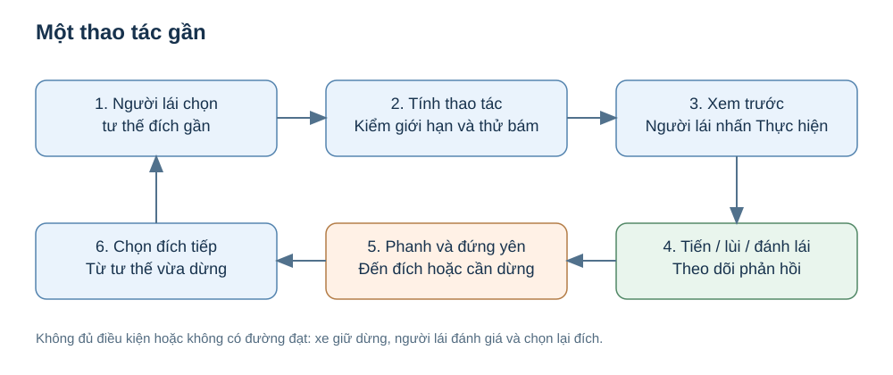
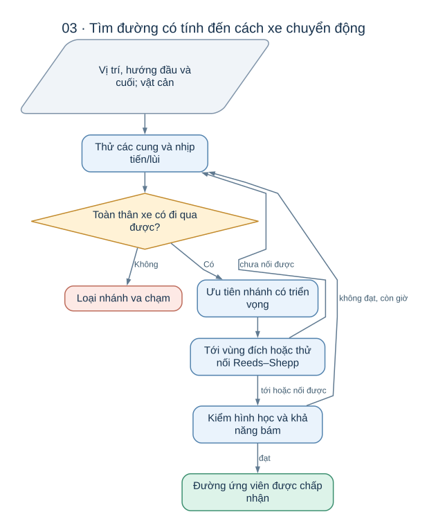
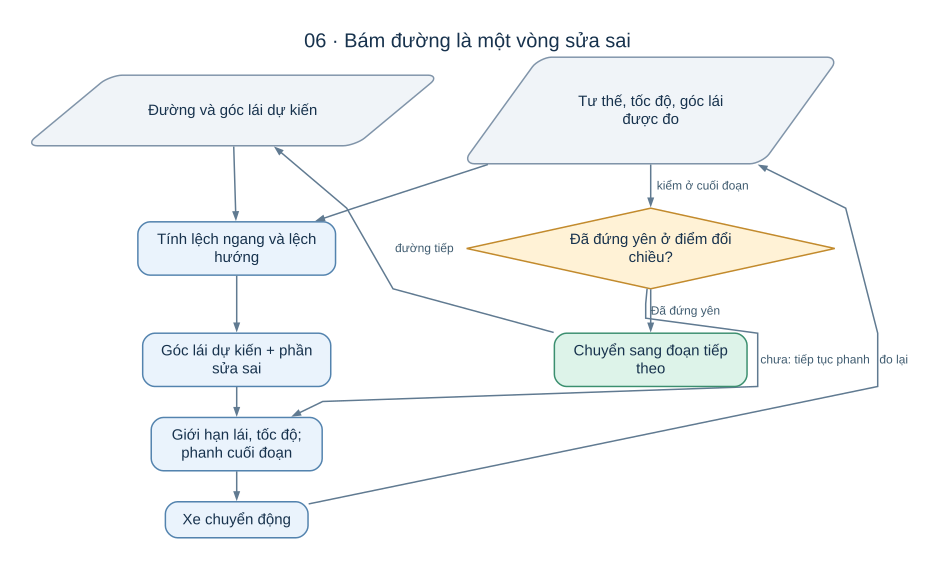

# Một lần đỗ xe diễn ra như thế nào?

Hãy hình dung một chiếc xe mô hình đang đứng trong lối đi của bãi đỗ.
Phía bên phải có một ô trống, hai bên ô là những xe đã đỗ.
Người dùng chọn ô đó và muốn xe tự lùi vào, nằm ngay ngắn rồi dừng lại.

Đó là bài toán AutoPark đang giải quyết.
Điểm khó nằm ở việc nối nhiều quyết định nhỏ thành một chuyển động có thể thực hiện:
biết xe đang ở đâu, hiểu khoảng trống, chọn cách vào ô, đánh lái đúng lúc và biết khi nào phải dừng.

Bài này kể lại một lượt đỗ để bạn hiểu vai trò của từng phần.
Các hình mô tả nguyên lý; vị trí và tỷ lệ trong hình không phải số đo của xe thật.

## 1. Trước khi di chuyển, cần hiểu đúng đầu bài

### Xe đang ở đâu và quay về hướng nào?

Chỉ biết “xe ở gần ô đỗ” là chưa đủ.
Hai chiếc xe ở cùng vị trí nhưng quay đầu khác nhau sẽ cần hai cách vào ô khác nhau.
Vì vậy hệ thống mô tả xe bằng **tư thế**: vị trí trên mặt sàn và hướng của thân xe.

Có thể tưởng tượng tư thế là một mũi tên đặt trên bản đồ.
Gốc mũi tên trả lời “ở đâu”, đầu mũi tên trả lời “quay về đâu”.
Trong mô hình của dự án, gốc này được đặt ở tâm trục sau để tính chuyển động khi đánh lái.

Ở mô phỏng, vị trí xe được biết từ mô hình chuyển động.
Với xe thật, tư thế phải được ước lượng từ dữ liệu cảm biến và được cập nhật khi xe chạy.
Nếu tư thế sai, cả đường đi lẫn thao tác sửa lái đều có thể sai theo.

### Chỗ nào thực sự còn trống?

Bản đồ phục vụ đỗ xe cần phân biệt vật cản, vùng đã quan sát là trống và vùng chưa biết.
Một khoảng không có điểm đo chưa chắc là khoảng an toàn: cảm biến có thể chưa nhìn tới hoặc bị che khuất.

LiDAR cung cấp các điểm đo khoảng cách; camera cung cấp hình ảnh để nhận biết môi trường.
Muốn dùng chung hai loại dữ liệu, hệ thống phải biết chúng được đo lúc nào và nằm ở đâu so với xe.
Đây là lý do hiệu chuẩn, đồng bộ thời gian và định vị có vai trò lớn trong dự án.

Phần này được giải thích riêng trong [Xe nhìn và biết vị trí bằng cách nào?](docs/CAM_NHAN_VA_DINH_VI.md).

### “Vào ô” phải được diễn đạt thành một đích cụ thể

Đích gồm vị trí và hướng mong muốn của xe trong ô.
Đỗ lùi và đỗ tiến có thể dùng cùng một ô nhưng hướng cuối khác nhau.
Xe cũng cần đủ chỗ cho toàn bộ thân, gồm cả phần đầu và đuôi nhô ra ngoài hai trục bánh.

Ngay từ đây, hệ thống có thể loại đầu bài không hợp lệ, chẳng hạn ô nhỏ hơn thân xe
hoặc tư thế đích đã chồng lên vật cản.
Tìm kiếm lâu hơn không sửa được một đầu bài như vậy.

## 2. Vì sao không nối một đường thẳng từ xe tới ô?

Xe kiểu ô tô không thể trượt ngang tùy ý.
Nó thay đổi vị trí nhờ tiến hoặc lùi, đồng thời thay đổi hướng nhờ góc lái.
Một khoảng cách rất ngắn theo đường thẳng vẫn có thể cần vài lần tiến–lùi mới đi hết.

Chẳng hạn, xe đã song song với ô nhưng còn lệch sang trái.
Lệnh “dịch sang phải 5 cm” không phải thao tác xe thực hiện trực tiếp được.
Xe phải kết hợp các đoạn cong để kết quả cuối cùng giống một lần dịch ngang.

Đây là nguồn gốc của **ràng buộc chuyển động** trong bài toán đỗ xe:
mọi đoạn đường đề xuất phải phù hợp với cách chiếc xe thật có thể chuyển động.

Dự án dùng mô hình xe đạp động học để mô tả điều này.
Hai bánh trước được quy về một bánh lái tương đương, hai bánh sau thành một bánh tương đương.
Mô hình giữ lại quan hệ quan trọng giữa góc lái, khoảng cách hai trục bánh và độ cong đường đi.

Với đỗ xe ở tốc độ thấp, cách mô tả đó là một điểm xuất phát phù hợp để nghiên cứu thuật toán.
Nó vẫn cần được đối chiếu với xe thật vì chưa mô tả đầy đủ độ rơ, trượt bánh hay biến dạng lốp.

## 3. Phải kiểm cả chiếc xe đi qua đâu

Giả sử tâm xe đi qua một cột mà không chạm.
Khi xe quay, góc đầu xe vẫn có thể quệt cột đó.
Do vậy một đường cho “điểm đại diện của xe” chưa đủ để kết luận xe đi qua được.

AutoPark kiểm **toàn bộ hình chữ nhật thân xe** ở các tư thế trên đường.
Giữa hai tư thế liên tiếp, hệ thống còn xét vùng mà thân xe quét qua.
Cách kiểm này giúp phát hiện tình huống hai đầu đoạn đều trống nhưng góc xe va vào vật cản ở giữa.

Khi tìm đường, hệ thống còn có thể nới thân xe thêm một khoảng gọi là **lề an toàn**.
Lề lớn giúp để lại khoảng trống cho sai số bám đường.
Nhưng lề quá lớn có thể làm một ô còn đủ chỗ cho xe trở thành ô không tìm được đường vào.

Vì vậy “cứ tăng lề lên” không giải quyết mọi trường hợp.
Cần cân bằng khoảng hở, khả năng đánh lái và sai số xe có thể gặp trong thực tế.

## 4. Tìm đường là thử những cách tiến–lùi có triển vọng

Bộ lập đường bắt đầu từ tư thế xe và thử các chuyển động có thể thực hiện.
Nhánh chạm vật cản bị loại; nhánh còn hợp lệ được xem xét tiếp.
Hệ thống ưu tiên những nhánh có vẻ đưa xe tới đích với chi phí hợp lý.

“Chi phí” ở đây không chỉ là mét đường đi.
Việc lùi, đổi chiều nhiều lần hoặc thay đổi góc lái nhiều cũng được tính vào lựa chọn.
Một đường ngắn nhưng phải liên tục nhích tới–lùi chưa chắc là phương án dễ thực hiện nhất.

### Vì sao dự án dùng nhiều thuật toán?

Một ô rộng thường không cần cách tìm kiếm quá phức tạp.
Ô hẹp có thể đòi những nhịp rất nhỏ mà cách biểu diễn ban đầu bỏ sót.
AutoPark vì thế dùng một **danh mục cách tìm đường**, thử theo thứ tự trong một giới hạn thời gian.

| Cách đang dùng | Giúp giải quyết điều gì? |
|---|---|
| Lưới trạng thái có thao tác gộp | Xem cả một nhịp tiến–lùi như một lựa chọn, giúp biểu diễn thao tác trong chỗ hẹp |
| RRT-Connect kết hợp Reeds–Shepp | Khám phá những tư thế không bị gộp vào một lưới cố định, rồi nối chúng bằng chuyển động kiểu ô tô |
| Hybrid A* mịn có thao tác gộp | Tìm bằng các cung chuyển động với cách chia vị trí và hướng chi tiết hơn, làm một phương án dự phòng |

Mặc định, hai lượt đầu dùng lưới có thao tác gộp với thời gian khác nhau;
sau đó mới thử RRT-Connect và Hybrid A* mịn.
Đây là cách bổ sung khả năng cho nhau, không phải kết luận một thuật toán luôn tốt nhất.

**Reeds–Shepp** xuất hiện ở nhiều chỗ vì nó tạo các đoạn nối gồm đường thẳng, cung trái, cung phải,
có thể tiến hoặc lùi và tôn trọng bán kính quay tối thiểu.
Mỗi đoạn nối vẫn phải được kiểm với vật cản; bản thân công thức nối không biết bãi đỗ đang có gì.

Giải thích từng thuật toán và lý do lựa chọn nằm trong [Từ khoảng trống đến đường xe chạy được](docs/THUAT_TOAN_DUONG_DI.md).

## 5. Có đường rồi, tại sao phải cho xe mô phỏng chạy thử?

Một đường đúng về hình học có thể đòi đổi góc lái quá nhanh hoặc có những nhịp quá ngắn.
Khi xe thực hiện, cơ cấu lái chưa kịp quay đủ thì xe đã đi qua chỗ cần đánh lái.
Sai số đó có thể dồn qua nhiều nhịp và làm xe dừng lệch ô.

Vì vậy mỗi đường ứng viên được đưa qua một vòng kiểm:
bộ điều khiển tính lệnh, xe mô phỏng đáp ứng lệnh, rồi bộ điều khiển nhận trạng thái mới để sửa tiếp.
Đó là **mô phỏng kín vòng**.

Đường chỉ được nhận khi lượt mô phỏng đáp ứng các điều kiện như không va chạm và tới đích trong dung sai.
“Dung sai” là mức lệch vị trí và lệch hướng được cho phép cho đầu bài đó.
Đi hết danh sách điểm mà vẫn nằm lệch ô không được tính là đỗ thành công.

Nếu một đường chưa đạt, hệ thống có thể thử cách tìm khác khi còn thời gian.
Nếu hết thời gian mà chưa có đường đạt, kết quả phải phản ánh việc chưa tìm được phương án dùng được.

Mô phỏng này kiểm sự phù hợp giữa đường và mô hình xe hiện có.
Nó chưa chứng minh chiếc xe ngoài đời sẽ làm được, bởi cảm biến và cơ cấu thật có thêm sai số.

## 6. Khi chạy, xe sửa lái liên tục bằng phản hồi

Một người lái xe không nhìn ô đỗ một lần rồi nhắm mắt đánh lái đến hết.
Bộ bám đường cũng phải liên tục so sánh tư thế xe đang có với tư thế mong muốn trên đường.

Hai sai số dễ hình dung nhất là:

- **Lệch ngang:** xe đang ở bên trái hay bên phải đường cần bám, cách bao xa?
- **Lệch hướng:** thân xe đang quay lệch bao nhiêu so với hướng cần có?

Bộ bám hiện tại kết hợp góc lái dự kiến từ đường với phần sửa theo hai sai số đó.
Biết trước độ cong giúp xe chủ động đánh lái; phản hồi giúp sửa khi xe không đi đúng dự kiến.
Khi lùi, quan hệ giữa góc lái và hướng quay thay đổi nên phần sửa hướng cũng phải đổi dấu phù hợp.

### Tại sao phải chậm lại trước cuối mỗi đoạn?

Đổi từ tiến sang lùi cần đi qua trạng thái đứng yên.
Quỹ đạo vì thế được chia thành các đoạn cùng chiều, với tốc độ giảm khi tới cuối đoạn.
Bộ bám chờ xe dừng rồi mới chuyển sang chiều tiếp theo.

Đầu mỗi đoạn, cấu hình bám mặc định còn cho xe đứng yên để đưa bánh lái về góc cần thiết.
Giả định này cần được kiểm khi áp dụng lên phần cứng: cơ cấu phải cho phép đánh lái lúc đứng yên.

### Có phải cứ bám đúng đường là đủ?

Đường được tính từ thông tin tại một thời điểm.
Nếu một vật cản mới xuất hiện hoặc dữ liệu vị trí không còn đủ tin cậy, tiếp tục bám đường cũ có thể gây va chạm.
Phần giám sát vì thế phải theo dõi điều kiện chạy và yêu cầu dừng khi cần.

Tìm một đường đi được và quyết định có nên tiếp tục chạy là hai trách nhiệm liên quan chặt chẽ.
[Sơ đồ hệ thống](docs/SO_DO_HE_THONG.md) giải thích cách các phần phối hợp để giữ hai trách nhiệm đó rõ ràng.

## 7. Khi nào có thể nói “xe đã đỗ xong”?

Kết thúc một lượt đỗ cần trả lời đủ ba câu hỏi: xe đã dừng, vị trí có đúng và hướng có đúng hay chưa.
Ngoài ra còn phải xem lượt chạy có va chạm hoặc phát sinh lỗi nào không.

Kết quả hữu ích gồm sai số cuối, khoảng hở, số lần đổi chiều và những tình huống đã xảy ra.
Những thông tin đó giúp biết lỗi nằm ở hiểu môi trường, chọn đường hay thực hiện đường.

Với hồ sơ hiện có, dự án đã có luồng đỗ hoàn chỉnh trong mô phỏng và các phần thử cảm biến, điều khiển.
Một lượt tự đỗ hoàn chỉnh trên xe thật vẫn là phần cần chứng minh bằng thử nghiệm thực tế.
Xem [Tiến độ và những vấn đề còn mở](../TONG_HOP_DU_AN.md) để hiểu giới hạn của từng kết quả.

Nếu muốn đào sâu một vấn đề, hãy chọn câu hỏi gần với mình:

- “Vì sao đường ngắn nhất chưa chắc chạy được?” → [Thuật toán đường đi và bám đường](docs/THUAT_TOAN_DUONG_DI.md).
- “Từ ảnh và điểm laser, làm sao biết xe ở đâu?” → [Cảm nhận và định vị](docs/CAM_NHAN_VA_DINH_VI.md).
- “Nếu một phần sai, những phần khác phản ứng thế nào?” → [Sơ đồ hệ thống](docs/SO_DO_HE_THONG.md).
- “Từ này có nghĩa gì?” → [Thuật ngữ](docs/THUAT_NGU.md).

*Đối chiếu cơ chế: [lập đường](autopark/planning/parking.py), [danh mục thuật toán](autopark/planning/portfolio.py), [bám đường](autopark/control/tracker.py), [xe mô phỏng](autopark/simulation/vehicle.py). Nội dung được biên tập ngày 17/10/2026; các mô tả “hiện tại” nói về phiên bản dự án tại thời điểm này.*
