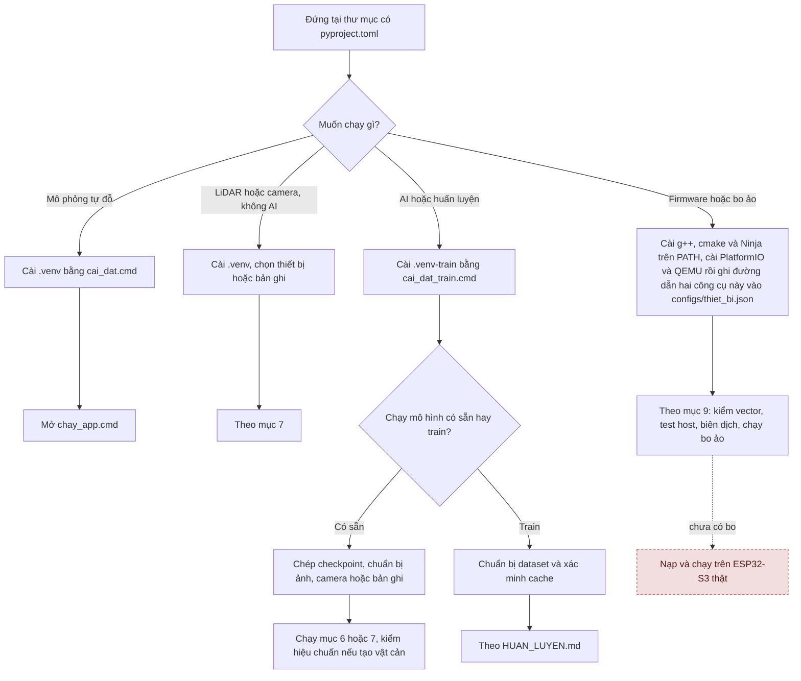
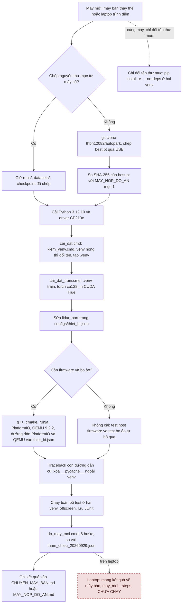
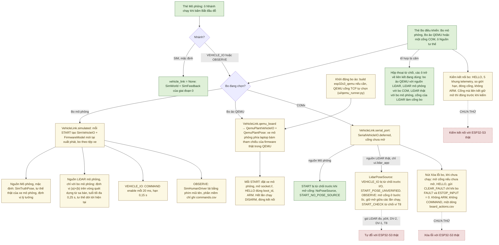

# Cài đặt và chạy AutoPark

[Cần biết tiến độ?](../TONG_HOP_DU_AN.md) · [Tài liệu kỹ thuật](docs/README.md) · [Sơ đồ hệ thống](docs/SO_DO_HE_THONG.md)

Đây là hướng dẫn thao tác: cài môi trường, mở mô phỏng, chạy test, và dùng các công cụ cho LiDAR, camera, AI, firmware và bo ảo. Mỗi công cụ có kèm một câu nói nó đã được kiểm tới đâu. Bức tranh chung của dự án nằm ở [tổng quan và tiến độ](../TONG_HOP_DU_AN.md).

*Hiện trạng tính đến 06/10/2026. Mã nguồn trên nhánh `main` giống commit `470abb3`.*

Từ 29/09/2026, máy phát triển chính là máy bàn Dell Precision 3680 (i9-14900, RTX 4000 Ada 20 GB, Windows 11), repo ở `D:\xetulai\autopark`. Mọi số đo mới trong tài liệu này làm trên máy đó. Laptop trình diễn mới chạy mô phỏng giai đoạn 0 ([máy nộp đồ án](docs/MAY_NOP_DO_AN.md)). Các lượt chạy lại lệnh với thiết bị thật trên máy bàn được ghi ở [tóm tắt ngày 29/09/2026](docs/evidence/chuyen_may_20260929/kiem_may_20260929.md) và [biên bản chuyển máy](docs/CHUYEN_MAY_BAN.md) mục 12–14.

Nghiên cứu nhận thức sử dụng **[Valeo WoodScape Dataset](https://github.com/valeoai/WoodScape)**. [Hồ sơ giấy phép](docs/GIAY_PHEP_DU_LIEU.md).

## 1. Chọn môi trường và thư mục

| Bạn muốn | Môi trường | Cần thêm | Đã kiểm tới đâu (06/10/2026) |
|---|---|---|---|
| Mô phỏng tự đỗ | `.venv` | Không cần cảm biến hay AI | Chạy trên máy tính; giai đoạn 0 đạt sáu điều kiện chuyển bước ở mức mô phỏng ([báo cáo](../BAO_CAO_GIAI_DOAN_0.md)); có xe nghiệm thu 0,10 m/s và 9 tệp sa bàn nghiệm thu (mục 3) |
| LiDAR, camera, không chạy AI | `.venv` | Thiết bị hoặc bản ghi | Đã đo với RPLIDAR C1 và bốn camera thật trên bàn thử, gần nhất ngày 02/10/2026 trên máy bàn ([biên bản chuyển máy](docs/CHUYEN_MAY_BAN.md) mục 2, 12) |
| AI, huấn luyện, bàn thử có AI | `.venv-train` | Checkpoint, dữ liệu hoặc camera, GPU NVIDIA | Mô hình tham chiếu đã huấn luyện và chấm trên WoodScape ([huấn luyện](../HUAN_LUYEN.md)); AI chạy trên bàn thử và bản ghi. Trong phiên đỗ, AI chưa tạo vật cản từ camera thật vì chưa camera nào được hiệu chuẩn ([AI camera](docs/AI_DIEU_KHIEN_XE.md)) |
| Firmware ESP32-S3 | g++, cmake, PlatformIO | Mục 9; [hướng dẫn firmware](firmware/esp32_vehicle/README.md) | Lõi C++ khớp bản tham chiếu Python; cả firmware biên dịch được cho ESP32-S3 (29/09/2026). Chưa nạp, chưa chạy trên bo vì chưa có bo |
| Bo ảo QEMU (firmware thật trong giả lập) | `.venv` + QEMU của Espressif + PlatformIO | Đường dẫn ở `configs/thiet_bi.json`; mục 9; [mô phỏng firmware](docs/MO_PHONG_FIRMWARE.md) mục 1, 1.1 | Dùng được từ dòng lệnh, pytest và giao diện; chạy được cả phiên đỗ với xe mô phỏng phía laptop (02/10/2026). Chỉ là giả lập |

Dự án chưa có xe thật: MN300, ESP32-S3, IMU, ToF, encoder, AS5600, phần nguồn và nút dừng khẩn đều chưa nhận ([kiểm kê phần cứng](docs/hardware_inventory.md)). Vì vậy chưa lệnh nào trong tài liệu này điều khiển bo hay xe thật.

Cần Python 3.11 trở lên; môi trường tham chiếu trên Windows dùng Python 3.12.10. Phiên bản thư viện được cố định trong `requirements-phase0.lock` và `requirements-train.lock`.

**Chạy lệnh tại thư mục chứa README này**, tức thư mục có `pyproject.toml` và `run_app.py`. Riêng lệnh cmake và PlatformIO của firmware chạy trong `firmware/esp32_vehicle`.

```text
autopark/                        ← gốc repository
├── README.md
└── autopark/                    ← chạy lệnh ở đây
    ├── pyproject.toml
    ├── run_app.py
    ├── autopark/                ← package Python
    └── firmware/esp32_vehicle/  ← lệnh cmake và PlatformIO (mục 9)
```

Các lệnh dưới đây viết cho PowerShell và gọi thẳng Python của từng môi trường, nên không cần activate.

**Chọn đường chạy phù hợp:**



Các ô không tô màu là bước chọn đường chạy, không nói về trạng thái. Ô đỏ viền đứt là việc chưa làm: chưa có bo để nạp.

## 2. Cài và mở mô phỏng

Cách nhanh nhất: chạy `cai_dat.cmd`, rồi `chay_app.cmd`. `cai_dat.cmd` gọi `kiem_venv.cmd` để chạy thử Python của `.venv` có sẵn. Nếu venv chép từ máy khác không chạy được, nó được đổi tên thành `.venv.hong-tu-may-cu` rồi tạo mới; nếu tên đó đã có, script dừng và báo.

Hoặc chạy từng bước:

```powershell
python --version
python -m venv .venv
./.venv/Scripts/python.exe -m pip install -r requirements-phase0.lock
./.venv/Scripts/python.exe -m pip install -e . --no-deps
./.venv/Scripts/python.exe -X utf8 run_app.py
```

Nếu `python --version` không chạy, hãy cài Python hoặc sửa đường dẫn trước. Cài thư viện cần mạng. `requirements-phase0.lock` có sẵn `pyserial` để đọc LiDAR. Mô phỏng cơ bản không cần checkpoint AI.

Máy mới, hoặc thư mục chép từ máy khác: thứ tự đầy đủ các bước (hai môi trường, cổng LiDAR, công cụ firmware, test, kiểm máy) nằm ở sơ đồ "Chuẩn bị một máy mới" trong mục 5.

## 3. Thử một lượt đỗ

1. Đặt hoặc xoay đích. Đích đè lên vật cản, hoặc làm thân xe vượt ra ngoài sa bàn, sẽ bị từ chối.
2. Bấm **Tìm đường đỗ** → **Xem trước** → kết thúc xem trước → **Bắt đầu đỗ**.
3. Khi xe đang chạy, thử **Vật cản giả** hoặc **Mất dữ liệu**.
4. Khi xe đã dừng, bấm **Chọn lại vị trí**, chọn lại vị trí hoặc đích và lập đường mới.
5. Bấm **Lưu phiên…** trước khi đặt lại phiên. Nút này chỉ dùng được khi xe đã dừng.

Mặc định xe chạy ở nhánh mô phỏng của giai đoạn 0. Các nhánh khác ở mục 9.

Mở kịch bản có vùng chưa quan sát:

```powershell
./.venv/Scripts/python.exe -X utf8 run_app.py scenarios/giai_doan_0_unknown.json
```

Vùng chưa quan sát được chặn như vật cản. `configs/vehicle_default.json` chứa thông số giả định, chưa phải số đo của MN300.

**Giới hạn số lần đổi chiều (công cụ T12).** Dòng đường trên cockpit cảnh báo khi đường có hơn 7 lần đổi chiều. Chạy `run_app.py <kịch bản> --max-cusps N` (hay `chay_app.cmd <kịch bản> --max-cusps N`) thì **Bắt đầu đỗ** bị từ chối khi đường có hơn N lần đổi chiều, trước khi gửi bất kỳ lệnh nào tới bo. `--warn-cusps N` đổi mức cảnh báo. Giới hạn này chưa chốt nên mặc định không chặn ([kịch bản nghiệm thu](docs/KICH_BAN_NGHIEM_THU.md) mục 7). `run_app.py` báo lỗi (mã thoát 2) nếu gặp tham số lạ.

**Xe nghiệm thu.** Lệnh dưới chạy với xe giống `vehicle_default.json` nhưng tốc độ tối đa 0,10 m/s, theo ngưỡng N-V1 (còn là đề xuất):

```powershell
./.venv/Scripts/python.exe -X utf8 run_app.py scenarios/sa_ban_3x2_hai_hop.json --vehicle-config configs/vehicle_nghiem_thu.json
```

Với cmd: `chay_app.cmd <kịch bản> --vehicle-config configs\vehicle_nghiem_thu.json`. Một vài điều cần biết:

- Planner vẫn đặt tốc độ 0,15 m/s; quỹ đạo và bộ bám kẹp tốc độ ở 0,10.
- Thẻ "Xe" (trong ngăn **Sa bàn +**) có ô **Cấu hình xe** để đổi xe khi phiên đang chỉnh hoặc sẵn sàng. Xe đã chọn được giữ khi **Mở…** kịch bản khác.
- Bo mô phỏng tự chọn theo tệp xe: xe nghiệm thu đi với `configs/vehicle_io_sim_nghiem_thu.json`.
- Tệp xe thiếu hay hỏng thì ứng dụng thoát mã 2 trước khi mở cửa sổ.
- Nếu đã chọn xe khác với tệp xe của kịch bản, **Lưu** sẽ ghi tệp xe đó vào kịch bản. Muốn giữ nguyên tệp trong kho, dùng **Lưu thành…**.
- Với bo ảo QEMU hay ESP32-S3, xe nghiệm thu bị từ chối ở VehicleIO, vì firmware biên dịch cứng 300 mm/s (suy ra từ mã, chưa chạy thử; mục 9).

**Tệp sa bàn nghiệm thu.** Bộ `scenarios/nghiem_thu/do1.json` … `do6.json` (mức mô phỏng) gắn sẵn kịch bản nghiệm thu qua trường `acceptance`. Mở một tệp như vậy thì ứng dụng tự dùng xe `configs/vehicle_nghiem_thu.json` và giới hạn đổi chiều của kịch bản đó trong `configs/nguong_nghiem_thu.json`: N-D6 (b) là ≤ 2 ở DO-1/2/3a/4a, ≤ 7 ở DO-3b/4b/5/6, còn DO-3c chỉ báo số (các số còn là đề xuất). `--max-cusps N` chỉ siết thêm. Thẻ "Kịch bản" hiện giới hạn đang áp; "Lưu thành…" giữ nguyên thẻ. Ví dụ:

```powershell
./.venv/Scripts/python.exe -X utf8 run_app.py scenarios/nghiem_thu/do3b.json
```

**Dấu đồng bộ video–log (T14).** Khi quay video để đối chiếu với log (phương pháp R3, R7 của kịch bản nghiệm thu), bấm **F8** hoặc nút **Dấu đồng bộ · F8** trước **Bắt đầu đỗ** và sau khi xe dừng. Mỗi dấu nháy một ô trắng có số trên cửa sổ trong 0,5 s và ghi một dòng có `perf_counter` vào `runs/sync_marks/<giờ>_ui_app.csv`. **Lưu phiên…** ghi thêm `<tên>_sync_marks.csv` cạnh tệp CSV ([kịch bản nghiệm thu](docs/KICH_BAN_NGHIEM_THU.md) mục 2.5). Nút bị khóa khi xe đang chạy. Mới kiểm offscreen; với màn hình và camera thật chưa thử, độ trễ hiển thị chưa đo.

## 4. Test, bằng chứng và replay

Chạy toàn bộ bộ test (`offscreen` để Qt không mở cửa sổ):

```powershell
$env:QT_QPA_PLATFORM = "offscreen"
./.venv/Scripts/python.exe -X utf8 -m pytest
Remove-Item Env:QT_QPA_PLATFORM
```

Những điều cần biết khi chạy test:

- **Test cần torch** được bỏ qua trong `.venv`. Chạy cùng lệnh bằng `./.venv-train/Scripts/python.exe` để gồm cả chúng.
- **Test firmware** nằm trong cùng bộ test: 2 test host của lõi C++ (`tests/test_transport_firmware_host.py`, cần cmake và trình biên dịch C++ trên PATH) và `tests/test_firmware_qemu.py` của bo ảo (14 test, 7 trong đó chạy firmware thật trong QEMU, cần công cụ khai trong `configs/thiet_bi.json`). Máy thiếu công cụ thì các test cần nó tự bỏ qua (mục 9).
- **EcoQoS.** Trên Windows 11, tiến trình pytest không có cửa sổ (ví dụ chạy nền) có thể bị chậm tới khoảng 3 lần dù máy gần rảnh, đủ làm hỏng các test có hạn giờ (dấu `planner_budget`; đo ngày 30/09/2026). Vì vậy `tests/conftest.py` tắt EcoQoS cho tiến trình pytest. Tiến trình con do test mở thì không được tắt, trừ QEMU của bo ảo (`QemuBoard` tự tắt EcoQoS cho QEMU).
- Từ 02/10/2026, ứng dụng và công cụ đo cũng tự tắt EcoQoS cho chính mình lúc khởi động, qua hàm `apply_ecoqos_policy` của `autopark/power_throttling.py` (lý do: cửa sổ thu nhỏ làm lập đường hết hạn; [biên bản](docs/CHUYEN_MAY_BAN.md) mục 10, 10.1):
  - ứng dụng: `run_app.py`, `ui.lidar_app`, `ui.rig_app`, `ui.calib_app`, `ui.roi_app`, `lidar.live_view`, `ui.overhead_app`; giao diện hiện nhãn "EcoQoS: tắt" ở góc phải thanh trạng thái;
  - công cụ mở thiết bị, chạy theo hạn giờ hay đo thời gian: `rig.bench`, `rig.may_moi`, `camera_bench`, `lidar.bench`, `video.overhead_record`, `evaluation.bench`, `sensitivity`, …; các công cụ này in hoặc ghi khóa `ecoqos` vào tệp kết quả. Danh sách đủ 27 điểm vào có gọi và 29 điểm vào không gọi (kèm lý do) nằm ở `tests/test_ecoqos_policy.py`.

  Đặt `AUTOPARK_KEEP_ECOQOS=1` để giữ mặc định của Windows, ví dụ khi muốn đo đúng điều kiện đó. Một biến dùng chung cho pytest, ứng dụng và công cụ, và chỉ nhận đúng giá trị `1` (cmd: `set AUTOPARK_KEEP_ECOQOS=1`; PowerShell: `$env:AUTOPARK_KEEP_ECOQOS = "1"`). Trạng thái đọc lại được ghi vào tệp JUnit (thuộc tính `ecoqos` của testsuite: `off`, `system`, `on` hoặc `unknown`), và khi chạy thêm `-v` thì vào dòng đầu báo cáo.
- Vẫn nên chạy test có hạn giờ khi máy rảnh, tách khỏi các chiến dịch tải CPU và không kèm coverage.
- **Thư mục tạm.** `pyproject.toml` đặt `tmp_path_retention_policy = "failed"`, nên pytest xóa `tmp_path` của test đạt ngay khi test xong. Lượt có test hỏng chỉ giữ thư mục của test hỏng và của fixture dùng chung (`tmp_path_factory`). Nếu giữ hết, mỗi lượt `.venv-train` để lại khoảng 2,1 GB trong `%TEMP%`. Cần giữ để xem lại thì thêm `-o tmp_path_retention_policy=all`.
- `chay_test.cmd` gọi `.venv\Scripts\python.exe -m pytest` nhưng không đặt `offscreen` và không có `-X utf8`. Muốn giống các lượt ghi trong biên bản thì dùng lệnh ở trên.

Chi tiết và số đo: [biên bản chuyển máy](docs/CHUYEN_MAY_BAN.md) mục 8, 10.1; sơ đồ 3.7 (hạn giờ và EcoQoS) trong [Sơ đồ hệ thống](docs/SO_DO_HE_THONG.md).

**Ghi số test làm bằng chứng.** Quy trình: commit mã trước; chạy toàn bộ test trên chính commit đó, với cây làm việc sạch; lưu JUnit có mã commit vào `docs/evidence/<đợt>/`; cuối cùng ghi số vào tài liệu bằng một commit riêng. Thay `<đợt>` và `<mã commit>` trước khi chạy:

```powershell
$env:QT_QPA_PLATFORM = "offscreen"
./.venv/Scripts/python.exe -X utf8 -m pytest -p no:cacheprovider --junitxml docs/evidence/<đợt>/pytest_venv_<mã commit>.xml
./.venv-train/Scripts/python.exe -X utf8 -m pytest -p no:cacheprovider --junitxml docs/evidence/<đợt>/pytest_venv_train_<mã commit>.xml
Remove-Item Env:QT_QPA_PLATFORM
```

Từ 30/09/2026 bước này chạy bằng một script, và script đã qua ba bản:

- [docs/evidence/su_co_thoat_20261006/chay_tren_commit.py](docs/evidence/su_co_thoat_20261006/chay_tren_commit.py) — bản dùng cho lượt tiếp theo (06/10/2026). Gọi bằng `.venv\Scripts\python.exe -X utf8 docs\evidence\su_co_thoat_20261006\chay_tren_commit.py <commit> <thư mục kết quả>`. Bản này đặt ErrorMode 0x8001 để crash có sự kiện WER và minidump (LocalDumps đã bật trên máy bàn; dump mới được chép sang `runs/dump/`), chạy pytest với `-X faulthandler`, giữ đầu ra từng lượt, ghi mã thoát dạng hex, có hạn giờ, ghi HEAD và độ sạch của cây. Thêm `--chi-test tests/test_geometry.py` để kiểm chính script trong vài giây.
- [docs/evidence/bien_tap_20261001/chay_tren_commit.py](docs/evidence/bien_tap_20261001/chay_tren_commit.py) — bản ngày 01/10/2026, cùng hai tham số; dùng cho các lượt tới `470abb3`.
- [docs/evidence/mo_phong_20260930/chay_tren_commit.py](docs/evidence/mo_phong_20260930/chay_tren_commit.py) — bản đầu (30/09/2026), ghi thẳng vào `docs/evidence/mo_phong_20260930/`.

Cả ba bản đều chạy thêm `qemu_board kiem` và 10 lượt test bo ảo trước toàn bộ test. Các bản cũ được giữ nguyên. Sơ đồ 9.2 trong [Sơ đồ hệ thống](docs/SO_DO_HE_THONG.md).

**Lượt chạy toàn bộ gần nhất:** ngày 06/10/2026, trên máy bàn, bằng bản ngày 01/10 của script (offscreen), commit `470abb3`, cây làm việc sạch. Kết quả:

- `.venv`: 2105 đạt, 10 bỏ qua (cần torch), 0 hỏng, 640 s. Tuy vậy tiến trình thoát mã 0xC0000005 sau khi đã ghi JUnit (có lẽ lúc Python tắt). Nguyên nhân chưa rõ ([biên bản](docs/CHUYEN_MAY_BAN.md) mục 16).
- `.venv-train`: 2168 đạt, 1 hỏng, 683 s. Test hỏng là `test_parking_session_through_qemu_board`: test chạy trước để bo ảo còn đang dốc tham chiếu tốc độ về 0, nên cổng START từ chối, đúng thiết kế; cần sửa ở test, đợt sau.
- Thêm 462 test so với lượt trên `d3e1555` (02/10/2026). Cả hai tệp JUnit ghi `ecoqos=off`.

Số test thay đổi theo mã. Tệp kết quả và các lượt trước: [biên bản chuyển máy](docs/CHUYEN_MAY_BAN.md) mục 2, 3, 6, 8, 9, 11, 15.

**Tạo phiên mẫu rồi phát lại:**

```powershell
./.venv/Scripts/python.exe -X utf8 -m autopark.evaluation.phase0 --out runs/thu_nghiem_moi
./.venv/Scripts/python.exe -X utf8 -m autopark.evaluation.replay runs/thu_nghiem_moi/obstacle
```

Dùng một thư mục đầu ra mới cho mỗi lượt. Mỗi phiên lưu cấu hình, quỹ đạo, sự kiện, telemetry, kết quả, ảnh chụp mã nguồn, ảnh và video. Replay dùng quỹ đạo đã lưu. Ngày 29/09/2026 trên máy bàn hiện tại, `phase0` cho năm phiên trùng từng giá trị với đợt 20/09/2026 và replay khớp cả năm ([tóm tắt](docs/evidence/chuyen_may_20260929/kiem_may_20260929.md) mục 2.1); đây vẫn chỉ là mô phỏng.

**Kiểm mở rộng:**

```powershell
./.venv/Scripts/python.exe -X utf8 -m autopark.evaluation.robustness --out runs/kiem_thu_moi
```

[Giải thích kết quả](../BAO_CAO_GIAI_DOAN_0.md). Lệnh replay ở trên tái mô phỏng các gói giai đoạn 0 (nhánh SIM). Gói của lần chạy qua VehicleIO dùng cùng lệnh, nhưng khi đó là phát lại log (xem T9 ngay dưới).

### Công cụ nghiệm thu

Các công cụ dưới đây làm theo bảng T1–T15 của [kịch bản nghiệm thu](docs/KICH_BAN_NGHIEM_THU.md) mục 7, đa số thêm ngày 02/10/2026. Tất cả mới được kiểm bằng test: bo mô phỏng, cổng serial giả, camera giả, giao diện offscreen, bản ghi phát lại, bo ảo QEMU, ảnh tổng hợp. Chưa công cụ nào được dùng với LiDAR, camera hay ESP32-S3 thật. Hai công cụ cuối mục này đo EcoQoS và vòng điều khiển 50 Hz của chính ứng dụng giao diện.

**Phát lại log lần chạy qua VehicleIO (T9).** Sau một lần chạy ở nhánh VehicleIO hoặc Quan sát với bo mô phỏng, **Lưu phiên…** hay **Xuất log CSV…** ghi ra:

- tệp CSV của lần chạy;
- thư mục `<tên>_vehicle_io/` gồm tám tệp: `commands.csv`, `telemetry.csv`, `events.csv`, `start_refusals.csv`, `board_actions.csv`, `poses.csv`, `clock.csv`, `link.json`;
- gói `<tên>_<thời điểm>/` có thêm `vehicle_io/`.

Phát lại gói bằng cùng lệnh replay:

```powershell
./.venv/Scripts/python.exe -X utf8 -m autopark.evaluation.replay <thư mục gói>
```

Lệnh chạy lại cùng phần mềm (`Session`, `VehicleLink`, bộ bám) trên đầu vào đã ghi, rồi so lệnh, sự kiện (kể cả dòng `session_stop`) và kết quả với bản ghi. Nó in báo cáo tiếng Việt và thoát với mã: 0 = KHỚP, 1 = KHÁC, 2 = không phát lại được (thiếu `vehicle_io/`, log ghi trước khi có băng phát lại, gói hỏng), 3 = lỗi bất ngờ. Đây là tái hiện quyết định của phần mềm, không tái hiện xe; mới kiểm với bo mô phỏng và cổng serial giả ([chế độ quan sát](docs/CHE_DO_QUAN_SAT.md) mục 5.1).

**Chấm một lần chạy (T5).** `autopark.evaluation.score_run` đọc thư mục `<tên>_vehicle_io` (với RunLog `<tên>.csv` bên cạnh) hoặc gói của `export_run` (SIM hay VehicleIO), cùng một tham chiếu độc lập. Tham chiếu có thể là:

- tệp tư thế R1 (`--reference`, định dạng ở `evaluation/reference_pose.py`);
- hai điểm thước R2 (`--r2-points`);
- tư thế thật của mô phỏng (`--sim-truth`), chỉ cho mức MP và xe ảo của BT. `--sim-truth` nhận cả log bo ảo QEMU (tư thế xe mô phỏng phía laptop), nhưng vẫn chỉ ở mức MP.

Công cụ tính các ngưỡng N-… theo `configs/nguong_nghiem_thu.json` (còn là đề xuất), ghi một dòng biên bản vào tệp `--report` (bắt buộc, trừ khi `--dry-run`) và một tệp chi tiết JSON có SHA-256 của mọi tệp đã đọc. Nó chỉ *đề xuất* THÀNH CÔNG hay THẤT BẠI; `--result` của người chấm luôn được ưu tiên.

Ví dụ chấm ở mức MP lần chạy DO-1 đầu tiên: mở `run_app.py scenarios/bai_do_xe.json`, chọn nhánh VehicleIO với bo mô phỏng, chạy, rồi **Xuất log CSV…** vào `runs/nghiem_thu/mo_phong/do1_l01/lan_chay.csv`. Sau đó chấm:

```powershell
./.venv/Scripts/python.exe -X utf8 -m autopark.evaluation.score_run --scenario DO-1 --attempt 1 --level MP --log runs/nghiem_thu/mo_phong/do1_l01/lan_chay_vehicle_io --sim-truth --layout scenarios/bai_do_xe.json --report runs/nghiem_thu/mo_phong/bien_ban_mo_phong.csv
```

`--layout` là tệp kịch bản (hay bố trí đo bằng thước) của chính lần chạy đó.

Lưu ý về tốc độ: N-V1 kiểm cả vế tốc độ mục tiêu từ lệnh đã gửi, nên lần chạy ở tốc độ mặc định 0,15 m/s của planner, như ví dụ trên, luôn bị đề xuất THẤT BẠI ([ngưỡng đề xuất](docs/NGUONG_NGHIEM_THU_DE_XUAT.md) N-V1). Lần chạy DO-1 dùng cho nghiệm thu mức MP phải chạy với xe nghiệm thu: mở `scenarios/nghiem_thu/do1.json` (tệp này tự dùng xe nghiệm thu và giới hạn đổi chiều của DO-1), hoặc `scenarios/sa_ban_3x2_hai_hop.json` với `--vehicle-config configs/vehicle_nghiem_thu.json`; chọn nhánh VehicleIO với bo mô phỏng; rồi chấm như lệnh trên, với `--layout` là kịch bản đã chạy. Với xe nghiệm thu, xe mô phỏng bị kẹp ở 0,10 m/s nên N-V1 ở mức MP không kiểm được vọt lố; công cụ ghi chú điều này. Công cụ mới chấm dữ liệu tổng hợp và lần chạy mô phỏng; chưa chấm lần chạy thật nào (công cụ tham chiếu T4 đã có, nhưng còn thiếu camera trên cao và TC-1). Tham số khác: `--help`.

**Diễn tập tiêm lỗi (T6), chỉ ở mức mô phỏng.** `autopark.evaluation.fault_drill` gây lỗi có kiểm soát rồi kiểm phản ứng:

- `pose`: nguồn tư thế ngừng cập nhật (kịch bản CB-6);
- `hang`: vòng điều khiển của laptop treo, có hoặc không Heartbeat (CB-5 (b), L7);
- `camera`: một camera đứng hình (CB-2).

`pose` và `hang` chạy một phiên đỗ qua bo mô phỏng và kiểm phản ứng của cả phiên lẫn bo. `camera` không chạy phiên đỗ, chỉ kiểm lớp camera: camera bị báo cũ, bị bỏ khỏi bộ ảnh rồi quay lại. Lệnh chạy trên bo mô phỏng, camera giả hay bản ghi phát lại; không mở cổng COM, LiDAR hay camera.

```powershell
./.venv/Scripts/python.exe -X utf8 -m autopark.evaluation.fault_drill pose --mode hold --repeat 10 --out runs/fault_drill/<ngày> --name cb6
./.venv/Scripts/python.exe -X utf8 -m autopark.evaluation.fault_drill hang --seconds 1 --phases 0 1 2 3 --out runs/fault_drill/<ngày> --name cb5b
./.venv/Scripts/python.exe -X utf8 -m autopark.evaluation.fault_drill camera --mode stall --repeat 10 --out runs/fault_drill/<ngày> --name cb2
```

Mỗi lần chạy tạo một thư mục `<out>/<name>_<kk>/`. Với `pose` và `hang`, thư mục có tám tệp log của `VehicleLink`, `faults.csv` và `drill.json`; với `camera` chỉ có `faults.csv` và `drill.json`. Tóm tắt nằm ở `<out>/<name>.drill.json`. Mã thoát: 0 khi mọi lần ĐẠT, 1 khi có lần KHÔNG ĐẠT, 2 khi sai tham số hay `--name` đã dùng trong `--out`. ĐẠT/KHÔNG ĐẠT ở đây là kiểm của công cụ, không phải ngưỡng nghiệm thu. `hang --heartbeat` cho biến thể có Heartbeat; `camera --replay <bản ghi> --ports 1 2 3 4 --port 2` dùng bản ghi phát lại thay cho camera giả.

**Sinh tệp sa bàn nghiệm thu (T12 theo kịch bản).** `autopark.evaluation.acceptance_scenarios` sinh 9 tệp gắn DO-1 … DO-6 từ `scenarios/sa_ban_3x2_hai_hop.json` và các ca khó của kịch bản nghiệm thu mục 5.1, kích thước theo xe giả định. Mặc định ghi vào `runs/sa_ban_nghiem_thu`; bộ trong kho nằm ở `scenarios/nghiem_thu`. Khi đã đo được xe, sinh lại bằng lệnh dưới (`--dry-run` chỉ kiểm, không ghi). Mọi thẻ được tra trong tệp ngưỡng trước khi ghi. Công cụ thoát mã 2, không ghi tệp nào, khi có thẻ không tra được hay tệp đã có mà thiếu `--force`. Công cụ không chạy planner.

```powershell
./.venv/Scripts/python.exe -X utf8 -m autopark.evaluation.acceptance_scenarios --out scenarios/nghiem_thu --vehicle-config <tệp xe> --force
```

**Tham chiếu trên cao R1 (T4).** Camera trên cao cùng hai marker ArUco trên xe cho ra tệp tư thế tham chiếu dùng với `score_run --reference` ([tham chiếu trên cao](docs/THAM_CHIEU_TREN_CAO.md)). Chuỗi lệnh theo thứ tự (chỉ `overhead_record` và nút "Mở camera" của giao diện mở camera):

```powershell
./.venv/Scripts/python.exe -X utf8 -m autopark.perception.aruco_sheet --ids 0-47 --size-mm 100 --out calibration/bang_in/aruco
./.venv/Scripts/python.exe -X utf8 -m autopark.evaluation.overhead_ref survey-template --size 3.0x2.0 --step 0.5 --check 8 --out docs/evidence/moc_sa_ban_<ngày>.csv
./.venv/Scripts/python.exe -X utf8 -m autopark.video.overhead_record --index N --size 1280x720 --seconds 20 --out runs/tren_cao/<ngày> --name san_trong
./.venv/Scripts/python.exe -X utf8 -m autopark.evaluation.overhead_ref floor --intrinsics calibration/cam_tren_cao_1280x720.json --survey docs/evidence/moc_sa_ban_<ngày>.csv --video runs/tren_cao/<ngày>/san_trong.avi --out docs/evidence/nghiem_thu/mat_san_<ngày>.json
./.venv/Scripts/python.exe -X utf8 -m autopark.evaluation.overhead_ref tc1 --floor docs/evidence/nghiem_thu/mat_san_<ngày>.json --markers configs/tham_chieu/xe_gia_v1.json --poses docs/evidence/tc1_<ngày>.csv --kind full --out docs/evidence/nghiem_thu/tham_chieu_tren_cao_<ngày>.json
./.venv/Scripts/python.exe -X utf8 -m autopark.evaluation.overhead_ref track --video runs/tren_cao/<ngày>/do1_l01.avi --floor docs/evidence/nghiem_thu/mat_san_<ngày>.json --markers configs/tham_chieu/xe_gia_v1.json --tc1 docs/evidence/nghiem_thu/tham_chieu_tren_cao_<ngày>.json --out runs/nghiem_thu/<ngày>/do1_l01/tu_the_tham_chieu.csv
./.venv/Scripts/python.exe -X utf8 -m autopark.ui.overhead_app --index N --camera-name tren_cao --size 1280x720
```

- Tờ marker để in (PDF) đã có trong kho ở `calibration/bang_in/aruco/`; lệnh đầu chỉ cần khi muốn tạo lại.
- `configs/tham_chieu/xe_gia_v1.json` là cấu hình marker trên xe giả *đã đo*, hiện chưa có. Mẫu giả định `xe_gia_v0.json` (`measured: false`) bị `tc1` và `track` từ chối khi dùng với dữ liệu thật. `track` nhận mẫu này nếu thêm `--cho-cau-hinh-chua-do`, khi đó ô độ chính xác để trống.
- `overhead_record` từ chối tên đã có, trừ khi thêm `--overwrite` (bản cũ được đổi tên thành `<tên>.bak_<ngày_giờ>.*`). `--force` chỉ bỏ qua lời từ chối khi ổ còn dưới 5 GB. Lệnh thoát mã 1 cả khi camera ngừng trả khung tốt quá 5 s (trạng thái "lỗi").
- Mã thoát của `overhead_ref`: 0 là xong; 1 là xong nhưng chất lượng chưa đạt (khớp mặt sàn có `ok` false; camera bị dịch, dưới 80 % khung hợp lệ hay không khung nào hợp lệ; TC-1 thiếu yêu cầu); 2 là tham số sai hay bị từ chối, không ghi gì; 3 là lỗi bất ngờ.
- Video AVI không do `overhead_record` ghi (chỉ có số khung/s danh định) bị từ chối, trừ khi thêm `--allow-nominal-fps`; khi chấm, tham chiếu như vậy cần ít nhất 2 cặp đồng bộ.
- `overhead_ref check <tệp>` tóm tắt mọi tệp của T4. `overhead_ref synthetic --out runs/tren_cao/tong_hop` ghi một bộ thử tổng hợp, kèm README liệt kê chuỗi lệnh.

Mới kiểm trên ảnh tổng hợp và camera giả. Chưa thử với camera thật, chưa chọn camera trên cao, chưa làm TC-1; độ trễ chụp chưa đo (mặc định giả định 0,15 s). Các ngưỡng còn là đề xuất.

**Ghi cảm biến trong phiên đỗ (T3).** Dùng ngăn "Ghi cảm biến" của `ui.lidar_app` (mục 7). "Xuất log CSV…" ghi thêm `<tên>_sensor_recordings.json` trỏ tới bản ghi. Mới kiểm offscreen với nguồn giả.

**Đo EcoQoS của ứng dụng giao diện.** Công cụ mở giao diện thật, đặt cửa sổ ở trạng thái thường, thu nhỏ, hay bị một màn che kín (bằng Win32), rồi lập đường như khi bấm **Tìm đường đỗ**. Nó có hai đối chứng: cùng giao diện nhưng tắt EcoQoS, và tiến trình không có cửa sổ. Biến thể `gui_system` là giao diện ở mặc định của Windows (tức ứng dụng trước 02/10/2026, hay ứng dụng chạy với `AUTOPARK_KEEP_ECOQOS=1`); `gui_off` là ứng dụng hiện nay.

Lượt đầy đủ (mặc định ca `uturn_w46`, `--khoi 2 --lap 2`) mở cửa sổ thật khoảng 7–9 phút. Máy phải rảnh và không ai dùng: bấm phím hay chuột trong lúc đo làm công cụ mất quyền đưa cửa sổ ra trước, và các lượt sau bị loại. Nhấn Esc hoặc bấm chuột để đóng màn che.

```powershell
./.venv/Scripts/python.exe -X utf8 -m autopark.evaluation.ecoqos_gui do --ra docs/evidence/ecoqos_giao_dien_<ngày>
./.venv/Scripts/python.exe -X utf8 -m autopark.evaluation.ecoqos_gui tom-tat --ra <thư mục đã đo>
```

`tom-tat` viết lại `tom_tat.txt` từ tệp kết quả. Lệnh thử nhanh `do --ra runs/thu_ecoqos --ca pillar_at_slot_mouth --khoi 1 --lap 1 --cho 2` (khoảng 35 s) chỉ để kiểm công cụ chạy được: mỗi trạng thái chỉ có một lượt, nên mọi phép so in "không đủ lượt hợp lệ để so". Muốn so được cần ít nhất 2 lượt hợp lệ mỗi bên, như mặc định. Kết quả lượt đo ngày 02/10/2026: [biên bản chuyển máy](docs/CHUYEN_MAY_BAN.md) mục 10.

**Đo vòng điều khiển 50 Hz khi chạy.** Cùng công cụ, lệnh `do-chay`. Mỗi lượt đặt cửa sổ ở trạng thái thường, thu nhỏ hay bị che, bấm **Bắt đầu đỗ**, rồi ghi nhịp giao diện, nhịp điều khiển và thời gian phiên so với đồng hồ thật của một lần chạy SIM hoặc VehicleIO với bo mô phỏng (không dùng cổng COM, camera hay LiDAR). Lượt mặc định (kịch bản `bai_do_xe`, nhánh SIM và VEHICLE_IO, biến thể `gui_system` và `gui_off`, 2 khối) mở cửa sổ thật khoảng 15–30 phút; lượt ngày 02/10/2026 mất 14 phút 17 s. Máy phải rảnh, không ai dùng, màn hình không tự tắt; không chạy cùng LD-1 hay lượt test.

```powershell
./.venv/Scripts/python.exe -X utf8 -m autopark.evaluation.ecoqos_gui do-chay --ra docs/evidence/ecoqos_chay_<ngày>
./.venv/Scripts/python.exe -X utf8 -m autopark.evaluation.ecoqos_gui do-chay --ra runs/thu_ecoqos_chay --nhanh SIM --bien-the gui_system --khoi 1 --lap 1 --cho 2
./.venv/Scripts/python.exe -X utf8 -m autopark.evaluation.ecoqos_gui do-chay --ra <thư mục mới> --bien-the gui_off,gui_off_dh
./.venv/Scripts/python.exe -X utf8 -m autopark.evaluation.ecoqos_gui tom-tat --ra <thư mục đã đo>
```

- Lệnh thứ hai chỉ kiểm công cụ chạy được (mỗi trạng thái một lượt, nên mọi phép so in "không đủ lượt hợp lệ để so").
- Lệnh thứ ba thêm biến thể `gui_off_dh` (tắt EcoQoS và luôn tôn trọng độ phân giải đồng hồ của tiến trình); chỉ cần khi `gui_off` vẫn thưa nhịp lúc thu nhỏ.
- `tom-tat` tự nhận ra thư mục của `do-chay` (`may.json` có `che_do: chay`).
- Nếu một lần chạy không dừng được, công cụ bỏ phần còn lại của khối đó nhưng mã thoát vẫn là 0; xem dòng CẢNH BÁO trong `tom_tat.txt` và `khoi_bo_do` trong `may.json`.

Kết quả lượt đo ngày 02/10/2026, 18:43–18:57, trên máy bàn, bằng lệnh thứ nhất ([tóm tắt](docs/evidence/ecoqos_chay_02102026/tom_tat.txt), [biên bản chuyển máy](docs/CHUYEN_MAY_BAN.md) mục 13):

- 32/32 lần chạy xong.
- Thu nhỏ ở mặc định Windows (`gui_system`) làm thời gian tính mỗi bước 5 ms chậm rõ (hệ số 1,73 ở SIM, 1,76 ở VehicleIO); với `gui_off` thì hết (1,00 / 0,96). Cửa sổ bị che không thấy chậm.
- Nhịp giao diện p95 không đổi (≈ 16,5 ms). Khoảng lớn nhất giữa hai nhịp điều khiển là 32 ms khi cửa sổ thường và 46–47 ms khi thu nhỏ; không khoảng nào quá 0,15 s.
- Thời gian phiên chậm ≈ 2,5 % so với đồng hồ thật, vì `QElapsedTimer` làm tròn tới mili giây.

Ảnh hưởng tới bo chạy theo đồng hồ tường (bo thật, bo ảo QEMU, với hạn lệnh 0,15 s và watchdog 0,5 s) mới chỉ suy ra, chưa đo. Laptop và kế hoạch nguồn Balanced chưa đo.

## 5. Cài môi trường AI và lấy dữ liệu

Chạy `cai_dat_train.cmd`. Script tạo `.venv-train`, cài theo lock với torch CUDA 12.8 và kiểm GPU. Giống mục 2, nếu `.venv-train` chép từ máy khác không chạy được, nó được đổi tên thành `.venv-train.hong-tu-may-cu` rồi tạo mới. Môi trường này có Shapely để AI chạy cùng phiên đỗ. Môi trường tham chiếu dùng Python 3.12 và GPU NVIDIA.

Chuyển môi trường và checkpoint sang laptop: [máy nộp đồ án](docs/MAY_NOP_DO_AN.md). Chép cả dự án sang máy bàn khác: làm theo mục 5 của [biên bản chuyển máy](docs/CHUYEN_MAY_BAN.md), tóm lại trong sơ đồ dưới.

Bản clone không có những thứ sau:

| Tệp hoặc dữ liệu | Cách có |
|---|---|
| `runs/ai_woodscape_rtx4000_v1/best.pt` | Chép từ máy bàn rồi so SHA-256 với [MAY_NOP_DO_AN.md](docs/MAY_NOP_DO_AN.md) mục 1, hoặc huấn luyện lại |
| `datasets/prepared/` | Chuẩn bị cache từ dataset |
| `runs/rig_recordings/` | Chép bản ghi hoặc ghi phiên mới |
| `calibration/cam_p<cổng>.json` | Hiệu chuẩn từng camera |
| `configs/rig/camera_rig_extrinsics_v1.json` | Đo ngoại tham |
| `configs/roi/rig_v1/` | Tạo ROI cho camera thật |

Cài thư viện không tự tạo ra các tệp này. Ngoại tham `v0` và ROI của WoodScape không thay được hiệu chuẩn camera của dự án.

### Chuẩn bị một máy mới

Thứ tự làm khi chuyển sang một máy bàn khác hoặc cài laptop trình diễn, gom từ [biên bản chuyển máy](docs/CHUYEN_MAY_BAN.md) mục 5–8 và [MAY_NOP_DO_AN.md](docs/MAY_NOP_DO_AN.md) mục 2:



Các ô không tô màu là bước làm, không nói về trạng thái. Ô đỏ viền đứt là việc chưa làm. Trên máy bàn hiện tại, nhánh "chép nguyên thư mục" đã làm ngày 29–30/09/2026 ([biên bản chuyển máy](docs/CHUYEN_MAY_BAN.md) mục 1–8). Trên laptop, `do_may_moi.cmd` chưa chạy lần nào. Cùng sơ đồ: 9.3 trong [Sơ đồ hệ thống](docs/SO_DO_HE_THONG.md).

## 6. Huấn luyện và suy luận

Sau khi có cache:

```powershell
./.venv-train/Scripts/python.exe -X utf8 -m autopark.perception.verify_cache
./.venv-train/Scripts/python.exe -X utf8 -m autopark.perception.train --config configs/train_woodscape_rtx4000_baseline.json --out runs/ai_luot_moi
```

Với checkpoint tham chiếu đã chép vào đúng chỗ:

```powershell
./.venv-train/Scripts/python.exe -X utf8 -m autopark.perception.evaluate --checkpoint runs/ai_woodscape_rtx4000_v1/best.pt --split val --out runs/cham_val_moi
./.venv-train/Scripts/python.exe -X utf8 -m autopark.perception.predict --checkpoint runs/ai_woodscape_rtx4000_v1/best.pt --input duong_dan_anh.jpg --out runs/du_doan_moi --threshold 0.15
```

Thay `duong_dan_anh.jpg` bằng ảnh thật. Ngưỡng 0,15 chưa được nghiệm thu trên sa bàn.

Ngày 29/09/2026 trên máy bàn hiện tại, cả bốn lệnh đã chạy lại: `verify_cache` đạt; `evaluate --split val` với checkpoint tham chiếu ra mIoU 0,9700, bằng số trong [HUAN_LUYEN.md](../HUAN_LUYEN.md); `predict` chạy trên một ảnh ở ngưỡng 0,15; `train` chạy với thêm `--set epochs=1`, chỉ để kiểm pipeline và GPU ([tóm tắt](docs/evidence/chuyen_may_20260929/kiem_may_20260929.md) mục 2.3–2.6).

Đọc thêm: [huấn luyện và kết quả](../HUAN_LUYEN.md), [tải dữ liệu](datasets/TAI_VA_KIEM_TRA.md), [nhãn sa bàn](docs/GAN_NHAN_SA_BAN.md).

## 7. LiDAR, camera và bàn thử

### Mở giao diện mà chưa kết nối cảm biến

Chọn một trong hai lệnh:

```powershell
./.venv/Scripts/python.exe -X utf8 -m autopark.ui.lidar_app --no-connect
./.venv-train/Scripts/python.exe -X utf8 -m autopark.ui.lidar_app --no-connect --camera-ai
```

Lệnh không tự mở LiDAR hay camera. Bấm **Bật AI camera** để mở camera, **Kết nối** để mở LiDAR. **Nạp lại hiệu chuẩn** khi AI đang tắt chỉ kiểm các tệp.

### Kết nối và ghi thiết bị thật

Cổng LiDAR được khai ở một chỗ: khóa `lidar_port` trong [configs/thiet_bi.json](configs/thiet_bi.json), hiện là `"COM3"` của máy bàn. Khi đổi máy, sửa dòng này theo Device Manager (mục "Silicon Labs CP210x USB to UART Bridge (COMx)"), hoặc ghi `"auto"` để tự tìm bộ chuyển CP210x. `auto` lấy cổng CP210x đầu tiên, nên tránh dùng khi cắm thêm bo khác cũng qua CP210x. Lệnh LiDAR không có `--port` lấy cổng từ tệp; `--port COMx` ghi đè cho một lần chạy. Tệp thiếu hoặc hỏng thì lệnh báo lỗi trước khi mở thiết bị (giao diện hiện lỗi ở ngăn LiDAR lúc kết nối).

Kiểm cổng, chỉ đọc thông tin và tình trạng của C1:

```powershell
./.venv/Scripts/python.exe -X utf8 -m autopark.lidar.rplidar_c1 info
```

Mở giao diện và kết nối LiDAR ở cổng khai trong tệp:

```powershell
./.venv/Scripts/python.exe -X utf8 -m autopark.ui.lidar_app
```

Ghi bốn camera + LiDAR + AI (cần checkpoint). `--lidar` không kèm giá trị thì lấy cổng của tệp; `--lidar COMx` ghi đè; bỏ hẳn `--lidar` thì không dùng LiDAR:

```powershell
./.venv-train/Scripts/python.exe -X utf8 -m autopark.rig.bench --ports 1 2 3 4 --lidar --seconds 60 --name phien_moi --out runs/rig_bench/phien_moi --record runs/rig_recordings/phien_moi
```

Lệnh này mở thiết bị thật. Mặc định chạy 640×480; chất lượng bốn luồng phải đo chung trên đúng hub và đúng máy. Những lần đã chạy với thiết bị thật trên máy bàn hiện tại:

- 29/09/2026: `lidar.rplidar_c1 info` không kèm `--port` mở đúng COM3 và đọc được C1 ([biên bản](docs/CHUYEN_MAY_BAN.md) mục 3). Cùng ngày, lệnh `rig.bench` như trên với `--seconds 30` chạy với bốn camera, LiDAR (cổng lấy từ tệp) và AI, ghi phiên rồi phát lại được ([tóm tắt](docs/evidence/chuyen_may_20260929/kiem_may_20260929.md) mục 2.7–2.8; tệp gốc git-ignore ở `runs/kiem_may_20260929/rig_bench/` và `runs/kiem_may_20260929/rig_recordings/r_kiem/`).
- 02/10/2026, không người ở cạnh: `rig.bench` với `--seconds 1800 --record` (kịch bản LD-1) chạy đủ 30 phút ở lần thứ ba: mỗi camera 23,85 khung/s, 0 khung hỏng; LiDAR 10,008 Hz, 0 lỗi; AI 23,75 bộ/s; ghi 4,44 MB/s. `fusion.demo` 30 s và `camera_bench measure` cũng đã chạy ([biên bản](docs/CHUYEN_MAY_BAN.md) mục 12).
- `ui.lidar_app` chưa chạy lại với thiết bị thật kể từ khi đổi cách lấy cổng.

**Mã đọc C1 (sửa ngày 02/10/2026).** Trên cổng CP210x của máy bàn, `reset_input_buffer()` không xóa byte nào. Vì vậy một tiến trình chết để lại C1 đang quét từng làm mọi lần mở sau trên cùng cổng hỏng ("bad response descriptor"). Mã đọc nay tự đọc bỏ byte cũ (sau STOP, trước mỗi lệnh hỏi, trước SCAN, trong `flush()`), RESET một lần khi lệnh hỏi hỏng, và bỏ vòng đầu sau `flush()`. `stats()` có thêm `discarded_bytes` và `skipped_after_flush`. Thử trên C1 thật: giết tiến trình đang quét rồi mở lại đạt 2/2 ([chẩn đoán](docs/evidence/thiet_bi_20261002/chan_doan_lidar.txt)).

**Dấu đồng bộ cho video R3 (T14).** Thêm `--sync-mark`, ví dụ:

```powershell
./.venv-train/Scripts/python.exe -X utf8 -m autopark.rig.bench --ports 1 2 3 4 --lidar --seconds 60 --name cb1 --out runs/rig_bench/cb1 --sync-mark
```

Một ô trắng có số nháy 0,5 s phủ cả màn hình chính ở đầu và cuối phần đo (`--sync-screen N` để chọn màn hình khác). Nhấn Enter, Space hay m để thêm một dấu, nhưng chỉ khi cửa sổ lệnh đang được chọn. Phiên dài thì thêm `--sync-every 30` (một dấu mỗi 30 s). Lệnh ghi `<out>/<name>.sync.csv` (nếu tệp đã có thì từ chối ngay, mã 2) và khóa `sync_marks` của `.rig.json`; không dùng cùng `--replay`. Khi chạy dài không người trông, tắt khóa màn hình. `ui.rig_app` có nút "Dấu đồng bộ (F8)" tương tự. Mới kiểm offscreen; trên màn hình và với camera thật chưa thử; ảnh hưởng của cửa sổ nháy lên số đo chưa đo.

**Khoảng hở cuối phiên của camera (T10).** `gap_max_ms` của từng camera trong `.rig.json` nay tính cả khoảng hở còn mở lúc chốt số (`gap_end_ms`, ví dụ khi camera ngừng hẳn trước lúc hết phần đo); nghĩa cũ chuyển sang `gap_closed_max_ms`. `rig.bench` in "khoảng cách max … ms (hở cuối phiên … ms)". Các `.rig.json` ghi trước 02/10/2026 không có `gap_end_ms`. Mới kiểm bằng test với camera giả.

### Phát lại bản ghi

```powershell
./.venv-train/Scripts/python.exe -X utf8 -m autopark.rig.bench --replay runs/rig_recordings/phien_moi --name phat_lai --out runs/rig_bench/phat_lai
./.venv/Scripts/python.exe -X utf8 -m autopark.ui.rig_app --replay runs/rig_recordings/phien_moi --no-ai
```

Hai lệnh này không mở thiết bị. Lệnh thứ hai chỉ để xem, không chạy AI. Chi tiết: [ghi và phát lại](docs/GHI_PHAT_LAI_BAN_THU.md).

### AI tạo vật cản trong phiên đỗ

Cần checkpoint và các tệp nội tham, ngoại tham, ROI thật đạt kiểm tra. Nếu thiếu, giao diện báo lý do bị chặn.

```powershell
./.venv-train/Scripts/python.exe -X utf8 -m autopark.ui.lidar_app --camera-ai --cam-ports 1 2 3 4
```

Lệnh này mở LiDAR và camera thật. Nhánh kết hợp này chưa thử với camera thật đang mở ([AI camera](docs/AI_DIEU_KHIEN_XE.md) mục 8.3).

Thử luồng phần mềm bằng phát lại với rig tổng hợp:

```powershell
./.venv-train/Scripts/python.exe -X utf8 -m autopark.ui.lidar_app --no-connect --camera-ai --cam-replay runs/rig_recordings/phien_moi --camera-ai-test-rig
```

`--cam-replay` tự bật AI. Rig tổng hợp chỉ dùng với bản ghi hay nguồn giả; vị trí vật cản khi đó không phải số đo từ camera thật. Chi tiết: [AI camera](docs/AI_DIEU_KHIEN_XE.md).

### Ghi cảm biến trong phiên đỗ (T3)

Ngăn **Ghi cảm biến** của `ui.lidar_app` (thẻ cạnh ngăn LiDAR) ghi camera của ngăn AI camera và LiDAR của ngăn LiDAR vào `runs/session_recordings/<ngày_giờ>_<tên>/`. Bản ghi dùng chung đồng hồ `perf_counter` với log VehicleIO và dấu đồng bộ (mốc ở `session/clock.csv`). Việc ghi không gửi gì tới bo, không dừng hay chặn xe. **Bắt đầu ghi** bị khóa khi xe đang chạy; **Dừng ghi** luôn dùng được. Đóng cửa sổ thì ứng dụng dừng ghi, dừng xe (enable=0 + DISARM, tắt bo ảo QEMU) rồi mới chờ bản ghi ghi nốt (tối đa 60 s).

```powershell
./.venv-train/Scripts/python.exe -X utf8 -m autopark.ui.lidar_app --camera-ai --cam-ports 1 2 3 4 --record-root runs/session_recordings --record-format jpg
./.venv-train/Scripts/python.exe -X utf8 -m autopark.ui.lidar_app --camera-ai --session-replay runs/session_recordings/<thư mục>
./.venv/Scripts/python.exe -X utf8 -m autopark.ui.lidar_app --recording runs/session_recordings/<thư mục>
```

- Lệnh 1 mở camera và LiDAR thật. Không bắt đầu ghi khi ổ còn dưới 5 GB (`--record-min-free-gb`), tự dừng khi dưới 2 GB (ngưỡng đề xuất).
- Lệnh 2 phát lại camera và LiDAR của bản ghi trên cùng một đồng hồ (T3b).
- Lệnh 3 chỉ phát lại LiDAR (mọi phần).

Mới kiểm offscreen với nguồn giả; chưa thử với thiết bị thật (MB/s với cảnh sa bàn, khung bị bỏ, vòng 50 Hz khi đang ghi đều chưa đo). Chi tiết: [ghi và phát lại](docs/GHI_PHAT_LAI_BAN_THU.md) mục 9.

## 8. Chuẩn bị camera và định vị

| Công việc | Tài liệu |
|---|---|
| In bảng, chụp, tính nội tham | [Hiệu chuẩn camera](docs/HIEU_CHUAN_CAMERA.md) |
| Đo vị trí và góc camera, vẽ ROI | [Ngoại tham và ROI](docs/NGOAI_THAM_VA_ROI.md) |
| Kiểm bản đồ nhìn từ trên xuống | [BEV](docs/BEV.md) |
| Gán nhãn ảnh | [Nhãn sa bàn](docs/GAN_NHAN_SA_BAN.md) |
| Ghi scan, đo khoảng cách, tạo bản đồ | [LiDAR](docs/GIAI_DOAN_1_LIDAR.md) |
| Định vị trên bản đồ có sẵn | [Định vị](docs/DINH_VI_LIDAR.md) |
| So sánh các cách định vị và khớp scan | [SLAM](docs/SO_SANH_DINH_VI_SLAM.md) |
| Dựng bản đồ sa bàn từ nhiều chỗ đặt; nguồn tư thế LiDAR của phiên đỗ (T2) | [Nguồn tư thế LiDAR](docs/NGUON_TU_THE_LIDAR.md) |
| Camera trên cao: khớp mặt sàn, TC-1, tư thế R1 | [Tham chiếu trên cao](docs/THAM_CHIEU_TREN_CAO.md) |

Tham số của từng công cụ: chạy `python -m <tên_module> --help` bằng đúng môi trường.

**Camera không qua hub 1–4 (T11),** ví dụ camera trên cao của tham chiếu R1. Tra index OpenCV mỗi lần cắm hay khởi động lại máy, rồi hiệu chuẩn theo index và tên. Tệp kết quả là `calibration/cam_tren_cao_1280x720.json`, ảnh nằm ở `runs/calib/<ngày giờ>_tren_cao/`:

```powershell
./.venv/Scripts/python.exe -X utf8 -m autopark.video.camera_bench list
./.venv/Scripts/python.exe -X utf8 -m autopark.ui.calib_app --index N --camera-name tren_cao --size 1280x720
```

BEV và AI camera không đọc tệp này; công cụ ngoại tham từ chối nó. Khi một số cổng có camera ở hai hub (ví dụ camera trên cao cắm thẳng vào cổng 2 của máy), `calib_app --port 2` báo lỗi thay vì chọn đại. Khi đó, cắm camera trên cao vào cổng có số khác, hoặc rút nó ra lúc hiệu chuẩn camera xe. Mới kiểm offscreen với camera giả; camera trên cao thật chưa thử ([hiệu chuẩn camera](docs/HIEU_CHUAN_CAMERA.md)).

Sau nội tham: in marker, đo mốc, khớp mặt sàn, làm TC-1 và trích tư thế R1 bằng `autopark.evaluation.overhead_ref` hay giao diện `autopark.ui.overhead_app` (T4; mới kiểm trên ảnh tổng hợp; lệnh ở mục 4, [tham chiếu trên cao](docs/THAM_CHIEU_TREN_CAO.md)).

**Bản đồ LiDAR cho nguồn tư thế của phiên đỗ (T2).** Phương án này làm theo đề xuất mục 7 của [so sánh SLAM](docs/SO_SANH_DINH_VI_SLAM.md), được chọn ngày 02/10/2026. Các bước: ghi LiDAR đứng yên ở vài chỗ đặt; neo chỗ đặt 1 vào hệ sa bàn bằng tư thế đo bằng thước; dựng bản đồ; rồi định vị lại một bản ghi offline bằng đúng mã mà phiên đỗ dùng:

```powershell
./.venv/Scripts/python.exe -X utf8 -m autopark.lidar.map_builder --placement <chỗ_1>.npz --anchor X Y YAW_DEG --placement <chỗ_2>.npz --scenario scenarios/sa_ban_3x2_hai_hop.json --out runs/lidar_maps/<ngày>_<tên>
./.venv/Scripts/python.exe -X utf8 -m autopark.lidar.pose_estimator --map runs/lidar_maps/<ngày>_<tên> --recording <bản_ghi>.npz --out runs/lidar_pose/<ngày>_<tên> --initial X Y YAW_DEG
```

- Với `map_builder`, tư thế là của **tâm quay LiDAR** (m, m, độ) trong hệ sa bàn. Nếu bản đồ bị từ chối (tỉ lệ ghép, độ tản, lệch so với thước, hay kiểm bỏ-ra-một vượt ngưỡng đề xuất), công cụ chỉ ghi `map_build.json` với `ok` false và thoát mã 1. Dùng sai tham số thì thoát mã 2, không ghi gì. Bản đồ không có mốc neo thì không dùng được cho phiên.
- `pose_estimator --recording` nhận cả thư mục bản ghi phiên (T3). `--same-scans-as <localization.csv>` xử lý đúng các vòng của một lần chạy đã ghi.

Mới kiểm trên vòng quét tổng hợp và bản ghi C1 đứng yên; chưa dựng bản đồ sa bàn thật nào. Cách dùng bản đồ trong phiên: mục 9.

## 9. Chế độ điều khiển, firmware và bo ảo

Có hai lựa chọn độc lập, đều nằm trong ngăn "Thiết lập sa bàn" (mở bằng nút **Sa bàn +**):

- **Nhánh chạy**, chọn ở ô "Nhánh chạy khi bấm Bắt đầu đỗ" của thẻ **Mô phỏng**: SIM, VehicleIO hay Quan sát.
- **Bo nhận lệnh** (bo mô phỏng, bo ảo QEMU hay một cổng COM) và **nguồn tư thế**, chọn ở thẻ **Bo điều khiển**.

Sơ đồ dưới là đường đi trong mã hiện nay (`ui/main_window.py`, `application/vehicle_link.py`):



Ở sơ đồ này, xanh là có mã và đã kiểm trên máy tính (test giao diện và phiên, offscreen); vàng là chỉ chạy với bo mô phỏng, bo ảo QEMU (xe mô phỏng phía laptop) hoặc cổng serial giả; đỏ viền đứt là chưa làm hoặc chưa thử trên thiết bị. Nghĩa của xanh và vàng ở đây hẹp hơn chú giải chuẩn: nhánh SIM tô xanh vì là đường mặc định đã kiểm, nhưng vẫn là mô phỏng. Chưa lệnh nào đi tới bo hay xe thật.

| Nhánh chạy | Hành vi |
|---|---|
| Mô phỏng giai đoạn 0 (SIM, mặc định) | Xe ảo chạy trong mô hình động học (`SimWorld` + `SimFeedback`), không qua VehicleIO |
| VehicleIO | Mỗi nhịp 20 ms gửi một COMMAND có hạn 0,15 s qua giao thức tới bo đã chọn. Tốc độ và góc lái lấy từ telemetry; tư thế lấy từ nguồn tư thế đã chọn (mặc định là mô phỏng, `SimTruthPose`). Chạy được với bo mô phỏng và bo ảo QEMU |
| Quan sát | Tính lệnh và ghi `commands.csv` (cột `sent` = 0) nhưng không gửi COMMAND nào, kể cả enable=0. Lúc START chỉ gửi DISARM, và bo phải ở DISARMED suốt lần quan sát. Trong giao diện, người lái là `SimHumanDriver` (phím mũi tên) trên bo mô phỏng; với bo ảo QEMU, phím mũi tên lái xe mô phỏng phía laptop (`PlantHumanDriver`) |

**Bo ở cổng COM.** Chọn một cổng COM với nguồn tư thế mô phỏng thì **Bắt đầu đỗ** ở VehicleIO hay Quan sát bị từ chối trước khi mở cổng, vì chưa có nguồn tư thế thật (`NoPoseSource`). **Kiểm kết nối bo** gửi HELLO, đọc tới 5 khung telemetry, so giới hạn của bo với cấu hình xe rồi đóng cổng; không ARM, không gửi COMMAND. Nút này mới thử với bo mô phỏng và cổng serial giả, chưa thử với ESP32-S3. Với nguồn tư thế "LiDAR thật", cổng COM có thể qua được bước mở cổng lúc START (xem "Nguồn tư thế" ở dưới).

**Bo ảo QEMU.** Chọn "Bo ảo QEMU (firmware xe trong giả lập)" ở thẻ Bo điều khiển, rồi bấm **Khởi động bo ảo**. Nút này build env `esp32s3_qemu` khi ảnh firmware còn thiếu hay cũ hơn mã nguồn (lần đầu mất vài phút), rồi chạy QEMU ở một cổng TCP tự chọn trên 127.0.0.1 (dùng khoảng 1 lõi CPU).

- Bắt đầu đỗ ở VehicleIO hay Quan sát sẽ đi qua firmware *thật* trong QEMU. Tốc độ, góc lái và tư thế lấy từ xe mô phỏng phía laptop. Firmware chưa đọc cảm biến, nên vòng PI, STALL và FEEDBACK_LOST của firmware không được thử.
- Mỗi lần Bắt đầu đỗ: đặt xe mô phỏng ở điểm xuất phát, mở `socket://`, gửi HELLO đúng boot_id, ARM. Hết lần chạy thì DISARM rồi đóng kết nối.
- **Kiểm kết nối bo** và **Xóa lỗi bo** dùng được, không hỏi xác nhận.
- Chọn bo khác, bấm **Tắt bo ảo** hay đóng cửa sổ thì QEMU tắt. Log nằm ở `runs/bo_ao_qemu/<ngày_giờ>/`. Tham số giả định của xe mô phỏng phía laptop nằm ở `configs/bo_ao_qemu.json` (chu kỳ telemetry chỉ nhận 20..100 ms).
- Firmware biên dịch cứng `max_speed_mm_s` = 300, nên với xe nghiệm thu (0,10 m/s) bo ảo từ chối Bắt đầu đỗ ở VehicleIO (LIMITS_MISMATCH, hướng an toàn); ở Quan sát chỉ cảnh báo. Điều này suy ra từ mã, chưa chạy thử với bo ảo. Bản firmware 100 mm/s chưa làm.

Một lần chạy ứng dụng bằng script ngày 02/10/2026 (offscreen, không người bấm, xe `vehicle_default.json`): hai lần đỗ `bai_do_xe.json` đều xong, khoảng 21 s mỗi lần ([biên bản chuyển máy](docs/CHUYEN_MAY_BAN.md) mục 14, [bằng chứng](docs/evidence/bo_ao_ui_20261002/)). Lái tay trên cửa sổ thật chưa thử; cửa sổ thu nhỏ khi dùng bo ảo (chạy theo đồng hồ tường) chưa đo. Đây **không** phải bo thật, chỉ là mức MP ([MO_PHONG_FIRMWARE.md](docs/MO_PHONG_FIRMWARE.md) mục 1.1).

**Nguồn tư thế (T2).** Ô "Nguồn tư thế" của thẻ Bo điều khiển có ba lựa chọn:

- **Mô phỏng** (mặc định): định vị lý tưởng.
- **LiDAR mô phỏng** (chỉ với bo mô phỏng): LiDAR mô phỏng quét sa bàn từ tư thế thật của xe mô phỏng, rồi định vị trên bản đồ dựng từ sa bàn; tư thế được dời tới thời điểm hiện tại bằng tốc độ và góc lái đo được.
- **LiDAR thật** (chỉ trong `ui.lidar_app`, chỉ với bo COM): cần bản đồ do `lidar.map_builder` dựng.

Một số tổ hợp bị cấm: bo ảo QEMU chỉ đi với tư thế của xe mô phỏng phía laptop, và cổng của LiDAR không được chọn làm cổng bo. Khi chọn tổ hợp bị cấm, hộp thoại từ chối và các ô trở về liên kết đang dùng.

Với "LiDAR thật", VehicleIO bị từ chối (START_POSE_UNVERIFIED) trước mọi I/O cho tới khi gá LiDAR được đo và đạt p04, DV-2, DV-1 (`configs/dinh_vi_lidar_v0.json`). Ở Quan sát, lần Bắt đầu đỗ đầu tiên mở cổng COM (bước 0c) và giữ cổng mở giữa các lần chạy; **Kiểm kết nối bo** đóng cổng đó trước khi kiểm (có hỏi xác nhận). Vòng quét phát lại từ bản ghi không bao giờ được dùng để chạy bo COM. Đường này chưa thử với bo thật.

Lần chạy dừng khi định vị bị lạc (POSE_LOST), kiểm chéo lệch (POSE_DISAGREE), không kiểm chéo được (POSE_UNCHECKED), hay tư thế cũ quá 0,25 s (STALE_POSE). LiDAR mô phỏng chưa dùng được cho nghiệm thu mức MP: 4/9 tệp `scenarios/nghiem_thu` dừng POSE_LOST ([nguồn tư thế LiDAR](docs/NGUON_TU_THE_LIDAR.md)).

```powershell
./.venv/Scripts/python.exe -X utf8 -m autopark.ui.lidar_app --pose-source lidar_sim
./.venv/Scripts/python.exe -X utf8 -m autopark.ui.lidar_app --pose-source lidar_real --lidar-map runs/lidar_maps/<ngày>_<tên>
```

`--pose-source {sim_truth,lidar_sim,lidar_real}` chọn sẵn ô "Nguồn tư thế"; `--lidar-map` nạp bản đồ (phải ở hệ sa bàn); `--lidar-config` thay cho `configs/dinh_vi_lidar_v0.json`. Với "LiDAR thật", nếu thiếu bản đồ, bản đồ hỏng hay cấu hình hỏng thì ứng dụng thoát mã 2 trước khi mở cửa sổ hay cổng nào. Mới kiểm offscreen với nguồn giả, LiDAR mô phỏng và bản ghi C1 đứng yên.

**Xóa lỗi bo (CLEAR_FAULT, T15).** Nút dùng chính cổng đã chọn ở nhánh VehicleIO hoặc Quan sát, khi xe chưa chạy. Trình tự:

1. Giao diện hỏi xác nhận (với bo ảo QEMU thì không hỏi), rồi mở cổng nếu chưa mở. Nếu cổng đang được liên kết giữ mở từ lần Bắt đầu đỗ trước (bước 0c), nút dùng luôn cổng đó và không đóng nó.
2. Gửi HELLO, đọc khung telemetry đầu tiên bo gửi sau lúc bấm.
3. Chỉ khi bo đang FAULT và telemetry báo nút dừng khẩn đã nhả (`ESTOP_INPUT` = 0), gửi đúng một CLEAR_FAULT; rồi đọc khung kế tiếp và đóng cổng.

Nút không ARM, không gửi COMMAND. Bo về DISARMED và vẫn phải ARM qua **Bắt đầu đỗ**. Mỗi lần bấm ghi một dòng `board_actions.csv`, xuất cùng log VehicleIO (mục 4); báo cáo hiện ngay trong thẻ. Nút bị khóa khi xe đang chạy, và với bo mô phỏng của giao diện (vì mỗi lần Bắt đầu đỗ tạo bo mới ở DISARMED). Mới thử với bo mô phỏng và cổng serial giả, chưa thử với ESP32-S3; việc mở cổng có thể làm bo khởi động lại qua DTR/RTS (chưa kiểm).

Đọc thêm: [giao thức](docs/GIAO_THUC_XE.md), [quan sát](docs/CHE_DO_QUAN_SAT.md), [firmware](firmware/esp32_vehicle/README.md), [bo ảo QEMU và các trình giả lập đã thử](docs/MO_PHONG_FIRMWARE.md). Sơ đồ 2.3 và 2.4 (một lần chạy qua VehicleLink) trong [Sơ đồ hệ thống](docs/SO_DO_HE_THONG.md).

### Firmware và bo ảo QEMU

Hiện trạng: lõi C++ `src/core` khớp bản tham chiếu Python trên máy tính (703 phép kiểm, 0 lệch, 29/09/2026). Cả firmware biên dịch được cho ESP32-S3, 0 lỗi, 0 cảnh báo (29/09/2026). Firmware thật chạy trong bo ảo QEMU trên máy bàn, và phần mềm phía laptop (`SerialVehicleIO`, cũng chạy trên máy bàn) nói chuyện với nó qua `socket://` (30/09/2026); từ 02/10/2026 giao diện chạy được cả phiên đỗ qua bo ảo (xem "Bo ảo QEMU" ở trên). Laptop trình diễn chưa chạy bo ảo. Firmware **chưa nạp, chưa chạy trên bo thật nào** vì chưa có bo; kết quả trong bo ảo là giả lập, không phải số đo phần cứng.

Các công cụ trên máy bàn đều nằm ngoài repo ([biên bản chuyển máy](docs/CHUYEN_MAY_BAN.md) mục 6–8). PlatformIO và QEMU ở ổ D. g++, cmake và Ninja thuộc gói WinLibs cài bằng winget cho tài khoản người dùng, ở `%LOCALAPPDATA%\Microsoft\WinGet\Packages\` trên ổ C; đường dẫn gói ghi ở cuối [bằng chứng test host](docs/evidence/chuyen_may_20260929/firmware_host_20260929.txt), cmake và Ninja cùng thư mục `mingw64\bin` (kiểm bằng `Get-Command` ngày 30/09/2026, không lưu log).

| Công cụ | Dùng cho | Trên máy bàn |
|---|---|---|
| g++ và cmake trên PATH | Test host của lõi C++ | g++ 16.1.0 MinGW-w64 UCRT, cmake 4.4.1, Ninja: cùng gói WinLibs, ổ C |
| PlatformIO Core | Biên dịch env `esp32s3` (bản nạp vào xe) và `esp32s3_qemu` (chỉ cho bo ảo) | 6.2.0 trong venv riêng `D:\xetulai\_platformio\penv`; nền tảng ở `D:\xetulai\_platformio\core` (biến `PLATFORMIO_CORE_DIR`) |
| QEMU của Espressif 9.2.2 | Bo ảo | `D:\xetulai\_platformio\qemu` |

Đường dẫn QEMU và PlatformIO khai trong [configs/thiet_bi.json](configs/thiet_bi.json) (khóa `qemu_xtensa`, `platformio_python`, `platformio_core_dir`); đổi máy chỉ cần sửa tệp này. Máy không có QEMU hay PlatformIO vẫn chạy được mọi phần khác: 7 test chạy firmware thật trong QEMU tự bỏ qua, và giao diện báo "Máy này chưa cấu hình bo ảo" khi chọn bo ảo. Máy không có cmake hay trình biên dịch C++ trên PATH thì 2 test host tự bỏ qua.

**Kiểm vector mẫu chung Python ↔ C++** (trong thư mục có `pyproject.toml`):

```powershell
./.venv/Scripts/python.exe -X utf8 -m autopark.transport.vectors --check
```

Lệnh in `... vectors.json is up to date` (mã thoát 0), hoặc báo tệp đã cũ (mã thoát 1) khi `firmware/esp32_vehicle/test/vectors.json` khác bản sinh lại từ Python. `--write` ghi lại tệp đó; chỉ dùng khi đã quyết định đổi hành vi của bản tham chiếu Python.

**Test host của lõi C++** (trong `firmware/esp32_vehicle`; `--config` và `-C` dành cho Visual Studio, Ninja bỏ qua):

```powershell
cmake -S test/host -B build/host -DCMAKE_BUILD_TYPE=Release
cmake --build build/host --config Release
ctest --test-dir build/host -C Release --output-on-failure
```

Kết quả ngày 29/09/2026 trên máy bàn: `703 checks, 0 failures` ([bằng chứng](docs/evidence/chuyen_may_20260929/firmware_host_20260929.txt)). Nếu báo lệch, bản tham chiếu Python là chuẩn: sửa C++ cho khớp ([README firmware](firmware/esp32_vehicle/README.md), mục "Cách kiểm trên máy tính").

**Biên dịch cho ESP32-S3** (không nạp), trong `firmware/esp32_vehicle`, bằng Python có gói platformio (trên máy bàn, đường dẫn ở khóa `platformio_python`):

```powershell
D:\xetulai\_platformio\penv\Scripts\python.exe -m platformio run -e esp32s3
```

Trên máy khác: cài PlatformIO (`pip install platformio`) trong một venv riêng, không cài vào `.venv` hay `.venv-train`. Nếu ổ hệ thống chật, đặt `PLATFORMIO_CORE_DIR` sang ổ khác trước lần chạy đầu ([biên bản chuyển máy](docs/CHUYEN_MAY_BAN.md) mục 5, 7). Sau đó chạy lệnh trên bằng Python của venv đó (hoặc `pio run -e esp32s3`). Lần đầu sẽ tải nền tảng `espressif32 @ 7.1.3` (khoảng 2,5 GB). Kết quả ngày 29/09/2026: 0 lỗi, 0 cảnh báo ([bằng chứng](docs/evidence/chuyen_may_20260929/firmware_esp32_20260929.txt)). Chưa chạy lệnh nạp (`-t upload`) nào vì chưa có bo.

**Bo ảo** (trong thư mục có `pyproject.toml`; công cụ lấy từ `configs/thiet_bi.json`):

```powershell
# build env esp32s3_qemu, chạy bo ảo, HELLO + 2 s telemetry, in kết quả rồi tắt
./.venv/Scripts/python.exe -X utf8 -m autopark.transport.qemu_board kiem
# chạy bo ảo ở socket://127.0.0.1:5555 (monitor HMP ở cổng 5556) tới khi Ctrl+C
./.venv/Scripts/python.exe -X utf8 -m autopark.transport.qemu_board chay
# 14 test, 7 trong đó chạy firmware thật trong QEMU
./.venv/Scripts/python.exe -X utf8 -m pytest tests/test_firmware_qemu.py
```

`--no-build` dùng ảnh đã build, không gọi PlatformIO; `chay` nhận thêm `--port`, `--monitor-port`, `--workdir`. `kiem` thoát 0 khi nhận ít nhất 30 khung trong cửa sổ 2 s, 1 khi ít hơn, 2 khi thiếu công cụ, build hỏng hoặc QEMU không khởi động. Lần build đầu của env mất vài phút. Khi `chay` đang chạy, từ Python có thể gọi `SerialVehicleIO.open("socket://127.0.0.1:5555")`.

Kết quả trên máy bàn ngày 30/09/2026 (bo ảo, không phải bo thật):

- `kiem` với cách đếm đã sửa, hai lượt: 40 và 39 khung trong 2 s (≈ 20 Hz), cộng 16 khung nhận trước đó lúc chờ bo ra khỏi BOOT ([kiem_bo_ao_dem_rieng.txt](docs/evidence/mo_phong_20260930/bo_ao_30092026/kiem_bo_ao_dem_rieng.txt)). Hai lượt ghi trước đó (10:13 và 13:47) in "55 khung trong 2 s", vì bản cũ đếm gộp cả các khung nhận trước cửa sổ đo (16 + 39).
- Chạy lặp `tests/test_firmware_qemu.py` 10 lượt trên `ebbec83`: 10/10 lượt đạt cả 13 test của lúc đó (6 trong đó chạy firmware thật trong QEMU), mỗi lượt 9–10 s ([chay_lap_test_bo_ao_ebbec83.txt](docs/evidence/mo_phong_20260930/bo_ao_30092026/chay_lap_test_bo_ao_ebbec83.txt)).

Giới hạn: bản `esp32s3_qemu` khác bản nạp vào xe ở hai chỗ (Serial qua UART0, flash DIO); không nạp bản này vào xe. Bo ảo không có LEDC (xung ESC/servo), GPIO vào (nút dừng khẩn), I2C, task watchdog kích hoạt hay USB-CDC thật; chạy được ở đây không chứng minh gì về bo thật ([MO_PHONG_FIRMWARE.md](docs/MO_PHONG_FIRMWARE.md) mục 1). Sơ đồ 6.6 (các tầng kiểm chứng firmware) và 6.7 (build và dựng bo ảo) trong [Sơ đồ hệ thống](docs/SO_DO_HE_THONG.md).

## 10. Cấu trúc mã

| Thư mục | Vai trò |
|---|---|
| `autopark/domain/` | Dữ liệu, cấu hình, hợp đồng cảm biến |
| `autopark/application/` | Phiên đỗ (`session.py`); nối phiên với VehicleIO (`vehicle_link.py`); phát lại log lần chạy qua VehicleIO (`vehicle_replay.py`); kiểm số lần đổi chiều trước khi chạy, kể cả giới hạn theo kịch bản nghiệm thu (`cusp_policy.py`); nguồn tư thế LiDAR của phiên (`lidar_pose_source.py`, T2) |
| `autopark/ui/` | Cửa sổ đỗ xe (`main_window`); bàn thử LiDAR + AI (`lidar_app`, `lidar_dock`, `camera_dock`); `rig_app`, `calib_app`, `roi_app`, `label_app`; ô nháy dấu đồng bộ (`sync_flash`); bo ảo QEMU (`qemu_runner`); ngăn ghi cảm biến (`record_dock`, T3); tham chiếu trên cao (`overhead_app`, T4); nhãn EcoQoS (`process_status`) |
| `autopark/planning/`, `autopark/control/` | Tìm đường, bám đường |
| `autopark/geometry/`, `autopark/simulation/` | Va chạm, động học, phản hồi giả |
| `autopark/perception/` | AI, hiệu chuẩn, ROI, BEV; tờ marker ArUco (`aruco_sheet`) |
| `autopark/lidar/`, `autopark/video/` | Nguồn scan và ảnh, công cụ đo. Cho T2: dựng bản đồ nhiều chỗ đặt (`map_builder`), bộ ghép định vị (a) + (b) (`pose_estimator`), cấu hình gá và ngưỡng (`pose_config`), LiDAR mô phỏng (`synthetic`). Cho T4: ghi video camera trên cao có dấu thời gian `perf_counter` (`video/overhead_record.py`) |
| `autopark/fusion/`, `autopark/rig/` | Hợp nhất, bàn thử; ghi cảm biến trong phiên đỗ (`rig/session_recording.py`, T3) |
| `autopark/transport/`, `firmware/` | Giao thức, VehicleIO (bo mô phỏng, cổng serial); bo ảo QEMU qua `socket://` (`qemu_board.py`, `socket_port.py`); bo ảo trong phiên đỗ với xe mô phỏng phía laptop (`qemu_plant.py`); firmware C++ |
| `autopark/safety/` | Thời hạn dữ liệu; tiêm lỗi có kiểm soát (`fault_injection.py`, T6; chỉ test và công cụ diễn tập dùng) |
| `autopark/storage/`, `autopark/evaluation/` | Lưu, replay, kiểm chứng; chấm một lần chạy (`score_run`, `reference_pose`); dấu đồng bộ video–log (`sync_marks`); diễn tập tiêm lỗi (`fault_drill`); đo EcoQoS và vòng 50 Hz (`ecoqos_gui`, `ecoqos_chay`); sinh tệp sa bàn nghiệm thu (`acceptance_scenarios`); tham chiếu trên cao (`overhead_ref`, `overhead_tc1`, `sync_video`, cảnh tổng hợp `overhead_synth`) |
| `autopark/estimation/` | Chỗ dành cho định vị và bản đồ quan sát của phiên đỗ; chưa có mã. Nguồn tư thế LiDAR hiện nằm ở `application/lidar_pose_source.py` và `lidar/pose_estimator.py` (dùng `lidar/localize.py`, `lidar/scan_odometry.py`) |
| `autopark/image_io.py`, `autopark/power_throttling.py` | Đọc/ghi ảnh khi đường dẫn có dấu; tắt EcoQoS cho tiến trình: pytest, QEMU (theo pid), ứng dụng và công cụ đo qua `apply_ecoqos_policy` (nhãn trạng thái ở `ui/process_status.py`) |
| `configs/`, `scenarios/`, `tests/` | Tham số, sa bàn, kiểm thử. Xem các tệp cấu hình chính ngay dưới |

Các tệp cấu hình đáng chú ý:

- `configs/nguong_nghiem_thu.json`: bản sao các ngưỡng nghiệm thu (còn là đề xuất) cho công cụ chấm.
- `configs/vehicle_nghiem_thu.json` + `configs/vehicle_io_sim_nghiem_thu.json`: xe nghiệm thu 0,10 m/s và bo mô phỏng đi kèm.
- `scenarios/nghiem_thu/`: 9 tệp sa bàn gắn kịch bản nghiệm thu DO-1 … DO-6 (mức MP).
- `configs/bo_ao_qemu.json`: tham số giả định của xe mô phỏng phía laptop khi dùng bo ảo.
- `configs/dinh_vi_lidar_v0.json`: gá LiDAR (giả định, chưa đo), điều kiện tiên quyết và ngưỡng của nguồn tư thế LiDAR.
- `configs/tham_chieu/`: cấu hình marker trên xe (mẫu giả định `xe_gia_v0.json`).

Đơn vị: mét, giây, radian. Tư thế đặt tại tâm trục sau; x hướng về trước, y sang trái, yaw dương ngược chiều kim đồng hồ.

## 11. Khi không chạy được

| Biểu hiện | Cách xử lý |
|---|---|
| Không gọi được Python | Cài Python và sửa PATH |
| Thiếu package `autopark` hoặc `run_app.py` | Đứng đúng thư mục có `pyproject.toml` |
| Thiếu torch | Cài và dùng `.venv-train` |
| Thiếu `best.pt` | Chép checkpoint hoặc huấn luyện lại |
| AI bị chặn vì hiệu chuẩn | Làm nội tham → ngoại tham → ROI; đọc lý do trên giao diện |
| LiDAR không kết nối | Xem số COM trong Device Manager (không thấy cổng thì cài driver CP210x), sửa `lidar_port` trong `configs/thiet_bi.json` (mục 7); tránh nhầm với cổng bo xe |
| Venv báo `No Python at ...` sau khi chép từ máy khác | Chạy lại `cai_dat.cmd` / `cai_dat_train.cmd` (mục 2, 5) |
| `import autopark` hỏng khi chạy ngoài thư mục repo, sau khi đổi tên hay dời thư mục | Chạy `pip install -e . --no-deps` ở `.venv` và `.venv-train` (mục 5) |
| Traceback hiện đường dẫn của máy cũ sau khi chép repo | Xóa các thư mục `__pycache__` nằm ngoài venv |
| Ảnh không đọc/ghi được khi đường dẫn có dấu | Mã dự án đọc/ghi ảnh qua `autopark/image_io.py`; mã mới cũng nên dùng `image_io` thay vì gọi thẳng `cv2.imread/imwrite`, vốn hỏng lặng lẽ với đường dẫn có dấu ([biên bản](docs/CHUYEN_MAY_BAN.md) mục 3) |
| AI không đủ bốn luồng | Kiểm khung hỏng, nhịp camera và USB |
| Test có hạn giờ (`planner_budget`) hỏng TIMEOUT hoặc TRACKING_FAILED | Kiểm tệp JUnit có `ecoqos=off` (hoặc chạy thêm `-v` để thấy dòng `EcoQoS của tiến trình pytest: off`); không đặt `AUTOPARK_KEEP_ECOQOS=1`; chạy khi máy rảnh, tách khỏi coverage và chiến dịch tải CPU (mục 4) |
| Lập đường hết hạn (TIMEOUT, TRACKING_FAILED ở 8 s) khi cửa sổ bị thu nhỏ | Xem nhãn EcoQoS ở góc phải thanh trạng thái. "EcoQoS: tắt" là bình thường. Chữ vàng: đang đặt `AUTOPARK_KEEP_ECOQOS=1`, bỏ biến đó rồi mở lại. Chữ đỏ: Windows không nhận yêu cầu tắt, đừng thu nhỏ cửa sổ khi đang lập đường hay đang chạy ([biên bản](docs/CHUYEN_MAY_BAN.md) mục 10.1) |
| `qemu_board` thoát mã 2, báo không thấy QEMU hoặc thiếu `platformio_python` | Sửa đường dẫn trong `configs/thiet_bi.json` (mục 9). Máy không dùng bo ảo thì bỏ qua; 7 test chạy QEMU tự bỏ qua |
| QEMU tự thoát lúc khởi động (espressif/qemu#175) | `QemuBoard` tự khởi động QEMU tối đa 5 lần; vẫn hỏng thì đọc `qemu.err` trong thư mục mà thông báo lỗi chỉ ra |
| Test bo ảo hỏng vì firmware chốt LOOP_OVERRUN | Máy bận làm QEMU trễ nhịp; chạy lại khi máy rảnh ([MO_PHONG_FIRMWARE.md](docs/MO_PHONG_FIRMWARE.md) mục 1) |
| Bắt đầu đỗ với bo ảo báo "bo ảo chưa chạy" | Bấm **Khởi động bo ảo** ở thẻ Bo điều khiển, chờ dòng "Bo ảo đang chạy" (lần build đầu mất vài phút) |
| "đang có một lần build env esp32s3_qemu khác …" | Một pytest, lệnh `qemu_board` hay cửa sổ khác đang build: chờ nó xong. Khóa `.pio/autopark_esp32s3_qemu.lock` tự nhả khi tiến trình đó thoát |
| "HELLO_ACK có boot_id …, khác bo ảo đã khởi động" | Cổng không phải bo ảo này, hoặc chip ảo đã khởi động lại: bấm **Tắt bo ảo** rồi **Khởi động bo ảo** lại |
| Bắt đầu đỗ với bo ảo bị từ chối vì FAULT LOOP_OVERRUN | Máy bận làm QEMU trễ nhịp: giảm tải máy, bấm **Xóa lỗi bo**, thử lại |
| Bắt đầu đỗ ở VehicleIO với bo ảo bị từ chối vì LIMITS_MISMATCH | Đang dùng xe nghiệm thu (0,10 m/s) mà firmware biên dịch 300 mm/s (suy ra từ mã): dùng xe mặc định với bo ảo, hoặc dùng Quan sát. Bản firmware 100 mm/s chưa làm (mục 9) |
| "Máy này chưa cấu hình bo ảo" | Thiếu hay sai `qemu_xtensa` trong `configs/thiet_bi.json` (mục 9) |
| Thanh trạng thái báo "Không đọc được configs/bo_ao_qemu.json (telemetry_period_ms phải trong [20, 100] ms …)" | Sửa `telemetry_period_ms` về 20..100 (mặc định 20), vì ngưỡng mất liên lạc 0,3 s phải ≥ 3 chu kỳ. Tới khi sửa, giao diện dùng tham số mặc định của xe mô phỏng |
| Bắt đầu đỗ với bo COM và "LiDAR thật" bị từ chối START_POSE_UNVERIFIED | Đúng thiết kế: gá LiDAR chưa đo, p04, DV-2, DV-1 chưa đạt (`configs/dinh_vi_lidar_v0.json`), hoặc vòng quét đang là bản ghi phát lại ([nguồn tư thế LiDAR](docs/NGUON_TU_THE_LIDAR.md)) |
| `run_app.py` thoát mã 2, báo tham số không nhận | `run_app.py` chỉ nhận đường dẫn kịch bản, `--max-cusps N`, `--warn-cusps N` và `--vehicle-config TỆP` (mục 3). Tệp xe thiếu hay hỏng cũng thoát mã 2, kèm tên tệp và lý do |
| `run_app.py` (hay `ui.lidar_app --scenario`) thoát mã 2, báo "không có kịch bản … (tệp sa bàn gắn nghiệm thu)" hay lỗi tệp ngưỡng | Tệp sa bàn có trường `acceptance` mà `configs/nguong_nghiem_thu.json` không có khóa đó, hoặc tệp ngưỡng hỏng: sửa thẻ (mã dạng DO-1, biến thể ở `variant`) hoặc tệp ngưỡng. Trong cửa sổ, "Mở…" tệp như vậy hiện hộp "Không mở được kịch bản" và giữ kịch bản cũ |
| **Lưu phiên…**, **Xuất log CSV…**, **Dấu đồng bộ · F8** hay **Xóa lỗi bo** bị mờ | Xem giải thích ngay dưới bảng |

**Vì sao một số nút bị mờ.** Ba nút đầu bị khóa khi xe đang chạy hoặc đang dừng (RUNNING, STOPPING): chờ xe dừng hẳn. **Xuất log CSV…** còn mờ (và **Lưu phiên…** bị ẩn) khi chưa có gì để ghi: chưa chạy hay lái tay lần nào, và liên kết đang chọn chưa có lần START bị từ chối hay lần Xóa lỗi bo nào. **Xóa lỗi bo** chỉ dùng được ở nhánh VehicleIO hoặc Quan sát, với bo chọn ở cổng COM (hoặc bo ảo QEMU đang chạy), khi phiên đang chỉnh hoặc sẵn sàng. Tooltip của nút nêu lý do khóa (mục 9).

[Mục lục kỹ thuật](docs/README.md) · [Sơ đồ hệ thống](docs/SO_DO_HE_THONG.md)
