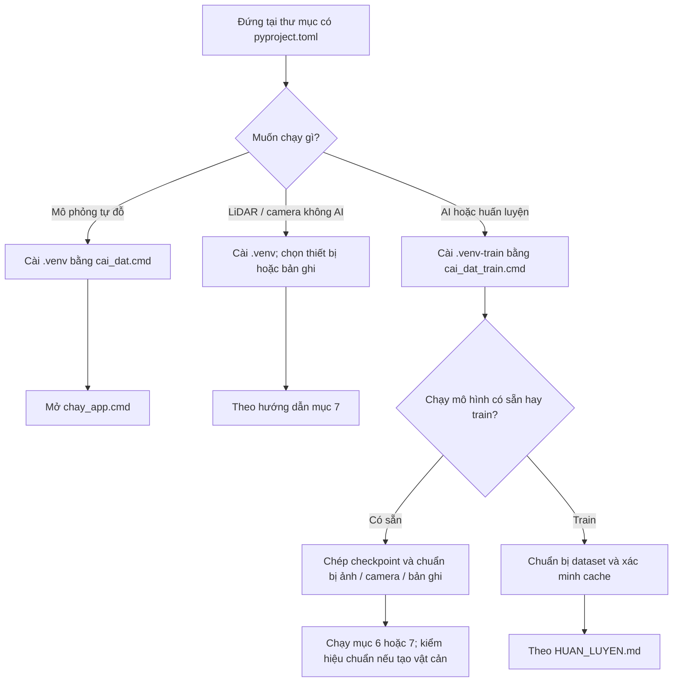
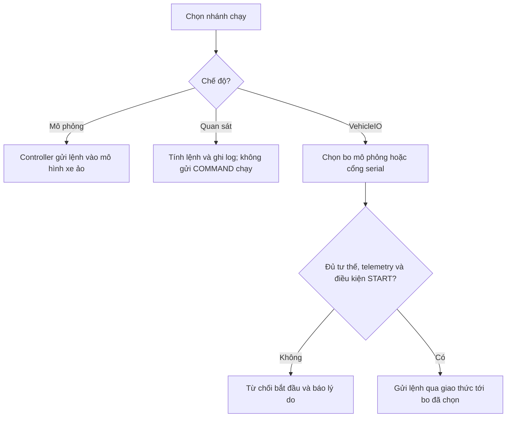

# Cài đặt và chạy AutoPark

[Cần biết tiến độ?](../TONG_HOP_DU_AN.md) · [Tài liệu kỹ thuật](docs/README.md)

Biên tập 26/09/2026 theo mã tại `9d68257`; cập nhật 29/09/2026 theo mã tại `38f64bb`, sau khi chuyển sang máy bàn mới ([biên bản](docs/CHUYEN_MAY_BAN.md)). Lệnh được đối chiếu với mã/script. Ngày 29/09/2026 đã cài lại hai môi trường và chạy toàn bộ test trên máy bàn hiện tại (mục 4); sau khi đổi cách lấy cổng LiDAR, trong các lệnh mở thiết bị ở mục 7 mới chạy lại `lidar.rplidar_c1 info` với thiết bị thật.

Nghiên cứu nhận thức sử dụng **[Valeo WoodScape Dataset](https://github.com/valeoai/WoodScape)**. [Hồ sơ giấy phép](docs/GIAY_PHEP_DU_LIEU.md).

## 1. Chọn môi trường và thư mục

| Nhu cầu | Môi trường | Cần thêm |
|---|---|---|
| Mô phỏng tự đỗ | `.venv` | Không cần cảm biến/AI |
| LiDAR/camera không chạy AI | `.venv` | Thiết bị hoặc bản ghi theo lệnh |
| AI, huấn luyện, bàn thử có AI | `.venv-train` | Checkpoint, dữ liệu/camera, cấu hình GPU phù hợp |
| Firmware ESP32 | C++/PlatformIO | [Hướng dẫn firmware](firmware/esp32_vehicle/README.md) |

Python tối thiểu 3.11; môi trường tham chiếu Windows dùng Python 3.12.10. Thư viện cố định trong `requirements-phase0.lock` và `requirements-train.lock`.

**Chạy lệnh tại thư mục chứa README này, `pyproject.toml` và `run_app.py`:**

```text
autopark/                    ← gốc repository
├── README.md
└── autopark/                ← chạy lệnh ở đây
    ├── pyproject.toml
    ├── run_app.py
    └── autopark/            ← package Python
```

Các lệnh dưới dùng PowerShell, gọi trực tiếp Python của từng môi trường nên không cần activate.

**Chọn đường chạy phù hợp:**



## 2. Cài và mở mô phỏng

Cách nhanh: chạy `cai_dat.cmd` rồi `chay_app.cmd`. `cai_dat.cmd` gọi `kiem_venv.cmd` chạy thử Python của `.venv` có sẵn; venv chép từ máy khác mà không chạy được thì được đổi tên thành `.venv.hong-tu-may-cu` rồi tạo mới (tên đó đã có thì script dừng và báo).

Hoặc chạy tuần tự:

```powershell
python --version
python -m venv .venv
./.venv/Scripts/python.exe -m pip install -r requirements-phase0.lock
./.venv/Scripts/python.exe -m pip install -e . --no-deps
./.venv/Scripts/python.exe -X utf8 run_app.py
```

Nếu `python --version` không chạy được, cài/sửa đường dẫn Python trước. Cài thư viện cần mạng. `requirements-phase0.lock` có cả `pyserial` để đọc LiDAR. Mô phỏng cơ bản không cần checkpoint AI.

## 3. Thử một lượt đỗ

1. Đặt/xoay đích; đích đè vật cản hoặc làm thân xe vượt sa bàn bị từ chối.
2. **Tìm đường đỗ** → **Xem trước** → kết thúc xem trước → **Bắt đầu đỗ**.
3. Thử **Vật cản giả** hoặc **Mất dữ liệu** khi xe đang chạy.
4. Khi đã dừng, chọn lại vị trí/đích và lập đường mới.
5. **Lưu phiên…** trước khi đặt lại phiên.

Mở kịch bản vùng chưa quan sát:

```powershell
./.venv/Scripts/python.exe -X utf8 run_app.py scenarios/giai_doan_0_unknown.json
```

Vùng chưa quan sát được chặn như vật cản. `configs/vehicle_default.json` chứa thông số giả định, chưa phải số đo MN300.

## 4. Test, bằng chứng và replay

```powershell
$env:QT_QPA_PLATFORM = "offscreen"
./.venv/Scripts/python.exe -X utf8 -m pytest
Remove-Item Env:QT_QPA_PLATFORM
```

Test cần torch được bỏ qua trong `.venv`; chạy cùng lệnh bằng `./.venv-train/Scripts/python.exe` để gồm cả chúng. Chạy test có ngân sách tìm đường khi máy rảnh, tách khỏi coverage và các chiến dịch tải CPU. Trên Windows 11, tiến trình pytest không có cửa sổ (ví dụ chạy nền) có thể chạy chậm tới ≈ 3 lần dù máy gần rảnh, đủ làm hỏng các test này (đo 30/09/2026). Vì vậy từ 30/09/2026 `tests/conftest.py` tắt EcoQoS cho tiến trình pytest; đặt `AUTOPARK_KEEP_ECOQOS=1` để giữ mặc định của Windows. pytest xóa thư mục tạm của test đạt (`tmp_path_retention_policy = "failed"` trong `pyproject.toml`; cần giữ thì thêm `-o tmp_path_retention_policy=all`). Chi tiết: [biên bản chuyển máy](docs/CHUYEN_MAY_BAN.md) mục 8.

Lần chạy toàn bộ gần nhất: 30/09/2026, máy bàn Dell Precision 3680 (i9-14900, RTX 4000 Ada 20 GB, Windows 11), bằng lệnh trên (offscreen), mã `b37e9ee` cộng sửa đổi chưa commit của đợt bo ảo QEMU tính tới 10:21, tức trước khi `tests/conftest.py` tắt EcoQoS. Kết quả: `.venv` 1376 đạt, 8 bỏ qua (cần torch), 0 hỏng. `.venv-train` 1437 đạt, 1 hỏng ở cả hai lượt: `uturn_w46`, một test ngân sách thời gian; cùng test đó đạt khi tiến trình tự tắt EcoQoS. Số test đổi theo mã; tệp kết quả và các lượt trước ở [biên bản chuyển máy](docs/CHUYEN_MAY_BAN.md) mục 2, 3, 6, 8.

Tạo phiên mẫu rồi phát lại:

```powershell
./.venv/Scripts/python.exe -X utf8 -m autopark.evaluation.phase0 --out runs/thu_nghiem_moi
./.venv/Scripts/python.exe -X utf8 -m autopark.evaluation.replay runs/thu_nghiem_moi/obstacle
```

Dùng thư mục đầu ra mới cho từng lượt. Phiên lưu cấu hình, quỹ đạo, sự kiện, telemetry, kết quả, snapshot source, ảnh/video. Replay dùng quỹ đạo đã lưu.

Kiểm mở rộng:

```powershell
./.venv/Scripts/python.exe -X utf8 -m autopark.evaluation.robustness --out runs/kiem_thu_moi
```

[Giải thích kết quả](../BAO_CAO_GIAI_DOAN_0.md). Replay trên áp dụng cho mô phỏng giai đoạn 0; phiên VehicleIO bị từ chối bằng `ReplayNotSupported`.

## 5. Cài môi trường AI và lấy dữ liệu

Chạy `cai_dat_train.cmd`. Script tạo `.venv-train`, cài lock với torch CUDA 12.8 và kiểm GPU; `.venv-train` chép từ máy khác mà không chạy được thì được đổi tên thành `.venv-train.hong-tu-may-cu` rồi tạo mới, như mục 2. Môi trường này có Shapely để AI chạy cùng phiên đỗ. Môi trường tham chiếu dùng Python 3.12 và GPU NVIDIA.

[Chuyển môi trường/checkpoint sang laptop](docs/MAY_NOP_DO_AN.md). Chép cả dự án sang máy bàn khác: làm theo mục 5 của [biên bản chuyển máy](docs/CHUYEN_MAY_BAN.md).

Bản clone không có:

| Tệp/dữ liệu | Cách có |
|---|---|
| `runs/ai_woodscape_rtx4000_v1/best.pt` | Chép từ máy bàn rồi so SHA-256 với [MAY_NOP_DO_AN.md](docs/MAY_NOP_DO_AN.md) mục 1, hoặc huấn luyện lại |
| `datasets/prepared/` | Chuẩn bị cache từ dataset |
| `runs/rig_recordings/` | Chép bản ghi hoặc ghi phiên mới |
| `calibration/cam_p<cổng>.json` | Hiệu chuẩn từng camera |
| `configs/rig/camera_rig_extrinsics_v1.json` | Đo ngoại tham |
| `configs/roi/rig_v1/` | Tạo ROI camera thật |

Cài thư viện không tự tạo các tệp này. Ngoại tham `v0` và ROI WoodScape không thay hiệu chuẩn camera dự án.

## 6. Huấn luyện và suy luận

Sau khi có cache:

```powershell
./.venv-train/Scripts/python.exe -X utf8 -m autopark.perception.verify_cache
./.venv-train/Scripts/python.exe -X utf8 -m autopark.perception.train --config configs/train_woodscape_rtx4000_baseline.json --out runs/ai_luot_moi
```

Với checkpoint tham chiếu đã chép vào đúng chỗ:

```powershell
./.venv-train/Scripts/python.exe -X utf8 -m autopark.perception.evaluate --checkpoint runs/ai_woodscape_rtx4000_v1/best.pt --split val --out runs/cham_val_moi
./.venv-train/Scripts/python.exe -X utf8 -m autopark.perception.predict --checkpoint runs/ai_woodscape_rtx4000_v1/best.pt --input duong_dan_anh.jpg --out runs/du_doan_moi --threshold 0.15
```

Thay `duong_dan_anh.jpg` bằng ảnh thật. Ngưỡng 0,15 chưa được nghiệm thu trên sa bàn.

[Huấn luyện/kết quả](../HUAN_LUYEN.md), [tải dữ liệu](datasets/TAI_VA_KIEM_TRA.md), [nhãn sa bàn](docs/GAN_NHAN_SA_BAN.md).

## 7. LiDAR, camera và bàn thử

### Mở giao diện mà chưa kết nối cảm biến

Chọn một trong hai lệnh:

```powershell
./.venv/Scripts/python.exe -X utf8 -m autopark.ui.lidar_app --no-connect
./.venv-train/Scripts/python.exe -X utf8 -m autopark.ui.lidar_app --no-connect --camera-ai
```

Lệnh không tự mở LiDAR/camera. **Bật AI camera** mở camera; **Kết nối** mở LiDAR. **Nạp lại hiệu chuẩn** khi AI tắt chỉ kiểm tệp.

### Kết nối và ghi thiết bị thật

Cổng LiDAR đặt ở một chỗ: khóa `lidar_port` trong [configs/thiet_bi.json](configs/thiet_bi.json), hiện là `"COM3"` của máy bàn. Đổi máy thì sửa dòng này theo Device Manager (mục "Silicon Labs CP210x USB to UART Bridge (COMx)"), hoặc ghi `"auto"` để tự tìm bộ chuyển CP210x; `auto` lấy cổng CP210x đầu tiên, nên tránh khi cắm thêm bo khác cũng qua CP210x. Lệnh LiDAR không có `--port` lấy cổng từ tệp; `--port COMx` ghi đè cho một lần chạy. Tệp thiếu hoặc hỏng thì lệnh báo lỗi trước khi mở thiết bị (giao diện hiện lỗi ở ngăn LiDAR lúc kết nối).

Kiểm cổng, chỉ đọc thông tin và tình trạng C1:

```powershell
./.venv/Scripts/python.exe -X utf8 -m autopark.lidar.rplidar_c1 info
```

Mở giao diện và kết nối LiDAR ở cổng của tệp:

```powershell
./.venv/Scripts/python.exe -X utf8 -m autopark.ui.lidar_app
```

Ghi bốn camera + LiDAR + AI, cần checkpoint. `--lidar` không kèm giá trị lấy cổng của tệp; `--lidar COMx` ghi đè; bỏ `--lidar` thì không dùng LiDAR:

```powershell
./.venv-train/Scripts/python.exe -X utf8 -m autopark.rig.bench --ports 1 2 3 4 --lidar --seconds 60 --name phien_moi --out runs/rig_bench/phien_moi --record runs/rig_recordings/phien_moi
```

Lệnh mở thiết bị thật. Mặc định 640×480; chất lượng bốn luồng phải đo chung trên đúng hub/máy. Ngày 29/09/2026 trên máy bàn, cách lấy cổng từ tệp mới được thử với thiết bị thật bằng `lidar.rplidar_c1 info` (mở đúng COM3, đọc được C1); `ui.lidar_app` và `rig.bench --lidar` chưa chạy lại với thiết bị thật sau thay đổi này ([biên bản](docs/CHUYEN_MAY_BAN.md) mục 3).

### Phát lại bản ghi

```powershell
./.venv-train/Scripts/python.exe -X utf8 -m autopark.rig.bench --replay runs/rig_recordings/phien_moi --name phat_lai --out runs/rig_bench/phat_lai
./.venv/Scripts/python.exe -X utf8 -m autopark.ui.rig_app --replay runs/rig_recordings/phien_moi --no-ai
```

Không mở thiết bị. Lệnh thứ hai chỉ xem, không chạy AI. [Ghi/phát lại](docs/GHI_PHAT_LAI_BAN_THU.md).

### AI tạo vật cản trong phiên đỗ

Cần checkpoint và nội tham/ngoại tham/ROI thật đạt kiểm tra; nếu thiếu, giao diện báo lý do chặn.

```powershell
./.venv-train/Scripts/python.exe -X utf8 -m autopark.ui.lidar_app --camera-ai --cam-ports 1 2 3 4
```

Lệnh mở LiDAR và camera thật. Nhánh kết hợp này chưa được thử với camera live trong hồ sơ tại `9d68257`.

Phát lại bằng rig tổng hợp để thử luồng phần mềm:

```powershell
./.venv-train/Scripts/python.exe -X utf8 -m autopark.ui.lidar_app --no-connect --camera-ai --cam-replay runs/rig_recordings/phien_moi --camera-ai-test-rig
```

`--cam-replay` tự bật AI. Rig tổng hợp chỉ dùng với replay/nguồn giả; vị trí vật cản không phải số đo từ camera thật. [Chi tiết AI camera](docs/AI_DIEU_KHIEN_XE.md).

## 8. Chuẩn bị camera và định vị

| Công việc | Tài liệu |
|---|---|
| In bảng, chụp, tính nội tham | [Hiệu chuẩn camera](docs/HIEU_CHUAN_CAMERA.md) |
| Đo vị trí/góc, vẽ ROI | [Ngoại tham và ROI](docs/NGOAI_THAM_VA_ROI.md) |
| Kiểm bản đồ nhìn từ trên xuống | [BEV](docs/BEV.md) |
| Gán nhãn ảnh | [Nhãn sa bàn](docs/GAN_NHAN_SA_BAN.md) |
| Ghi scan, đo khoảng cách, tạo map | [LiDAR](docs/GIAI_DOAN_1_LIDAR.md) |
| Định vị trên map có sẵn | [Định vị](docs/DINH_VI_LIDAR.md) |
| So sánh định vị/khớp scan | [SLAM](docs/SO_SANH_DINH_VI_SLAM.md) |

Tham số từng công cụ: `python -m <tên_module> --help` bằng đúng môi trường.

## 9. Chế độ điều khiển



Cấu hình cổng serial hiện chưa có nguồn tư thế thật, nên đi vào nhánh từ chối START. Nút kiểm kết nối chỉ kiểm liên lạc, không thay các điều kiện chạy.

| Chế độ | Hành vi |
|---|---|
| Mô phỏng giai đoạn 0 | Xe ảo chạy trong mô hình động học |
| VehicleIO | Lệnh qua giao thức tới bo chọn; mặc định bo mô phỏng |
| Quan sát | Tính lệnh/ghi log, không gửi COMMAND chạy |

**Kiểm kết nối bo** thực hiện HELLO, kiểm giới hạn và đọc telemetry; không ARM/COMMAND. Cấu hình bo thật hiện thiếu nguồn tư thế thật nên START bị chặn.

[Giao thức](docs/GIAO_THUC_XE.md), [quan sát](docs/CHE_DO_QUAN_SAT.md), [firmware](firmware/esp32_vehicle/README.md), [bo ảo QEMU và các trình giả lập đã thử](docs/MO_PHONG_FIRMWARE.md) (30/09/2026: firmware thật chạy trong QEMU, laptop nói chuyện bằng `SerialVehicleIO` qua `socket://`; giao diện chưa chọn được bo ảo).

## 10. Cấu trúc mã

| Thư mục | Vai trò |
|---|---|
| `autopark/domain/` | Dữ liệu, cấu hình, hợp đồng cảm biến |
| `autopark/application/`, `autopark/ui/` | Phiên và giao diện |
| `autopark/planning/`, `autopark/control/` | Tìm đường, bám đường |
| `autopark/geometry/`, `autopark/simulation/` | Va chạm, động học, phản hồi giả |
| `autopark/perception/` | AI, hiệu chuẩn, ROI, BEV |
| `autopark/lidar/`, `autopark/video/` | Nguồn scan/ảnh và công cụ đo |
| `autopark/fusion/`, `autopark/rig/` | Hợp nhất, bàn thử |
| `autopark/transport/`, `firmware/` | Giao thức, bo mô phỏng, firmware |
| `autopark/safety/` | Thời hạn dữ liệu |
| `autopark/storage/`, `autopark/evaluation/` | Lưu, replay, kiểm chứng |
| `configs/`, `scenarios/`, `tests/` | Tham số, sa bàn, kiểm thử |

Đơn vị: mét, giây, radian. Pose tại tâm trục sau; x hướng trước, y trái, yaw dương ngược chiều kim đồng hồ.

## 11. Khi không chạy được

| Biểu hiện | Kiểm tra |
|---|---|
| Không gọi được Python | Cài Python và sửa PATH |
| Thiếu package `autopark`/`run_app.py` | Đứng đúng thư mục có `pyproject.toml` |
| Thiếu torch | Cài và dùng `.venv-train` |
| Thiếu `best.pt` | Chép checkpoint hoặc train lại |
| AI bị chặn hiệu chuẩn | Làm nội tham → ngoại tham → ROI, đọc lý do trên UI |
| LiDAR không kết nối | Xem số COM trong Device Manager (không thấy cổng thì cài driver CP210x), sửa `lidar_port` trong `configs/thiet_bi.json` (mục 7); tránh nhầm cổng bo xe |
| Venv báo `No Python at ...` sau khi chép từ máy khác | Chạy lại `cai_dat.cmd` / `cai_dat_train.cmd` (mục 2, 5) |
| Traceback hiện đường dẫn của máy cũ sau khi chép repo | Xóa các thư mục `__pycache__` ngoài venv |
| Ảnh không đọc/ghi được khi đường dẫn có dấu | Mã dự án đã xử lý qua `autopark/image_io.py` hoặc hàm tương đương; mã mới dùng `image_io` thay vì gọi thẳng `cv2.imread/imwrite`, vốn hỏng lặng lẽ với đường dẫn như `D:\gấp\...` ([biên bản](docs/CHUYEN_MAY_BAN.md) mục 3) |
| AI không đủ bốn luồng | Kiểm khung hỏng, nhịp camera và USB |
| Test planner đôi lúc TIMEOUT | Chạy khi máy rảnh, tách khỏi coverage |

[Mục lục kỹ thuật](docs/README.md). [README trước biên tập](https://github.com/thbn12082/autopark/blob/9d68257/autopark/README.md) giữ các lệnh và nhật ký cũ.
