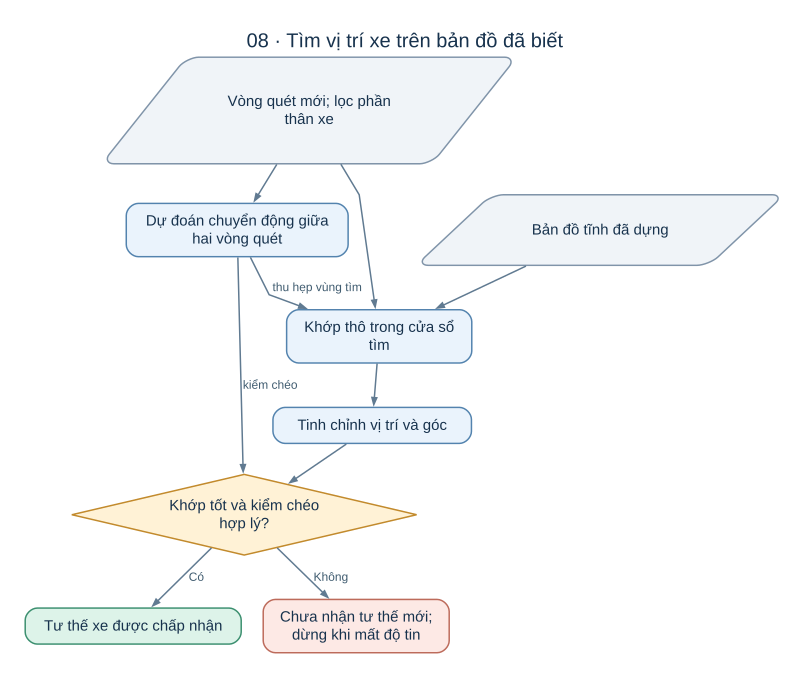
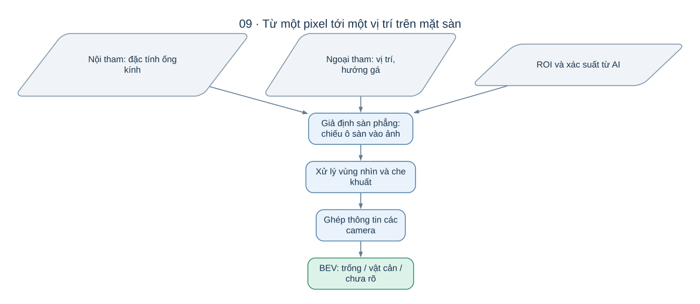

# Xe biết xung quanh có gì và biết mình đang ở đâu như thế nào?

Để lùi vào một chỗ đỗ, xe cần trả lời hai câu hỏi: **“vật cản ở đâu?”** và **“mình đang ở đâu?”**. Hai câu hỏi liên quan nhưng không giống nhau. Có thể đo chính xác khoảng cách tới tường mà vẫn chưa biết xe đang ở đoạn nào của bức tường. Ngược lại, biết vị trí xe chưa đủ để phát hiện chiếc hộp vừa được đặt vào đường lùi.

AutoPark dùng LiDAR để đo hình học xung quanh và ước lượng tư thế xe, đồng thời có nhánh camera AI để bổ sung thông tin vật cản. Tài liệu này đi theo dòng thông tin từ số đo tới bản đồ, rồi giải thích vì sao từng thuật toán xuất hiện.

*LiDAR và camera tạo ra các loại bằng chứng khác nhau. Muốn dùng chung, chúng phải được đặt đúng tọa độ và thời gian.*

## 1. Trước tiên phải thống nhất “ở đâu” nghĩa là gì

Một chiếc hộp “cách camera 40 cm” chưa có tọa độ trên sa bàn. Camera gắn lệch so với thân xe; xe lại đang quay so với trục sa bàn. Dự án vì vậy phân biệt ba hệ tọa độ:

| Hệ tọa độ | Câu hỏi nó trả lời |
|---|---|
| Cảm biến | Vật ở hướng nào, cách LiDAR/camera bao xa? |
| Xe | Vật ở phía trước/sau/trái/phải xe bao nhiêu? |
| Sa bàn | Vật ở chỗ nào trong không gian mà bộ tìm đường đang dùng? |

Trong hệ xe, x hướng trước, y hướng trái, z hướng lên. Gốc dùng cho mô hình xe nằm trên mặt sàn tại tâm trục sau. Tư thế phẳng gồm ba số **x, y và góc hướng**. Tâm quay LiDAR có thể ở chỗ khác; chuyển từ tư thế cảm biến sang tư thế xe phải biết phép biến đổi gá.

Ví dụ, LiDAR thấy một hộp ở trước nó 0,5 m, nhưng LiDAR nằm trước tâm trục sau 0,1 m. Nếu bỏ qua gá, vị trí hộp tương đối với xe đã lệch 0,1 m trước khi thuật toán tìm đường bắt đầu. Mọi con số ở ví dụ chỉ để minh họa phép đổi hệ, không phải kích thước đã đo của xe dự án.

## 2. LiDAR biến khoảng cách thành bản đồ bằng cách nào?

Một vòng quét LiDAR là nhiều cặp **góc và khoảng cách**. Mỗi cặp cho một điểm phản hồi. Bản đồ chia sàn thành các ô nhỏ; các cấu hình LiDAR đang dùng ô 5 cm làm giá trị khởi đầu.

Thuật toán dựng bản đồ đi dọc từng tia đo, thường gọi là **ray casting**:

1. Các ô tia đi qua trước điểm phản hồi được cộng bằng chứng “đi qua”.
2. Ô chứa điểm phản hồi được cộng bằng chứng “chạm vật”.
3. Gộp nhiều vòng quét để giảm ảnh hưởng của một điểm nhiễu riêng lẻ.

Kết quả là **lưới chiếm chỗ**, với ba trạng thái:

| Trạng thái ô | Ý nghĩa |
|---|---|
| FREE | Có đủ bằng chứng tia đi xuyên qua vùng này |
| OCCUPIED | Có đủ bằng chứng tia chạm vật trong vùng này |
| UNKNOWN | Chưa quan sát được hoặc chưa đủ bằng chứng |

Dự án đếm số lần đi qua và chạm, rồi xét ngưỡng số lần và tỷ lệ chạm. Đây là cơ chế đếm bằng chứng; không nên mô tả thành một bộ lọc Bayes hay log-odds khi phần hiện thực chưa làm phép cập nhật đó. Một tia không có phản hồi không được coi là bằng chứng sàn trống. Vùng sau vật cản vẫn có thể chứa vật khác.

**Vì sao dùng lưới?** Mỗi vòng quét có nhiều điểm rời rạc. Lưới gom chúng vào một biểu diễn cố định, thuận tiện tích lũy bằng chứng và đối chiếu vị trí. Cái giá là mất chi tiết dưới kích thước ô: tường có thể bị lượng tử hóa, vật nhỏ có thể chỉ còn một ô, và ranh giới không còn chính xác tuyệt đối.

Để nhìn được cả vùng bị che ở một chỗ đặt, bộ dựng bản đồ của dự án ghép nhiều đoạn LiDAR **đứng yên tại các vị trí khác nhau**. Chỗ đầu được neo vào hệ sa bàn; các chỗ tiếp theo được khớp vào bản đồ đã có. Dự án kiểm thêm bằng cách bỏ một chỗ đặt ra rồi định vị lại chỗ đó trên phần bản đồ còn lại. Nếu không đủ chồng lấp thì phép kiểm không kết luận được. Sai số mốc neo vẫn truyền sang toàn bản đồ: lệch hướng 1° tạo sai lệch khoảng 3,5 cm ở khoảng cách 2 m.

## 3. Định vị trên bản đồ: giống đặt một tờ giấy trong suốt lên bản vẽ

Hãy tưởng tượng bản đồ đã có đường viền các bức tường. Vòng quét mới là các chấm trên một tờ giấy trong suốt. Ta dịch và xoay tờ giấy cho các chấm trùng đường viền. Vị trí đặt tốt nhất là một ứng viên tư thế LiDAR.

*Tư thế tốt phải khớp bản đồ và vượt qua kiểm tra độ tin. Một nghiệm có điểm cao vẫn có thể nhầm nếu cảnh có nhiều vị trí giống nhau.*

AutoPark thực hiện ý tưởng này bằng ba bước:

**Tạo trường khoảng cách.** Với mỗi ô, tính khoảng cách tới ô có vật cản gần nhất. Khi đặt một điểm quét gần tường trên bản đồ, nó nhận điểm khớp cao; rơi xa tường thì điểm thấp. Điểm rơi vào vùng đã biết trống có thể bị phạt vì mâu thuẫn với bản đồ.

**Tìm thô bằng khớp tương quan.** Thử các vị trí x, y và góc hướng trong một vùng quanh dự đoán ban đầu. Phương pháp nhánh-cận xét các vùng lớn trước và loại vùng không thể thắng kết quả đã tìm thấy, rồi chia nhỏ những vùng còn hứa hẹn. Nhờ vậy không phải tính chi tiết mọi vị trí. Đây là lựa chọn tìm kiếm trên lưới của dự án, cùng hướng tiếp cận nhánh-cận được trình bày trong [nghiên cứu Cartographer](https://research.google/pubs/real-time-loop-closure-in-2d-lidar-slam/); dự án không vì dùng ý tưởng này mà trở thành toàn bộ hệ Cartographer.

**Tinh chỉnh bằng Gauss-Newton có giảm chấn.** Khi đã ở gần vị trí khớp tốt, dịch và xoay thêm những lượng nhỏ để giảm khoảng cách từ điểm quét tới vật cản. Cơ chế Levenberg-Marquardt giúp bước điều chỉnh thận trọng hơn khi mô hình cục bộ không thuận lợi; trọng số Cauchy giảm ảnh hưởng của các điểm lệch mạnh. Nhờ tinh chỉnh, nghiệm không bị buộc nằm đúng tâm một ô lưới.

Lý do kết hợp tìm thô và tinh chỉnh là hai bước có vai trò bổ sung: tìm thô tìm vùng phù hợp, tinh chỉnh đạt độ mịn hơn trong vùng đó. Chỉ tinh chỉnh quanh một phỏng đoán sai có thể dừng ở nghiệm không mong muốn; chỉ tìm trên lưới thì độ mịn bị giới hạn bởi bước lưới. Đây là cách diễn giải cơ chế hiện có, chưa phải kết quả so sánh định lượng với mọi thuật toán định vị khác.

Sau khi tìm, hệ thống kiểm tra số tia khớp, tia mâu thuẫn, nghiệm ở mép vùng tìm, độ bất định và việc có **hai vị trí khác nhau nhưng khớp gần bằng nhau** hay không. Kết quả có thể là hợp lệ, mơ hồ hoặc thất bại. Trong hành lang dài, hai bức tường cho biết khoảng cách ngang khá tốt nhưng có thể không cho biết xe đã đi dọc hành lang bao xa. Đây là thiếu thông tin hình học, không thể sửa chỉ bằng việc tin mạnh hơn vào con số ước lượng.

Độ bất định tính từ phép khớp chỉ mô tả một phần sai số; nó chưa bao gồm đầy đủ sai số mốc neo, gá và bản đồ. Các ngưỡng chấp nhận của dự án vẫn là giá trị đề xuất, cần được đối chiếu với phép đo độc lập.

## 4. Vì sao còn cần odometry nếu đã có bản đồ?

**Odometry** trả lời “từ lần trước đến giờ, cảm biến đã dịch và quay bao nhiêu?”. Trong dự án, nguồn này lấy từ khớp các vòng quét LiDAR, không phải từ encoder bánh xe hay IMU.

Mỗi vòng mới được so với bản đồ tham chiếu tích lũy, quanh một dự đoán chuyển động. Chỉ thêm khung quét làm mốc khi đã dịch hoặc quay đủ, để tránh tích lũy liên tục các khung gần giống nhau lúc đứng yên. Dự án cũng có chế độ chỉ so với vòng trước để đối chiếu; cách đó dễ tích lũy sai số qua từng bước hơn.

Nguồn định vị dùng hai kết quả theo vai trò rõ ràng:

- **Khớp bản đồ tĩnh** cung cấp vị trí trong hệ sa bàn.
- **Odometry LiDAR** dự đoán tâm vùng tìm tiếp theo và kiểm tra xem bước thay đổi tư thế có hợp lý không.

Ví dụ, bản đồ tĩnh cho rằng xe vừa “nhảy” sang một chỗ đỗ giống hệt ở cách xa, còn chuỗi quét cho thấy xe chỉ vừa dịch một đoạn ngắn. Sự bất đồng là lý do để ngừng tin tư thế mới. Hai phép tính vẫn dùng cùng cảm biến, nên kiểm chéo này không tương đương có hai nguồn đo độc lập.

Odometry còn xét hướng của các bề mặt trong vòng quét. Nếu chúng gần song song, một hướng chuyển động có thể khó quan sát. Khi đó hệ thống giảm độ tin ở hướng ấy và kéo mềm kết quả về dự đoán chuyển động, đồng thời giữ trạng thái mơ hồ. Tiên nghiệm chuyển động giúp ổn định tính toán nhưng không tạo ra thông tin mà cảm biến chưa nhìn thấy; nếu xe đổi tốc độ trong hành lang trơn, hướng đó vẫn có thể trôi.

Khi bắt đầu, nguồn tư thế đợi nhiều vòng hợp lệ liên tiếp. Trong lúc chạy, mất định vị, bất đồng quá mức hoặc quá lâu không kiểm chéo được đều có cơ chế báo dừng. Tìm lại toàn cục chỉ được thực hiện ở trạng thái chưa chạy; xe đang chạy không tự nhận một vị trí xa chỉ vì phép tìm toàn bản đồ cho điểm cao.

## 5. Quan hệ giữa dựng bản đồ, định vị và SLAM

| Cách làm | Thứ đã biết | Thứ đang cần tìm |
|---|---|---|
| Dựng bản đồ từ các chỗ đặt | Tư thế chỗ neo và quan hệ ghép được giữa các chỗ | Hình học môi trường |
| Định vị trên bản đồ tĩnh | Bản đồ môi trường | Tư thế hiện tại |
| Odometry LiDAR | Các vòng quét đã chấp nhận | Chuyển động tích lũy tương đối |
| SLAM có tối ưu toàn cục | Chưa có bản đồ hoàn chỉnh | Bản đồ và tư thế, có cơ chế sửa sai số tích lũy |

Nhánh hiện tại của AutoPark dùng **bản đồ tĩnh kết hợp odometry để dự đoán và kiểm chéo**. Nó chưa có đóng vòng và tối ưu đồ thị để sửa toàn bộ quỹ đạo/bản đồ khi quay lại một nơi cũ. Vì vậy không gọi nhánh này là SLAM đầy đủ.

Với một sa bàn nhỏ có thể chuẩn bị trước, cách dùng bản đồ cố định giúp tách lỗi bản đồ khỏi lỗi định vị khi đánh giá. Đó là lý do thực dụng phù hợp với thiết kế đang có. Đổi lại, khi bố cục môi trường thay đổi nhiều, bản đồ cũ có thể không còn phù hợp; hệ thống không tự giải quyết mọi thay đổi bằng một bản đồ luôn được tối ưu lại.

## 6. Camera cần gì để biến pixel thành vị trí trên sàn?

AI cho biết vùng ảnh có khả năng là vật cản. **Hiệu chuẩn** cho biết quan hệ giữa điểm trong ảnh và hướng nhìn ngoài không gian. Hai loại thông tin cần được phân biệt:

| Thành phần | Cách hình dung |
|---|---|
| Nội tham | Ống kính biến một hướng nhìn thành điểm ảnh ra sao, kể cả méo góc rộng |
| Ngoại tham | Camera ở đâu và quay thế nào so với xe |
| ROI | Phần ảnh đủ đáng tin để tham gia dựng bản đồ |

Camera góc rộng không thể được hiểu bằng cách chia đều chiều ngang ảnh thành các mét ngoài sàn. Mô hình hiệu chuẩn phải mô tả phép chiếu và méo của ống kính. Các khái niệm nội tham, ngoại tham và phép chiếu fisheye được trình bày trong [tài liệu OpenCV](https://docs.opencv.org/4.13.0/db/d58/group__calib3d__fisheye.html). Dự án có mô hình đa thức góc rộng tương ứng với dữ liệu WoodScape và luồng hiệu chuẩn riêng cho camera dự án; các hệ số thuộc mô hình nào phải được hiểu đúng theo mô hình đó.

*Hiệu chuẩn nối ảnh với hình học. Độ chính xác của AI và độ chính xác của phép chiếu là hai việc phải kiểm tra riêng.*

**BEV** là bản đồ nhìn từ trên xuống. Trong cách hiện thực của AutoPark, sàn được giả định phẳng. Với từng ô sàn, hệ thống tính ô đó xuất hiện ở pixel nào, rồi đọc bằng chứng FREE/BLOCKED ở pixel ấy. Những phần chỉ phụ thuộc gá và hiệu chuẩn có thể tính trước để dùng lại cho nhiều khung ảnh.

Cách làm này thuận tiện vì bộ tìm đường cần tọa độ trên sàn. Tuy nhiên, phép chiếu chỉ đúng cho điểm nằm trên mặt sàn. Pixel ở nóc một chiếc hộp nếu bị giả định nằm trên sàn sẽ bị đặt sai vị trí. Dự án dùng quy tắc che khuất: theo một hướng nhìn, vùng sau vật gần nhất trở thành UNKNOWN. Cách này giảm việc coi vùng khuất là trống, nhưng chưa tạo được hình chiếu chính xác của vật nhô ra hoặc vật có chân bị che.

Để không bỏ qua vật mảnh nằm giữa các tâm ô, mỗi ô được chia nhỏ khi chiếu, và có thêm lượt kiểm pixel ngược về sàn để loại những kết luận FREE thiếu chắc chắn. Khi gộp lại, chỉ cần một ô con có vật cản thì ô lớn giữ bằng chứng vật cản; muốn gọi ô lớn là trống thì mọi ô con phải có bằng chứng trống.

## 7. Ghép nhiều nguồn: vì sao không lấy trung bình là xong?

Nếu camera thứ nhất thấy hộp còn camera thứ hai thấy sàn ở cùng vị trí, lấy trung bình có thể làm hộp biến mất. Dự án ưu tiên giữ bằng chứng vật cản: ở lưới camera, có camera nói OCCUPIED thì giữ OCCUPIED; chỉ gọi FREE khi có bằng chứng trống và không có camera báo vật cản. Vùng chưa đủ thông tin giữ UNKNOWN. Phần dưới thân xe được che đi để tránh nhận chính xe thành vật ngoài môi trường.

*Các nguồn bổ sung vật cản vào môi trường chung. Vùng FREE của camera không có quyền xóa vật cản đã được nguồn khác cung cấp.*

Sau BEV, lưới camera được xoay và dịch vào hệ sa bàn bằng tư thế xe. Dự án lọc theo thời gian ngay trong hệ sa bàn: một ô phải xuất hiện là vật cản ở ít nhất **2 trong 3 lô** gần nhất được xử lý. Làm trong hệ sa bàn giúp không nhầm vật đứng yên thành vật chạy quanh xe chỉ vì xe đang dịch chuyển. Đổi lại, lọc nhiều lô làm chậm thời điểm xác nhận; vật chỉ xuất hiện một lô có thể bị bỏ qua.

Cầu nối hiện chuyển các ô OCCUPIED thành những hình chữ nhật vật cản cho bộ tìm đường. **FREE/UNKNOWN của camera không trực tiếp mở hay khóa toàn bộ vùng tương ứng trong bộ tìm đường.** Vì thế không thể suy từ một vùng UNKNOWN màu xám trên ảnh BEV rằng planner hiện tự chặn tất cả vùng đó. Cần phân biệt trạng thái trên bản đồ cảm nhận với quy tắc cầu nối đang sử dụng.

Khi đang chạy, vật mới ảnh hưởng tới vùng toàn thân xe sẽ quét qua trên phần đường còn lại khiến phiên đỗ phanh rồi chờ lập lại đường. Vật mới nằm xa hành lang đó được ghi nhận mà không gây dừng ngay. Cách kiểm theo thân xe có ý nghĩa hơn chỉ kiểm một đường mảnh nối các tâm xe: đầu xe và đuôi xe còn quét ra ngoài đường tâm khi quay.

Các lựa chọn trên thiên về giữ bằng chứng cản đường và tránh dừng do nhiễu xa đường. Chúng có cái giá rõ ràng: vật cản báo nhầm có thể làm đường đi hẹp hơn, trong khi vật chưa được cảm nhận thành OCCUPIED vẫn cần được phát hiện bằng cách khác.

## 8. Vì sao dữ liệu đúng nhưng cũ vẫn gây sai?

Xe thay đổi vị trí theo thời gian. Nếu dùng ảnh chụp trước đó để đặt vật vào tư thế hiện tại, vật có thể bị dịch trên bản đồ dù AI tô đúng. Ví dụ minh họa, xe chạy 0,10 m/s trong 0,5 s đã dịch 5 cm; chưa tính phần sai số do quay.

Nhánh camera hiện đặt cả một lô vào bản đồ bằng tư thế xe được cung cấp khi xử lý, chưa nội suy riêng tư thế theo thời điểm chụp từng ảnh. Nó theo dõi tuổi lô bằng khung cũ nhất đã dùng; ngưỡng tuổi mặc định là 0,5 s và vẫn cần xác nhận trên sa bàn. Một khoảng mất dữ liệu quá dài làm xóa cửa sổ lọc, tránh cộng bằng chứng cũ với mới như thể chúng liên tục.

Hiệu chuẩn cũng phải khớp với ảnh đang dùng. Đổi chế độ camera hoặc kích thước khung có thể làm phép chiếu không còn đúng. Nhánh tạo vật cản có các điều kiện chặn khi nội tham chưa đạt, ngoại tham chưa đo, thiếu ROI hoặc dùng dữ liệu tổng hợp cho camera thật. Thiếu thông tin không được biến thành khẳng định “không có vật cản”.

## 9. Phần nào đã có, phần nào còn phải chứng minh?

Các thuật toán trên đã được hiện thực trong dự án. Bằng chứng hiện có gồm dữ liệu tổng hợp, bản ghi LiDAR C1 đứng yên, dữ liệu DROW và các phép phát lại. Việc có thuật toán và có kết quả kiểm trên các nguồn ấy chưa chứng minh toàn bộ xe thật hoạt động chính xác.

Theo hồ sơ đi kèm mã hiện tại, nhánh dựng bản đồ và định vị ngày 02/10 chưa có nghiệm thu với LiDAR gá trên xe chuyển động thật; các thông số gá và ngưỡng chấp nhận còn cần đo/chốt. Nhánh camera AI cũng chưa có nghiệm thu với camera thật đã hiệu chuẩn và bộ ảnh sa bàn có nhãn. Những hạn chế này xác định công việc cần làm tiếp: so vị trí với mốc đo độc lập, kiểm lỗi khi môi trường thay đổi, và đo thời gian từ cảnh thật tới phản ứng của xe.

Để hiểu đoạn tiếp theo của chuỗi, đọc [các thuật toán của bài toán đỗ xe](THUAT_TOAN_DUONG_DI.md). Để hiểu cách mô hình phân biệt sàn và vật cản, đọc [AI trong AutoPark](../../HUAN_LUYEN.md). Hồ sơ kỹ thuật chi tiết được giữ tại [định vị LiDAR](DINH_VI_LIDAR.md), [đối chiếu odometry và SLAM](SO_SANH_DINH_VI_SLAM.md), [BEV](BEV.md) và [AI tham gia phiên đỗ](AI_DIEU_KHIEN_XE.md).
