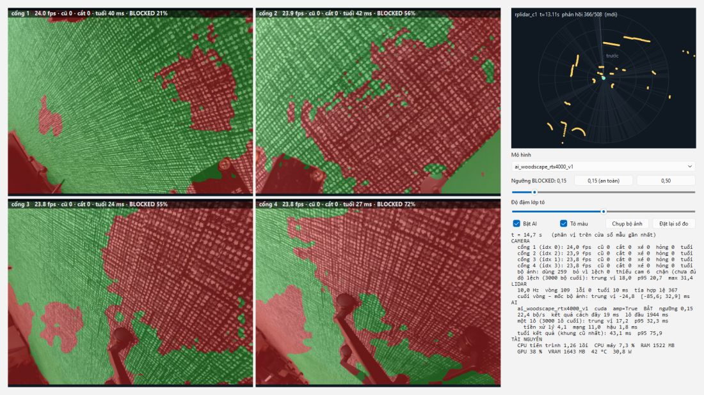

# Dữ liệu, giấy phép và bằng chứng

Dữ liệu lớn/checkpoint thường ở `datasets/`, `runs/`, `recordings/` ngoài Git. Giữ manifest, phiên bản, ảnh/scan gốc và điều kiện đo. [evidence/](evidence/) gồm bằng chứng có ngày: phân biệt kết quả thao tác gần mới với các hồ sơ tự đỗ/bàn thử lịch sử.

## Bằng chứng chặng 1 hiện tại

[Snapshot 28/10/2026](evidence/maneuver_suite_stage1_20261028.json) ghi mẫu số từng loại kết quả, số đo lấy mẫu, dấu vân tay mã nguồn, kiểm thử hồi quy và replay của bộ thao tác gần. [Cách đọc kết quả](KIEM_THU_VA_LO_TRINH.md#bo-mo-phong) giữ riêng đến đích, từ chối, dừng và các probe cố ý thất bại.

Trace và báo cáo đầy đủ ở `runs/maneuver_suite_stage1_final_v2_20261028/` trên máy chạy; không đưa vào Git. Khi lấy repo sang máy khác, dùng [lệnh chạy bộ đánh giá](VAN_HANH.md#danh-gia-mo-phong) để tạo dữ liệu mới. Snapshot này chỉ là bằng chứng mô phỏng, không bổ sung số đo xe hay chất lượng AI thật.



*Ảnh bàn thử lịch sử đã lưu trong repo: bốn camera nhìn sàn/thảm, lớp tô AI và scan LiDAR. Giữ nguyên ảnh gốc; đây không phải cảnh xe tự thực hiện thao tác.*

## AI và nhãn sa bàn

Checkpoint tham chiếu `runs/ai_woodscape_rtx4000_v1/best.pt`: L-RASPP/MobileNetV3-Large khởi tạo torchvision COCO/VOC, học WoodScape. [Bảng nhãn](../configs/woodscape_binary_v1.json) đổi thành FREE/BLOCKED/IGNORE; IGNORE của nhãn khác UNKNOWN của bản đồ.

Sa bàn cần ảnh phủ vật thấp/cột/mép tường/vùng sát thân xe và ánh sáng khác nhau. Chia theo phiên/cảnh, kiểm trùng/gần trùng, dùng nhãn độc lập cho tập chấm; chỉ ảnh đã duyệt được xuất. Nhãn 0 FREE, 1 OBSTACLE, 255 IGNORE; không resize bằng bilinear.

Từ `autopark/`:

```powershell
.\.venv\Scripts\python.exe -m autopark.perception.labels import runs/rig_snapshots --project datasets/sa_ban_labels
.\.venv\Scripts\python.exe -m autopark.ui.label_app --project datasets/sa_ban_labels
.\.venv\Scripts\python.exe -m autopark.perception.labels export --project datasets/sa_ban_labels --out datasets/prepared/sa_ban_v1
```

Bộ chấm nhập `--no-draft`, dùng `--exclude`/`--disjoint-from` để kiểm giao tập. Huấn luyện/chấm trong môi trường có PyTorch: `perception.train`, `perception.evaluate`, `perception.evaluate_external`; xem `--help`. Chọn mô hình/ngưỡng bằng validation, đo thêm bỏ sót/báo nhầm theo vật/khoảng cách.

## Giấy phép và ghi công

Bảng này giữ trạng thái rà 22–25/09/2026, đối chiếu 30/09; không phải xác nhận điều khoản mới.

| Nguồn | Hồ sơ đã ghi |
|---|---|
| [Valeo WoodScape](https://github.com/valeoai/WoodScape) | Dữ liệu theo điều khoản riêng, MIT của mã không áp dụng cho ảnh; chỉ phi thương mại, có vế về vận hành phương tiện |
| ACDC | Nghiên cứu phi thương mại; hồ sơ không thấy điều khoản vận hành phương tiện; cấm mục đích quân sự |
| [AVM-SS](https://github.com/Engro39/avm_dataset) | Chưa có tuyên bố giấy phép; không mặc định được tự do dùng |
| [DROW v2](https://github.com/VisualComputingInstitute/DROW) | MIT; phần reha CC BY-NC-SA 3.0; dùng thì trích cả hai bài DROW |
| Trọng số torchvision | Mã BSD; điều khoản riêng của trọng số COCO/VOC và nguồn tiền huấn luyện còn phải tra |
| RoadObstacle21 | Chưa xác minh điều khoản |
| RoadAnomaly21 | Giấy phép theo từng ảnh; chưa rõ nhãn/mask |

Ngày 25/09/2026 người làm khóa luận chọn dùng mô hình chỉ học WoodScape trong vòng điều khiển xe mô hình, theo cách đọc vế phương tiện là ví dụ của dùng thương mại. **Valeo chưa xác nhận cách đọc này**; cách đọc thành lệnh cấm riêng vẫn chưa loại trừ. Quyết định không bao phủ checkpoint trộn AVM-SS, nhãn nháp AI hoặc điều khoản trọng số torchvision. Hai hướng dự phòng đã ghi là chỉ LiDAR hoặc học lại từ nguồn phù hợp.

Giữ nguyên [LICENSE.pdf của WoodScape](../datasets/woodscape_metadata/LICENSE.pdf), [README nguồn](../datasets/woodscape_metadata/README.md), thông báo bản quyền và [hồ sơ điều khoản/quyết định đầy đủ](https://github.com/thbn12082/autopark/blob/a37824d84515077b892002aa70949427f12ad645/autopark/docs/GIAY_PHEP_DU_LIEU.md). [Danh mục nguồn](https://github.com/thbn12082/autopark/blob/a37824d84515077b892002aa70949427f12ad645/autopark/datasets/DANH_MUC_DATASET.md) và [tình trạng tải](https://github.com/thbn12082/autopark/blob/a37824d84515077b892002aa70949427f12ad645/autopark/datasets/TAI_VA_KIEM_TRA.md) là bản lịch sử.

## Số đo lịch sử tiêu biểu

| Ngày, điều kiện | Kết quả và giới hạn |
|---|---|
| 20/09, mô phỏng giai đoạn 0 | Sáu điều kiện của phạm vi tự đỗ cũ đạt trong mô phỏng; không phải xe thật hoặc nghiệm thu hướng mới |
| 21–29/09, WoodScape | Cache 8.234 ảnh (5.764/1.235/1.235); test mIoU 0,9692 ở ngưỡng 0,50. Test nền đã chấm hai lần ở hai ngưỡng, không phải một lần cuối duy nhất |
| Ngoài miền, ngưỡng 0,50 | RoadObstacle21 30 ảnh: mIoU 0,520, bỏ sót 31,7%, không phát hiện vật trong 11 ảnh. Chưa có bộ chấm sa bàn độc lập |
| 24/09, BEV tổng hợp trên i9-14900 | Bốn camera 640×480, lưới 5 cm: trung vị 11,8–12,0 ms sau tối ưu, có cache/tải song song; không phải trễ toàn hệ thống |
| 24/09, ghi bàn thử o03 | 60 s: 5.724 JPEG, 601 scan, 298,6 MB, không bỏ khung. Phát lại sau làm nóng đủ cỡ lô khôi phục 1.432 bộ; JPEG không trùng từng bit |
| 29/09, firmware trên máy tính | Host 703 check/0 lệch; build ESP32-S3 thành công. 30/09 chạy QEMU; chưa nạp bo thật |
| 02/10, C1 đứng yên trong phòng | 271 vòng: 2 INIT/269 OK; độ tản 2,99 mm / 2,64 mm / 0,06°. Là độ lặp lại, chưa có tham chiếu độc lập |
| 02/10, chạy dài bàn thử | Có lượt bị dừng ngoài và lượt LiDAR lỗi; lượt sau sửa đủ 1.800 s. Không gọi các lượt đó là thử xe |

Bảng chỉ tóm tắt. Dữ kiện và điều kiện đầy đủ giữ trong các nguồn sau:

- [Báo cáo giai đoạn 0](https://github.com/thbn12082/autopark/blob/a37824d84515077b892002aa70949427f12ad645/BAO_CAO_GIAI_DOAN_0.md), [AI và các phép so sánh](https://github.com/thbn12082/autopark/blob/a37824d84515077b892002aa70949427f12ad645/HUAN_LUYEN.md), [độ nhạy xe](https://github.com/thbn12082/autopark/blob/a37824d84515077b892002aa70949427f12ad645/autopark/docs/DO_NHAY_KICH_THUOC_XE.md).
- [Bàn thử camera](https://github.com/thbn12082/autopark/blob/a37824d84515077b892002aa70949427f12ad645/autopark/docs/GIAI_DOAN_1_CAMERA.md), [LiDAR](https://github.com/thbn12082/autopark/blob/a37824d84515077b892002aa70949427f12ad645/autopark/docs/GIAI_DOAN_1_LIDAR.md), [định vị](https://github.com/thbn12082/autopark/blob/a37824d84515077b892002aa70949427f12ad645/autopark/docs/DINH_VI_LIDAR.md), [bốn camera](https://github.com/thbn12082/autopark/blob/a37824d84515077b892002aa70949427f12ad645/autopark/docs/GIAI_DOAN_2_BAN_THU.md), [chuyển máy/QEMU](https://github.com/thbn12082/autopark/blob/a37824d84515077b892002aa70949427f12ad645/autopark/docs/CHUYEN_MAY_BAN.md).
- Bằng chứng gốc: [camera](evidence/camera/), [ghi/phát lại](evidence/rig/cho_nhip_rieng_ghi_phat_lai_20260924.json), [chuyển máy](evidence/chuyen_may_20260929/), [thiết bị 02/10](evidence/thiet_bi_20261002/).
- [Kiểm kê thiết bị](https://github.com/thbn12082/autopark/blob/a37824d84515077b892002aa70949427f12ad645/autopark/docs/hardware_inventory.md), [MN300](https://github.com/thbn12082/autopark/blob/a37824d84515077b892002aa70949427f12ad645/autopark/docs/mn300_inventory.md), [USB](https://github.com/thbn12082/autopark/blob/a37824d84515077b892002aa70949427f12ad645/autopark/docs/usb_topology.md), [nguồn mua đã được cung cấp](https://github.com/thbn12082/autopark/blob/a37824d84515077b892002aa70949427f12ad645/KE_HOACH_TRIEN_KHAI_XE_TU_DO_v3.1.md).

Các liên kết Git trên cố định bản trước khi gom docs; lệnh/module/số mục trong đó chỉ áp dụng tại thời điểm ghi. Hướng dẫn đang dùng là [README và năm chuyên đề](../../README.md).
