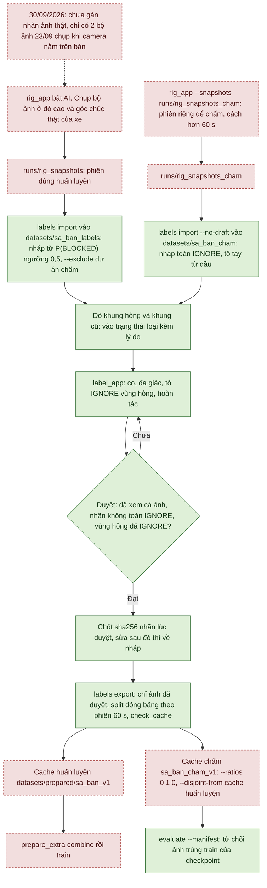

# Gán nhãn ảnh sa bàn — nháp từ AI, người sửa, chỉ ảnh đã duyệt vào huấn luyện (24/09/2026)

Kế hoạch v3.1 (bảng trạng thái, giai đoạn 1) còn việc *"chụp ảnh sa bàn ở độ cao thật, gán nhãn, chấm AI"*. Công cụ ở
đây làm phần giữa: nhận các bộ ảnh do nút **"Chụp bộ ảnh"** của bàn thử (`autopark.ui.rig_app`) ghi ra, lấy xác suất
AI lưu kèm làm **nhãn nháp**, để người tô sửa chỗ sai, duyệt, rồi xuất thành cache cùng định dạng các cache huấn luyện
đã có. Chưa gán nhãn ảnh thật nào: hiện chỉ có hai bộ ảnh (23/09), chụp khi camera nằm trên bàn, **không** ở độ cao
và góc chúc của xe.

## 1. Đã viết gì

| Việc | Mã | Kiểm |
|---|---|---|
| Dự án gán nhãn trên đĩa: nhập bộ ảnh (chép nguyên byte ảnh gốc, sha256), nhãn nháp từ xác suất, dò khung hỏng và khung cũ, lưu/đọc an toàn (file tạm + `fsync` + `os.replace`; sidecar hỏng thì báo đúng tên file), trạng thái nháp / đã duyệt / loại, thống kê, export ra cache huấn luyện với split đóng băng theo phiên, kiểm tách rời khỏi cache khác (`--disjoint-from`), tự kiểm cache không cần torch | `perception/labels.py` | `tests/test_labels.py`: 41 hàm test (55 trường hợp khi tính tham số hóa; đếm bằng `pytest --collect-only` ngày 30/09/2026 ở `ff4a018`, như ở `54cb3e2`; lúc viết 24/09/2026 là 35 hàm, 48 trường hợp; xem mục 10); một test cần torch (`PreparedCache.open`) nên chỉ chạy trong `.venv-train`, một test đọc bộ ảnh thật `runs/rig_snapshots/20260923_145753_910` (bỏ qua nếu không có). Gồm: split giữ nguyên qua các lần export, phiên cũ vẫn giữ split khi mọi ảnh đóng băng của nó đã về nháp/bị loại (15 seed × 3 cách), phiên bị nối chỉ dời về train, chuỗi phiên đi qua bộ ảnh nháp/loại/bị bỏ, khung cũ xếp phiên theo giờ khung, duyệt/export khung hỏng đòi vùng hỏng là IGNORE, tập chấm trùng ảnh/bộ ảnh/phiên với cache huấn luyện bị từ chối, sidecar hỏng, nhập lại sau khi mất sidecar không đè nhãn, ghi có `fsync` và không để file tạm, đồng bộ lại sidecar lệch, export dừng khi dự án bị ghi giữa chừng, dọn thư mục dở, `--overwrite` khi cache cũ đang mở, tham số dòng lệnh sai |
| Sửa nhãn không phụ thuộc Qt: cọ, đa giác, tô theo mặt nạ (vùng hỏng), tô lại theo AI (giữ hoặc bỏ phần đã tô), hoàn tác/làm lại theo từng thao tác | `perception/labels.py::LabelEditor` | như trên |
| Giao diện gán nhãn | `ui/label_app.py` | `tests/test_label_app_ui.py`: 15 hàm test offscreen (20 trường hợp) — nét cọ bằng sự kiện chuột, đa giác bằng nhấp/nhấp đúp, phím tắt, lăn chuột (Ctrl + lăn theo nấc, không theo số sự kiện), duyệt rồi đọc lại file trên đĩa, tự lưu khi chuyển ảnh, khung hỏng phải xác nhận và tô IGNORE vùng hỏng, khung cũ có cảnh báo riêng, duyệt bị từ chối khi đa giác chưa đóng, nhấp đúp ở chế độ cọ vẫn bắt đầu nét, tọa độ con trỏ không đè thông báo, lưu hỏng thì hỏi trước khi đóng, cửa sổ co vừa màn hình nhỏ, sidecar hỏng báo tên file, đi Trước/Sau khi tự lưu đưa ảnh đã duyệt về nháp, Ctrl+Z/Ctrl+Y/Tô lại giữa lúc kéo cọ, màu chữ trạng thái đã duyệt/loại đọc được trên cả nền danh sách sáng và tối (nháp giữ màu chữ mặc định) |

Đã thử trên hai bộ ảnh thật trong `runs/rig_snapshots/` (chỉ đọc, dự án thử nằm ngoài repo): 8 ảnh vào dự án, **hai
khung 720p bị cắt cụt (cổng 1 và 4 của bộ 14:57) bị đánh dấu hỏng** — `truncated_rows` 352 và 328 trên 720 dòng,
`bottom_repeat_share` tính lại 1,0 — sáu khung còn lại sạch. Export thử và `PreparedCache.open` mở được cache đó.
Chưa có ai dùng giao diện để gán nhãn ảnh thật, nên **tốc độ gán nhãn chưa đo**; giao diện mới chỉ được kiểm bằng test
tự động offscreen (không có phông chữ) và một ảnh chụp màn hình offscreen.

## 2. Quy trình

Sơ đồ dưới tóm tắt bảy bước của mục này (mã ở `ff4a018`, 30/09/2026). Hai luồng tách rời ngay từ lúc chụp: luồng huấn
luyện dùng nháp AI và `--exclude`; luồng chấm dùng `--no-draft`, tô tay từ đầu và `--disjoint-from`.

Xanh: đã có và đã kiểm/đo · Vàng: chỉ trong mô phỏng/giả lập · Đỏ viền đứt: chưa làm hoặc chưa thử trên thiết bị.
Ở đây màu theo công cụ: ô xanh là công cụ đã có và có test (dữ liệu giả; riêng nhập và export đã thử với 8 ảnh thật,
mục 1, và phần so manifest của `evaluate` đã chạy trên dữ liệu công khai thật); ô đỏ là ảnh, cache hay bước chưa có với
ảnh sa bàn thật (`prepare_extra combine` chưa có test). Mũi tên chỉ thứ tự bước, không có nghĩa bước đó đã chạy.

**Bước 1 — chụp ở độ cao thật.** Gá camera lên xe (hoặc giá cùng độ cao, cùng góc chúc), bật AI trong bàn thử để bộ
ảnh có xác suất, bấm "Chụp bộ ảnh":

    .\.venv-train\Scripts\python.exe -X utf8 -m autopark.ui.rig_app --lidar

`--lidar` không kèm giá trị dùng cổng LiDAR trong `configs/thiet_bi.json`; `--lidar COMx` ghi đè ([chuyển máy](CHUYEN_MAY_BAN.md)).

Bốn camera qua hub chỉ dùng được ở 640×480 (docs/GIAI_DOAN_2_BAN_THU.md). Mỗi lần đổi bố cục sa bàn (dời hộp, dời xe,
đổi ánh sáng) nên cách lần trước hơn một phút: công cụ coi các bộ ảnh chụp cách nhau ≤ 60 s là **cùng một phiên** (mục
5). Ảnh chụp khi camera nằm trên bàn vẫn gán nhãn đúng được, nhưng khác góc nhìn của xe: dữ liệu đó sai miền.

**Phiên dành để chấm** (tập chấm không thiên lệch neo, bước 7) chụp vào **thư mục riêng**, không bao giờ vào
`runs/rig_snapshots`:

    .\.venv-train\Scripts\python.exe -X utf8 -m autopark.ui.rig_app --lidar --snapshots runs/rig_snapshots_cham

Đó phải là phiên riêng: bố cục khác, và cách mọi lần chụp đi vào huấn luyện hơn `--session-gap` (60 s). Chuỗi phiên chỉ
nối trong một dự án, không nối qua hai dự án: một ảnh chấm chụp 30 s sau một ảnh huấn luyện là ảnh gần trùng mà không
gì gom nhóm được — trừ `export --disjoint-from` ở bước 7, là thứ kiểm điều này.

**Bước 2 — nhập.** Chạy được trong `.venv` (không cần torch):

    .\.venv\Scripts\python.exe -X utf8 -m autopark.perception.labels import runs/rig_snapshots --project datasets/sa_ban_labels

`runs/rig_snapshots` ở đây **không bao giờ được chứa phiên dành để chấm** (bước 1: chúng nằm ở
`runs/rig_snapshots_cham`); lỡ nhập rồi thì tập chấm không còn sạch và `export --disjoint-from` ở bước 7 sẽ từ chối.

- `--threshold 0.5` (mặc định, argmax): ngưỡng P(BLOCKED) của nháp, là **phân số trong (0, 1)**, không phải phần trăm
  (`--threshold 15` bị từ chối trước khi tạo gì trên đĩa). 0,15 là ngưỡng an toàn của bàn thử nhưng gọi BLOCKED
  nhiều hơn hẳn (mục 4), nghĩa là nhiều chỗ phải tô lại FREE hơn. Đổi được từng ảnh trong giao diện.
- `--model runs/ai_woodscape_rtx4000_v1/best.pt`: ảnh nào bộ ảnh không có xác suất (lúc chụp AI tắt) thì chạy
  `LiveSegmenter` để có nháp. Cần torch: chạy bằng `.venv-train`; thiếu torch thì báo lỗi rõ, không im lặng bỏ qua.
  Không có xác suất và không cho chạy mô hình thì nháp **toàn IGNORE** (tô tay từ đầu).
- `--no-draft`: không dùng AI (không chép xác suất, nháp toàn IGNORE) — cho bộ nhãn không dẫn xuất từ mô hình (mục 4, 6).
- `--skip-damaged`: bỏ hẳn khung hỏng; mặc định khung hỏng vẫn vào dự án ở trạng thái **loại** kèm lý do, để còn xem.
- `--frame-age-limit-ms 2000` (mặc định): khung có `age_ms` trong `meta.json` lớn hơn là **khung cũ** (camera treo) và
  bị đánh dấu hỏng (mục 9).
- Từ 24/09 bàn thử không chờ camera chậm (GIAI_DOAN_2_BAN_THU.md mục 10), nên trong một bộ ảnh chụp, khung của camera
  chậm có thể cũ hơn khung các camera khác (`cameras[<cổng>].frame_from` = `earlier_batch`) hoặc là khung sống không có
  xác suất (`live_unsynced`). Ảnh và xác suất đi cùng nhau luôn thuộc CÙNG một khung, nên nháp vẫn khớp từng điểm ảnh;
  chỉ các cổng trong một bộ không còn chụp cùng lúc. Gán nhãn từng ảnh riêng thì không ảnh hưởng.
- Nhập lại là an toàn: ảnh trùng sha256 với ảnh đã có thì bỏ qua. Thư mục thiếu `meta.json` bị bỏ qua (bàn thử ghi
  meta sau cùng, thiếu nó là lần chụp dở dang); file có trong `failed_writes` cũng vậy.
- Thời điểm chụp của **mọi** bộ ảnh đọc được `meta.json` được ghi vào `<dự án>/snapshots.json`, kể cả bộ mà mọi khung bị
  bỏ (`--skip-damaged`, trùng, lỗi ghi): bộ đó vẫn là một lần chụp trong phiên và vẫn nối chuỗi phiên (mục 5).

**Bước 3 — sửa nháp.**

    .\.venv\Scripts\python.exe -X utf8 -m autopark.ui.label_app --project datasets/sa_ban_labels --who <tên>

| Thao tác | Cách |
|---|---|
| Chọn lớp | phím 1 FREE, 2 BLOCKED, 3 IGNORE (hoặc nút) |
| Cọ | B; kéo chuột trái. Cỡ cọ: Ctrl + lăn chuột (một nấc bánh xe = một bước; bánh xe mịn/touchpad gửi nhiều sự kiện nhỏ thì cộng dồn cho đủ một nấc) hoặc thanh trượt |
| Đa giác | G; nhấp trái từng đỉnh, nhấp đúp hoặc Enter để tô kín, Esc để bỏ. **Duyệt bị từ chối khi đa giác chưa đóng** (Ctrl+Enter nằm sát Enter); sang ảnh / đóng cửa sổ thì đa giác ≥ 3 đỉnh được tô kín, < 3 đỉnh bị bỏ — cả hai có báo; đổi sang cọ thì bỏ, có báo |
| Vùng hỏng | H hoặc nút "Tô IGNORE vùng hỏng": tô IGNORE các dòng đáy / dải xé mà bộ dò định vị được (một bước hoàn tác). Chỉ bật khi khung bị đánh dấu hỏng và bộ dò định vị được vùng |
| Phóng / kéo khung nhìn | lăn chuột (quanh con trỏ); kéo chuột phải hoặc giữa; F vừa khung |
| Lớp nhãn | O bật/tắt; thanh "độ đậm". Xanh FREE, đỏ BLOCKED, xám sọc IGNORE |
| Tô lại theo AI | kéo ngưỡng rồi bấm "Tô lại theo AI (giữ chỗ đã tô)": chỉ đổi pixel chưa tô tay. "Tô lại toàn bộ…" xóa cả phần đã tô (hỏi trước). Cả hai hoàn tác được |
| Hoàn tác / làm lại | Ctrl+Z / Ctrl+Y (hoặc Ctrl+Shift+Z); mỗi nét cọ, mỗi đa giác, mỗi lần tô lại là một bước. Bấm giữa lúc đang kéo cọ thì nét đó đóng lại ngay, phần kéo còn lại không tô cho tới khi nhả chuột |
| Ảnh sau / trước | PgDown / PgUp hoặc nút; **tự lưu, không hỏi**. Ctrl+S lưu ngay. Đi theo đúng các dòng đang hiện: đang lọc "Đã duyệt" mà sửa một ảnh thì ảnh đó về "nháp" nhưng vẫn nằm trong danh sách (đánh dấu nháp) cho tới lần lọc lại |
| Duyệt / Loại / Về nháp | nút; Ctrl+Enter = đã duyệt. Duyệt thì lưu, chốt nhãn và sang ảnh kế |
| Lưu hỏng | (hết chỗ, file chỉ-đọc, thư mục đồng bộ khóa file) ở lại ảnh đó, báo lỗi. Đóng cửa sổ thì **hỏi trước**, mặc định là ở lại; chọn "Có" thì bỏ thay đổi chưa lưu của ảnh đó rồi đóng. Muốn giữ nét: sửa quyền ghi/chỗ trống rồi Ctrl+S |

Bảng bên phải ghi nguồn (bộ ảnh, cổng, kích thước, giờ chụp), mô hình và ngưỡng của nháp, tuổi khung lúc chụp,
`bottom_repeat_share`, **cảnh báo đỏ "KHUNG HỎNG" nếu khung bị đánh dấu hỏng** và **"KHUNG CŨ (camera treo)"** nếu khung
chụp trước giờ bộ ảnh hơn 2 s. Tọa độ và lớp dưới con trỏ hiện ở mép phải thanh trạng thái, không đè thông báo (như
"Đã ở ảnh cuối danh sách"). Cửa sổ mở 1600×900, co lại cho vừa màn hình nhỏ hơn (vd. laptop 1080p ở 125 %: 1536×864
logic). Lịch sử hoàn tác mất khi chuyển ảnh (nhãn đã lưu thì không mất). Không có khóa: mỗi dự án chỉ mở trong một cửa
sổ một lúc.

**Bước 4 — duyệt hoặc loại.** "Đã duyệt" nghĩa là người đã xem **cả ảnh** và nhãn đúng theo mục 3. Nó chốt sha256
của mảng nhãn lúc duyệt; sửa nhãn sau đó thì ảnh tự về "nháp" và phải duyệt lại. Không duyệt được nhãn toàn IGNORE.
Khung bị đánh dấu hỏng chỉ duyệt được sau khi xác nhận riêng (ghi `damage_override`: ai, lúc nào, số pixel vùng hỏng),
**và** vùng hỏng mà bộ dò định vị được (`truncated_rows` dòng đáy, các dải xé `torn_spans`) phải đã là IGNORE: nháp AI
gọi vân khối do bộ giải mã tô là FREE (đo 24/09 trên bộ 14:57, ngưỡng 0,5: cổng 1 có 450 551 / 450 560 pixel của 352
dòng đáy là FREE, cổng 4 có 419 840 / 419 840 pixel của 328 dòng đáy), duyệt nguyên nháp là
dạy mô hình "vân xám = FREE". `set_status` từ chối nếu còn pixel khác IGNORE trong vùng đó; giao diện hỏi để tô hộ
(nút/phím H). Export kiểm lại điều này, nên ảnh đã duyệt bằng bản trước 24/09 cũng bị bắt. Vùng hỏng thật có thể rộng
hơn phần bộ dò tìm thấy: vẫn phải xem ảnh. Lý do chỉ `bottom_repeat_share` hay chỉ khung cũ thì không định vị được vùng
nào: người tự xét. Ảnh không dùng được (mờ, che ống kính, khung hỏng) thì "Loại"; ghi chú là lý do.

Nếu file nhãn trên đĩa khác sha256 trong sidecar (file bị sửa ngoài công cụ, hoặc lần lưu trước bị ngắt giữa file nhãn
và sidecar), duyệt bị từ chối. Mở ảnh đó trong công cụ và bấm "Lưu" (hay "Đã duyệt", vốn lưu trước): sidecar được
đồng bộ theo đúng nhãn đang thấy, lịch sử ghi "đồng bộ lại sidecar"; ảnh đã duyệt mà nhãn khác lúc duyệt thì về "nháp".

**Bước 5 — thống kê.**

    .\.venv\Scripts\python.exe -X utf8 -m autopark.perception.labels stats --project datasets/sa_ban_labels

Số ảnh theo trạng thái và theo cổng, số bộ ảnh và phiên, tỉ lệ pixel FREE/BLOCKED/IGNORE của ảnh đã duyệt, phần ảnh
người tô tay, và "nháp so với nhãn đã duyệt" — con số này **không phải phép chấm mô hình** (mục 4).

**Bước 6 — export.**

    .\.venv\Scripts\python.exe -X utf8 -m autopark.perception.labels export --project datasets/sa_ban_labels --out datasets/prepared/sa_ban_v1

**Đóng công cụ gán nhãn trước khi export.** Chỉ ảnh đã duyệt. Từ chối nếu ảnh trong dự án khác sha256 lúc nhập hoặc
nhãn khác sha256 lúc duyệt; kiểm lại lần nữa trên đúng mảng được ghi vào cache, nên nếu cửa sổ gán nhãn tự lưu (hay có
ảnh bị loại) trong lúc export thì export dừng, không để nhãn chưa duyệt lọt vào cache. Thư mục ra đã có thì từ chối
(một lượt huấn luyện có thể đang dùng cache cũ; checkpoint ghi sha256 của manifest); `--overwrite` đổi tên thư mục cũ
sang `<tên>.cu_<giờ>`, không xóa — và **báo lỗi, không đụng gì** nếu cache cũ còn file đang mở (Windows không đổi tên
được thư mục đó; đã thử bằng `np.load(mmap_mode="r")` như `PreparedCache`). Cache được dựng trong `<tên>.partial_*`, tự
kiểm (mục 7), rồi mới đổi tên thành thư mục ra, nên không bao giờ có cache dở ở đúng tên; export hỏng giữa chừng thì
thư mục `.partial_*` đó tự bị xóa.

**Split đóng băng.** Lần export đầu ghi split của từng ảnh vào `<dự án>/splits.json` (cùng seed, tỉ lệ, khoảng phiên).
Các lần sau ảnh cũ **giữ split**, chỉ phiên mới được chia (mục 5). Đổi `--seed`, `--ratios` hay `--session-gap` so với
lần đầu thì bị từ chối; `--resplit` chia lại từ đầu và làm mất tính so sánh với mọi cache export trước đó. Một export
hỏng không đóng băng gì (file chỉ được ghi sau khi cache đã vào chỗ).

**Bước 7 — chấm và huấn luyện.**

- *Chấm mô hình hiện có trên sa bàn* (chấm chéo miền, cần CUDA):

      .\.venv-train\Scripts\python.exe -X utf8 -m autopark.perception.evaluate --checkpoint runs/ai_woodscape_rtx4000_v1/best.pt --split val --manifest datasets/prepared/sa_ban_v1/manifest.json --out runs/ai_woodscape_rtx4000_v1/eval_sa_ban_val

  `per_image.csv` có cột camera `p1`…`p4`; ảnh minh họa (best/typical/worst) thì `evaluate.py` chỉ vẽ cho tên camera
  WoodScape (FV/MVL/MVR/RV) nên với cache sa bàn sẽ không có ảnh minh họa. Tập test chỉ chấm một lần, với `--final-test`;
  "tập test" ở đây là tập test **đóng băng** trong `splits.json`, nên export thêm (sa_ban_v2, v3…) không làm mới nó.
- *So giữa các lần export*: mô hình hay ngưỡng chỉnh trên `sa_ban_v1` vẫn sạch khi chấm trên val/test của `sa_ban_v2`
  cùng dự án (ảnh chỉ được dời VỀ train, không bao giờ ngược lại). Chiều ngược lại thì không: nếu `v2` báo "dời về
  train" thì mô hình huấn luyện trên `v2` đã thấy vài ảnh val/test của `v1`. Không bao giờ huấn luyện/chỉnh trên một
  cache rồi chấm trên cache export sau một lần `--resplit`, hay trên cache của một dự án khác có chung bộ ảnh/phiên với
  dữ liệu huấn luyện (tập chấm dưới đây chỉ sạch vì hai dự án tách rời; `export --disjoint-from` kiểm điều đó).
- *Tập chấm không thiên lệch neo*: nhập `runs/rig_snapshots_cham` (bước 1, **không** phải `runs/rig_snapshots`) vào
  **một dự án riêng với `--no-draft`**, tô tay từ đầu, rồi export với mọi phiên vào val và kiểm tách rời khỏi cache
  huấn luyện:

      .\.venv\Scripts\python.exe -X utf8 -m autopark.perception.labels import runs/rig_snapshots_cham --no-draft --project datasets/sa_ban_cham
      .\.venv\Scripts\python.exe -X utf8 -m autopark.perception.labels export --project datasets/sa_ban_cham --out datasets/prepared/sa_ban_cham_v1 --ratios 0 1 0 --disjoint-from datasets/prepared/sa_ban_v1

  `--disjoint-from` (một hay nhiều cache, thư mục hoặc `manifest.json`) từ chối export nếu có ảnh đã duyệt trùng sha256
  ảnh, trùng tên bộ ảnh, hoặc chụp cách một bản ghi của cache đó ≤ `--session-gap` (cùng phiên: khung gần trùng mà
  sha256 không bắt được); manifest ghi `disjoint_from` (đường dẫn + sha256 manifest đã so, các phép kiểm). Cache chấm
  không thiên lệch **chỉ vì** hai dự án không chung bộ ảnh hay phiên nào. Quy trình cũ của tài liệu này (bước 2 nhập cả
  `runs/rig_snapshots`, bước 7 nhập hai bộ ảnh cuối của chính thư mục đó vào dự án chấm), chạy bằng mã trước 24/09 trên
  dữ liệu giả 6 phiên × 2 camera: cả 4 ảnh val của cache chấm trùng sha256 với ảnh **train** của `sa_ban_v1`, export
  không cảnh báo gì. Nay `--disjoint-from` từ chối (`tests/test_labels.py`). Tỉ lệ `0 1 0` đóng băng cùng dự án: lần
  export sau của dự án này cũng phải `--ratios 0 1 0`. Giới hạn lúc viết (24/09/2026, trước `77eb51f`): `evaluate.py`
  chưa tự kiểm ảnh chấm có nằm trong train của checkpoint không (chế độ chấm chéo miền bỏ qua mọi phép kiểm split) —
  `--disjoint-from` lúc export là chốt duy nhất khi đó. Từ `77eb51f` (25/09/2026) có ba chốt: `import --exclude` lúc
  nhập, `export --disjoint-from` lúc xuất, và `evaluate.py` mặc định từ chối chấm ảnh trùng split train của checkpoint
  (`--train-overlap refuse`; `warn` thì chấm tiếp nhưng ghi `train_overlap` vào `metrics.json`); chi tiết ở ghi chú ngay
  dưới. Trên cache sa bàn, cả ba mới thử trên dữ liệu giả; riêng phần so manifest của `evaluate.py --train-overlap` đã
  chạy thêm trên dữ liệu công khai thật tối 24/09/2026 (WoodScape val: 0 ảnh trùng 5.764 ảnh train; AVM-SS val của
  `ai_ws_avm`: 1.050/1.050 ảnh thuộc split chọn checkpoint; [DAN_Y_KHOA_LUAN.md](DAN_Y_KHOA_LUAN.md) phần 0, dòng DL).

  *Ghi chú muộn tối 24/09/2026 (mã chưa commit lúc viết; cập nhật 25/09/2026: đã commit ở `77eb51f`, đã push):* câu giới hạn ngay trên đã lỗi thời, nay có thêm hai chốt nữa.

  **Chốt lúc nhập: `import --exclude`.** Đưa vào một dự án gán nhãn khác (thư mục có `project.json`: mọi ảnh của nó,
  ở mọi trạng thái) hoặc một cache (thư mục hay `manifest.json`). Khung trùng sha256 ảnh, cùng tên bộ ảnh, hoặc chụp
  cách một ảnh của nguồn đó ≤ `--session-gap` giây thì **không nhập**. Đây đúng là ba phép so của `--disjoint-from`; với
  khung cũ thì so cả giờ khung. Lệnh in lý do cho từng khung. Giờ của bộ ảnh bị loại trừ vẫn vào `snapshots.json`. Ảnh
  **đã có sẵn** trong dự án mà trùng nguồn thì chỉ bị cảnh báo, không tự xóa hay đổi trạng thái. Nguồn không đọc được
  (sai đường dẫn, sidecar hỏng) thì lệnh dừng trước khi tạo gì trên đĩa. Nguồn chỉ được đọc. Hai chiều dùng được, mỗi
  lệnh một dòng:

      .venv\Scripts\python.exe -X utf8 -m autopark.perception.labels import runs/rig_snapshots --project datasets/sa_ban_labels --exclude datasets/sa_ban_cham
      .venv\Scripts\python.exe -X utf8 -m autopark.perception.labels import runs/rig_snapshots_cham --no-draft --project datasets/sa_ban_cham --exclude datasets/sa_ban_labels

  Nhập dự án huấn luyện với `--exclude <dự án chấm>` thì về sau export dự án chấm với `--disjoint-from <cache huấn
  luyện>` qua được, với cùng khoảng phiên (có test). Phép so chỉ nhìn các ảnh mà nguồn có **lúc nhập**; ảnh nhập vào
  dự án chấm sau đó không được so lại. Vì vậy `--disjoint-from` vẫn là phép kiểm cuối trên chính cache chấm. Import làm
  từ dòng lệnh, giao diện gán nhãn không có nút nhập, nên không cần móc giao diện.

  **Chốt lúc chấm: `evaluate.py`.** Trước khi chấm, lệnh so ảnh của split được chấm với split train của manifest mà
  checkpoint đã học: sha256 ảnh, mã ảnh kèm cache gốc, tên bộ ảnh, giờ chụp ≤ 60 s. Có trùng, hoặc không kiểm được
  (thiếu `manifest.json` của cache huấn luyện, hay manifest đó khác sha256 checkpoint đã ghi, vd. sau `export
  --overwrite`), thì mặc định **từ chối**. `--train-overlap warn` cho chấm tiếp nhưng ghi `train_overlap` vào
  metrics.json. Kiểm chỉ cần `manifest.json`, không cần `images.npy`. Mọi phép thử trên cache sa bàn là dữ liệu giả
  trong test (`tests/test_perception_evaluation.py`, `tests/test_labels.py`), vì **chưa có dự án gán nhãn thật nào**.

  *Sửa sau rà soát (tối 24/09/2026, mã chưa commit lúc viết; cập nhật 25/09/2026: đã commit ở `77eb51f`):* "giờ chụp ≤ 60 s" ở đoạn trên chỉ còn đúng khi chấm một cache
  **khác** mà không manifest nào ghi khoảng phiên. Bản đầu so tên bộ ảnh và giờ chụp ≤ 60 s cố định cả khi chấm chính
  cache huấn luyện. Vì vậy nó từ chối nhầm, tái hiện trên dữ liệu giả: val/test của cache export với `--session-gap 30`
  (bộ ảnh cách nhau 45 s); và val/test có khung cũ đã duyệt mà export, đúng luật xếp theo giờ khung, đặt khác split với
  các camera cùng bộ ảnh. Nay:
  - chấm chính cache huấn luyện: chỉ so sha256 ảnh, mã ảnh + cache gốc và nhóm `group`. Tức là tin phân nhóm mà export
    ghi và `check_splits` đã kiểm (khoảng phiên `--session-gap` người dùng chọn; khung cũ theo giờ khung và camera);
  - chấm cache khác (`--manifest`): vẫn bốn phép như `--disjoint-from` và `import --exclude` (tên bộ ảnh trần, cả giờ
    bộ ảnh lẫn giờ khung cũ — chặt hơn cách export xếp khung cũ). Khoảng phiên: của `--disjoint-from` nếu cache chấm đã
    được export tách rời khỏi đúng manifest huấn luyện đó (khớp sha256); không thì `grouping.session_gap_s` của cache
    huấn luyện; không có (WoodScape, ACDC, cache ghép) thì 60 s. `--session-gap` riêng của cache chấm không nới được
    chốt. `metrics.json` ghi `train_overlap.checks`, `session_gap_s` và `session_gap_source`.
  Mỗi trường hợp có test, và đã thử đột biến trên bản sao (`tests/test_perception_evaluation.py`). Vẫn chỉ trên dữ liệu
  giả. Giới hạn: cache ghép (`prepare_extra combine`) không ghi khoảng phiên của cache sa bàn con, nên chấm chéo với
  checkpoint học trên cache ghép dùng 60 s.
- *Huấn luyện*: ghép với cache khác bằng `prepare_extra combine` (mỗi ảnh giữ split gốc), rồi
  `train --config ... --set prepared_manifest=datasets/prepared/<cache>/manifest.json`. Về giấy phép: khởi tạo từ checkpoint
  WoodScape, hay ghép với cache WoodScape, thì mô hình ra là mô hình *"trained on or refined using the Dataset"* theo
  điều khoản Valeo (docs/GIAY_PHEP_DU_LIEU.md). Hướng 2 của tài liệu đó (mô hình không dính WoodScape) nghĩa là chỉ huấn
  luyện trên cache sa bàn, có thể ghép ACDC, khởi tạo từ trọng số pretrained chính thức của torchvision (L-RASPP
  `COCO_WITH_VOC_LABELS_V1`, `initialization` mặc định, như lượt nền) chứ không từ checkpoint WoodScape (sửa
  24/09/2026: bản trước ghi nhầm "trọng số ImageNet"; trainer không có tùy chọn khởi tạo chỉ từ ImageNet, xem
  `autopark/perception/model.py`).

## 3. Quy tắc gán nhãn

Nhãn nói về **vật lý**: xe mô hình có lăn qua chỗ này được không. Vùng được phép chạy (biên sa bàn) là việc của planner,
không phải của nhãn. Ánh xạ giữ cùng tinh thần với `configs/woodscape_binary_v1.json` để ghép cache không mâu thuẫn:
mặt đường và vạch kẻ là FREE; tường, vật, người, xe là BLOCKED; trời, xe mình và viền ảnh là IGNORE.

| Lớp | Gồm | Ghi chú |
|---|---|---|
| **FREE (0)** | mặt sàn sa bàn, giấy in, vạch kẻ ô đỗ, băng dính dán phẳng, thảm trải phẳng (kể cả hoa văn dày), bóng đổ và phản chiếu trên sàn | Sàn ngoài biên sa bàn vẫn là FREE. Nháp hay gọi nhầm thảm hoa văn là BLOCKED (mục 4): tô lại FREE |
| **BLOCKED (1)** | vách/tường sa bàn, hộp, xe mô hình khác, chân bàn, chân ghế, chân giá camera, chân người, đồ đạc trong phòng, mọi vật nhô khỏi sàn | Tô cả phần thân vật nhìn thấy, không chỉ chỗ chạm sàn; chiếu xuống mặt sàn là việc của costmap (kế hoạch: *"không tự biến toàn bộ mask của một vật cao thành footprint"*) |
| **IGNORE (255)** | thân xe mình và mọi thứ gắn trên xe (giá camera, mạch, dây); phần ảnh ngoài ống kính (viền tối, góc bị giá che); vùng khung hỏng (đuôi bị bộ giải mã tô, dải xé); vùng quá tối hay cháy sáng không phân biệt được; trần nhà; vài pixel sát biên giữa hai lớp khi không chắc; **mọi chỗ phân vân** | IGNORE bị loại khỏi loss và khỏi số đo, không phải lớp "không biết" |

Hai nguyên tắc:

1. **Phân vân giữa FREE và BLOCKED thì IGNORE, không đoán FREE.** Lỗi nguy hiểm là vật cản bị gọi FREE; một nhãn FREE
   sai dạy mô hình đúng lỗi đó.
2. **Vật thấp mà chưa quyết định được xe có cán qua hay không** (dây điện nằm trên sàn, mép thảm cong, gờ giấy) thì
   IGNORE và ghi chú. Khi đã chốt quy tắc (theo khoảng sáng gầm đo được của xe) thì sửa lại cho nhất quán.

## 4. Nháp AI: vì sao phải nghi ngờ nó

Mô hình nháp (`ai_woodscape_rtx4000_v1`) huấn luyện trên WoodScape — fisheye gắn ô tô trên đường phố — và **chưa từng
được chấm trên ảnh sa bàn**. Nhìn bằng mắt bộ ảnh `runs/rig_snapshots/20260923_165138_661` (camera nằm trên bàn, nhìn
xuống thảm hoa văn dày): ở ngưỡng 0,5 mô hình gọi BLOCKED 11 / 31 / 39 / 60 % pixel của cổng 1 / 2 / 3 / 4, ở ngưỡng
0,15 là 21 / 56 / 55 / 72 %. Ở cổng 2, 3, 4 **phần lớn vùng đỏ là thảm** — báo động giả; phần đỏ còn lại là vật thật
(chân giá, tấm đen ở góc ảnh). Đây là quan sát bằng mắt trên bốn ảnh, không phải số đo so với nhãn; số đo thật chỉ có
sau khi gán nhãn xong.

Thiên lệch neo: người sửa bắt đầu từ nháp nên chỗ không chắc thường giữ nguyên nháp. Hệ quả:

- con số "nháp so với nhãn đã duyệt" trong `stats` **lạc quan về phía mô hình**; không dùng nó làm điểm của mô hình;
- muốn chấm mô hình trên sa bàn cho khóa luận thì dùng tập nhãn **tô tay từ đầu** (`--no-draft`, dự án riêng, bước 7).

Nhãn nháp là đầu ra của một mô hình huấn luyện trên WoodScape. Nhãn đã sửa có chịu điều khoản WoodScape hay không thì
**chưa đánh giá**; manifest của cache ghi `draft_origins` và từng bản ghi ghi `draft.model`, để biết ảnh nào có nháp từ
mô hình. Ai cần chắc chắn thì nhập bằng `--no-draft`.

## 5. Vì sao chỉ ảnh đã duyệt, và split theo phiên

**Chỉ ảnh đã duyệt.** Nháp chưa sửa là nhãn của chính mô hình: huấn luyện trên nó là dạy mô hình lặp lại lỗi của mình
(báo động giả trên thảm được củng cố), chấm trên nó là chấm mô hình bằng chính nó. Vì vậy export không có tùy chọn lấy
ảnh nháp, và từ chối ảnh mà nhãn trên đĩa khác nhãn lúc duyệt.

**Split theo phiên chụp.** Các khung chụp liền nhau của cùng một cảnh gần như trùng nhau; để một khung vào train và
khung bên cạnh vào val/test là rò rỉ (đã gặp ở split của tác giả AVM-SS — HUAN_LUYEN.md). Quy tắc: mọi camera của một
bộ ảnh, và các bộ ảnh chụp cách nhau ≤ 60 s (`--session-gap`), **nối chuỗi**, là một nhóm; cả nhóm vào cùng một split,
bốc theo tỉ lệ 0,70 / 0,15 / 0,15 bằng đúng luật thiếu hụt của `prepare_extra.split_groups`. Thời điểm chụp lấy từ
`created_local` của `meta.json`, không có thì từ tên thư mục; không rõ thời điểm thì bộ ảnh là một nhóm riêng.

Chuỗi được nối trên **mọi bộ ảnh đã nhập** — kể cả bộ còn nháp, bị loại, và bộ mà mọi khung bị bỏ lúc nhập (thời điểm
của nó nằm trong `snapshots.json`) — không chỉ trên ảnh đã duyệt: A (0 s), B (50 s), C (100 s) mà B chưa duyệt hay bị
loại thì A và C vẫn chung một phiên, chung một split. `stats` và `export` dùng chung một phép tính phiên nên con số
"phiên có ảnh đã duyệt" của `stats` bằng số phiên trong manifest. Giới hạn còn lại: bộ ảnh chưa từng được nhập (ở thư
mục khác, hoặc thiếu `meta.json`) thì không nối được chuỗi; dự án nhập bằng bản trước ngày 24/09 không có
`snapshots.json` nên bộ ảnh bị `--skip-damaged` bỏ ở lần nhập đó cũng không nối được (nhập lại cùng thư mục là có).

**Split đóng băng theo từng ảnh** (`<dự án>/splits.json`, ghi ở lần export đầu). Mỗi lần export sau:

- ảnh đã có split giữ nguyên split đó; ảnh mới thuộc một phiên cũ theo split của phiên. Phiên cũ được nhận ra qua
  **mọi** ảnh đã đóng băng của nó, kể cả ảnh nay đã về nháp (sửa sau khi duyệt, "Về nháp") hay bị loại. Trước 24/09 chỉ
  ảnh đang được export mới tính: phiên mà mọi ảnh cũ không còn ở trạng thái đã duyệt bị coi là phiên mới, và ảnh mới của
  nó có thể rơi vào split khác ảnh cũ — gần trùng vắt qua train và val (test tái hiện: B chụp 30 s sau A, A đóng băng ở
  train, A về nháp, B vào val — seed 0, cả ba cách đưa A về nháp);
- phiên mới hoàn toàn được chia theo luật thiếu hụt, **tính cả số ảnh đã đóng băng** ở mỗi split;
- nếu một bộ ảnh mới nối hai phiên cũ đang ở hai split khác nhau thành một, cả phiên nối **dời về train**, manifest ghi
  `grouping.split_assignment.moved_to_train` (phiên, từ split nào, ảnh nào) và cảnh báo; ảnh đã đóng băng của phiên đó
  mà lúc ấy chưa duyệt cũng được ghi train trong `splits.json`;
- ảnh không bao giờ ra khỏi train, cũng không chuyển giữa val và test.

Vì vậy val ∪ test của lần export sau ⊆ val ∪ test của lần trước ∪ ảnh mới: mô hình hay ngưỡng chỉnh trên cache cũ vẫn
sạch khi chấm trên val/test của cache mới. Trước khi có cơ chế này, mỗi lần export chia lại từ đầu. Đo lại bằng mã cũ
trên dữ liệu giả (24/09, 8 phiên × 2 camera, export, thêm phiên, export lại): thêm 3 phiên thì 10/16 ảnh cũ đổi split,
thêm 4 phiên (một phiên xen giữa) thì 8/16, có cả train → test và test → train. `--resplit` quay lại đúng tình trạng
đó cho lần export ấy: chỉ dùng khi chấp nhận bỏ mọi so sánh với các cache trước. Split không dùng hash của phiên vì mốc
phiên đổi khi có bộ ảnh chụp sớm hơn nối vào, và với 3–15 phiên thì chia theo hash dễ lệch tỉ lệ (lập luận, chưa đo).

Đây là giả định bảo thủ, không phải phép đo. Mọi phiên đều chụp **cùng một sa bàn**, nên val/test đo khả năng tổng quát
sang phiên mới trên sa bàn này, không phải sang môi trường mới. Manifest kèm `leakage_min_phash_distance_to_train`
(khoảng cách hash tri giác nhỏ nhất từ mỗi ảnh val/test tới train, như AVM-SS) để ĐO mức gần trùng còn lại. Cần ít
nhất ba phiên đã duyệt thì cả ba split mới có ảnh; thiếu thì export vẫn chạy nhưng in và ghi cảnh báo vào manifest.

## 6. Định dạng cache

Cùng định dạng `prepare_extra.write_cache` (AVM-SS, ACDC): `images.npy` (N, 384, 512, 3) uint8 **RGB**, `masks.npy`
(N, 384, 512) uint8 trong {0, 1, 255}, `manifest.json` (`records`, `splits`, `statistics`, `grouping`, `mapping`
{0: FREE, 1: BLOCKED, 255: IGNORE}), `audit.json`, `TRANSFER_READY.json`. Ảnh letterbox bằng `perception.data.letterbox`:
ảnh 4:3 (640×480) vừa khít 512×384; ảnh 16:9 (720p) có dải đệm 48 dòng trên và dưới, **đệm là IGNORE**. Mỗi bản ghi có
`group` (phiên), `snapshot`, `port`, `camera` (`p1`…`p4`), sha256 ảnh gốc và nhãn, người/giờ duyệt, nguồn nháp, phần ảnh
tô tay. Manifest ghi `self_captured: true`, `contains_woodscape_images: false`, `licence_note`, `review_policy`.

## 7. Kiểm tra cache, và vì sao không dùng `verify_cache`

`verify_cache` chỉ dành cho WoodScape: nó so cache với manifest đóng băng trong `datasets/frozen_splits/` và băm lại file
gốc `rgb_images/`, `instance_annotations/` của WoodScape. Với sa bàn không có hai thứ đó. Thay vào đó export chạy
`labels.check_cache` trên cache vừa ghi, trước khi đặt vào chỗ: kích thước và kiểu mảng, giá trị nhãn, đếm lại pixel từng
bản ghi (như `verify_cache.recount_pixels`), split phủ mỗi bản ghi đúng một lần, `index`/`split` từng bản ghi khớp, và
**không nhóm nào vắt qua hai split** (như `dataset.check_splits`). Lặp lại logic này vì `dataset.py` nhập torch ngay đầu
module; test trong `.venv-train` mở cache bằng chính `PreparedCache.open`, cả `require_verified=False` lẫn `True`.

Như cache AVM-SS/ACDC, `write_cache` ghi `handoff_split_verified: true` và `TRANSFER_READY.json`, nên trainer mở được với
cấu hình mặc định. Ở đây cờ đó nghĩa là "split dựng tại chỗ theo nhóm và đã qua `check_cache`", không phải "đã so với
split đóng băng" (manifest ghi rõ ở `split_verification`).

## 8. Dự án trên đĩa

    datasets/sa_ban_labels/
      project.json      loại dự án, ánh xạ nhãn
      images/<mã>.png   bản chép nguyên byte của cam_p<cổng>.png (runs/ không vào git và có thể bị dọn)
      probs/<mã>.png    P(BLOCKED)×255 làm nháp
      labels/<mã>.png   nhãn 0/1/255, cùng kích thước khung gốc
      edited/<mã>.png   1 = pixel người đã tô
      items/<mã>.json   trạng thái, nguồn (bộ ảnh + cổng), sha256, mô hình + ngưỡng nháp, kết quả dò khung hỏng,
                        ai sửa/duyệt lúc nào, ghi chú, lịch sử
      snapshots.json    thời điểm chụp của mọi bộ ảnh đã gặp lúc nhập (kể cả bộ bị bỏ qua): để nối chuỗi phiên
      splits.json       split đóng băng theo mã ảnh + seed/tỉ lệ/khoảng phiên + lịch sử các lần export

Mã ảnh là `<tên bộ ảnh>_p<cổng>`, ví dụ `20260923_165138_661_p2`. Mọi file ghi qua file tạm, `fsync` rồi `os.replace`:
tiến trình chết giữa chừng không để lại file cụt, và dữ liệu đã nằm trên đĩa trước khi đổi tên (NTFS ghi nhật ký cho
phép đổi tên chứ không cho dữ liệu); ghi hỏng thì file tạm bị xóa. Nếu một sidecar vẫn hỏng (sửa tay, đĩa lỗi), mở dự án
(`label_app`, `stats`, `export`) báo đúng tên file và dừng, không bỏ qua ảnh đó; nhập lại sau khi chuyển sidecar hỏng ra
ngoài thì ảnh mang mã mới (hậu tố sha256), không đè `labels/` và `edited/` của mã cũ. Ảnh ghi
bằng `cv2.imencode` và đọc bằng `cv2.imdecode(np.fromfile(...))` vì `cv2.imwrite/imread` hỏng trên đường dẫn tiếng Việt.
`datasets/sa_ban_labels/` **không** nằm trong `.gitignore` (chỉ `datasets/prepared/` có): ảnh chép vào dự án khá nặng
(PNG 480p ≈ 0,7 MB, 720p ≈ 2 MB), nên quyết định có đưa vào git hay không trước khi `git add`.

## 9. Khung hỏng

Dò lại trên từng khung khi nhập, bốn phép thử, lý do ghi riêng: `truncated_rows` (đuôi khung do bộ giải mã tô),
`torn_bands` (dải xé giữa ảnh, không tính phần đáy đã tô; vị trí từng dải ghi ở `damage.torn_spans` = [dòng đầu, dòng
cuối + 1, cột đầu], tính bằng chính `torn_bands` trên từng hàng khối nên số dải luôn bằng nhau — có test, cả trên 8 khung
thật), `bottom_repeat_share` > 0,2 lấy từ `meta.json` (bộ ảnh cũ không ghi thì tính lại trên khung bằng cùng hàm), và
**khung cũ**: `age_ms` của `meta.json` > 2 s (`--frame-age-limit-ms`). `bottom_repeat_share` là số thô: khung sạch
≤ 0,13, đáy bị tô ≈ 1, nhưng đáy phẳng hay cháy sáng cũng cao — vì vậy lý do "chỉ `bottom_repeat_share`" nên được xem lại
bằng mắt, và "Về nháp" mở lại được ảnh đó. Nguồn camera từ 23/09 đã loại khung hỏng trước khi đến bàn thử
(`source_rejects_damaged`), nên bộ ảnh mới hiếm khi có khung hỏng; hai khung hỏng thật hiện có là của bộ 14:57, chụp
trước khi có bộ lọc. Duyệt một khung hỏng đòi vùng bộ dò định vị được là IGNORE (bước 4).

**Khung cũ.** Bàn thử ghi khung mới nhất nó có của từng camera, bất kể tuổi: camera treo thì bộ ảnh chụp sau đó vẫn
mang khung cũ (byte khác các khung trước nên sha256 không bắt được) và trước 24/09 khung đó vào đúng phiên của giờ bộ
ảnh — một khung gần trùng của phiên trước có thể sang split khác. Theo mã `rig_app`, việc này gặp ở bộ ảnh không đồng bộ
(`source = latest_frames_unsynced`, AI tắt hoặc kết quả AI cũ hơn 0,5 s) và ở cổng chậm/lệch pha trong chế độ bộ AI khi
nó lấy khung sống; chưa gặp trên ảnh thật (hai bộ ảnh 23/09: `age_ms` 180–341 ms). Ngưỡng là `age_ms`, **không** phải
cờ `stale` (> 0,5 s): cổng chậm trong chế độ bộ AI có thể vượt 0,5 s mà camera vẫn khỏe (test: `age_ms` 700, `stale`
true vẫn là nháp). Khung cũ vào dự án ở trạng thái loại; nếu vẫn duyệt (xác nhận riêng — không có vùng nào để tô) thì
nó được xếp phiên theo **giờ khung** = giờ bộ ảnh − `age_ms` (`source.frame_captured_local`), tức chung phiên với lúc
khung thật sự được chụp. Bộ ảnh cũ không ghi `age_ms` thì không xét.

## 10. Chưa làm / giới hạn

- Chưa gán nhãn ảnh thật nào; tốc độ gán nhãn và mức "đỡ công" nhờ nháp chưa đo.
- Giao diện chỉ được kiểm bằng test offscreen; chưa có người dùng thử trên màn hình thật.
- Chưa có công cụ chọn vùng thông minh (đũa thần, siêu điểm ảnh); chỉ có cọ và đa giác.
- Vùng khung hỏng không tự thành IGNORE lúc nhập (`edited` nghĩa là "người tô", tự tô làm sai `edited_fraction`): ảnh
  hỏng mặc định bị loại; muốn dùng thì bấm "Tô IGNORE vùng hỏng" (hoặc để giao diện hỏi lúc duyệt). Duyệt/export chỉ
  đòi đúng vùng bộ dò định vị được; phần hỏng ngoài vùng đó (dải xé bắt đầu gần mép phải hơn 64 điểm, đuôi tô bằng màu
  phẳng) vẫn phải người nhìn ra.
- `evaluate.py` chưa tự kiểm ảnh chấm (chế độ chấm chéo miền) có nằm trong train của checkpoint không; chốt duy nhất là
  `export --disjoint-from`. Chưa có `import --exclude` để dự án huấn luyện tự bỏ các thư mục đã nhập vào dự án chấm.
  *(Cập nhật 30/09/2026: ý này đã làm, không còn thuộc "Chưa làm": `evaluate.py --train-overlap` (mặc định `refuse`) và
  `labels import --exclude` có từ `77eb51f` (25/09/2026), xem ghi chú ngay dưới và bước 7. Phần còn thiếu ghi ở cuối
  mục.)*
- Lịch sử hoàn tác không lưu qua lần chuyển ảnh; không có khóa khi hai cửa sổ mở cùng dự án. Export không khóa dự án
  mà kiểm lại từng ảnh ngay trước khi ghi và dừng nếu có gì đổi; hai lượt export chạy cùng lúc trên một dự án thì lượt
  ghi `splits.json` sau thắng (không có phép thử cho trường hợp này).
- `evaluate.py` không vẽ ảnh minh họa cho cache sa bàn (chỉ vẽ cho tên camera WoodScape).
- *Ghi chú muộn tối 24/09/2026:* ý thứ năm ở trên ("`evaluate.py` chưa tự kiểm…", "Chưa có `import --exclude`…") đã
  có mã, xem ghi chú cùng ngày ở bước 7. *Sửa sau rà soát (tối 24/09/2026):* bản trước của câu này ghi 38 hàm test và
  "bỏ riêng từng phép thì test hỏng". Câu đó nói quá: khi ấy test nguồn cache chỉ có ảnh chép nguyên byte. Đột biến bỏ
  gom tên bộ ảnh hay giờ của nguồn cache, bỏ giờ khung cũ của nguồn dự án, bỏ việc lệnh chuyển `--session-gap`, hay bỏ
  so tên/giờ trong cảnh báo "đã có trong dự án" đều không làm test nào hỏng. Nay `tests/test_labels.py` có 41 hàm test
  (55 trường hợp); sáu hàm là cho `--exclude`. Mỗi phép so (sha256, tên bộ ảnh, giờ bộ ảnh, giờ khung cũ) có một bộ ảnh
  chỉ trùng đúng theo phép đó, với nguồn là dự án gán nhãn và cả nguồn là cache (kể cả giờ khung cũ của nguồn). Cũng
  có test cho `--session-gap` của lệnh import, và cho cảnh báo ảnh sẵn có chỉ trùng tên/giờ. Bỏ riêng từng phép, hay bỏ
  việc đọc từng trường của nguồn, thì test hỏng: 16 đột biến trên bản sao, mỗi đột biến làm ít nhất một test hỏng.
  Còn thiếu:
  - ảnh gần trùng mà khác sha256, chụp ở hai phiên cách nhau > 60 s (cùng bố cục sa bàn), vẫn không phép so nào bắt được;
  - `leakage_report` (hash tri giác) chỉ đo trong một cache, không đo giữa hai dự án;
  - chưa dùng trên dữ liệu thật.
