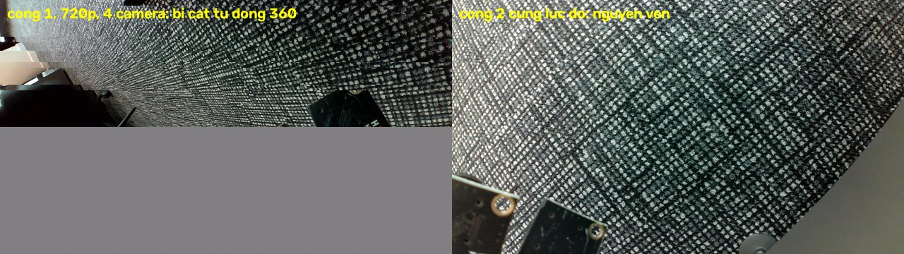

# Giai đoạn 2 — bàn thử chạy chung bốn camera, LiDAR và AI (23/09/2026)

Máy bàn i9-14900 + RTX 4000 Ada, Windows 11, **chưa phải laptop RTX 3050 Ti mang đi nộp đồ án**. Bốn camera "HD Camera" qua hub UGREEN
(bus-powered, nhánh USB 2.0), RPLIDAR C1 trên COM4, mô hình AI tham chiếu `runs/ai_woodscape_rtx4000_v1/best.pt`.
Camera nằm trên bàn, chưa gá, chưa hiệu chuẩn. Kế hoạch v3.1, giai đoạn 2 "Khi đủ bốn camera":

- bước 2: *"Ghi FPS/độ trễ/mất hình riêng từng camera; chạy đồng thời với LiDAR và AI, không chỉ thử mở bốn cửa sổ."*
- bước 5: *"Đồng bộ ở mức phần mềm và ghi sai lệch thời gian còn lại."*
- và phần còn thiếu của giai đoạn 1 bước 3: *"thời gian suy luận, độ trễ, … CPU/GPU và nhiệt trong một phiên thử"*.

## 1. Đã viết gì

| Việc | Mã | Kiểm |
|---|---|---|
| `MultiCameraManager` mà kế hoạch giai đoạn 2 yêu cầu: mỗi camera một luồng, vòng đệm có giới hạn (3 khung), chọn camera theo **cổng hub** (index OpenCV đổi sau khởi động lại), ghép bộ ảnh theo thời gian (mốc = khung mới nhất của camera chậm nhất, mỗi camera chọn khung gần mốc nhất), **bỏ bộ ảnh lệch quá ngưỡng** (mặc định 60 ms), bộ chỉ "mới" khi mọi camera có khung mới, hoặc sau giới hạn chờ camera chậm (từ 24/09, mục 10) | `video/multicam.py` | test với camera giả, gồm phép thử tất định cho quy tắc bỏ bộ lệch |
| Suy luận theo lô cho nhiều camera, cùng tiền xử lý với `predict.py`, đo thời gian từng khâu (tiền xử lý / mạng / hậu xử lý, có đồng bộ CUDA) | `perception/live.py` | test: kết quả theo lô trùng `predict_image` tới 1e−5 |
| Điều phối: luồng LiDAR, luồng AI (lấy bộ mới nhất, không xếp hàng, đổi mô hình lúc chạy), luồng tài nguyên 1 Hz (CPU tiến trình và máy, RAM, GPU tải/VRAM/nhiệt độ/công suất qua NVML), chuỗi số đo theo giây | `rig/core.py` | test chạy trọn với camera, LiDAR, AI giả |
| Lệnh đo không giao diện: khởi động, bỏ phần làm nóng, đo T giây, ghi `<tên>.rig.json` | `rig/bench.py` | test ghi json |
| Giao diện trực tiếp: bốn ô camera có lớp tô AI (xanh FREE, đỏ BLOCKED), bản đồ LiDAR, bảng số đo, chọn mô hình, kéo ngưỡng (nút 0,15 an toàn / 0,50), bật tắt AI và lớp tô, **chụp bộ ảnh** (ảnh gốc bốn camera + xác suất + ảnh tô + vòng LiDAR + siêu dữ liệu) | `ui/rig_app.py` | test offscreen với nguồn giả |
| `UsbCameraSource` đếm riêng khung cũ và đọc hỏng; **loại khung MJPEG bị cắt cụt hoặc có dải xé** (bộ giải mã tô phần thiếu bằng vân khối 8×8 lặp lại, mục 2) và đếm riêng từng loại; `camera_bench` cũng đếm | `video/sources.py::truncated_rows`, `torn_bands`, `video/camera_bench.py` | test với ảnh hỏng tổng hợp; bộ dò chạy trên ảnh hỏng thật (bắt đúng hai ảnh) và ảnh sạch (không bắt nhầm); các khung bị bắt trong phiên chẩn đoán được xem bằng mắt (mục 2.2) |
| Cài PySide6, pyserial, pygrabber, comtypes, psutil, nvidia-ml-py vào `.venv-train` để một tiến trình chạy được cả GPU lẫn giao diện; extra `rig` trong `pyproject.toml` | | |

Mọi stamp dùng chung một đồng hồ `time.perf_counter` cho mọi luồng, kể cả driver LiDAR (`time.monotonic` của Python
3.12 trên Windows chỉ có bước 15,6 ms — mục 6). Stamp camera là lúc `read()` trả khung về Python (đã gồm chờ và
giải mã), **không phải lúc phơi sáng**; stamp LiDAR là lúc byte cuối của vòng quét tới máy. Vì vậy mọi độ lệch và
độ trễ dưới đây là **độ lệch lúc đến và độ trễ trong máy**. Độ trễ từ sự kiện thật tới lúc khung về máy chưa đo
(cần LED nháy hoặc đồng hồ quay bằng camera).

## 2. Phát hiện chính: khung MJPEG bị cắt cụt khi bốn camera chạy chung qua hub — gần hết khung ở 720p/1080p, từng đợt ở 480p

### 2.1. Thấy gì

Ảnh chụp giao diện lúc 14:57 (720p, [evidence/rig/giao_dien_720p_thr015.jpg](evidence/rig/giao_dien_720p_thr015.jpg))
có hai ô camera bị hỏng nửa dưới. Ảnh gốc đã lưu cho thấy từ một dòng trở xuống, ảnh là **một khối 8×8 xám lặp lại**
(R = B, trung bình ≈ 129), phía trên thường có vài vệt xé ngang. Đây là dấu hiệu của khung MJPEG **bị cắt cụt**: dữ liệu
khung tới máy không đủ, và bộ giải mã tô phần còn thiếu. Khung như vậy vẫn là "khung mới", nên mọi số FPS trước đó đều
tính nó như khung tốt, và AI đã chấm cả những khung này (vùng vân bị gọi gần như toàn bộ là FREE, xem mục 2.4).



### 2.2. Cách phát hiện, và đã kiểm thế nào

`video/sources.py` có hai bộ dò chạy trên **mọi** khung; `UsbCameraSource` loại khung hỏng và đếm riêng từng loại:

- `truncated_rows`: 8 dòng đáy lặp y hệt khi dịch 8 điểm ảnh (> 90 % số điểm), **và** có kết cấu bên trong chu kỳ
  (điểm kề bên ít trùng). Điều kiện sau loại vùng phẳng hay cháy sáng: vùng như vậy cũng lặp y hệt nhưng không phải hỏng.
  Camera này cháy sáng thành RGB 251/255/251 chứ không phải 255/255/255, nên không thể dựa vào giá trị 255.
- `torn_bands`: một hàng khối có đoạn vân tô chạy liền tới mép phải, dài ít nhất 64 điểm. Đây là dải xé giữa ảnh, khi
  mất dữ liệu giữa khung rồi bộ giải mã bắt lại được.
- Khung hỏng mà driver trả lại lần nữa (trùng byte với lần đọc trước) được tính là **khung cũ**, không tính thêm một khung
  hỏng. `camera_bench` cũng làm như vậy.

Chi phí đo trên khung sạch 720p: cả hai bộ dò cộng lại khoảng 0,2 ms một khung.

Kiểm trên 1086 khung đã lưu (`runs/rig_bench/20260923_v3/corpus/`, `d01_diag_frames/`):

| Tập khung | Số khung | Bị cắt (đáy bị tô) | Trong đó có thêm dải xé phía trên | Chỉ có dải xé, đáy nguyên |
|---|---:|---:|---:|---:|
| bốn camera 640×480 cùng lúc (không lọc) | 395 | 0 | 0 | 0 |
| từng camera một mình, 720p (không lọc) | 232 | 0 | 0 | 0 |
| ảnh tĩnh giai đoạn 1 (một camera, 720p) | 9 | 0 | 0 | 0 |
| bốn camera 720p cùng lúc (không lọc) | 375 | 28 | 15 | 0 |
| khung bị bắt trong phiên chẩn đoán d01 (720p) | 75 | 75 | 12 | 0 |

- **Không bắt nhầm khung nào** trong các tập mà mắt thường thấy sạch.
- Đã xem bằng mắt dải đáy của 18 khung bị bắt (6 khung mỗi cổng 1, 3, 4) và hai khung nguyên cỡ. Khung nào cũng có vân
  xám ở đáy, kể cả các khung chỉ bị tô 8 dòng: [evidence/rig/day_khung_bi_cat.jpg](evidence/rig/day_khung_bi_cat.jpg).
- Trong các tập này chưa gặp khung nào **chỉ** có dải xé mà đáy nguyên. Một vòng kiểm tra độc lập (mục 8) dựng được
  trường hợp đó từ một dải xé thật của cổng 1, và bộ dò mới bắt được nó. Sau đó, ở 480p, đã gặp khung như vậy thật (mục 2.4).
- Giới hạn còn lại: nếu bộ giải mã tô bằng màu phẳng, hoặc khung bị cắt giữa hàng khối cuối, hoặc dải xé bắt đầu cách mép
  phải dưới 64 điểm, thì bộ dò bỏ sót. **Không có phép thử độc lập bằng byte thô**: OpenCV/DirectShow trên máy này vẫn trả
  ảnh đã giải mã dù đặt `CAP_PROP_CONVERT_RGB = 0` (kể cả khi đưa vào lúc mở), nên chưa kiểm được dấu kết thúc JPEG của từng khung.

### 2.3. Khi nào khung bị cắt — chỉ đọc camera, không AI, không LiDAR (`runs/rig_bench/20260923_v3/raw/`)

| Phiên | Camera chạy cùng lúc | Độ phân giải | Thời lượng | Khung bị cắt / khung mới — cổng 1 | cổng 2 | cổng 3 | cổng 4 | Khung tốt/s cổng 1 / 2 / 3 / 4 |
|---|---|---|---:|---|---|---|---|---|
| r01 | cổng 1 một mình | 1280×720 | 8 s | 0 / 227 (0 %) | — | — | — | 28,4 / — / — / — |
| r07 | cổng 1 một mình (lần 2, cuối loạt) | 1280×720 | 15 s | 0 / 352 (0 %) | — | — | — | 23,5 / — / — / — |
| r10 | cổng 2 một mình | 1280×720 | 15 s | — | 0 / 352 (0 %) | — | — | — / 23,5 / — / — |
| r02 | cổng 1 + 2 | 1280×720 | 15 s | 3 / 441 (1 %) | 0 / 352 (0 %) | — | — | 29,2 / 23,5 / — / — |
| r03 | cổng 1 + 2 + 3 | 1280×720 | 15 s | 386 / 399 (97 %) | 0 / 360 (0 %) | 32 / 352 (9 %) | — | 0,9 / 24,0 / 21,3 / — |
| r04 | cả bốn, mở 1-2-3-4 | 1280×720 | 15 s | 268 / 270 (99 %) | 0 / 359 (0 %) | 102 / 360 (28 %) | 255 / 256 (100 %) | 0,1 / 23,9 / 17,2 / 0,1 |
| r08 | cả bốn, mở 4-3-2-1 | 1280×720 | 15 s | 343 / 343 (100 %) | 0 / 360 (0 %) | 253 / 360 (70 %) | 290 / 359 (81 %) | 0,0 / 24,0 / 7,1 / 4,6 |
| r11 | cả bốn, mở 1-2-3-4 (lặp lại) | 1280×720 | 15 s | 238 / 239 (100 %) | 0 / 359 (0 %) | 0 / 360 (0 %) | 201 / 201 (100 %) | 0,1 / 23,9 / 24,0 / 0,0 |
| r05 | cổng 2 + 3 + 4 | 1280×720 | 15 s | — | 0 / 360 (0 %) | 3 / 360 (1 %) | 236 / 352 (67 %) | — / 24,0 / 23,8 / 7,7 |
| r09 | cả bốn | 1920×1080 | 15 s | 145 / 146 (99 %) | 47 / 360 (13 %) | 359 / 359 (100 %) | 352 / 352 (100 %) | 0,1 / 20,9 / 0,0 / 0,0 |
| r06 | cả bốn | 640×480 | 15 s | 0 / 360 (0 %) | 0 / 360 (0 %) | 0 / 360 (0 %) | 0 / 352 (0 %) | 24,0 / 24,0 / 24,0 / 23,5 |

Đọc bảng:

- **Chạy một mình thì không camera nào bị cắt**, kể cả cổng 1: cổng 1 và 2 ở bảng này, cả bốn cổng ở tập "từng camera một mình" mục 2.2. Thêm camera ở 720p thì cổng 1 và cổng 4 bị cắt gần hết
  khung, cổng 3 dao động (0–70 %). Riêng **cổng 2 chưa từng bị cắt ở 720p**, dù mở theo thứ tự nào.
- **Ở 1080p**, ba trên bốn camera bị cắt gần hết khung.
- **Ở 640×480, phiên này (15 s) cả bốn camera không bị cắt khung nào** và đều đạt ≈ 24 khung/s. Các phiên 480p khác ở
  mục 2.4 cho thấy 480p không phải lúc nào cũng sạch.
- Thứ tự mở không cứu được cổng 1 (r08).
- Giả thuyết hợp với số liệu nhất: bốn camera dùng chung **băng thông USB 2.0 của hub** (cả bốn ở nhánh USB 2.0 của hub
  UGREEN, docs/usb_topology.md). Camera nào có khung JPEG lớn hơn thì mất đuôi khung. **Chưa chứng minh**: chưa đo được
  kích thước khung, chưa thử tách camera ra nhiều cổng gốc, chưa thử nguồn ngoài cho hub. Vì sao cổng 2 luôn nguyên cũng
  chưa rõ: có thể do khung cảnh nó nhìn cho ảnh JPEG nhỏ hơn, hoặc do cách nó được cấp băng thông.

### 2.4. 640×480: ít hơn hẳn, nhưng không hết — mọi phiên bốn camera 480p ngày 23/09 theo giờ

| Giờ | Phiên | Điều kiện | Thời lượng | Khung hỏng / khung mới — cổng 1 | cổng 2 | cổng 3 | cổng 4 |
|---|---|---|---:|---|---|---|---|
| xong 16:06 | r06 | chỉ camera | 15 s | 0 / 360 | 0 / 360 | 0 / 360 | 0 / 352 |
| xong 16:25 | u01 | + LiDAR + AI | 120 s | 0 / 2861 | 0 / 2862 | 0 / 2862 | 0 / 2862 |
| xong 16:28 | u03 | chỉ camera | 60 s | 377 / 1431 (26,3 %) | 0 / 1431 | 0 / 1431 | 0 / 1431 |
| xong 16:38 | u04 | + LiDAR + AI | 600 s | 0 / 14308 | 0 / 14308 | 0 / 14309 | 6 / 14308 (< 0,1 %) |
| xong 16:39 | a01 | chỉ camera | 30 s | 0 / 717 | 0 / 718 | 0 / 718 | 0 / 716 |
| xong 16:39 | a02 | + 4 tiến trình bận CPU | 30 s | 0 / 717 | 0 / 718 | 0 / 718 | 0 / 717 |
| xong 16:40 | a03 | + LiDAR | 30 s | 0 / 717 | 0 / 717 | 0 / 718 | 0 / 718 |
| xong 16:41 | a04 | chỉ camera | 30 s | 0 / 718 | 0 / 718 | 0 / 718 | 0 / 716 |
| xong 16:41 | a05 | + 4 tiến trình bận CPU | 30 s | 0 / 716 | 0 / 718 | 0 / 718 | 0 / 716 |
| xong 16:42 | a06 | + LiDAR | 30 s | 0 / 712 | 0 / 717 | 0 / 717 | 0 / 717 |
| xong 16:42 | a07 | chỉ camera | 30 s | 0 / 717 | 0 / 718 | 0 / 718 | 0 / 716 |
| xong 16:43 | f01 | chỉ camera | 30 s | 0 / 718 | 0 / 717 | 0 / 717 | 0 / 710 |
| xong 16:45 | a12 | chỉ camera | 30 s | 0 / 717 | 0 / 717 | 0 / 718 | 0 / 716 |
| xong 16:45 | a13 | chỉ camera | 30 s | 0 / 717 | 0 / 717 | 0 / 718 | 0 / 716 |
| xong 16:46 | a14 | chỉ camera | 30 s | 5 / 718 (0,7 %) | 0 / 718 | 0 / 718 | 0 / 716 |
| xong 16:47 | a16 | chỉ camera | 30 s | 0 / 718 | 0 / 718 | 0 / 718 | 0 / 716 |
| xong 16:47 | a17 | chỉ camera | 30 s | 1 / 717 (0,1 %) | 0 / 717 | 0 / 718 | 0 / 716 |
| xong 16:50 | f02 | chỉ camera | 120 s | 1035 / 2863 (36,2 %) | 0 / 2864 | 0 / 2864 | 0 / 2856 |

"Khung hỏng" = bị cắt đáy hoặc có dải xé. Cộng mọi phiên trên: cổng 1 hỏng 1418 / 31142 khung,
cổng 2 0 / 31153, cổng 3 0 / 31158, cổng 4 6 / 31115.

- **Phần lớn thời gian 480p sạch**, nhưng **cổng 1 có những đợt 26–36 % khung hỏng** (u03 xong 16:28, f02 từ 16:48 tới
  16:50), xen giữa các đợt sạch hoàn toàn. Chưa rõ vì sao đợt hỏng bắt đầu hay dừng.
- **Chưa tìm ra nguyên nhân.** Hai đợt hỏng đều rơi vào phiên chỉ có camera, nhưng các phiên chỉ có camera khác đều sạch
  hoặc gần sạch. Bảy phiên xen kẽ (a01–a07: chỉ camera / thêm bốn tiến trình bận CPU / thêm LiDAR, mỗi điều kiện hai–ba
  lần) đều sạch, nên phép thử này **không tái hiện được** đợt hỏng. Vì vậy chưa nói được CPU rảnh hay LiDAR có liên quan
  hay không. Chạy ngay sau một phiên 720p cũng sạch (a12, a16). Lúc đó máy dùng chế độ nguồn "Balanced", USB selective
  suspend bật, quản lý nguồn liên kết PCIe ở mức tiết kiệm tối đa. Không đổi thiết lập nào.
- **Khung hỏng ở 480p là thật:** đã xem bằng mắt trong phiên f02 — đáy có dải vân xám 8 hoặc 16 dòng
  ([evidence/rig/day_khung_bi_cat_480p.jpg](evidence/rig/day_khung_bi_cat_480p.jpg)), và một khung **chỉ có dải xé** ở dòng
  248–255, đáy nguyên ([evidence/rig/khung_xe_480p.jpg](evidence/rig/khung_xe_480p.jpg)). Đây là lần đầu thấy loại khung
  chỉ bị xé; `torn_bands` bắt được nó.
- Khi đợt hỏng tới, nguồn camera loại các khung đó, nên **AI không nhận khung hỏng** (trừ khung lọt bộ dò, mục 2.2).
  Nhưng cổng 1 chỉ còn ≈ 15–18 khung tốt/s, và vì bộ ảnh chỉ "mới" khi mọi camera có khung mới, cả chuỗi xử lý chậm theo.
- *Cập nhật 24/09/2026:* nếu khung hỏng lọt tới AI thì không chỉ là nhiễu. Trên hai khung bị cắt của bộ ảnh 14:57 (720p,
  `runs/rig_snapshots/20260923_145753_910`, mô hình `ai_woodscape_rtx4000_v1`, chụp trước khi có bộ lọc), mô hình gọi
  gần như toàn bộ vân khối ở đáy là FREE. Ở ngưỡng 0,5: cổng 1 có 450 551 / 450 560 pixel của 352 dòng đáy, cổng 4 có
  419 840 / 419 840 pixel của 328 dòng đáy ([GAN_NHAN_SA_BAN.md](GAN_NHAN_SA_BAN.md), mục 2, bước 4). Ở ngưỡng 0,15
  (ngưỡng lúc chụp) cũng vậy: 450 281 / 450 560 và 419 839 / 419 840 (đo lại 24/09 từ `prob_blocked_p1.png`,
  `prob_blocked_p4.png` của bộ ảnh đó). Tức vùng hỏng thành **vùng trống giả**, theo hướng không an toàn. Mới đo trên
  hai khung mà bộ dò bắt được; chưa đo trên khung thật sự lọt bộ dò (tô màu phẳng, cắt giữa hàng khối; mục 2.2).

**Hệ quả:** `rig.bench` và giao diện nay **mặc định 640×480**. Mô hình AI vốn thu ảnh về 512×384, nên 480p gần như không
mất gì cho AI. 720p và 1080p vẫn chạy được bằng `--width/--height`, và cột "cắt" cho biết mất bao nhiêu khung.

## 3. Số đo chính thức — loạt `runs/rig_bench/20260923_v3/` (bộ dò khung hỏng đã bật)

Bốn phiên, camera MJPG phơi sáng tự động, bỏ 5 s khởi động, mô hình `ai_woodscape_rtx4000_v1`, bỏ bộ lệch hơn 60 ms, hub
bus-powered. Trong lúc đo, một dự án khác trên cùng máy (công cụ mô phỏng bán dẫn) chạy ba tiến trình Python, mỗi cái ≈ 1
lõi. Không đụng tới chúng, và mỗi phiên có ghi CPU cả máy. "Khung tốt/s" là số khung đã qua cả hai bộ dò.

### 3.1. Camera

| Phiên | Cấu hình | Thời lượng | Khung tốt/s cổng 1 / 2 / 3 / 4 | Khung bị cắt cổng 1 / 2 / 3 / 4 | Khung xé | Khung cũ cổng 1 / 2 / 3 / 4 | CPU máy TB |
|---|---|---:|---|---|---|---|---:|
| u01 | 640×480, LiDAR, AI | 120 s | 23,8 / 23,9 / 23,9 / 23,9 | 0 / 0 / 0 / 0 | 0 / 0 / 0 / 0 | 0 / 0 / 0 / 0 | 16 % |
| u02 | 1280×720, LiDAR, AI | 60 s | 0,0 / 23,9 / 23,8 / 0,0 | 1431 / 0 / 0 / 1430 | 0 / 0 / 0 / 0 | 0 / 0 / 0 / 1 | 10 % |
| u03 | 640×480, —, — | 60 s | 17,6 / 23,9 / 23,9 / 23,9 | 357 / 0 / 0 / 0 | 20 / 0 / 0 / 0 | 0 / 0 / 0 / 0 | 15 % |
| u04 | 640×480, LiDAR, AI | 600 s | 23,9 / 23,9 / 23,9 / 23,8 | 0 / 0 / 0 / 4 | 0 / 0 / 0 / 2 | 0 / 0 / 0 / 0 | 11 % |

### 3.2. Bộ ảnh đồng bộ và LiDAR so với bộ ảnh (giai đoạn 2, bước 5)

| Phiên | Bộ dùng | Bộ thiếu camera | Bỏ vì lệch > 60 ms | Độ lệch trong bộ trung vị / p95 / max | LiDAR cuối vòng − mốc, trung vị [min; max] | giữa vòng − mốc |
|---|---:|---:|---:|---|---|---:|
| u01 | 2851 | 0 | 0 | 15,0 / 24,1 / 44,8 ms | -29,7 [-92,2; 42,8] ms | -79,5 ms |
| u02 | 1430 | 1430 | 0 | 21,9 / 22,4 / 24,5 ms | -29,7 [-92,5; 27,7] ms | -79,2 ms |
| u03 | 1054 | 0 | 0 | 24,1 / 56,4 / 59,6 ms | — | — |
| u04 | 13887 | 0 | 1 | 33,9 / 34,2 / 61,8 ms | -18,6 [-81,4; 46,4] ms | -68,4 ms |

"Bộ thiếu camera" là bộ ghép khi có camera không có khung tốt nào trong 0,5 s. AI vẫn chấm bộ đó với các camera còn lại,
và ô camera thiếu trên giao diện báo đỏ. Vòng LiDAR dài 100,3 ms (10 Hz).
Bốn camera chạy tự do, không có đồng bộ phần cứng, nên pha giữa chúng đổi theo từng lần mở. Vì vậy độ lệch trong bộ khác
nhau giữa các phiên (trung vị 15,0 ms ở u01, 33,9 ms ở u04), nhưng
khi không camera nào mất khung thì gần như luôn dưới một chu kỳ khung (≈ 42 ms ở 24 khung/s). Khi một camera mất khung
thì khung gần mốc nhất của nó có thể xa hơn (u03: p95 56,4 ms). Tuổi kết quả AI ở u04 lớn hơn u01 cũng vì pha.
"Cuối vòng − mốc" là stamp lúc gói chứa điểm cuối của vòng mới nhất tới máy, trừ mốc bộ ảnh, lấy ngay lúc ghép bộ.

### 3.3. AI (lô bốn ảnh trên GPU, fp16)

| Phiên | Bộ/s | Một lô trung vị (tiền xử lý / mạng / hậu xử lý) | Lô p95 / max | Tuổi kết quả so với khung cũ nhất, trung vị / p95 | so với khung mới nhất | Lỗi |
|---|---:|---|---|---|---:|---:|
| u01 | 23,8 | 16,4 ms (3,0 / 11,6 / 1,7) | 36,7 / 64,7 ms | 34,8 / 74,9 ms | 20,0 ms | 0 |
| u02 | 23,8 | 11,4 ms (2,6 / 8,2 / 0,5) | 30,8 / 45,9 ms | 35,6 / 63,2 ms | 14,3 ms | 0 |
| u04 | 23,1 | 15,6 ms (2,9 / 11,0 / 1,6) | 36,3 / 57,2 ms | 65,5 / 84,9 ms | 36,2 ms | 0 |

### 3.4. Tài nguyên

| Phiên | CPU tiến trình TB / max (lõi) | RAM tiến trình | GPU TB / max | VRAM | Nhiệt GPU đầu → cuối (max) | Công suất GPU | CPU cả máy |
|---|---|---:|---|---:|---|---:|---:|
| u01 | 0,93 / 1,80 | 1422 MB | 26 / 85 % | 1648 MB | 41 → 46 (46) °C | 31,3 W | 16 % |
| u02 | 1,26 / 1,66 | 1495 MB | 19 / 72 % | 1570 MB | 45 → 45 (46) °C | 28,0 W | 10 % |
| u03 | 0,29 / 0,44 | 139 MB | 10 / 17 % | 1316 MB | 43 → 40 (43) °C | 15,0 W | 15 % |
| u04 | 0,84 / 1,39 | 1421 MB | 24 / 88 % | 1606 MB | 43 → 48 (49) °C | 31,0 W | 11 % |

Nhiệt độ CPU không đọc được: Windows không cho khi không có quyền admin.

### 3.5. Mười phút ở 480p (u04) theo từng phút

| Phút | Khung tốt/s cổng 1 / 2 / 3 / 4 | Khung bị cắt trong phút (cả bốn cổng) | Lô AI/s | Lô AI trung vị | Nhiệt GPU | CPU tiến trình |
|---:|---|---:|---:|---:|---:|---:|
| 0 | 23,4 / 23,5 / 23,5 / 23,4 | 1 | 22,7 | 16,9 ms | 44 °C | 0,92 |
| 1 | 23,9 / 23,9 / 23,9 / 23,9 | 0 | 23,1 | 15,6 ms | 45 °C | 0,92 |
| 2 | 23,9 / 23,9 / 23,9 / 23,8 | 1 | 23,1 | 14,8 ms | 46 °C | 0,82 |
| 3 | 23,9 / 23,9 / 23,9 / 23,9 | 0 | 23,2 | 16,2 ms | 46 °C | 0,89 |
| 4 | 23,9 / 23,9 / 23,9 / 23,9 | 0 | 23,2 | 15,6 ms | 47 °C | 0,82 |
| 5 | 23,9 / 23,9 / 23,9 / 23,9 | 0 | 23,2 | 15,4 ms | 47 °C | 0,80 |
| 6 | 23,9 / 23,9 / 23,9 / 23,8 | 2 | 23,1 | 14,3 ms | 47 °C | 0,80 |
| 7 | 23,9 / 23,9 / 23,9 / 23,9 | 1 | 23,1 | 15,6 ms | 47 °C | 0,81 |
| 8 | 23,9 / 23,9 / 23,9 / 23,9 | 0 | 23,2 | 14,4 ms | 47 °C | 0,80 |
| 9 | 23,9 / 23,9 / 23,9 / 23,8 | 1 | 23,2 | 13,9 ms | 47 °C | 0,80 |

## 4. Đọc kết quả

- **Cấu hình dùng được hiện nay là 640×480, kèm bộ dò khung hỏng.** 480p chưa chắc sạch (mục 2.4), nhưng khung hỏng bị
  loại và đếm. Bốn camera, LiDAR và AI chạy chung
  (120 s ở u01, 600 s ở u04): 0 và 6 khung hỏng trên
  11447 và 57227 khung tốt. AI chấm 23,8 bộ/s (u01), kết quả có mặt
  34,8 ms (trung vị) sau khi khung cũ nhất trong bộ tới máy.
  LiDAR 6006 vòng trong 10 phút, mất 0 vòng,
  và mọi luồng tắt sạch (`stop_alive` = []).
- **720p qua hub này không dùng được cho bốn camera**: ở u02 các cổng có 1431 / 0 / 0 / 1430
  khung bị cắt (cổng 1 / 2 / 3 / 4) trong 60 s, và khung tốt/s còn 0,0 / 23,9 / 23,8 / 0,0.
- **Giới hạn của chuỗi xử lý là camera chậm nhất.** Quy tắc "bộ mới khi mọi camera có khung mới" làm số bộ/s bằng tốc độ
  của camera chậm nhất. Ở 480p khi không có đợt hỏng, camera nào cũng ≈ 24 khung/s, nên AI chấm được ≈ 23–24 bộ/s.
  Trong đợt hỏng của cổng 1 (u03), camera đó còn 17,6 khung tốt/s.
- **Sai lệch thời gian còn lại (bước 5):** trong bộ ảnh ở 480p, trung vị 15,0 ms, p95
  24,1 ms (u01). Giữa LiDAR và bộ ảnh, điểm giữa vòng quét sớm hơn mốc bộ ảnh
  80 ms (trung vị), dao động trong khoảng một vòng quét.
  Hợp nhất cảm biến phải bù sai lệch cỡ 100 ms này khi xe chạy; khi xe đứng yên thì không quan trọng.
- **Chưa đo:** độ trễ từ sự kiện thật tới lúc khung tới máy (cần LED nháy), và mọi số trên laptop RTX 3050 Ti (máy nộp đồ án) (xem ghi chú cuối mục 9).

## 5. Loạt v2 (`runs/rig_bench/20260923_v2/`, t01–t09, trước khi có bộ dò khung hỏng) — phần nào còn dùng được

Loạt v2 chạy trước khi biết có khung bị cắt. Theo phép thử ở mục 2.3, ở 720p/1080p phần lớn khung của cổng 1 và cổng 4
là khung bị cắt. Vì vậy:

- **Không còn đúng:** mọi số "FPS" và mọi chữ "sạch" của camera ở 720p/1080p. Các nhận định cũ sai là: "cổng 1 là chiếc
  duy nhất rớt khung" (thực ra cổng 1 gửi đủ khung nhưng phần lớn bị cắt), và "ở 1080p cổng 2–4 sạch 23,9 fps" (ở r09,
  cổng 3 và 4 bị cắt gần hết khung). Cột FPS dưới đây giữ lại chỉ để đối chiếu.
- **Vẫn dùng được**, vì không phụ thuộc nội dung ảnh: thời gian AI từng khâu, tuổi kết quả, độ lệch stamp trong bộ ảnh,
  LiDAR so với bộ ảnh, CPU/GPU/nhiệt, và phép thử khoảng chuyển luồng 0,5 ms (t07, t08: không cải thiện gì).
- 480p (t05) không có khung cũ nào ở cổng 2–4 và AI chấm 23,8 bộ/s. Kết quả này hợp với phần lớn
  các phiên 480p ở mục 2.4, nhưng t05 chưa kiểm khung bị cắt.

| Phiên | Cấu hình | Thời lượng | "FPS TB" cổng 1 / 2 / 3 / 4 (**gồm cả khung bị cắt**) | Khung cũ cổng 1 / 2 / 3 / 4 | CPU máy TB |
|---|---|---:|---|---|---:|
| t01 | 1280×720, —, — | 60 s | 18,2 / 23,9 / 28,9 / 23,1 | 658 / 0 / 25 / 45 | 41 % |
| t02 | 1280×720, LiDAR, — | 60 s | 16,3 / 23,9 / 29,0 / 22,8 | 574 / 0 / 17 / 64 | 27 % |
| t03 | 1280×720, LiDAR, AI | 120 s | 18,2 / 23,9 / 23,9 / 23,3 | 1325 / 0 / 0 / 64 | 12 % |
| t04 | 1280×720, —, — | 60 s | 21,8 / 23,8 / 23,9 / 23,9 | 450 / 0 / 0 / 0 | 8 % |
| t05 | 640×480, LiDAR, AI | 60 s | 29,3 / 23,9 / 23,9 / 23,9 | 1 / 0 / 0 / 0 | 9 % |
| t06 | 1920×1080, LiDAR, AI | 60 s | 16,9 / 23,8 / 23,9 / 23,9 | 736 / 0 / 0 / 0 | 12 % |
| t07 | 1920×1080, LiDAR, AI, switch 0,5 ms | 60 s | 15,2 / 23,9 / 23,8 / 23,9 | 721 / 0 / 1 / 0 | 9 % |
| t08 | 1280×720, LiDAR, AI, switch 0,5 ms | 120 s | 15,1 / 23,9 / 23,9 / 23,8 | 1700 / 0 / 0 / 2 | 6 % |
| t09 | 1280×720, LiDAR, AI | 600 s | 18,3 / 23,9 / 23,9 / 23,9 | 5022 / 0 / 0 / 0 | 6 % |

| Phiên | Độ lệch trong bộ trung vị / p95 / max | LiDAR cuối vòng − mốc, trung vị [min; max] | giữa vòng − mốc | LiDAR: vòng / mất vòng |
|---|---|---|---:|---|
| t01 | 26,8 / 48,8 / 63,5 ms | — | — | — |
| t02 | 18,7 / 50,7 / 87,4 ms | -24,2 [-91,1; 96,2] ms | -74,2 ms | 601 / 0 |
| t03 | 32,5 / 49,1 / 85,3 ms | -19,3 [-84,8; 107,1] ms | -69,3 ms | 1201 / 0 |
| t04 | 33,8 / 42,6 / 60,2 ms | — | — | — |
| t05 | 16,3 / 24,0 / 33,1 ms | -33,1 [-92,6; 42,7] ms | -83,2 ms | 600 / 0 |
| t06 | 30,0 / 61,9 / 63,8 ms | -20,0 [-74,3; 110,8] ms | -70,0 ms | 601 / 0 |
| t07 | 26,7 / 51,9 / 70,5 ms | -22,1 [-87,9; 93,4] ms | -72,0 ms | 600 / 0 |
| t08 | 31,5 / 61,8 / 63,8 ms | -20,0 [-82,4; 104,4] ms | -69,9 ms | 1201 / 0 |
| t09 | 18,0 / 54,6 / 64,6 ms | -23,5 [-93,8; 124,7] ms | -73,4 ms | 6005 / 0 |

| Phiên | Bộ/s | Một lô trung vị (tiền xử lý / mạng / hậu xử lý) | Lô p95 / max | Tuổi kết quả so với khung cũ nhất, trung vị / p95 | so với khung mới nhất | Lỗi |
|---|---:|---|---|---|---:|---:|
| t03 | 15,2 | 15,3 ms (4,7 / 9,4 / 0,9) | 39,5 / 94,3 ms | 64,1 / 91,0 ms | 26,9 ms | 0 |
| t05 | 23,8 | 13,0 ms (2,8 / 8,6 / 1,6) | 19,3 / 58,1 ms | 30,3 / 62,7 ms | 15,4 ms | 0 |
| t06 | 15,0 | 19,7 ms (9,3 / 9,2 / 1,0) | 46,7 / 67,6 ms | 66,6 / 100,3 ms | 24,9 ms | 0 |
| t07 | 14,3 | 19,1 ms (8,9 / 9,2 / 0,9) | 47,4 / 71,8 ms | 61,2 / 93,4 ms | 23,6 ms | 0 |
| t08 | 13,1 | 16,1 ms (4,6 / 10,6 / 0,9) | 45,9 / 62,4 ms | 63,9 / 100,2 ms | 28,0 ms | 0 |
| t09 | 17,3 | 14,6 ms (4,4 / 9,2 / 0,8) | 40,6 / 58,6 ms | 46,7 / 83,7 ms | 18,4 ms | 0 |

| Phiên | CPU tiến trình TB / max (lõi) | RAM tiến trình | GPU TB / max | VRAM | Nhiệt GPU đầu → cuối (max) | Công suất GPU | CPU cả máy |
|---|---|---:|---|---:|---|---:|---:|
| t01 | 0,99 / 1,22 | 224 MB | 13 / 48 % | 1303 MB | 39 → 39 (40) °C | 18,2 W | 41 % |
| t02 | 0,92 / 1,14 | 225 MB | 8 / 36 % | 1239 MB | 39 → 39 (41) °C | 18,6 W | 27 % |
| t03 | 1,11 / 1,48 | 1491 MB | 16 / 88 % | 1579 MB | 41 → 46 (47) °C | 32,7 W | 12 % |
| t04 | 0,71 / 0,86 | 224 MB | 13 / 50 % | 1285 MB | 45 → 40 (45) °C | 15,3 W | 8 % |
| t05 | 0,76 / 1,03 | 1422 MB | 20 / 73 % | 1633 MB | 43 → 47 (47) °C | 35,4 W | 9 % |
| t06 | 2,03 / 2,34 | 1676 MB | 18 / 72 % | 1505 MB | 47 → 47 (48) °C | 31,8 W | 12 % |
| t07 | 1,94 / 2,36 | 1673 MB | 17 / 81 % | 1461 MB | 47 → 47 (47) °C | 31,3 W | 9 % |
| t08 | 1,06 / 1,39 | 1494 MB | 22 / 79 % | 1459 MB | 48 → 45 (48) °C | 27,7 W | 6 % |
| t09 | 1,09 / 1,50 | 1483 MB | 18 / 82 % | 1464 MB | 46 → 48 (49) °C | 31,5 W | 6 % |

Phiên t09 (720p, 10 phút): AI 14,6 ms/lô suốt 10 phút, nhiệt GPU
46 → 48 °C, LiDAR 6005 vòng không mất vòng nào.
Hai phiên đầu t01, t02 trùng lúc dự án mô phỏng bán dẫn chạy 6 tiến trình (CPU cả máy 41 % và 27 %).

**Phiên chẩn đoán d01** (720p, bốn camera + LiDAR + AI, 60 s, xong lúc 16:02) chạy bằng bản đầu của bộ dò, khi đó đọc lại khung hỏng
còn bị tính thêm một lần cắt. Nên chỉ dùng d01 làm bằng chứng hình ảnh (khung bị bắt được lưu và xem lại), không dùng
làm tỉ lệ. Tỉ lệ đúng nằm ở mục 2.3 và u02.

## 6. Loạt đầu (`runs/rig_bench/20260923/`, s01–s07) — chỉ dùng được một phần

Loạt đầu chạy bằng bản mã trước vòng kiểm tra thứ nhất. Hai lỗi của chính công cụ đo làm sai số liệu của nó:

1. **Đồng hồ `time.monotonic`** trên Python 3.12/Windows có bước 15,6 ms, nên mọi số độ lệch, tuổi khung và LiDAR − bộ
   ảnh của s01–s07 bị làm tròn thô. Không dùng các số đó.
2. **Thống kê giữ GIL:** luồng chuỗi số đo sắp xếp lại toàn bộ mảng thời gian mỗi giây, chiếm GIL, làm nghẽn luồng camera
   và luồng AI. Ở 1080p, mạng AI đo được 37,1 ms/lô; sau khi sửa (t06) còn
   9,2 ms.

Phiên 10 phút s07 cho cùng kết luận ổn định: AI 15,4 ms/lô, nhiệt GPU
43 → 47 °C.

## 7. Giao diện trực tiếp

`python -m autopark.ui.rig_app --lidar COM4` mở một cửa sổ:

- Bốn ô camera theo cổng hub, có lớp tô AI (xanh = mô hình gọi là FREE, đỏ = BLOCKED theo ngưỡng đang chọn). Góc trên mỗi
  ô ghi FPS, số khung cũ, số khung bị cắt/xé, tỉ lệ BLOCKED. Camera không có khung tốt trong 0,5 s thì ô báo đỏ.
- Bản đồ LiDAR, bảng số đo trực tiếp, chọn mô hình, kéo ngưỡng (nút 0,15 an toàn / 0,50), bật tắt AI và lớp tô.
- Nút "Chụp bộ ảnh" lưu ảnh gốc bốn camera, xác suất, ảnh tô, vòng LiDAR lấy **cùng lúc** với khung, và siêu dữ liệu. Siêu
  dữ liệu gồm nguồn (bộ AI đồng bộ hay khung rời), tuổi từng khung, số khung bị cắt/xé tới lúc chụp, và một con số thô
  `bottom_repeat_share` để lọc lại ảnh khi gán nhãn.


Mô hình chưa từng được chấm trên ảnh sa bàn: lớp tô là để **nhìn** mô hình làm gì, không phải bằng chứng.

## 8. Kiểm tra độc lập

**Vòng 1** (20 agent, 4 lăng kính, mỗi phát hiện một agent hoài nghi cố bác bỏ): 16 phát hiện, cả 16 được xác nhận và đã
sửa trước loạt v2. Gồm: đồng hồ bước 15,6 ms; thống kê giữ GIL; LiDAR − bộ ảnh lấy sau suy luận; chuỗi "theo giây" thực
ra là tích lũy; đổi mô hình hai lần liên tiếp chạy nhầm mô hình; ảnh chụp không ghi được vào thư mục tên tiếng Việt;
LiDAR có thể không dừng; AI lỗi mà giao diện không báo; ảnh 4:3 bị méo.

**Vòng 2** (11 agent, 3 lăng kính: bộ dò, tích hợp, test): 8 phát hiện, 7 được xác nhận và đã sửa, 1 bị bác:

- **Bộ dò:** sàn trắng cháy sáng (RGB 251/255/251) bị báo là khung bị cắt, nên mọi khung bị loại. Nay dùng phép thử kết
  cấu thay cho phép thử giá trị 0/255. Dải xé giữa ảnh với đáy nguyên thì lọt; nay có `torn_bands`.
- **Tích hợp:** driver trả lại một khung bị cắt thì bị đếm thêm một khung cắt thay vì khung cũ (lệch với `camera_bench`);
  trường "truncated_rows" trong ảnh chụp luôn bằng 0 vì kiểm lại đúng phép thử vừa qua (nay thay bằng con số thô);
  đặt lại số đo có thể xen với dòng chuỗi theo giây (nay có khóa).
- **Test:** hai phép chặn của bộ dò có thể bị xóa mà không test nào hỏng; thứ tự "khung tốt làm mốc" chưa được test.
  Nay mỗi phép có test riêng. Ba bản cố tình làm hỏng mã (bỏ phép thử kết cấu, bỏ `torn_bands`, đổi lại thứ tự khung cũ)
  đều làm test hỏng.
- **Bị bác:** "fps_mean đổi nghĩa mà tên không đổi". Không có mã nào đọc lẫn số cũ và số mới; mục 5 ghi rõ số v2 gồm cả
  khung bị cắt.

Ngoài hai vòng trên: vòng LiDAR trong ảnh chụp trước đây được lấy **sau** khi ghi ảnh (≈ 80 ms), nên tuổi ra âm
(−82,7 ms ở ảnh chụp 14:57). Nay vòng LiDAR được lấy cùng lúc với khung.

## 9. Việc còn lại

1. **Tách camera ra nhiều cổng gốc** (hai camera qua hub, hai camera cắm thẳng vào máy) rồi chạy lại bốn camera 720p, đọc
   cột khung bị cắt. Nếu hết bị cắt thì nguyên nhân là băng thông dùng chung qua hub. Thử thêm nguồn ngoài cho hub.
   Chưa có sơ đồ cổng USB của laptop RTX 3050 Ti (máy nộp đồ án). Ghi sơ đồ cổng của nó như
   [usb_topology.md](usb_topology.md) rồi mới dùng kết quả này để chọn 480p hay đổi cách đi dây (sửa 24/09/2026: bản
   trước khẳng định laptop có ít cổng hơn mà chưa có căn cứ). Cùng phép thử đó xem đợt
   hỏng của cổng 1 ở 480p (mục 2.4) có hết không; đổi chỗ camera cổng 1 với cổng 2 để tách "camera" với "cổng hub".
2. Đo trên laptop RTX 3050 Ti (máy nộp đồ án) bằng cùng lệnh `rig.bench`, ghi cấu hình và số cổng USB gốc. Đo độ trễ từ
   sự kiện thật tới lúc khung tới máy (LED nháy).
3. Hiệu chuẩn bốn camera, gá lên rig, rồi mới chiếu kết quả AI xuống sàn và hợp nhất với LiDAR (giai đoạn 2, bước 4–8).
   *Cập nhật 24/09/2026:* công cụ hiệu chuẩn nội tham cho bước 4 (bảng in sẵn, giao diện chụp, hiệu chuẩn fisheye) đã có,
   xem [HIEU_CHUAN_CAMERA.md](HIEU_CHUAN_CAMERA.md). Công cụ mới kiểm trên ảnh tổng hợp; chưa in bảng, chưa hiệu chuẩn
   camera nào. Ngoại tham (vị trí/hướng camera so với rig) chưa có công cụ, chưa làm (HIEU_CHUAN_CAMERA.md mục 6).
   *Cập nhật 25/09/2026:* công cụ ngoại tham và ROI đã có (`perception/extrinsics_calib.py`, `perception/roi_tool.py`,
   giao diện `ui/roi_app.py`; commit `65b7127`; [NGOAI_THAM_VA_ROI.md](NGOAI_THAM_VA_ROI.md)), mã chiếu kết quả AI
   xuống sàn cũng đã có (`perception/bev.py`, commit `1d2b857`; [BEV.md](BEV.md)). Công cụ ngoại tham và ROI mới kiểm
   trên ảnh tổng hợp; BEV kiểm trên rig tổng hợp và ảnh WoodScape. Chưa đo ngoại tham, chưa dựng ROI cho camera nào;
   BEV chưa chạy với hiệu chuẩn thật trên camera dự án (mới thử bộ lọc khung hỏng trên hai bộ ảnh thật với nội tham
   danh định, [BEV.md](BEV.md) mục 6), chưa hợp nhất với LiDAR.
4. Dùng nút "Chụp bộ ảnh" ở 480p để thu ảnh sa bàn ở độ cao thật, gán nhãn, chấm các mô hình (HUAN_LUYEN.md mục 18).
   *Cập nhật 24/09/2026:* chụp, nhập, gán nhãn, split theo phiên và tách tập chấm theo
   [GAN_NHAN_SA_BAN.md](GAN_NHAN_SA_BAN.md). Lúc nhập, công cụ tự đánh dấu khung hỏng (`truncated_rows`, `torn_bands`,
   `bottom_repeat_share` > 0,2, khung cũ), thay cho việc lọc tay bằng `bottom_repeat_share` trong `meta.json` (khung
   sạch ≤ 0,13); lý do "chỉ `bottom_repeat_share`" vẫn nên xem lại bằng mắt (GAN_NHAN_SA_BAN.md mục 9). Ảnh dành để
   chấm phải chụp vào thư mục riêng (`--snapshots runs/rig_snapshots_cham`), không vào `runs/rig_snapshots`. Chưa gán
   nhãn ảnh thật nào.
5. Nếu cần một phép thử độc lập cho bộ dò: đọc byte MJPEG thô (ví dụ qua FFmpeg dshow hoặc Media Foundation) để kiểm dấu
   kết thúc JPEG của từng khung.

*Cập nhật 24/09/2026, người dùng xác nhận:* máy bàn i9-14900 + RTX 4000 Ada là máy phát triển chính; laptop i7-12700H + RTX 3050 Ti (4 GB VRAM) là máy mang đi nộp và trình diễn đồ án. Mọi số đo đến nay là trên máy bàn; số dùng cho khóa luận phải đo lại trên laptop.

## 10. Không chờ camera chậm (24/09/2026)

**Vấn đề.** Quy tắc cũ "bộ mới khi mọi camera có khung mới" làm cả chuỗi chậm theo camera chậm nhất. Ở mục 2.4, trong
đợt hỏng, cổng 1 chỉ còn ≈ 15–18 khung tốt/s.

**Quy tắc mới, mặc định bật** (`--max-wait-ms 60` của `rig.bench` và `rig_app`; `--max-wait-ms 0` là quy tắc cũ):

- Khi một số camera đã có khung mới mà camera khác chưa có, bàn thử chờ tối đa L = max(60 ms; 1,5 × chu kỳ khung đo được
  của camera nhanh nhất), tức ≈ 62 ms ở 24 khung/s. Hết hạn thì ghép bộ không có camera đó. *(Cập nhật 24/09/2026: ngưỡng
  chung theo camera nhanh nhất đã bị thay bằng ngưỡng riêng theo nhịp của từng camera, xem mục 10.1.)*
- Camera bị bỏ vì chậm gọi là **"chậm"** (`lagging`), khác với camera **"thiếu"**: camera thiếu là không có khung tốt nào
  trong 0,5 s.
- AI chỉ chấm các camera có trong bộ. Giao diện giữ lớp tô cũ của camera chậm và ghi "chậm: … cách đây X ms"; lớp tô cũ
  quá 0,5 s thì ô về ảnh sống không tô.
- Ảnh chụp ghi thêm `lagging_ports`, `deferred_ports`, `unsynced_ports`, và cho từng camera `frame_from`, `ai_prob_from`,
  `prob_batch_id`. Ảnh và xác suất lưu cùng nhau luôn thuộc CÙNG một khung.
- `rig.bench` ghi `sets_partial_wait`, `lagging_per_port`, `wait_limit_ms`, `sets_regrouped` và chuỗi theo giây tương ứng.

**Chu kỳ khung** được ước lượng từ thời điểm tới của mọi khung camera gửi, kể cả khung bị cắt/xé. Lý do: nhịp thật xen
kẽ ≈ 31 ms và ≈ 48 ms (GIAI_DOAN_1_CAMERA.md mục 4.1). Vòng kiểm tra độc lập thứ hai đã bắt lỗi của bản đầu: bộ ước lượng
tưởng chu kỳ là ≈ 31 ms nên bỏ camera KHỎE khỏi khoảng nửa số bộ. Lỗi đã sửa. Phát lại khoảng cách khung đo thật (phiên
m04) cho 100 % bộ đủ bốn camera. Ngoài ra còn hai quy tắc phụ, đều là lựa chọn thiết kế chỉ kiểm bằng đồng hồ giả: quy
tắc "đáng chờ" dự đoán khung sắp tới, và quy tắc gom lại camera lệch pha (`sets_regrouped`).

**Đo trên bàn thử thật** (`runs/rig_bench/20260924_wait/`, 12:13–12:22 ngày 24/09, bốn camera + LiDAR + AI, xen kẽ bật và
tắt):

| Phiên | Độ phân giải | Quy tắc chờ | Thời lượng | Khung tốt/s cổng 1 / 2 / 3 / 4 | Khung bị cắt/xé | Bộ AI/s | Bộ thiếu camera chậm | Camera khỏe bị bỏ | Độ lệch trong bộ trung vị / p95 | Tuổi kết quả AI so với khung cũ nhất, trung vị / p95 |
|---|---|---|---:|---|---:|---:|---:|---:|---|---|
| w01 | 640×480 | bật, ngưỡng 62,4 ms | 120 s | 23,85 / 23,84 / 23,84 / 23,85 | 0 | 23,85 | 0 | 0 | 23,0 / 23,3 ms | 36,6 / 39,9 ms |
| w02 | 640×480 | tắt (`--max-wait-ms 0`) | 120 s | 23,85 / 23,85 / 23,85 / 23,85 | 0 | 23,83 | 0 | 0 | 27,0 / 27,2 ms | 61,5 / 64,8 ms |
| w03 | 1280×720 | bật, ngưỡng 62,4 ms | 60 s | 23,85 / 23,85 / 23,85 / 23,85 | 0 | 23,85 | 0 | 0 | 27,6 / 28,1 ms | 42,3 / 45,1 ms |
| w04 | 1280×720 | tắt (`--max-wait-ms 0`) | 60 s | 23,85 / 23,85 / 23,85 / 23,85 | 0 | 23,85 | 0 | 0 | 25,6 / 26,1 ms | 62,6 / 65,3 ms |
| w05 | 640×480 | bật, ngưỡng 62,4 ms | 120 s | 23,85 / 23,85 / 23,85 / 23,85 | 0 | 23,84 | 0 | 0 | 22,2 / 24,1 ms | 36,9 / 40,5 ms |

- **Không bỏ nhầm camera khỏe.** Với bốn camera khỏe, quy tắc bật không tạo bộ thiếu camera nào trong 7155 bộ. Số bộ/s
  bằng lúc tắt.
- **Tuổi kết quả AI thấp hơn khi bật,** ≈ 37–42 ms ở cả ba phiên bật, so với ≈ 62 ms ở cả hai phiên tắt. Chưa giải thích được cơ chế. Độ lệch
  trong bộ lại đổi theo pha giữa các camera mỗi lần mở (mục 3.2), nên chưa coi đây là lợi ích đã chứng minh.
- **Lợi ích chính CHƯA thấy trên phần cứng.** Lợi ích chính là AI không chậm theo camera đang có đợt hỏng, nhưng không phiên
  nào có camera chậm.
- **Lúc đo, camera nhìn vào chỗ tối** (gầm bàn, chân màn hình; cổng 2 gần như đen), khác hẳn cảnh thảm hoa văn ngày 23/09.
  Vì vậy cả 720p cũng không có khung bị cắt nào. Đây thêm một dấu hiệu khung bị cắt phụ thuộc cảnh, tức phụ thuộc kích
  thước JPEG. Nó **không** phải bằng chứng 720p đã dùng được.
- **Nhược điểm đã biết, từ mô phỏng:** khi nhịp từng camera trôi pha độc lập, mỗi cổng khỏe vẫn bị bỏ 0,2–2,7 % số bộ.
  Chưa sửa. Cần một phiên thật có camera chậm để đo lợi ích và mức bỏ nhầm; so với loạt `20260923_v3` thì phải chạy
  `--max-wait-ms 0`. *(Cập nhật 24/09/2026: với quy tắc ở mục 10.1, cùng loại mô phỏng không bỏ "chậm" camera khỏe nào;
  còn lại 2,1–2,5 % số bộ bị để dành để gom lại pha. Dòng "Không bỏ nhầm camera khỏe" ở trên chỉ đúng khi bốn camera
  cùng nhịp: mục 10.1.)*

### 10.1. Cập nhật 24/09/2026 (sau phiên `may_moi` lúc 15:25): xét mỗi camera theo nhịp của chính nó

**Phát hiện trên phần cứng.** Phiên `runs/may_moi_20260924_may_ban/m02_720p_chi_camera.rig.json` (máy bàn, 1280×720,
chỉ camera, 30 s, quy tắc ở trên; bản sao số ở
[evidence/may_ban/tham_chieu_20260924.json](evidence/may_ban/tham_chieu_20260924.json)): cổng 1 chạy 29,3 khung/s (phơi
sáng tự động), cổng 2–4 chạy 23,85 khung/s, cả bốn 0 khung bị cắt/xé. Quy tắc ở trên bỏ camera 24 khung/s **khỏe** ở 263
/ 855 bộ (cổng 2 / 3 / 4: 106 / 137 / 106), 28,5 bộ/s. Ở 640×480 (m01, 120 s, cả bốn ≈ 23,85 khung/s) nó bỏ camera khỏe
ở 3 / 2861 bộ. Nguyên nhân: ngưỡng chung và điều kiện "khung thuộc nhóm sau" đều tính theo chu kỳ của camera **nhanh**
nhất. Khung đúng lượt của camera 24 khung/s thường tới sau khung của camera 29 khung/s hơn 34 ms, nên bị coi là thuộc
nhóm sau. Vì vậy dòng "Không bỏ nhầm camera khỏe" ở trên chỉ đúng khi bốn camera cùng nhịp.

**Quy tắc mới** (người dùng duyệt 24/09; mô tả đầy đủ ở docstring đầu `autopark/video/multicam.py`):

- Mỗi camera có ngưỡng riêng L = max(60 ms; 1,5 × chu kỳ khung đo được của **chính nó**): ≈ 63 ms ở 24 khung/s, ≈ 100 ms
  ở 15 khung/s. Chu kỳ vẫn đo từ mọi lần khung tới, kể cả khung bị cắt/xé.
- Camera đang chờ bị bỏ khỏi bộ khi có một trong bốn điều sau:
  - khung mới cũ nhất đã chờ quá L của nó;
  - khung "đúng lượt" dự đoán của nó đã trễ quá nửa chu kỳ của nó, tức không có khung tốt mới trong ≈ 1,5 chu kỳ của nó
    (khung đúng lượt đoán theo khung mới của các camera **cùng nhịp** với nó, sửa tối 24/09, mục 10.2);
  - khung đúng lượt đã tới nhưng hỏng: bỏ ngay, không chờ thêm;
  - nó không có lần tới nào (tốt hay hỏng) trong 2,5 chu kỳ của nó (treo): thôi chờ nó ở mọi bộ cho tới lần tới kế.
- Camera khỏe mà chậm hơn (phơi sáng dài) **không** bị bỏ: nó định nhịp cả chuỗi, khung dư của camera nhanh không vào bộ
  nào. Hệ quả: một camera chậm cố định (ví dụ 8 khung/s ở chỗ tối) làm AI chậm theo, như quy tắc cũ. Quy tắc chờ chỉ giúp
  khi một camera lỡ nhịp của chính nó.
- Khi các camera khác nhịp (chu kỳ chênh quá 15 %), mốc bộ và quy tắc gom lại camera lệch pha chỉ xét các camera cùng
  nhịp với camera chậm nhất.
- `--max-wait-ms 0` vẫn đúng quy tắc cũ. Tên trường json giữ nguyên. Từ bản này, `wait_limit_ms` là ngưỡng riêng **lớn
  nhất** trong các camera của bộ. Mỗi camera có thêm `period_ms`: nhịp đo được lúc lấy số.

**Đã kiểm trong mô phỏng** (đồng hồ giả, phát lại khoảng cách khung **thật** đo ngày 23/09 trong
`runs/camera_bench/20260923`; pha ngẫu nhiên, 6 hạt, mỗi lần 20 s; **không** phải số đo phần cứng). "Bỏ" gồm cả bộ bị
để dành để gom lại pha; tỉ lệ là của cổng tệ nhất.

| Kịch bản | Quy tắc ở trên | Quy tắc mới | Tắt chờ |
|---|---|---|---|
| 720p: cổng 1 29,3 khung/s + cổng 2–4 23,85 khung/s | camera khỏe bị bỏ 12,4–18,3 % số bộ; 27,1–29,2 bộ/s | 0–0,42 % (chỉ cổng 1); 23,85–23,90 bộ/s | 0 %; 21,6–23,9 bộ/s |
| 480p: bốn camera (m04) | 0–0,21 % | 0–0,21 % (chỉ để dành) | 0 % |
| Ba camera 23,85 khung/s + một camera đều 15 khung/s | camera 15 khung/s bị bỏ 36–37 %; 23,8–23,9 bộ/s | 0 %; 15,0 bộ/s | 0 %; 15,0 bộ/s |
| Cổng 1 hỏng 36 % khung theo đợt 1 s (nguồn báo khung hỏng) | cổng 1 bị bỏ 16–19 %; khung mới chờ lâu nhất 30–55 ms | cổng 1 bị bỏ 16–19 %; chờ lâu nhất 16–38 ms; camera khỏe 0–0,21 % | 18,5–20,0 bộ/s |
| Cổng 2 treo 0,3 s | chỉ cổng 2 bị bỏ; 23,85 bộ/s | như bên trái | 22,4–23,5 bộ/s |
| Nhịp Markov 31/48 ms tổng hợp, pha trôi | bỏ "chậm" 1,2–2,1 %; tính cả để dành 2,7–2,9 % | bỏ "chậm" 0 %; để dành 2,1–2,5 % | 0 %; 21,9–22,3 bộ/s |

- **Chỗ còn kém tắt chờ:** khi các camera khác nhịp, độ lệch trong bộ lớn hơn vài ms. Ở kịch bản 720p: trung vị 17–29 ms,
  p95 31–46 ms, so với 15–28 / 28–40 ms khi tắt.
- **Test:** `tests/test_multicam_rig.py`. Khoảng cách khung thật đã chép vào test vì `runs/` bị git-ignore. Các test gồm:
  camera chậm hơn định nhịp; khung đúng lượt bị hỏng; camera 15 khung/s bị treo; luồng thật với FakeCamera có khung hỏng.
- **Chưa đo trên phần cứng:** chưa chạy lại `rig.bench` hay `may_moi` sau bản này. Sẽ đo lại ở 720p, khi cổng 1 chạy 29,3
  khung/s. Số `lagging_per_port`, `sets_partial_wait`, `wait_limit_ms` của w01–w05 và m01/m02 là của quy tắc ở trên. Các
  hệ số 1,5, nửa chu kỳ, 2,5 và 15 % là lựa chọn thiết kế, **chưa** đo trên phần cứng.
  *(Cập nhật 25/09/2026: đã chạy lại trên máy bàn tối 24/09: `rig.bench` o01, o02 ở mục 10.3, và lệnh `may_moi` đầy
  đủ lúc 19:08 cho tham chiếu mới [evidence/may_ban/tham_chieu_20260924_toi.json](evidence/may_ban/tham_chieu_20260924_toi.json);
  tệp này và mã quy tắc mới vào git ở commit `bfcbfc2`. Các hệ số trên vẫn chưa đo trên phần cứng: không phiên đo trực
  tiếp nào (o01, o02, o03, o07, `may_moi` 19:08) có camera lỡ nhịp; hai lượt phát lại bản ghi o03 là o05 và o06 mỗi lượt có
  một bộ bỏ cổng 3 ở giây đầu (`lagging_per_port`; mục 10.3 và [GHI_PHAT_LAI_BAN_THU.md](GHI_PHAT_LAI_BAN_THU.md) mục 7).)*
- **Tên trường json:** json ghi từ bản này có `policy.wait_rule = "own_cadence"` và `policy.wait_periods_of_own = 1,5`
  (số chu kỳ của **chính từng camera**). Khóa cũ `policy.wait_periods_of_fastest` vẫn được ghi cùng giá trị để trình đọc
  cũ không hỏng. Json ghi trước đó (w01–w05, m01/m02) không có `wait_rule`, và ở đó 1,5 là số chu kỳ của camera nhanh
  nhất. Chữ in ra của `rig.bench` và bảng số đo của `rig_app` đã đổi theo (tối 24/09): "1,5 × chu kỳ của CHÍNH từng
  camera", "ngưỡng lớn nhất trong bộ", và cột "nhịp" từng camera.

### 10.2. Sửa sau vòng kiểm tra độc lập (tối 24/09/2026)

Hai lỗi của bản ở mục 10.1, người kiểm tra tìm ra và tái hiện bằng đồng hồ giả; cả hai đã sửa trong
`autopark/video/multicam.py`. **Không** lỗi nào được đo trên phần cứng.

1. **Đoán khung "đúng lượt" theo camera nhanh.** Khung đúng lượt của camera đang chờ được đoán gần khung mới cũ nhất
   của **mọi** camera. Khi các camera khác nhịp, khung đó thường là khung dư chưa dùng của camera nhanh (29,3 khung/s),
   tới sớm hơn nhóm của camera 24 khung/s. Camera 24 khung/s vừa mất một khung hỏng (bị bỏ ngay, đúng) thì ở bộ kế bị so
   với đúng lượt nó vừa lỡ. Nó bị bỏ thêm một bộ dù khung tốt kế của nó đúng hạn, rồi bị ghép trễ một chu kỳ mãi.
   - **Sửa:** khung đúng lượt đoán gần khung mới cũ nhất của các camera **cùng nhịp** với nó (chu kỳ chênh ≤ 15 %). Không
     camera nào cùng nhịp đã có khung mới (ví dụ một camera 15 khung/s giữa các camera 24 khung/s) thì như cũ. Khi mọi
     camera cùng nhịp, kết quả y hệt bản trước.
   - **Mô phỏng** (đồng hồ giả, không phải số đo phần cứng): cổng 1 29,3 + cổng 2–4 23,85 khung/s trên lưới đều, cổng 4
     hỏng 36 % khung theo đợt 1 s, 4 hạt × 3 pha × 20 s: **1169 → 982** bộ bỏ cổng 4 cho 981 khung hỏng. Cùng kịch bản
     trên khoảng cách khung thật (6 hạt × 20 s): 580 → 513 bộ cho 481 khung hỏng; phần dư ≈ 7 % chưa phân tích hết, dồn
     ở 2 / 6 hạt. Sáu kịch bản của bảng mục 10.1 cho **đúng** các số cũ sau khi sửa.
   - **Còn lại, đã biết:** camera cùng nhịp mà lệch pha ≈ nửa chu kỳ so với nhóm thì ghép nhóm tự nó mơ hồ; một khung
     hỏng ở đó vẫn có thể làm nó thiếu ở hai bộ.
2. **Đọc "lần tới gần nhất" không cùng lúc với vòng đệm.** Quy tắc "khung đúng lượt đã tới nhưng hỏng" đọc lần tới gần
   nhất sau khi đã chụp vòng đệm. Nếu khung **tốt** tới giữa hai lần đọc, lần tới đó không có khung trong ảnh chụp, và
   camera khỏe bị coi là có khung hỏng rồi bị bỏ.
   - **Sửa:** chụp vòng đệm và lần tới gần nhất trong **cùng** một lần giữ khóa.
   - **Bằng chứng:** tái hiện tất định. Người kiểm tra còn tái hiện bằng luồng thật khi ép `sys.setswitchinterval`
     ≤ 100 µs: bỏ camera khỏe ở 157 / 326 và 178 / 339 bộ; với bản chụp cùng khóa: 0 / 286. Ở 1 ms và 5 ms (mặc định)
     không thấy lần nào trong 4 × 286 bộ. Tần suất trên phần cứng **CHƯA ĐO**.

**Test mới** (`tests/test_multicam_rig.py`):

- `test_slower_camera_losing_one_frame_among_a_faster_camera_misses_exactly_one_set`, 8 bộ tham số: bản trước hỏng 6 / 8.
- `test_slower_camera_with_damaged_bursts_among_a_faster_camera_is_left_out_once_per_damaged_frame`: bản trước bỏ 52 / 53
  bộ cho 39 / 42 khung hỏng, 25,0–25,3 bộ/s; bản sửa 39 / 42, 23,8–23,9 bộ/s.
- `test_good_frame_arriving_while_the_set_is_being_built_is_not_taken_for_a_damaged_due_frame`: lỗi 2.
- Ghim quy tắc treo: `test_stalled_slow_camera_…` giờ kiểm cả bước từ bộ thiếu thứ hai sang thứ ba, nên đổi hệ số 2,5
  thành 4,0 là test hỏng. `test_camera_sending_only_damaged_frames_past_the_stall_limit_is_not_stalled` ghim phần "tốt
  **hay hỏng**": khung hỏng vẫn tính là có tới.
- Đột biến đã thử trên bản sao: bỏ mốc cùng nhịp, đọc lại lần tới riêng, hệ số treo 4,0, bỏ quy tắc treo, chỉ xét khung
  tốt khi xét treo. Mỗi đột biến làm ít nhất một test trên hỏng.
- **Chưa đo lại trên phần cứng** lúc viết mục này. Kết quả đo lại ở mục 10.3.

### 10.3. Đo lại trên phần cứng (tối 24/09/2026, máy bàn)

Cùng máy, hub, bốn camera ở cổng 1–4, LiDAR COM4, cùng chỗ đặt camera như phiên `may_moi` lúc 15:25. Mã: HEAD 2bd37b6 cùng
các thay đổi **chưa commit** ở mục 10.1–10.2 và ở [GHI_PHAT_LAI_BAN_THU.md](GHI_PHAT_LAI_BAN_THU.md) *(cập nhật 25/09/2026: các thay đổi đó nay nằm trong commit `bfcbfc2`, đã push; tệp bằng chứng không ghi hash mã nên không đối chiếu được bản đã chạy với đúng bản commit)*. Tệp gốc nằm ở
`runs/rig_bench/20260924_own/` (git-ignore). Bản rút gọn trong git:
[evidence/rig/cho_nhip_rieng_ghi_phat_lai_20260924.json](evidence/rig/cho_nhip_rieng_ghi_phat_lai_20260924.json).

| Phiên | Cấu hình | Khung tốt/s cổng 1 / 2 / 3 / 4 | Bộ | Bộ bỏ camera khỏe | Độ lệch bộ trung vị / p95 / max (ms) |
|---|---|---|---|---|---|
| m02 (15:25, quy tắc cũ) | 720p chỉ camera, 30 s | 29,3 / 23,85 / 23,85 / 23,85 | 855 | **263** (cổng 2 / 3 / 4: 106 / 137 / 106) | 24,5 / 36,0 / 40,3 |
| **o01** (quy tắc mới) | 720p chỉ camera, 30 s | 29,27 / 23,87 / 23,87 / 23,83 | 715 | **0** | 28,5 / 36,4 / 52,8 |
| m01 (15:25, quy tắc cũ) | 480p + LiDAR + AI, 120 s | 23,85 cả bốn | 2861 | 3 (cổng 2) | 27,8 / 28,0 / 41,2 |
| **o02** (quy tắc mới) | 480p + LiDAR + AI, 120 s | 23,85 cả bốn | 2862 | **0** | 23,1 / 23,3 / 25,8 |

- Ở 720p cổng 1 lại chạy 29,3 khung/s, cổng 2–4 chạy 23,85 khung/s, đúng điều kiện đã làm quy tắc cũ hỏng. Quy tắc mới
  không bỏ camera khỏe nào trong 715 bộ, 23,8 bộ/s: camera 24 khung/s định nhịp, 164 khung dư của cổng 1 không vào bộ nào.
  Camera chạy ≈ 29 khung/s không cố định một cổng: ngày 23/09 là cổng 3 (s01–s07, t01, t02), nay là cổng 1
  ([GIAI_DOAN_1_CAMERA.md](GIAI_DOAN_1_CAMERA.md) mục 4.1). Quy tắc mới không giả định cổng nào nhanh.
  Cái giá là độ lệch trong bộ lớn hơn (trung vị 28,5 so với 24,5 ms, max 52,8 so với 40,3 ms), như mô phỏng mục 10.1 đã
  báo. Cả bốn camera 0 khung bị cắt/xé ở 720p, vì camera nhìn chỗ tối như lúc 15:25. Đây **không** phải bằng chứng 720p
  dùng được.
- Ở 480p AI chấm 23,85 bộ/s, một lô trung vị 12,1 ms (p95 14,5, max 20,8). LiDAR 10,008 Hz, 0 lỗi.
- **Chưa thử trên phần cứng:** camera thật bị cắt/xé khung hay bị treo giữa phiên. Hai phiên này không có khung hỏng nào,
  nên nhánh "bỏ camera lỡ nhịp" chỉ được kiểm bằng mô phỏng và test.

**Phát hiện kèm theo: lần đầu gặp một cỡ lô, AI mất 1,2–1,7 s.** Đo 24/09 trên máy bàn, LiveSegmenter 640×480, cùng
một tiến trình, chạy lần lượt các lô 4, 4, 3, 3, 2, 1, 4, 3 ảnh: 1665, 18, 1444, 15, 1431, 1265, 17, 15 ms. Lô đầu
**mỗi** cỡ phải trả phần khởi tạo, không chỉ lô đầu của phiên. Hệ quả:

- Khi phát lại ([GHI_PHAT_LAI_BAN_THU.md](GHI_PHAT_LAI_BAN_THU.md) mục 7), lô đầu làm 34 / 34 / 67 / 34 khung đầu của cổng
  1 / 2 / 3 / 4 không vào bộ nào (o04; phần dư ≈ 33 khung của cổng 3 chưa tách nguyên nhân). Sau đó một bộ thiếu camera ở giây đầu gây thêm một lần AI đứng 1,27 s (o05).
- Ở phiên thật trước đây chưa thấy AI đứng như thế: m01 có 3 lô thiếu camera trong cửa sổ đo mà lô chậm nhất chỉ 20,2 ms.
  Giải thích có lý nhưng **chưa kiểm**: lô thiếu camera đầu tiên rơi vào 5 s làm nóng, lúc chưa biết nhịp camera. Nếu một cỡ
  lô xuất hiện lần đầu giữa phiên, ví dụ hai camera cùng lỡ nhịp, AI sẽ đứng ≈ 1,4 s.
- **Sửa** (`AIWorker.warm_up` trong `autopark/rig/core.py`, cả phiên thật lẫn phát lại): ngay sau khi nạp mô hình, trước
  bộ ảnh đầu, chạy một lô ảnh đen cho mỗi cỡ lô n, n−1, …, 1. `rig.bench` chờ xong việc này rồi mới tính 5 s làm nóng.
  Json ghi `ai.warm_up_ms`. Trên máy bàn: [1682, 1444, 1468, 1283] ms, tức AI sẵn sàng chậm hơn ≈ 4,2 s so với trước.
  Phiên thật o07 (480p + LiDAR + AI, 30 s) sau sửa: 715 bộ, 0 bỏ camera, 23,87 bộ/s, lô chậm nhất 18,3 ms. Phát lại o06:
  xem [GHI_PHAT_LAI_BAN_THU.md](GHI_PHAT_LAI_BAN_THU.md) mục 7.
- Laptop RTX 3050 Ti: thời gian làm nóng **CHƯA ĐO**.

## Cách chạy

Từ thư mục `autopark`, trong `.venv-train` (có torch cho AI và PySide6 cho giao diện; `pip install -e .[rig]` nếu dựng lại môi trường):

```powershell
.\.venv-train\Scripts\python.exe -X utf8 -m autopark.ui.rig_app --lidar COM4
.\.venv-train\Scripts\python.exe -X utf8 -m autopark.ui.rig_app --lidar COM4 --width 1280 --height 720
.\.venv-train\Scripts\python.exe -X utf8 -m autopark.rig.bench --ports 1 2 3 4 --lidar COM4 --seconds 120 --name <ten> --out runs/rig_bench/<ngay>
.\.venv-train\Scripts\python.exe -X utf8 -m autopark.rig.bench --ports 1 2 3 4 --no-ai --seconds 60 --name <ten> --out runs/rig_bench/<ngay>
.\.venv-train\Scripts\python.exe -X utf8 -m autopark.rig.bench --ports 1 2 3 4 --lidar COM4 --seconds 120 --max-wait-ms 0 --name <ten> --out runs/rig_bench/<ngay>
.\.venv-train\Scripts\python.exe -X utf8 -m pytest tests/test_multicam_rig.py tests/test_rig_app_ui.py tests/test_perception_live.py tests/test_truncated_frames.py
```

Mặc định 640×480 (mục 2.3–2.4) và không chờ camera chậm quá ≈ 62 ms (mục 10; từ 24/09/2026 là ngưỡng riêng theo nhịp từng camera, ≈ 63 ms ở 24 khung/s, mục 10.1); dòng thứ hai mở 720p để xem khung bị cắt; dòng thứ năm tắt quy tắc chờ để so với loạt 20260923_v3. Trong giao diện: chọn mô hình ở hộp "Mô hình" (lượt nền WoodScape đứng đầu), kéo ngưỡng BLOCKED hoặc bấm "0,15 (an toàn)",
"Chụp bộ ảnh" lưu vào `runs/rig_snapshots/<thời điểm>/` (ảnh gốc `cam_p<cổng>.png`, `prob_blocked_p<cổng>.png`,
`overlay_p<cổng>.jpg`, `meta.json` có stamp, mô hình, ngưỡng và vòng LiDAR). Camera luôn được gọi theo cổng hub; nếu
một cổng không có camera, ô đó báo lỗi mở thay vì làm hỏng cả giao diện. Giao diện tranh CPU với camera, nên số đo
có hồ sơ lấy bằng `rig.bench`.
