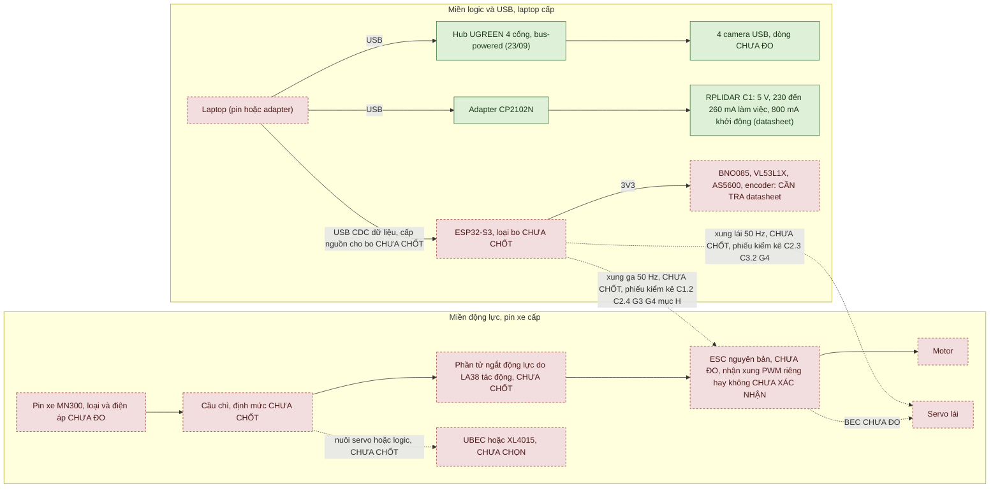
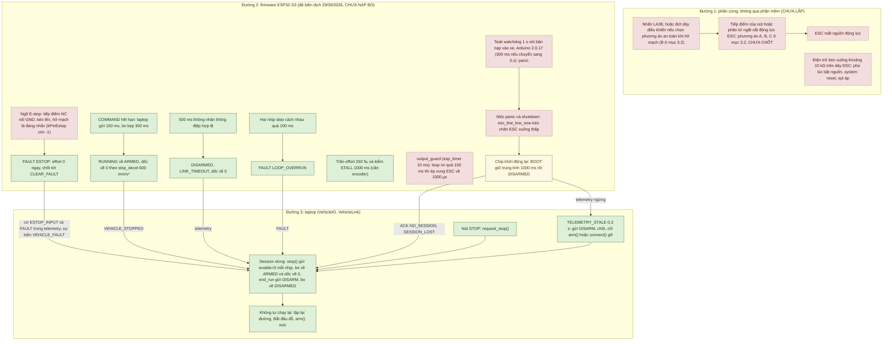

# Giai đoạn 6 — nguồn và dừng an toàn: bản nháp khi chưa có phần cứng

Tài liệu này là bản nháp chuẩn bị cho giai đoạn 6 của kế hoạch: nguồn điện và dừng an toàn cho xe. Nó được soạn ngày
24/09/2026, khi chưa có phần cứng nguồn hay dừng nào, và cập nhật một số chỗ tới 02/10/2026. Kế hoạch đặt tên bốn đầu ra:
`power_budget.md`, "sơ đồ nguồn", "sơ đồ dừng" và "bảng định mức còn cần kiểm tra". Bản nháp của cả bốn nằm ở mục 1–4;
mục 5 viết trước 16 kịch bản thử lỗi L1–L16. Khi có số đo thì tách `power_budget.md` ra riêng hay giữ ở đây: chưa chốt.

## Hiện trạng

Tính đến lần cập nhật cuối của tệp (02/10/2026):

- **Mức bằng chứng: bản nháp thiết kế.** Chưa có phần cứng nguồn hay dừng nào: bộ nguồn, LA38, cầu chì, phần tử ngắt,
  ESP32-S3, MN300. Dự án chưa đo điện áp hay dòng của thiết bị nào. Số duy nhất về điện trong repo là số datasheet của
  RPLIDAR C1 ([hardware_inventory.md](hardware_inventory.md)).
- Firmware C++ biên dịch cho ESP32-S3 từ 29/09/2026 nhưng **chưa nạp bo**. Lõi C++ `src/core` chạy trong test host từ
  29/09/2026: 703 check, khớp bản Python, gồm kịch bản hết hạn lệnh và mất liên lạc. Bản build thật chạy trong bo ảo
  QEMU từ 30/09/2026 ([MO_PHONG_FIRMWARE.md](MO_PHONG_FIRMWARE.md) mục 1).
- Chỉ phần logic đã kiểm trên máy tính: watchdog liên lạc 500 ms (`LINK_TIMEOUT`) ở bản Python, test host và bo ảo QEMU;
  logic chốt E-stop (vector `estop_latch`) ở bản Python và test host (mục 3.1).
- Tác dụng của `output_guard`, móc panic, task watchdog khi kích hoạt và ngõ vào E-stop thật chưa được kiểm ở đâu. Lý do
  là bo ảo không có LEDC, không có GPIO vào, và task watchdog không kích hoạt trong đó.
- Phía laptop, `VehicleIO` được nối vào phiên đỗ xe từ 24/09/2026, nhưng chỉ với bo mô phỏng và cổng serial giả, chưa
  với bo thật ([CHE_DO_QUAN_SAT.md](CHE_DO_QUAN_SAT.md); [GIAO_THUC_XE.md](GIAO_THUC_XE.md) mục 12). Tối 24/09/2026,
  trên mô phỏng, tìm thấy và sửa một khoảng trống an toàn quanh `COMMAND_TIMEOUT` (kịch bản L7).
- Cả 16 kịch bản L1–L16 đều chưa thử trên thiết bị; một số đã có test mô phỏng hoặc test với cổng giả (mục 5.2).
- Mọi hành vi "theo thiết kế" dưới đây lấy từ đặc tả, từ bản tham chiếu Python đã có test, hoặc từ mã C++; từng chỗ có
  ghi rõ. Không hành vi nào đã thử trên thiết bị.

**Đối chiếu kế hoạch** ([v3.1](../../KE_HOACH_TRIEN_KHAI_XE_TU_DO_v3.1.md)):

- mục 10 (giai đoạn 6). Theo [bản `9d68257`](https://github.com/thbn12082/autopark/blob/9d68257/KE_HOACH_TRIEN_KHAI_XE_TU_DO_v3.1.md),
  đoạn "Khi chưa có nguồn final" gồm: bảng điện áp/dòng tải, tách đường nguồn, xác định phần tử mà LA38 tác động, chọn
  cầu chì/dây/đầu nối, viết trước các tình huống lỗi. Bản hiện tại gọi đoạn này là "Khi chờ";
- mục 3 (đợt mua 6);
- mục 16.2 (ngưỡng "Phản ứng lỗi" cần chốt);
- mục 16.3 (kịch bản "Điều khiển/an toàn").

Mọi chỗ "kế hoạch mục N bước M" trong tệp này theo bản `9d68257`. Thiết kế firmware và giao thức ở
[GIAO_THUC_XE.md](GIAO_THUC_XE.md) mục 0, 5, 6, 12 và [firmware README](../firmware/esp32_vehicle/README.md) mục "An
toàn". Cách nối `VehicleIO` vào phiên đỗ xe ở [CHE_DO_QUAN_SAT.md](CHE_DO_QUAN_SAT.md).

**Quy ước trạng thái** dùng trong bảng và sơ đồ:

- "CHƯA ĐO": đại lượng đo được nhưng chưa đo;
- "CẦN TRA datasheet": số phải lấy từ tài liệu của đúng linh kiện đã mua;
- "CHƯA CHỐT": lựa chọn thiết kế chưa quyết định;
- "CHƯA THỬ": phép thử chưa làm;
- "đề xuất": ngưỡng hoặc cách làm chưa kiểm trên thiết bị thật.

## 1. Bảng tải (nháp `power_budget`)

Mục này liệt kê từng tải điện và nguồn cấp dự kiến, kèm bảng đo sẽ điền khi có phần cứng. Phần lớn ô còn chờ datasheet
hoặc chờ đo.

### 1.1. Từng tải

| # | Tải | Điện áp | Dòng điển hình | Dòng đỉnh | Lấy nguồn từ (dự kiến) | Nguồn số liệu | Trạng thái |
|---:|---|---|---|---|---|---|---|
| P1 | RPLIDAR C1 | 5 V | 230 mA (làm việc, 10 Hz) | 260 mA (làm việc); 800 mA lúc khởi động | cổng USB của laptop qua adapter CP2102N | datasheet C1M1 rev 1.1, ghi ở [hardware_inventory.md](hardware_inventory.md) | số datasheet; CHƯA ĐO trên thiết bị |
| P2 | Adapter USB–UART CP2102N (kèm LiDAR) | 5 V từ bus USB | CẦN TRA datasheet | CẦN TRA datasheet | cùng cổng với P1 | — | CHƯA ĐO |
| P3 | Hub UGREEN 4 cổng (bản thân hub) | 5 V từ bus USB | CẦN TRA datasheet | CẦN TRA datasheet | cổng USB laptop; hub có cổng nguồn ngoài (theo người dùng) | [usb_topology.md](usb_topology.md) | bus-powered trong mọi phiên 23/09; nguồn ngoài CHƯA THỬ |
| P4 | 4 camera USB "HD Camera" (VID 1BCF / PID 0B09) | 5 V từ bus USB qua hub | CHƯA ĐO | CHƯA ĐO | hub (P3) | [GIAI_DOAN_1_CAMERA.md](GIAI_DOAN_1_CAMERA.md): "dòng tiêu thụ chưa đo"; dự án chưa có đồng hồ đo USB | CHƯA ĐO |
| P5 | ESP32-S3 (bo chính) | ngõ vào tùy loại bo; logic 3,3 V | CẦN TRA datasheet | CẦN TRA datasheet | USB laptop (phương án thử trên bàn) hoặc bộ nguồn logic trên xe | [GIAO_THUC_XE.md](GIAO_THUC_XE.md) mục 0: loại bo CHƯA CHỐT | chưa nhận bo |
| P6 | BNO085 (IMU) | theo breakout; tín hiệu 3,3 V với ESP32-S3 | CẦN TRA datasheet | CẦN TRA datasheet | 3V3 của bo hoặc nguồn logic | — | chưa nhận |
| P7 | VL53L1X (2, có thể 4) | theo breakout; tín hiệu 3,3 V | CẦN TRA datasheet | CẦN TRA datasheet | như P6 | — | chưa nhận |
| P8 | AS5600 | theo breakout; tín hiệu 3,3 V | CẦN TRA datasheet | CẦN TRA datasheet | như P6 | — | chưa nhận |
| P9 | Encoder (MT6701 hoặc loại khác) | theo breakout | CẦN TRA datasheet | CẦN TRA datasheet | như P6 | loại encoder CHƯA CHỐT (kế hoạch mục 1.1) | chưa nhận |
| P10 | Servo lái (nguyên bản MN300) | CHƯA ĐO | CHƯA ĐO | CHƯA ĐO (không khóa cứng servo để đo, kế hoạch mục 10 bước 4) | BEC của ESC hoặc bộ nguồn riêng: CHƯA CHỐT | [mn300_inventory.md](mn300_inventory.md) C3.3 | xe chưa nhận |
| P11 | ESC + motor (nguyên bản MN300) | điện áp pin xe, CHƯA ĐO | CHƯA ĐO | CHƯA ĐO (không khóa cứng motor để đo dòng kẹt) | pin xe qua cầu chì và phần tử ngắt động lực | [mn300_inventory.md](mn300_inventory.md) B, C1, C4 | xe chưa nhận |
| P12 | Mạch đọc E-stop (tiếp điểm NC nối GND, điện trở kéo lên 3V3) | 3,3 V | 0,33–0,7 mA khi nhả nút (tính: 3,3 V / 10 kΩ … 4,7 kΩ; khi nhấn thì mạch hở, ≈ 0) | như điển hình | 3V3 của bo | trị số 4,7–10 kΩ là đề xuất trong [firmware README](../firmware/esp32_vehicle/README.md) | tính, CHƯA ĐO; chưa lắp |
| P13 | Phần tử ngắt động lực (nếu là rơ-le/công-tắc-tơ thì có cuộn hút) | CHƯA CHỐT | CẦN TRA datasheet | CẦN TRA datasheet | CHƯA CHỐT | kế hoạch mục 10 | loại phần tử CHƯA CHỐT |
| P14 | Bộ nguồn UBEC hoặc XL4015 (nếu dùng): hiệu suất, dòng không tải | CẦN TRA datasheet | CẦN TRA datasheet | CẦN TRA datasheet | pin xe | kế hoạch mục 1.1, 18: "chỉ chọn theo điện áp/tải thực" | CHƯA CHỌN; nuôi tải nào cũng CHƯA CHỐT |

Nguồn cấp (không phải tải của pin xe):

| Nguồn | Cấp cho | Còn thiếu | Trạng thái |
|---|---|---|---|
| Laptop (pin laptop hoặc adapter) | mọi thiết bị USB: P1–P5, và P6–P9 nếu bo lấy điện từ USB | khả năng cấp dòng của từng cổng USB: CẦN TRA tài liệu laptop; sơ đồ cổng USB của laptop (ghi chú dưới bảng) | mọi số đo đến nay trên máy bàn |
| Pin xe MN300 | P10, P11, P13, P14 | loại, điện áp, dung lượng, dòng xả cho phép ([mn300_inventory.md](mn300_inventory.md) mục B) | xe chưa nhận |
| Adapter nguồn ngoài cho hub | P3, P4 | có dùng không; điện áp/dòng: CẦN TRA | tài liệu chưa ghi đã có hay chưa ([TONG_HOP_DU_AN.md](../../TONG_HOP_DU_AN.md) mục 5.3) |

Laptop ở đây là laptop RTX 3050 Ti, máy nộp đồ án. Sơ đồ cổng USB của laptop này chưa có
([TONG_HOP_DU_AN.md](../../TONG_HOP_DU_AN.md) mục 2).

### 1.2. Tổng theo nhánh

**Chưa cộng được.** Nhánh USB của laptop thiếu dòng của P2–P9; nhánh động lực thiếu P10, P11, P13, P14. Không điền tổng
bằng số ước lượng. Từ số có sẵn đã thấy hai điều:

- Dòng khởi động 800 mA của C1 (datasheet) cao hơn ba lần dòng làm việc (230–260 mA). Cổng USB cấp cho LiDAR phải chịu
  được đỉnh này; cần tra theo cổng của laptop nộp đồ án. [hardware_inventory.md](hardware_inventory.md) đã khuyên cắm
  LiDAR thẳng vào cổng máy, không qua hub không có nguồn.
- Bốn camera đang chung một nhánh USB 2.0 qua hub bus-powered. Giả thuyết thiếu nguồn gây ra hiện tượng khung bị cắt
  **chưa kiểm** ([GIAI_DOAN_1_CAMERA.md](GIAI_DOAN_1_CAMERA.md), [usb_topology.md](usb_topology.md)).

### 1.3. Bảng đo khi có phần cứng (điền theo kế hoạch mục 10 bước 1–3)

Kế hoạch đặt thứ tự bật: đo điện áp trước khi nối từng tải → logic → LiDAR → một camera → bốn camera → chấp hành có kiểm
soát. Mỗi dòng ghi điều kiện pin/nguồn lúc đo.

| Bước | Tải đang bật | Điểm đo | Điện áp không tải / có tải | Dòng (TB / đỉnh) | Sụt áp | Có reset/mất kết nối? | Nhiệt | Pin/nguồn lúc đo | Ngày, dụng cụ |
|---|---|---|---|---|---|---|---|---|---|
| 1 | chưa tải | ngõ ra từng nguồn, đúng cực | CHƯA ĐO | — | — | — | — | | |
| 2 | ESP32-S3 + cảm biến | | CHƯA ĐO | CHƯA ĐO | | | | | |
| 3 | + LiDAR | | CHƯA ĐO | CHƯA ĐO | | | | | |
| 4 | + 1 camera | | CHƯA ĐO | CHƯA ĐO | | | | | |
| 5 | + 4 camera (cùng LiDAR + AI như bàn thử) | | CHƯA ĐO | CHƯA ĐO | | | | | |
| 6 | + servo (đánh lái, xe kê cao) | | CHƯA ĐO | CHƯA ĐO | | | | | |
| 7 | + ESC/motor (bánh kê cao, trần effort 250 ‰) | | CHƯA ĐO | CHƯA ĐO | | | | | |
| 8 | toàn bộ, trên sàn, tốc độ thấp | | CHƯA ĐO | CHƯA ĐO | | | | | |

Dụng cụ cần: đồng hồ vạn năng, đồng hồ đo dòng USB, máy hiện sóng hoặc logic analyzer, nguồn bàn chỉnh được áp và giới
hạn dòng. Dự án chưa có đồng hồ đo USB. Với các dụng cụ còn lại, tài liệu dự án chưa ghi đã có hay chưa.

## 2. Sơ đồ nguồn (nháp)

Nguồn chia thành hai miền tách nhau: **miền logic/USB** do laptop cấp và **miền động lực** do pin xe cấp. Ô ghi CHƯA
CHỐT là chỗ chưa quyết định; đường chấm là liên kết chưa biết có hay không.



Màu ô ở sơ đồ này: xanh là thiết bị đã có và đã chạy trên bàn thử, cấp điện qua USB của máy bàn (dòng tiêu thụ chưa đo);
vàng là chỉ trong mô phỏng/giả lập (sơ đồ này không có ô nào); đỏ viền đứt là chưa làm hoặc chưa thử trên thiết bị.
Laptop tô đỏ vì chưa lần nào cấp điện cho LiDAR, hub hay camera: mọi số đo đến nay là trên máy bàn (mục 1.1). Chưa đo
dòng thiết bị nào. Tần số xung 50 Hz là hằng `kPwmHz` trong `src/main.cpp`, chưa xác nhận với ESC/servo thật.

Cùng nội dung ở dạng chữ:

```text
MIỀN LOGIC/USB (laptop):
  Laptop ─USB─ Hub UGREEN (bus-powered) ─ 4 camera
  Laptop ─USB─ CP2102N ─ RPLIDAR C1
  Laptop ─USB CDC─ ESP32-S3 (nguồn cho bo: từ USB hay từ bộ nguồn trên xe? CHƯA CHỐT) ─3V3─ BNO085, VL53L1X, AS5600, encoder
MIỀN ĐỘNG LỰC (pin xe):
  Pin xe ─ cầu chì (CHƯA CHỐT) ─ phần tử ngắt do LA38 tác động (CHƯA CHỐT) ─ ESC ─ motor
  Servo: BEC của ESC hay UBEC/XL4015 riêng? (CHƯA CHỐT; phụ thuộc phiếu kiểm kê C1.6, C3.3)
TÍN HIỆU GIỮA HAI MIỀN:
  ESP32-S3 ─ xung ga ─> ESC ; ESP32-S3 ─ xung lái ─> servo ; (tham chiếu mass chung: CẦN KIỂM)
  (CHƯA CHỐT: ESC/bộ thu nguyên bản tách hay gộp, có nhận xung PWM riêng không, phiếu kiểm kê C1.2, C2.3–C2.4, C3.2,
   G3, G4, mục H; nếu không thì phải thay ESC, xem N7)
```

### 2.1. Quyết định còn mở

| # | Câu hỏi | Ảnh hưởng | Trạng thái |
|---:|---|---|---|
| N1 | Laptop đặt trên xe hay ngoài xe (dây USB kéo dài)? | chiều dài/loại cáp USB, hub đặt ở đâu, có cần nguồn ngoài cho hub | CHƯA CHỐT ([kế hoạch v3.1](../../KE_HOACH_TRIEN_KHAI_XE_TU_DO_v3.1.md) mục 1.1: đường điều khiển khi tích hợp xe chưa chốt) |
| N2 | ESP32-S3 lấy điện từ USB laptop hay từ bộ nguồn trên xe? | kịch bản L1–L3 (mục 5): rút cáp USB có làm bo mất điện không | CHƯA CHỐT |
| N3 | Servo lấy điện từ BEC của ESC hay nguồn riêng? | E-stop cắt động lực có làm servo mất điện không (ghi chú dưới bảng) | CHƯA CHỐT; cần phiếu kiểm kê C1.6, C3.3 |
| N4 | UBEC hay XL4015, nuôi tải nào | bảng tải mục 1 | CHƯA CHỌN; kế hoạch: chỉ chọn sau bảng tải |
| N5 | Hub dùng nguồn ngoài hay bus-powered | P3, P4; hiện tượng khung bị cắt | phép thử nguồn ngoài CHƯA LÀM |
| N6 | Có công tắc riêng cho miền logic không | trình tự bật/tắt, kịch bản L1 | CHƯA CHỐT |
| N7 | ESC và bộ thu nguyên bản tách hay gộp; ESP32-S3 đưa xung ga/lái vào được mà không thay cụm điện không? | nếu không: phải thay ESC, có thể cả servo (ghi chú dưới bảng) | CHƯA CHỐT; chỉ quyết sau phiếu kiểm kê mục H và chạy thử |

Ghi chú:

- N3: khi FAULT, firmware giữ góc lái; nhưng nếu servo mất điện thì góc lái thả.
- N7: nếu ESC và bộ thu gộp, hoặc ESC không nhận xung PWM, thì phải thay ESC, có thể cả servo. Khi đó nhánh động lực đổi
  theo (đầu nối, định mức, BEC; P10, P11; N3), cùng với hằng `kEsc*` của firmware và bảng B4/B5/B7 ở
  [GIAI_DOAN_4_CHUAN_BI.md](GIAI_DOAN_4_CHUAN_BI.md). Kế hoạch mục 8 ghi: "Chưa mua ESC thay thế chỉ từ tên xe".

### 2.2. Điểm phải kiểm khi đấu dây

- Đo điện áp và cực tính trước khi nối từng tải (kế hoạch mục 10 bước 1).
- **Tham chiếu mass cho tín hiệu**, nếu ESP32-S3 điều khiển ESC bằng xung riêng (N7). Xung từ ESP32-S3 sang ESC/servo cần
  mass chung giữa bo và ESC. Nếu bo lấy điện từ USB laptop thì mass laptop nối với cực âm pin xe qua đường này. Cách nối
  mass và ảnh hưởng nhiễu: cần kiểm khi đấu.
- **Không để hai nguồn 5 V song song.** Nếu ESC có BEC (dây đỏ trên dây tín hiệu) và bo đang lấy điện từ USB, không nối
  dây đỏ BEC vào 5 V của bo khi chưa xét kỹ. Cách đấu chưa chốt, phụ thuộc phiếu kiểm kê C1.6.
- **Điện trở kéo xuống trên dây ESC**, nếu ESP32-S3 điều khiển ESC bằng xung riêng (N7): ≈ 10 kΩ trên dây tín hiệu ESC,
  để chân không thả nổi lúc bật nguồn hay system reset. Trị số là đề xuất trong
  [firmware README](../firmware/esp32_vehicle/README.md).
- **Điện trở kéo lên cho ngõ E-stop:** 4,7–10 kΩ lên 3V3, đặt tại bo.

## 3. Sơ đồ dừng (nháp)

Thiết kế có ba lớp dừng: phần cứng (nút LA38), firmware và laptop. Nguyên tắc theo kế hoạch mục 2.1: "E-stop vật lý là
đường dừng riêng, không phụ thuộc giao diện laptop". Kế hoạch mục 10 thêm: "Một nút bấm đơn lẻ không được đánh dấu là đã
hoàn tất E-stop".

Sơ đồ dưới vẽ ngày 30/09/2026 theo mã firmware và laptop ở commit `ff4a018`: `src/main.cpp`, `vehicle_core`,
`firmware_model.py`, `vehicle_io.py`, `application/vehicle_link.py`. Task watchdog trong sơ đồ là 1 s, vì bản nạp vào xe
dùng Arduino-ESP32 2.0.17 (`espressif32 @ 7.1.3`) và `setup_task_watchdog()` gọi `esp_task_wdt_init(1, true)`. Con số
300 ms là của Arduino 3.x.



Màu ô ở sơ đồ này:

- xanh: logic đã kiểm trên máy tính, chưa ô nào chạy trên bo thật. Ở đường 2 là bản tham chiếu Python và lõi C++ qua
  test host, một phần trong bo ảo QEMU; ở đường 3 là với bo mô phỏng và cổng serial giả;
- vàng: chuỗi khởi động lại, mới thấy trong bo ảo (reset chip qua monitor) và trong mô phỏng;
- đỏ viền đứt: chưa làm hoặc chưa thử trên thiết bị. QEMU không cho task watchdog kích hoạt
  ([MO_PHONG_FIRMWARE.md](MO_PHONG_FIRMWARE.md) mục 2.1).

Khi chip khởi động lại giữa lần chạy, laptop thấy một trong hai dấu hiệu: telemetry ngừng, hoặc ACK `NO_SESSION`
(`SESSION_LOST`). Dấu hiệu nào tới trước thì làm phiên dừng. Với telemetry ngừng, phiên đỗ dừng vì `STALE_TELEMETRY` của
`VehicleLink` sau 0,15 s, trước `TELEMETRY_STALE` của `VehicleIO` sau 0,3 s. Điều này kiểm bằng
`tests/test_session_vehicle.py` với rút cáp giả. Lúc vẽ sơ đồ, phiên đỗ chưa chạy với bo ảo; từ 02/10/2026 cả phiên đỗ đã
chạy qua firmware thật trong bo ảo QEMU, ở mức mô phỏng ([CHUYEN_MAY_BAN.md](CHUYEN_MAY_BAN.md) mục 14).

`FIRMWARE_RESET` (`boot_id` mới) chỉ sinh ở lần `connect()` sau, tức lần chạy mới, và chỉ được ghi log trước START. Nó
không làm dừng lần chạy nào (`application/vehicle_link.py`, `_open_run`).

### 3.1. Bảng các đường dừng

| Đường | Kích hoạt | Tác động lên | Không phụ thuộc phần mềm? | Hằng số thời gian theo thiết kế | Trạng thái |
|---|---|---|---|---|---|
| LA38 → phần tử ngắt | nhấn nút; đứt dây điều khiển (nếu thiết kế an toàn khi hở mạch) | nguồn động lực của ESC | có (theo ý đồ thiết kế) | CHƯA ĐO (phụ thuộc phần tử) | phần tử CHƯA CHỐT, chưa lắp |
| LA38 tiếp điểm tín hiệu (`kPinEstop`) → firmware | nhấn nút; đứt dây; tuột đầu nối | effort = 0, FAULT chốt | không | mỗi chu kỳ điều khiển 10 ms | đã chọn kiểu đấu; `kPinEstop` = −1; ngõ vào thật chưa lắp, chưa thử; logic chốt: ghi chú (1) |
| Thời hạn lệnh | laptop ngừng gửi COMMAND | dốc mục tiêu về 0 | không | ≤ 300 ms (kẹp) rồi dốc 600 mm/s² | có test trên bản tham chiếu Python; lõi C++ qua test host (29/09/2026) và bản build thật trong bo ảo QEMU (30/09/2026) |
| Watchdog liên lạc của bo | 500 ms không nhận thông điệp hợp lệ | DISARMED | không | 500 ms | có test Python; lõi C++ qua test host và bản build thật trong bo ảo QEMU (30/09/2026) |
| `output_guard` | loop firmware im > 100 ms | xung ESC = trung tính | không (chạy trên bo) | 100–110 ms (README) | chỉ trong C++, đã biên dịch 29/09/2026, chưa chạy trên bo |
| Task watchdog + móc panic | loop treo > 300 ms (3.x); 1 s (2.x) | chân ESC thấp, chip khởi động lại | không | xem [GIAO_THUC_XE.md](GIAO_THUC_XE.md) mục 5 | chỉ trong C++, đã biên dịch 29/09/2026, CẦN KIỂM TRÊN BO |
| `stop()` / `disarm()` của laptop | nút STOP, phiên dừng/kết thúc | ARMED / DISARMED, dốc | không | trễ truyền + dốc | nối vào phiên từ 24/09/2026, **chỉ với bo mô phỏng**; bo thật CHƯA THỬ; ghi chú (2) |
| `TELEMETRY_STALE` của laptop | 0,3 s không có telemetry | gửi DISARM, chốt `send(enable=True)` | không | 0,3 s | có test Python |

Ghi chú:

1. Logic chốt FAULT khi `inputs.estop` đã kiểm ở bản tham chiếu Python và lõi C++ qua test host (vector `estop_latch`).
   Bo ảo QEMU không có GPIO vào.
2. Đường `stop()` / `disarm()` của laptop:
   - Đường này nối vào phiên từ 24/09/2026 ở hai chế độ VEHICLE_IO/OBSERVE, chỉ với bo mô phỏng (`SimVehicleIO` +
     `FirmwareModel`; [CHE_DO_QUAN_SAT.md](CHE_DO_QUAN_SAT.md), `application/vehicle_link.py`).
   - Ở VEHICLE_IO: nút STOP → `request_stop()` → COMMAND enable=0 mỗi nhịp điều khiển; kết thúc lần chạy → enable=0 rồi
     DISARM. Có test mô phỏng (`tests/test_session_vehicle.py`). Ở OBSERVE không gửi lệnh nào.
   - Thẻ "Bo điều khiển" chọn được cổng COM từ 25/09/2026 (commit `6db5087`). Nhưng START với bo thật luôn bị từ chối vì
     chưa có nguồn tư thế thật.
   - Nút "Kiểm kết nối bo" mở cổng, gửi HELLO rồi đọc telemetry; nó không ARM, không gửi COMMAND nào
     ([CHE_DO_QUAN_SAT.md](CHE_DO_QUAN_SAT.md) mục 6).
   - Từ 02/10/2026, nút "Xóa lỗi bo (CLEAR_FAULT)" (T15) cũng mở cổng đó. Mỗi lần bấm, nút mở cổng, gửi HELLO, gửi nhiều
     nhất một CLEAR_FAULT khi khung telemetry mới báo FAULT và `ESTOP_INPUT` = 0, rồi đóng cổng; không ARM, không
     COMMAND. Giao diện đóng cổng sau mỗi lần bấm nên luôn là phiên mới; PING thay HELLO chỉ khi `VehicleIO` đã mở sẵn
     và còn phiên, như trong test. Nút này chỉ thử với bo mô phỏng và cổng serial giả.
   - Với cả hai nút, có thể có thêm DISARM mà `VehicleIO` tự gửi khi mất liên lạc.
   - Từ 02/10/2026 (T13), qua `VehicleIO`, mỗi quyết định dừng của phiên, kể cả nút STOP (`USER_STOP`), là một dòng
     `session_stop` trong `events.csv`.
   - Bo ảo QEMU: trước 02/10/2026 chưa chọn được từ giao diện; từ 02/10/2026 thẻ "Bo điều khiển" có lựa chọn bo ảo QEMU,
     ở mức mô phỏng ([TONG_HOP_DU_AN.md](../../TONG_HOP_DU_AN.md) mục 4.9).
   - Đường `stop()`/`disarm()` trên bo thật: CHƯA THỬ.

Mô phỏng `VehicleIO` giả định E-stop cắt động lực (`actuator.estop_cuts_power: true` trong
[vehicle_io_sim.json](../configs/vehicle_io_sim.json)). Đó là giả định của mô phỏng; chưa có phần cứng nào làm việc đó.

### 3.2. Phần tử mà LA38 cắt: các phương án (CHƯA CHỐT)

| Phương án | Mô tả | Cần kiểm trước khi chọn |
|---|---|---|
| A | Tiếp điểm của nút nằm trực tiếp trên dây động lực pin → ESC | định mức dòng/áp một chiều của tiếp điểm so với dòng ESC (cả hai CHƯA ĐO/CẦN TRA); hồ quang khi cắt dòng một chiều |
| B | Tiếp điểm NC của nút nằm trên cuộn hút của rơ-le/công-tắc-tơ loại thường mở; phần tử này cắt động lực | định mức tiếp điểm chính của phần tử; mất nguồn cuộn hút hay đứt dây = cắt động lực (an toàn khi hở mạch) |
| C | Nút điều khiển một khóa bán dẫn (MOSFET) trên động lực | định mức dòng, tản nhiệt, hỏng kiểu ngắn mạch thì không cắt được — cần xét |

Yêu cầu chung, từ kế hoạch và firmware:

- cắt động lực không qua phần mềm;
- đứt dây không làm mất chức năng dừng;
- tiếp điểm NC loại mở cưỡng bức, để tiếp điểm dính vẫn bị tách khi nhấn (theo
  [firmware README](../firmware/esp32_vehicle/README.md));
- nút cần đủ khối tiếp điểm cho cả đường động lực lẫn tín hiệu về ESP32-S3. Số và loại khối tiếp điểm của LA38 đã mua,
  và nút có tự giữ khi nhấn không: cần kiểm trên hàng thật.

Tài liệu này còn đề xuất đo điện áp phía động lực qua bộ chia áp để phát hiện mất động lực; việc này chưa làm. README cũng
nêu phương án đọc thêm một tiếp điểm phụ của nút. Nhưng tiếp điểm đó chỉ báo trạng thái nút, không thấy cầu chì đứt hay
đầu nối động lực tuột.

### 3.3. Sau sự kiện nào thì cần thao tác gì để chạy lại

Nguyên tắc: không tự chạy lại sau khi nhả nút dừng hay nối lại cáp; phải có thao tác cho phép mới (kế hoạch mục 10 bước
6, mục 13).

| Sự kiện | Bo ở trạng thái | Laptop thấy | Thao tác để chạy lại | Nguồn |
|---|---|---|---|---|
| Nhả E-stop | vẫn FAULT (CLEAR_FAULT bị từ chối `ESTOP_ACTIVE` khi nút còn nhấn) | FAULT trong telemetry | CLEAR_FAULT → DISARMED → ARM → COMMAND enable mới | GIAO_THUC_XE mục 6 |
| Động lực có lại sau khi đóng phần tử ngắt | không đổi (bo không mất điện nếu miền logic tách riêng) | — | như trên; ghi chú (a) | — |
| Rút rồi cắm lại USB laptop–bo | DISARMED sau `reopen()` + `connect()` (phiên mới) | `LINK_ERROR` lúc rút | `reopen()` → `connect()` → `arm()` → COMMAND mới; lệnh phiên cũ bị từ chối; ghi chú (b) | GIAO_THUC_XE mục 4, 6, 11; ghi chú (b) |
| Bo khởi động lại (watchdog, sụt áp, mất điện) | BOOT (giữ trung tính `boot_hold_ms` 1000 ms) → DISARMED | telemetry ngừng → `TELEMETRY_STALE`; ACK `NO_SESSION` → `SESSION_LOST`; ghi chú (c) | `connect()` → `arm()` → COMMAND mới; ghi chú (c) | GIAO_THUC_XE mục 3, 4 |
| Ứng dụng laptop khởi động lại | DISARMED sau HELLO mới | — | `connect()` → `arm()` | GIAO_THUC_XE mục 6 |
| `TELEMETRY_STALE` rồi telemetry có lại | có thể vẫn ARMED | `TELEMETRY_RESUMED` (LOG), chốt vẫn giữ | `arm()` hoặc `connect()` | GIAO_THUC_XE mục 5 |
| STALL, LOOP_OVERRUN, SUPPLY_LOW | FAULT | `VEHICLE_FAULT` | CLEAR_FAULT (SUPPLY_LOW chỉ khi điện áp đo lại ≥ ngưỡng) → ARM → COMMAND mới | GIAO_THUC_XE mục 6 |
| Lệnh hết hạn (`COMMAND_TIMEOUT`) mà liên lạc vẫn còn | ARMED | `VEHICLE_STOPPED` (lý do `COMMAND_TIMEOUT`) | mức giao thức: COMMAND enable=1 là đủ; phiên đỗ: lập lại đường rồi Bắt đầu đỗ; ghi chú (d) | GIAO_THUC_XE mục 6; [CHE_DO_QUAN_SAT.md](CHE_DO_QUAN_SAT.md) mục 3 |

Ghi chú:

- (a) ESC vừa có điện lại nhận xung trung tính vì effort = 0. ESC xử lý lúc bật nguồn thế nào thì chưa chốt (phiếu kiểm
  kê C1.12).
- (b) Lỗi cổng làm `SerialVehicleIO` đóng cổng (`transport = None`), nên gọi thẳng `connect()` sẽ báo
  `VehicleIOError("Cổng chưa mở")`. `reopen()` chỉ dùng được khi đối tượng được tạo bằng `SerialVehicleIO.open(port)`,
  vì cần hàm mở lại cổng. Nguồn: `transport/vehicle_io.py` `SerialVehicleIO` (docstring, `_link_failed`, `reopen`);
  test `test_serial_unplug_raises_link_error_and_reconnect_stays_disarmed` (cổng giả).
- (c) `boot_id` mới → `FIRMWARE_RESET` ở lần `connect()` sau, chỉ ghi log trước START; `reset_reason` có trong
  HELLO_ACK. Trong bo ảo QEMU ngày 30/09/2026, laptop thấy `TELEMETRY_STALE` hoặc `SESSION_LOST` rồi `FIRMWARE_RESET`
  (test `test_chip_reset_is_seen_as_firmware_reset`). Trên bo thật, chữ ROM/log đi chung cổng USB làm tăng bộ đếm lỗi
  khung (MO_PHONG_FIRMWARE.md mục 5.5); chưa thử. Cũng cần kiểm trên bo thật: nếu bo dùng USB CDC gốc của ESP32-S3 thì
  khi bo reset, Windows có thể bỏ rồi tạo lại cổng COM. Khi đó cũng có `LINK_ERROR` và phải `reopen()` trước `connect()`.
- (d) Ở mức giao thức, **COMMAND enable=1 là đủ, không cần ARM lại**, vì máy trạng thái chuyển ARMED + COMMAND enable=1
  → RUNNING. Phiên đỗ xe qua `VehicleIO` (từ 24/09/2026, bo mô phỏng) coi `VEHICLE_STOPPED` là STOP và không gửi lại
  enable trong lần chạy đó: phải lập lại đường rồi Bắt đầu đỗ (`arm()` mới). Tối 24/09/2026 tìm thấy một ngoại lệ trên
  mô phỏng: nếu vòng điều khiển treo trong khi telemetry vẫn được đọc, và bước đầu tiên khi hết treo rơi vào nhịp điều
  khiển (pha 0), thì một enable=1 lọt tới bo trước khi `VEHICLE_STOPPED` được xử lý. Lỗi được sửa cùng tối:
  `VehicleLink.refresh()` chạy trước nhịp điều khiển, và `command()` không gửi khi còn sự kiện dừng chưa lấy. Bản sửa mới
  kiểm trên bo mô phỏng và cổng serial giả ([GIAO_THUC_XE.md](GIAO_THUC_XE.md) mục 12). Chi tiết ở kịch bản L7.

Ngoài chốt FAULT của firmware, có cần thêm một chốt phần cứng (nút đóng lại động lực riêng) sau khi nhả E-stop không:
chưa chốt. Với phương án B ở mục 3.2, nhả nút là cuộn hút có điện lại và động lực đóng ngay. Khi đó việc xe không chạy
chỉ còn dựa vào firmware đang ở FAULT.

## 4. Bảng định mức còn phải kiểm

Kế hoạch mục 10 ghi: "không khóa con số 15 A/30 A chỉ vì danh sách bán hàng". Các số 15 A (cầu chì) và 30 A (công tắc)
chỉ xuất hiện trong danh sách bán hàng (kế hoạch mục 1.1); chúng **không phải định mức đã chọn**.

| Hạng mục | Cần biết trước khi chọn | Lấy từ đâu | Hiện có | Trạng thái |
|---|---|---|---|---|
| Pin xe | điện áp danh định và lúc sạc đầy, dòng xả cho phép, đầu nối | nhãn pin, phiếu kiểm kê mục B | — | xe chưa nhận |
| Cầu chì chính (động lực) | dòng liên tục và đỉnh của ESC + motor (P11); điện áp một chiều định mức của cầu chì; kiểu tác động | đo P11 (không khóa motor), datasheet cầu chì | link cầu chì/đế ở kế hoạch mục 18 | CHƯA CHỐT |
| Cầu chì nhánh logic/servo (nếu có) | dòng P5–P10, P14 | bảng tải mục 1 | — | CHƯA CHỐT |
| Dây động lực | dòng liên tục, chiều dài, nhiệt | đo P11; bảng tiết diện theo dòng | — | CHƯA CHỐT |
| Đầu nối động lực (XT60 hay loại khác) | tương thích đầu nối pin/ESC nguyên bản; định mức dòng | phiếu kiểm kê C5.1; datasheet đầu nối | link XT60 ở kế hoạch mục 18, ghi "kiểm tra tương thích" | CHƯA CHỐT |
| Tiếp điểm LA38 | dòng/áp một chiều định mức của từng khối; số khối NO/NC; khối NC có phải loại mở cưỡng bức (positive opening) không; kiểu tự giữ | nhãn/datasheet của nút đã mua | link ở kế hoạch mục 18 | CẦN KIỂM trên hàng thật |
| Phần tử ngắt (mục 3.2) | dòng tiếp điểm chính, cuộn hút (điện áp, dòng), thời gian cắt | datasheet | — | CHƯA CHỐT |
| UBEC / XL4015 | điện áp vào/ra, dòng ra liên tục và đỉnh, nhiệt | datasheet; bảng tải | link ở kế hoạch mục 18 | CHƯA CHỌN |
| Dây và đầu nối servo | dòng servo (P10) | đo | — | CHƯA ĐO |
| Dây tín hiệu E-stop | chống kéo tuột; tuột = FAULT (theo thiết kế) | — | — | CHƯA CHỐT |
| Điện trở kéo xuống dây ESC, kéo lên ngõ E-stop | trị số, vị trí gần bo | [firmware README](../firmware/esp32_vehicle/README.md) (≈ 10 kΩ; 4,7–10 kΩ) | đề xuất | chưa lắp |
| Cổng USB laptop | dòng cấp mỗi cổng; cổng nào chung bộ điều khiển | tài liệu laptop; sơ đồ cổng USB của laptop | chưa có | CẦN TRA |
| Cáp USB (camera, LiDAR, ESP32) | chiều dài, loại; A/B cáp ngắn – cáp dài (kế hoạch mục 6 bước 9) | ghi khi lắp | chưa ghi ([hardware_inventory.md](hardware_inventory.md)) | CHƯA GHI |
| Adapter nguồn hub | điện áp/dòng | nhãn adapter | tài liệu chưa ghi đã có | CHƯA THỬ |

Yêu cầu khối NC loại mở cưỡng bức của tiếp điểm LA38 đến từ [firmware README](../firmware/esp32_vehicle/README.md).

## 5. Kịch bản thử lỗi

Mục này viết trước 16 kịch bản lỗi về nguồn và dừng (L1–L16): mức thử, hành vi mà thiết kế nói sẽ xảy ra, cách thử và
tiêu chí đạt đề xuất. Chưa kịch bản nào thử trên thiết bị.

### 5.1. Mức thử

Các mức thử theo trình tự của [firmware README](../firmware/esp32_vehicle/README.md) ("Trình tự thử trên bo", "Cách kiểm
trên bo") và kế hoạch mục 9–10. M0–M3 là các mức thử trên bo ESP32-S3; R là bàn thử cảm biến hiện có.

| Mức | Cấu hình | Điều kiện trước |
|---|---|---|
| R | Bàn thử cảm biến hiện có trên máy bàn (LiDAR + 4 camera + xe ảo), không có xe | cần người rút/cắm cáp |
| M0 | Chỉ bo ESP32-S3 cắm USB, `AP_ENABLE_PWM_OUTPUTS=0`: xem trạng thái và telemetry | có bo; đã biên dịch và nạp firmware (PlatformIO đã cài và biên dịch được từ 29/09/2026; còn thiếu bo) |
| M1 | Bật xung, chân đã chốt, **chưa nối** ESC/servo; máy hiện sóng/logic analyzer trên chân ESC và chân servo | như M0 + chốt chân + dụng cụ đo xung |
| M2 | Nối ESC/servo theo sơ đồ đã đối chiếu, xe kê cao bánh không chạm đất, đường dừng phần cứng sẵn sàng, trần effort 250 ‰ | như M1 + MN300 + phần tử ngắt đã lắp |
| M3 | Trên sàn, tốc độ thấp trong vùng thử, người giám sát cầm nút dừng | M2 đạt; kế hoạch: nguồn/dừng xác nhận trước khi chạy tự động trên sàn |

**Công thức dùng cho tiêu chí đề xuất.** Công thức tính từ tham số thiết kế, chưa đo. Sau khi bo ngừng nhận lệnh, xung
ESC phải về trung tính (1500 µs) không muộn hơn

`T = t_hạn + |v_ref| / stop_decel + 10 ms (một chu kỳ điều khiển) + 20 ms (một chu kỳ xung 50 Hz)`,

trong đó `t_hạn` là thời hạn còn lại của lệnh cuối (laptop gửi 150 ms; bo kẹp ≤ 300 ms) và `stop_decel` = 600 mm/s².
Ví dụ `v_ref` = 0,15 m/s, `t_hạn` = 150 ms: T = 0,15 + 0,25 + 0,03 = 0,43 s. Công thức chỉ nói về **xung**, không nói
về quãng dừng thật của xe.

### 5.2. Tổng hợp

| # | Tình huống | Mức thử | Trên thiết bị | Đã kiểm trên máy tính |
|---:|---|---|---|---|
| L1 | Bo ESP32-S3 mất nguồn khi đang chạy | M1, M2 | CHƯA THỬ | — |
| L2 | Laptop tắt / ngủ / chương trình bị đóng | M1, M2 | CHƯA THỬ | — |
| L3 | Rút cáp USB laptop–ESP32-S3 | M0, M1, M2 | CHƯA THỬ | test với cổng giả |
| L4 | Rút cáp USB LiDAR | R | CHƯA THỬ | nguồn quét kịch bản; từ tối 24/09/2026 thêm test với cổng nối tiếp giả (`tests/test_lidar_unplug.py`) |
| L5 | Rút cáp một camera, hoặc rút hub | R | CHƯA THỬ | — |
| L6 | Mất cảm biến trên bo (encoder, AS5600, IMU, ToF) | M0, M2 | CHƯA THỬ | phía laptop: test với bo mô phỏng (tối 24/09/2026) |
| L7 | Treo chương trình laptop | M0, M1, M2 | CHƯA THỬ | test mô phỏng; khoảng trống tìm và sửa tối 24/09/2026; script diễn tập `fault_drill hang` (02/10/2026) |
| L8 | Treo firmware (loop im, treo lâu, panic) | M1 | CHƯA THỬ | — |
| L9 | Khởi động lại bo; khởi động lại chương trình laptop | M0, M1, M2 | CHƯA THỬ | test mô phỏng |
| L10 | Nhấn E-stop khi đang chạy | M1, M2, M3 | CHƯA THỬ | — |
| L11 | Đứt dây / tuột đầu nối E-stop | M0, M2 | CHƯA THỬ | — |
| L12 | Nhả E-stop | M2 | CHƯA THỬ | nút CLEAR_FAULT (T15): bo mô phỏng, cổng serial giả (02/10/2026) |
| L13 | Pin yếu | M0 (nguồn bàn), M2 | CHƯA THỬ | — |
| L14 | Sụt áp (brownout) khi động cơ kéo | M1, M2 | CHƯA THỬ | — |
| L15 | Lệnh STOP từ laptop | M1, M2, M3 | CHƯA THỬ | nút STOP qua `VehicleIO`: bo mô phỏng (từ 24/09/2026) |
| L16 | Mất động lực khi logic còn (cầu chì đứt, đầu nối động lực tuột) | M2 | CHƯA THỬ | — |

### 5.3. Chi tiết từng kịch bản

Với mỗi kịch bản, "hành vi mong đợi" là điều thiết kế hiện tại **nói sẽ xảy ra**, không phải điều đã thấy. "Tiêu chí
đạt" là đề xuất; ngưỡng cuối phải chốt theo kế hoạch mục 16.2 ("Phản ứng lỗi: thời gian phát hiện, phát lệnh dừng, dừng
thực; xử lý reconnect").

**L1 — Bo ESP32-S3 mất nguồn khi đang chạy**

- **Hành vi mong đợi.** Bo tắt. Chân ESC thả nổi, và điện trở kéo xuống ngoài (đề xuất, chưa lắp) giữ nó ở mức thấp,
  tức không có xung. ESC làm gì khi mất xung thì chưa chốt (phiếu kiểm kê C1.13). Phía laptop: nếu bo lấy điện từ USB thì
  cổng mất → `LINK_ERROR`; nếu không thì sau 0,3 s không có telemetry → `TELEMETRY_STALE`. Khi có điện lại: BOOT, giữ
  trung tính 1000 ms → DISARMED; `boot_id` mới, `reset_reason` = bật nguồn.
- **Cách thử.** M1: cắt nguồn bo khi đang RUNNING với effort ≠ 0. Máy hiện sóng ghi mức chân ESC từ lúc cắt tới lúc có
  lại 1500 µs sau khi cấp điện lại. M2: như trên với bánh kê cao; quay video bánh.
- **Tiêu chí đạt (đề xuất).** Chân ESC không phát xung khác trung tính từ lúc mất điện tới khi firmware chạy lại. Bánh
  ngừng được kéo; thời gian cần chốt sau khi đo. Sau khi có điện lại, không chuyển động cho tới ARM + COMMAND mới.
- **Trạng thái.** CHƯA THỬ.

**L2 — Laptop tắt, ngủ, hoặc chương trình bị đóng**

- **Hành vi mong đợi.** Bo lấy điện từ USB laptop: như L1. Bo có nguồn riêng: lệnh cuối hết hạn → RUNNING → ARMED, dốc
  về trung tính; 500 ms không có thông điệp → DISARMED (`LINK_TIMEOUT`).
- **Cách thử.** M1/M2: đóng tiến trình laptop (hoặc cho máy ngủ) khi bo đang RUNNING; đặt máy hiện sóng trên chân ESC.
- **Tiêu chí đạt (đề xuất).** Xung về 1500 µs trong thời gian T (mục 5.1), tính từ COMMAND cuối bo nhận. Sau khi laptop
  chạy lại, không chuyển động cho tới `connect()` + `arm()` + COMMAND mới. Chế độ ngủ và tiết kiệm điện USB của Windows
  có thể cắt cổng, nên cần kiểm cài đặt của máy nộp đồ án; việc này người dùng làm.
- **Trạng thái.** CHƯA THỬ.

**L3 — Rút cáp USB laptop–ESP32-S3**

- **Hành vi mong đợi.** Laptop: lỗi cổng → `LINK_ERROR` (STOP). Test với cổng giả đã có: "rút cáp → LINK_ERROR, mở lại
  vẫn DISARMED" ([GIAO_THUC_XE.md](GIAO_THUC_XE.md) mục 11). Bo lấy điện từ cáp này: như L1; bo có nguồn riêng: như L2.
  Khi cắm lại: `reopen()` mở lại cổng rồi `connect()` mở phiên mới → DISARMED; lệnh phiên cũ bị từ chối. Gọi `connect()`
  khi chưa `reopen()` sẽ báo `Cổng chưa mở`.
- **Cách thử.** M0: rút/cắm khi RUNNING (không có xung), xem trạng thái sau khi cắm lại. M1/M2: thêm máy hiện sóng; ghi
  thời điểm rút bằng kênh thứ hai (ví dụ VBUS phía bo nếu bo có nguồn riêng) hoặc bằng video.
- **Tiêu chí đạt (đề xuất).** Laptop báo STOP (`LINK_ERROR` hoặc `TELEMETRY_STALE`) ≤ 0,3 s + một chu kỳ telemetry
  (50 ms) sau khi rút. Xung về trung tính trong T. Sau khi cắm lại, không chuyển động cho tới `arm()` + COMMAND mới.
- **Trạng thái.** CHƯA THỬ trên bo (có test với cổng giả).

**L4 — Rút cáp USB LiDAR**

- **Hành vi mong đợi.** Khi rút cáp có hai khả năng:
  - (a) cổng còn mở nhưng không có byte: hết `revolution_timeout_s` (1,0 s mặc định) thì driver ném `ScanReadError`
    thường;
  - (b) thiết bị CP2102N biến mất: theo mã pyserial 3.5 (`serialwin32.py`, `in_waiting`/`read`), khả năng cao là
    `serial.SerialException` (một `OSError`).

  Từ tối 24/09/2026, driver ném lại lỗi của cổng nối tiếp trong `read()` (`OSError`/`SerialException` từ
  `in_waiting`/`read`) thành `LidarTransportError`. Đây là lớp con của `ScanReadError`, giữ lỗi gốc ở `__cause__`
  (`lidar/rplidar_c1.py`, `read()`). `close()` vẫn ném `OSError` khi không gửi được STOP qua cổng đã chết. Lỗi nào thật
  sự xảy ra khi rút cáp C1 thì chưa đo.

  Cách các chương trình phản ứng. Phần driver, demo và `lidar.bench` mới thử với cổng nối tiếp giả; đường dừng của
  `ui.lidar_app` suy ra từ mã.
  - `ui.lidar_app` (ngăn LiDAR, `ui/lidar_dock.py`): luồng đọc `ScanReader` của `lidar/live_view.py` bắt mọi lỗi, hiện
    tên lỗi (nay là `LidarTransportError`) và thử đọc lại mỗi 0,2 s. `FreshnessMonitor` báo `STALE_DATA`. Lớp
    `LiveLidar` là lớp **bắt buộc**, tuổi tối đa 0,3 s. Vì không có vòng quét mới nên bản đồ hợp nhất không hợp lệ, mọi
    ô bị chặn và phiên dừng ([GIAI_DOAN_3_CHUAN_BI.md](GIAI_DOAN_3_CHUAN_BI.md)).
  - `fusion/demo.py`: gặp lỗi cổng lúc xe ảo chạy thì thôi đọc cổng và dừng xe ảo ngay với lý do "Mất kết nối LiDAR (lỗi
    cổng nối tiếp)", không chờ lớp LiveLidar hết hạn. Demo kết thúc khi xe ảo đứng yên, đóng cổng chết không ném lỗi lần
    hai, in dòng JSON và thoát mã 1. Lỗi cổng trước khi xe chạy cũng kết thúc gọn, mã 1.
  - `lidar.bench record`: sau 3 lỗi đọc thì dừng, vẫn lưu và phân tích phần đã ghi, in cảnh báo, thoát mã 1.

  Khi cắm lại: cổng COM có giữ nguyên không, xe ảo có tự chạy tiếp không thì cần thử.
- **Cách thử** (mức R). Có hai đường dừng; thử cả hai. Các lệnh dưới mở LiDAR ở cổng ghi trong `configs/thiet_bi.json`;
  thêm `--port COMx` để ghi đè ([chuyển máy](CHUYEN_MAY_BAN.md)). Chưa lệnh nào trong số này chạy với cáp thật.
  - Đường "bản đồ hợp nhất không hợp lệ": chạy `python -m autopark.ui.lidar_app` (Kết nối → Tìm đường đỗ → Bắt đầu đỗ;
    giữ ô "Vật mới trên đường làm xe dừng" được chọn, mặc định là chọn). Rồi rút cáp USB của LiDAR khi xe ảo đang chạy.
  - Đường "Mất kết nối LiDAR": chạy lệnh dưới, ghi thêm dòng JSON cuối và mã thoát (kỳ vọng 1).
    ```cmd
    .venv\Scripts\python.exe -X utf8 -m autopark.fusion.demo --seconds 30
    ```
  - Muốn giữ phần quét tới lúc rút thì dùng lệnh dưới; kỳ vọng thoát mã 1 và có `.npz` + `.analysis.json`.
    ```cmd
    .venv\Scripts\python.exe -X utf8 -m autopark.lidar.bench record --out runs\lidar_bench\rut_cap --name rut_cap --seconds 30
    ```

  Cần ghi lại:
  - tên lỗi hiện trên ngăn LiDAR, chép nguyên dòng thông báo. Đó sẽ là `LidarTransportError` (cổng nối tiếp lỗi; tên lỗi
    gốc, ví dụ `SerialException`, nằm trong dòng thông báo `serial port failed (...)` và ở `__cause__`) hoặc
    `ScanReadError` thường (hết `revolution_timeout_s`, cổng còn mở mà không có byte). Ngăn LiDAR không còn hiện
    `SerialException`/`OSError` trần. Điều này suy ra từ mã `lidar/rplidar_c1.py` `read()` và `ui/lidar_dock.py`, chưa
    thử với cáp thật;
  - thời điểm vòng quét cuối, lúc phát yêu cầu dừng, lúc xe ảo đứng yên;
  - điều xảy ra khi cắm lại.
- **Tiêu chí đạt (đề xuất).** Yêu cầu dừng ≤ 0,3 s + 0,1 s (một vòng quét) sau vòng quét cuối. Không chạy tiếp khi
  LiDAR có lại mà không có thao tác của người dùng.
- **Trạng thái.** CHƯA THỬ với cáp thật. Đã kiểm bằng nguồn quét kịch bản
  ([GIAI_DOAN_3_CHUAN_BI.md](GIAI_DOAN_3_CHUAN_BI.md) mục 1). Từ tối 24/09/2026 có thêm test với cổng nối tiếp giả,
  [`tests/test_lidar_unplug.py`](../tests/test_lidar_unplug.py): 13 test, 13 đạt.

**L5 — Rút cáp một camera, hoặc rút hub**

- **Hành vi mong đợi.** `MultiCameraManager`: camera không có khung tốt trong 0,5 s (`STALE_AFTER_S`) bị loại khỏi bộ
  ảnh và báo cũ/thiếu; các camera khác chạy tiếp. Lớp `CameraSemantic` của hợp nhất là lớp **tùy chọn**
  (`required=False`, tuổi tối đa 0,5 s). Vì vậy mất camera **không** làm bản đồ hợp nhất không hợp lệ; phần ô của camera
  đó bị bỏ. Lúc viết mục này (24/09), camera chưa nối vào costmap hay planner. Có nên dừng khi mất camera: chưa chốt.
  Cắm lại cùng cổng: InstanceId giữ nguyên ([usb_topology.md](usb_topology.md)); camera có tự mở lại không: cần thử.
- **Cách thử.** R: bàn thử bốn camera + LiDAR + AI; rút một camera, rồi rút cả hub; ghi thời điểm.
- **Tiêu chí đạt (đề xuất).** Camera bị báo thiếu ≤ 0,5 s + một chu kỳ khung. Không camera khỏe nào bị bỏ nhầm; mốc so
  sánh là ba phiên bật quy tắc không chờ w01, w03, w05 ngày 24/09, có 0 bộ thiếu camera khỏe trong 7.155 bộ
  ([GIAI_DOAN_2_BAN_THU.md](GIAI_DOAN_2_BAN_THU.md) mục 10). Mất cả hub thì cả bốn camera bị báo thiếu.
- **Trạng thái.** CHƯA THỬ.

**L6 — Mất cảm biến trên bo**

- **Hành vi mong đợi.** Mỗi số đo có cờ hợp lệ; số đo không hợp lệ được gửi là 0 và laptop đổi thành `None`
  ([GIAO_THUC_XE.md](GIAO_THUC_XE.md) mục 8). Theo từng cảm biến:
  - **Encoder:** `SPEED_VALID` = 0 → vòng tốc độ chỉ còn feedforward (`SPEED_LOOP_CLOSED` = 0), vẫn kẹp trần effort.
    FAULT `FEEDBACK_LOST` **chỉ khi** `require_speed_feedback = True`, mà mặc định là False. Vậy với mặc định hiện tại,
    mất encoder giữa lúc chạy thì bo **chạy tiếp mạch hở**. Encoder báo sai mà cờ vẫn hợp lệ (kẹt 0, đảo dấu): STALL sau
    1000 ms ở |effort| ≥ 200 ‰.
  - **AS5600:** `STEER_VALID` = 0, laptop nhận `steer_rad = None`.
  - **IMU:** `IMU_VALID` = 0.
  - **ToF:** bit mặt nạ = 0, giá trị 0 (không bao giờ là "xa"). Lớp `NearField` là lớp tùy chọn nên không làm bản đồ
    không hợp lệ.

  Hiện firmware chưa có mã đọc cảm biến nào, nên mọi số đo đều báo không hợp lệ.
- **Cách thử.** M0: rút từng breakout khi bo chạy, xem cờ trong telemetry. M2: rút đầu nối encoder khi bánh kê cao đang
  quay ở vòng kín.
- **Tiêu chí đạt (đề xuất).** Cờ hợp lệ về 0 trong telemetry kế tiếp; không số đo nào bị báo thành giá trị an toàn. Trước
  M3 phải chốt có đặt `require_speed_feedback = True` hay không.
- **Phía laptop (bo mô phỏng).** Phiên qua VehicleIO dừng khi telemetry thiếu tốc độ hoặc góc lái đo
  (`NO_MEASURED_STATE`, `VehicleLink.observe()`), và từ chối START trong trường hợp đó (`_start_problems()`). Điều này
  đọc từ mã ngày 24/09/2026; từ tối cùng ngày có test trong `tests/test_session_vehicle.py`:
  - `test_measured_speed_lost_mid_run_stops_and_standstill_is_not_assumed`: mất tốc độ giữa lúc chạy → dừng đầu tiên
    `NO_MEASURED_STATE`, kết thúc FAULT `STOP_NOT_CONFIRMED` vì không xác nhận được đứng yên;
  - `test_measured_steer_lost_mid_run_stops`: mất góc lái → `NO_MEASURED_STATE`, STOPPED;
  - cả hai test không có enable nào sau lệnh dừng;
  - từ chối START: `test_start_refused_without_measured_speed` và
    `test_start_refused_without_measured_steer[VEHICLE_IO/OBSERVE]`, từ chối trước khi ARM, 0 COMMAND.

  Vì firmware hiện báo mọi số đo là không hợp lệ, START qua bo thật sẽ bị từ chối cho tới khi có mã đọc encoder/AS5600
  (suy ra từ mã, chưa thử).
- **Trạng thái.** CHƯA THỬ; chính sách CHƯA CHỐT.

**L7 — Treo chương trình laptop**

- **Hành vi mong đợi ở mức giao thức.** Phần này suy ra từ đặc tả ([GIAO_THUC_XE.md](GIAO_THUC_XE.md) mục 5, 6, 10),
  chưa thử. Nó mô tả lúc ứng dụng tự gọi `VehicleIO`, ghi ngày 24/09/2026, trước khi `VehicleIO` được nối vào phiên.
  - (a) Cả tiến trình treo, kể cả luồng `Heartbeat`: như L2 khi bo có nguồn riêng.
  - (b) Vòng điều khiển treo nhưng `Heartbeat` vẫn PING: lệnh cuối hết hạn → ARMED, dốc về trung tính. Bo **không**
    DISARM vì vẫn nhận PING (có test mô phỏng). Khi ứng dụng hết treo, bo đang ARMED nhận COMMAND enable=1 và vào
    RUNNING ngay, không cần ARM lại. `VehicleIO` không chốt, vì telemetry vẫn tới qua `Heartbeat.service()`.
- **Hành vi của phiên đỗ xe** (nhánh bo mô phỏng, `application/vehicle_link.py`, từ 24/09/2026). Ở VEHICLE_IO,
  `VEHICLE_STOPPED` (mọi lý do, gồm `COMMAND_TIMEOUT`) và `COMMAND_REJECTED` xảy ra khi laptop chưa ra lệnh dừng thì được
  nâng thành STOP (`_VEHICLE_IO_STOP_CODES`). Phiên sang STOPPING, và lần chạy đó không gửi lại enable; muốn chạy lại phải
  lập lại đường rồi bấm Bắt đầu đỗ (`arm()` mới). Phiên không dùng `Heartbeat`. Vì vậy khi luồng giao diện treo thì không
  ai đọc cổng và không có PING; bo có nguồn riêng sẽ đi hết đường L2: lệnh hết hạn → ARMED, 500 ms im lặng → DISARMED.
- **Khoảng trống tìm thấy và sửa tối 24/09/2026, trên mô phỏng.** Trường hợp (b) được thử trên mô phỏng với phiên đỗ xe.
  Nếu bước 5 ms đầu tiên khi hết treo rơi vào nhịp điều khiển (pha 0), phiên gửi MỘT COMMAND enable=1 (bo ARMED →
  RUNNING) trước khi xử lý `VEHICLE_STOPPED`, vì sự kiện chỉ được gom sau nhịp điều khiển. Trên mô hình bo, lệnh dừng
  tới sau 10/20/40 ms cho effort 107/115/130 ‰. Cùng tối, khoảng trống được sửa bằng hai lớp:
  1. `VehicleLink.refresh()` lấy telemetry và sự kiện đã tới ở đầu mỗi bước, trước nhịp điều khiển. Hàm này đọc các
     khung đang đệm bằng `poll(block=False)`.
  2. `command()` không gửi khi còn sự kiện dừng chưa lấy.
- **Kiểm sau bản sửa**, trên bo mô phỏng và cổng serial giả ([CHE_DO_QUAN_SAT.md](CHE_DO_QUAN_SAT.md) mục 7–8,
  [GIAO_THUC_XE.md](GIAO_THUC_XE.md) mục 12):
  - `COMMAND_TIMEOUT` khi telemetry vẫn tới:
    `test_command_timeout_while_heartbeat_keeps_link_stops_and_never_resumes[pha 0–3]` (treo 1 s, một vòng giống
    `Heartbeat` vẫn PING) và `test_vehicle_io_command_timeout_after_freeze_by_phase[pha 0–3]` (treo 0,25 s).
  - Cắt liên lạc cả hai chiều: `test_vehicle_io_stale_telemetry_stops_and_reconnect_never_resumes` dừng vì
    `STALE_TELEMETRY`, không gửi lại enable.
  - Treo khi không ai đọc cổng: `test_realtime_hang_without_heartbeat_never_resumes`, 8 trường hợp trên cổng serial giả.
    Mã dừng đầu tiên là một trong `STALE_TELEMETRY`/`VEHICLE_STOPPED`/`VEHICLE_NOT_ARMED`, không có enable nào; test chỉ
    kiểm mã đó thuộc tập ba mã này. Tối 24/09/2026 chạy lại 8 trường hợp này trên máy bàn (`.venv`, script tạm, cổng
    serial giả, `ManualClock`). Mã dừng đầu tiên là `VEHICLE_STOPPED` khi treo 0,3 s và `VEHICLE_NOT_ARMED` khi treo 1 s,
    ở cả bốn pha, không enable nào. Khi tắt `refresh()` để có lại thứ tự cũ, pha 0 cho `STALE_TELEMETRY` ở cả hai độ dài
    treo.
  - Khung telemetry được đóng dấu thời gian lúc laptop đọc. Vì vậy sau bản sửa, khi bo vẫn gửi telemetry, phiên không
    còn dừng bằng `STALE_TELEMETRY` theo kiểu "nhịp điều khiển chạy trước khi đọc các khung đang đệm". Điều này suy ra
    từ mã và khớp với lần chạy lại ở trên. `STALE_TELEMETRY` vẫn là mã dừng khi telemetry mất thật, như L2 hoặc rút cáp.
  - `tests/test_session_vehicle.py` có 60 test, 60 đạt, 0 `xfail`. Ở mọi pha (0–3) của cả hai test treo, không có
    enable=1 nào tới bo sau khi hết treo.
  - Effort = 0 chỉ được kiểm ở pha 0, treo 1 s (`test_resume_after_hang_sends_no_enable_to_the_sim_board` và
    `test_resume_after_hang_keeps_effort_zero_whatever_the_gap_before_the_stop[0/10/20/40]`). Với treo 0,25 s, lúc hết
    treo bo còn đang dốc về trung tính sau `COMMAND_TIMEOUT`, và không lệnh nào nâng lại. Effort lúc đó là 207–222 ‰
    trên mô hình bo; các bước sau chỉ giảm, lớn nhất 194–197 ‰. Các số này lấy từ script ngoài repo trên máy bàn,
    `.venv`, tối 24/09/2026, không phải test.
- **Diễn tập trên mô phỏng** (công cụ T6, từ 02/10/2026). Script chỉ chạy trên bo mô phỏng (`SimVehicleIO` +
  `FirmwareModel`). `fault_drill` không có tùy chọn cổng serial nào; cổng serial giả chỉ dùng trong test của hàm bên
  dưới.
  ```cmd
  .venv\Scripts\python.exe -X utf8 -m autopark.evaluation.fault_drill hang --seconds 1 --phases 0 1 2 3 --out runs\fault_drill\<ngày> --name <tên>
  ```
  Thêm `--heartbeat` cho biến thể có Heartbeat. Hàm bên dưới là `safety/fault_injection.hang_control_loop`, treo theo
  pha của nhịp điều khiển. `tests/test_fault_injection.py` chạy trên bo mô phỏng, cả 4 pha:
  - treo 0,3 s không Heartbeat → mã dừng đầu `VEHICLE_STOPPED`, bo ARMED (`COMMAND_TIMEOUT`);
  - treo 1 s → `VEHICLE_NOT_ARMED`, bo DISARMED (`LINK_TIMEOUT`); không có `TELEMETRY_STALE`;
  - có Heartbeat (treo 1 s, pha 0) → `VEHICLE_STOPPED`, bo chỉ `COMMAND_TIMEOUT`;
  - không enable=1 nào tới bo sau khi hết treo.

  Nhánh đồng hồ tường của hàm (ngủ thật, Heartbeat tùy chọn) mới thử với cổng giả trong test. Bo ảo QEMU và bo thật chưa
  thử, vì START với bo thật còn bị từ chối ([CHE_DO_QUAN_SAT.md](CHE_DO_QUAN_SAT.md) mục 7.1).
- **Cách thử trên bo.** M0/M2: dùng một script chèn một lần ngủ 1 s vào vòng gửi lệnh, bật và tắt `Heartbeat`; đo xung
  (M1) hoặc bánh kê cao (M2). `fault_drill hang` ở trên hiện chỉ chạy với bo mô phỏng.
- **Tiêu chí đạt (đề xuất).** Xung về trung tính trong T. Sau khi ứng dụng hết treo, không chuyển động cho tới khi có thao
  tác cho phép mới. Người dùng vẫn phải chốt ngưỡng T.
- **Giới hạn còn lại**, suy ra từ mã, chưa có test: nếu khung telemetry báo bo đã về ARMED chưa tới laptop thì laptop vẫn
  có thể gửi enable=1. Đề xuất đóng khoảng hở này phía firmware ghi ở mục 6.
- **Trạng thái.** CHƯA THỬ. Treo thật với bo thật chưa thử.

**L8 — Treo firmware**

- **Hành vi mong đợi.** Theo [firmware README](../firmware/esp32_vehicle/README.md) mục "Cách kiểm trên bo". Các cơ chế
  này chỉ có trong C++, đã biên dịch 29/09/2026, chưa chạy; bản Python không có chúng.
  - Loop im 150 ms → `output_guard` ép xung ESC về 1500 µs trong 100–110 ms sau lần loop cuối, rồi FAULT
    `LOOP_OVERRUN` khi loop chạy lại.
  - Treo loop → guard ≈ 100 ms. Với bản nạp vào xe (Arduino 2.0.17, TWDT 1 s): treo 400 ms không reset (sau đó FAULT
    `LOOP_OVERRUN`), còn `while (1)` → chip khởi động lại sau ≈ 1 s. Với Arduino 3.x, chip khởi động lại sau ≈ 300 ms.
  - Lúc panic, chân ESC xuống thấp. HELLO_ACK lần sau có `reset_reason` = watchdog, `boot_id` mới, BOOT → DISARMED.
  - `abort()`, interrupt watchdog, `esp_restart()` → móc kéo chân ESC xuống thấp. Độ rộng xung ở pha chạy bằng XTAL:
    cần đo.
- **Cách thử.** M1 (không nối ESC): các bản build thử của README bước 2–4; so với bản build bỏ lời gọi
  `esc_line_low_now()` trong móc.
- **Tiêu chí đạt (đề xuất, theo README).** Xung về trung tính trong 100–110 ms. Chạy nhiều giờ ở RUNNING với loop khỏe
  thì guard ghi trung tính 0 lần. Bản build bỏ móc phải còn thấy xung cũ lúc reset, để chứng minh móc có tác dụng.
- **Trạng thái.** CHƯA THỬ.

**L9 — Khởi động lại bo; khởi động lại chương trình laptop**

- **Hành vi mong đợi.** Bo khởi động lại: BOOT → DISARMED; laptop thấy telemetry ngừng (`TELEMETRY_STALE`), ACK
  `NO_SESSION`, và `FIRMWARE_RESET` khi kết nối lại. Trong mô phỏng (`SimVehicleIO.reset_firmware`): có móc thì cơ cấu
  chấp hành thôi kéo ngay; không có móc (`hold_last_output_ms = 400`) thì ga cuối giữ 400 ms, xe mô phỏng còn chạy ở
  0,3 s. Hành vi chân ESC khi nhấn nút reset trên bo: cần đo. Chương trình laptop khởi động lại: HELLO mới → DISARMED.
- **Cách thử.** M0/M1: khi đang RUNNING, lần lượt nhấn nút reset trên bo, gọi `esp_restart()` qua bản build thử, khởi
  động lại chương trình laptop; ghi xung và trạng thái.
- **Tiêu chí đạt (đề xuất).** Sau mọi kiểu khởi động lại: không chuyển động cho tới `arm()` + COMMAND mới; `reset_reason`
  đúng loại; chân ESC không phát xung khác trung tính trong lúc khởi động lại.
- **Trạng thái.** CHƯA THỬ trên bo (có test mô phỏng).

**L10 — Nhấn E-stop khi đang chạy**

- **Hành vi mong đợi.** Phần cứng: phần tử ngắt cắt động lực ESC (chưa chốt, chưa lắp). Firmware, qua tiếp điểm tín hiệu
  `kPinEstop`: FAULT `ESTOP`, effort = 0 ngay (không dốc), giữ góc lái; telemetry có cờ `ESTOP_INPUT` = 1; bo gửi một
  khung FAULT; laptop phát `VEHICLE_FAULT` (STOP). Servo có mất điện hay không phụ thuộc N3 (mục 2.1).
- **Cách thử.** M1: nối tiếp điểm tín hiệu, nhấn nút, đo thời gian tới xung trung tính. M2: thêm máy hiện sóng trên điện
  áp ngõ vào động lực của ESC; thử cả khi firmware đang treo (kết hợp L8) để chứng minh đường phần cứng không cần phần
  mềm. M3: đo quãng dừng từ 0,05 / 0,10 / 0,15 m/s.
- **Tiêu chí đạt (đề xuất).** Điện áp động lực ở ngõ vào ESC về ≈ 0 trong thời gian cần chốt sau khi chọn phần tử.
  Telemetry báo FAULT trong khung kế tiếp (≤ 50 ms + 10 ms). Đường phần cứng vẫn cắt khi firmware treo. Quãng dừng đo
  được và ≤ ngưỡng cần chốt (kế hoạch mục 16.2). Kế hoạch mục 10 nhắc: "không coi cắt nguồn là đứng yên tức thì".
- **Trạng thái.** CHƯA THỬ.

**L11 — Đứt dây / tuột đầu nối E-stop**

- **Hành vi mong đợi.** Đường tín hiệu (NC nối GND, kéo lên): hở mạch đọc là đang nhấn → FAULT; CLEAR_FAULT bị từ chối
  (`ESTOP_ACTIVE`) tới khi cắm lại. Đường động lực: với phương án A và B ở mục 3.2, đứt dây cũng cắt động lực. Kiểu đấu
  mà đứt dây làm mất chức năng dừng thì không được chọn. Từ 02/10/2026, nút "Xóa lỗi bo" của giao diện (T15) không gửi
  CLEAR_FAULT khi telemetry còn `ESTOP_INPUT` = 1, chỉ báo ESTOP_PRESSED. Muốn thấy chính firmware từ chối
  (`ESTOP_ACTIVE`) thì gọi `clear_fault()` của `VehicleIO` từ Python.
- **Cách thử.** M0: rút đầu nối tín hiệu E-stop (README bước 5). M2: rút dây điều khiển phần tử ngắt, đo điện áp động
  lực.
- **Tiêu chí đạt (đề xuất).** Rút tín hiệu → `ESTOP_INPUT` = 1 và FAULT trong khung telemetry kế tiếp; CLEAR_FAULT bị từ
  chối tới khi cắm lại. Rút dây điều khiển phần tử ngắt → động lực bị cắt.
- **Trạng thái.** CHƯA THỬ.

**L12 — Nhả E-stop**

- **Hành vi mong đợi.** Bo vẫn FAULT; phải CLEAR_FAULT → DISARMED → ARM → COMMAND enable mới. Động lực có lại khi phần
  tử ngắt đóng; với phương án B là ngay khi nhả. ESC nhận xung trung tính vì effort = 0; ESC xử lý lúc có điện lại thế
  nào: chưa chốt.
- **Cách thử.** M2: nhả nút, để yên ≥ 10 s, rồi làm từng bước CLEAR_FAULT, ARM, COMMAND; quay video bánh.
  - Từ 02/10/2026, bước CLEAR_FAULT làm được bằng nút "Xóa lỗi bo (CLEAR_FAULT)" ở thẻ "Bo điều khiển" (T15), mới thử
    với bo mô phỏng và cổng serial giả. Mỗi lần bấm thêm một dòng `board_actions.csv`, nên bước này có dòng log riêng.
  - ARM và COMMAND đầu tiên vẫn đi liền nhau trong "Bắt đầu đỗ" (COMMAND ở nhịp điều khiển đầu tiên sau ARM). Vì vậy
    bước "ARM mà chưa có lệnh" chỉ tách được bằng script Python gọi `SerialVehicleIO`. Với bo thật, START còn bị từ chối
    tới khi có nguồn tư thế thật.
  - Chưa thử với bo.
- **Tiêu chí đạt (đề xuất).** Không chuyển động khi chưa có đủ ba thao tác; mỗi thao tác được ghi trong log (kế hoạch mục
  10 bước 6).
- **Trạng thái.** CHƯA THỬ.

**L13 — Pin yếu**

- **Hành vi mong đợi.** Firmware có FAULT `SUPPLY_LOW` khi điện áp đo < `min_supply_mv`. Nhưng mặc định `min_supply_mv`
  = 0 (tắt) và **chưa có mã đo điện áp** (`SUPPLY_VALID` = 0). Vậy hiện tại **không phát hiện pin yếu**. ESC có cắt khi
  pin yếu (LVC) hay không: xem phiếu kiểm kê C1.9.
- **Cách thử.** Sau khi có mạch đo điện áp: M0 với nguồn bàn chỉnh được đưa vào ngõ đo (qua bộ chia), hạ dần điện áp.
  Không làm cạn pin thật để thử.
- **Tiêu chí đạt (đề xuất).** Ngưỡng chọn sau khi biết loại pin (phiếu kiểm kê mục B). `SUPPLY_LOW` chốt khi điện áp <
  ngưỡng và chỉ xóa khi đo lại ≥ ngưỡng ([GIAO_THUC_XE.md](GIAO_THUC_XE.md) mục 6).
- **Trạng thái.** CHƯA THỬ; ngưỡng và mạch đo CHƯA CHỐT.

**L14 — Sụt áp (brownout) khi động cơ kéo**

- **Hành vi mong đợi.** Nếu bo bị sụt áp: bo khởi động lại, HELLO_ACK kế tiếp có `reset_reason` = 4 (sụt áp), `boot_id`
  mới; laptop thấy `TELEMETRY_STALE` rồi `FIRMWARE_RESET`. Hành vi chân ESC trong lúc sụt áp: cần đo; README nói không
  chắc đi qua móc panic. Camera/LiDAR lấy điện từ laptop, nên không chung nguồn với động lực nếu hai miền tách như mục 2.
- **Cách thử.** M1: hạ dần điện áp nguồn bàn cấp cho bo, đặt máy hiện sóng trên chân ESC. M2: tăng tốc theo bậc trong
  trần effort, bánh kê cao, ghi điện áp các miền; không khóa motor.
- **Tiêu chí đạt (đề xuất).** Trong bộ thử tải đã định, không có reset hay mất kết nối ngoài dự kiến (kế hoạch mục 10,
  điều kiện chuyển bước 2). Nếu có sụt áp thì chân ESC không phát xung khác trung tính và bo lên lại ở DISARMED.
- **Trạng thái.** CHƯA THỬ.

**L15 — Lệnh STOP từ laptop**

- **Hành vi mong đợi.** `stop()` gửi COMMAND enable=0 → ARMED, dốc về trung tính với `stop_decel`, lý do
  `ENABLE_CLEARED`. `disarm()` → DISARMED, lý do `HOST_DISARM`, cũng dốc. Từ 24/09/2026, nút STOP của giao diện đi qua
  `request_stop()` → `stop()` mỗi nhịp điều khiển; kết thúc lần chạy thì `stop()` + `disarm()`. Hiện chỉ nối với bo mô
  phỏng ([CHE_DO_QUAN_SAT.md](CHE_DO_QUAN_SAT.md)).
- **Cách thử.** M1/M2: gọi `stop()` và `disarm()` khi RUNNING; M3: đo quãng dừng.
- **Tiêu chí đạt (đề xuất).** Effort = 0 sau |v_ref| / stop_decel + 10 ms kể từ lúc bo nhận; laptop nhận
  `VEHICLE_STOPPED` với đúng lý do; quãng dừng trên sàn đo được và ≤ ngưỡng cần chốt.
- **Trạng thái.** CHƯA THỬ.

**L16 — Mất động lực khi logic còn**

- **Hành vi mong đợi.** Firmware không thấy trực tiếp, vì tiếp điểm E-stop chỉ báo nút và dây tín hiệu. Có encoder và
  vòng kín: STALL sau 1000 ms nếu |effort| ≥ 200 ‰ mà xe không đi. Không có encoder: không phát hiện; laptop chỉ thấy vị
  trí (theo LiDAR) không đổi.
- **Cách thử.** M2: tháo đầu nối động lực khi bánh kê cao đang quay ở vòng kín.
- **Tiêu chí đạt (đề xuất).** Chưa chốt. Phương án phát hiện: đo điện áp phía động lực (sau cầu chì và phần tử ngắt, gần
  ngõ vào ESC) qua bộ chia áp về một chân ADC. Mất áp khi bo còn ở trạng thái cho phép chạy → FAULT. Phương án này chưa
  làm, chưa có trong giao thức. Tiếp điểm phụ của nút không phát hiện được cầu chì đứt hay đầu nối động lực tuột, vì nó
  chỉ báo trạng thái nút.
- **Trạng thái.** CHƯA THỬ.

## 6. Còn mở

| Việc | Ai quyết | Ghi chú |
|---|---|---|
| N1–N7 ở mục 2.1 (laptop trên xe hay không, nguồn cho bo, nguồn servo, UBEC/XL4015, nguồn hub, công tắc logic, ESC nguyên bản có nhận xung riêng không) | người dùng | cần trước khi mua đợt 6; N7 sau phiếu kiểm kê mục H |
| Phương án phần tử ngắt (mục 3.2) và có cần chốt phần cứng sau khi nhả E-stop | người dùng | |
| `require_speed_feedback` cho chạy trên sàn (L6) | người dùng | mặc định False: mất encoder thì chạy tiếp mạch hở |
| Chính sách sau `COMMAND_TIMEOUT` khi ứng dụng hết treo (L7) | người dùng | đã làm ở nhánh bo mô phỏng; còn chốt ngưỡng, thử trên bo thật và quyết cách đóng khoảng hở còn lại (ghi chú dưới bảng) |
| Mất camera/ToF có làm dừng không (L5, L6: hai lớp đang là tùy chọn) | người dùng | |
| Mạch đo điện áp pin và ngưỡng `SUPPLY_LOW` (L13) | sau phiếu kiểm kê mục B | |
| Dụng cụ: đồng hồ đo USB, máy hiện sóng/logic analyzer, nguồn bàn | người dùng | tài liệu chưa ghi đã có |
| Cài trình biên dịch/PlatformIO để có M0–M2 (xong 29/09/2026) | người dùng | [firmware README](../firmware/esp32_vehicle/README.md) |

Ghi chú về `COMMAND_TIMEOUT` (L7):

- Ở nhánh bo mô phỏng, `VEHICLE_STOPPED` → dừng, không gửi lại enable.
- Khoảng trống ở pha 0, tức một enable=1 lọt tới bo khi hết treo, được tìm thấy và sửa trên mô phỏng tối 24/09/2026. Thử
  trên bo thật: CHƯA THỬ.
- Khoảng hở còn lại là khi khung báo bo đã về ARMED chưa tới laptop. Ngày 25/09/2026 có đề xuất đóng nó phía firmware:
  sau `COMMAND_TIMEOUT`, bo không nhận enable=1 tới khi có ARM mới. Đề xuất này đổi hành vi firmware nên còn chờ người
  dùng duyệt, chưa làm ([GIAO_THUC_XE.md](GIAO_THUC_XE.md) mục 12).
