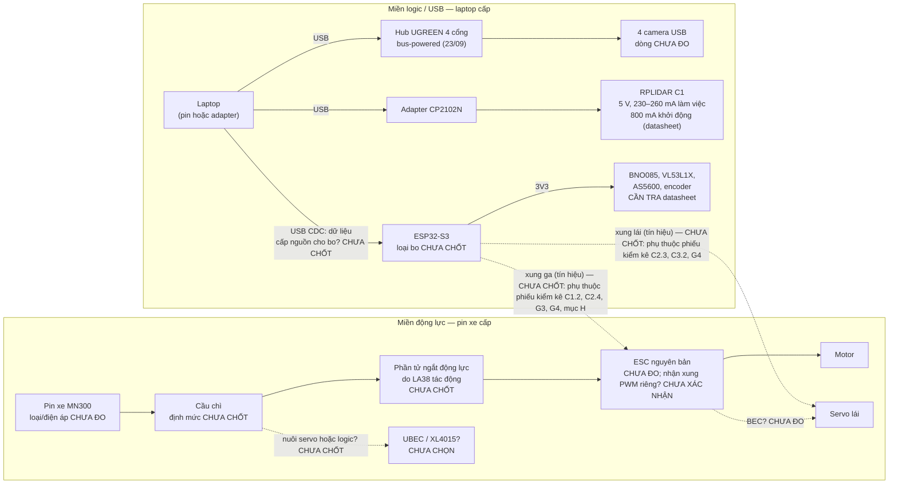
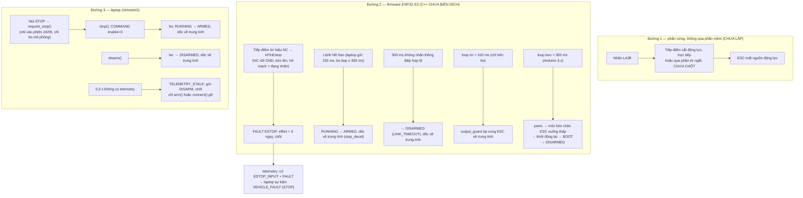

# Giai đoạn 6 — nguồn và dừng an toàn: bản nháp khi chưa có nguồn final (24/09/2026)

**Kế hoạch đối chiếu:** [v3.1](../../KE_HOACH_TRIEN_KHAI_XE_TU_DO_v3.1.md) mục 10 (giai đoạn 6, "Khi chưa có nguồn
final": bảng điện áp/dòng tải, tách đường nguồn, xác định phần tử mà LA38 tác động, chọn cầu chì/dây/đầu nối, viết trước
các tình huống lỗi), mục 3 (đợt mua 6), mục 16.2 (ngưỡng "Phản ứng lỗi" cần chốt), mục 16.3 (kịch bản "Điều khiển/an
toàn"). Thiết kế firmware và giao thức: [GIAO_THUC_XE.md](GIAO_THUC_XE.md) mục 0, 5, 6, 12;
[firmware README](../firmware/esp32_vehicle/README.md) mục "An toàn". Nối `VehicleIO` vào phiên đỗ xe (từ 24/09/2026,
chỉ bo mô phỏng): [CHE_DO_QUAN_SAT.md](CHE_DO_QUAN_SAT.md). Lúc kiểm (24/09/2026), mục 12 của GIAO_THUC_XE.md còn ghi
`VehicleIO` chưa nối vào phiên; dòng đó đã lỗi thời. *(Cập nhật tối 24/09/2026: mục 12 của GIAO_THUC_XE.md nay đã ghi
`VehicleIO` được nối vào phiên đỗ xe (bo mô phỏng và cổng serial giả, chưa với bo thật). Nó cũng ghi khoảng trống an toàn
`COMMAND_TIMEOUT` tìm thấy và sửa trong tối 24/09 (kịch bản L7). Câu trên chỉ còn là lịch sử.)*

**Mức bằng chứng:** bản nháp thiết kế. **Chưa có phần cứng nguồn hay dừng nào** (chưa có bộ nguồn, LA38, cầu chì, phần tử
ngắt, ESP32-S3, MN300). Dự án chưa đo điện áp hay dòng của thiết bị nào. Số duy nhất về điện có trong repo là số datasheet
của RPLIDAR C1 ([hardware_inventory.md](hardware_inventory.md)). Firmware C++ **chưa biên dịch**; mọi hành vi "theo thiết
kế" dưới đây lấy từ đặc tả, từ bản tham chiếu Python đã có test, hoặc từ mã C++ chưa chạy (ghi rõ ở từng chỗ). Không hành vi
nào đã thử trên thiết bị.

Kế hoạch đặt tên các đầu ra `power_budget.md`, "sơ đồ nguồn", "sơ đồ dừng", "bảng định mức còn cần kiểm tra". Bản nháp
của cả bốn nằm trong tệp này (mục 1–4). Khi có số đo thì tách `power_budget.md` ra riêng hay giữ ở đây: CHƯA CHỐT.

**Quy ước trạng thái:** "CHƯA ĐO" = đại lượng đo được nhưng chưa đo; "CẦN TRA datasheet" = số phải lấy từ tài liệu của
đúng linh kiện đã mua; "CHƯA CHỐT" = lựa chọn thiết kế chưa quyết định; "CHƯA THỬ" = phép thử chưa làm; "đề xuất" = ngưỡng
hoặc cách làm chưa kiểm trên thiết bị thật.

## 1. Bảng tải (nháp `power_budget`)

### 1.1. Từng tải

| # | Tải | Điện áp | Dòng điển hình | Dòng đỉnh | Lấy nguồn từ (dự kiến) | Nguồn số liệu | Trạng thái |
|---:|---|---|---|---|---|---|---|
| P1 | RPLIDAR C1 | 5 V | 230 mA (làm việc, 10 Hz) | 260 mA (làm việc); 800 mA lúc khởi động | cổng USB của laptop qua adapter CP2102N | datasheet C1M1 rev 1.1, ghi ở [hardware_inventory.md](hardware_inventory.md) | số datasheet; CHƯA ĐO trên thiết bị |
| P2 | Adapter USB–UART CP2102N (kèm LiDAR) | 5 V từ bus USB | CẦN TRA datasheet | CẦN TRA datasheet | cùng cổng với P1 | — | CHƯA ĐO |
| P3 | Hub UGREEN 4 cổng (bản thân hub) | 5 V từ bus USB | CẦN TRA datasheet | CẦN TRA datasheet | cổng USB laptop; hub có cổng nguồn ngoài (theo người dùng) | [usb_topology.md](usb_topology.md) | bus-powered trong mọi phiên 23/09; nguồn ngoài CHƯA THỬ |
| P4 | 4 camera USB "HD Camera" (VID 1BCF / PID 0B09) | 5 V từ bus USB qua hub | CHƯA ĐO | CHƯA ĐO | hub (P3) | [GIAI_DOAN_1_CAMERA.md](GIAI_DOAN_1_CAMERA.md): "dòng tiêu thụ chưa đo"; dự án chưa có đồng hồ đo USB | CHƯA ĐO |
| P5 | ESP32-S3 (bo chính) | ngõ vào tùy loại bo; logic 3,3 V | CẦN TRA datasheet | CẦN TRA datasheet | USB laptop (phương án thử trên bàn) hoặc bộ nguồn logic trên xe | [GIAO_THUC_XE.md](GIAO_THUC_XE.md) mục 0: loại bo CHƯA CHỐT | chưa nhận bo |
| P6 | BNO085 (IMU) | theo breakout; tín hiệu 3,3 V với ESP32-S3 | CẦN TRA datasheet | CẦN TRA datasheet | 3V3 của bo hoặc nguồn logic | — | chưa nhận |
| P7 | VL53L1X (2, có thể 4) | theo breakout; tín hiệu 3,3 V | CẦN TRA datasheet | CẦN TRA datasheet | như P6 | — | chưa nhận |
| P8 | AS5600 | theo breakout; tín hiệu 3,3 V | CẦN TRA datasheet | CẦN TRA datasheet | như P6 | — | chưa nhận |
| P9 | Encoder (MT6701 hoặc loại khác) | theo breakout | CẦN TRA datasheet | CẦN TRA datasheet | như P6 | loại encoder CHƯA CHỐT (kế hoạch mục 1.1) | chưa nhận |
| P10 | Servo lái (nguyên bản MN300) | CHƯA ĐO | CHƯA ĐO | CHƯA ĐO (không khóa cứng servo để đo, kế hoạch mục 10 bước 4) | BEC của ESC hoặc bộ nguồn riêng: CHƯA CHỐT | [mn300_inventory.md](mn300_inventory.md) C3.3 | xe chưa nhận |
| P11 | ESC + motor (nguyên bản MN300) | điện áp pin xe, CHƯA ĐO | CHƯA ĐO | CHƯA ĐO (không khóa cứng motor để đo dòng kẹt) | pin xe qua cầu chì và phần tử ngắt động lực | [mn300_inventory.md](mn300_inventory.md) B, C1, C4 | xe chưa nhận |
| P12 | Mạch đọc E-stop (tiếp điểm NC nối GND, điện trở kéo lên 3V3) | 3,3 V | 0,33–0,7 mA khi nhả nút (tính: 3,3 V / 10 kΩ … 4,7 kΩ; khi nhấn thì mạch hở, ≈ 0) | như điển hình | 3V3 của bo | trị số 4,7–10 kΩ là đề xuất trong [firmware README](../firmware/esp32_vehicle/README.md) | tính, CHƯA ĐO; chưa lắp |
| P13 | Phần tử ngắt động lực (nếu là rơ-le/công-tắc-tơ thì có cuộn hút) | CHƯA CHỐT | CẦN TRA datasheet | CẦN TRA datasheet | CHƯA CHỐT | kế hoạch mục 10 | loại phần tử CHƯA CHỐT |
| P14 | Bộ nguồn UBEC hoặc XL4015 (nếu dùng): hiệu suất, dòng không tải | CẦN TRA datasheet | CẦN TRA datasheet | CẦN TRA datasheet | pin xe | kế hoạch mục 1.1, 18: "chỉ chọn theo điện áp/tải thực" | CHƯA CHỌN; nuôi tải nào cũng CHƯA CHỐT |

Nguồn cấp (không phải tải của pin xe):

| Nguồn | Cấp cho | Còn thiếu | Trạng thái |
|---|---|---|---|
| Laptop (pin laptop hoặc adapter) | mọi thiết bị USB: P1–P5, và P6–P9 nếu bo lấy điện từ USB | khả năng cấp dòng của từng cổng USB: CẦN TRA tài liệu laptop; sơ đồ cổng USB của laptop RTX 3050 Ti (máy nộp đồ án) chưa có ([TONG_HOP_DU_AN.md](../../TONG_HOP_DU_AN.md) mục 2) | mọi số đo đến nay trên máy bàn |
| Pin xe MN300 | P10, P11, P13, P14 | loại, điện áp, dung lượng, dòng xả cho phép ([mn300_inventory.md](mn300_inventory.md) mục B) | xe chưa nhận |
| Adapter nguồn ngoài cho hub | P3, P4 | có dùng không; điện áp/dòng: CẦN TRA | tài liệu chưa ghi đã có hay chưa ([TONG_HOP_DU_AN.md](../../TONG_HOP_DU_AN.md) mục 5.3) |

### 1.2. Tổng theo nhánh

**Chưa cộng được.** Nhánh USB của laptop thiếu dòng của P2–P9; nhánh động lực thiếu P10, P11, P13, P14. Không điền tổng
bằng số ước lượng. Hai điều đã thấy từ số có sẵn:

- Dòng khởi động 800 mA của C1 (datasheet) cao hơn ba lần dòng làm việc (230–260 mA). Cổng USB cấp cho LiDAR phải chịu được
  đỉnh này: CẦN TRA theo cổng của laptop nộp đồ án. [hardware_inventory.md](hardware_inventory.md) đã khuyên cắm LiDAR thẳng
  vào cổng máy, không qua hub không có nguồn.
- Bốn camera đang chung một nhánh USB 2.0 qua hub bus-powered. Giả thuyết thiếu nguồn cho hiện tượng khung bị cắt **chưa
  kiểm** ([GIAI_DOAN_1_CAMERA.md](GIAI_DOAN_1_CAMERA.md), [usb_topology.md](usb_topology.md)).

### 1.3. Bảng đo khi có phần cứng (điền theo kế hoạch mục 10 bước 1–3)

Thứ tự bật theo kế hoạch: đo điện áp trước khi nối từng tải → logic → LiDAR → một camera → bốn camera → chấp hành có kiểm
soát. Mỗi dòng ghi điều kiện pin/nguồn lúc đo.

| Bước | Tải đang bật | Điểm đo | Điện áp không tải / có tải | Dòng (TB / đỉnh) | Sụt áp | Có reset/mất kết nối? | Nhiệt | Pin/nguồn lúc đo | Ngày, dụng cụ |
|---|---|---|---|---|---|---|---|---|---|
| 1 | chưa tải | ngõ ra từng nguồn, đúng cực | CHƯA ĐO | — | — | — | — | | |
| 2 | ESP32-S3 + cảm biến | | CHƯA ĐO | CHƯA ĐO | | | | | |
| 3 | + LiDAR | | CHƯA ĐO | CHƯA ĐO | | | | | |
| 4 | + 1 camera | | CHƯA ĐO | CHƯA ĐO | | | | | |
| 5 | + 4 camera (cùng LiDAR + AI như bàn thử) | | CHƯA ĐO | CHƯA ĐO | | | | | |
| 6 | + servo (đánh lái, xe kê cao) | | CHƯA ĐO | CHƯA ĐO | | | | | |
| 7 | + ESC/motor (bánh kê cao, trần effort 250 ‰) | | CHƯA ĐO | CHƯA ĐO | | | | | |
| 8 | toàn bộ, trên sàn, tốc độ thấp | | CHƯA ĐO | CHƯA ĐO | | | | | |

Dụng cụ cần: đồng hồ vạn năng, đồng hồ đo dòng USB (dự án chưa có), máy hiện sóng hoặc logic analyzer, nguồn bàn chỉnh
được áp/giới hạn dòng. Tài liệu dự án chưa ghi đã có dụng cụ nào trong số này (trừ việc chưa có đồng hồ đo USB).

## 2. Sơ đồ nguồn (nháp)

Hai miền tách nhau: **miền logic/USB** (laptop cấp) và **miền động lực** (pin xe cấp). Ô ghi CHƯA CHỐT là chỗ chưa quyết
định; đường chấm là liên kết chưa biết có hay không.



Cùng nội dung dạng chữ:

```text
MIỀN LOGIC/USB (laptop):
  Laptop ─USB─ Hub UGREEN (bus-powered) ─ 4 camera
  Laptop ─USB─ CP2102N ─ RPLIDAR C1
  Laptop ─USB CDC─ ESP32-S3 (nguồn cho bo: từ USB hay từ bộ nguồn trên xe? CHƯA CHỐT) ─3V3─ BNO085, VL53L1X, AS5600, encoder
MIỀN ĐỘNG LỰC (pin xe):
  Pin xe ─ cầu chì (CHƯA CHỐT) ─ phần tử ngắt do LA38 tác động (CHƯA CHỐT) ─ ESC ─ motor
  Servo: BEC của ESC hay UBEC/XL4015 riêng? (CHƯA CHỐT; phụ thuộc phiếu kiểm kê C1.6, C3.3)
TÍN HIỆU GIỮA HAI MIỀN:
  ESP32-S3 ─ xung ga ─> ESC ; ESP32-S3 ─ xung lái ─> servo ; (tham chiếu mass chung: CẦN KIỂM)
  (CHƯA CHỐT: ESC/bộ thu nguyên bản tách hay gộp, có nhận xung PWM riêng không, phiếu kiểm kê C1.2, C2.3–C2.4, C3.2,
   G3, G4, mục H; nếu không thì phải thay ESC, xem N7)
```

### 2.1. Quyết định còn mở

| # | Câu hỏi | Ảnh hưởng | Trạng thái |
|---:|---|---|---|
| N1 | Laptop đặt trên xe hay ngoài xe (dây USB kéo dài)? | chiều dài/loại cáp USB, hub đặt ở đâu, có cần nguồn ngoài cho hub | CHƯA CHỐT ([kế hoạch v3.1](../../KE_HOACH_TRIEN_KHAI_XE_TU_DO_v3.1.md) mục 1.1: đường điều khiển khi tích hợp xe chưa chốt) |
| N2 | ESP32-S3 lấy điện từ USB laptop hay từ bộ nguồn trên xe? | kịch bản L1–L3 (mục 5): rút cáp USB có làm bo mất điện không | CHƯA CHỐT |
| N3 | Servo lấy điện từ BEC của ESC hay nguồn riêng? | E-stop cắt động lực có làm servo mất điện không; khi FAULT firmware giữ góc lái, nhưng servo mất điện thì góc lái thả | CHƯA CHỐT; cần phiếu kiểm kê C1.6, C3.3 |
| N4 | UBEC hay XL4015, nuôi tải nào | bảng tải mục 1 | CHƯA CHỌN; kế hoạch: chỉ chọn sau bảng tải |
| N5 | Hub dùng nguồn ngoài hay bus-powered | P3, P4; hiện tượng khung bị cắt | phép thử nguồn ngoài CHƯA LÀM |
| N6 | Có công tắc riêng cho miền logic không | trình tự bật/tắt, kịch bản L1 | CHƯA CHỐT |
| N7 | ESC và bộ thu nguyên bản tách hay gộp; ESP32-S3 đưa xung ga/lái vào được mà không thay cụm điện không? | nếu gộp hoặc không nhận xung PWM: phải thay ESC (có thể cả servo) → đổi nhánh động lực (đầu nối, định mức, BEC; P10, P11; N3), hằng `kEsc*` của firmware, bảng B4/B5/B7 ở [GIAI_DOAN_4_CHUAN_BI.md](GIAI_DOAN_4_CHUAN_BI.md) | CHƯA CHỐT; chỉ quyết sau phiếu kiểm kê mục H và chạy thử (kế hoạch mục 8: "Chưa mua ESC thay thế chỉ từ tên xe") |

### 2.2. Điểm phải kiểm khi đấu dây

- Đo điện áp và cực tính trước khi nối từng tải (kế hoạch mục 10 bước 1).
- Nếu ESP32-S3 điều khiển ESC bằng xung riêng (N7): **tham chiếu mass cho tín hiệu:** xung từ ESP32-S3 sang ESC/servo cần
  mass chung giữa bo và ESC. Nếu bo lấy điện từ USB
  laptop thì mass laptop nối với cực âm pin xe qua đường này. Cách nối mass và ảnh hưởng nhiễu: CẦN KIỂM khi đấu.
- **Không để hai nguồn 5 V song song:** nếu ESC có BEC (dây đỏ trên dây tín hiệu) và bo đang lấy điện từ USB, không nối dây
  đỏ BEC vào 5 V của bo khi chưa xét kỹ. Cách đấu: CHƯA CHỐT, phụ thuộc phiếu kiểm kê C1.6.
- Nếu ESP32-S3 điều khiển ESC bằng xung riêng (N7): điện trở kéo xuống (≈ 10 kΩ, đề xuất trong
  [firmware README](../firmware/esp32_vehicle/README.md)) trên dây tín hiệu ESC,
  để chân không thả nổi lúc bật nguồn/system reset. Điện trở kéo lên 4,7–10 kΩ lên 3V3 tại bo cho ngõ E-stop.

## 3. Sơ đồ dừng (nháp)

Ba lớp dừng, theo nguyên tắc của kế hoạch mục 2.1: "E-stop vật lý là đường dừng riêng, không phụ thuộc giao diện laptop".
Kế hoạch mục 10: "Một nút bấm đơn lẻ không được đánh dấu là đã hoàn tất E-stop".



### 3.1. Bảng các đường dừng

| Đường | Kích hoạt | Tác động lên | Không phụ thuộc phần mềm? | Hằng số thời gian theo thiết kế | Trạng thái |
|---|---|---|---|---|---|
| LA38 → phần tử ngắt | nhấn nút; đứt dây điều khiển (nếu thiết kế an toàn khi hở mạch) | nguồn động lực của ESC | có (theo ý đồ thiết kế) | CHƯA ĐO (phụ thuộc phần tử) | phần tử CHƯA CHỐT, chưa lắp |
| LA38 tiếp điểm tín hiệu (`kPinEstop`) → firmware | nhấn nút; đứt dây; tuột đầu nối | effort = 0, FAULT chốt | không | mỗi chu kỳ điều khiển 10 ms | đã chọn kiểu đấu; `kPinEstop` = −1; chưa lắp, chưa thử |
| Thời hạn lệnh | laptop ngừng gửi COMMAND | dốc mục tiêu về 0 | không | ≤ 300 ms (kẹp) rồi dốc 600 mm/s² | có test trên bản tham chiếu Python |
| Watchdog liên lạc của bo | 500 ms không nhận gì | DISARMED | không | 500 ms | có test Python |
| `output_guard` | loop firmware im > 100 ms | xung ESC = trung tính | không (chạy trên bo) | 100–110 ms (README) | chỉ trong C++, chưa biên dịch |
| Task watchdog + móc panic | loop treo > 300 ms (3.x); 1 s hoặc giữ mặc định (2.x) | chân ESC thấp, chip khởi động lại | không | xem [GIAO_THUC_XE.md](GIAO_THUC_XE.md) mục 5 | chỉ trong C++, chưa biên dịch, CẦN KIỂM TRÊN BO |
| `stop()` / `disarm()` của laptop | nút STOP, phiên dừng/kết thúc | ARMED / DISARMED, dốc | không | trễ truyền + dốc | Đã nối vào phiên từ 24/09/2026 ở hai chế độ VEHICLE_IO/OBSERVE, **chỉ với bo mô phỏng** (`SimVehicleIO` + `FirmwareModel`; [CHE_DO_QUAN_SAT.md](CHE_DO_QUAN_SAT.md), `application/vehicle_link.py`). Ở VEHICLE_IO: nút STOP → `request_stop()` → COMMAND enable=0 mỗi nhịp điều khiển; kết thúc lần chạy → enable=0 rồi DISARM (có test mô phỏng, `tests/test_session_vehicle.py`). Ở OBSERVE không gửi lệnh nào. Giao diện chưa có chọn cổng serial tới bo thật; đường này trên bo thật CHƯA THỬ. *(Cập nhật 25/09/2026: thẻ "Bo điều khiển" nay chọn được cổng COM, commit `6db5087`, nhưng START với bo thật luôn bị từ chối vì chưa có nguồn tư thế thật; chỉ nút "Kiểm kết nối bo" mở cổng, và nó không ARM, không gửi COMMAND nào ([CHE_DO_QUAN_SAT.md](CHE_DO_QUAN_SAT.md) mục 6). Đường này trên bo thật vẫn CHƯA THỬ)* |
| `TELEMETRY_STALE` của laptop | 0,3 s không có telemetry | gửi DISARM, chốt `send(enable=True)` | không | 0,3 s | có test Python |

Mô phỏng `VehicleIO` giả định E-stop cắt động lực (`actuator.estop_cuts_power: true` trong
[vehicle_io_sim.json](../configs/vehicle_io_sim.json)). Đó là giả định của mô phỏng, chưa có phần cứng nào làm việc đó.

### 3.2. Phần tử mà LA38 cắt: các phương án (CHƯA CHỐT)

| Phương án | Mô tả | Cần kiểm trước khi chọn |
|---|---|---|
| A | Tiếp điểm của nút nằm trực tiếp trên dây động lực pin → ESC | định mức dòng/áp một chiều của tiếp điểm so với dòng ESC (cả hai CHƯA ĐO/CẦN TRA); hồ quang khi cắt dòng một chiều |
| B | Tiếp điểm NC của nút nằm trên cuộn hút của rơ-le/công-tắc-tơ loại thường mở; phần tử này cắt động lực | định mức tiếp điểm chính của phần tử; mất nguồn cuộn hút hay đứt dây = cắt động lực (an toàn khi hở mạch) |
| C | Nút điều khiển một khóa bán dẫn (MOSFET) trên động lực | định mức dòng, tản nhiệt, hỏng kiểu ngắn mạch thì không cắt được — cần xét |

Yêu cầu chung (từ kế hoạch và firmware): cắt động lực không qua phần mềm; đứt dây không làm mất chức năng dừng; tiếp điểm
NC loại mở cưỡng bức (theo [firmware README](../firmware/esp32_vehicle/README.md), để tiếp điểm dính vẫn bị tách khi nhấn);
nút cần đủ khối tiếp điểm cho cả đường động lực lẫn tín hiệu về ESP32-S3 (số và loại khối tiếp điểm của LA38 đã mua: CẦN
KIỂM trên hàng thật; nút có tự giữ khi nhấn không: CẦN KIỂM). Tài liệu này còn đề xuất đo điện áp phía động lực qua bộ
chia áp để phát hiện mất động lực (chưa làm). README cũng nêu phương án đọc thêm một tiếp điểm phụ của nút, nhưng tiếp điểm
đó chỉ báo trạng thái nút, không thấy cầu chì đứt hay đầu nối động lực tuột.

### 3.3. Sau sự kiện nào thì cần thao tác gì để chạy lại

Nguyên tắc: không tự chạy lại sau khi nhả nút dừng hay nối lại cáp; phải có thao tác cho phép mới (kế hoạch mục 10 bước 6,
mục 13).

| Sự kiện | Bo ở trạng thái | Laptop thấy | Thao tác để chạy lại | Nguồn |
|---|---|---|---|---|
| Nhả E-stop | vẫn FAULT (CLEAR_FAULT bị từ chối `ESTOP_ACTIVE` khi nút còn nhấn) | FAULT trong telemetry | CLEAR_FAULT → DISARMED → ARM → COMMAND enable mới | GIAO_THUC_XE mục 6 |
| Động lực có lại sau khi đóng phần tử ngắt | không đổi (bo không mất điện nếu miền logic tách riêng) | — | như trên; ESC vừa có điện lại nhận xung trung tính vì effort = 0; ESC xử lý lúc bật nguồn thế nào: CHƯA CHỐT (phiếu kiểm kê C1.12) | — |
| Rút rồi cắm lại USB laptop–bo | DISARMED sau `reopen()` + `connect()` (phiên mới) | `LINK_ERROR` lúc rút | `reopen()` → `connect()` → `arm()` → COMMAND mới; lệnh phiên cũ bị từ chối. Lỗi cổng làm `SerialVehicleIO` đóng cổng (`transport = None`), nên gọi thẳng `connect()` sẽ báo `VehicleIOError("Cổng chưa mở")`. `reopen()` chỉ dùng được khi đối tượng được tạo bằng `SerialVehicleIO.open(port)`, vì cần hàm mở lại cổng | GIAO_THUC_XE mục 4, 6, 11; `transport/vehicle_io.py` `SerialVehicleIO` (docstring, `_link_failed`, `reopen`); test `test_serial_unplug_raises_link_error_and_reconnect_stays_disarmed` (cổng giả) |
| Bo khởi động lại (watchdog, sụt áp, mất điện) | BOOT (giữ trung tính `boot_hold_ms` 1000 ms) → DISARMED | telemetry ngừng → `TELEMETRY_STALE`; ACK `NO_SESSION`; `boot_id` mới → `FIRMWARE_RESET`; `reset_reason` trong HELLO_ACK | `connect()` → `arm()` → COMMAND mới. CẦN KIỂM trên bo thật: nếu bo dùng USB CDC gốc của ESP32-S3 thì khi bo reset, Windows có thể bỏ rồi tạo lại cổng COM; khi đó cũng có `LINK_ERROR` và phải `reopen()` trước `connect()` | GIAO_THUC_XE mục 3, 4 |
| Ứng dụng laptop khởi động lại | DISARMED sau HELLO mới | — | `connect()` → `arm()` | GIAO_THUC_XE mục 6 |
| `TELEMETRY_STALE` rồi telemetry có lại | có thể vẫn ARMED | `TELEMETRY_RESUMED` (LOG), chốt vẫn giữ | `arm()` hoặc `connect()` | GIAO_THUC_XE mục 5 |
| STALL, LOOP_OVERRUN, SUPPLY_LOW | FAULT | `VEHICLE_FAULT` | CLEAR_FAULT (SUPPLY_LOW chỉ khi điện áp đo lại ≥ ngưỡng) → ARM → COMMAND mới | GIAO_THUC_XE mục 6 |
| Lệnh hết hạn (`COMMAND_TIMEOUT`) mà liên lạc vẫn còn | ARMED | `VEHICLE_STOPPED` (lý do `COMMAND_TIMEOUT`) | Ở mức giao thức: **COMMAND enable=1 là đủ, không cần ARM lại** (máy trạng thái: ARMED + COMMAND enable=1 → RUNNING). Phiên đỗ xe qua `VehicleIO` (từ 24/09/2026, bo mô phỏng) coi `VEHICLE_STOPPED` là STOP và không gửi lại enable trong lần chạy đó: phải lập lại đường rồi Bắt đầu đỗ (`arm()` mới). Xem kịch bản L7. *(Cập nhật muộn hơn tối 24/09/2026: câu "không gửi lại enable" từng có ngoại lệ trên mô phỏng. Nếu vòng điều khiển treo trong khi telemetry vẫn được đọc và bước đầu tiên khi hết treo rơi vào nhịp điều khiển (pha 0), một enable=1 lọt tới bo trước khi `VEHICLE_STOPPED` được xử lý. Đã sửa cùng tối: `VehicleLink.refresh()` chạy trước nhịp điều khiển, và `command()` không gửi khi còn sự kiện dừng chưa lấy. Mới kiểm trên bo mô phỏng và cổng serial giả; [GIAO_THUC_XE.md](GIAO_THUC_XE.md) mục 12)* | GIAO_THUC_XE mục 6; [CHE_DO_QUAN_SAT.md](CHE_DO_QUAN_SAT.md) mục 3 |

Có cần thêm một chốt phần cứng (nút đóng lại động lực riêng) sau khi nhả E-stop không, ngoài chốt FAULT của firmware:
CHƯA CHỐT. Với phương án B ở mục 3.2, nhả nút là cuộn hút có điện lại và động lực đóng ngay; khi đó việc xe không chạy chỉ
còn dựa vào firmware đang ở FAULT.

## 4. Bảng định mức còn phải kiểm

Kế hoạch mục 10: "không khóa con số 15 A/30 A chỉ vì danh sách bán hàng". Các số 15 A (cầu chì) và 30 A (công tắc) chỉ xuất
hiện trong danh sách bán hàng (kế hoạch mục 1.1); **không phải định mức đã chọn**.

| Hạng mục | Cần biết trước khi chọn | Lấy từ đâu | Hiện có | Trạng thái |
|---|---|---|---|---|
| Pin xe | điện áp danh định và lúc sạc đầy, dòng xả cho phép, đầu nối | nhãn pin, phiếu kiểm kê mục B | — | xe chưa nhận |
| Cầu chì chính (động lực) | dòng liên tục và đỉnh của ESC + motor (P11); điện áp một chiều định mức của cầu chì; kiểu tác động | đo P11 (không khóa motor), datasheet cầu chì | link cầu chì/đế ở kế hoạch mục 18 | CHƯA CHỐT |
| Cầu chì nhánh logic/servo (nếu có) | dòng P5–P10, P14 | bảng tải mục 1 | — | CHƯA CHỐT |
| Dây động lực | dòng liên tục, chiều dài, nhiệt | đo P11; bảng tiết diện theo dòng | — | CHƯA CHỐT |
| Đầu nối động lực (XT60 hay loại khác) | tương thích đầu nối pin/ESC nguyên bản; định mức dòng | phiếu kiểm kê C5.1; datasheet đầu nối | link XT60 ở kế hoạch mục 18, ghi "kiểm tra tương thích" | CHƯA CHỐT |
| Tiếp điểm LA38 | dòng/áp một chiều định mức của từng khối; số khối NO/NC; khối NC có phải loại mở cưỡng bức (positive opening) không, như [firmware README](../firmware/esp32_vehicle/README.md) yêu cầu; kiểu tự giữ | nhãn/datasheet của nút đã mua | link ở kế hoạch mục 18 | CẦN KIỂM trên hàng thật |
| Phần tử ngắt (mục 3.2) | dòng tiếp điểm chính, cuộn hút (điện áp, dòng), thời gian cắt | datasheet | — | CHƯA CHỐT |
| UBEC / XL4015 | điện áp vào/ra, dòng ra liên tục và đỉnh, nhiệt | datasheet; bảng tải | link ở kế hoạch mục 18 | CHƯA CHỌN |
| Dây và đầu nối servo | dòng servo (P10) | đo | — | CHƯA ĐO |
| Dây tín hiệu E-stop | chống kéo tuột; tuột = FAULT (theo thiết kế) | — | — | CHƯA CHỐT |
| Điện trở kéo xuống dây ESC, kéo lên ngõ E-stop | trị số, vị trí gần bo | [firmware README](../firmware/esp32_vehicle/README.md) (≈ 10 kΩ; 4,7–10 kΩ) | đề xuất | chưa lắp |
| Cổng USB laptop | dòng cấp mỗi cổng; cổng nào chung bộ điều khiển | tài liệu laptop; sơ đồ cổng USB của laptop | chưa có | CẦN TRA |
| Cáp USB (camera, LiDAR, ESP32) | chiều dài, loại; A/B cáp ngắn – cáp dài (kế hoạch mục 6 bước 9) | ghi khi lắp | chưa ghi ([hardware_inventory.md](hardware_inventory.md)) | CHƯA GHI |
| Adapter nguồn hub | điện áp/dòng | nhãn adapter | tài liệu chưa ghi đã có | CHƯA THỬ |

## 5. Kịch bản thử lỗi

### 5.1. Mức thử

Theo trình tự của [firmware README](../firmware/esp32_vehicle/README.md) ("Trình tự thử trên bo", "Cách kiểm trên bo") và
kế hoạch mục 9–10:

| Mức | Cấu hình | Điều kiện trước |
|---|---|---|
| R | Bàn thử cảm biến hiện có trên máy bàn (LiDAR + 4 camera + xe ảo), không có xe | cần người rút/cắm cáp |
| M0 | Chỉ bo ESP32-S3 cắm USB, `AP_ENABLE_PWM_OUTPUTS=0`: xem trạng thái và telemetry | có bo; đã biên dịch và nạp firmware (cần trình biên dịch/PlatformIO: người dùng quyết định cài) |
| M1 | Bật xung, chân đã chốt, **chưa nối** ESC/servo; máy hiện sóng/logic analyzer trên chân ESC và chân servo | như M0 + chốt chân + dụng cụ đo xung |
| M2 | Nối ESC/servo theo sơ đồ đã đối chiếu, xe kê cao bánh không chạm đất, đường dừng phần cứng sẵn sàng, trần effort 250 ‰ | như M1 + MN300 + phần tử ngắt đã lắp |
| M3 | Trên sàn, tốc độ thấp trong vùng thử, người giám sát cầm nút dừng | M2 đạt; kế hoạch: nguồn/dừng xác nhận trước khi chạy tự động trên sàn |

**Công thức dùng cho tiêu chí đề xuất** (tính từ tham số thiết kế, CHƯA ĐO): sau khi bo ngừng nhận lệnh, xung ESC phải về
trung tính (1500 µs) không muộn hơn

`T = t_hạn + |v_ref| / stop_decel + 10 ms (một chu kỳ điều khiển) + 20 ms (một chu kỳ xung 50 Hz)`,

với `t_hạn` là thời hạn còn lại của lệnh cuối (laptop gửi 150 ms; bo kẹp ≤ 300 ms), `stop_decel` = 600 mm/s². Ví dụ
`v_ref` = 0,15 m/s, `t_hạn` = 150 ms: T = 0,15 + 0,25 + 0,03 = 0,43 s. Công thức chỉ nói về **xung**, không nói về quãng
dừng thật của xe.

### 5.2. Tổng hợp

| # | Tình huống | Mức thử | Trạng thái |
|---:|---|---|---|
| L1 | Bo ESP32-S3 mất nguồn khi đang chạy | M1, M2 | CHƯA THỬ |
| L2 | Laptop tắt / ngủ / chương trình bị đóng | M1, M2 | CHƯA THỬ |
| L3 | Rút cáp USB laptop–ESP32-S3 | M0, M1, M2 | CHƯA THỬ (mới có test với cổng giả) |
| L4 | Rút cáp USB LiDAR | R | CHƯA THỬ (mới có test với nguồn quét kịch bản; từ tối 24/09/2026 thêm test với cổng nối tiếp GIẢ, `tests/test_lidar_unplug.py`) |
| L5 | Rút cáp một camera, hoặc rút hub | R | CHƯA THỬ |
| L6 | Mất cảm biến trên bo (encoder, AS5600, IMU, ToF) | M0, M2 | CHƯA THỬ |
| L7 | Treo chương trình laptop | M0, M1, M2 | CHƯA THỬ (có test mô phỏng cho trường hợp Heartbeat vẫn chạy; tối 24/09/2026 tìm thấy và sửa một khoảng trống trên mô phỏng, xem chi tiết L7) |
| L8 | Treo firmware (loop im, treo lâu, panic) | M1 | CHƯA THỬ |
| L9 | Khởi động lại bo; khởi động lại chương trình laptop | M0, M1, M2 | CHƯA THỬ (có test mô phỏng) |
| L10 | Nhấn E-stop khi đang chạy | M1, M2, M3 | CHƯA THỬ |
| L11 | Đứt dây / tuột đầu nối E-stop | M0, M2 | CHƯA THỬ |
| L12 | Nhả E-stop | M2 | CHƯA THỬ |
| L13 | Pin yếu | M0 (nguồn bàn), M2 | CHƯA THỬ |
| L14 | Sụt áp (brownout) khi động cơ kéo | M1, M2 | CHƯA THỬ |
| L15 | Lệnh STOP từ laptop | M1, M2, M3 | CHƯA THỬ |
| L16 | Mất động lực khi logic còn (cầu chì đứt, đầu nối động lực tuột) | M2 | CHƯA THỬ |

### 5.3. Chi tiết từng kịch bản

Cột "Hành vi mong đợi" là điều thiết kế hiện tại **nói sẽ xảy ra**, không phải điều đã thấy. "Tiêu chí đạt" là đề xuất;
ngưỡng cuối phải chốt theo kế hoạch mục 16.2 ("Phản ứng lỗi: thời gian phát hiện, phát lệnh dừng, dừng thực; xử lý
reconnect").

**L1 — Bo ESP32-S3 mất nguồn khi đang chạy**

| | |
|---|---|
| Hành vi mong đợi | Bo tắt; chân ESC thả nổi, điện trở kéo xuống ngoài (đề xuất, chưa lắp) giữ ở mức thấp, tức không có xung. ESC khi mất xung làm gì: CHƯA CHỐT (phiếu kiểm kê C1.13). Laptop: nếu bo lấy điện từ USB thì cổng mất → `LINK_ERROR`; nếu không thì 0,3 s không có telemetry → `TELEMETRY_STALE`. Có điện lại: BOOT, giữ trung tính 1000 ms → DISARMED; `boot_id` mới, `reset_reason` = bật nguồn |
| Cách thử | M1: cắt nguồn bo khi đang RUNNING với effort ≠ 0; máy hiện sóng ghi mức chân ESC từ lúc cắt tới lúc có lại 1500 µs sau khi cấp điện lại. M2: như trên với bánh kê cao; quay video bánh |
| Tiêu chí đạt (đề xuất) | Chân ESC không phát xung khác trung tính từ lúc mất điện tới khi firmware chạy lại; bánh ngừng được kéo (thời gian CẦN CHỐT sau khi đo); sau khi có điện lại, không chuyển động cho tới ARM + COMMAND mới |
| Trạng thái | CHƯA THỬ |

**L2 — Laptop tắt, ngủ, hoặc chương trình bị đóng**

| | |
|---|---|
| Hành vi mong đợi | Bo lấy điện từ USB laptop: như L1. Bo có nguồn riêng: lệnh cuối hết hạn → RUNNING → ARMED, dốc về trung tính; 500 ms không có thông điệp → DISARMED (`LINK_TIMEOUT`) |
| Cách thử | M1/M2: đóng tiến trình laptop (hoặc cho máy ngủ) khi bo đang RUNNING; máy hiện sóng trên chân ESC |
| Tiêu chí đạt (đề xuất) | Xung về 1500 µs trong thời gian T (mục 5.1) tính từ COMMAND cuối bo nhận; sau khi laptop chạy lại, không chuyển động cho tới `connect()` + `arm()` + COMMAND mới. Chế độ ngủ và tiết kiệm điện USB của Windows có thể cắt cổng: CẦN KIỂM cài đặt máy nộp đồ án (người dùng làm) |
| Trạng thái | CHƯA THỬ |

**L3 — Rút cáp USB laptop–ESP32-S3**

| | |
|---|---|
| Hành vi mong đợi | Laptop: lỗi cổng → `LINK_ERROR` (STOP); test với cổng giả đã có: "rút cáp → LINK_ERROR, mở lại vẫn DISARMED" ([GIAO_THUC_XE.md](GIAO_THUC_XE.md) mục 11). Bo lấy điện từ cáp này: như L1. Bo có nguồn riêng: như L2. Cắm lại: `reopen()` mở lại cổng rồi `connect()` mở phiên mới → DISARMED (gọi `connect()` khi chưa `reopen()` sẽ báo `Cổng chưa mở`); lệnh phiên cũ bị từ chối |
| Cách thử | M0: rút/cắm khi RUNNING (không có xung), xem trạng thái sau khi cắm lại. M1/M2: thêm máy hiện sóng; ghi thời điểm rút bằng kênh thứ hai (ví dụ VBUS phía bo nếu bo có nguồn riêng) hoặc video |
| Tiêu chí đạt (đề xuất) | Laptop báo STOP (`LINK_ERROR` hoặc `TELEMETRY_STALE`) ≤ 0,3 s + một chu kỳ telemetry (50 ms) sau khi rút; xung về trung tính trong T; sau khi cắm lại không chuyển động cho tới `arm()` + COMMAND mới |
| Trạng thái | CHƯA THỬ trên bo (có test với cổng giả) |

**L4 — Rút cáp USB LiDAR**

| | |
|---|---|
| Hành vi mong đợi | Lỗi driver ném ra khi rút cáp: CẦN THỬ. Có hai khả năng. (a) Cổng còn mở nhưng không có byte: hết `revolution_timeout_s` (1,0 s mặc định) thì ném `ScanReadError`. (b) Thiết bị CP2102N biến mất: theo mã pyserial 3.5 (`serialwin32.py`, `in_waiting`/`read`), khả năng cao là `serial.SerialException` (một `OSError`). Driver không đổi lỗi này thành `ScanReadError` (`lidar/rplidar_c1.py`, `read()`). Lỗi nào thật sự xảy ra: CHƯA ĐO. Trong `ui.lidar_app` (ngăn LiDAR, `ui/lidar_dock.py`), luồng đọc `ScanReader` của `lidar/live_view.py` bắt mọi lỗi và hiện tên lỗi. `FreshnessMonitor` báo `STALE_DATA`; lớp `LiveLidar` là lớp **bắt buộc**, tuổi tối đa 0,3 s → bản đồ hợp nhất không hợp lệ, mọi ô bị chặn → phiên dừng ([GIAI_DOAN_3_CHUAN_BI.md](GIAI_DOAN_3_CHUAN_BI.md)). Cắm lại: cổng COM có giữ nguyên không, xe ảo có tự chạy tiếp không: CẦN THỬ. *(Cập nhật tối 24/09/2026; chỉ thử với cổng nối tiếp GIẢ trong `tests/test_lidar_unplug.py`, 13 test. Câu "driver không đổi lỗi này thành `ScanReadError`" đã lỗi thời. Driver nay ném lại lỗi của cổng nối tiếp trong `read()` (`OSError`/`SerialException` từ `in_waiting`/`read`) thành `LidarTransportError`, lớp con của `ScanReadError`, giữ lỗi gốc ở `__cause__`. Hết thời gian chờ vẫn là `ScanReadError` thường. `close()` vẫn ném `OSError` khi không gửi được STOP qua cổng đã chết. `fusion/demo.py`: gặp lỗi cổng lúc xe ảo chạy thì thôi đọc cổng và dừng xe ảo ngay với lý do "Mất kết nối LiDAR (lỗi cổng nối tiếp)", không chờ lớp LiveLidar hết hạn. Demo kết thúc khi xe ảo đứng yên, đóng cổng chết không ném lỗi lần hai, in dòng JSON và thoát mã 1; lỗi cổng trước khi xe chạy cũng kết thúc gọn, mã 1. `lidar.bench record`: sau 3 lỗi đọc thì dừng, vẫn lưu và phân tích phần đã ghi, in cảnh báo, thoát mã 1. `ui.lidar_app`: luồng `ScanReader` hiện tên lỗi (nay là `LidarTransportError`) và thử đọc lại mỗi 0,2 s. Vì không có vòng quét mới nên đường dừng vẫn là "bản đồ hợp nhất không hợp lệ" như trên (suy ra từ mã). Lỗi thật sự xảy ra khi rút cáp C1: vẫn CHƯA ĐO.)* |
| Cách thử | R: chạy `python -m autopark.ui.lidar_app` (Kết nối → Tìm đường đỗ → Bắt đầu đỗ; giữ ô "Vật mới trên đường làm xe dừng" được chọn, mặc định là chọn), rồi rút cáp USB của LiDAR khi xe ảo đang chạy. Ghi lại tên lỗi hiện trên ngăn LiDAR (`ScanReadError` hay `SerialException`/`OSError`). Không dùng `fusion/demo.py` cho phép thử này: vòng lặp của nó chỉ bắt `ScanReadError` (`fusion/demo.py` ~dòng 98), nên `SerialException` sẽ làm chương trình dừng bằng traceback trước khi đi tới đường dừng "bản đồ hợp nhất không hợp lệ". `source.close()` trong `finally` cũng có thể ném thêm lỗi, vì `stop()` ghi ra cổng đã mất (suy ra từ mã). Kết quả như vậy không chấm đạt/không đạt được. Ghi thời điểm vòng quét cuối, lúc phát yêu cầu dừng, lúc xe ảo đứng yên; cắm lại và ghi điều xảy ra. *(Cập nhật tối 24/09/2026: lý do "không dùng `fusion/demo.py`" ở trên đã lỗi thời, vì demo nay bắt lỗi cổng và kết thúc gọn. Có thể thử cả hai đường dừng. Đường "bản đồ hợp nhất không hợp lệ" dùng `ui.lidar_app` như trên. Đường "Mất kết nối LiDAR" dùng `.venv\Scripts\python.exe -X utf8 -m autopark.fusion.demo --seconds 30`; ghi thêm dòng JSON cuối và mã thoát (kỳ vọng 1). Muốn giữ phần quét tới lúc rút thì dùng `.venv\Scripts\python.exe -X utf8 -m autopark.lidar.bench record --out runs\lidar_bench\rut_cap --name rut_cap --seconds 30`, kỳ vọng thoát mã 1 và có `.npz` + `.analysis.json`. Chưa lệnh nào trong số này chạy với cáp thật. Danh sách tên lỗi cần ghi ở trên cũng đã lỗi thời: nay driver đổi mọi `OSError` (kể cả `SerialException` của pyserial) trong `read()` thành `LidarTransportError`, nên ngăn LiDAR không còn hiện `SerialException`/`OSError` trần. Cần ghi một trong hai: `LidarTransportError` (cổng nối tiếp lỗi; tên lỗi gốc, ví dụ `SerialException`, nằm trong dòng thông báo `serial port failed (...)` và ở `__cause__`) hoặc `ScanReadError` thường (hết `revolution_timeout_s`, cổng còn mở mà không có byte). Chép nguyên dòng thông báo (suy ra từ mã `lidar/rplidar_c1.py` `read()` và `ui/lidar_dock.py`; CHƯA THỬ với cáp thật).)* Các lệnh trong ô này mở LiDAR ở cổng ghi trong `configs/thiet_bi.json`; thêm `--port COMx` để ghi đè ([chuyển máy](CHUYEN_MAY_BAN.md)). |
| Tiêu chí đạt (đề xuất) | Yêu cầu dừng ≤ 0,3 s + 0,1 s (một vòng quét) sau vòng quét cuối; không chạy tiếp khi LiDAR có lại mà không có thao tác của người dùng |
| Trạng thái | CHƯA THỬ với cáp thật; mới kiểm bằng nguồn quét kịch bản ([GIAI_DOAN_3_CHUAN_BI.md](GIAI_DOAN_3_CHUAN_BI.md) mục 1). *(Cập nhật tối 24/09/2026: thêm test với cổng nối tiếp GIẢ, [`tests/test_lidar_unplug.py`](../tests/test_lidar_unplug.py), 13 test đạt; vẫn CHƯA THỬ với cáp thật.)* |

**L5 — Rút cáp một camera, hoặc rút hub**

| | |
|---|---|
| Hành vi mong đợi | `MultiCameraManager`: camera không có khung tốt trong 0,5 s (`STALE_AFTER_S`) bị loại khỏi bộ ảnh và báo cũ/thiếu; các camera khác chạy tiếp. Lớp `CameraSemantic` của hợp nhất là lớp **tùy chọn** (`required=False`, tuổi tối đa 0,5 s): mất camera **không** làm bản đồ hợp nhất không hợp lệ, phần ô của camera bị bỏ. Lúc viết (24/09) camera chưa nối vào costmap hay planner. Có nên dừng khi mất camera: CHƯA CHỐT. Cắm lại cùng cổng: InstanceId giữ nguyên ([usb_topology.md](usb_topology.md)); camera có tự mở lại không: CẦN THỬ |
| Cách thử | R: bàn thử bốn camera + LiDAR + AI; rút một camera, rồi rút cả hub; ghi thời điểm |
| Tiêu chí đạt (đề xuất) | Camera bị báo thiếu ≤ 0,5 s + một chu kỳ khung; không camera khỏe nào bị bỏ nhầm (mốc so sánh: ba phiên bật quy tắc không chờ w01, w03, w05 ngày 24/09 có 0 bộ thiếu camera khỏe trong 7.155 bộ, [GIAI_DOAN_2_BAN_THU.md](GIAI_DOAN_2_BAN_THU.md) mục 10); mất cả hub thì cả bốn bị báo thiếu |
| Trạng thái | CHƯA THỬ |

**L6 — Mất cảm biến trên bo**

| | |
|---|---|
| Hành vi mong đợi | Mỗi số đo có cờ hợp lệ; số đo không hợp lệ gửi 0 và laptop đổi thành `None` ([GIAO_THUC_XE.md](GIAO_THUC_XE.md) mục 8). **Encoder:** `SPEED_VALID` = 0 → vòng tốc độ chỉ còn feedforward (`SPEED_LOOP_CLOSED` = 0), vẫn kẹp trần effort; FAULT `FEEDBACK_LOST` **chỉ khi** `require_speed_feedback = True`, mặc định là False. Vậy với mặc định hiện tại, mất encoder giữa lúc chạy thì bo **chạy tiếp mạch hở**. Encoder báo sai mà cờ vẫn hợp lệ (kẹt 0, đảo dấu): STALL sau 1000 ms ở \|effort\| ≥ 200 ‰. **AS5600:** `STEER_VALID` = 0, laptop nhận `steer_rad = None`. **IMU:** `IMU_VALID` = 0. **ToF:** bit mặt nạ = 0, giá trị 0 (không bao giờ là "xa"); lớp `NearField` là lớp tùy chọn nên không làm bản đồ không hợp lệ. Hiện firmware chưa có mã đọc cảm biến nào, mọi số đo đều báo không hợp lệ |
| Cách thử | M0: rút từng breakout khi bo chạy, xem cờ trong telemetry. M2: rút đầu nối encoder khi bánh kê cao đang quay ở vòng kín |
| Tiêu chí đạt (đề xuất) | Cờ hợp lệ về 0 trong telemetry kế tiếp; không số đo nào bị báo thành giá trị an toàn. Trước M3 phải chốt: đặt `require_speed_feedback = True` hay không. Phía laptop, phiên qua VehicleIO đã dừng khi telemetry thiếu tốc độ hoặc góc lái đo (`NO_MEASURED_STATE`, `VehicleLink.observe()`), và từ chối START trong trường hợp đó (`_start_problems()`). Đây là đọc mã ngày 24/09/2026 (nhánh bo mô phỏng); chưa có test riêng cho hai điều này. *(Cập nhật tối 24/09/2026: nay đã có test, bo mô phỏng, `tests/test_session_vehicle.py`. `test_measured_speed_lost_mid_run_stops_and_standstill_is_not_assumed`: mất tốc độ giữa lúc chạy → dừng đầu tiên `NO_MEASURED_STATE`, kết thúc FAULT `STOP_NOT_CONFIRMED` vì không xác nhận được đứng yên. `test_measured_steer_lost_mid_run_stops`: mất góc lái → `NO_MEASURED_STATE`, STOPPED. Cả hai không có enable nào sau lệnh dừng. Từ chối START: `test_start_refused_without_measured_speed` và `test_start_refused_without_measured_steer[VEHICLE_IO/OBSERVE]`, từ chối trước khi ARM, 0 COMMAND.)* Vì firmware hiện báo mọi số đo là không hợp lệ, START qua bo thật sẽ bị từ chối cho tới khi có mã đọc encoder/AS5600 (suy ra từ mã, CHƯA THỬ) |
| Trạng thái | CHƯA THỬ; chính sách CHƯA CHỐT |

**L7 — Treo chương trình laptop**

| | |
|---|---|
| Hành vi mong đợi | (a) Cả tiến trình treo, kể cả luồng `Heartbeat`: như L2 khi bo có nguồn riêng. (b) Vòng điều khiển treo nhưng `Heartbeat` vẫn PING: lệnh cuối hết hạn → ARMED, dốc về trung tính; bo **không** DISARM vì vẫn nhận PING (có test mô phỏng). Khi ứng dụng hết treo: bo đang ARMED nhận COMMAND enable=1 và vào RUNNING ngay, không cần ARM lại; `VehicleIO` không chốt vì telemetry vẫn tới qua `Heartbeat.service()`. Điểm này **suy ra từ đặc tả** ([GIAO_THUC_XE.md](GIAO_THUC_XE.md) mục 5, 6, 10), chưa thử. Đó là hành vi ở mức giao thức, khi ứng dụng tự gọi `VehicleIO` (ghi 24/09/2026, trước khi nối `VehicleIO` vào phiên). Phiên đỗ xe hiện tại không gửi lại enable sau `VEHICLE_STOPPED` (dòng "Tiêu chí đạt"). *(Cập nhật muộn hơn tối 24/09/2026: trường hợp (b) đã được thử trên mô phỏng với phiên đỗ xe, và tìm thấy một khoảng trống. Nếu bước 5 ms đầu tiên khi hết treo rơi vào nhịp điều khiển (pha 0), phiên gửi MỘT COMMAND enable=1 (bo ARMED → RUNNING) trước khi xử lý `VEHICLE_STOPPED`, vì sự kiện chỉ được gom sau nhịp điều khiển. Trên mô hình bo, lệnh dừng tới sau 10/20/40 ms cho effort 107/115/130 ‰. Đã sửa cùng tối, xem dòng "Tiêu chí đạt".)* |
| Cách thử | M0/M2: script thử chèn một lần ngủ 1 s vào vòng gửi lệnh, bật và tắt `Heartbeat` (script chưa có); đo xung (M1) hoặc bánh kê cao (M2) |
| Tiêu chí đạt (đề xuất) | Xung về trung tính trong T; sau khi ứng dụng hết treo, không chuyển động cho tới khi có thao tác cho phép mới. Nhánh bo mô phỏng đã làm phần laptop (24/09/2026, `application/vehicle_link.py`). Ở VEHICLE_IO, `VEHICLE_STOPPED` (mọi lý do, gồm `COMMAND_TIMEOUT`) và `COMMAND_REJECTED` xảy ra khi laptop chưa ra lệnh dừng được nâng thành STOP (`_VEHICLE_IO_STOP_CODES`). Phiên sang STOPPING, và lần chạy đó không gửi lại enable; muốn chạy lại phải lập lại đường rồi bấm Bắt đầu đỗ (`arm()` mới). Test mô phỏng hiện có chỉ cắt liên lạc **cả hai chiều** (`test_vehicle_io_stale_telemetry_stops_and_reconnect_never_resumes`: dừng vì `STALE_TELEMETRY`, không gửi lại enable). Chưa có test riêng cho `COMMAND_TIMEOUT` khi telemetry vẫn tới. Phiên không dùng `Heartbeat`, nên khi luồng giao diện treo thì không ai đọc cổng và không có PING; bo có nguồn riêng sẽ đi hết đường L2 (lệnh hết hạn → ARMED, 500 ms im lặng → DISARMED). Hết treo, mã dừng đầu tiên phía laptop là `STALE_TELEMETRY` (nếu nhịp điều khiển chạy trước khi đọc các khung đang đệm) hoặc `VEHICLE_STOPPED` được nâng thành STOP / `VEHICLE_NOT_ARMED` (nếu đọc khung trước). Cả hai đều là STOP và không gửi lại enable (suy ra từ mã `session.py`/`vehicle_link.py`, chưa có test). Treo thật với bo thật: CHƯA THỬ. Người dùng vẫn phải chốt ngưỡng T. *(Cập nhật muộn hơn tối 24/09/2026; chỉ bo mô phỏng và cổng serial GIẢ, [CHE_DO_QUAN_SAT.md](CHE_DO_QUAN_SAT.md) mục 7–8, [GIAO_THUC_XE.md](GIAO_THUC_XE.md) mục 12. Hai câu "chưa có test" ở trên đã lỗi thời. `COMMAND_TIMEOUT` khi telemetry vẫn tới nay có test: `test_command_timeout_while_heartbeat_keeps_link_stops_and_never_resumes[pha 0–3]` (treo 1 s, vòng giống `Heartbeat` vẫn PING) và `test_vehicle_io_command_timeout_after_freeze_by_phase[pha 0–3]` (treo 0,25 s). Treo khi không ai đọc cổng: `test_realtime_hang_without_heartbeat_never_resumes`, 8 trường hợp trên cổng serial giả, mã dừng đầu tiên là một trong `STALE_TELEMETRY`/`VEHICLE_STOPPED`/`VEHICLE_NOT_ARMED`, không enable nào. Test chỉ kiểm mã đó thuộc tập ba mã này. Sau bản sửa, `refresh()` đọc các khung đang đệm (`poll(block=False)`) ở đầu mỗi bước, trước nhịp điều khiển. Khung được đóng dấu thời gian lúc laptop đọc, nên nhánh `STALE_TELEMETRY` "nếu nhịp điều khiển chạy trước khi đọc các khung đang đệm" ở trên không còn xảy ra trong phiên khi bo vẫn gửi telemetry (suy ra từ mã, khớp với lần chạy lại dưới đây). `STALE_TELEMETRY` vẫn là mã dừng khi telemetry mất thật, như L2 hoặc rút cáp. Chạy lại 8 trường hợp này tối 24/09/2026 (máy bàn, `.venv`, script tạm, cổng serial giả, `ManualClock`): mã dừng đầu tiên là `VEHICLE_STOPPED` khi treo 0,3 s và `VEHICLE_NOT_ARMED` khi treo 1 s, ở cả bốn pha, không enable nào. Khi tắt `refresh()` để có lại thứ tự cũ, pha 0 cho `STALE_TELEMETRY` ở cả hai độ dài treo. Khoảng trống ở pha 0 (dòng "Hành vi mong đợi") được sửa bằng hai lớp. (1) `VehicleLink.refresh()` lấy telemetry và sự kiện đã tới ở đầu mỗi bước, trước nhịp điều khiển. (2) `command()` không gửi khi còn sự kiện dừng chưa lấy. Nay `tests/test_session_vehicle.py` có 60 test, 60 đạt, 0 `xfail`; ở mọi pha (0–3) của cả hai test treo, không có enable=1 nào tới bo sau khi hết treo. Effort = 0 chỉ được kiểm ở pha 0, treo 1 s (`test_resume_after_hang_sends_no_enable_to_the_sim_board` và `test_resume_after_hang_keeps_effort_zero_whatever_the_gap_before_the_stop[0/10/20/40]`). Với treo 0,25 s, lúc hết treo bo còn đang dốc về trung tính sau `COMMAND_TIMEOUT` (207–222 ‰ trên mô hình bo, các bước sau đó chỉ giảm, lớn nhất 194–197 ‰; script ngoài repo, máy bàn, `.venv`, tối 24/09/2026, không phải test) và không lệnh nào nâng lại. Giới hạn còn lại, suy ra từ mã và chưa có test: nếu khung telemetry báo bo đã về ARMED chưa tới laptop thì laptop vẫn có thể gửi enable=1. Kịch bản L7 với bo thật: vẫn CHƯA THỬ.)* |
| Trạng thái | CHƯA THỬ |

**L8 — Treo firmware**

| | |
|---|---|
| Hành vi mong đợi | Theo [firmware README](../firmware/esp32_vehicle/README.md) mục "Cách kiểm trên bo" (chỉ trong C++, chưa biên dịch; bản Python không có các cơ chế này): loop im 150 ms → `output_guard` ép xung ESC về 1500 µs trong 100–110 ms sau lần loop cuối, rồi FAULT `LOOP_OVERRUN` khi loop chạy lại. Treo 400 ms hoặc `while (1)` → guard ≈ 100 ms, chip khởi động lại ≈ 300 ms (Arduino 3.x); lúc panic chân ESC xuống thấp; HELLO_ACK lần sau có `reset_reason` = watchdog, `boot_id` mới, BOOT → DISARMED. `abort()`, interrupt watchdog, `esp_restart()` → móc kéo chân ESC xuống thấp; độ rộng xung ở pha chạy bằng XTAL: CẦN ĐO |
| Cách thử | M1 (không nối ESC): các bản build thử của README bước 2–4; so với bản build bỏ lời gọi `esc_line_low_now()` trong móc |
| Tiêu chí đạt (đề xuất, theo README) | Xung về trung tính trong 100–110 ms; chạy nhiều giờ ở RUNNING với loop khỏe thì guard ghi trung tính 0 lần; bản build bỏ móc phải còn thấy xung cũ lúc reset (chứng minh móc có tác dụng) |
| Trạng thái | CHƯA THỬ |

**L9 — Khởi động lại bo; khởi động lại chương trình laptop**

| | |
|---|---|
| Hành vi mong đợi | Bo khởi động lại: BOOT → DISARMED; laptop thấy telemetry ngừng (`TELEMETRY_STALE`), ACK `NO_SESSION`, và `FIRMWARE_RESET` khi kết nối lại. Mô phỏng (`SimVehicleIO.reset_firmware`): có móc thì cơ cấu chấp hành thôi kéo ngay; không có móc (`hold_last_output_ms = 400`) thì ga cuối giữ 400 ms, xe mô phỏng còn chạy ở 0,3 s. Hành vi chân ESC khi nhấn nút reset trên bo: CẦN ĐO. Chương trình laptop khởi động lại: HELLO mới → DISARMED |
| Cách thử | M0/M1: nhấn nút reset trên bo, gọi `esp_restart()` qua bản build thử, khởi động lại chương trình laptop, mỗi cách khi đang RUNNING; ghi xung và trạng thái |
| Tiêu chí đạt (đề xuất) | Sau mọi kiểu khởi động lại: không chuyển động cho tới `arm()` + COMMAND mới; `reset_reason` đúng loại; chân ESC không phát xung khác trung tính trong lúc khởi động lại |
| Trạng thái | CHƯA THỬ trên bo (có test mô phỏng) |

**L10 — Nhấn E-stop khi đang chạy**

| | |
|---|---|
| Hành vi mong đợi | Phần cứng: phần tử ngắt cắt động lực ESC (CHƯA CHỐT, chưa lắp). Firmware (tiếp điểm tín hiệu `kPinEstop`): FAULT `ESTOP`, effort = 0 ngay (không dốc), giữ góc lái; telemetry cờ `ESTOP_INPUT` = 1; gửi một khung FAULT; laptop phát `VEHICLE_FAULT` (STOP). Servo mất điện hay không: phụ thuộc N3 (mục 2.1) |
| Cách thử | M1: nối tiếp điểm tín hiệu, nhấn nút, đo thời gian tới xung trung tính. M2: thêm máy hiện sóng trên điện áp ngõ vào động lực của ESC; thử cả khi firmware đang treo (kết hợp L8) để chứng minh đường phần cứng không cần phần mềm. M3: đo quãng dừng từ 0,05 / 0,10 / 0,15 m/s |
| Tiêu chí đạt (đề xuất) | Điện áp động lực ở ngõ vào ESC về ≈ 0 trong thời gian CẦN CHỐT (sau khi chọn phần tử); telemetry báo FAULT trong khung kế tiếp (≤ 50 ms + 10 ms); đường phần cứng vẫn cắt khi firmware treo; quãng dừng đo được và ≤ ngưỡng CẦN CHỐT (kế hoạch mục 16.2). Kế hoạch mục 10: "không coi cắt nguồn là đứng yên tức thì" |
| Trạng thái | CHƯA THỬ |

**L11 — Đứt dây / tuột đầu nối E-stop**

| | |
|---|---|
| Hành vi mong đợi | Đường tín hiệu (NC nối GND, kéo lên): hở mạch đọc là đang nhấn → FAULT; CLEAR_FAULT bị từ chối (`ESTOP_ACTIVE`) tới khi cắm lại. Đường động lực: với phương án A và B ở mục 3.2, đứt dây cũng cắt động lực. Kiểu đấu mà đứt dây làm mất chức năng dừng thì không được chọn |
| Cách thử | M0: rút đầu nối tín hiệu E-stop (README bước 5). M2: rút dây điều khiển phần tử ngắt, đo điện áp động lực |
| Tiêu chí đạt (đề xuất) | Rút tín hiệu → `ESTOP_INPUT` = 1 và FAULT trong khung telemetry kế tiếp; CLEAR_FAULT bị từ chối tới khi cắm lại; rút dây điều khiển phần tử ngắt → động lực bị cắt |
| Trạng thái | CHƯA THỬ |

**L12 — Nhả E-stop**

| | |
|---|---|
| Hành vi mong đợi | Bo vẫn FAULT; phải CLEAR_FAULT → DISARMED → ARM → COMMAND enable mới. Động lực có lại khi phần tử ngắt đóng (phương án B: ngay khi nhả); ESC nhận xung trung tính vì effort = 0; ESC xử lý lúc có điện lại thế nào: CHƯA CHỐT |
| Cách thử | M2: nhả nút, để yên ≥ 10 s, rồi làm từng bước CLEAR_FAULT, ARM, COMMAND; quay video bánh |
| Tiêu chí đạt (đề xuất) | Không chuyển động khi chưa có đủ ba thao tác; mỗi thao tác được ghi trong log (kế hoạch mục 10 bước 6) |
| Trạng thái | CHƯA THỬ |

**L13 — Pin yếu**

| | |
|---|---|
| Hành vi mong đợi | Firmware có FAULT `SUPPLY_LOW` khi điện áp đo < `min_supply_mv`, nhưng mặc định `min_supply_mv` = 0 (tắt) và **chưa có mã đo điện áp** (`SUPPLY_VALID` = 0). Vậy hiện tại **không phát hiện pin yếu**. ESC có cắt khi pin yếu (LVC) hay không: phiếu kiểm kê C1.9 |
| Cách thử | Sau khi có mạch đo điện áp: M0 với nguồn bàn chỉnh được đưa vào ngõ đo (qua bộ chia), hạ dần điện áp; không làm cạn pin thật để thử |
| Tiêu chí đạt (đề xuất) | Ngưỡng chọn sau khi biết loại pin (phiếu kiểm kê mục B); `SUPPLY_LOW` chốt khi điện áp < ngưỡng và chỉ xóa khi đo lại ≥ ngưỡng ([GIAO_THUC_XE.md](GIAO_THUC_XE.md) mục 6) |
| Trạng thái | CHƯA THỬ; ngưỡng và mạch đo CHƯA CHỐT |

**L14 — Sụt áp (brownout) khi động cơ kéo**

| | |
|---|---|
| Hành vi mong đợi | Nếu bo bị sụt áp: bo khởi động lại, HELLO_ACK kế tiếp có `reset_reason` = 4 (sụt áp), `boot_id` mới; laptop `TELEMETRY_STALE` rồi `FIRMWARE_RESET`. Hành vi chân ESC trong lúc sụt áp: CẦN ĐO (README: không chắc đi qua móc panic). Camera/LiDAR lấy điện từ laptop nên không chung nguồn với động lực nếu hai miền tách như mục 2 |
| Cách thử | M1: hạ dần điện áp nguồn bàn cấp cho bo, máy hiện sóng trên chân ESC. M2: tăng tốc theo bậc trong trần effort, bánh kê cao, ghi điện áp các miền (không khóa motor) |
| Tiêu chí đạt (đề xuất) | Trong bộ thử tải đã định không có reset hay mất kết nối ngoài dự kiến (kế hoạch mục 10, điều kiện chuyển bước 2); nếu có sụt áp thì chân ESC không phát xung khác trung tính và bo lên lại ở DISARMED |
| Trạng thái | CHƯA THỬ |

**L15 — Lệnh STOP từ laptop**

| | |
|---|---|
| Hành vi mong đợi | `stop()` gửi COMMAND enable=0 → ARMED, dốc về trung tính với `stop_decel`, lý do `ENABLE_CLEARED`; `disarm()` → DISARMED, lý do `HOST_DISARM`, cũng dốc. Từ 24/09/2026, nút STOP của giao diện đi qua `request_stop()` → `stop()` mỗi nhịp điều khiển; kết thúc lần chạy thì `stop()` + `disarm()`. Hiện chỉ nối với bo mô phỏng ([CHE_DO_QUAN_SAT.md](CHE_DO_QUAN_SAT.md)) |
| Cách thử | M1/M2: gọi `stop()` và `disarm()` khi RUNNING; M3: đo quãng dừng |
| Tiêu chí đạt (đề xuất) | Effort = 0 sau \|v_ref\| / stop_decel + 10 ms kể từ lúc bo nhận; laptop nhận `VEHICLE_STOPPED` với đúng lý do; quãng dừng trên sàn đo được và ≤ ngưỡng CẦN CHỐT |
| Trạng thái | CHƯA THỬ |

**L16 — Mất động lực khi logic còn**

| | |
|---|---|
| Hành vi mong đợi | Firmware không thấy trực tiếp: tiếp điểm E-stop chỉ báo nút và dây tín hiệu. Có encoder và vòng kín: STALL sau 1000 ms nếu \|effort\| ≥ 200 ‰ mà xe không đi. Không có encoder: không phát hiện; laptop chỉ thấy vị trí (theo LiDAR) không đổi |
| Cách thử | M2: tháo đầu nối động lực khi bánh kê cao đang quay ở vòng kín |
| Tiêu chí đạt (đề xuất) | CHƯA CHỐT. Phương án phát hiện: đo điện áp phía động lực (sau cầu chì và phần tử ngắt, gần ngõ vào ESC) qua bộ chia áp về một chân ADC; mất áp khi bo còn ở trạng thái cho phép chạy → FAULT (chưa làm, chưa có trong giao thức). Tiếp điểm phụ của nút không phát hiện được cầu chì đứt hay đầu nối động lực tuột, vì nó chỉ báo trạng thái nút |
| Trạng thái | CHƯA THỬ |

## 6. Còn mở

| Việc | Ai quyết | Ghi chú |
|---|---|---|
| N1–N7 ở mục 2.1 (laptop trên xe hay không, nguồn cho bo, nguồn servo, UBEC/XL4015, nguồn hub, công tắc logic, ESC nguyên bản có nhận xung riêng không) | người dùng | cần trước khi mua đợt 6; N7 sau phiếu kiểm kê mục H |
| Phương án phần tử ngắt (mục 3.2) và có cần chốt phần cứng sau khi nhả E-stop | người dùng | |
| `require_speed_feedback` cho chạy trên sàn (L6) | người dùng | mặc định False: mất encoder thì chạy tiếp mạch hở |
| Chính sách sau `COMMAND_TIMEOUT` khi ứng dụng hết treo (L7) | người dùng | đã làm ở nhánh bo mô phỏng (`VEHICLE_STOPPED` → dừng, không gửi lại enable); còn chốt ngưỡng và thử trên bo thật. *(Cập nhật muộn hơn tối 24/09/2026: khoảng trống ở pha 0 — một enable=1 lọt tới bo khi hết treo — tìm thấy và sửa trên mô phỏng cùng tối, xem L7; thử trên bo thật vẫn CHƯA THỬ)* *(Cập nhật 25/09/2026: khoảng hở còn lại — khung báo bo đã về ARMED chưa tới laptop — có một cách đóng phía firmware: sau `COMMAND_TIMEOUT` bo không nhận enable=1 tới khi có ARM mới. Đổi hành vi firmware nên vẫn CHỜ người dùng duyệt, CHƯA LÀM; [GIAO_THUC_XE.md](GIAO_THUC_XE.md) mục 12)* |
| Mất camera/ToF có làm dừng không (L5, L6: hai lớp đang là tùy chọn) | người dùng | |
| Mạch đo điện áp pin và ngưỡng `SUPPLY_LOW` (L13) | sau phiếu kiểm kê mục B | |
| Dụng cụ: đồng hồ đo USB, máy hiện sóng/logic analyzer, nguồn bàn | người dùng | tài liệu chưa ghi đã có |
| Cài trình biên dịch/PlatformIO để có M0–M2 | người dùng | [firmware README](../firmware/esp32_vehicle/README.md) |
