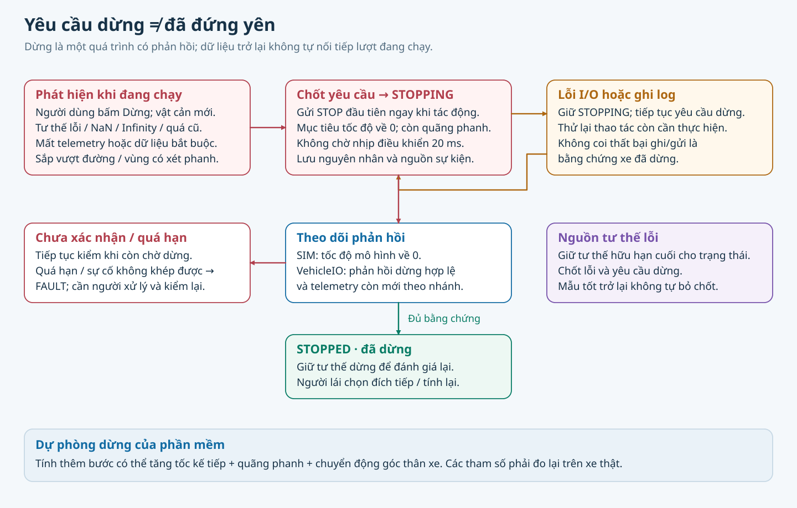

# Kiểm thử và lộ trình

Mỗi lần thử là một thao tác tới đích gần do người lái chọn, kết thúc đứng yên rồi mới chọn bước tiếp. [Cách chạy kiểm thử](VAN_HANH.md).

## Bộ đánh giá mô phỏng

Bộ v1 có **26 ca cơ sở + 18 ca nhiễu/lỗi**, gồm cả chọn đích tiếp sau hoàn thành hoặc dừng. Kỳ vọng, seed, mức nhiễu, giới hạn và ngưỡng chấm được lưu trước khi chạy; không sửa chúng theo kết quả. [Lệnh chạy, tệp báo cáo và replay](VAN_HANH.md#danh-gia-mo-phong).

Bộ chấm đọc chuyển động thực của mô phỏng mỗi **5 ms**, tự tính sai số, khoảng hở toàn thân, đường, đổi chiều và quãng/thời gian dừng; không chỉ tin cờ hoàn thành. Kỳ vọng `complete`/`refuse`/`stop` được đối chiếu với kết quả `completed`/`refused`/`stopped`. Không kích hoạt được lỗi, dữ liệu thiếu/mâu thuẫn hoặc tự chạy lại đều không đạt. `TIMEOUT`/`NO_PATH` không được tính thành từ chối đúng hay bằng chứng vô nghiệm.

Hoàn thành cần đến đích trong dung sai và đứng yên; từ chối cần bằng chứng đầu bài không hợp lệ; dừng cần đúng nguyên nhân, giới hạn và giữ đứng yên sau đó. Hình học lấy mẫu và tham số thử này chưa phải nghiệm thu xe thật.

**Mốc 28/10/2026:** 132/132 đúng kỳ vọng (90 hoàn thành, 18 từ chối, 24 dừng), thêm 15 lượt tiếp theo hoàn thành; 9 replay thông thường khớp. Hai probe cố ý hết ngân sách đều giữ `FAIL/TIMEOUT` và replay khớp, không cộng vào 132. Nhóm hồi quy liên quan đạt 278/278. [Bằng chứng tổng hợp và fingerprint](evidence/maneuver_suite_stage1_20261028.json) trỏ tới trace/báo cáo gốc trong `runs/` (không đưa dữ liệu lớn vào Git). Đây là mốc hoàn thành chặng phần mềm/mô phỏng; nhiễu và lỗi được tiêm giả, chưa đánh giá cảm biến/AI hay cơ cấu thật.

## Phạm vi bộ ca và phép đo tiếp theo

| Tình huống | Biến thể | Điều cần đo |
|---|---|---|
| Cua hẹp | Trái/phải, tiến/lùi | Đầu/đuôi quét, khoảng hở, sai số cuối |
| Qua cửa | Lệch tâm hoặc lệch hướng | Hở hai sườn, khả năng chỉnh lái |
| Lách cột | Cột cạnh đầu/đuôi | Vùng quét giữa mẫu, vật trong vùng mù |
| Chỉnh vào khe | Tiến/lùi, đổi chiều | Dừng trước đổi chiều, số nhịp, tư thế cuối |
| Đầu bài không đạt | Xa, vượt vùng/đường, không đủ hở | Từ chối trước chuyển động |
| Lỗi trong lượt | Vật mới, yêu cầu dừng, mất/phục hồi phản hồi giả | Thời gian/quãng dừng, không tự chạy lại |
| Bước tiếp | Sau hoàn thành hoặc dừng | Giữ đúng tư thế vừa dừng, tính lại đường |

Hai cảnh JSON trên giao diện là ví dụ; bộ đánh giá ở trên mở rộng các tình huống này bằng dữ liệu tổng hợp. Bộ v1 hữu hạn, chưa đại diện mọi kích thước xe, mặt sàn hay sai số cảm biến.

*Dùng sơ đồ để chọn ca tiêm lỗi và kiểm trạng thái/log. Phần mềm mô phỏng chưa cung cấp số đo phanh hoặc độ trễ dừng trên xe thật.*

## Ghi và chấm

Trước thử ghi bố trí, xe/giới hạn, nguồn tư thế, seed, mã nguồn, máy/thiết bị và số lần. Giữ video/log, sự kiện, tham chiếu và can thiệp của người. Đo sai số vị trí/hướng cuối, hở toàn thân nhỏ nhất, tổng đường, đổi chiều, thời gian tính/thực hiện, tốc độ và quãng dừng.

Báo riêng hoàn thành, dừng đúng yêu cầu, từ chối, thất bại và lần không tính kèm lý do; không bỏ lượt hỏng khỏi thống kê. Tách **TH** tổng hợp, **MP** mô phỏng, **BT** bàn thử, **XT** xe thật. Truth mô phỏng chỉ để chấm; độ lặp lại cảm biến không phải độ chính xác.

Công cụ chính của chặng mô phỏng là `evaluation.maneuver_bench` và `maneuver_score`. `evaluation.score_run` giữ cách chấm chiến dịch lịch sử; `fault_drill` diễn tập lỗi bàn thử giả, `evaluation.replay` đối chiếu gói xuất từ giao diện. Chúng không tự chứng minh thiết bị thật đạt.

## Ngưỡng

[nguong_nghiem_thu.json](../configs/nguong_nghiem_thu.json) giữ bộ N-…/DO-/VC-/AT-/DV- lịch sử với `DE_XUAT_CHO_CHOT`; score_run ghi SHA-256 bộ đã dùng. Bộ mô phỏng mới dùng `EvaluationCriteria` trong [contract](../autopark/evaluation/maneuver_suite_spec.py) và dung sai/giới hạn của từng case, không mượn mã nghiệm thu cũ. Thời gian quan sát sau dừng phải lớn hơn 0 để có bằng chứng không tự chạy lại.

Cần chốt riêng dung sai, khoảng hở, tốc độ/quãng dừng, tuổi dữ liệu, số đổi chiều, số lần lặp và tỷ lệ đạt dựa phép đo. [Giới hạn mẫu](../../README.md) không phải ngưỡng nghiệm thu. Chốt phải có căn cứ, phạm vi và người duyệt; đồng bộ cấu hình/công cụ, không nâng ngưỡng để hợp thức hóa lượt hỏng.

## Trạng thái sáu chặng

| Chặng | Trạng thái và đầu ra cần có |
|---|---|
| 1. Bộ đánh giá mô phỏng | **Hoàn tất mốc v1:** bộ ca, chấm độc lập, báo cáo và replay; duy trì hồi quy khi sửa mã |
| 2. Firmware và kết nối xe | Chưa hoàn tất: chốt GPIO/đầu ra, đọc tốc độ/góc lái thật, kiểm giao tiếp và giới hạn |
| 3. Đo xe, nguồn và phanh | Chưa hoàn tất: cấu hình đo được, quãng dừng, E-stop và thử lỗi/reset trên thiết bị |
| 4. Định vị và cảm nhận sát xe | Chưa hoàn tất: chọn cảm biến của bản đầu, hiệu chuẩn/gá, đo sai số và vùng mù bằng tham chiếu độc lập |
| 5. Tích hợp chạy thật | Chưa hoàn tất: quan sát trước, rồi từng thao tác chậm, dừng và chọn đích tiếp đúng vị trí thực |
| 6. Nghiệm thu và bàn giao | Chưa hoàn tất: chốt tiêu chí thực, lặp bộ ca, giữ video/log và báo cả lượt không đạt |

Các bước cần tay người theo [phần cứng/hiệu chuẩn](PHAN_CUNG_VA_HIEU_CHUAN.md). Khi chờ thiết bị có thể chấm bản ghi, gán nhãn, kiểm fault/replay và hoàn thiện ca tái hiện.

Khóa luận trình bày ngắn: bài toán/phạm vi → cơ sở → thiết kế/xây dựng → thực nghiệm có mức bằng chứng → giới hạn/việc tiếp. Không đổi số tự đỗ cũ thành kết quả thao tác gần. [Hồ sơ và nguồn](DU_LIEU_VA_GIAY_PHEP.md).
