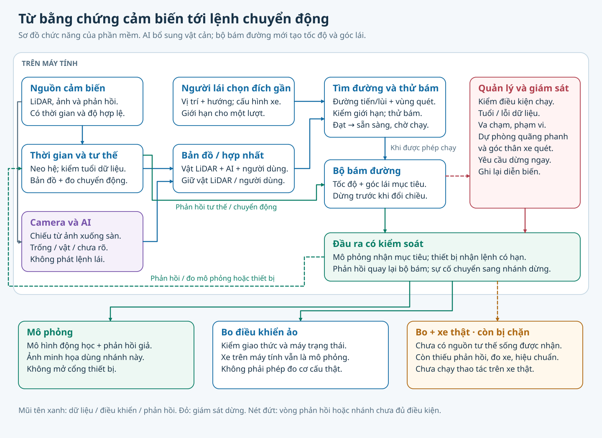
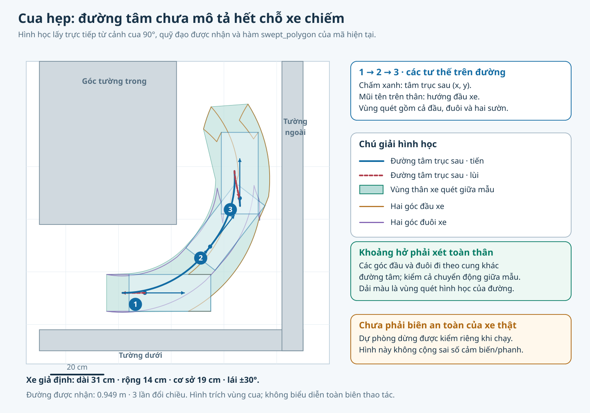

# Kiến trúc

Một lượt nhận tư thế đích do người lái chọn, thực hiện rồi dừng. [Phạm vi và cấu hình mẫu](../../README.md).

*Luồng chức năng; nhánh bo/xe thật còn thiếu điều kiện. AI bổ sung bằng chứng vật cản, không điều khiển lái.*

## Tìm và bám đường

Entry point [`plan_maneuver`](../autopark/planning/maneuver_planner.py) kiểm đầu bài và thu vùng tìm về vùng thao tác. Portfolio thử lưới có nhịp tiến/lùi gộp, RRT-Connect với Reeds–Shepp và Hybrid A* mịn trong chung ngân sách.

Xe đạp động học dùng `ẋ=v cosθ`, `ẏ=v sinθ`, `θ̇=v tanδ/L`; tư thế đặt tại tâm trục sau. Kiểm va chạm xét cả thân xe, phần nhô và vùng quét giữa các mẫu. Đường ứng viên phải thỏa tổng chiều dài, số đổi chiều và biên vùng.

*Dựng từ quỹ đạo lập được nhận trong `thao_tac_cua_hep.json`; không phải vệt đo xe thật hay vùng cộng sai số cảm biến/phanh.*

`simulation.rollout` chạy thử đường với xe và bộ bám theo đúng kịch bản gốc, dùng chung giới hạn động với phiên thực hiện. Đúng hình học chưa đủ: đường bám không đạt dung sai bị loại. Trước START, phiên kiểm lại đầu/cuối và vùng quét trước I/O.

Bộ bám kết hợp góc lái dự kiến với hiệu chỉnh lệch ngang/hướng, giảm tốc cuối đoạn và chờ đứng yên trước đổi chiều. Vật mới, dữ liệu không dùng được hoặc hết phạm vi có thể yêu cầu dừng. Dữ liệu trở lại không tự nối tiếp lượt.

`TIMEOUT`/`NO_PATH` chỉ nói lượt tìm chưa có đường được nhận; `MANEUVER_LIMIT` là vi phạm phạm vi, `TRACKING_FAILED` là thử bám không đạt.

## Cảm nhận và định vị

| Nguồn | Vai trò | Giới hạn |
|---|---|---|
| LiDAR C1 | Hình học vật cản trong mặt quét | Vật thấp/cao ngoài mặt quét, phản xạ và vùng khuất |
| Khớp scan vào bản đồ tĩnh | Tư thế trong hệ bản đồ đã neo | Cảnh đổi, đối xứng, đỉnh khớp mơ hồ |
| Odometry scan–scan | Kiểm chéo chuyển động | Trôi; cùng LiDAR nên không độc lập hoàn toàn |
| Camera + AI + BEV | Bổ sung vật cản từ ảnh xuống sàn | Khác miền dữ liệu, hiệu chuẩn, che khuất và sàn phẳng |
| Telemetry | Tốc độ/góc lái có thời gian và cờ hợp lệ | Firmware chưa đọc các cảm biến thật này |

Các nguồn phải cùng hệ tọa độ (+x trước, +y trái) và thời gian phù hợp. UNKNOWN là chưa đủ biết, không phải FREE. FREE của camera không xóa vật LiDAR hoặc vật người dùng.

## AI và BEV

Mô hình tham chiếu L-RASPP + MobileNetV3-Large phân đoạn FREE/BLOCKED; không phát lệnh lái. BEV chiếu bằng chứng qua nội/ngoại tham và ROI xuống lưới, giữ riêng trống, vật, chưa rõ và bị che.

Nhánh tạo vật cản dùng ngưỡng thử 0,05/0,15 và lọc 2/3 lô đã xét; demo BEV dùng 0,15/0,50. Camera thiếu/hỏng/sai cỡ hoặc hiệu chuẩn không đạt bị chặn. AI quá cũ: cảnh báo và giữ vật đã biết; chọn **AI bắt buộc** thì yêu cầu dừng.

Mặt nạ thân xe nới 5 cm có thể làm mất vật trong khoảng tới 10 cm tùy ô lưới. Định vị LiDAR từng gặp sai số lớn hơn khoảng hở trên cảnh mô phỏng. Hai điểm này cần đo lại trước khi dựa vào cảm biến để đi sát vật. [Điều kiện phần cứng](PHAN_CUNG_VA_HIEU_CHUAN.md), [dữ liệu AI và số đo](DU_LIEU_VA_GIAY_PHEP.md).

## Mã và nguồn

[Session](../autopark/application/session.py), [giới hạn thao tác](../autopark/planning/maneuver.py), [portfolio](../autopark/planning/portfolio.py), [tracker](../autopark/control/tracker.py), [vùng quét](../autopark/geometry/footprint.py), [định vị](../autopark/lidar/pose_estimator.py), [AI](../autopark/fusion/camera_ai.py).

Nguồn nguyên lý: [Hybrid A* — Dolgov và cs.](https://ai.stanford.edu/~ddolgov/papers/dolgov_gpp_stair08.pdf), [Reeds–Shepp](https://msp.org/pjm/1990/145-2/pjm-v145-n2-p06-s.pdf), [RRT-Connect](https://www.clear.rice.edu/comp450/papers/kuffner_lavalle_00.pdf), [L-RASPP của torchvision](https://docs.pytorch.org/vision/2.0/models/generated/torchvision.models.segmentation.lraspp_mobilenet_v3_large.html). [Pure Pursuit — Coulter](https://publications.ri.cmu.edu/implementation-of-the-pure-pursuit-path-tracking-algorithm) dùng đối chiếu; bộ bám dự án có feedforward, không phải Pure Pursuit thuần.
