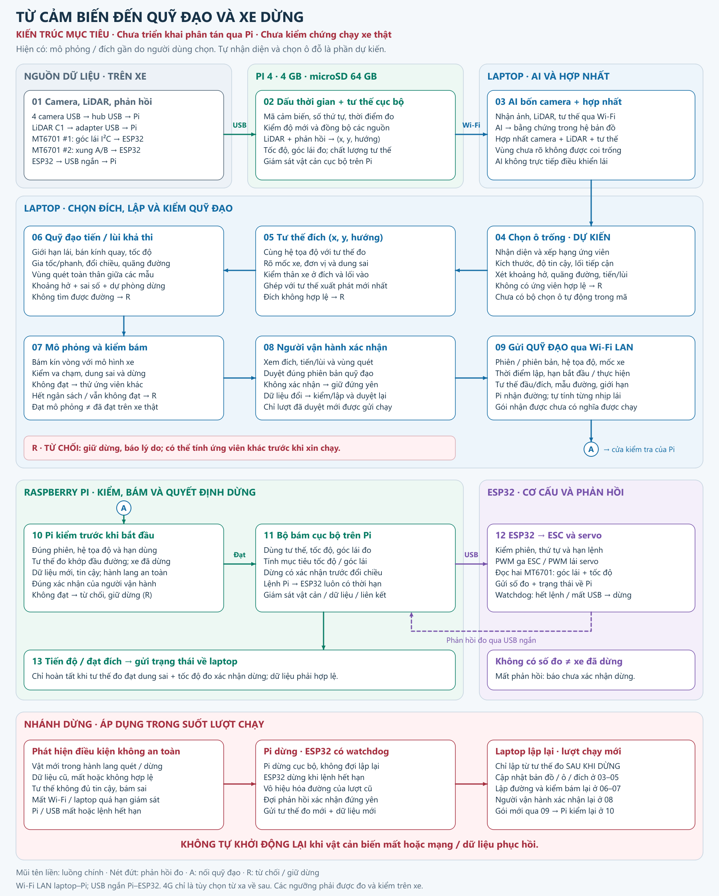
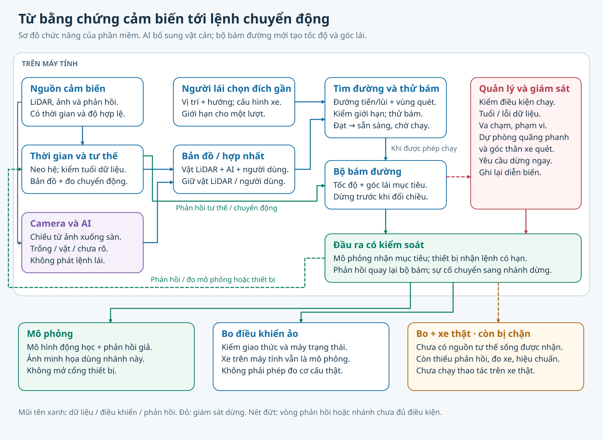
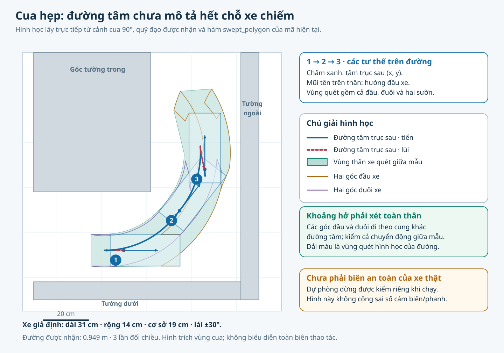

# Kiến trúc: laptop, Raspberry Pi và ESP32

**Cấu hình chốt 14/11/2026:** Pi 4 Model B RAM 4 GB + microSD 64 GB. Hai MT6701 riêng nối ESP32: #1 góc lái tuyệt đối qua I²C; #2 chuyển động bánh/trục qua A/B. Module/gá/PPR cần đối chiếu; driver phần cứng chưa hoàn thiện.

## Phương án đã chốt ngày 13/11/2026

Laptop chạy AI từ ảnh camera, hợp nhất thông tin môi trường, chọn chỗ đỗ và lập quỹ đạo. Raspberry Pi đặt trên xe thu cảm biến, cập nhật tư thế, bám quỹ đạo và yêu cầu dừng tại xe. ESP32 đọc tốc độ/góc lái thực, điều khiển ESC/servo và xử lý lệnh hết hạn. AI không phát trực tiếp tín hiệu ga hoặc lái.

Laptop và Pi nối bằng Wi-Fi nội bộ; không cần Internet hoặc 4G khi hai thiết bị ở gần nhau. Camera và LiDAR nối vào Pi, ESP32 nối Pi bằng USB ngắn. Laptop gửi quỹ đạo đã được kiểm tra; Pi tạo tốc độ và góc lái mục tiêu từ phản hồi mới nhất trên xe.

**Đây là kiến trúc đích, chưa phải bản phân tán đã triển khai hoặc nghiệm thu.** Phần mềm hiện có vẫn thực hiện thao tác gần với đích do người dùng chọn. Chuyển bộ bám/định vị xuống Pi, truyền cảm biến qua mạng và tự chọn chỗ đỗ là các phần cần phát triển.

[Một lượt tính đường hoàn chỉnh](LUONG_TINH_DUONG.md) · [Xử lý khi gặp vật cản](LUONG_VAT_CAN.md) · [Kết nối phần cứng](LAP_RAP_DIEN_2D.md)

## Trao đổi dữ liệu giữa hai máy

Pi gửi tư thế và độ tin cậy, tốc độ/góc lái đo thực, quét LiDAR, ảnh nén, tình trạng cảm biến và sự kiện dừng. Mỗi mẫu cần dấu thời gian lấy mẫu, số thứ tự và nguồn; phải quy đổi đồng hồ và hệ tọa độ trước khi hợp nhất. Thời điểm laptop nhận gói không thay thế thời điểm đo.

Laptop gửi đích và quỹ đạo có mã phiên/phiên bản, hệ tọa độ, giới hạn tốc độ và thời hạn sử dụng. Pi kiểm tư thế xuất phát, tuổi dữ liệu và điều kiện đứng yên trước khi nhận lệnh chạy. Quỹ đạo cũ, sai phiên hoặc không còn phù hợp môi trường phải bị từ chối. Luồng video được giới hạn hàng đợi và tách khỏi lệnh/trạng thái để tránh dồn dữ liệu cũ.

Pi phải phát hiện nguy cơ va chạm trong vùng quét và quãng dừng bằng dữ liệu tại xe, không chờ vòng truyền ảnh tới AI. Điều này không bảo đảm nhìn thấy mọi vật: LiDAR có vùng mù và vật thấp; bằng chứng chỉ thấy qua camera còn phụ thuộc thời gian xử lý/truyền. Khi dữ liệu bắt buộc quá cũ, mất kết nối quá hạn hoặc mất tin cậy định vị, xe chuyển sang dừng. ESP32 vẫn phải tự xử lý nếu Pi ngừng gửi lệnh hợp lệ; tín hiệu báo còn kết nối không được gia hạn lệnh chuyển động cũ.

Sau khi xác nhận đứng yên, laptop có thể tính đường mới từ tư thế đo lại. Người dùng xác nhận lượt mới; mạng hoặc cảm biến phục hồi không tự làm xe chạy tiếp. Các ngưỡng trễ, hạn lệnh và quãng phanh phải được chốt bằng phép đo của cấu hình thật.

## Nền phần mềm hiện có

Mỗi lượt đưa xe từ chỗ khó tới một tư thế đích gần rồi dừng. Người lái quyết định đích tiếp theo. Chặng đầu đã hoàn tất trong mô phỏng; xe thật chưa thực hiện thao tác.

*Sơ đồ phần mềm hiện có trên máy tính, trước khi phân chia sang Pi. Đây không phải sơ đồ bố trí thiết bị của phương án mới; nhánh xe thật còn thiếu điều kiện.*

## Tìm đường và thực hiện

Bộ lập đường tìm các đoạn tiến, lùi trong vùng thao tác. Đường phải phù hợp tư thế đầu và cuối, giới hạn chiều dài, số lần đổi chiều và khoảng trống cho toàn thân xe.

Đường tìm được còn phải chạy thử với bộ bám trong mô phỏng. Không đạt dung sai thì bị loại. Khi người dùng yêu cầu thực hiện, hệ thống kiểm lại đường, tư thế, phản hồi và điều kiện đứng yên.

*Vùng quét từ đường lập của cảnh cua hẹp; chưa cộng sai số cảm biến và phanh của xe thật.*

Bộ bám hiệu chỉnh tốc độ, góc lái theo phản hồi và dừng trước khi đổi chiều. Vật mới, dữ liệu lỗi hoặc sắp vượt phạm vi có thể yêu cầu dừng. Dữ liệu phục hồi không tự làm xe chạy tiếp.

## Cảm nhận và định vị

LiDAR đo vật cản trong mặt quét và đối chiếu bản đồ để ước lượng tư thế. Vật thấp, vùng khuất và cảnh đối xứng có thể gây sai lệch. So sánh các lượt quét giúp kiểm chéo chuyển động nhưng vẫn dùng chung cảm biến.

Camera và AI bổ sung bằng chứng vật cản xuống mặt sàn. Vùng chưa rõ không được coi là trống; camera không xóa vật đã biết từ LiDAR hoặc người dùng. Các nguồn cần cùng hệ tọa độ và thời gian phù hợp.

Vùng che quanh thân xe trong bản đồ ảnh hiện có thể loại nhầm vật cản cách xe tới khoảng 10 cm. Cần kiểm lại phần này trước khi đưa xe vào khoảng hở nhỏ.

## Đánh giá độc lập

Kết quả được chấm lại bằng cách tính hình học riêng, xét tư thế cuối, khoảng hở, quãng đường và hành vi dừng. Có thử phản hồi trễ, nhiễu và mất mẫu. Kết quả này chưa thay thế phép đo trên xe thật.
