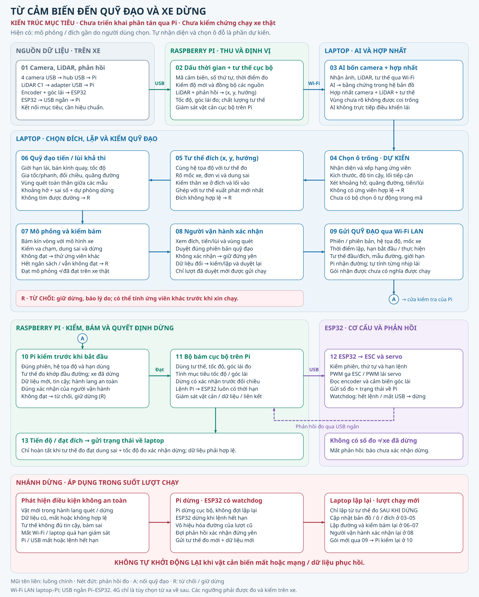

# Luồng tính đường: từ cảm biến đến xe dừng đúng đích

**Cấu hình chốt 14/11/2026:** Pi 4 Model B RAM 4 GB + microSD 64 GB. Hai MT6701 riêng nối ESP32: #1 góc lái tuyệt đối qua I²C; #2 chuyển động bánh/trục qua A/B. Module/gá/PPR cần đối chiếu; driver phần cứng chưa hoàn thiện.

**Đây là kiến trúc mục tiêu Laptop–Raspberry Pi–ESP32, chưa phải hệ thống phân tán đã triển khai hoặc kết quả chạy xe thật.** Mã hiện có phục vụ mô phỏng và thao tác gần với đích do người dùng chọn. Tự nhận diện, xếp hạng và chọn ô đỗ còn là phần dự kiến.

Laptop chạy AI trên ảnh của bốn camera, hợp nhất thông tin và lập quỹ đạo. Raspberry Pi trên xe thu cảm biến, định vị cục bộ, bám quỹ đạo và quyết định dừng khi hành lang chuyển động không an toàn. ESP32 thực hiện điều khiển cơ cấu, đọc encoder/góc lái và giám sát lệnh hết hạn. **AI không trực tiếp phát lệnh lái; Pi nhận quỹ đạo, rồi tự tính từng nhịp điều khiển bằng số đo trên xe.**



[Mở ảnh PNG](images/luong-tinh-duong.png) · [Mã sinh SVG và PNG](images/build_planning_flow.py). Các số trên hình tương ứng với các bước bên dưới; ký hiệu **A** nối gói quỹ đạo qua Wi-Fi tới cửa kiểm tra của Pi, **R** là nhánh từ chối.

## 1. Thu dữ liệu, gắn thời gian và định vị trên Pi

1. **Nguồn dữ liệu:** bốn camera USB → hub USB → Pi; LiDAR C1 giữ adapter USB → Pi. Encoder tốc độ và cảm biến góc lái được ESP32 đọc rồi gửi phản hồi qua cáp USB ngắn tới Pi. Đây là kết nối mục tiêu, không phải xác nhận các cảm biến đã lắp hoặc hiệu chuẩn.
2. **Pi thu nhận và định vị:** lưu mã định danh nguồn dữ liệu, số thứ tự, thời điểm đo/nhận, hệ tọa độ và trạng thái hợp lệ. Pi dùng LiDAR cùng phản hồi chuyển động để ước lượng tư thế cục bộ `(x, y, hướng)`, tốc độ và độ tin cậy. Góc lái đo được là phản hồi riêng, không thay bằng góc lái đã ra lệnh. Bộ giám sát vật cản cục bộ tiếp tục chạy trên Pi trong lúc xe chuyển động.
3. **Wi-Fi LAN → laptop:** gửi ảnh bốn camera, dữ liệu LiDAR cần cho hợp nhất, tư thế và phản hồi có dấu thời gian. Laptop chạy AI, đưa kết quả camera về cùng hệ tọa độ với LiDAR và hợp nhất thành vùng trống/vật cản/vùng chưa rõ. Vật cản từ nguồn hợp lệ phải được giữ; thiếu quan sát không phải bằng chứng ô trống.

Thời điểm nhận gói không được thay cho thời điểm đo. Thiết kế phải có quy ước đồng hồ và ước lượng sai lệch giữa laptop–Pi–ESP32, kèm giới hạn tuổi mẫu, độ lệch thời gian giữa các nguồn và chất lượng định vị. Chưa có các ngưỡng đã đo trên cấu hình này; không suy ra chúng từ tốc độ khung hình danh nghĩa. 4G chỉ là khả năng truy cập từ xa về sau, không phải liên kết điều khiển của bản mục tiêu này.

## 2. Laptop chọn đích và tạo quỹ đạo có thể bám

4. **Nhận diện và xếp hạng ô đỗ trống — dự kiến:** từ ảnh AI và bản đồ hợp nhất, lập danh sách vùng ứng viên có đủ kích thước và khoảng tiếp cận. Xét độ tin cậy, khoảng hở toàn thân, độ dài đường và số lần tiến/lùi. Ô có vẻ trống nhưng không có đường tiếp cận hợp lệ phải bị loại. Nếu không có ứng viên đủ tin cậy, giữ xe đứng yên và báo lý do. Mã hiện tại vẫn dùng đích do người dùng chọn, chưa có bộ chọn ô này.
5. **Chốt tư thế đích:** mỗi ứng viên tạo một tư thế `(x, y, hướng)` trong hệ bản đồ đã thống nhất, cùng dung sai vị trí/hướng. Kiểm thân xe ở đích, vùng tiếp cận và tư thế xuất phát đo mới nhất. Một điểm giữa ô chưa đủ để mô tả đích: hướng xe và vị trí mốc thân xe cũng phải rõ.
6. **Lập quỹ đạo tiến/lùi khả thi:** dùng kích thước xe, chiều dài cơ sở, giới hạn góc lái/tốc độ đổi lái, bán kính quay, tốc độ, gia tốc/phanh và giới hạn số lần đổi chiều/quãng đường. Quỹ đạo gồm tư thế, chiều tiến/lùi, đoạn, tốc độ và góc lái tham chiếu. Kiểm vùng thân xe quét qua **cả giữa các mẫu**, đầu/đuôi/hai sườn, biên vùng thao tác và khoảng hở có dự phòng sai số. Dự phòng dừng phải dựa trên phép đo phanh và độ trễ khi triển khai xe thật.
7. **Mô phỏng kín vòng và kiểm khả năng bám:** cho bộ bám thực hiện quỹ đạo với mô hình xe để kiểm va chạm, sai số cuối, giới hạn động học, đổi chiều và dừng. Đường hình học tồn tại nhưng mô phỏng không bám đạt thì bị loại. Có thể thử cấu hình hoặc ứng viên khác trong ngân sách tính toán; hết ngân sách, không có đường hoặc không đạt kiểm tra đều dẫn tới **R: không cho chạy**. Mô phỏng đạt chưa chứng minh xe thật đạt.
8. **Người vận hành xem và xác nhận:** hiển thị ô/đích, chiều tiến/lùi, vùng quét, khoảng hở và các điều kiện kiểm tra. Chỉ tạo yêu cầu chạy sau khi người vận hành xác nhận đúng phiên bản quỹ đạo. Nếu dữ liệu, bản đồ, cấu hình xe hoặc điểm xuất phát thay đổi làm đường mất hiệu lực, phải kiểm/lập lại và xác nhận lại.
9. **Gửi quỹ đạo có phiên bản qua Wi-Fi:** laptop gửi một quỹ đạo đã kiểm, không truyền từng nhịp PWM hoặc thay Pi điều chỉnh lái theo mạng. Xác nhận nhận gói chỉ chứng minh Pi đã nhận dữ liệu; chỉ sau bước 10 mới được nhận lệnh bắt đầu.

### Nội dung gói quỹ đạo mục tiêu

Đây là hợp đồng dữ liệu **cần triển khai**, không phải định dạng mạng đã có sẵn trong repository.

| Nhóm | Thông tin và ý nghĩa |
|---|---|
| Định danh | Phiên chạy, mã/phiên bản quỹ đạo, số thứ tự; loại bỏ gói cũ, trùng và gói thuộc phiên khác |
| Hệ quy chiếu | Mã hệ tọa độ, phiên bản bản đồ/hiệu chuẩn, quy ước mốc xe, đơn vị và dấu tiến/lùi/góc lái |
| Thời gian | Thời điểm lập, mốc dữ liệu dùng để lập, hạn nhận/bắt đầu và thời lượng thực hiện tối đa; Pi kiểm theo quy ước đồng hồ đã thống nhất |
| Điều kiện đầu/cuối | Tư thế xuất phát và dung sai, yêu cầu đứng yên, tư thế đích và dung sai; tham chiếu cấu hình xe đã dùng |
| Quỹ đạo | Các mẫu tư thế, quãng đường tích lũy, đoạn cùng chiều, chiều tiến/lùi, tốc độ và góc lái tham chiếu; điểm cần dừng trước khi đổi chiều |
| Giới hạn | Giới hạn chuyển động, hành lang/vùng quét, khoảng hở và yêu cầu độ mới/chất lượng của các nguồn bắt buộc |
| Xác nhận | Yêu cầu bắt đầu gắn với đúng phiên bản đã được người vận hành duyệt; Pi báo nhận, chấp nhận/từ chối và lý do |

Hạn dùng quỹ đạo, tuổi dữ liệu cảm biến, hạn liên lạc Wi-Fi và hạn từng lệnh Pi–ESP32 là các điều kiện riêng. Một heartbeat còn tới không làm dữ liệu cũ hoặc lệnh chuyển động hết hạn trở lại hợp lệ.

## 3. Pi bám tại chỗ; ESP32 thực hiện và phản hồi

10. **Pi kiểm trước khi chạy:** kiểm phiên bản, hệ tọa độ, cấu hình xe, hạn thời gian, dữ liệu bắt buộc còn mới và đủ tin cậy; so tư thế hiện tại với tư thế xuất phát của quỹ đạo. Xác nhận xe thực sự đứng yên, đường/hành lang trước xe còn an toàn và yêu cầu chạy đúng phiên đã được duyệt. Lỗi bất kỳ điều kiện nào thì từ chối, giữ dừng và gửi lý do về laptop. Không dịch chuyển âm thầm đường cũ để khớp tư thế mới.
11. **Bộ bám trên Pi:** mỗi nhịp dùng tư thế, tốc độ và góc lái **đo được** để cập nhật tiến độ và tính mục tiêu tốc độ/góc lái trong giới hạn xe. Dừng có xác nhận trước khi chuyển từ tiến sang lùi hoặc ngược lại. Pi gửi mục tiêu có thời hạn qua USB ngắn; Wi-Fi chỉ mang quỹ đạo, dữ liệu, trạng thái và giám sát phiên, không nằm trong từng nhịp chỉnh lái.
12. **ESP32 thực hiện:** kiểm phiên/thứ tự/hạn lệnh, điều khiển PWM tới ESC và servo theo hiệu chuẩn, đọc encoder và góc lái rồi trả số đo/trạng thái lỗi cho Pi. Khi lệnh hết hạn hoặc mất Pi/USB, watchdog của ESP32 đưa đầu ra về trạng thái dừng đã thiết kế và kiểm. Phản hồi quay về Pi để khép kín vòng điều khiển; lệnh đã gửi không được coi là số đo chuyển động.
13. **Theo dõi và kết thúc:** Pi gửi tiến độ, tư thế đo, sai số, trạng thái dừng và lý do về laptop. Chỉ báo đạt đích khi vị trí/hướng đo nằm trong dung sai và tốc độ đo xác nhận đứng yên với dữ liệu hợp lệ. Hết danh sách điểm hoặc đã gửi lệnh tốc độ 0 chưa đủ. Mất phản hồi lúc dừng thì báo chưa xác nhận được dừng, không báo hoàn tất.

## 4. Vật cản mới, dữ liệu cũ hoặc mất liên kết

| Sự kiện | Phản ứng trong kiến trúc mục tiêu |
|---|---|
| Vật mới làm hành lang vùng quét/dừng không an toàn | Pi chủ động yêu cầu dừng tại chỗ, không chờ laptop tính đường khác; gửi trạng thái và dữ liệu mới về laptop khi liên kết còn hoạt động |
| LiDAR, ảnh AI bắt buộc, tư thế hoặc phản hồi mất/cũ/không hợp lệ; định vị không đủ tin cậy | Pi dừng và chốt trạng thái chờ; laptop cũng không nhận đường từ dữ liệu không đạt |
| Mất Wi-Fi/laptop hoặc hết thời hạn giám sát phiên | Pi dừng khi vượt ngưỡng đã quy định; việc Pi bám cục bộ không có nghĩa xe tiếp tục khi mất mạng |
| Pi treo, USB đứt hoặc lệnh hết hạn | Watchdog ESP32 xử lý dừng độc lập với vòng tính toán trên laptop/Pi; phải kiểm hành vi thực trên xe |
| Không tìm được đường, kiểm bám thất bại hoặc Pi từ chối quỹ đạo | Giữ đứng yên, báo lý do; không thực hiện đường ứng viên chỉ để thử trên xe |

Sau dừng, **không tự chạy lại khi vật cản biến mất hoặc mạng/dữ liệu phục hồi**. Pi xác nhận đứng yên bằng phản hồi mới và cung cấp tư thế đo mới; nếu chưa xác nhận được thì tiếp tục chờ. Laptop cập nhật bản đồ, kiểm lại ô/đích và lập đường từ chính tư thế đó, mô phỏng lại, rồi người vận hành xác nhận **một lượt mới**. Đường của lượt trước bị vô hiệu hóa. Không lấy tư thế kết thúc dự kiến hay tư thế mô phỏng làm vị trí thật sau dừng.

## 5. Đối chiếu với mã hiện có

| Thành phần trong repository | Đã thể hiện điều gì / còn thiếu gì |
|---|---|
| [`application/session.py`](../autopark/application/session.py) | Chọn đích, lập/xem trước/chạy, xử lý dừng và chuẩn bị thao tác mới; bộ bám còn được tạo trong phiên ứng dụng, chưa tách thành dịch vụ trên Pi |
| [`planning/maneuver_planner.py`](../autopark/planning/maneuver_planner.py), [`planning/portfolio.py`](../autopark/planning/portfolio.py) | Lập thao tác gần, xét giới hạn và kiểm bám bằng mô phỏng; chưa có tự nhận diện/xếp hạng ô đỗ |
| [`planning/trajectory.py`](../autopark/planning/trajectory.py), [`control/tracker.py`](../autopark/control/tracker.py) | Quỹ đạo có tư thế/chiều/tốc độ/góc lái tham chiếu; bộ bám dùng trạng thái phản hồi và xử lý đổi chiều. Chưa phải giao thức gửi quỹ đạo laptop–Pi |
| [`fusion/fuse.py`](../autopark/fusion/fuse.py), [`fusion/camera_ai.py`](../autopark/fusion/camera_ai.py) | Có lớp hợp nhất và chuyển bằng chứng camera thành vật cản; chưa phải luồng chọn ô đỗ và triển khai bốn camera qua Pi |
| [`safety/freshness.py`](../autopark/safety/freshness.py), [`transport/vehicle_io.py`](../autopark/transport/vehicle_io.py) | Có kiểm dữ liệu cũ và giao tiếp/giám sát bo; cần chuyển trách nhiệm thích hợp lên Pi và bổ sung giám sát Wi-Fi theo thiết kế này |
| [`firmware/esp32_vehicle/src/main.cpp`](../firmware/esp32_vehicle/src/main.cpp) | PWM mặc định tắt, chân cơ cấu chưa cấu hình và đọc cảm biến thật chưa hoàn thiện; không chứng minh ESP32 đã điều khiển xe với phản hồi thực |

Sơ đồ chỉ mô tả luồng chức năng. Cấu hình mục tiêu không bổ sung ToF, IMU hoặc E-stop như thiết bị đã lắp. Điều kiện nguồn vẫn áp dụng: servo chỉ dùng BEC 6 V khi đã xác minh tương thích điện áp/dòng; **Pi cần nguồn ổn áp riêng phù hợp, không lấy trực tiếp BEC 6 V làm nguồn Pi**. Đấu dây và hiệu chuẩn xem [Phần cứng và hiệu chuẩn](PHAN_CUNG_VA_HIEU_CHUAN.md) và [Lắp ráp điện 2D](LAP_RAP_DIEN_2D.md).

## Sinh lại hình

Từ thư mục gốc repository, dùng Python có PySide6:

```powershell
.\autopark\.venv\Scripts\python.exe .\autopark\docs\images\build_planning_flow.py
.\autopark\.venv\Scripts\python.exe .\autopark\docs\images\build_planning_flow.py --check
```

Mã tự sinh hình vector và kết xuất PNG bằng PySide6, không đọc ảnh nguồn, không mở cảm biến và không chạy ứng dụng điều khiển xe. Chỉ hai tệp `luong-tinh-duong.svg` và `luong-tinh-duong.png` được ghi. Chế độ `--check` dựng lại trong bộ nhớ và so byte với hai tệp hiện có, không ghi tệp. Kết quả PNG xác định khi dùng cùng bản Qt/PySide6 và phông chữ; SVG không có dữ liệu ngẫu nhiên hay thời điểm sinh. Phông mặc định là Segoe UI trên Windows.
