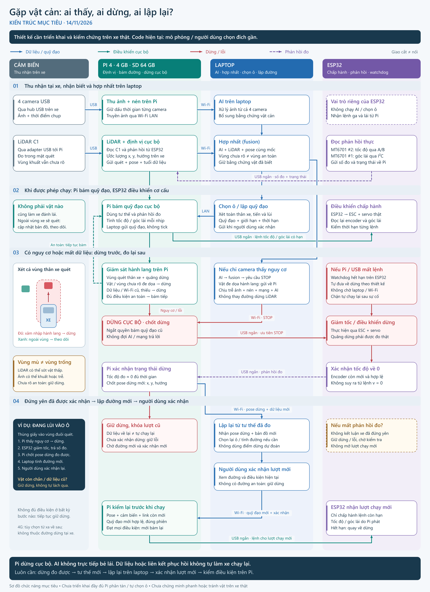

# Gặp vật cản: ai thấy, ai dừng, ai lập lại?

**Cấu hình chốt 14/11/2026:** Pi 4 Model B RAM 4 GB + microSD 64 GB. Hai MT6701 riêng nối ESP32: #1 góc lái tuyệt đối qua I²C; #2 chuyển động bánh/trục qua A/B. Module/gá/PPR cần đối chiếu; driver phần cứng chưa hoàn thiện.

**Kiến trúc mục tiêu — 13/11/2026.** Laptop chạy AI trên ảnh từ bốn camera, hợp nhất dữ liệu, chọn ô đỗ và lập quỹ đạo. Raspberry Pi trên xe thu cảm biến, định vị, bám quỹ đạo và kiểm tra nguy cơ cục bộ. ESP32 điều khiển cơ cấu thật, đọc phản hồi tốc độ/góc lái và xử lý lệnh hết hạn.

Đây là thiết kế cần triển khai, hiệu chuẩn và kiểm chứng. Mã hiện tại chủ yếu phục vụ mô phỏng thao tác ngắn với **đích gần do người dùng chọn**; chưa có hệ thống Pi phân tán hoặc quy trình tự chọn ô đỗ hoàn chỉnh, chưa có kết quả chứng minh luồng này chạy an toàn trên xe thật.



[Mở SVG để phóng to](images/luong-vat-can.svg). Màu xanh dương chỉ dữ liệu/quỹ đạo; xanh lục chỉ điều khiển cục bộ; đỏ chỉ dừng/lỗi; tím nét đứt chỉ phản hồi đo. Các đường giao cắt không có nút nối không trao đổi dữ liệu tại chỗ giao. Dải tiêu đề ngắt nét các đường đi qua để giữ chữ dễ đọc.

## Phân công và đường truyền

| Khối | Công việc trong thiết kế mục tiêu | Đường trao đổi |
|---|---|---|
| Bốn camera USB | Thu ảnh quanh xe; cần hiệu chuẩn, xác định hướng gá và vùng che | Camera → hub USB → Pi |
| LiDAR C1 | Đo khoảng cách trong mặt quét; góp phần định vị và phát hiện vật cản cục bộ | C1 qua adapter USB → Pi |
| Raspberry Pi | Thu ảnh, gắn/giữ thời điểm thu, nén và gửi ảnh; đọc LiDAR, dùng phản hồi để định vị; kiểm hành lang va chạm và bám quỹ đạo | Wi-Fi LAN với laptop; USB ngắn với ESP32 |
| Laptop | AI trên cả bốn camera; fusion ảnh/LiDAR/tư thế; chọn ô và lập đường; hiển thị để người dùng xác nhận | Nhận ảnh, quét, tư thế, trạng thái từ Pi; gửi quỹ đạo, yêu cầu dừng và xác nhận lượt chạy về Pi |
| ESP32 | Phát lệnh cho ESC/servo, đọc encoder và góc lái thực; kiểm hạn lệnh, giảm tốc/dừng và trả phản hồi | Nhận lệnh tốc độ/góc lái từ Pi, trả số đo và trạng thái qua USB ngắn |

Pi nhận **quỹ đạo có giới hạn và thời hạn**, rồi tự tính lệnh tốc độ/góc lái theo từng nhịp dựa trên số đo tại xe. Laptop không gửi từng nhịp đánh lái qua Wi-Fi; AI không phát trực tiếp lệnh servo. Wi-Fi LAN là kết nối laptop–Pi của phương án này. 4G chỉ là tùy chọn điều khiển/giám sát từ xa về sau, chưa thuộc luồng vận hành ban đầu.

Sơ đồ này là luồng chức năng, không phải sơ đồ cấp điện. Pi cần nguồn ổn áp riêng phù hợp model Pi và tải USB; **không cấp Pi từ BEC 6 V của ESC**. Nhánh BEC → servo chỉ dùng sau khi xác minh servo tương thích 6 V và nguồn đủ dòng. Không suy từ hình rằng đã lắp thêm ToF, IMU hoặc nút dừng khẩn. Chi tiết kết nối nằm trong [tài liệu phần cứng](PHAN_CUNG_VA_HIEU_CHUAN.md) và [bản lắp điện](LAP_RAP_DIEN_2D.md).

## Hai nhánh nhận biết chạy song song

**Nhánh camera:** bốn camera → hub USB → Pi thu và nén ảnh → Wi-Fi LAN → laptop chạy AI → fusion → chọn ô/lập đường. Pi đồng thời gửi quét LiDAR, tư thế và trạng thái có dấu thời gian để laptop đối chiếu các nguồn trong cùng hệ tọa độ. Kết quả AI là bằng chứng về vật cản và vùng có thể đi, không phải quyết định đánh lái. Camera không được dùng để xóa một vật cản đã biết chỉ vì không nhìn thấy nó trong ảnh mới.

**Nhánh dừng tại xe:** C1 → USB → Pi đọc quét, cập nhật định vị và kiểm hành lang chuyển động → yêu cầu dừng qua USB ngắn → ESP32 giảm tốc qua cơ cấu chấp hành → encoder báo tốc độ đo → Pi xác nhận trạng thái dừng. Nhánh này không phải chờ truyền ảnh, AI hoặc phản hồi qua Wi-Fi. ESP32 còn tự xử lý khi lệnh từ Pi hết hạn, kể cả khi Pi treo hoặc USB bị đứt.

Nhánh cục bộ chỉ phản ứng với thông tin mà cảm biến trên xe thực sự đo được và các lỗi được giám sát. Nó không tự nhìn thấy vật nằm ngoài khả năng của LiDAR. Nếu vật chỉ hiện trong camera, yêu cầu dừng phải đi qua nén ảnh, mạng, AI, fusion rồi quay lại Pi. Độ trễ này phải được tính vào giới hạn tốc độ và khoảng cách phát hiện; không thể coi AI trên laptop là đường dừng tức thời.

## Khi nào giữ đường, khi nào dừng?

Hành lang cần kiểm là vùng **toàn thân xe sẽ quét** khi tiến, lùi hoặc quay, gồm cả đầu, đuôi và hai sườn. Phải tính thêm sai số định vị/cảm biến, độ trễ và phần xe còn di chuyển trước khi dừng. Một điểm giữa xe hoặc một tia LiDAR phía trước không đủ đại diện cho vùng này. Quãng dừng và các ngưỡng chưa được phép suy ra từ sơ đồ; cần đo trên xe thật.

| Tình huống | Hành vi mục tiêu |
|---|---|
| Vật nằm ngoài hành lang, không đe dọa vùng quét; dữ liệu và định vị vẫn hợp lệ | Cập nhật bản đồ và theo dõi; tiếp tục bám quỹ đạo đã duyệt nếu mọi điều kiện còn đạt. Không phải cứ thấy vật là tự đánh lái tránh. |
| LiDAR phát hiện vật xâm nhập hành lang hoặc không còn đủ khoảng để dừng | Pi chốt dừng ngay tại xe, gửi STOP cho ESP32; không đợi AI. |
| Chỉ camera thấy vật có nguy cơ xâm nhập hành lang | Laptop qua AI/fusion gửi yêu cầu dừng về Pi; kết quả chịu độ trễ cả hai chiều mạng và xử lý. Pi chốt dừng khi nhận được yêu cầu hợp lệ. |
| Hành lang đi vào vùng mù, vùng chưa rõ hoặc không đủ bằng chứng để xác nhận an toàn | Không coi vùng đó là trống. Không cho bắt đầu; nếu đang chạy thì yêu cầu dừng và đánh giá lại. |
| Dữ liệu bắt buộc cũ/thiếu/không hợp lệ, mất định vị hoặc Wi-Fi LAN quá hạn | Pi chốt dừng theo điều kiện giám sát; không tiếp tục chạy chỉ vì vẫn giữ một quỹ đạo cũ. |
| Pi treo, USB tới ESP32 đứt hoặc lệnh đã hết hạn | Watchdog trên ESP32 đưa về dừng theo thiết kế. Khôi phục kết nối không được tự tái kích hoạt lượt cũ. |
| Không có phản hồi tốc độ còn mới, hoặc không đủ bằng chứng xe đã đứng yên | Giữ yêu cầu dừng/trạng thái lỗi; không kết luận đã dừng và không mở lượt mới. |

“Dữ liệu bắt buộc” cần được khai báo rõ cho từng chế độ. Với chế độ mục tiêu dùng đủ bốn camera, không được âm thầm bỏ một camera lỗi rồi coi hệ thống vẫn đủ điều kiện chạy. Nếu có chế độ giảm chức năng về sau, phải định nghĩa và kiểm chứng riêng. Mất mạng được nhận biết bằng hạn liên lạc/heartbeat; hạn đó phải được thiết kế và đo, không đồng nghĩa phát hiện tức thời khi sóng yếu.

LiDAR 2D có thể bỏ sót vật thấp, vật nằm ngoài mặt quét hoặc bị che. Camera có vùng mù, sai hiệu chuẩn và ảnh trễ. “Không phát hiện vật” không tự chứng minh “không có vật”. Không đủ tầm quan sát để bảo vệ hành lang thì không cho chạy vào đó.

## Ví dụ: thùng giấy xuất hiện khi xe đang lùi vào ô

1. Người dùng đã xác nhận quỹ đạo. Pi bám đường từ tư thế đo tại xe; ESP32 thực hiện ga/lái và trả phản hồi.
2. Thùng giấy đi vào vùng đuôi hoặc sườn xe sẽ quét. Nếu C1 thấy nguy cơ, Pi yêu cầu dừng ngay tại xe. Nếu chỉ camera thấy, laptop gửi STOP sau bước AI/fusion; đó là nhánh có độ trễ, không phải bằng chứng LiDAR đã thấy thùng.
3. Pi ngắt quyền tiếp tục quỹ đạo cũ và gửi STOP. ESP32 thực hiện giảm tốc/dừng, tiếp tục báo tốc độ, góc lái và trạng thái. Đã gửi STOP hoặc đã đặt tốc độ mong muốn bằng 0 **chưa chứng minh xe đã đứng yên**.
4. Pi chỉ xác nhận đứng yên khi tốc độ đo còn mới, hợp lệ và nằm trong ngưỡng gần 0 liên tục đủ thời gian theo cấu hình đã kiểm chứng. Pi lấy tư thế dừng mới từ định vị còn hợp lệ, gồm vị trí `x, y` và hướng xe; encoder một mình không cung cấp đủ tư thế tuyệt đối.
5. Pi gửi trạng thái dừng, tư thế đo và dữ liệu mới cho laptop. Laptop cập nhật bản đồ, kiểm lại ô đỗ và lập đường từ **nơi xe thực sự dừng**, không dùng điểm dừng dự đoán của quỹ đạo cũ. Nếu vật còn chắn, không có đường đạt điều kiện hoặc tư thế chưa tin cậy, xe tiếp tục giữ dừng.
6. Người dùng xem và xác nhận lượt mới. Pi kiểm lại dữ liệu, liên kết, tư thế, phiên lệnh và quỹ đạo trước khi mở quyền bám; ESP32 chỉ chấp hành lệnh mới còn hạn. Nếu điều kiện đã thay đổi trong lúc chờ xác nhận, lượt mới không được bắt đầu.

Thùng giấy được nhấc đi, AI nhận lại ảnh, Wi-Fi nối lại hoặc USB cắm lại đều **không tự làm xe chạy tiếp**. Phải có chu trình đứng yên đo được → tư thế mới → lập lại → xác nhận lượt mới. Lỗi khiến không đo được trạng thái dừng cần được xử lý trước khi tiếp tục chu trình này.

## Phần đã có và phần còn phải làm

Các tệp dưới đây là điểm đối chiếu mã hiện tại, không phải bằng chứng kiến trúc phân tán đã được triển khai:

| Mã hiện tại | Ý nghĩa và giới hạn |
|---|---|
| [`application/session.py`](../autopark/application/session.py) | Có chọn đích gần, lập/bám thao tác, yêu cầu dừng và chuẩn bị lượt tiếp theo; không phải dịch vụ điều khiển cục bộ đã chạy trên Pi. |
| [`fusion/fuse.py`](../autopark/fusion/fuse.py), [`fusion/camera_ai.py`](../autopark/fusion/camera_ai.py) | Có xử lý lớp dữ liệu, tuổi dữ liệu và hợp nhất vật cản; không chứng minh toàn bộ bốn luồng ảnh Pi–Wi-Fi–laptop đã đồng bộ và hoạt động. |
| [`safety/freshness.py`](../autopark/safety/freshness.py) | Có giám sát nguồn dữ liệu cũ/thiếu; việc phân bố giám sát giữa laptop/Pi, hạn heartbeat và chính sách chế độ cần được triển khai. |
| [`vehicle_core.cpp`](../firmware/esp32_vehicle/src/core/vehicle_core.cpp) | Có logic hết hạn lệnh/liên lạc và thay đổi tham chiếu tốc độ. Cần tích hợp chốt dừng, phiên mới và chống phát lại lệnh cũ của toàn hệ thống; không tự suy ra watchdog hiện tại đã đáp ứng trọn quy trình không tự chạy lại. |
| [`main.cpp`](../firmware/esp32_vehicle/src/main.cpp) | Đầu ra PWM mặc định chưa bật (`AP_ENABLE_PWM_OUTPUTS=0`), chân cơ cấu và đọc phản hồi thật chưa hoàn thiện. Cấu hình firmware phải được đối chiếu với phần cứng đã chọn trước khi thử xe. |

Còn phải triển khai dịch vụ thu/nén ảnh và điều khiển trên Pi, giao thức quỹ đạo/trạng thái qua LAN, đồng bộ thời gian, xử lý lệnh trễ/sai phiên, chọn ô trên laptop và nối phản hồi thật trên ESP32. Sau đó mới đo độ trễ toàn luồng, khoảng dừng, vùng mù, độ tin cậy tư thế và thử các lỗi mất ảnh/LiDAR/Wi-Fi/USB. Hình này không thêm thiết bị hoặc bật đầu ra phần cứng.

## Tái tạo hình

Từ thư mục ứng dụng `autopark/` nằm trong repo, chạy bằng môi trường đã có PySide6:

```powershell
.\.venv\Scripts\python.exe docs\images\build_obstacle_flow.py
```

[`build_obstacle_flow.py`](images/build_obstacle_flow.py) tự chứa toàn bộ chữ và hình học, chỉ ghi `luong-vat-can.svg` và `luong-vat-can.png` bên cạnh nó. Không nhập `render_docs.py`, không mở camera/thiết bị, không đọc ảnh mạch hoặc ảnh nguồn. SVG có nội dung xác định; PNG được render bằng PySide6 với font Segoe UI trên Windows và tái tạo giống nhau khi giữ nguyên Qt/font. Generator kiểm chiều rộng, chiều cao các dòng chữ trước khi render. PNG vẫn cần được xem trực tiếp để kiểm mũi tên và bố cục.
