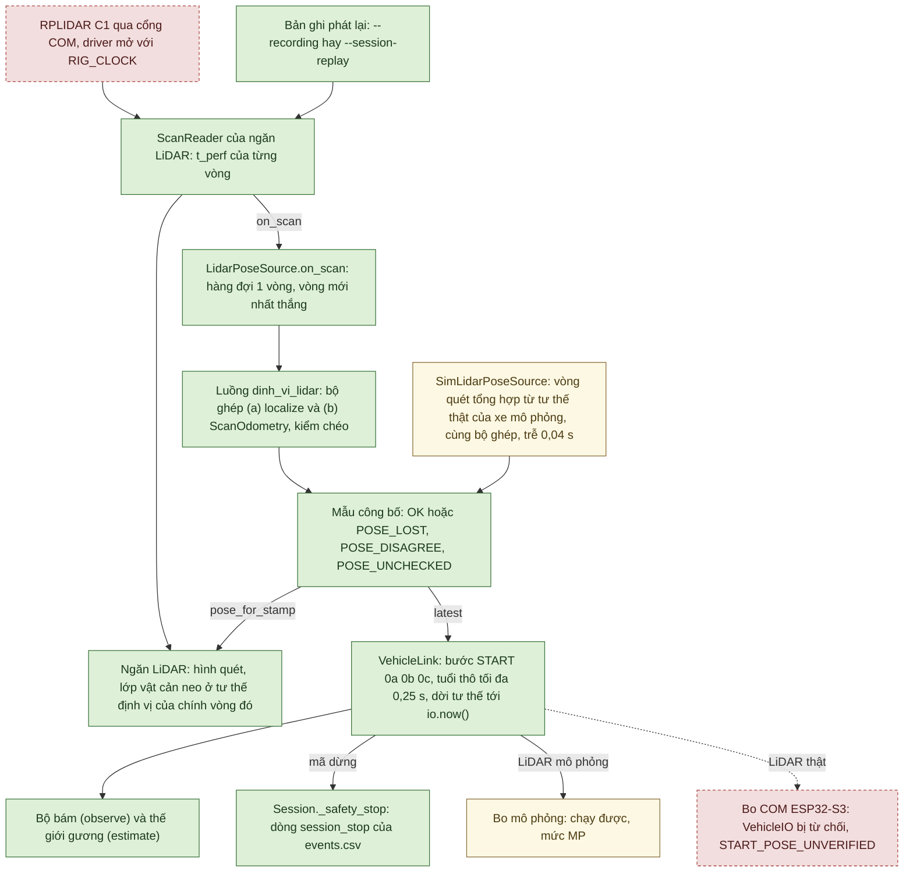
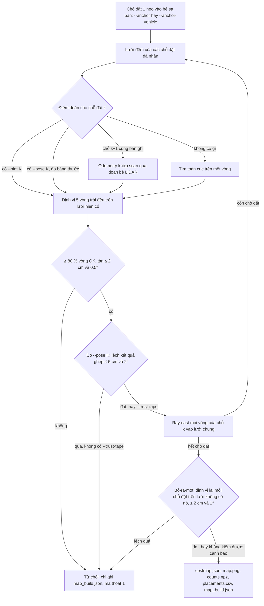
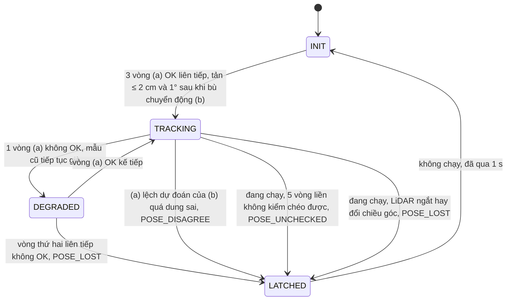

# Nguồn tư thế LiDAR cho phiên đỗ xe (T2, 02/10/2026)

*Viết 02/10/2026, trên cây gộp đợt 2, sau đợt sửa lỗi review cùng ngày.* Tài liệu này mô tả việc T2 của
[KICH_BAN_NGHIEM_THU.md](KICH_BAN_NGHIEM_THU.md) mục 7: thay tư thế lý tưởng của mô phỏng bằng tư thế xe định vị từ
LiDAR, để nhánh VehicleIO có nguồn tư thế khi có bo thật.

**Quyết định.** Người dùng giao quyết định 02/10/2026 ('làm hết'), theo đề xuất mục 7 của
[SO_SANH_DINH_VI_SLAM.md](SO_SANH_DINH_VI_SLAM.md): (a) định vị từng vòng quét trên bản đồ tĩnh dựng trước từ nhiều chỗ
đặt; (b) odometry khớp scan làm tâm cửa sổ tìm của (a) và để kiểm chéo. Mọi ngưỡng vẫn là ĐỀ XUẤT – CHỜ CHỐT, dùng cho
nghiệm thu tới khi chốt. Gá LiDAR trên xe là GIẢ ĐỊNH – CHƯA ĐO.

**Mức bằng chứng (02/10/2026).**
- Chỉ mô phỏng (MP): LiDAR MÔ PHỎNG quét sa bàn từ tư thế thật của xe mô phỏng, chạy với bo mô phỏng.
- Kiểm trên máy tính, offline, cùng đường mã với lúc chạy: các bản ghi C1 thật đã có, mọi bản ghi đều ĐỨNG YÊN (p07,
  live_headless ngày 22/09/2026; k01, o03 ngày 24/09/2026); DROW v2 (Beyer và cộng sự, giấy phép MIT,
  [GIAY_PHEP_DU_LIEU.md](GIAY_PHEP_DU_LIEU.md)): cảm biến có di chuyển nhưng khác C1 và khác cảnh; so với `.odom2` là so
  hai ước lượng, không phải sai số.
- Kiểm trên máy tính, offscreen: ngăn LiDAR → nguồn tư thế → `VehicleLink`, với nguồn vòng quét giả và cổng serial GIẢ.
- CHƯA THỬ: C1 thật nối vào nguồn tư thế trong `ui.lidar_app`; LiDAR gá trên xe đang chạy; mọi đường với bo thật
  (ESP32-S3 chưa có); laptop RTX 3050 Ti; độ rung của vòng điều khiển 50 Hz khi luồng định vị chạy.
- **LiDAR mô phỏng CHƯA dùng được cho nghiệm thu MP** (mục 9, 10): kể cả khi đã dời tư thế tới hiện tại, bốn trong chín
  kịch bản nghiệm thu vẫn dừng POSE_LOST, và khe hở của hai đường lập nhỏ hơn sai số định vị. Nghiệm thu MP dùng nguồn
  "Mô phỏng: định vị lý tưởng".
- Không phải SLAM: bản đồ cố định trong lượt chạy, không cập nhật, không đóng vòng. Không viết "đã có SLAM".

| Phần | Mã | Test (số hàm test) |
|---|---|---|
| Cấu hình: gá LiDAR, ba điều kiện tiên quyết, ngưỡng bộ ghép, LiDAR mô phỏng (mục 6) | [`configs/dinh_vi_lidar_v0.json`](../configs/dinh_vi_lidar_v0.json), [`lidar/pose_config.py`](../autopark/lidar/pose_config.py) | `tests/test_lidar_pose_source.py` |
| Dựng bản đồ nhiều chỗ đặt, neo vào hệ sa bàn (mục 2) | [`lidar/map_builder.py`](../autopark/lidar/map_builder.py) | [`tests/test_lidar_map_builder.py`](../tests/test_lidar_map_builder.py) (9) |
| Bộ ghép (a) + (b) và CLI offline (mục 3) | [`lidar/pose_estimator.py`](../autopark/lidar/pose_estimator.py); (a) `lidar/localize.py`; (b) `lidar/scan_odometry.py` (thêm `velocity_per = "second"` và trục suy biến trong mỗi bước) | [`tests/test_lidar_pose_estimator.py`](../tests/test_lidar_pose_estimator.py) (17); `tests/test_scan_odometry.py` (thêm 3) |
| Vòng quét tổng hợp của sa bàn (LiDAR mô phỏng, test) | `lidar/synthetic.py`; dữ liệu test dùng chung `tests/lidar_fakes.py` | qua các test trên |
| Nguồn tư thế cho `VehicleLink`: `LidarPoseSource` (C1 hay bản ghi phát lại), `SimLidarPoseSource`, `LidarSimPoseFactory` | [`application/lidar_pose_source.py`](../autopark/application/lidar_pose_source.py) | [`tests/test_lidar_pose_source.py`](../tests/test_lidar_pose_source.py) (9) |
| Nối vào phiên: tuổi tư thế, bước START 0a/0b/0c, mã dừng, dời tư thế tới hiện tại, log, phát lại log | `application/vehicle_link.py`, `application/vehicle_replay.py`, `application/session.py` (`start_source`), `evaluation/fault_drill.py` (`pose_age_limit_s`) | [`tests/test_session_lidar_pose.py`](../tests/test_session_lidar_pose.py) (11), [`tests/test_pose_prediction.py`](../tests/test_pose_prediction.py) (7 hàm, 9 trường hợp) |
| Ngăn LiDAR: người tiêu thụ vòng quét, `t_perf`, neo vòng quét ở tư thế định vị, loại nguồn vòng quét | `lidar/live_view.py` (`ScanReader`), `ui/lidar_dock.py`, `fusion/layers.py` (`body_mask`) | `tests/test_lidar_live_view.py` (thêm 2), `tests/test_lidar_dock_ui.py` (thêm 2), `tests/test_nominal_clock_and_reader_stop.py` (1 hàm về luồng đọc đang dừng) |
| Giao diện: ô "Nguồn tư thế", bản đồ, cờ dòng lệnh (mục 7) | `ui/main_window.py`, `ui/lidar_app.py` | [`tests/test_pose_source_ui.py`](../tests/test_pose_source_ui.py) (6), [`tests/test_bench_window_feed_and_close.py`](../tests/test_bench_window_feed_and_close.py) (11, sửa sau review, một phần là của T3), `tests/test_vehicle_board_ui.py` (1 hàm về "Kiểm kết nối bo") |

Sơ đồ dưới đây là đường của tư thế từ vòng quét tới bộ bám, đúng như mã chạy hôm nay. Mũi tên chỉ cho biết dữ liệu đi
đâu, không có nghĩa đường đó đã chạy với thiết bị thật.



Xanh: có mã và đã kiểm trên máy tính (test offscreen với nguồn giả, bản ghi C1 đứng yên chạy offline) · Vàng: chỉ mô
phỏng (LiDAR mô phỏng, bo mô phỏng) · Đỏ viền đứt: CHƯA THỬ trên thiết bị (C1 nối vào nguồn tư thế trong `ui.lidar_app`;
bo ESP32-S3 chưa có). Mũi tên đứt: đoạn nối chưa thử.

## 1. Quyết định

Người dùng giao quyết định 02/10/2026 ('làm hết'), theo đề xuất mục 7 của SO_SANH_DINH_VI_SLAM.md. Các lựa chọn dưới đây
là mặc định an toàn của thiết kế T2; mọi số là ĐỀ XUẤT – CHỜ CHỐT, dùng cho nghiệm thu tới khi chốt. Giá trị nằm ở
`configs/dinh_vi_lidar_v0.json` (mục 6) và `LinkParams` của `application/vehicle_link.py`.

| Câu hỏi | Lựa chọn (ĐỀ XUẤT – CHỜ CHỐT) |
|---|---|
| Tuổi tư thế tối đa (N-T2) | 0,25 s chỉ cho nguồn LiDAR (`LinkParams.max_pose_age_s`, khóa `max_pose_age_s` của tệp cấu hình); telemetry và nguồn "Mô phỏng" (`SimTruthPose`) giữ 0,15 s (`max_state_age_s`) |
| (a) không OK liên tiếp | vòng đầu chịu được (mẫu đang công bố giữ nguyên và tiếp tục già); vòng thứ hai liên tiếp → POSE_LOST (N-L5: không quá 1 vòng liên tiếp không OK) |
| Kiểm chéo (a)/(b) | lệch ≤ 4 cm + 3 % quãng đi kể từ mốc, và ≤ 2° + 2°/m; lệch một lần là POSE_DISAGREE; bỏ thành phần dọc trục suy biến của (b) |
| Không kiểm chéo được | 5 vòng liên tiếp khi đang chạy → POSE_UNCHECKED |
| Cửa sổ, tìm toàn cục | bám ±0,15 m / ±10° quanh dự đoán của (b); khởi tạo ±0,5 m / ±30° quanh điểm xuất phát; đỉnh ở mép cửa sổ (`window_edge`) thì tìm lại một lần với cửa sổ khởi tạo; tìm toàn cục chỉ ngoài lần chạy, tối đa một lần mỗi 10 s, nhận sau 3 vòng xác nhận |
| Bo thật ở VehicleIO | từ chối trước mọi I/O (START_POSE_UNVERIFIED) tới khi tệp cấu hình ghi gá đã đo và đạt p04, DV-2, DV-1, mục nào cũng có bằng chứng (mục 6). Quan sát, bo ảo đã gắn cờ `virtual_board`, bo mô phỏng: chỉ ghi dòng POSE_SOURCE_WARNING. *(Sửa 02/10/2026 sau review gộp đợt 2: vòng quét không phải của LiDAR thật — bản ghi phát lại `--recording` (evidence `recording_replay`), phát lại phiên `--session-replay` (`session_replay`), nguồn do test hay nơi khác gắn (`other_source`), ngăn LiDAR đã ngắt (`no_feed`) — thì bo thật bị từ chối ở MỌI nhánh, kể cả Quan sát và kể cả khi đủ điều kiện tiên quyết (START_POSE_UNVERIFIED trước mọi I/O, cổng không mở); bo mô phỏng / bo ảo gắn cờ chỉ có dòng POSE_SOURCE_WARNING. Chỉ kiểm bằng test.)* |
| Bo ảo QEMU | thiết kế: tính là bo thật tới khi mã tạo liên kết truyền `virtual_board=True`. Sau khi gộp đợt 2, liên kết bo ảo luôn có `virtual_board` = True; giao diện chỉ cho bo ảo đi với nguồn "Mô phỏng" (tư thế xe mô phỏng phía laptop), chọn LiDAR mô phỏng hay LiDAR thật cùng bo ảo bị từ chối (mục 7). Liên kết không gắn cờ vẫn coi là bo thật |
| Dấu thời gian của tư thế | lúc vòng quét về máy (stamp cuối vòng của driver); lúc bắt đầu vòng ghi ở `t_first_perf` của localization.csv |
| Luồng | LiDAR thật: một luồng "dinh_vi_lidar" trong tiến trình giao diện; LiDAR mô phỏng: chạy đồng bộ trên luồng của phiên |
| Bản đồ của phiên | phải neo vào hệ sa bàn (`--anchor` hay `--anchor-vehicle` của map_builder); hướng neo đo bằng thước thẳng ≥ 0,65 m (cách của N-L2) |
| Dời tư thế tới "bây giờ" | thiết kế ban đầu: không (chờ encoder; phương án 0,15 s của N-T2 để sau). *(Sửa 02/10/2026 sau review: có, cho hai nguồn LiDAR của giao diện (`LinkParams.for_lidar`): mẫu OK được dời tới io.now() bằng tốc độ, góc lái ĐO; mọi kiểm tuổi vẫn trên tuổi thô; mục 5. Bo thật chưa báo tốc độ, góc lái đo (T8) nên chưa dời gì.)* |
| "LiDAR mô phỏng" trong giao diện | có, chỉ với bo mô phỏng; nhãn "MÔ PHỎNG", trễ xử lý giả định 0,04 s, bằng chứng `simulation_only`; chấm bằng tệp tham chiếu MP `tu_the_that_mo_phong.csv` (mục 8), không dùng `--sim-truth` |

## 2. Dựng bản đồ: `python -m autopark.lidar.map_builder`

Bản đồ của phiên là một lưới tĩnh ô 5 cm, dựng TRƯỚC buổi chạy từ vài chỗ đặt C1 đứng yên, trong hệ sa bàn (gốc, trục
như [KICH_BAN_NGHIEM_THU.md](KICH_BAN_NGHIEM_THU.md) mục 3.3). Mọi tư thế dưới đây là tư thế TÂM QUAY LiDAR (x m, y m,
hướng độ), trừ `--anchor-vehicle`.

- **Chỗ đặt.** Mỗi `--placement` là một tệp `.npz` của `lidar.recording` (bản ghi của `lidar.bench record`, hay
  `lidar/part_XXXX.npz` của một bản ghi phiên), hoặc một đoạn `A.npz@T0:T1` (giây tính từ vòng đầu của bản ghi; bỏ trống
  một đầu là không giới hạn). Bỏ 3 s đầu của bản ghi (mô-tơ khởi động; `--skip-seconds`). Mọi bản ghi phải cùng cờ
  `mirror`. Thư mục bản ghi phiên chưa nhận ở đây (chỉ `pose_estimator` nhận, mục 3).
- **Neo.** Chỗ đặt 1 là mốc neo: `--anchor X Y YAW_DEG` (tâm quay LiDAR trong hệ sa bàn) hoặc `--anchor-vehicle X Y
  YAW_DEG` (tư thế xe, tâm trục sau; cảm biến = xe ⊕ gá, cần `--lidar-config`). Không neo thì bản đồ ở hệ
  "cam_bien_cho_dat_1", `session_ready` false, và nguồn tư thế của phiên từ chối bản đồ đó.
- **Ghép chỗ đặt k ≥ 2** vào bản đồ dựng từ các chỗ đặt trước. Điểm đoán lấy theo thứ tự: `--hint K X Y YAW_DEG` (cửa sổ
  ±0,5 m / ±30°); `--pose K X Y YAW_DEG` (tư thế đo bằng thước, cùng cửa sổ); odometry khớp scan qua đoạn bê LiDAR, khi
  chỗ k−1 và k là hai đoạn của CÙNG một bản ghi (cửa sổ ±0,3 m / ±20°); cuối cùng tìm toàn cục trên một vòng. Rồi định
  vị 5 vòng trải đều của chỗ đặt đó trên bản đồ hiện có.
- **Ray-cast** mọi vòng của chỗ đặt đã ghép vào lưới đếm chung (tầm 0,25–8 m). `--self-mask` (cần `--lidar-config` và
  `--vehicle-config`) bỏ phản hồi rơi vào thân xe nới 3 cm.

Sơ đồ dưới là thứ tự ghép một chỗ đặt và các cổng nhận bản đồ (`build_static_map`).



Tìm toàn cục không ra tư thế OK cũng là từ chối (lời từ chối gợi ý thêm `--hint K` hay `--pose K`).

| Cổng nhận (ĐỀ XUẤT – CHỜ CHỐT, `MapBuildConfig`) | Ngưỡng | Không đạt |
|---|---|---|
| Ghép chỗ đặt k ≥ 2 | ≥ 80 % trong 5 vòng thử OK; tản quanh trung vị ≤ 2 cm / 0,5° | từ chối ("Không ghép được chỗ đặt k: …") |
| Thước so với ghép (`--pose K`) | ≤ 5 cm / 2° | từ chối; với `--trust-tape` thì dùng tư thế thước, ghi độ lệch và một cảnh báo |
| Bỏ-ra-một | ≤ 2 cm / 1° khi định vị OK | từ chối (có chỗ đặt dùng tư thế thước nhờ `--trust-tape` thì chỉ cảnh báo); định vị không OK (ít chồng lấp) thì chỉ cảnh báo "không kiểm được" |

Kết quả và mã thoát:
- Đạt (mã 0): thư mục `--out` có `costmap.json` (khối costmap như `occupancy.py`, valid, gốc yaw 0, cộng khối
  `map_build`: hệ, mốc neo, `session_ready`, từng chỗ đặt với `pose_source` (anchor / registered / tape) và `guess`
  (hint / tape / odometry_hint / global), thống kê ghép, bỏ-ra-một, cờ mirror, thông tin thiết bị trong meta bản ghi,
  sha256 đầu vào, commit git, cấu hình, tên và biên sa bàn khi có `--scenario`), `map.png` (vẽ cả chỗ đặt),
  `counts.npz`, `placements.csv` (một dòng mỗi chỗ đặt), `map_build.json` (báo cáo đủ). Một dòng JSON tóm tắt in ra màn
  hình.
- Bị từ chối (mã 1): CHỈ ghi `map_build.json` với `ok` = false và lý do tiếng Việt.
- Dùng sai (mã 2, không ghi gì): mirror khác nhau giữa các bản ghi; `--pose 1` hay `--hint 1`; `--anchor-vehicle` hay
  `--self-mask` thiếu `--lidar-config`; `--self-mask` thiếu `--vehicle-config`; thư mục kết quả đã có tệp mà không có
  `--overwrite`; tệp không đọc được.

Tùy chọn khác: `--grid XMIN XMAX YMIN YMAX RES` (lưới cố định; không có thì lưới tự nới, rồi cắt về vùng đã thấy cộng lề
0,5 m), `--max-range`, `--min-range`, `--trust-tape`, `--overwrite`.

Độ đúng của bản đồ so với sa bàn phụ thuộc mốc neo: lệch 1° ở hướng neo thành 3,5 cm ở 2 m. Hướng neo nên đo bằng thước
thẳng ≥ 0,65 m (cách của N-L2, [NGUONG_NGHIEM_THU_DE_XUAT.md](NGUONG_NGHIEM_THU_DE_XUAT.md)). Trạng thái 02/10/2026:
kiểm trên máy tính với vòng quét tổng hợp và bản ghi C1 đứng yên (mục 9); CHƯA dựng bản đồ sa bàn thật nào.

## 3. Bộ ghép (a) + (b): `lidar/pose_estimator.py`

`LidarPoseEstimator` đồng bộ, không luồng, không đồng hồ: mỗi lần gọi `process(góc, tầm, t)` là một vòng quét, `t` là
dấu thời gian của vòng theo đồng hồ của người gọi (mục 5). Tư thế ra là tư thế XE (tâm trục sau) trong hệ sa bàn, đổi từ
tư thế cảm biến qua gá. Mỗi vòng:

1. Bỏ phản hồi rơi vào thân xe nới 3 cm (`fusion.layers.body_mask`, cùng phép với `LiveLidarLayer`).
2. (b) `ScanOdometry` chế độ `scan_to_map`, vận tốc dự đoán theo GIÂY (`velocity_per = "second"`, nên vòng bị rơi không
   làm hỏng dự đoán). (b) báo `lost` thì dựng lại (b) và bỏ mốc kiểm chéo.
3. Tâm cửa sổ tìm của (a): lúc khởi tạo là điểm gợi ý (điểm xuất phát của sa bàn) qua gá, cửa sổ ±0,5 m / ±30°; có mốc
   (a_i, b_i) thì a_i ⊕ (b_i⁻¹ ⊕ b), tức tư thế (b) dự đoán, cửa sổ ±0,15 m / ±10°; không có mốc thì tư thế OK gần nhất.
4. (a) `localize`. FAILED chỉ vì `window_edge` thì tìm lại một lần với cửa sổ khởi tạo. Lúc khởi tạo, không đang chạy,
   tối đa một lần mỗi 10 s: tìm toàn cục. Không bao giờ tìm toàn cục khi đang chạy.
5. Kiểm chéo khi (a) OK, có mốc và (b) dùng được (INIT, OK hay AMBIGUOUS): lệch giữa (a) và dự đoán của (b); (b) khóa
   trục suy biến thì bỏ thành phần dọc trục đó; dung sai 4 cm + 3 % quãng đi kể từ mốc, 2° + 2°/m.
6. Quyết định theo sơ đồ dưới; mã dừng ở mục 4.

Khởi tạo cần 3 vòng (a) OK liên tiếp, tản ≤ 2 cm / 1° sau khi đưa về vòng đầu bằng chuyển động (b) giữa các vòng (nên
khởi tạo được cả khi cảm biến đang đi chậm). Chưa xong thì không công bố gì và nguồn chưa dùng được. Đang chạy (`arm()`
lúc mở lần chạy): không tìm toàn cục, không tự khởi tạo lại, mã dừng đã chốt giữ tới khi lần chạy kết thúc. Ngoài lần
chạy, chốt tự gỡ sau 1 s và bộ ghép khởi tạo lại.



Vòng không OK đầu tiên (DEGRADED) không đổi mẫu đang công bố: mẫu cũ tiếp tục già, nên luồng định vị treo hay nguồn
ngừng vẫn thành STALE_POSE sau 0,25 s. Từ DEGRADED, (a) lệch (b) cũng chốt POSE_DISAGREE. Đang chạy, LATCHED giữ tới hết
lần chạy rồi mới tự khởi tạo lại.

**CLI offline, cùng đường mã.** `python -m autopark.lidar.pose_estimator --map <thư mục bản đồ> --recording <bản ghi>
--out <thư mục> --initial X Y YAW_DEG` (lệnh đủ ở mục 11). `--recording` nhận một `.npz` hoặc một thư mục bản ghi phiên
T3 (mọi phần `lidar/part_*.npz` nối lại, `lidar.recording.read_lidar_any`). `--initial` là tư thế XE gợi ý lúc khởi tạo
(với `--sensor-frame`: tư thế cảm biến). Tùy chọn: `--config` (mặc định `configs\dinh_vi_lidar_v0.json`),
`--sensor-frame` (gá = 0, cho bản ghi C1 trên bàn), `--vehicle-config <xe>.json` (bật mặt nạ thân xe), `--skip-seconds`
(mặc định 3), `--limit N`, `--drop-every N` (bỏ mỗi vòng thứ N, để thử vòng bị rơi),
`--same-scans-as <localization.csv>`, `--same-scans-tolerance-ms MS`, `--fail-on-stop` (mã 1 khi có mã dừng). Bộ ghép
được `arm()` ngay khi bắt được, như lúc bấm Bắt đầu đỗ, nên mã dừng đầu tiên trong báo cáo là mã mà phiên sẽ dừng.
Kết quả: `localization.csv` (mục 8), `pose_estimator.json` (đếm theo quyết định, mã dừng đầu tiên, thời gian (a)/(b),
sha256 của bản đồ, cấu hình và bản ghi (từng phần ở `recording_parts` khi là thư mục), số lần tìm toàn cục, số lần dựng
lại (b), commit), `overlay.png`. Dùng sai hay tệp hỏng: mã 2.

**`--same-scans-as`: tái hiện đúng các vòng của một lần chạy.** *(Sửa 02/10/2026 sau review gộp đợt 2.)* Mỗi dòng của
localization.csv ghép với vòng gần nhất của bản ghi. Vòng đó phải là vòng duy nhất cách `t_perf_scan` của dòng không quá
10 ms (đổi bằng `--same-scans-tolerance-ms`, trong (0; 50] ms, chỉ đi cùng `--same-scans-as`); các dòng phải đúng thứ
tự, không hai dòng cùng một vòng. Bộ ghép nhận `t_perf_scan` và `t_first_perf` của dòng như lúc chạy, nên
localization.csv mới có cùng `t_perf_scan` từng dòng; `summary.same_scans` ghi số dòng, dung sai, độ lệch lớn nhất và
trung vị. Lý do cần dung sai: `t_perf_scan` của phiên là `t_perf` của `ScanReader` (đọc `perf_counter` hai lần), còn bản
ghi T3 ghi stamp + `t0` của cùng vòng. Thử 02/10/2026 bằng nguồn giả kiểu C1: lệch trung vị 3,7–5 µs, lớn nhất 0,55 ms
trên 3000 vòng khi hai luồng tải giành GIL. Trước bản sửa, công cụ đòi lệch ≤ 1 µs và chỉ đọc một `.npz`, nên không ghép
được lần chạy nào của phiên. Dòng không có vòng trong bản ghi cho mã 2, nên hãy bắt đầu ghi cảm biến TRƯỚC khi bấm Bắt
đầu đỗ để bản ghi có cả 5 dòng before_start. localization.csv của LiDAR mô phỏng không có `t_perf_scan` nên không dùng
được ở đây (mã 2); không dùng cùng `--drop-every`. Mới kiểm bằng nguồn giả offscreen; với C1 thật: CHƯA THỬ.

## 4. Mã dừng và cổng START

| Điều kiện | Mã | Tác dụng |
|---|---|---|
| Mẫu thiếu hoặc tuổi thô > 0,25 s (luồng định vị treo, nguồn ngừng, cáp rời, xử lý chậm) | STALE_POSE (nguồn `vehicle_link`) | dừng; luật có từ trước, ngưỡng `pose_age_limit_s` |
| (a) không OK 2 vòng liên tiếp | POSE_LOST | dừng |
| (a)/(b) lệch quá dung sai | POSE_DISAGREE | dừng ngay lần đầu |
| 5 vòng liên tiếp không kiểm chéo được khi đang chạy | POSE_UNCHECKED | dừng |
| Ngắt LiDAR hay đổi chiều góc giữa lần chạy | POSE_LOST, cùng LIDAR_DISCONNECTED / LIDAR_MIRROR_CHANGED của ngăn LiDAR | dừng |
| Luồng định vị gặp ngoại lệ | POSE_LOST ("luồng định vị LiDAR lỗi: …") | dừng |

Ba mã POSE_* mang nguồn là id của nguồn tư thế (`lidar_c1_localize` hay `lidar_sim_localize`). Mọi mã đi qua
`VehicleLink.observe()` → `Session._safety_stop` → dòng `session_stop` của `events.csv` (T13), nên phát lại log (T9)
dựng lại được. Mẫu không OK không bao giờ vào bộ bám hay thế giới gương.

**Các bước START của `VehicleLink._open_run` với nguồn LiDAR**, trước các bước kiểm START có từ trước:
- 0a. Nguồn chưa dùng được → START_NO_POSE_SOURCE. Lý do tiếng Việt: chưa có vòng quét ("bấm Kết nối ở ngăn LiDAR"),
  không có vòng mới trong 1 s, đang khởi tạo, đang chốt một mã dừng, bản đồ khác chiều góc với LiDAR, luồng định vị lỗi.
  START_NO_POSE_SOURCE được gỡ khi nguồn LiDAR có bản đồ hệ sa bàn, vòng quét tới đều và đã bắt. *(Sửa 02/10/2026 sau
  review: lời từ chối nói đúng trạng thái cổng — "Cổng chưa được mở" hay "Cổng đang mở (liên kết giữ cổng giữa các lần
  chạy)" — vì bước 0c của lần trước có thể đã mở cổng.)*
- 0b. `start_gate` của nguồn: bo thật ở VehicleIO mà điều kiện tiên quyết chưa đạt → START_POSE_UNVERIFIED, không I/O
  nào (cổng không mở, không gửi gì). Còn lại, mỗi mục chưa đạt thành một dòng POSE_SOURCE_WARNING (before_start). Móc
  này lỗi khi có phần cứng chấp hành thì coi như từ chối.
- 0c. Cổng serial chưa mở thì mở ở đây (`reopen()`; lỗi → START_NO_LINK). Cổng COM giữ mở giữa các lần chạy (đóng khi
  đổi bo, nhánh hay nguồn tư thế, khi đóng cửa sổ, hay khi bấm "Kiểm kết nối bo" trên cùng cổng); bo ảo QEMU đóng socket
  sau mỗi lần chạy.
- START_CHECK thêm điều kiện của nguồn: đã bắt (TRACKING); 5 vòng gần nhất OK; ≥ 8 vòng/s trong 2 s; thời gian xử lý p95
  của 20 vòng gần nhất ≤ 0,10 s (> 0,05 s chỉ cảnh báo); có mốc kiểm chéo; vòng quét còn tới (≤ 1 s); cùng chiều góc với
  bản đồ. Các kiểm có từ trước vẫn giữ, trong đó tư thế lệch điểm xuất phát ≤ 3 cm / 5° và telemetry có tốc độ, góc lái
  đo.
- LiDAR mô phỏng quét trước START khi xe còn đứng yên, mỗi bước 0,1 s của đồng hồ bo mô phỏng, tới khi điều kiện của
  nguồn đạt hay hết 2 s (`warm_up`).

Hôm nay (02/10/2026), theo loại bo:

| Bo, nhánh | Nguồn vòng quét | Kết quả |
|---|---|---|
| Bo mô phỏng, VehicleIO hay Quan sát | LiDAR mô phỏng | các dòng POSE_SOURCE_WARNING (bốn mục chưa đạt), rồi chạy; mức MP |
| Bo COM, VehicleIO | bất kỳ | START_POSE_UNVERIFIED trước mọi byte (gá GIẢ ĐỊNH – CHƯA ĐO; p04, DV-2, DV-1 chưa đạt) |
| Bo COM, Quan sát | C1 do chính ngăn LiDAR mở (`device`) | POSE_SOURCE_WARNING, mở cổng ở bước 0c, rồi START_CHECK từ chối "Telemetry không có tốc độ hoặc góc lái đo được" (firmware chưa đọc cảm biến, T8) |
| Bo COM, VehicleIO hay Quan sát | bản ghi phát lại, phát lại phiên, nguồn khác, ngăn đã ngắt | START_POSE_UNVERIFIED, cổng không mở, kể cả khi đủ điều kiện tiên quyết; lời từ chối nói rõ "vòng quét LiDAR không phải của LiDAR thật gá trên xe: … (evidence …)" *(sửa 02/10/2026 sau review gộp đợt 2; trước đó Quan sát chỉ cảnh báo rồi mở cổng, và VehicleIO sẽ qua bước 0b khi tệp cấu hình ghi đủ điều kiện)* |
| Bo ảo QEMU | — | giao diện không cho đi cùng nguồn LiDAR (mục 7) |

Mọi dòng bo COM ở trên mới kiểm bằng test với cổng serial GIẢ (`FirmwareSerialLoopback`); với ESP32-S3: CHƯA THỬ.

## 5. Đồng hồ

- Ngăn LiDAR mở driver C1 và bản ghi phát lại với `RIG_CLOCK` (= `time.perf_counter`, như bàn thử), không còn
  `time.monotonic` (bước 15,6 ms trên Windows).
- `ScanReader` đóng dấu mỗi vòng `t_perf` = `perf_counter()` lúc đọc − tuổi của vòng theo đồng hồ của nguồn
  (`source.now()` − stamp, chia `speed` khi phát lại nhanh, không âm); `t_first_perf` tính cùng cách. Cùng giá trị đó đi
  tới người tiêu thụ (`on_scan`) và hàng đợi của ngăn.
- `LidarPoseSource.latest()` đổi sang đồng hồ io: t = io.now() − (perf_counter() − t_vòng). Không kẹp, không đóng dấu
  lại: vòng cũ giữ đúng tuổi thật, kể cả khi t âm (vòng có trước lúc đồng hồ io bắt đầu). Vì vậy luồng treo hay cáp rời
  thành STALE_POSE.
- LiDAR mô phỏng dùng đồng hồ của bo mô phỏng: vòng quét đóng dấu `io.now()`; kết quả của vòng t có ở t + 0,04 s khi
  đang chạy, có ngay khi ngoài lần chạy.
- Bản ghi cảm biến T3 ghi stamp + `t0` của cùng vòng, lệch `t_perf` vài µs: xem `--same-scans-as` ở mục 3.

**Dời tư thế tới io.now().** *(Sửa sau review 02/10/2026.)* Liên kết mà giao diện dựng cho "LiDAR mô phỏng" và "LiDAR
thật" (`LinkParams.for_lidar`) dời tư thế của mẫu OK từ t của vòng quét tới io.now() (đọc liền sau mẫu) bằng tốc độ, góc
lái ĐO của khung telemetry mới nhất, giữ không đổi trong khoảng đó (mô hình xe đạp động học, chiều dài cơ sở của cấu
hình xe lần chạy), trước khi giao cho bộ bám (`observe`) và thế giới gương (`estimate`). Chỉ dời khi tuổi thô trong
(0; 0,25] s, telemetry mới (≤ 0,15 s) và có cả tốc độ lẫn góc lái đo; còn lại dùng nguyên mẫu. Mọi kiểm tuổi
(STALE_POSE, kiểm START) vẫn trên tuổi THÔ của vòng quét; không đóng dấu lại, không sửa mẫu. Bo thật chưa có tốc độ, góc
lái đo (T8) nên chưa dời gì. `LinkParams()` mặc định tắt: SimTruthPose (tuổi 0), bo ảo QEMU (`QemuPlantPose` mang t của
khung telemetry cuối, tuổi tới ≈ 20 ms) và băng phát lại cũ chạy như trước. Lý do: ở MP, mẫu LiDAR tới bộ bám đã cũ
0,04–0,13 s (trễ xử lý 0,04 s cộng chu kỳ quét 0,1 s), xe trễ 0,4–1,3 cm sau tư thế thật ở 0,10 m/s; DO-4a va chạm
xe_sau khi mọi vòng định vị đều OK (review 02/10/2026). Mức bằng chứng: chỉ mô phỏng.

## 6. Gá LiDAR và điều kiện tiên quyết

[`configs/dinh_vi_lidar_v0.json`](../configs/dinh_vi_lidar_v0.json) được đọc chặt (`lidar/pose_config.py`):
`schema_version` phải là 1, khóa lạ ở bất kỳ mức nào → lỗi tiếng Việt, khóa vắng mặt lấy mặc định của mã (bằng tệp mặc
định). Tệp gồm:
- `mount`: gá x 0,095 m, y 0, yaw 0°, `z_m` null, `measured` false, `measured_on` null, `evidence` null. Căn cứ
  (`basis`): GIẢ ĐỊNH – CHƯA ĐO, tâm quay C1 đặt giữa hai trục của xe giả định `vehicle_default.json` (trục cách
  0,19 m), trên trục dọc, 0° là phía trước xe; chưa có MN300 và gá. Hệ của gá như `configs/tof_mounts_v0.json`: gốc tâm
  trục sau, x hướng tiến, y sang trái, yaw ngược chiều kim đồng hồ; cảm biến trong hệ sa bàn = tư thế xe ⊕ gá.
- `prerequisites`: ba điều kiện tiên quyết của SO_SANH_DINH_VI_SLAM.md mục 7 cho bo thật, mỗi mục `ok`, `evidence`,
  `note`, hôm nay đều `ok` false:
  - `dau_goc_p04`: dấu góc trái/phải của C1, chốt bằng lần đặt hộp bên trái p04
    ([GIAI_DOAN_1_LIDAR.md](GIAI_DOAN_1_LIDAR.md) mục 6);
  - `huong_goc_dv2`: nguyên nhân lệch hướng +4,3° giữa hai lần bật đã rõ, có bước hiệu chuẩn hướng nếu gốc góc đổi theo
    lần khởi động mô-tơ (N-L4, DV-2 ở [KICH_BAN_NGHIEM_THU.md](KICH_BAN_NGHIEM_THU.md) mục 5.7);
  - `dinh_vi_tinh_dv1`: định vị tĩnh trên sa bàn thật so với thước đạt N-L1 … N-L3 (DV-1, cùng mục 5.7).
- `max_pose_age_s` 0,25; `localizer` (ngưỡng của bộ ghép ở mục 1, 3, 4); `localize` (ghi đè tham số của `localize`,
  hiện rỗng); `odometry` (`scan_to_map`, `velocity_per` `second`); `sim` (LiDAR mô phỏng, toàn số GIẢ ĐỊNH: chu kỳ
  0,1 s, 510 tia, 360°, nhiễu 1 cm, 10 % mất phản hồi, tầm 0,05–12 m, trễ 0,04 s, làm nóng tối đa 2 s, bản đồ từ 5 chỗ
  đặt × 5 vòng, seed 0).

Gá chỉ tính là đã đo khi `measured` = true VÀ có `evidence`; một điều kiện chỉ tính là đạt khi `ok` = true VÀ có
`evidence` (ghi `ok` mà thiếu bằng chứng vẫn là "chưa đạt"). Hôm nay `unmet()` liệt kê bốn mục: gá GIẢ ĐỊNH – CHƯA ĐO,
p04, DV-2, DV-1. Khi đo xong (CẦN ĐO, cần người ở cạnh thiết bị): ghi x, y, yaw đo được, `measured: true`, `measured_on`
(ngày), `evidence` (đường dẫn tệp bằng chứng trong `docs/evidence/…`), rồi từng điều kiện với `ok: true` và `evidence`
của nó. Trước đó VehicleIO với bo thật luôn bị từ chối. Đủ bốn mục rồi thì bo thật còn phải qua: vòng quét đến từ driver
C1 do ngăn LiDAR mở (`device`, mục 4) và telemetry có tốc độ, góc lái đo (T8).

## 7. Giao diện

Thẻ "Bo điều khiển" (cả `ui.app` và `ui.lidar_app`) có ô **"Nguồn tư thế"** cho nhánh VehicleIO và Quan sát (nhánh mô
phỏng không dùng liên kết):
- "Mô phỏng: định vị lý tưởng (mặc định)": như trước T2 (bo mô phỏng: tư thế thật của xe mô phỏng; bo COM: chưa có
  nguồn, START_NO_POSE_SOURCE; bo ảo QEMU: tư thế xe mô phỏng phía laptop);
- "LiDAR mô phỏng: định vị trên vòng quét dựng từ sa bàn": chỉ với bo mô phỏng; mỗi lần Bắt đầu đỗ tạo bo mô phỏng mới
  và nguồn mới (`LidarSimPoseFactory`), bản đồ dựng từ sa bàn lúc đó;
- "LiDAR thật: định vị trên bản đồ tĩnh": chỉ trong `python -m autopark.ui.lidar_app` (cần ngăn LiDAR và bản đồ), chỉ
  với bo COM; ở `ui.app` mục này bị làm mờ.

Hai nguồn LiDAR dựng liên kết bằng `LinkParams.for_lidar` với 0,25 s của tệp cấu hình: tuổi tư thế tối đa riêng và dời
tư thế tới hiện tại (mục 5).

Tổ hợp bị cấm: hộp thoại nêu lý do, và ba ô (nhánh, bo, nguồn tư thế) trở về liên kết đang dùng:
- bo mô phỏng + LiDAR thật (xe mô phỏng chạy còn LiDAR đứng trên bàn);
- bo COM + LiDAR mô phỏng; bo ảo QEMU + LiDAR mô phỏng hay LiDAR thật (bo ảo chỉ đi với tư thế xe mô phỏng phía laptop);
- cổng bo trùng cổng LiDAR của ngăn LiDAR;
- LiDAR thật khi chưa nạp bản đồ ("Chưa nạp bản đồ LiDAR: bấm 'Chọn bản đồ LiDAR…' trước").

Nút và nhãn:
- **"Chọn bản đồ LiDAR…"**: chọn thư mục có `costmap.json` của map_builder, hệ sa bàn, `session_ready`. Nhãn dưới nút
  ghi tên thư mục, hệ và 12 ký tự đầu của sha256. Thư mục không phải bản đồ dùng được: hộp cảnh báo nói lý do, nguồn cũ
  giữ nguyên *(sửa 02/10/2026: trước đó lỗi NameError, không có hộp thoại)*.
- **"Đặt xuất phát theo LiDAR"**: chỉ khi đang chỉnh / sẵn sàng và định vị đang OK; lấy tư thế OK hiện tại làm điểm xuất
  phát, ghi `start_source = lidar_localize` vào snapshot của lần chạy; thanh trạng thái báo kiểm START với điểm xuất
  phát không còn là kiểm độc lập. Đổi xe ở ô "Cấu hình xe" giữ nguồn này, mở kịch bản khác thì về `manual` *(sửa
  02/10/2026 sau review gộp đợt 2: trước đó đổi xe ghi `manual` dù điểm xuất phát vẫn là tư thế LiDAR)*.
- **Nhãn trạng thái**, làm mới 5 Hz, dạng "Định vị LiDAR: OK · (x; y) m, hướng° · tuổi … s · … vòng/s · xử lý
  trung vị … ms, p95 … ms · bỏ … vòng"; lúc khởi tạo "đang khởi tạo (tìm quanh điểm xuất phát)…"; khi chốt mã dừng
  "LẠC (mã: lý do): tự khởi tạo lại sau 1 s khi không chạy; đang chạy thì giữ dừng". Với LiDAR mô phỏng, nhãn bắt đầu
  bằng "MÔ PHỎNG · ".
- **Xe viền nét đứt màu nhấn** trên sa bàn ở tư thế LiDAR, khi không có lần chạy (ẩn từ lúc chạy tới khi phiên về
  trạng thái chỉnh).
- Ô và nút của nguồn tư thế chỉ đổi được khi đang chỉnh / sẵn sàng; khóa khi đang chạy.

**`ui.lidar_app`**: `--pose-source {sim_truth,lidar_sim,lidar_real}` (chọn sẵn ô), `--lidar-map DIR`, `--lidar-config
PATH`. Kiểm trước khi mở cửa sổ hay cổng nào (mã 2): `lidar_real` thiếu `--lidar-map`; bản đồ không đọc được, không do
map_builder dựng, không ở hệ sa bàn; cấu hình hỏng.

**Ngăn LiDAR khi chọn "LiDAR thật".** Nguồn tư thế nhận vòng quét (người tiêu thụ của `ScanReader`) và ngăn neo vòng
quét theo nó CHỈ khi ô đang chọn "LiDAR thật", nên không chọn thì không tốn CPU định vị. Khi đó ngăn không còn coi LiDAR
đứng yên ở điểm xuất phát: mỗi vòng chờ (tối đa 5 vòng, 0,3 s) tới khi nguồn cho tư thế OK của CHÍNH vòng đó, rồi vào
lớp vật cản ở tư thế ấy, gá theo tệp cấu hình; vòng không có tư thế bị bỏ và đếm ở nhãn điểm ("bỏ vì chưa có tư thế: N
vòng"). Mũi tên vàng ở tâm quay LiDAR theo tư thế OK gần nhất. Chỉ kiểm với nguồn tư thế giả.

**Nhãn bằng chứng theo nguồn đang gắn.** *(Sửa 02/10/2026 sau review gộp đợt 2; chỉ kiểm bằng test.)* Ngăn LiDAR báo
loại nguồn cho nguồn tư thế mỗi lần gắn hay ngắt nguồn: `device` chỉ với driver C1 do chính ngăn mở; `--recording` →
`recording_replay`; `--session-replay` → `session_replay` (cả khi bản đồ nạp trước lúc phát lại bắt đầu); nguồn do test
hay nơi khác gắn → `other_source`; ngăn đã ngắt → `no_feed`; ngăn chưa nối lần nào thì theo nguồn mà ngăn sẽ mở. Khác
`device` thì bo COM bị từ chối ở mọi nhánh (mục 4). Với `--session-replay`, ngăn LiDAR không giữ cổng COM nào (chọn cổng
đó làm bo không bị từ chối).

**Gợi ý ở thẻ Bo điều khiển** nêu điều còn chặn tổ hợp đang chọn. Bo COM + LiDAR thật: VehicleIO bị từ chối trước khi mở
cổng tới khi đo gá và đạt p04, DV-2, DV-1; Quan sát mở cổng ở lần Bắt đầu đỗ đầu tiên và giữ mở giữa các lần chạy;
"Kiểm kết nối bo" đóng cổng đó trước khi kiểm, lần Bắt đầu đỗ sau mở lại *(sửa 02/10/2026 sau review: trước đó "Kiểm kết
nối bo" không mở được cổng mà liên kết đang giữ)*; START_CHECK vẫn từ chối khi telemetry không có tốc độ, góc lái đo
(T8). Bo mô phỏng + LiDAR mô phỏng: nhắc tư thế được dời tới hiện tại và bằng chứng `simulation_only`.

## 8. Log

"Xuất log CSV…" ghi thư mục `<tên>_vehicle_io/`; gói phát lại có `vehicle_io/` (T9). Với nguồn LiDAR:

- **`poses.csv`** (một dòng mỗi lần đọc nguồn tư thế trong lần chạy) nối thêm cột `status`, `reason` (OK hay mã dừng, và
  lý do), rồi *(sửa sau review 02/10/2026)* sáu cột dời tư thế: `pred_dt_s` (khoảng đã dời = tuổi thô của mẫu, s),
  `pred_speed_mps`, `pred_steer_rad` (số đo đã dùng), `pred_x`, `pred_y`, `pred_yaw_rad` (tư thế giao cho bộ bám khi
  `use` = observe, cho thế giới gương khi `use` = estimate). Các cột này để trống khi không dời. `x`, `y`, `yaw_rad` vẫn
  là mẫu thô của nguồn.
- **`localization.csv`**: một dòng mỗi vòng đã xử lý: 5 vòng cuối trước lúc mở lần chạy (`phase` before_start) rồi các
  vòng của lần chạy (`run`; tối đa 20 000 dòng, ≈ 33 phút ở 10 Hz). Cột: số vòng, `phase`; thời gian `t_perf_scan`,
  `t_first_perf`, `t_io_scan`, `t_done_perf`, `latency_ms`; `dropped_before` (số vòng bị bỏ ở hàng đợi trước vòng này);
  `state`, số tia; kết quả (a) (`a_status`, `a_reasons`, `a_window`, tư thế cảm biến, tỉ lệ khớp, mâu thuẫn,
  `a_second_ratio`, độ lệch chuẩn, `a_ms`); tâm cửa sổ; kết quả (b) (`b_status`, tư thế odometry, `b_locked`, trục suy
  biến, `b_retried`, `b_ms`); kiểm chéo (`check_used`, `check_dx`, `check_dy`, `check_dyaw_deg`, dung sai); `decision`,
  `bad_run`, `unchecked_run`; tư thế XE `vehicle_x`, `vehicle_y`, `vehicle_yaw_deg` (hệ sa bàn, tâm trục sau); `reason`;
  `truth_*` chỉ có với LiDAR mô phỏng. LiDAR mô phỏng để trống các cột `*_perf`; thời gian của nó ở `t_io_scan` (đồng hồ
  bo mô phỏng).
- **`tu_the_that_mo_phong.csv` + `.json`** (chỉ LiDAR mô phỏng): tham chiếu MP theo `evaluation/reference_pose.py`
  (method MP, đồng hồ `t_session` = t_io − t_io lúc mở lần chạy, hệ sa bàn, tâm trục sau): tư thế THẬT của xe mô phỏng ở
  mỗi vòng quét của lần chạy, lúc mở và lúc kết thúc; lần chạy kết thúc khi xe đứng yên thì thêm 1 s đứng yên ở tư thế
  cuối, như `reference_from_sim_rows`. Không phải phép đo độc lập. Chấm bằng `score_run --level MP --reference <tệp
  này>`; `--sim-truth` không nhận log của nguồn LiDAR (tư thế trong RunLog là tư thế ước lượng).
- **`link.json`**: `params.max_pose_age_s`, `params.predict_pose` (true với nguồn LiDAR; log ghi trước bản sửa không có
  khóa này, đọc lại là false), `pose_source_info` (bản đồ, cấu hình và sha256, gá, các mục chưa đạt, ngưỡng, số vòng
  nhận / xử lý / bỏ, thời gian xử lý), `virtual_board`. `pose_source_info.evidence` là nguồn vòng quét lúc MỞ lần chạy
  (`device`, `recording_replay`, `session_replay`, `other_source`, `no_feed`; LiDAR mô phỏng: `simulation_only`), nên
  xuất log sau khi đã ngắt LiDAR vẫn ghi đúng nguồn của lần chạy *(sửa 02/10/2026 sau review gộp đợt 2)*.
- Snapshot của lần chạy (`config_snapshot/run.json` của gói phát lại) có `start_source` (`manual` hay `lidar_localize`).

**Phát lại log (T9).** Đọc mẫu thô của `poses.csv` (băng cũ không có cột `status`, `reason`: mẫu coi là OK; không có
`predict_pose`: không dời), dời lại bằng cùng mã nên không so các cột `pred_*`; lệnh (`commands.csv`, cột `obs_*`) và
RunLog dùng tư thế đã dời vẫn được so. `localization.csv` không so; tái hiện bằng
`lidar.pose_estimator --recording <thư mục bản ghi phiên T3> --same-scans-as localization.csv` (mục 3).

## 9. Đã kiểm (02/10/2026, máy bàn, `.venv`; máy có tác vụ khác chạy song song)

- **Tổng hợp** (kiểm trên máy tính, `tests/test_lidar_pose_estimator.py`; phòng không đối xứng, 3 hộp, 2 vật di động
  không có trong bản đồ, nhiễu 1 cm, 10 % tia mất phản hồi, 0,12 m/s tiến – rẽ – lùi): 2 vòng INIT rồi 139/139 OK, sai
  số xe trung vị 4,2 mm, lớn nhất 7,0 mm, hướng ≤ 0,14°; kiểm chéo dùng ở 138/138 vòng. (a) "nhảy" 10 cm → POSE_DISAGREE
  ngay vòng đó; nhảy 2 cm vẫn OK. Vòng rơi ngẫu nhiên: (b) phải tìm lại 0 lần với vận tốc theo giây, 11 lần theo vòng.
  Phòng đối xứng: không bao giờ OK.
- **MP trong phiên** (chỉ mô phỏng, `tests/test_session_lidar_pose.py`; bo mô phỏng + LiDAR mô phỏng, đường thẳng
  1,5 m): COMPLETED, tư thế THẬT cuối lệch đích 4,7 mm / 0,03° (đo lại khi có dời tư thế: 4,7 mm / 0,02°). Che LiDAR →
  POSE_LOST sau 0,16 s; nguồn im → STALE_POSE sau 0,18 s (không đổi khi có dời tư thế, vì kiểm trên tuổi thô). Vật chỉ
  LiDAR thấy → POSE_LOST, không lệnh enable nào sau đó, bo về DISARMED. (a) lệch giữa lần chạy → POSE_DISAGREE. Phát lại
  log khớp; băng cũ không có cột `status` vẫn phát lại được.
- **`sa_ban_3x2_hai_hop` (lùi vào ô) với LiDAR mô phỏng** (chỉ mô phỏng; kiểm một lần bằng tay lúc viết mã, không phải
  test, kết quả ở thư mục tạm): COMPLETED; `score_run` mức MP với `tu_the_that_mo_phong.csv`: N-D1 0,4 cm, N-D2 0,86°;
  N-V1 không đạt vì xe mặc định chạy theo tốc độ hành trình 0,15 m/s của planner (đo 0,175 m/s).
- **Nghiệm thu MP với LiDAR mô phỏng** *(sau review 02/10/2026; chỉ mô phỏng; script tạm của đợt sửa lỗi, kết quả không
  lưu trong repo)*: chín kịch bản `scenarios/nghiem_thu`, xe `vehicle_nghiem_thu.json` 0,10 m/s, bo mô phỏng khớp tệp
  xe, nguồn dựng như giao diện, 3 lần mỗi kịch bản, EcoQoS tắt. "Lệch" = |tư thế thật − thế giới gương| lớn nhất; "cuối"
  = tư thế THẬT cuối so với đích; "hở thật" = khoảng cách nhỏ nhất từ thân xe THẬT tới vật cản.

  | Kịch bản | Trước khi dời tư thế | Sau khi dời tư thế |
  |---|---|---|
  | DO-1, DO-2 | COMPLETED (lệch 1,51 cm; cuối 0,22 cm / 0,21°) | COMPLETED (lệch 0,44 cm; cuối 0,61 cm / 0,97°) |
  | DO-3a | POSE_LOST lúc 17,26 s | POSE_LOST lúc 17,06 s |
  | DO-3b | POSE_LOST lúc 7,66 s | POSE_LOST lúc 20,96 s |
  | DO-3c | POSE_LOST lúc 25,06 s (review thấy va chạm 2/3 lần với đường lập khác) | POSE_LOST lúc 22,46 s |
  | DO-4a | FAULT "Va chạm xe_sau" 3/3 lần, dù 132/132 vòng định vị OK | COMPLETED 3/3 (hở thật nhỏ nhất 0,8 mm; cuối 1,74 cm / 0,28°) |
  | DO-4b | POSE_LOST lúc 9,46 s | POSE_LOST lúc 16,56 s; thân xe THẬT chạm vật 20 ms sau, khi đang dừng |
  | DO-5 | COMPLETED (lệch 1,86 cm) | COMPLETED (lệch 0,83 cm) |
  | DO-6 | COMPLETED 3/3 (lệch ≈ 1,7 cm) | COMPLETED 3/3 (lệch 0,6–0,7 cm) |

  Mọi POSE_LOST là (a) AMBIGUOUS (`second_peak`) hai vòng liền. Tắt dời tư thế trên cây sau bản sửa cho lại đúng kết quả
  "trước" ở 8/9 kịch bản (DO-6 khác vì đường lập đổi giữa các lần). Nguồn tư thế trễ 0,10 s
  (`tests/test_pose_prediction.py`): tư thế giao cho bộ bám lệch tư thế thật tới 2,30 cm khi không dời, 0,34 cm khi có
  dời.
- **C1 đứng yên** (kiểm trên máy tính, offline, trên bản ghi C1 thật): live_headless trên bản đồ dựng từ 3–10 s của p07:
  26/26 OK sau khởi tạo, khoảng tản 4,8 mm / 9,3 mm / 0,21°, trung vị (−1,0 mm; −4,8 mm; +4,31°)
  ([DINH_VI_LIDAR.md](DINH_VI_LIDAR.md) mục 5: −1,1 mm; −6,8 mm; +4,33°); o03 trên bản đồ của chính nó 148/148 OK; k01
  (LiDAR đã dời chỗ) 40/40 vòng không bao giờ công bố tư thế. map_builder ghép live_headless vào p07 ra (−1,3 mm;
  −4,7 mm; +4,31°); k01 bị từ chối.
- **C1 thật, kiểm tĩnh trực tiếp** (đã đo trên thiết bị thật, 02/10/2026 21:00, máy bàn, cảnh phòng vì chưa có sa bàn
  thật, driver C1 đã sửa): bản đồ một chỗ đặt `--anchor 0 0 0` từ bản ghi 20 s, bản ghi kiểm 30 s ghi ngay sau ở CÙNG
  chỗ, `pose_estimator --sensor-frame`: 271 vòng, 2 INIT, 269 OK, 0 dừng; tư thế các vòng OK dao động 2,99 mm (x),
  2,64 mm (y), 0,06° (độ lệch chuẩn 0,52 mm / 0,46 mm / 0,01°); kiểm chéo (b) − (a) dao động 13,9 mm / 20,5 mm /
  0,81°; (a) trung vị 26,4 ms (p95 31,8), (b) 17,1 ms, lúc máy đang chạy bộ test. Đây là độ LẶP LẠI tĩnh, không phải
  độ chính xác so với thước; chưa trên sa bàn thật, chưa qua `ui.lidar_app`
  ([t2_kiem_tinh.tom_tat.json](evidence/thiet_bi_20261002/t2_kiem_tinh.tom_tat.json)).
- **DROW** `run_2015-11-25-10-34-20-c` vòng 300–459, bản đồ từ `.odom2` (kiểm trên máy tính): 134/160 OK, hai lần
  POSE_LOST do (a) `conflicts_with_map` (người đi lại, cả lúc dựng bản đồ), 0 POSE_DISAGREE trên 132 vòng kiểm chéo;
  lệch so với `.odom2` trung vị 2,5 cm, lớn nhất 6,3 cm trên 7,8 m (không phải sai số).
- **Thời gian một vòng** trên sa bàn tổng hợp (đo lúc viết mã, không lưu log): (a) trung vị 12 ms, p95 18 ms;
  (b) trung vị 8 ms, p95 19 ms. Khi máy bận (CPU 85 %), bản đồ 6 × 5 m: (a) 34 ms, (b) 22 ms trung vị. Laptop
  RTX 3050 Ti: CHƯA ĐO.
- **Bản sửa sau review** chỉ kiểm bằng test (offscreen, nguồn giả, cổng serial GIẢ): vòng quét phát lại bị từ chối ở
  cổng START của bo thật, nhãn bằng chứng theo nguồn đang gắn, thứ tự đóng cửa sổ
  (`tests/test_bench_window_feed_and_close.py`); `--same-scans-as` với thư mục bản ghi phiên
  (`tests/test_lidar_pose_estimator.py`); dời tư thế (`tests/test_pose_prediction.py`); lời bước 0a theo trạng thái cổng
  và `release_port` (`tests/test_session_lidar_pose.py`); "Kiểm kết nối bo" nhả cổng liên kết đang giữ
  (`tests/test_vehicle_board_ui.py`, `tests/test_pose_prediction.py`); luồng đọc đang dừng không đưa vòng nào cho người
  tiêu thụ (`tests/test_nominal_clock_and_reader_stop.py`).
- Test: bảng ở đầu tài liệu. 5 test cần dữ liệu ngoài git (`runs/` cho C1, `datasets/` cho DROW) tự bỏ qua khi máy không
  có. Kết quả chạy toàn bộ test trên commit: ở [CHUYEN_MAY_BAN.md](CHUYEN_MAY_BAN.md) mục 15 (commit `470abb3`,
  06/10/2026).

## 10. Giới hạn

- **LiDAR mô phỏng CHƯA dùng được cho nghiệm thu MP (02/10/2026).** Với dời tư thế: DO-1, DO-2, DO-4a, DO-5, DO-6 xong
  (DO-4a chỉ còn hở thật 0,8 mm); DO-3a, DO-3b, DO-3c, DO-4b dừng POSE_LOST; ở DO-4b thân xe thật chạm vật trong lúc
  dừng, mà thế giới gương không thấy vì tư thế ước lượng lệch ≈ 1 cm. Hai nguyên nhân, đều CHƯA SỬA:
  1. Luật `second_peak` của `lidar/localize.py` coi vai của một đỉnh rộng là đỉnh thứ hai. Trên sa bàn nhỏ (tầm trung vị
     0,4–0,6 m), đỉnh thứ hai của DO-3b, DO-4b ở cùng x, y, chỉ quay ±6° (ngay sau `peak_sep_deg` 5°) và cách tư thế
     thật ≤ 0,8 cm; điểm giảm đều từ 1,00 xuống 0,90 rồi giảm tiếp. Vòng OK có `second_ratio` trung vị 0,81–0,86, sát
     ngưỡng 0,9 (ĐỀ XUẤT). DO-3a, DO-3c là một rãnh ngang ≥ 0,90 trên 15 cm tới mép cửa sổ.
  2. Khe hở của đường lập ở DO-4a / DO-4b chỉ 0,71 / 0,80 cm (lề planner = min(3 cm, 0,5 × khe hở ở xuất phát / đích)),
     trong khi sai số định vị LiDAR mô phỏng tới 2,3 cm.

  Đề xuất của đợt sửa lỗi (CHƯA LÀM; ngưỡng ĐỀ XUẤT không đổi khi chưa đo lại trên dữ liệu tổng hợp, C1 và DROW): chỉ
  tính là đỉnh thứ hai khi đó là cực đại địa phương và có rãnh giữa hai đỉnh; sườn dài theo một hướng thì báo
  `degenerate` theo hướng, để kiểm chéo (b) quyết định; với nguồn tư thế LiDAR, lập đường với lề ≥ sai số định vị, hoặc
  từ chối / cảnh báo ở START khi khe hở đường lập nhỏ hơn giới hạn định vị đề xuất. Tới khi đó, nghiệm thu MP dùng nguồn
  "Mô phỏng: định vị lý tưởng".
- Mọi đường với bo thật: CHƯA THỬ — cổng START_POSE_UNVERIFIED, bước mở cổng 0c (mở cổng có thể làm ESP32-S3 khởi động
  lại qua DTR/RTS; `wait_ready` chờ BOOT), luồng định vị với nhịp C1 thật, ảnh hưởng lên vòng 50 Hz.
- Chưa có tham chiếu độc lập trong phiên (DV-3 chưa làm; công cụ so localization.csv với R1 chưa có, việc của T4/T5).
  Số MP là định vị trên cảnh tổng hợp do chính dự án dựng.
- Gá và ba điều kiện tiên quyết chưa có: VehicleIO với bo thật luôn bị từ chối.
- Hướng neo bản đồ: lệch 1° thành 3,5 cm ở 2 m. Lệch +4,3° giữa các lần bật C1 chưa rõ nguyên nhân; chỉ cổng DV-2 chặn
  bo thật, Quan sát và bàn thử chỉ cảnh báo.
- Tường nằm trong khoảng ~1 cm quanh biên ô 5 cm cho dải OCCUPIED dày hai ô: tinh chỉnh của `localize` mất gradient, báo
  AMBIGUOUS `degenerate` (thấy trên sa bàn 3 × 2 m mô phỏng; bản đồ của LiDAR mô phỏng dùng lưới lệch nửa ô để tránh).
  Bản đồ thật từ map_builder có thể gặp; CHƯA SỬA.
- Sa bàn đối xứng hay giống hành lang: AMBIGUOUS, không khởi tạo được bằng tìm toàn cục (cần điểm xuất phát đúng trong
  ±0,5 m / ±30°).
- Lớp vật cản LiDAR khi LiDAR gá trên xe chạy có thể sinh MAP_CHANGED giả (góc nhìn mới, nhiễu định vị); chỉ thử với
  nguồn tư thế giả.
- CPU: luồng định vị chia GIL với vòng 50 Hz trong cùng tiến trình; độ rung CHƯA ĐO (lượt đo vòng 50 Hz ngày 02/10/2026
  dùng nguồn tư thế mặc định "Mô phỏng", không có luồng định vị). (a) + (b) quá ≈ 50 ms thì một vòng xấu đã đủ
  STALE_POSE (an toàn, nhưng dừng nhiều hơn). Từ 02/10/2026 ứng dụng tự tắt EcoQoS cho chính nó; với
  `AUTOPARK_KEEP_ECOQOS=1`, cửa sổ thu nhỏ có thể làm chậm cả luồng định vị.
- Ngưỡng là số đầu tiên chọn trên dữ liệu tổng hợp; C1 mới ghi đứng yên; DROW là cảm biến và cảnh khác.
- map_builder chỉ nhận tệp `.npz`, chưa nhận thư mục bản ghi phiên. `ScanOdometry.update` chưa nhận dự đoán từ odometry
  bánh xe (chưa có encoder, AS5600, BNO085).
- `score_run` mức XT chưa từ chối log VehicleIO có `pose_source_info.evidence` khác `device` (phòng thủ thêm, CHƯA LÀM);
  ứng dụng đã không cho bo COM chạy bằng vòng quét phát lại.

## 11. Lệnh

Trong thư mục `autopark`, `.venv`; mỗi lệnh một dòng, dán được vào cmd.exe; thay `<...>` và X Y YAW_DEG bằng số thật.
Lệnh 1: dựng bản đồ hai chỗ đặt. Lệnh 2: định vị offline một bản ghi. Lệnh 3: tái hiện từng vòng của một lần chạy từ bản
ghi cảm biến T3 ([GHI_PHAT_LAI_BAN_THU.md](GHI_PHAT_LAI_BAN_THU.md) mục 9). Lệnh 4, 5: giao diện với LiDAR thật (cổng
LiDAR theo `configs/thiet_bi.json`) và với LiDAR mô phỏng (không mở LiDAR). Lệnh 6: test của T2.

```
.venv\Scripts\python.exe -X utf8 -m autopark.lidar.map_builder --placement <cho_1>.npz --anchor X Y YAW_DEG --placement <cho_2>.npz --scenario scenarios\sa_ban_3x2_hai_hop.json --out runs\lidar_maps\<ngay>_<ten>
.venv\Scripts\python.exe -X utf8 -m autopark.lidar.pose_estimator --map runs\lidar_maps\<ngay>_<ten> --recording <ban_ghi>.npz --out runs\lidar_pose\<ngay>_<ten> --initial X Y YAW_DEG
.venv\Scripts\python.exe -X utf8 -m autopark.lidar.pose_estimator --map runs\lidar_maps\<ngay>_<ten> --recording runs\session_recordings\<thư mục> --same-scans-as <thư mục log>\localization.csv --out runs\lidar_pose\<ngay>_<ten>_tai_hien --initial X Y YAW_DEG
.venv\Scripts\python.exe -X utf8 -m autopark.ui.lidar_app --pose-source lidar_real --lidar-map runs\lidar_maps\<ngay>_<ten>
.venv\Scripts\python.exe -X utf8 -m autopark.ui.lidar_app --pose-source lidar_sim --no-connect
.venv\Scripts\python.exe -X utf8 -m pytest -p no:cacheprovider tests\test_lidar_map_builder.py tests\test_lidar_pose_estimator.py tests\test_lidar_pose_source.py tests\test_session_lidar_pose.py tests\test_pose_source_ui.py tests\test_pose_prediction.py
```

Bản ghi C1 trên bàn (gá không có nghĩa) thì thêm `--sensor-frame` vào lệnh 2; `--initial` khi đó là tư thế cảm biến.
