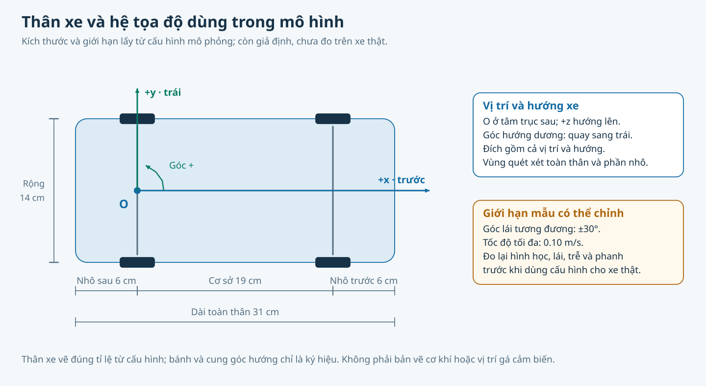

# Phần cứng và hiệu chuẩn

**Cấu hình chốt 14/11/2026:** Pi 4 Model B RAM 4 GB + microSD 64 GB. Hai MT6701 riêng nối ESP32: #1 góc lái tuyệt đối qua I²C; #2 chuyển động bánh/trục qua A/B. Module/gá/PPR cần đối chiếu; driver phần cứng chưa hoàn thiện.

Chặng đầu đã hoàn tất trong mô phỏng. Xe thật chưa chạy thao tác; đầu ra chuyển động trên bo mặc định tắt và phần mềm chưa đọc tốc độ, góc lái thực. Kết quả mô phỏng không mở các điều kiện đang chặn xe thật.

## Bố trí mới dùng Raspberry Pi

Phương án ngày 13/11/2026 đưa các kết nối USB lên xe: LiDAR C1 và hub bốn camera nối Pi; ESP32 nối Pi bằng USB ngắn. Laptop chỉ trao đổi dữ liệu và quỹ đạo qua Wi-Fi nội bộ. Pi đảm nhiệm định vị/bám đường; AI vẫn chạy trên laptop. Xem [bản vẽ nguồn và tín hiệu](LAP_RAP_DIEN_2D.md).

Pi cần nguồn ổn áp phù hợp với model và tải USB thực tế; nguồn này tách chức năng khỏi BEC cấp servo. Không đưa BEC 6 V hoặc pin 2S trực tiếp vào đầu nguồn 5 V của Pi. Chưa chốt module nguồn/hub; cần kiểm tải đồng thời Pi, LiDAR, ESP32 và camera, khả năng cấp nguồn hub, tránh cấp ngược qua USB và đo sụt áp khi motor/servo hoạt động.

Bắt đầu bằng một camera rồi tăng dần lên bốn. Đo tốc độ khung hình, tuổi ảnh, tải CPU, nhiệt độ và gián đoạn USB khi truyền đồng thời. Độ chính xác tư thế, độ trễ mạng và quãng phanh phải đo trên xe; số đo mô phỏng không thay thế được các phép kiểm này.

## Đo xe và hệ tọa độ

*Kích thước và giới hạn trong hình là giả định cho mô phỏng, không phải số đo hay ngưỡng nghiệm thu.*

Tư thế đặt tại tâm trục sau: trục x hướng trước, trục y hướng trái. Cần đo chiều dài cơ sở, bề rộng, phần nhô, vòng quay, trễ đánh lái, tốc độ thấp và quãng phanh. Ghi điều kiện pin, sàn, tải, dụng cụ và độ phân tán qua nhiều lần đo.

LiDAR phải được gá cố định, đo vị trí so với xe và kiểm hướng trái, phải bằng vật thật. Bản đồ cần được neo vào cùng hệ tọa độ.

## Hiệu chuẩn camera

1. Đo kích thước ô trên bảng chuẩn; chụp đúng chế độ camera, nhiều góc và vị trí, phủ cả mép ảnh.
2. Kiểm sai số và ảnh sau hiệu chỉnh; giữ ảnh gốc cùng kết quả.
3. Đo vị trí, hướng gá camera; kiểm phép chiếu bằng vật có vị trí đo trên sàn. Đổi gá phải đo lại.
4. Loại thân xe, viền và vùng không tin cậy khỏi ảnh dùng để suy luận; kiểm nguy cơ che mất vật sát xe.

Camera trên cao dùng để chấm phải có mốc sàn độc lập, vị trí dấu trên xe đã đo và đồng bộ thời gian. Không dùng cùng dữ liệu vừa hiệu chuẩn để kết luận độ chính xác.

## Bo điều khiển, nguồn và dừng

Hoàn thiện phản hồi tốc độ, góc lái và tư thế sống trước khi chạy. Lệnh chuyển động có hạn; mất lệnh hoặc phản hồi phải dẫn tới dừng. Kết nối lại không tự chạy tiếp. Bo ảo chỉ kiểm phần mềm và giao tiếp.

Chọn nguồn và dây theo dòng đo thực; tách nguồn động lực và logic. Cấu hình hiện đã chọn không bố trí dừng khẩn/ngắt động lực độc lập hoặc cầu chì bổ sung, và chưa dùng ToF/IMU. Dừng bằng phần mềm/watchdog không phải đường ngắt động lực độc lập; bản cập nhật Pi không thay đổi giới hạn phần cứng này.

Thử khi chưa cấp động lực, rồi kê bánh, sau đó mới kiểm phanh trên sàn. Thử mất Wi-Fi, Pi treo/khởi động lại, đứt USB Pi–ESP32, mất cảm biến và dữ liệu trễ; giữ bản ghi cùng quãng dừng đo được. Kết nối lại không được tự chạy tiếp.
