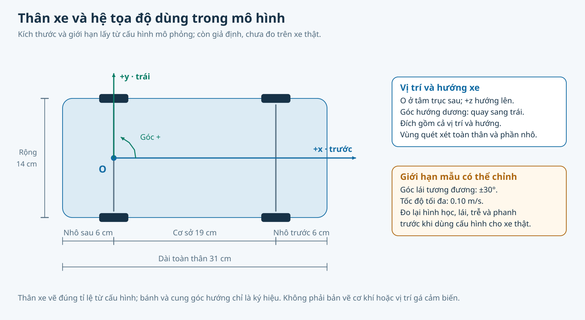

# Phần cứng và hiệu chuẩn

Cấu hình xe/cảm biến hiện còn giả định; chưa có thao tác trên xe thật. [Hồ sơ thiết bị và số đo có ngày](DU_LIEU_VA_GIAY_PHEP.md) giữ nguồn đối chiếu.

Sau [chặng 1 mô phỏng đã hoàn tất](KIEM_THU_VA_LO_TRINH.md), ưu tiên chặng 2–4: firmware/phản hồi thật, đo xe/phanh và hiệu chuẩn cảm biến được chọn. Firmware hiện tắt PWM mặc định và `read_inputs()` chưa đọc tốc độ/góc lái; cần hoàn thiện và kiểm trên thiết bị trước khi đáp ứng điều kiện chạy. Kết quả mô phỏng không mở các chặn START của xe thật.

## Xe, LiDAR và hệ tọa độ



*Hình theo cấu hình xe đi kèm hai cảnh mẫu; không phải kích thước đã đo hoặc bản vẽ gá cảm biến.*

Tư thế xe ở tâm trục sau: +x trước, +y trái, +z lên. Đo chiều dài cơ sở, bề rộng lớn nhất, phần nhô, góc lái/vòng quay hai chiều, trễ/tốc độ đổi lái, tốc độ thấp, gia tốc và quãng phanh. Mỗi số có ngày, dụng cụ, pin/sàn/tải, số lần lặp và độ tản.

Lưu cấu hình đo mới rồi chọn bằng `--vehicle-config`; bo mô phỏng/firmware phải khớp giới hạn. LiDAR cần đo gá, xác minh trái/phải bằng vật thật và neo bản đồ đúng hệ xe.

`lidar.map_builder` dựng bản đồ từ `--placement` NPZ với `--anchor`/`--anchor-vehicle`; `lidar.pose_estimator` kiểm bản ghi bằng `--map`, `--recording`, `--initial`. Dữ liệu bàn cố định dùng `--sensor-frame`. Xem `--help` trước khi thu.

VehicleIO với bo thật vẫn bị chặn `START_POSE_UNVERIFIED`; nguồn mô phỏng/phát lại không phải đo sống. Chế độ quan sát còn cần telemetry tốc độ/góc lái hợp lệ, hiện firmware chưa đọc các cảm biến đó.

<a id="noi-tham"></a>
## Nội tham camera

1. In bảng không co giãn, đo lại cỡ ô.
2. Chụp đúng camera/mode, nhiều vị trí/nghiêng, phủ giữa và mép ảnh; loại khung hỏng.
3. Hiệu chuẩn, kiểm RMS, độ phủ và ảnh nắn; lưu kèm ảnh nguồn/cỡ ô đo. Công cụ cần ít nhất 8 ảnh, nhưng lưu được không đồng nghĩa đạt.

Từ `autopark/`:

```powershell
.\.venv\Scripts\python.exe -m autopark.perception.fisheye_calib board --paper A3 --square-mm 28
.\.venv\Scripts\python.exe -m autopark.ui.calib_app --port 1
.\.venv\Scripts\python.exe -m autopark.perception.fisheye_calib check calibration/cam_p1.json
```

Nhập cỡ ô thực đo. Tệp `calibration/cam_pN.json` chứa K/D, cỡ ảnh, nguồn và acceptance; chỉ dùng đúng cỡ ảnh. Camera ngoài hub dùng `--index N --camera-name tren_cao`; tra index bằng `video.camera_bench list`.

<a id="ngoai-tham"></a>
## Ngoại tham

Gá cố định, đặt bảng ở nhiều vị trí sàn, đo O/A/B và chiều cao mặt in. Dùng `ui.roi_app --port 1` hoặc `perception.extrinsics_calib` để tính/kiểm chiếu lại. Tệp đo dự kiến `configs/rig/camera_rig_extrinsics_v1.json`; v0 là giả định. Đổi gá phải đo lại.

<a id="roi"></a>
## ROI

Trong `ui.roi_app`, loại thân xe, viền và vùng không tin cậy. Mask PNG đúng cỡ ảnh: 255 dùng, 0 loại; lưu `configs/roi/rig_v1/roi_pN.png`. Kiểm bằng vật có vị trí đo trên sàn; ảnh trông hợp lý chưa chứng minh phép chiếu đúng. Các đường V1 trên là đầu ra cần tạo, chưa mặc nhiên tồn tại.

<a id="tham-chieu"></a>
## Tham chiếu trên cao

Camera riêng, mốc sàn đo độc lập và marker trên xe cho tư thế chấm. Hiệu chuẩn → `evaluation.overhead_ref floor` → `tc1` → `track`; xem `--help`. Tách điểm khớp/điểm kiểm, đo marker so trục sau và chiều cao. Giữ video, TC-1, track CSV/JSON và dấu đồng bộ F8 trước/sau lượt. Trễ màn hình/FPS/đồng hồ phải tính vào sai số. Công cụ tổng hợp không xác nhận camera thật đã đạt.

<a id="giao-thuc"></a>
## VehicleIO và giao thức

V1: `COBS(message || CRC) || 0x00`, little-endian; CRC-16/CCITT-FALSE. Header 8 byte: version, type, session_id, sequence. COMMAND mang hạn ms, enable, tốc độ mm/s có dấu và lái mrad; API dùng m/s, rad, s. [Trường/enum](../autopark/transport/protocol.py), [C++](../firmware/esp32_vehicle/src/core/protocol.h).

HELLO → ARM → COMMAND mới còn hạn mới chạy. PING không gia hạn chuyển động. Hết lệnh, watchdog, lỗi và chốt mất telemetry có vai trò riêng; reset/kết nối lại/xóa lỗi không tự chạy tiếp.

<a id="firmware"></a>
## Firmware và QEMU

Trong `firmware/esp32_vehicle/`: `pio run -e esp32s3` hoặc `pio run -e esp32s3_qemu`. Từ `autopark/`: `.venv\Scripts\python.exe -m autopark.transport.qemu_board kiem`. Toolchain/QEMU theo `configs/thiet_bi.json`.

PWM mặc định tắt; GPIO chưa chốt. Giữ `-Wl,--wrap=esp_panic_handler` kể cả Arduino 3.x qua PlatformIO. Vector chung ở `test/vectors.json` sinh từ Python, không sửa tay. Trần firmware hiện 300 mm/s có thể gây `LIMITS_MISMATCH` với xe mẫu; đổi tệp xe không đổi firmware.

QEMU kiểm giao thức/máy trạng thái, không chứng minh LEDC, E-stop, watchdog vật lý hay phanh. Bản QEMU UART0/DIO chỉ cho giả lập; chưa nạp bo thật.

<a id="nguon-dung"></a>
## Nguồn và dừng

Lập bảng điện áp/dòng thường/đỉnh theo tải thật trước chọn nguồn, dây, cầu chì và phần tử ngắt. Tách động lực/logic, kiểm BEC/mass/cấp ngược USB. E-stop NC theo thiết kế coi hở mạch là tác động; GPIO E-stop không thay phần tử cắt động lực.

Kiểm giao thức khi PWM tắt → đo chân xung/reset/panic/watchdog → cơ cấu khi kê bánh → phản hồi/phanh trên sàn. Thử mất lệnh/telemetry, reset, đứt dây E-stop, mất cảm biến và kẹt cơ cấu; giữ log và quãng dừng. Chưa có số đo thì ghi chưa đo.
