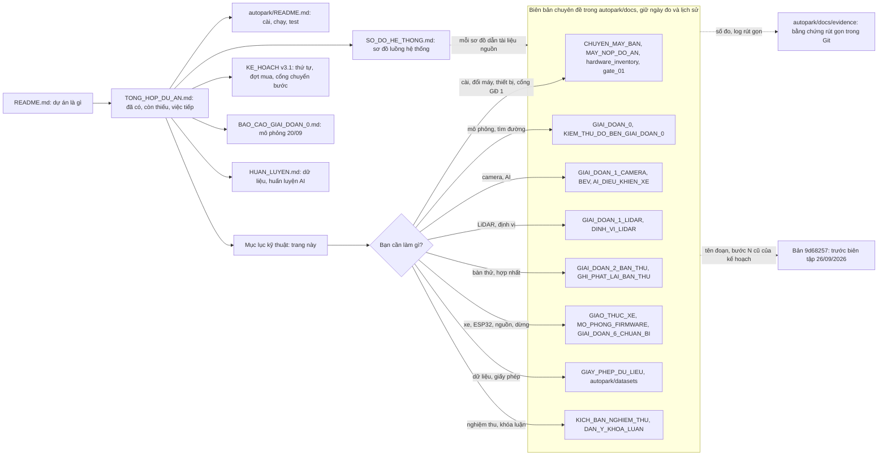

# Tài liệu kỹ thuật AutoPark

**Mới đọc dự án:** [README](../../README.md) → [Tổng quan và tiến độ](../../TONG_HOP_DU_AN.md) → [Cài đặt và chạy](../README.md) → [Sơ đồ hệ thống](SO_DO_HE_THONG.md).

Trang này giúp tìm tài liệu theo việc cần làm. Biên tập 30/09/2026 theo mã tại `ff4a018` (mã giống `ebbec83`); cập nhật 02/10/2026 cho các công cụ nghiệm thu của đợt dựng trên `3148014` (T5, T6, T9–T15, mới kiểm bằng test và mô phỏng) và công cụ đo EcoQoS của giao diện. Các biên bản chuyên sâu giữ ngày đo và lịch sử thử nghiệm; trạng thái hiện tại của cả dự án đọc ở [Tổng quan và tiến độ](../../TONG_HOP_DU_AN.md).

## Sơ đồ hệ thống

| Tài liệu | Nội dung |
|---|---|
| [Sơ đồ hệ thống AutoPark](SO_DO_HE_THONG.md) | Các sơ đồ luồng của mã tại `ff4a018` (cập nhật 02/10/2026 cho các công cụ nghiệm thu) gom về một chỗ, chia chín mục: toàn cảnh; ứng dụng và phiên đỗ; lập đường, bám đường và mô phỏng; cảm biến và bàn thử; AI nhận thức; liên kết laptop–bo và firmware; an toàn và dừng; tiến độ và nghiệm thu; quy trình làm việc. Mỗi sơ đồ dẫn tới tài liệu chi tiết và mã |

Sơ đồ có trạng thái dùng ba màu: xanh là đã có và đã kiểm/đo, vàng là chỉ trong mô phỏng/giả lập, đỏ viền đứt là chưa làm hoặc chưa thử trên thiết bị. Sơ đồ nào dùng một màu theo nghĩa hẹp hơn thì dòng chú giải dưới nó ghi rõ. Dòng “Sơ đồ:” ở đầu mỗi nhóm dưới đây chỉ mục hoặc sơ đồ tương ứng trong Sơ đồ hệ thống.

**Bản đồ đọc tài liệu** (cùng ý với sơ đồ 9.4 của [Sơ đồ hệ thống](SO_DO_HE_THONG.md), nhưng chia nhóm theo các mục của trang này):

Mũi tên liền là thứ tự đọc gợi ý; mũi tên đứt là chỗ tra thêm khi cần. Mỗi ô nhóm chỉ ghi vài tệp tiêu biểu; danh sách đủ nằm ở các bảng dưới.

## Cài, chạy và mang đi trình diễn

Sơ đồ: [Sơ đồ hệ thống](SO_DO_HE_THONG.md), sơ đồ 1.3 (thiết bị, máy và cổng), 9.2 (chạy test trên commit) và 9.3 (chuẩn bị máy mới).

| Tài liệu | Dùng khi |
|---|---|
| [Hướng dẫn chạy](../README.md) | Cài môi trường; chạy mô phỏng, test, AI, LiDAR/camera/bàn thử; chế độ điều khiển, lệnh firmware và bo ảo (mục 9) |
| [Chuyển máy bàn](CHUYEN_MAY_BAN.md) | Chép dự án sang máy khác: venv hỏng, đường dẫn có dấu, cổng LiDAR và đường dẫn QEMU/PlatformIO ở `configs/thiet_bi.json` (mục 1–5); kết quả kiểm máy bàn hiện tại ngày 29/09/2026 (mục 2); đổi tên repo sang `D:\xetulai`, test host và biên dịch firmware (mục 6–7); bo ảo QEMU, EcoQoS, số test trên `ebbec83`, dọn ổ C (mục 8, 30/09/2026); số test trên commit `c03ff94` của đợt biên tập tài liệu (mục 9, 01/10/2026); đo EcoQoS của ứng dụng giao diện khi cửa sổ thường, thu nhỏ, bị che (mục 10, 02/10/2026) |
| [Kiểm lại trên máy bàn 29/09](evidence/chuyen_may_20260929/kiem_may_20260929.md) | Tóm tắt lượt chạy lại các lệnh của hướng dẫn chạy trên máy bàn hiện tại ngày 29/09/2026 (mã `b37e9ee`): mô phỏng giai đoạn 0, LiDAR, chấm/dự đoán/huấn luyện thử AI, bàn thử có ghi và phát lại, `may_moi`; hồ sơ gốc git-ignore ở `autopark/runs/kiem_may_20260929/` |
| [Máy nộp đồ án](MAY_NOP_DO_AN.md) | Laptop RTX 3050 Ti mang đi nộp và trình diễn: chép checkpoint, cài/đo lại trên laptop, so với máy bàn |
| [Kế hoạch v3.1](../../KE_HOACH_TRIEN_KHAI_XE_TU_DO_v3.1.md) | Xem thứ tự giai đoạn, phụ thuộc, đợt mua và điều kiện chuyển bước |
| [Kiểm kê phần cứng](hardware_inventory.md) | Đối chiếu thiết bị đã nhận (LiDAR C1 ngày 22/09/2026, bốn camera và hub ngày 23/09/2026) và danh sách chưa nhận |
| [Cổng giai đoạn 1](gate_01.md) | Xem lý do chưa đủ điều kiện chuyển bước |

## Mô phỏng và tìm đường

Sơ đồ: [Sơ đồ hệ thống](SO_DO_HE_THONG.md) mục 2 (ứng dụng và phiên đỗ) và mục 3 (lập đường, bám đường và mô phỏng).

| Tài liệu | Nội dung |
|---|---|
| [Báo cáo giai đoạn 0](../../BAO_CAO_GIAI_DOAN_0.md) | Kết quả mô phỏng ngày 20/09, cách hiểu số test |
| [Biên bản giai đoạn 0](GIAI_DOAN_0.md) | Đối chiếu điều kiện chuyển bước |
| [Kiểm thử độ bền](KIEM_THU_DO_BEN_GIAI_DOAN_0.md) | Lỗi biên, campaign, ca khó, đường chứng |
| [Độ nhạy kích thước xe](DO_NHAY_KICH_THUOC_XE.md) | Ảnh hưởng kích thước giả định đến khả năng tìm đường |

## Camera và AI

Sơ đồ: [Sơ đồ hệ thống](SO_DO_HE_THONG.md), sơ đồ 4.3 (camera USB tới bộ ảnh đồng bộ), 4.6 (hiệu chuẩn camera và BEV) và mục 5 (AI nhận thức).

Làm theo thứ tự: kiểm camera → nội tham → ngoại tham/ROI → BEV → đo sai số → dùng làm vật cản.

| Tài liệu | Nội dung |
|---|---|
| [Chuẩn bị giai đoạn 1](GIAI_DOAN_1_CHUAN_BI.md) | Nguồn phát lại, ROI, costmap, ONNX, giám sát dữ liệu |
| [Thử camera thật](GIAI_DOAN_1_CAMERA.md) | Mode, FPS, khung hỏng, bốn camera qua hub |
| [Sơ đồ USB](usb_topology.md) | Cổng hub, nhận diện camera và dây |
| [Mode camera](camera_modes.csv) | Danh sách mode đã ghi |
| [Hiệu chuẩn nội tham](HIEU_CHUAN_CAMERA.md) | Bảng in, chụp, tham số ống kính và tiêu chí |
| [Thư mục hiệu chuẩn](../calibration/README.md) | Tệp bảng in và nơi lưu hiệu chuẩn |
| [Ngoại tham và ROI](NGOAI_THAM_VA_ROI.md) | Vị trí/góc camera, vùng ảnh được dùng |
| [BEV](BEV.md) | Chiếu xuống lưới, che khuất và điều kiện dùng bản đồ |
| [AI tạo vật cản](AI_DIEU_KHIEN_XE.md) | Ngăn AI camera, điều kiện chặn, dừng khi đường bị chắn |
| [Gán nhãn sa bàn](GAN_NHAN_SA_BAN.md) | Nhập/sửa/duyệt/xuất nhãn; tách tập chấm |
| [Huấn luyện AI](../../HUAN_LUYEN.md) | Baseline, thử thêm dữ liệu, kết quả và lệnh tái hiện |

## LiDAR, bản đồ và định vị

Sơ đồ: [Sơ đồ hệ thống](SO_DO_HE_THONG.md), sơ đồ 4.1 (đường dữ liệu LiDAR) và 4.2 (ngăn LiDAR đưa vật cản vào phiên đỗ).

| Tài liệu | Nội dung |
|---|---|
| [Thử LiDAR C1](GIAI_DOAN_1_LIDAR.md) | Driver, ghi scan, phép đo, bản đồ tĩnh, độ lặp lại |
| [Định vị trên bản đồ](DINH_VI_LIDAR.md) | Khớp scan với map, trạng thái OK/AMBIGUOUS/FAILED |
| [So sánh định vị/SLAM](SO_SANH_DINH_VI_SLAM.md) | Các phương án, scan odometry và giới hạn bằng chứng |

Đọc scan, tạo bản đồ và định vị lại là ba kết quả riêng. Độ lặp lại khoảng cách chưa cho biết sai số so với thước.

Các lệnh LiDAR lấy cổng COM từ khóa `lidar_port` trong [configs/thiet_bi.json](../configs/thiet_bi.json) khi không có `--port` (`rig.bench`, `ui.rig_app`: khi `--lidar` không kèm giá trị; `rig.may_moi` tự tìm bộ chuyển CP210x, `--lidar COMx` ghi đè); đổi máy thì sửa ở đó ([Chuyển máy bàn](CHUYEN_MAY_BAN.md) mục 3).

## Bàn thử và hợp nhất cảm biến

Sơ đồ: [Sơ đồ hệ thống](SO_DO_HE_THONG.md), sơ đồ 4.4 (bàn thử), 4.5 (ghi và phát lại) và 4.7 (kiểm máy mới).

| Tài liệu | Nội dung |
|---|---|
| [Bàn thử giai đoạn 2](GIAI_DOAN_2_BAN_THU.md) | Bốn camera + LiDAR + AI, thời gian xử lý và chờ camera |
| [Ghi/phát lại](GHI_PHAT_LAI_BAN_THU.md) | Lưu phiên thật và chạy lại không cần mở thiết bị |
| [Chuẩn bị hợp nhất](GIAI_DOAN_3_CHUAN_BI.md) | Các lớp bản đồ, ToF giả, đổi tọa độ và vật cản vào mô phỏng |

## Xe, ESP32, nguồn và dừng

Sơ đồ: [Sơ đồ hệ thống](SO_DO_HE_THONG.md) mục 6 (liên kết laptop–bo và firmware) và mục 7 (an toàn và dừng).

Chưa có bo ESP32-S3, xe MN300, phần nguồn và nút dừng ([Kiểm kê phần cứng](hardware_inventory.md)). Firmware đã biên dịch cho ESP32-S3 (29/09/2026) và chạy trong bo ảo QEMU (30/09/2026, giả lập), nhưng CHƯA nạp, CHƯA chạy trên bo; nhánh VEHICLE_IO/OBSERVE của ứng dụng mới chạy với bo mô phỏng.

Diễn tập tiêm lỗi (T6, chỉ mô phỏng, từ 02/10/2026): `python -m autopark.evaluation.fault_drill` với lệnh con `pose`, `hang` hay `camera` gây nguồn tư thế ngừng cập nhật, vòng điều khiển của laptop treo (có hoặc không Heartbeat) hay camera đứng hình, ghi log và `drill.json` vào `runs\fault_drill\…`; không mở cổng hay camera thật ([Kịch bản nghiệm thu](KICH_BAN_NGHIEM_THU.md) CB-2, CB-5, CB-6; lệnh ở [Hướng dẫn chạy](../README.md) mục 4).

| Tài liệu | Nội dung |
|---|---|
| [Chuẩn bị đo MN300](GIAI_DOAN_4_CHUAN_BI.md) | Bảng đo và cách đưa thông số vào cấu hình |
| [Phiếu kiểm kê MN300](mn300_inventory.md) | Điền khi nhận xe; hiện là mẫu |
| [Giao thức xe](GIAO_THUC_XE.md) | Laptop–bo, telemetry, lệnh có hạn và điểm còn mở |
| [VehicleIO và quan sát](CHE_DO_QUAN_SAT.md) | Các nhánh chạy, kiểm trước START, log (kể cả sự kiện dừng của phiên, T13), nút Xóa lỗi bo (T15), phát lại log (T9); mức bằng chứng: chỉ mô phỏng |
| [Firmware ESP32-S3](../firmware/esp32_vehicle/README.md) | Mã C++/PlatformIO, an toàn, test host, biên dịch cho ESP32-S3, chạy trong bo ảo, trình tự thử trên bo (chưa làm), các giá trị CHƯA CHỐT theo bo thực |
| [Mô phỏng firmware (bo ảo QEMU)](MO_PHONG_FIRMWARE.md) | Firmware thật (env `esp32s3_qemu`) chạy trong QEMU của Espressif, laptop nói chuyện bằng `SerialVehicleIO` qua `socket://`; 13 test pytest, 6 trong đó chạy firmware thật trong QEMU; các trình giả lập đã thử và giới hạn (29–30/09/2026). Không kiểm xung ESC/servo, E-stop, cảm biến, USB-CDC thật, task watchdog kích hoạt; không thay đo trên bo |
| [Nguồn và dừng](GIAI_DOAN_6_CHUAN_BI.md) | Nháp bảng tải/sơ đồ, kịch bản lỗi chưa thử |

Bo ảo đọc đường dẫn QEMU và PlatformIO từ các khóa `qemu_xtensa`, `platformio_python`, `platformio_core_dir` trong [configs/thiet_bi.json](../configs/thiet_bi.json); máy không có các khóa này hoặc đường dẫn không tồn tại thì 6 test chạy bo ảo tự bỏ qua. Giao diện chưa chọn được bo ảo (thẻ “Bo điều khiển” chỉ có bo mô phỏng và cổng COM); bo ảo dùng từ Python và pytest ([Mô phỏng firmware](MO_PHONG_FIRMWARE.md) mục 1).

## Dữ liệu và giấy phép

Sơ đồ: [Sơ đồ hệ thống](SO_DO_HE_THONG.md), sơ đồ 5.2 (dữ liệu và giấy phép).

| Tài liệu | Nội dung |
|---|---|
| [Danh mục dataset](../datasets/DANH_MUC_DATASET.md) | Bộ dữ liệu và mục đích dự kiến |
| [Tải và kiểm](../datasets/TAI_VA_KIEM_TRA.md) | Cách tải/kiểm các gói |
| [Trạng thái tải đầy đủ](../datasets/TRANG_THAI_TAI_DAY_DU.md) | Biên bản tải trên máy đã chuẩn bị dữ liệu |
| [Metadata WoodScape](../datasets/woodscape_metadata/README.md) | Nhãn, calibration và metadata trong repo |
| [Giấy phép dữ liệu](GIAY_PHEP_DU_LIEU.md) | Điều khoản, quyết định 25/09, phạm vi chưa được xác nhận |

Nghiên cứu nhận thức sử dụng **[Valeo WoodScape Dataset](https://github.com/valeoai/WoodScape)**. Dataset đầy đủ, cache và checkpoint không đi kèm bản clone. Biên bản “đã tải” nói về máy tại thời điểm ghi, không có nghĩa máy mới đã có dữ liệu.

## Nghiệm thu và khóa luận

Sơ đồ: [Sơ đồ hệ thống](SO_DO_HE_THONG.md) mục 8 (tiến độ và nghiệm thu).

| Tài liệu | Nội dung |
|---|---|
| [Kịch bản nghiệm thu](KICH_BAN_NGHIEM_THU.md) | 37 kịch bản (bản nháp, mọi kịch bản CHƯA THỬ ở mức nghiệm thu), cách đo độc lập, dấu đồng bộ video–log (mục 2.5), bảng công cụ T1–T15 (mục 7; T5, T6, T9–T15 có từ 02/10/2026, mới kiểm bằng test và mô phỏng) |
| [Ngưỡng đề xuất](NGUONG_NGHIEM_THU_DE_XUAT.md) | Giá trị cần chốt trước khi thu kết quả cuối; mọi ngưỡng đang là ĐỀ XUẤT – CHỜ CHỐT; bản sao cho công cụ chấm một lần chạy (T5) ở `configs/nguong_nghiem_thu.json` |
| [Dàn ý khóa luận](DAN_Y_KHOA_LUAN.md) | Chương, hình/bảng, mức bằng chứng và việc cần xác minh |
| [Bằng chứng trong Git](evidence/) | Bản sao nhỏ của log, JUnit, số đo và hình minh họa, chia theo đợt: mô phỏng giai đoạn 0 (gốc thư mục, `hard_cases/`), `camera/`, `lidar/`, `rig/`, `may_ban/`, `ke_hoach/`, `chuyen_may_20260929/`, `mo_phong_20260930/` |
| [Báo cáo camera 23/09](evidence/camera/report_20260923.md) | Biên bản thử camera theo ngày |

## Thuật ngữ thường gặp

| Thuật ngữ | Hiểu trong dự án |
|---|---|
| Pose / tư thế | Vị trí x, y và hướng yaw |
| Planner | Bộ tìm đường phù hợp hình học/giới hạn xe |
| Controller / tracker | Bộ tính tốc độ/góc lái để bám đường |
| Telemetry | Số đo và trạng thái bo gửi về laptop |
| Rig / bàn thử | Cụm cảm biến được bố trí để đo và kiểm |
| Nội tham | Tham số camera/ống kính để ánh xạ pixel thành hướng nhìn |
| Ngoại tham | Vị trí và hướng camera/cảm biến so với hệ tọa độ khác |
| ROI | Vùng ảnh được phép sử dụng |
| BEV | Bản đồ nhìn từ trên xuống |
| Costmap | Lưới biểu diễn vùng đi được, bị chặn hoặc chưa biết |
| UNKNOWN | Chưa quan sát hoặc chưa đủ tin cậy; không tự coi là trống |
| Odometry | Ước lượng dịch chuyển tương đối qua thời gian |
| SLAM | Đồng thời dựng bản đồ và định vị |
| Replay | Phát lại dữ liệu/phiên đã ghi |
| Phát lại log (lần chạy qua VehicleIO) | Chạy lại cùng phần mềm trên đầu vào đã ghi của một lần chạy qua `VehicleIO` (telemetry, sự kiện, mẫu tư thế) và so quyết định với bản ghi; không tái hiện xe hay bo (T9, từ 02/10/2026, chỉ mô phỏng) |
| Dấu đồng bộ video–log | Ô trắng có số nháy trên màn hình laptop để camera quay video thấy, kèm một dòng `SYNC_MARK` có `perf_counter`; dùng để ghép mốc video với mốc log (R7, T14, từ 02/10/2026, chỉ kiểm offscreen) |
| Checkpoint | Tệp trọng số và thông tin trạng thái huấn luyện |
| Cổng chuyển bước | Những điều kiện phải kiểm đạt trước bước tích hợp tiếp |
| Nguồn giả / tổng hợp | Dữ liệu tạo để kiểm phần mềm, không phải phép đo thật |
| SIM / VEHICLE_IO / OBSERVE | Ba nhánh chạy của phiên đỗ, chọn ở ô “Nhánh chạy khi bấm Bắt đầu đỗ”: SIM (mặc định) là xe ảo nhận lệnh trực tiếp, không qua giao thức, phản hồi giả như giai đoạn 0; VEHICLE_IO gửi lệnh tới bo qua giao thức v1; OBSERVE: người lái cầm lái, phần mềm chỉ tính và ghi lệnh, không gửi COMMAND nào (lúc START chỉ gửi DISARM) |
| Bo mô phỏng | `SimVehicleIO` + `FirmwareModel` (bản tham chiếu Python của firmware) chạy trong ứng dụng; bo mặc định của chế độ VEHICLE_IO/OBSERVE |
| Bo ảo (QEMU) | Firmware C++ thật (bản build `esp32s3_qemu`, cùng mã nguồn với bản nạp vào xe) chạy trong trình giả lập QEMU của Espressif trên máy tính, nói chuyện với laptop qua `socket://`. Là giả lập, không thay đo trên bo thật |
| Test host | Lõi C++ `src/core` của firmware biên dịch và chạy trên máy tính, so với bản tham chiếu Python bằng vector mẫu |
| EcoQoS | Chế độ của Windows 11 có thể hạ tốc một tiến trình (ví dụ tiến trình không có cửa sổ) dù máy rảnh, đủ làm hỏng test có hạn giờ; từ 30/09/2026 `tests/conftest.py` tắt nó cho tiến trình pytest (`AUTOPARK_KEEP_ECOQOS=1` để giữ mặc định của Windows) |
| JUnit | Tệp kết quả pytest dạng XML, lưu làm bằng chứng số test; từ 30/09/2026 ghi cả trạng thái EcoQoS (thuộc tính `ecoqos`) |

## Quy ước cập nhật tài liệu

Sơ đồ: [Sơ đồ hệ thống](SO_DO_HE_THONG.md), sơ đồ 9.1 (từ mã tới bằng chứng và tài liệu).

Tài liệu chính viết trạng thái mới vào đúng đoạn hiện tại; đưa lịch sử vào commit hoặc biên bản có ngày. Không nối nhiều chú thích “sửa lại/cập nhật” vào cùng câu. Biên bản chuyên đề giữ số đo và câu lịch sử; câu nào không còn đúng với hiện tại thì sửa thẳng câu đó hoặc thêm ghi chú có ngày *(Cập nhật dd/mm/yyyy: …)*.

Mỗi kết quả cần ghi nguồn, ngày, môi trường, cách đo và giới hạn. Hướng dẫn chạy cần ghi thư mục làm việc, môi trường và tệp phải có. Tệp ngoài Git ghi dạng đường dẫn và cách lấy, tránh tạo liên kết như thể đã có trong repo.

Ghi rõ mức bằng chứng: đã đo trên thiết bị thật, đã kiểm trên máy tính, chỉ mô phỏng hoặc giả lập (kể cả bo ảo QEMU), có mã nhưng CHƯA THỬ, CHƯA LÀM, CHƯA CHỐT, CẦN ĐO. Không viết kết quả mô phỏng hay giả lập như kết quả trên bo hay xe thật.

Sơ đồ đặt ngay cạnh phần giải thích tương ứng. Chữ trong ô nói rõ bước làm hoặc điều kiện; mũi tên không tự có nghĩa bước đó đã hoàn thành trên xe thật. Sơ đồ có tô trạng thái dùng ba màu ghi ở đầu trang và có một dòng chú giải ngay dưới sơ đồ.

**Các đợt biên tập.** Ngày 30/09/2026 viết lại bảy tài liệu chính ([README](../../README.md), [Tổng quan và tiến độ](../../TONG_HOP_DU_AN.md), [Kế hoạch v3.1](../../KE_HOACH_TRIEN_KHAI_XE_TU_DO_v3.1.md), [Báo cáo giai đoạn 0](../../BAO_CAO_GIAI_DOAN_0.md), [Huấn luyện AI](../../HUAN_LUYEN.md), [Hướng dẫn chạy](../README.md) và trang này) theo mã tại `ff4a018` (mã giống `ebbec83`) và thêm [Sơ đồ hệ thống](SO_DO_HE_THONG.md). Biên bản chuyên đề chỉ được sửa ở những câu không còn đúng với hiện tại, được thêm hoặc thay vài sơ đồ và vài đoạn trạng thái có ngày ([Giao thức xe](GIAO_THUC_XE.md) có khối “Trạng thái 30/09/2026”; [Chuyển máy bàn](CHUYEN_MAY_BAN.md) có đoạn về lượt chạy lại các lệnh ngày 29/09/2026 và bước chuẩn bị firmware, bo ảo khi đổi máy); số đo lịch sử giữ nguyên. Đợt này cũng thêm bản tóm tắt [kiem_may_20260929.md](evidence/chuyen_may_20260929/kiem_may_20260929.md) của lượt chạy lại đó. [Bản tại ff4a018](https://github.com/thbn12082/autopark/tree/ff4a018) giữ nội dung trước đợt này. Lúc biên tập, cây làm việc còn hai loại sửa đổi mã chưa commit: sửa chữ (docstring, chú thích, một tooltip của giao diện, mô tả gói trong `pyproject.toml`), và sửa cách `python -m autopark.transport.qemu_board kiem` đếm khung (đếm riêng các khung nhận trước cửa sổ đo 2 s; [kiem_bo_ao_dem_rieng.txt](evidence/mo_phong_20260930/bo_ao_30092026/kiem_bo_ao_dem_rieng.txt)). Đợt này cùng các sửa đổi mã đó vào commit `c03ff94` (01/10/2026), sau hai vòng kiểm lại các chỗ sửa; toàn bộ test chạy lại trên commit đó cho cùng số test với `ebbec83` ([Chuyển máy bàn](CHUYEN_MAY_BAN.md) mục 9).

Ngày 02/10/2026 các tài liệu được cập nhật theo đợt công cụ nghiệm thu (T5, T6, T9–T15 của [Kịch bản nghiệm thu](KICH_BAN_NGHIEM_THU.md) mục 7 và công cụ đo EcoQoS của giao diện, mã dựng trên `3148014`): tài liệu chính ghi thẳng trạng thái mới, biên bản chuyên đề thêm ghi chú có ngày, [Sơ đồ hệ thống](SO_DO_HE_THONG.md) sửa các sơ đồ liên quan (danh sách ở đầu tệp đó).

Đợt trước, ngày 26/09/2026 (commit `668bf5e`, `2ee2940`), viết lại sáu tài liệu chính, tạo trang này và thêm 13 sơ đồ luồng; [bản tại 9d68257](https://github.com/thbn12082/autopark/tree/9d68257) giữ đầy đủ nội dung trước đợt đó. Giữa hai đợt, các commit tài liệu `38f64bb`, `b37e9ee` (29/09/2026: chuyển máy bàn, cổng LiDAR, số test) và `ebbec83`, `ff4a018` (30/09/2026: test host và biên dịch firmware làm chiều 29/09, bo ảo QEMU, EcoQoS, số test trên `ebbec83`) vá các đoạn liên quan; chi tiết ở [Chuyển máy bàn](CHUYEN_MAY_BAN.md) và [Mô phỏng firmware](MO_PHONG_FIRMWARE.md).

Tên đoạn và số bước của kế hoạch mà các biên bản dẫn (ví dụ “Khi nhận LiDAR”, “Khi đủ bốn camera”, “mục 6 bước 8”) theo [bản kế hoạch tại 9d68257](https://github.com/thbn12082/autopark/blob/9d68257/KE_HOACH_TRIEN_KHAI_XE_TU_DO_v3.1.md). Bản kế hoạch hiện tại giữ số mục 1–18 nhưng không còn các tên đoạn và số bước đó; liên kết nào trong biên bản còn mở bản hiện tại thì tra tên đoạn và số bước ở bản 9d68257. Chi tiết mà biên bản viết trước 26/09/2026 dẫn theo số mục của tài liệu chính nhưng không còn ở bản hiện tại cũng tra ở bản 9d68257.
