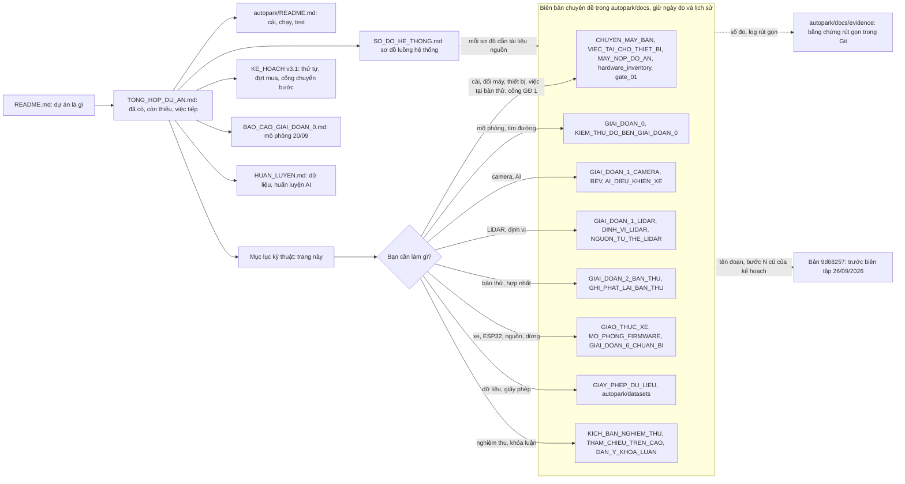

# Tài liệu kỹ thuật AutoPark

**Mới đọc dự án?** Đi theo thứ tự: [README](../../README.md) → [Tổng quan và tiến độ](../../TONG_HOP_DU_AN.md) → [Cài đặt và chạy](../README.md) → [Sơ đồ hệ thống](SO_DO_HE_THONG.md).

Trang này giúp tìm tài liệu theo việc bạn cần làm. Các tài liệu ở đây phần lớn là **biên bản chuyên đề**: chúng giữ ngày đo, số đo và diễn biến thử nghiệm, nên đọc chúng như hồ sơ. Trạng thái hiện tại của cả dự án luôn nằm ở [Tổng quan và tiến độ](../../TONG_HOP_DU_AN.md).

## Sơ đồ hệ thống

[Sơ đồ hệ thống AutoPark](SO_DO_HE_THONG.md) gom các sơ đồ luồng của mã về một chỗ, chia chín mục: toàn cảnh; ứng dụng và phiên đỗ; lập đường, bám đường và mô phỏng; cảm biến và bàn thử; AI nhận thức; liên kết laptop–bo và firmware; an toàn và dừng; tiến độ và nghiệm thu; quy trình làm việc. Mỗi sơ đồ dẫn tới tài liệu chi tiết và mã.

Sơ đồ có trạng thái dùng ba màu: **xanh** là đã có và đã kiểm hoặc đo; **vàng** là chỉ trong mô phỏng hay giả lập; **đỏ viền đứt** là chưa làm hoặc chưa thử trên thiết bị. Sơ đồ nào dùng màu theo nghĩa hẹp hơn thì dòng chú giải ngay dưới nó nói rõ. Dòng "Sơ đồ:" ở đầu mỗi nhóm dưới đây chỉ tới mục hoặc sơ đồ tương ứng.

**Bản đồ đọc tài liệu** (cùng ý với sơ đồ 9.4 của [Sơ đồ hệ thống](SO_DO_HE_THONG.md), nhưng chia nhóm theo các mục của trang này):

Mũi tên liền là thứ tự đọc gợi ý; mũi tên đứt là chỗ tra thêm khi cần. Mỗi ô nhóm chỉ ghi vài tệp tiêu biểu; danh sách đủ nằm ở các bảng dưới.

## Cài, chạy và mang đi trình diễn

Sơ đồ: [Sơ đồ hệ thống](SO_DO_HE_THONG.md), sơ đồ 1.3 (thiết bị, máy và cổng), 9.2 (chạy test trên commit) và 9.3 (chuẩn bị máy mới).

| Tài liệu | Dùng khi |
|---|---|
| [Hướng dẫn chạy](../README.md) | Cài môi trường; chạy mô phỏng, test, AI, LiDAR, camera, bàn thử; chế độ điều khiển, firmware và bo ảo (mục 9) |
| [Chuyển máy bàn](CHUYEN_MAY_BAN.md) | Biên bản theo ngày, 29/09–06/10/2026: chép dự án sang máy bàn hiện tại, cổng LiDAR, firmware, bo ảo QEMU, EcoQoS, các lượt chạy toàn bộ test, lượt chạy thiết bị ngày 02/10/2026, điều tra hai lần thoát bất thường. Đầu tệp có danh sách "mục nào nói gì" |
| [Việc tại chỗ thiết bị](VIEC_TAI_CHO_THIET_BI.md) | Lần tới ở cạnh bàn thử: các việc cần người tại chỗ, theo thứ tự nên làm, kèm lệnh, thời gian và nơi ghi kết quả |
| [Kiểm lại trên máy bàn 29/09](evidence/chuyen_may_20260929/kiem_may_20260929.md) | Tóm tắt lượt chạy lại các lệnh của hướng dẫn chạy trên máy bàn hiện tại ngày 29/09/2026 |
| [Máy nộp đồ án](MAY_NOP_DO_AN.md) | Laptop RTX 3050 Ti mang đi nộp và trình diễn: chép checkpoint, cài và đo lại, so với máy bàn |
| [Kế hoạch v3.1](../../KE_HOACH_TRIEN_KHAI_XE_TU_DO_v3.1.md) | Thứ tự giai đoạn, phụ thuộc, đợt mua, điều kiện chuyển bước |
| [Kiểm kê phần cứng](hardware_inventory.md) | Thiết bị đã nhận (LiDAR C1 ngày 22/09/2026, bốn camera và hub ngày 23/09/2026) và danh sách chưa nhận |
| [Cổng giai đoạn 1](gate_01.md) | Vì sao giai đoạn 1 chưa đủ điều kiện chuyển bước |

## Mô phỏng và tìm đường

Sơ đồ: [Sơ đồ hệ thống](SO_DO_HE_THONG.md) mục 2 (ứng dụng và phiên đỗ) và mục 3 (lập đường, bám đường và mô phỏng).

| Tài liệu | Nội dung |
|---|---|
| [Báo cáo giai đoạn 0](../../BAO_CAO_GIAI_DOAN_0.md) | Kết quả mô phỏng ngày 20/09, cách hiểu số test |
| [Biên bản giai đoạn 0](GIAI_DOAN_0.md) | Đối chiếu điều kiện chuyển bước |
| [Kiểm thử độ bền](KIEM_THU_DO_BEN_GIAI_DOAN_0.md) | Lỗi biên, chiến dịch thử, ca khó, đường chứng |
| [Độ nhạy kích thước xe](DO_NHAY_KICH_THUOC_XE.md) | Kích thước xe giả định ảnh hưởng thế nào tới khả năng tìm đường |

## Camera và AI

Sơ đồ: [Sơ đồ hệ thống](SO_DO_HE_THONG.md), sơ đồ 4.3 (camera USB tới bộ ảnh đồng bộ), 4.6 (hiệu chuẩn camera và BEV) và mục 5 (AI nhận thức).

Làm theo thứ tự: kiểm camera → nội tham → ngoại tham và ROI → BEV → đo sai số → dùng làm vật cản.

| Tài liệu | Nội dung |
|---|---|
| [Chuẩn bị giai đoạn 1](GIAI_DOAN_1_CHUAN_BI.md) | Nguồn phát lại, ROI, costmap, ONNX, giám sát dữ liệu |
| [Thử camera thật](GIAI_DOAN_1_CAMERA.md) | Chế độ ảnh, FPS, khung hỏng, bốn camera qua hub |
| [Sơ đồ USB](usb_topology.md) | Cổng hub, cách nhận diện camera, dây |
| [Chế độ camera](camera_modes.csv) | Danh sách chế độ ảnh đã ghi |
| [Hiệu chuẩn nội tham](HIEU_CHUAN_CAMERA.md) | Bảng in, cách chụp, tham số ống kính và tiêu chí; mở camera không qua hub (camera trên cao) theo index |
| [Thư mục hiệu chuẩn](../calibration/README.md) | Tệp bảng in (kể cả tờ marker ArUco cho tham chiếu trên cao) và nơi lưu kết quả hiệu chuẩn |
| [Ngoại tham và ROI](NGOAI_THAM_VA_ROI.md) | Vị trí và góc camera, vùng ảnh được dùng |
| [BEV](BEV.md) | Chiếu xuống lưới, che khuất, điều kiện dùng bản đồ |
| [AI tạo vật cản](AI_DIEU_KHIEN_XE.md) | Ngăn AI camera, các điều kiện chặn, dừng khi đường bị chắn |
| [Gán nhãn sa bàn](GAN_NHAN_SA_BAN.md) | Nhập, sửa, duyệt, xuất nhãn; tách tập chấm |
| [Huấn luyện AI](../../HUAN_LUYEN.md) | Mô hình nền, thử thêm dữ liệu, kết quả và lệnh tái hiện |

## LiDAR, bản đồ và định vị

Sơ đồ: [Sơ đồ hệ thống](SO_DO_HE_THONG.md), sơ đồ 4.1 (đường dữ liệu LiDAR) và 4.2 (ngăn LiDAR đưa vật cản vào phiên đỗ).

| Tài liệu | Nội dung |
|---|---|
| [Thử LiDAR C1](GIAI_DOAN_1_LIDAR.md) | Driver, ghi scan, phép đo, bản đồ tĩnh, độ lặp lại; lỗi xả bộ đệm cổng CP210x và bản sửa driver (02/10/2026, đã thử trên C1 thật) |
| [Định vị trên bản đồ](DINH_VI_LIDAR.md) | Khớp scan với bản đồ, các trạng thái OK/AMBIGUOUS/FAILED |
| [So sánh định vị/SLAM](SO_SANH_DINH_VI_SLAM.md) | Các phương án, odometry khớp scan và giới hạn bằng chứng. Phương án cho V1 theo đề xuất ở mục 7 (chọn ngày 02/10/2026) |
| [Nguồn tư thế LiDAR](NGUON_TU_THE_LIDAR.md) | Nguồn tư thế của phiên đỗ từ LiDAR (T2): dựng bản đồ sa bàn từ nhiều chỗ đặt, định vị trên bản đồ kèm kiểm chéo bằng odometry khớp scan, điều kiện trước khi dùng với bo thật, mã dừng, log. Mới chạy trong phiên mô phỏng và offline trên bản ghi C1 đứng yên |

Đọc scan, dựng bản đồ và định vị lại là ba kết quả riêng. Độ lặp lại khoảng cách chưa cho biết sai số so với thước.

Các lệnh LiDAR lấy cổng COM từ khóa `lidar_port` trong [configs/thiet_bi.json](../configs/thiet_bi.json) khi không có `--port`. `rig.bench` và `ui.rig_app` cũng lấy cổng này khi `--lidar` không kèm giá trị; `rig.may_moi` tự tìm bộ chuyển CP210x (`--lidar COMx` để ghi đè). Đổi máy thì sửa ở tệp đó ([Chuyển máy bàn](CHUYEN_MAY_BAN.md) mục 3).

## Bàn thử và hợp nhất cảm biến

Sơ đồ: [Sơ đồ hệ thống](SO_DO_HE_THONG.md), sơ đồ 4.4 (bàn thử), 4.5 (ghi và phát lại) và 4.7 (kiểm máy mới).

| Tài liệu | Nội dung |
|---|---|
| [Bàn thử giai đoạn 2](GIAI_DOAN_2_BAN_THU.md) | Bốn camera + LiDAR + AI: thời gian xử lý, cách chờ camera |
| [Ghi và phát lại](GHI_PHAT_LAI_BAN_THU.md) | Lưu phiên thật rồi chạy lại mà không cần mở thiết bị. Mục 9: ghi camera và LiDAR ngay trong phiên đỗ (ngăn "Ghi cảm biến", T3) và phát lại chung một đồng hồ (T3b), mới kiểm offscreen với thiết bị giả |
| [Chuẩn bị hợp nhất](GIAI_DOAN_3_CHUAN_BI.md) | Các lớp bản đồ, ToF giả, đổi tọa độ, đưa vật cản vào mô phỏng |

## Xe, ESP32, nguồn và dừng

Sơ đồ: [Sơ đồ hệ thống](SO_DO_HE_THONG.md) mục 6 (liên kết laptop–bo và firmware) và mục 7 (an toàn và dừng).

Dự án chưa có bo ESP32-S3, xe MN300, phần nguồn và nút dừng khẩn ([Kiểm kê phần cứng](hardware_inventory.md)). Firmware đã biên dịch cho ESP32-S3 (29/09/2026) và chạy trong bo ảo QEMU (30/09/2026, giả lập), nhưng chưa được nạp hay chạy trên bo thật.

Trong ứng dụng, nhánh VEHICLE_IO và OBSERVE chạy với bo mô phỏng. Từ 02/10/2026, nhánh VEHICLE_IO còn chạy được với bo ảo QEMU cùng xe mô phỏng phía laptop: một lần chạy ứng dụng offscreen, các nút được gọi bằng mã, đỗ xong 2/2 lần ([bằng chứng](evidence/bo_ao_ui_20261002/), [Chuyển máy bàn](CHUYEN_MAY_BAN.md) mục 14); lái tay qua giao diện chưa thử. Xe nghiệm thu `configs/vehicle_nghiem_thu.json` (0,10 m/s) bị bo ảo QEMU và ESP32-S3 từ chối ở VEHICLE_IO (LIMITS_MISMATCH, hướng an toàn), vì firmware vẫn biên dịch giới hạn 300 mm/s; bản firmware 100 mm/s chưa làm.

Diễn tập tiêm lỗi (T6, chỉ mô phỏng): `python -m autopark.evaluation.fault_drill` với lệnh con `pose`, `hang` hay `camera` gây ra nguồn tư thế ngừng cập nhật, vòng điều khiển của laptop treo (có hoặc không Heartbeat), hay camera đứng hình; kết quả ghi vào `runs\fault_drill\…`. Lệnh không mở cổng hay camera thật ([Kịch bản nghiệm thu](KICH_BAN_NGHIEM_THU.md) CB-2, CB-5, CB-6; lệnh ở [Hướng dẫn chạy](../README.md) mục 4).

| Tài liệu | Nội dung |
|---|---|
| [Chuẩn bị đo MN300](GIAI_DOAN_4_CHUAN_BI.md) | Bảng đo và cách đưa thông số vào cấu hình |
| [Phiếu kiểm kê MN300](mn300_inventory.md) | Phiếu điền khi nhận xe; hiện còn là mẫu |
| [Giao thức xe](GIAO_THUC_XE.md) | Giao thức laptop–bo, telemetry, lệnh có hạn và các điểm còn mở |
| [VehicleIO và quan sát](CHE_DO_QUAN_SAT.md) | Ba nhánh chạy, kiểm trước START, log (kể cả sự kiện dừng của phiên, T13), nút Xóa lỗi bo (T15), phát lại log (T9); bo ảo QEMU trong phiên, nguồn tư thế LiDAR, luật ghép bo với nguồn tư thế, các bước mở cổng lúc START. Mức bằng chứng: chỉ mô phỏng hay giả lập |
| [Firmware ESP32-S3](../firmware/esp32_vehicle/README.md) | Mã C++/PlatformIO, an toàn, test host, biên dịch, chạy trong bo ảo, trình tự thử trên bo (chưa làm), các giá trị chưa chốt |
| [Mô phỏng firmware (bo ảo QEMU)](MO_PHONG_FIRMWARE.md) | Firmware thật (env `esp32s3_qemu`) chạy trong QEMU của Espressif, laptop nói chuyện qua `socket://`; test pytest, một phần chạy firmware thật; phiên đỗ qua bo ảo (mục 1.1); các trình giả lập đã thử và giới hạn. Không kiểm được xung ESC/servo, nút dừng khẩn, cảm biến, USB-CDC thật, task watchdog |
| [Nguồn và dừng](GIAI_DOAN_6_CHUAN_BI.md) | Bản nháp bảng tải và sơ đồ nguồn, dừng; 16 kịch bản lỗi chưa thử |

Bo ảo đọc đường dẫn QEMU và PlatformIO từ các khóa `qemu_xtensa`, `platformio_python`, `platformio_core_dir` trong [configs/thiet_bi.json](../configs/thiet_bi.json); máy không có các khóa này, hoặc đường dẫn không tồn tại, thì các test chạy bo ảo tự bỏ qua. Trong giao diện, thẻ "Bo điều khiển" có mục "Bo ảo QEMU (firmware xe trong giả lập)" và nút "Khởi động bo ảo": nút này build ảnh firmware nếu thiếu hay cũ hơn mã nguồn, rồi chạy QEMU trên 127.0.0.1. Bo ảo chỉ đi với tư thế của xe mô phỏng phía laptop; chọn nó cùng nguồn tư thế LiDAR thì giao diện từ chối ([VehicleIO và quan sát](CHE_DO_QUAN_SAT.md), [Mô phỏng firmware](MO_PHONG_FIRMWARE.md) mục 1).

## Dữ liệu và giấy phép

Sơ đồ: [Sơ đồ hệ thống](SO_DO_HE_THONG.md), sơ đồ 5.2 (dữ liệu và giấy phép).

| Tài liệu | Nội dung |
|---|---|
| [Danh mục dataset](../datasets/DANH_MUC_DATASET.md) | Các bộ dữ liệu và mục đích dự kiến |
| [Tải và kiểm](../datasets/TAI_VA_KIEM_TRA.md) | Cách tải và kiểm các gói |
| [Trạng thái tải đầy đủ](../datasets/TRANG_THAI_TAI_DAY_DU.md) | Biên bản tải trên máy đã chuẩn bị dữ liệu (do script ghi) |
| [Metadata WoodScape](../datasets/woodscape_metadata/README.md) | README gốc của WoodScape đi kèm nhãn, calibration và metadata trong repo |
| [Giấy phép dữ liệu](GIAY_PHEP_DU_LIEU.md) | Điều khoản, quyết định ngày 25/09/2026, phạm vi chưa được xác nhận |

Nghiên cứu nhận thức sử dụng **[Valeo WoodScape Dataset](https://github.com/valeoai/WoodScape)**. Dataset đầy đủ, cache và checkpoint không đi kèm bản clone. Biên bản "đã tải" nói về một máy tại thời điểm ghi, không có nghĩa máy mới đã có dữ liệu.

## Nghiệm thu và khóa luận

Sơ đồ: [Sơ đồ hệ thống](SO_DO_HE_THONG.md) mục 8 (tiến độ và nghiệm thu).

| Tài liệu | Nội dung |
|---|---|
| [Kịch bản nghiệm thu](KICH_BAN_NGHIEM_THU.md) | 37 kịch bản (bản nháp, chưa kịch bản nào thử ở mức nghiệm thu), cách đo độc lập, dấu đồng bộ video–log (mục 2.5), bảng công cụ T1–T15 (mục 7). Chín kịch bản đỗ nghiệm thu dựng sẵn ở `scenarios/nghiem_thu/` |
| [Ngưỡng đề xuất](NGUONG_NGHIEM_THU_DE_XUAT.md) | Các giá trị cần chốt trước khi thu kết quả cuối; mọi ngưỡng còn là đề xuất. Bản sao cho công cụ chấm (T5) ở `configs/nguong_nghiem_thu.json`. Gồm cả xe nghiệm thu 0,10 m/s (N-V1) và giới hạn số lần đổi chiều theo từng kịch bản (N-D6 (b)) |
| [Tham chiếu trên cao](THAM_CHIEU_TREN_CAO.md) | Công cụ T4 cho phương pháp đo R1: in marker ArUco, tệp mốc sa bàn, khớp mặt sàn, TC-1 với xe giả, ghi video camera trên cao, trích tư thế cho `score_run --reference`, giao diện. Mới kiểm trên ảnh tổng hợp; với camera thật chưa thử, độ trễ chụp chưa đo |
| [Dàn ý khóa luận](DAN_Y_KHOA_LUAN.md) | Chương, hình và bảng, mức bằng chứng, việc cần xác minh |
| [Bằng chứng trong Git](evidence/) | Bản sao nhỏ của log, JUnit, số đo và hình minh họa, chia theo đợt (xem danh sách dưới) |
| [Báo cáo camera 23/09](evidence/camera/report_20260923.md) | Biên bản thử camera theo ngày |

Các thư mục trong `evidence/`:

- Gốc thư mục và `hard_cases/`: mô phỏng giai đoạn 0.
- `camera/`, `lidar/`, `rig/`, `may_ban/`, `ke_hoach/`: thử thiết bị, bàn thử, tham chiếu máy bàn, kiểm toán kế hoạch.
- `chuyen_may_20260929/`: chuyển sang máy bàn hiện tại.
- `mo_phong_20260930/`, `bien_tap_20261001/`, `cong_cu_20261002/`, `dot2_20261006/`: các lượt chạy test trên commit. Riêng `dot2_20261006/dua_start_bo_ao/` là thí nghiệm về test bo ảo bị từ chối START.
- `ecoqos_giao_dien_02102026/` và `ecoqos_giao_dien_02102026_lan2/`: EcoQoS khi lập đường; `ecoqos_chay_02102026/`: vòng 50 Hz khi cửa sổ thu nhỏ.
- `thiet_bi_20261002/`: lượt chạy thiết bị ngày 02/10/2026 và chẩn đoán LiDAR.
- `bo_ao_ui_20261002/`: ứng dụng chạy với bo ảo QEMU.
- `su_co_thoat_20261006/`: điều tra hai kiểu thoát bất thường (bảng mã thoát qua Git Bash, ErrorMode, lượt pytest chạy lại có theo dõi, công cụ chạy có theo dõi, bản mới của script chạy trên commit).

## Thuật ngữ thường gặp

| Thuật ngữ | Nghĩa trong dự án |
|---|---|
| Pose / tư thế | Vị trí x, y và hướng yaw |
| Planner | Bộ tìm đường phù hợp hình học và giới hạn của xe |
| Controller / tracker | Bộ tính tốc độ và góc lái để bám đường |
| Telemetry | Số đo và trạng thái bo gửi về laptop |
| Rig / bàn thử | Cụm cảm biến được bố trí để đo và kiểm |
| Nội tham | Tham số camera và ống kính, để đổi pixel thành hướng nhìn |
| Ngoại tham | Vị trí và hướng của camera hay cảm biến so với một hệ tọa độ khác |
| ROI | Vùng ảnh được phép dùng |
| BEV | Bản đồ nhìn từ trên xuống |
| Costmap | Lưới cho biết vùng nào đi được, bị chặn hay chưa biết |
| UNKNOWN | Chưa quan sát, hoặc chưa đủ tin cậy; không được tự coi là trống |
| Odometry | Ước lượng dịch chuyển tương đối theo thời gian |
| SLAM | Vừa dựng bản đồ vừa định vị |
| Replay | Phát lại dữ liệu hay phiên đã ghi |
| Phát lại log (lần chạy qua VehicleIO) | Chạy lại cùng phần mềm trên đầu vào đã ghi của một lần chạy qua `VehicleIO` (telemetry, sự kiện, mẫu tư thế) rồi so quyết định với bản ghi; không tái hiện xe hay bo (T9, chỉ mô phỏng) |
| Dấu đồng bộ video–log | Ô trắng có số nháy trên màn hình laptop để camera quay được, kèm một dòng `SYNC_MARK` có `perf_counter`; dùng để ghép mốc video với mốc log (R7, T14, mới kiểm offscreen) |
| Checkpoint | Tệp trọng số và trạng thái huấn luyện |
| Cổng chuyển bước | Các điều kiện phải kiểm đạt trước khi sang bước tích hợp tiếp theo |
| Nguồn giả / tổng hợp | Dữ liệu tạo ra để kiểm phần mềm, không phải phép đo thật |
| SIM / VEHICLE_IO / OBSERVE | Ba nhánh chạy của phiên đỗ, chọn ở ô "Nhánh chạy khi bấm Bắt đầu đỗ". SIM (mặc định): xe ảo nhận lệnh trực tiếp, không qua giao thức, phản hồi giả như giai đoạn 0. VEHICLE_IO: gửi lệnh tới bo qua giao thức v1. OBSERVE: người lái cầm lái, phần mềm chỉ tính và ghi lệnh, không gửi COMMAND nào (lúc START chỉ gửi DISARM) |
| Bo mô phỏng | `SimVehicleIO` + `FirmwareModel` (bản tham chiếu Python của firmware) chạy trong ứng dụng; là bo mặc định của VEHICLE_IO/OBSERVE |
| Bo ảo (QEMU) | Firmware C++ thật (bản build `esp32s3_qemu`, cùng mã nguồn với bản nạp vào xe) chạy trong trình giả lập QEMU của Espressif trên máy tính, nói chuyện với laptop qua `socket://`. Chọn được ở thẻ "Bo điều khiển" và chạy phiên đỗ với xe mô phỏng phía laptop. Là giả lập, không thay được đo trên bo thật |
| Nguồn tư thế | Nơi phiên đỗ lấy tư thế xe ở nhánh VEHICLE_IO/OBSERVE, chọn ở ô "Nguồn tư thế" của thẻ "Bo điều khiển" (T2): mô phỏng (định vị lý tưởng, mặc định), LiDAR mô phỏng, hay LiDAR thật (chỉ trong `ui.lidar_app`). Mỗi loại bo chỉ đi với một số nguồn ([Nguồn tư thế LiDAR](NGUON_TU_THE_LIDAR.md)) |
| Xe nghiệm thu | `configs/vehicle_nghiem_thu.json`: giống `vehicle_default.json` (mọi số đều giả định) trừ tốc độ tối đa 0,10 m/s theo N-V1. Bo mô phỏng đi kèm là `configs/vehicle_io_sim_nghiem_thu.json`; giao diện tự chọn theo tệp xe |
| MP / BT / XT | Ba mức thử của nghiệm thu: mô phỏng, bàn thử, xe thật ([Kịch bản nghiệm thu](KICH_BAN_NGHIEM_THU.md) mục 1.2) |
| T1–T15 | Các công cụ cần cho nghiệm thu ([Kịch bản nghiệm thu](KICH_BAN_NGHIEM_THU.md) mục 7) |
| R1, TC-1 | R1: tham chiếu độc lập bằng camera trên cao và hai marker ArUco trên xe, cho tư thế xe theo từng khung video. TC-1: kiểm độ chính xác của R1 bằng xe giả đứng yên, so với thước (R2). Công cụ T4 ([Tham chiếu trên cao](THAM_CHIEU_TREN_CAO.md)) |
| Test host | Lõi C++ `src/core` của firmware biên dịch và chạy trên máy tính, so với bản tham chiếu Python bằng vector mẫu |
| EcoQoS | Chế độ của Windows 11 có thể hạ tốc một tiến trình (ví dụ tiến trình không có cửa sổ, hay cửa sổ bị thu nhỏ) dù máy rảnh, đủ làm hỏng test và lập đường có hạn giờ. `tests/conftest.py` tắt nó cho pytest (từ 30/09/2026); ứng dụng và công cụ đo tự tắt cho chính mình (từ 02/10/2026). `AUTOPARK_KEEP_ECOQOS=1` giữ mặc định của Windows |
| JUnit | Tệp kết quả pytest dạng XML, lưu làm bằng chứng số test; từ 30/09/2026 có ghi trạng thái EcoQoS (thuộc tính `ecoqos`) |

## Quy ước viết tài liệu

Sơ đồ: [Sơ đồ hệ thống](SO_DO_HE_THONG.md), sơ đồ 9.1 (từ mã tới bằng chứng và tài liệu).

**Viết cho người mới đọc hiểu được.** Mỗi tài liệu mở đầu bằng vài câu nói nó dùng để làm gì; tài liệu có trạng thái thì có một phần tóm tắt ngắn ngay sau đó. Mỗi câu một ý; ý chính trước, chi tiết và số liệu sau; nguồn và bằng chứng gom ở cuối đoạn. Ô bảng giữ ngắn, chi tiết đưa xuống dưới bảng. Viết tắt được giải thích ở lần đầu xuất hiện.

**Trạng thái mới viết thẳng vào câu hiện tại.** Khi kết quả thay đổi, sửa đúng câu hoặc đoạn đó để nó nói đúng hiện nay; không nối thêm ghi chú "*(Cập nhật …)*" chồng lên câu cũ. Nếu diễn biến theo thời gian có ý nghĩa (lần 1 hỏng vì…, đã sửa ngày…, lần 3 đạt…), kể lại bằng câu thường có ngày. Lịch sử biên tập nằm trong Git, không cần kể trong tài liệu.

**Mỗi kết quả ghi nguồn, ngày, máy hay môi trường, cách đo và giới hạn.** Hướng dẫn chạy ghi thư mục làm việc, môi trường và các tệp cần có. Tệp ngoài Git ghi dạng đường dẫn kèm cách lấy, không tạo liên kết như thể tệp có trong repo.

**Luôn nói rõ mức bằng chứng:** đo trên thiết bị thật; kiểm trên máy tính; chỉ mô phỏng hay giả lập (kể cả bo ảo QEMU); có mã nhưng chưa thử; chưa làm; chưa chốt; chưa đo. Không bao giờ viết kết quả mô phỏng hay giả lập như kết quả trên bo hay xe thật. Trong câu văn dùng chữ thường ("chưa thử trên bo thật"); trong bảng trạng thái có thể dùng nhãn nhất quán.

**Giữ số mục.** Mã nguồn, test và các tài liệu khác dẫn "tệp X mục N", nên không đánh số lại các mục đã có. Một vài dòng bảng còn được test đọc trực tiếp: các dòng `| N-` của [Ngưỡng đề xuất](NGUONG_NGHIEM_THU_DE_XUAT.md) và bảng mục 4 của [Kịch bản nghiệm thu](KICH_BAN_NGHIEM_THU.md).

**Sơ đồ** đặt ngay cạnh phần giải thích tương ứng. Chữ trong ô nói rõ bước làm hoặc điều kiện; mũi tên không tự có nghĩa bước đó đã hoàn thành trên xe thật. Sơ đồ có tô trạng thái dùng ba màu ở đầu trang và có một dòng chú giải ngay dưới. Nhiều sơ đồ là bản sao của sơ đồ trong [Sơ đồ hệ thống](SO_DO_HE_THONG.md); sửa một bản thì sửa cả bản kia.

## Ghi chú về các bản cũ

- Ngày 12/10/2026, phần lớn tài liệu được viết lại cho dễ đọc theo quy ước ở trên; nội dung kỹ thuật và số đo giữ nguyên. Sáu tài liệu chưa viết lại đợt này vì đang có thay đổi chờ gộp: [Giao thức xe](GIAO_THUC_XE.md), [Mô phỏng firmware](MO_PHONG_FIRMWARE.md), [README firmware](../firmware/esp32_vehicle/README.md), [Định vị trên bản đồ](DINH_VI_LIDAR.md), [Nguồn tư thế LiDAR](NGUON_TU_THE_LIDAR.md), [So sánh định vị/SLAM](SO_SANH_DINH_VI_SLAM.md).
- [Bản tại `ff4a018`](https://github.com/thbn12082/autopark/tree/ff4a018) giữ nội dung trước đợt viết lại ngày 30/09/2026; [bản tại `9d68257`](https://github.com/thbn12082/autopark/tree/9d68257) giữ đầy đủ nội dung trước đợt 26/09/2026.
- Tên đoạn và số bước của kế hoạch mà các biên bản cũ dẫn (ví dụ "Khi nhận LiDAR", "Khi đủ bốn camera", "mục 6 bước 8") theo [bản kế hoạch tại `9d68257`](https://github.com/thbn12082/autopark/blob/9d68257/KE_HOACH_TRIEN_KHAI_XE_TU_DO_v3.1.md). Bản kế hoạch hiện tại giữ số mục 1–18 nhưng không còn các tên đoạn và số bước đó. Chi tiết mà biên bản viết trước 26/09/2026 dẫn theo số mục của tài liệu chính nhưng không còn ở bản hiện tại cũng tra ở bản `9d68257`.
