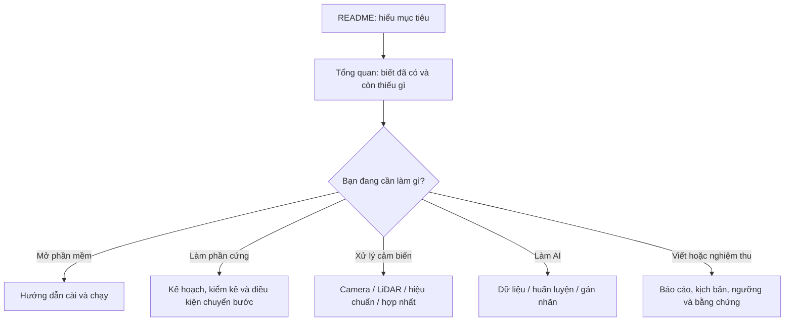

# Tài liệu kỹ thuật AutoPark

**Mới đọc dự án:** [README](../../README.md) → [Tổng quan và tiến độ](../../TONG_HOP_DU_AN.md) → [Cài đặt và chạy](../README.md).

Trang này giúp tìm tài liệu theo việc cần làm. Các biên bản chuyên sâu giữ ngày đo và lịch sử thử nghiệm; khi cần biết trạng thái hiện tại (biên tập theo mã tại `9d68257`, cập nhật 29/09/2026 theo đợt chuyển sang máy bàn mới), đọc bản tổng quan.

**Bản đồ đọc tài liệu:**

Sơ đồ được đặt ngay cạnh phần giải thích tương ứng trong tài liệu. Chữ trong ô nói rõ bước làm hoặc điều kiện; mũi tên không tự có nghĩa bước đó đã hoàn thành trên xe thật.

## Cài, chạy và mang đi trình diễn

| Tài liệu | Dùng khi |
|---|---|
| [Hướng dẫn chạy](../README.md) | Cài môi trường, mô phỏng, test, AI và bàn thử |
| [Máy nộp đồ án](MAY_NOP_DO_AN.md) | Chép checkpoint, cài/đo lại trên laptop, so máy bàn |
| [Chuyển máy bàn](CHUYEN_MAY_BAN.md) | Chép dự án sang máy khác: venv hỏng, cổng LiDAR ở `configs/thiet_bi.json`, đường dẫn có dấu; kết quả kiểm máy bàn hiện tại ngày 29/09/2026 |
| [Kế hoạch v3.1](../../KE_HOACH_TRIEN_KHAI_XE_TU_DO_v3.1.md) | Xem phụ thuộc, đợt mua và điều kiện chuyển bước |
| [Kiểm kê phần cứng](hardware_inventory.md) | Đối chiếu thiết bị đã nhận |
| [Cổng giai đoạn 1](gate_01.md) | Xem lý do chưa đủ điều kiện chuyển bước |

## Mô phỏng và tìm đường

| Tài liệu | Nội dung |
|---|---|
| [Báo cáo giai đoạn 0](../../BAO_CAO_GIAI_DOAN_0.md) | Kết quả mô phỏng ngày 20/09, cách hiểu số test |
| [Biên bản giai đoạn 0](GIAI_DOAN_0.md) | Đối chiếu điều kiện chuyển bước |
| [Kiểm thử độ bền](KIEM_THU_DO_BEN_GIAI_DOAN_0.md) | Lỗi biên, campaign, ca khó, đường chứng |
| [Độ nhạy kích thước xe](DO_NHAY_KICH_THUOC_XE.md) | Ảnh hưởng kích thước giả định đến khả năng tìm đường |

## Camera và AI

Làm theo thứ tự: kiểm camera → nội tham → ngoại tham/ROI → BEV → đo sai số → dùng làm vật cản.

| Tài liệu | Nội dung |
|---|---|
| [Chuẩn bị giai đoạn 1](GIAI_DOAN_1_CHUAN_BI.md) | Nguồn phát lại, ROI, costmap, ONNX, giám sát dữ liệu |
| [Thử camera thật](GIAI_DOAN_1_CAMERA.md) | Mode, FPS, khung hỏng, bốn camera qua hub |
| [Sơ đồ USB](usb_topology.md) | Cổng hub, nhận diện camera và dây |
| [Mode camera](camera_modes.csv) | Danh sách mode đã ghi |
| [Hiệu chuẩn nội tham](HIEU_CHUAN_CAMERA.md) | Bảng in, chụp, tham số ống kính và tiêu chí |
| [Thư mục hiệu chuẩn](../calibration/README.md) | Tệp bảng in và nơi lưu hiệu chuẩn |
| [Ngoại tham và ROI](NGOAI_THAM_VA_ROI.md) | Vị trí/góc camera, vùng ảnh được dùng |
| [BEV](BEV.md) | Chiếu xuống lưới, che khuất và điều kiện dùng bản đồ |
| [AI tạo vật cản](AI_DIEU_KHIEN_XE.md) | Ngăn AI camera, điều kiện chặn, dừng khi đường bị chắn |
| [Gán nhãn sa bàn](GAN_NHAN_SA_BAN.md) | Nhập/sửa/duyệt/xuất nhãn; tách tập chấm |
| [Huấn luyện AI](../../HUAN_LUYEN.md) | Baseline, thử thêm dữ liệu, kết quả và lệnh tái hiện |

## LiDAR, bản đồ và định vị

| Tài liệu | Nội dung |
|---|---|
| [Thử LiDAR C1](GIAI_DOAN_1_LIDAR.md) | Driver, ghi scan, phép đo, bản đồ tĩnh, độ lặp lại |
| [Định vị trên bản đồ](DINH_VI_LIDAR.md) | Khớp scan với map, trạng thái OK/AMBIGUOUS/FAILED |
| [So sánh định vị/SLAM](SO_SANH_DINH_VI_SLAM.md) | Các phương án, scan odometry và giới hạn bằng chứng |

Đọc scan, tạo bản đồ và định vị lại là ba kết quả riêng. Độ lặp lại khoảng cách chưa cho biết sai số so với thước.

Các lệnh LiDAR lấy cổng COM từ khóa `lidar_port` trong [configs/thiet_bi.json](../configs/thiet_bi.json) khi không có `--port` (`rig.bench`, `ui.rig_app`: khi `--lidar` không kèm giá trị; `rig.may_moi` tự tìm bộ chuyển CP210x, `--lidar COMx` ghi đè); đổi máy thì sửa ở đó ([Chuyển máy bàn](CHUYEN_MAY_BAN.md) mục 3).

## Bàn thử và hợp nhất cảm biến

| Tài liệu | Nội dung |
|---|---|
| [Bàn thử giai đoạn 2](GIAI_DOAN_2_BAN_THU.md) | Bốn camera + LiDAR + AI, thời gian xử lý và chờ camera |
| [Ghi/phát lại](GHI_PHAT_LAI_BAN_THU.md) | Lưu phiên thật và chạy lại không cần mở thiết bị |
| [Chuẩn bị hợp nhất](GIAI_DOAN_3_CHUAN_BI.md) | Các lớp bản đồ, ToF giả, đổi tọa độ và vật cản vào mô phỏng |

## Xe, ESP32, nguồn và dừng

| Tài liệu | Nội dung |
|---|---|
| [Chuẩn bị đo MN300](GIAI_DOAN_4_CHUAN_BI.md) | Bảng đo và cách đưa thông số vào cấu hình |
| [Phiếu kiểm kê MN300](mn300_inventory.md) | Điền khi nhận xe; hiện là mẫu |
| [Giao thức xe](GIAO_THUC_XE.md) | Laptop–bo, telemetry, lệnh có hạn và điểm còn mở |
| [VehicleIO và quan sát](CHE_DO_QUAN_SAT.md) | Các nhánh chạy, kiểm trước START, log |
| [Firmware ESP32-S3](../firmware/esp32_vehicle/README.md) | C++/PlatformIO, test host, việc chưa triển khai |
| [Mô phỏng firmware (bo ảo QEMU)](MO_PHONG_FIRMWARE.md) | Firmware thật trong QEMU với `SerialVehicleIO` qua `socket://`, test pytest, các trình giả lập đã thử và giới hạn (29–30/09/2026); không thay đo trên bo |
| [Nguồn và dừng](GIAI_DOAN_6_CHUAN_BI.md) | Nháp bảng tải/sơ đồ, kịch bản lỗi chưa thử |

## Dữ liệu và giấy phép

| Tài liệu | Nội dung |
|---|---|
| [Danh mục dataset](../datasets/DANH_MUC_DATASET.md) | Bộ dữ liệu và mục đích dự kiến |
| [Tải và kiểm](../datasets/TAI_VA_KIEM_TRA.md) | Cách tải/kiểm các gói |
| [Trạng thái tải đầy đủ](../datasets/TRANG_THAI_TAI_DAY_DU.md) | Biên bản tải trên máy đã chuẩn bị dữ liệu |
| [Metadata WoodScape](../datasets/woodscape_metadata/README.md) | Nhãn, calibration và metadata trong repo |
| [Giấy phép dữ liệu](GIAY_PHEP_DU_LIEU.md) | Điều khoản, quyết định 25/09, phạm vi chưa được xác nhận |

Nghiên cứu nhận thức sử dụng **[Valeo WoodScape Dataset](https://github.com/valeoai/WoodScape)**. Dataset đầy đủ, cache và checkpoint không đi kèm bản clone. Biên bản “đã tải” nói về máy tại thời điểm ghi, không có nghĩa máy mới đã có dữ liệu.

## Nghiệm thu và khóa luận

| Tài liệu | Nội dung |
|---|---|
| [Kịch bản nghiệm thu](KICH_BAN_NGHIEM_THU.md) | 37 kịch bản, cách đo độc lập, công cụ còn thiếu |
| [Ngưỡng đề xuất](NGUONG_NGHIEM_THU_DE_XUAT.md) | Giá trị cần chốt trước khi thu kết quả cuối |
| [Dàn ý khóa luận](DAN_Y_KHOA_LUAN.md) | Chương, hình/bảng, mức bằng chứng và việc cần xác minh |
| [Bằng chứng trong Git](evidence/) | Bản sao nhỏ của log, số đo và hình minh họa |
| [Báo cáo camera 23/09](evidence/camera/report_20260923.md) | Biên bản thử camera theo ngày |

## Thuật ngữ thường gặp

| Thuật ngữ | Hiểu trong dự án |
|---|---|
| Pose / tư thế | Vị trí x, y và hướng yaw |
| Planner | Bộ tìm đường phù hợp hình học/giới hạn xe |
| Controller / tracker | Bộ tính tốc độ/góc lái để bám đường |
| Telemetry | Số đo và trạng thái bo gửi về laptop |
| Rig / bàn thử | Cụm cảm biến được bố trí để đo và kiểm |
| Nội tham | Tham số camera/ống kính để ánh xạ pixel thành hướng nhìn |
| Ngoại tham | Vị trí và hướng camera/cảm biến so với hệ tọa độ khác |
| ROI | Vùng ảnh được phép sử dụng |
| BEV | Bản đồ nhìn từ trên xuống |
| Costmap | Lưới biểu diễn vùng đi được, bị chặn hoặc chưa biết |
| UNKNOWN | Chưa quan sát hoặc chưa đủ tin cậy; không tự coi là trống |
| Odometry | Ước lượng dịch chuyển tương đối qua thời gian |
| SLAM | Đồng thời dựng bản đồ và định vị |
| Replay | Phát lại dữ liệu/phiên đã ghi |
| Checkpoint | Tệp trọng số và thông tin trạng thái huấn luyện |
| Cổng chuyển bước | Những điều kiện phải kiểm đạt trước bước tích hợp tiếp |
| Nguồn giả / tổng hợp | Dữ liệu tạo để kiểm phần mềm, không phải phép đo thật |

## Quy ước cập nhật tài liệu

Viết trạng thái mới vào đúng đoạn hiện tại; đưa lịch sử vào commit hoặc biên bản có ngày. Không nối nhiều chú thích “sửa lại/cập nhật” vào cùng câu.

Mỗi kết quả cần ghi nguồn, ngày, môi trường, cách đo và giới hạn. Hướng dẫn chạy cần ghi thư mục làm việc, môi trường và tệp phải có. Tệp ngoài Git ghi dạng đường dẫn và cách lấy, tránh tạo liên kết như thể đã có trong repo.

Sáu tài liệu chính được biên tập lại ngày 26/09/2026; những chỗ nói về máy bàn, cài đặt và cổng LiDAR được cập nhật ngày 29/09/2026 theo đợt chuyển máy ([biên bản](CHUYEN_MAY_BAN.md)). [Bản tại 9d68257](https://github.com/thbn12082/autopark/tree/9d68257) giữ đầy đủ nội dung trước biên tập; các biên bản kỹ thuật chuyên sâu được giữ để đối chiếu.
