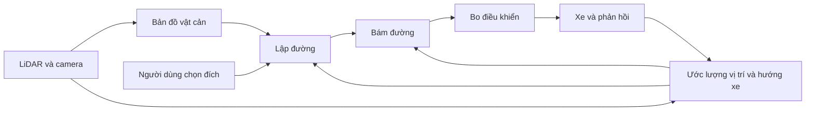
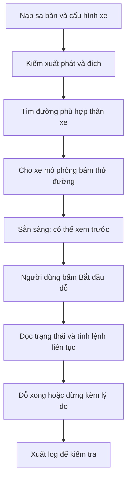
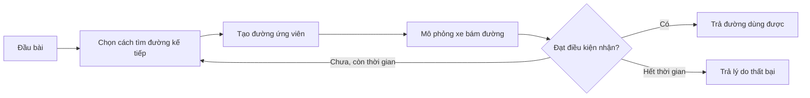
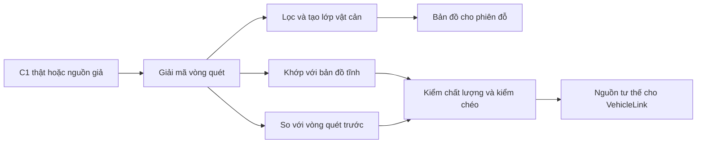
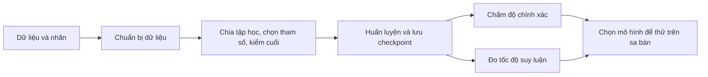
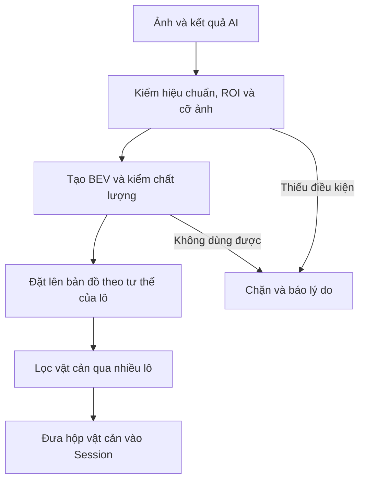
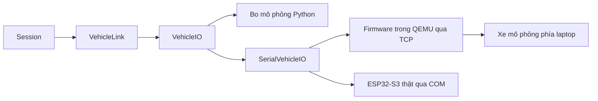
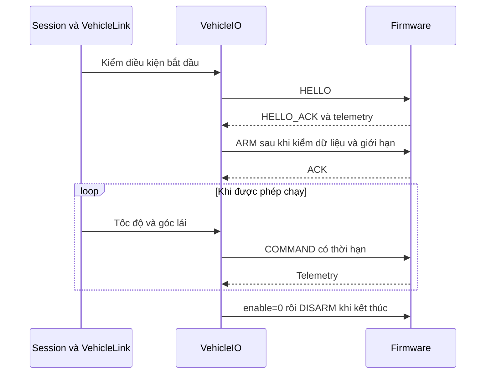
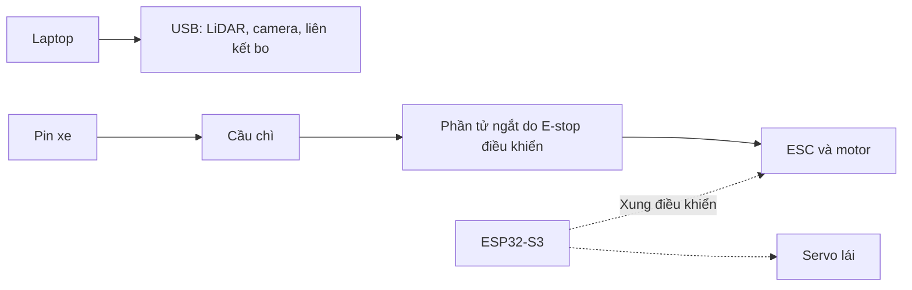

# Sơ đồ hệ thống AutoPark

AutoPark giúp xe mô hình tìm đường vào ô đỗ, đi theo đường đó và dừng khi có vấn đề. Tệp này giải thích các phần nối với nhau thế nào để bạn tìm đúng chỗ đọc mã hoặc sửa lỗi.

**Nếu mới tham gia:** chạy mô phỏng theo [hướng dẫn cài đặt](../README.md), đọc phần 1–3 dưới đây, rồi làm [bài đầu tiên cho thành viên mới](../../CONTRIBUTING.md). Những từ như *tư thế*, *planner*, *telemetry* được giải thích trong [bảng thuật ngữ](THUAT_NGU.md).

Bản viết lại ngày 17/10/2026, đối chiếu mã nguồn đang có trong kho. Các kết quả thiết bị dưới đây là bằng chứng đã lưu của các đợt tháng 9–10/2026, không phải phép đo mới. Xem [tổng hợp dự án](../../TONG_HOP_DU_AN.md) để biết tiến độ và việc còn thiếu.

## Cách đọc

- **Mô phỏng:** máy tính tạo xe hoặc cảm biến giả. Hữu ích để kiểm thuật toán, chưa chứng minh xe thật chạy được.
- **Bo ảo QEMU:** chạy mã firmware đã biên dịch, nhưng phần cơ khí và cảm biến của xe vẫn được mô phỏng.
- **Bàn thử:** có LiDAR/camera thật cắm vào máy tính; thiết bị chưa được gá và chạy trên xe.
- **Xe thật:** cả cảm biến, bo, cơ cấu chấp hành và phần mềm cùng hoạt động trên xe. Dự án chưa có bằng chứng hoàn thành mức này.

Mũi tên trong sơ đồ chỉ luồng xử lý hoặc phụ thuộc. Nó không nói rằng phần đó đã được thử trên xe. Số mục 1.1–9.4 được giữ để những tài liệu cũ dẫn tới đây vẫn tra được; một số sơ đồ lớn đã được thay bằng bảng hoặc đoạn giải thích.

## 1. Toàn cảnh

### 1.1. Hệ thống V1 mục tiêu và hiện trạng từng khối

Một lần đỗ cần biết ba điều: **xe đang ở đâu, nơi nào có vật cản, xe cần tới đâu**. Máy tính dùng chúng để tìm đường và tính lệnh tốc độ/góc lái. Bo điều khiển nhận lệnh, quản lý trạng thái chạy và trả dữ liệu về.

| Phần | Đã có bằng chứng gì? | Còn thiếu gì trước khi dùng trên xe? |
| --- | --- | --- |
| Chọn đích, tìm đường, xem trước, bám đường | Mô phỏng và kiểm thử phần mềm | Thông số xe đo thật và kiểm tích hợp |
| LiDAR C1, bốn camera, AI trên ảnh camera | Chạy trên bàn thử | Gá, hiệu chuẩn, đo sai số và kiểm khi xe chuyển động |
| Nguồn tư thế LiDAR | Mô phỏng; xử lý offline bản ghi C1 đứng yên | Thử trên xe với tham chiếu độc lập |
| Firmware ESP32-S3 | Test Python/C++, biên dịch và chạy QEMU | Nạp bo thật, đọc cảm biến, kiểm chân và cơ cấu chấp hành |
| Nguồn điện, phanh, E-stop | Thiết kế và một phần logic phần mềm | Lắp và đo thực tế |

AI camera đã có đường nối tới phần lập đường, nhưng các lô camera thật bị chặn khi thiếu hiệu chuẩn. V1 vẫn chưa được nghiệm thu; chạy được mô phỏng không thay cho nghiệm thu V1.

### 1.2. Kiến trúc lớp mô-đun

Từ thư mục chứa `pyproject.toml`, mã Python nằm trong `autopark/`. **`Session` là nơi điều phối một lần đỗ.** Giao diện nhận thao tác, còn `Session` quyết định có được lập đường, bắt đầu, dừng hay đặt lại hay không.

| Bạn muốn hiểu/sửa gì? | Đọc mã này trước | Test liên quan |
| --- | --- | --- |
| Các nút, trạng thái giao diện | [ui/main_window.py](../autopark/ui/main_window.py) | [test_ui_smoke.py](../tests/test_ui_smoke.py) |
| Vòng đời một lần đỗ | [application/session.py](../autopark/application/session.py): `Session` | [test_session.py](../tests/test_session.py), [test_session_run.py](../tests/test_session_run.py) |
| Tìm đường | [planning/parking.py](../autopark/planning/parking.py): `plan_parking` | [test_planning.py](../tests/test_planning.py), [test_portfolio_validation.py](../tests/test_portfolio_validation.py) |
| Tính tốc độ và góc lái tiếp theo | [control/tracker.py](../autopark/control/tracker.py): `TrajectoryTracker.update` | [test_tracker.py](../tests/test_tracker.py), [test_phase0.py](../tests/test_phase0.py) |
| Xe giả chuyển động thế nào | [simulation/world.py](../autopark/simulation/world.py), [simulation/vehicle.py](../autopark/simulation/vehicle.py) | [test_vehicle_model.py](../tests/test_vehicle_model.py) |
| Gửi lệnh và nhận phản hồi bo | [application/vehicle_link.py](../autopark/application/vehicle_link.py), [transport/vehicle_io.py](../autopark/transport/vehicle_io.py) | [test_session_vehicle.py](../tests/test_session_vehicle.py), [test_transport_vehicle_io.py](../tests/test_transport_vehicle_io.py) |
| Vật cản từ cảm biến vào phiên | [fusion/bridge.py](../autopark/fusion/bridge.py), [ui/lidar_dock.py](../autopark/ui/lidar_dock.py) | [test_fusion.py](../tests/test_fusion.py), [test_lidar_dock_ui.py](../tests/test_lidar_dock_ui.py) |
| Lưu và phát lại một lần chạy | [storage/run_store.py](../autopark/storage/run_store.py) | [test_run_store_vehicle.py](../tests/test_run_store_vehicle.py) |

Các kiểu dữ liệu dùng chung ở [domain/types.py](../autopark/domain/types.py). Đọc `Pose`, `Scenario`, `VehicleConfig`, `VehicleState` trước khi sửa thuật toán. `Pose` đặt gốc tại **tâm trục sau**, không phải tâm thân xe; mã dùng mét, radian và giây. JSON thường dùng `yaw_deg` theo độ, được chuyển sang radian khi nạp.

### 1.3. Thiết bị, máy và cổng

Máy khác nhau có thể gán camera index và COM khác nhau. [configs/thiet_bi.json](../configs/thiet_bi.json) giữ cổng LiDAR cùng đường dẫn QEMU/PlatformIO của máy. Đường dẫn có sẵn trong tệp có thể là của người khác; cần đối chiếu trước khi dùng thiết bị hoặc bo ảo.

Bốn camera được phân biệt theo cổng hub; index DirectShow không phải danh tính cố định. Cấu hình xe, vị trí gá cảm biến và dữ liệu hiệu chuẩn cũng phải phù hợp với bộ thiết bị đang dùng.

Đọc [kiểm kê phần cứng](hardware_inventory.md), [sơ đồ USB](usb_topology.md), [chuyển máy](CHUYEN_MAY_BAN.md) khi làm phần này. Bạn không cần thiết bị để bắt đầu với nhánh SIM.

## 2. Ứng dụng và phiên đỗ

### 2.1. Luồng dữ liệu một lần đỗ

Ví dụ: bạn mở sa bàn, chọn điểm xuất phát và ô đỗ, rồi bấm **Tìm đường đỗ**. Chương trình làm như sau:

Nếu đầu bài không hợp lệ hoặc xe mô phỏng không bám được trong dung sai, đường đó không được coi là sẵn sàng chạy. Xem trước chỉ chạy mô phỏng; **không gửi lệnh chuyển động ra bo**. Muốn chạy phải bấm bắt đầu và qua các kiểm tra của chế độ đang chọn.

### 2.2. Máy trạng thái phiên

Trạng thái là cách chương trình biết thao tác nào hợp lệ tại thời điểm hiện tại.

| Trạng thái trong mã | Nghĩa trên giao diện | Điều cần nhớ |
| --- | --- | --- |
| `EDITING` | Đang chỉnh sa bàn | Đổi xe, điểm đầu, đích, vật cản |
| `PLANNING` | Đang tính đường | Tính trong luồng nền; có thể hủy |
| `READY` | Sẵn sàng | Đường dùng được; có thể xem trước hoặc bắt đầu |
| `PREPARING_PREVIEW`, `PREVIEW` | Chuẩn bị/xem trước | Mô phỏng đường; kết thúc xem trước về `READY` |
| `RUNNING` | Đang đỗ | Vòng điều khiển đang hoạt động |
| `STOPPING` | Đang dừng | Chờ dừng; chưa được đặt lại hoặc lập đường |
| `STOPPED` | Đã dừng | Đọc lý do; có thể phải lập lại đường |
| `COMPLETED` | Đỗ xong | Đã đứng yên và nằm trong dung sai của đích |
| `FAULT` | Lỗi | Kết thúc không thành công, cần xử lý nguyên nhân |
| `MANUAL` | Lái tay | Nhánh lái tay trong mô phỏng |

Sửa đầu bài khi `READY` làm đường cũ mất hiệu lực. Các hàm quan trọng là `plan_async`, `_apply_plan`, `start_run`, `request_stop`, `reset` và `_finish_run` trong [session.py](../autopark/application/session.py).

### 2.3. Nhánh SIM, VEHICLE_IO, OBSERVE và thẻ Bo điều khiển

**Chế độ chạy** và **loại bo** là hai lựa chọn khác nhau.

| Chế độ | Xe lấy trạng thái từ đâu? | Có gửi lệnh chuyển động? |
| --- | --- | --- |
| `SIM` | Xe và phản hồi do Python mô phỏng | Không có bo |
| `VEHICLE_IO` | Telemetry từ bo + nguồn tư thế | Có, sau kiểm tra và ARM |
| `OBSERVE` | Telemetry + nguồn tư thế; người lái điều khiển xe | Chỉ tính và ghi lệnh đề xuất |

`OBSERVE` vẫn có thể mở liên kết, bắt tay và gửi `DISARM` để xác nhận bo không chạy. Nó **không ARM và không gửi COMMAND**, kể cả COMMAND dừng. Vì phần mềm không điều khiển xe, kết thúc quan sát cũng không có nghĩa xe vật lý đã dừng.

Với `VEHICLE_IO` hoặc `OBSERVE`, bo có thể là bo mô phỏng Python, bo ảo QEMU hoặc cổng COM. QEMU dùng firmware thật nhưng lấy chuyển động và số đo xe từ `LaptopPlant` trên máy tính. Thiếu nguồn tư thế dùng được thì yêu cầu bắt đầu bị từ chối trước mọi I/O mới; cổng COM chưa mở cũng sẽ không được mở. Đừng thay nguồn thật bằng tư thế mô phỏng để vượt kiểm tra.

Chi tiết: [chế độ quan sát](CHE_DO_QUAN_SAT.md), [bo ảo](MO_PHONG_FIRMWARE.md), [nguồn tư thế LiDAR](NGUON_TU_THE_LIDAR.md).

### 2.4. Một lần chạy qua VehicleLink

`VehicleLink` nối logic đỗ xe với giao thức bo. `begin_run` kiểm nguồn tư thế, kết nối, telemetry, lỗi/E-stop, trạng thái đứng yên, vị trí đầu và giới hạn cấu hình. Khi hợp lệ, nhánh điều khiển mới ARM bo.

Trong lúc chạy, mỗi nhịp đọc telemetry mới và tư thế mới, đưa vào bộ bám đường rồi gửi lệnh tốc độ/góc lái. Nếu thiếu số đo hoặc mẫu quá cũ, phiên yêu cầu dừng. Tốc độ/góc lái tham chiếu mà firmware muốn đạt không được coi là số đo thực.

`LIMITS_MISMATCH` cho biết giới hạn bo không phù hợp xe. Nếu sai khác làm bo cho phép chuyển động vượt giới hạn an toàn của cấu hình, `VEHICLE_IO` từ chối bắt đầu; bo chặt hơn chỉ cảnh báo. `OBSERVE` ghi nhận sai khác vì không gửi lệnh chuyển động. Xem [giao thức xe](GIAO_THUC_XE.md) và [test_session_vehicle.py](../tests/test_session_vehicle.py).

### 2.5. Lưu phiên và phát lại

`Session` giữ trạng thái trong bộ nhớ. Giao diện hoặc công cụ đánh giá gọi `export_run` để ghi ra đĩa. Một gói chạy có cấu hình lúc bắt đầu, `telemetry.csv`, sự kiện, kết quả, manifest và mã nguồn Python dùng trong lượt đó; lượt qua bo có thêm `vehicle_io/`.

| Gói chạy | Phát lại làm gì? | Kết luận được gì? |
| --- | --- | --- |
| SIM | Dựng lại mô phỏng từ cấu hình, đường và sự kiện | Kiểm kết quả mô phỏng có tái hiện được |
| Qua VehicleIO | Đưa dữ liệu đã ghi qua logic xử lý log | Kiểm quyết định phần mềm theo dữ liệu đã nhận |
| Bản ghi cảm biến | Đọc lại ảnh và vòng quét đã lưu | Kiểm nhận thức/định vị trên cùng đầu vào |

Phát lại log không phải chạy lại xe thật. Bản ghi cảm biến và gói chạy là hai loại đầu ra khác nhau; khi ghi trong phiên, công cụ liên kết chúng để tìm lại đúng dữ liệu. Xem [ghi và phát lại](GHI_PHAT_LAI_BAN_THU.md).

### 2.6. Tệp cấu hình và nơi đọc

Các đường dẫn trong bảng tính từ thư mục có `pyproject.toml`.

| Tệp/thư mục | Dùng để làm gì? | Chỗ đọc chính |
| --- | --- | --- |
| `scenarios/*.json` | Biên sa bàn, điểm đầu, đích, vật cản, đường dẫn xe | `storage/scenario_store.py` |
| `configs/vehicle_default.json` | Kích thước và giới hạn xe giả định | `Session`, planner, tracker |
| `configs/vehicle_nghiem_thu.json` | Xe giả định giới hạn 0,10 m/s cho thử nghiệm thu | Các công cụ và giao diện chọn cấu hình xe |
| `configs/vehicle_io_sim*.json` | Tham số bo mô phỏng; ghép theo tệp xe | `transport/vehicle_io.py` và giao diện |
| `configs/thiet_bi.json` | Cổng LiDAR, đường dẫn QEMU/PlatformIO theo máy | `lidar/port.py`, `transport/qemu_board.py` |
| `configs/bo_ao_qemu.json` | Xe mô phỏng đi cùng firmware QEMU | `transport/qemu_plant.py` |
| `configs/dinh_vi_lidar_v0.json` | Gá LiDAR, điều kiện dùng nguồn tư thế, ngưỡng định vị | `lidar/pose_config.py` |
| `calibration/`, `configs/rig/`, `configs/roi/` | Hiệu chuẩn camera, vị trí gá, vùng ảnh được dùng | `perception/bev.py`, `fusion/camera_ai.py` |
| `configs/nguong_nghiem_thu.json` | Ngưỡng chấm và giới hạn đổi chiều theo kịch bản | `evaluation/score_run.py`, `application/cusp_policy.py` |

`vehicle_config` trong sa bàn được tính **tương đối với tệp sa bàn**. Khi chuyển tệp sang chỗ khác, dùng `save_scenario` để cập nhật đường dẫn. Các tệp có số giả định hoặc `measured: false` chưa phải số đo thật. Ngưỡng nghiệm thu còn đề xuất phải được ghi đúng trạng thái; khi chốt phải cập nhật cả JSON và [tài liệu ngưỡng](NGUONG_NGHIEM_THU_DE_XUAT.md).

## 3. Lập đường, bám đường và mô phỏng

### 3.1. Từ nút Tìm đường đỗ tới quỹ đạo sẵn sàng

`Session.plan_async` chụp đầu bài rồi tính đường ở luồng nền. `plan_parking` kiểm ô đỗ và gọi bộ lập đường đang dùng. Kết quả gồm trạng thái, lời giải thích và quỹ đạo nếu tìm được.

Quỹ đạo là chuỗi vị trí/hướng, chiều tiến hoặc lùi và thông tin chuyển động. Khi kết quả trở về, `_apply_plan` kiểm phiên bản đầu bài để không nhận đường tính từ một sa bàn đã bị thay đổi. Thành công mới chuyển phiên sang `READY`.

Mã: [parking.py](../autopark/planning/parking.py), [trajectory.py](../autopark/planning/trajectory.py), [session.py](../autopark/application/session.py).

### 3.2. Thang leo nấc của portfolio và quy tắc nhận đường

*Portfolio* nghĩa là thử lần lượt nhiều cách tìm đường. Cách nhanh được thử trước; khi thất bại, chương trình dùng cách khác trong tổng hạn thời gian. Mặc định là hai lượt lưới có thao tác gộp, một lượt RRT-Connect, rồi lưới mịn.

Có hai mức kiểm: ngưỡng chặt để dừng tìm sớm và dung sai của sa bàn để chấp nhận kết quả. Một đường nhìn đẹp nhưng bám tới cuối ngoài dung sai có thể trả `TRACKING_FAILED`; đường đó chỉ để chẩn đoán, không được chạy như đường hợp lệ.

Số lần đổi từ tiến sang lùi hoặc ngược lại gọi là *cusp*. Ngoài kiểm tìm đường, `Session.start_run` kiểm giới hạn cusp. Sa bàn nghiệm thu lấy giới hạn theo mã trong `acceptance`; `--max-cusps` chỉ siết thêm. Vượt giới hạn thì từ chối trước mọi I/O với bo, vẫn có thể xem trước. Mã: [portfolio.py](../autopark/planning/portfolio.py), [cusp_policy.py](../autopark/application/cusp_policy.py). Test: [test_portfolio_validation.py](../tests/test_portfolio_validation.py), [test_cusp_acceptance.py](../tests/test_cusp_acceptance.py).

### 3.3. Một nhịp mô phỏng kín vòng trong phiên

*Kín vòng* nghĩa là tính lệnh từ phản hồi mới liên tục. Bộ bám không chỉ phát một danh sách lệnh rồi bỏ mặc xe.

Trong SIM, mô hình xe tiến mỗi **5 ms thời gian mô phỏng**. Cứ bốn bước, bộ bám tính lại lệnh: **20 ms/lần, tức 50 Hz**. Lệnh đi qua giới hạn tốc độ, gia tốc và tốc độ đổi góc lái, rồi mô hình tạo trạng thái tiếp theo.

Thông số 50 Hz trong mã là nhịp mục tiêu, không tự chứng minh máy giữ được 50 Hz theo đồng hồ thật. Cần đo khi đánh giá hiệu năng. `simulation/feedback.py` có thể thêm trễ/nhiễu/mất mẫu để kiểm phản ứng. Xem [giai đoạn 0](GIAI_DOAN_0.md) và [test_phase0.py](../tests/test_phase0.py).

### 3.4. Phản ứng an toàn khi đang chạy

| Tình huống | Phản ứng của phiên |
| --- | --- |
| Người dùng yêu cầu dừng | Tốc độ mục tiêu về 0; giữ đường |
| Vật mới chạm hành lang đường còn lại | Dừng, hủy đường; chờ đánh giá và lập lại |
| Phản hồi/telemetry/tư thế mất, cũ hoặc không dùng được | Dừng và ghi mã nguyên nhân |
| LiDAR hoặc AI bắt buộc không còn dữ liệu dùng được | Yêu cầu dừng theo chính sách của ngăn cảm biến |
| Quá thời gian chạy hoặc có va chạm | Kết thúc `FAULT` |
| Không xác nhận được xe đã dừng qua VehicleIO | `STOP_NOT_CONFIRMED`, kết thúc `FAULT` |

`_safety_stop` hủy đường; `request_stop` giữ đường. Trong `STOPPING`, nhánh điều khiển gửi `enable=0` và chờ **số đo mới** xác nhận đứng yên. Không được coi một mẫu tốc độ 0 đã cũ là xe đã dừng. Phiên không tự chạy tiếp khi dữ liệu trở lại; người dùng phải xử lý nguyên nhân rồi bắt đầu lại.

Nguồn tư thế LiDAR có thêm `POSE_LOST`, `POSE_DISAGREE` và `POSE_UNCHECKED` khi mất định vị, lệch kiểm chéo hoặc không kiểm chéo được. `STALE_POSE` của nguồn này dùng tuổi vòng quét; chi tiết ngưỡng ở [nguồn tư thế LiDAR](NGUON_TU_THE_LIDAR.md). Thử lỗi hiện có dùng mô phỏng; phanh và dừng trên xe chưa được xác nhận.

Test: [test_runtime_safety.py](../tests/test_runtime_safety.py), [test_session_stop_log.py](../tests/test_session_stop_log.py), [test_session_lidar_pose.py](../tests/test_session_lidar_pose.py), [test_fault_injection.py](../tests/test_fault_injection.py).

### 3.5. Công cụ đánh giá planner

`evaluation/bench.py` chạy các ca chuẩn, đo tìm đường và bám thử. `evaluation/compare.py` so nhiều planner trên cùng ca. Các tệp `planning/cand_*.py` là những thuật toán ứng viên; không phải tất cả đều nằm trên đường chạy mặc định của giao diện.

Khi đổi thuật toán, kiểm cả tìm được đường, không va chạm, sai số cuối, số đổi chiều và thời gian. Chỉ tăng tỷ lệ “tìm thấy” chưa đủ nếu xe không bám được. Đọc [kiểm thử độ bền](KIEM_THU_DO_BEN_GIAI_DOAN_0.md); test đầu tiên là [test_planning.py](../tests/test_planning.py) và [test_planner_hard_cases.py](../tests/test_planner_hard_cases.py).

### 3.6. Nghiệm thu giai đoạn 0

Giai đoạn 0 kiểm phần mềm với xe mô phỏng: đỗ bình thường, lùi, phản hồi nhiễu, vật cản mới và mất dữ liệu. `evaluation/phase0.py` sinh gói kết quả và kiểm phát lại.

Kết quả được ghi trong [báo cáo giai đoạn 0](../../BAO_CAO_GIAI_DOAN_0.md). Mức đạt của giai đoạn này là **mô phỏng**, dùng kích thước xe giả định. Nó không xác nhận sai số định vị, phanh hay kích thước xe thật.

### 3.7. Hạn giờ theo đồng hồ thật và EcoQoS

Tìm đường có hạn thời gian thật để giao diện không chờ vô hạn. Windows có thể giảm hiệu năng tiến trình khi cửa sổ thu nhỏ thông qua EcoQoS. Vì vậy [power_throttling.py](../autopark/power_throttling.py) được ứng dụng và pytest dùng để tắt EcoQoS cho tiến trình của mình rồi đọc lại trạng thái.

`AUTOPARK_KEEP_ECOQOS=1` giữ chính sách của Windows khi cần đo trường hợp đó. Test có dấu `planner_budget` nhạy với tải máy và không chạy dưới coverage tracing. Báo cáo hiệu năng cần ghi trạng thái cửa sổ, EcoQoS, máy và tải nền; xem [biên bản chuyển máy](CHUYEN_MAY_BAN.md). Công cụ `evaluation/ecoqos_chay.py` kiểm nhịp điều khiển khi cửa sổ thu nhỏ.

## 4. Cảm biến và bàn thử

### 4.1. Đường dữ liệu LiDAR

LiDAR đo khoảng cách quanh nó. Một vòng quét chưa phải vị trí xe: chương trình phải lọc dữ liệu và so với bản đồ hoặc vòng quét trước.

Mã đọc C1 ở [lidar/rplidar_c1.py](../autopark/lidar/rplidar_c1.py), dựng bản đồ ở [lidar/map_builder.py](../autopark/lidar/map_builder.py), định vị ở [lidar/pose_estimator.py](../autopark/lidar/pose_estimator.py), nối vào phiên ở [application/lidar_pose_source.py](../autopark/application/lidar_pose_source.py).

Nhánh định vị được kiểm trong mô phỏng và offline trên bản ghi C1 đứng yên. Để dùng trên xe còn phải đo gá và hoàn thành các điều kiện trước khi chạy. Xem [định vị LiDAR](DINH_VI_LIDAR.md), [nguồn tư thế LiDAR](NGUON_TU_THE_LIDAR.md), [test_lidar_pose_source.py](../tests/test_lidar_pose_source.py).

### 4.2. Ngăn LiDAR đưa vật cản vào phiên đỗ

Khi chỉnh sa bàn, ngăn LiDAR có thể đồng bộ vật cản vào đầu bài. Khi đang chạy, nó chỉ thêm vật mới, không xóa vật cản đang dùng. Vật mới chạm hành lang đường còn lại làm phiên dừng và hủy đường; vật ngoài hành lang chỉ được ghi nhận.

Ô **Vật mới trên đường làm xe dừng** còn bật kiểm dữ liệu LiDAR quá cũ. Mất kết nối hoặc đổi cấu hình trong lúc chạy phải dẫn tới xử lý dừng. Khi dùng định vị LiDAR, lớp vật cản cần được đặt theo tư thế của chính vòng quét đó; chưa có tư thế kịp thời thì bỏ vòng, không tùy ý dùng vị trí hiện tại.

Lượt C1 thật đã có dùng cảm biến đứng yên và xe mô phỏng. Tình huống LiDAR gá trên xe đang chạy còn phải thử. Chi tiết: [giai đoạn 3](GIAI_DOAN_3_CHUAN_BI.md), [lidar_dock.py](../autopark/ui/lidar_dock.py), [test_lidar_dock_ui.py](../tests/test_lidar_dock_ui.py).

### 4.3. Camera USB: từ khung ảnh tới bộ ảnh đồng bộ

Mỗi camera có luồng đọc riêng. `video/multicam.py` gom những ảnh còn mới thành bộ ảnh, kèm thời gian để biết chúng có gần nhau đủ hay không. Camera đứng hình hay ảnh cũ không được âm thầm coi là đầu vào mới.

“Đồng bộ” ở đây là ghép ảnh theo thời gian phần mềm, không phải bốn camera chụp bằng cùng một xung phần cứng. Độ lệch thời gian, ảnh hỏng và cấu hình USB cần đo. Xem [camera giai đoạn 1](GIAI_DOAN_1_CAMERA.md), [test_multicam_rig.py](../tests/test_multicam_rig.py).

### 4.4. Bàn thử: luồng, hàng đợi và đầu ra

`rig/core.py` nối camera, LiDAR và suy luận AI trong một bàn thử. Luồng đọc thiết bị tách khỏi xử lý AI và giao diện; các hàng đợi/bộ đệm kiểm soát độ trễ để việc xử lý chậm không tích ảnh cũ vô hạn.

Đầu ra gồm tình trạng nguồn, thời gian, ảnh/vòng quét mới nhất và thống kê. Lượt chạy 30 phút trên máy bàn có bằng chứng, nhưng không chứng minh laptop hay camera đã gá trên xe cũng đạt. Xem [bàn thử giai đoạn 2](GIAI_DOAN_2_BAN_THU.md), [test_bench_window_feed_and_close.py](../tests/test_bench_window_feed_and_close.py).

### 4.5. Ghi một phiên bàn thử rồi phát lại

Ghi bàn thử giúp nhiều người sửa thuật toán trên cùng dữ liệu mà không cần cắm thiết bị mỗi lần. `rig/recording.py` lưu ảnh, vòng quét và thời gian; `rig/replay.py` cấp lại dữ liệu cho xử lý.

Khi so trước/sau, dùng cùng bản ghi, cùng cấu hình và cùng mô hình. Mất ảnh trong bản ghi phải được thể hiện trong kết quả; phát lại không tạo lại được dữ liệu chưa từng lưu. Đọc [hướng dẫn ghi/phát lại](GHI_PHAT_LAI_BAN_THU.md), [test_rig_replay.py](../tests/test_rig_replay.py).

### 4.6. Hiệu chuẩn camera → BEV → chặn trước khi AI tạo vật cản

Hiệu chuẩn trả lời hai câu: ảnh bị méo thế nào, và camera nhìn xuống sàn từ vị trí/góc nào. Nhờ đó BEV chuyển ảnh sang cách nhìn từ trên xuống. ROI chọn vùng ảnh đáng tin cậy để dùng.

Thiếu nội tham, ngoại tham đã đo, ROI hoặc kiểm tra chất lượng thì kết quả chưa dùng được để đặt vật cản lên sa bàn. Bộ cấu hình tổng hợp chỉ phục vụ thử phần mềm. Không đổi nhãn thành “đã đo” để vượt chặn.

Đọc theo thứ tự: [hiệu chuẩn camera](HIEU_CHUAN_CAMERA.md) → [ngoại tham và ROI](NGOAI_THAM_VA_ROI.md) → [BEV](BEV.md). Mã kiểm cổng chất lượng ở [perception/bev.py](../autopark/perception/bev.py).

### 4.7. Kiểm máy mới bằng một lệnh: do_may_moi.cmd

Sau khi cài môi trường bàn thử và cắm đủ thiết bị, `do_may_moi.cmd` thu cấu hình máy, USB, LiDAR, độ trễ AI và phép thử camera/bàn thử. Nó ghi kết quả trong `runs/` rồi so với tham chiếu lưu trong `docs/evidence/may_ban/`.

Lệnh này **mở thiết bị thật**; không phải bước bắt buộc để học mô phỏng. Nó tự tìm cổng CP210x thay vì đọc cổng từ `thiet_bi.json`; có thể chỉ định lại bằng `--lidar`. Khi chỉ muốn tổng hợp một kết quả đã có, dùng tùy chọn `--out` và `--steps` không kèm tên bước theo [hướng dẫn chuyển máy](CHUYEN_MAY_BAN.md). Mã: [rig/may_moi.py](../autopark/rig/may_moi.py).

### 4.8. Ghi cảm biến trong phiên đỗ (T3) và phát lại phiên (thêm 02/10/2026)

Ngăn **Ghi cảm biến** trong ứng dụng LiDAR có thể lưu luồng cảm biến đang cấp cho phiên. `LidarTap` và phần camera lấy dữ liệu từ luồng hiện có; không mở thêm một bản sao của cùng thiết bị. Đồng hồ dùng chung giúp nối bản ghi với thời điểm của phiên.

Phần này ở [rig/session_recording.py](../autopark/rig/session_recording.py) và [ui/record_dock.py](../autopark/ui/record_dock.py). Bằng chứng ban đầu là test offscreen với nguồn giả; không được ghi thành một lượt thu xe thật. Chi tiết và cấu trúc đầu ra: [ghi/phát lại bàn thử, mục 9](GHI_PHAT_LAI_BAN_THU.md).

## 5. AI nhận thức

### 5.1. Từ dữ liệu tới checkpoint tham chiếu và các phép chấm

AI hiện phân vùng ảnh thành khu vực trống/vật cản. Nó cung cấp thông tin cho bản đồ; planner và tracker vẫn là các mô-đun riêng.

Các chương trình nằm trong `perception/`: `prepare.py`, `train.py`, `evaluate.py`, `benchmark.py`. Mô hình đã chấm trên dữ liệu công khai vẫn cần tập ảnh sa bàn riêng. Số liệu, môi trường và giới hạn từng lượt ở [HUAN_LUYEN.md](../../HUAN_LUYEN.md).

### 5.2. Dữ liệu và giấy phép: bộ nào được dùng vào đâu

Trước khi thêm bộ ảnh hay phân phối checkpoint, tra [giấy phép dữ liệu](GIAY_PHEP_DU_LIEU.md) và [danh mục dataset](../datasets/DANH_MUC_DATASET.md). Quyền tải để nghiên cứu, quyền huấn luyện và quyền phân phối lại không mặc nhiên giống nhau.

Dữ liệu lớn, cache huấn luyện và checkpoint thường ở các thư mục bị Git bỏ qua. Clone kho mã không đảm bảo có chúng; phần mô phỏng cơ bản vẫn chạy được mà không tải dữ liệu AI.

### 5.3. Đường suy luận AI trên bàn thử và bản ghi

`perception/live.py` nhận bộ ảnh mới, chạy mô hình rồi trả kết quả kèm thời gian. Bàn thử có thể tô kết quả lên ảnh để người dùng xem. Cũng có thể dùng bản ghi để chạy lại đúng đầu vào.

Ảnh được tô màu đẹp chỉ chứng minh mô hình đã trả kết quả. Để dùng kết quả làm vật cản, còn cần toàn bộ kiểm tra hình học và chất lượng của mục 5.4. Test: [test_perception_live.py](../tests/test_perception_live.py).

### 5.4. AI camera thành vật cản: chuỗi chặn an toàn tới phiên đỗ

`CameraObstacleMapper.update` trong [fusion/camera_ai.py](../autopark/fusion/camera_ai.py) thực hiện chuỗi này. Camera chỉ đóng góp vật cản của riêng nguồn camera; vùng camera cho là trống không được dùng để xóa vật cản LiDAR hoặc vật cản người dùng đặt.

Tại các lượt đã lưu, camera thật chưa có đủ hiệu chuẩn nên nhánh tạo vật cản bị chặn. Nhánh qua hết cổng chất lượng mới được kiểm với nguồn giả/cấu hình tổng hợp. Các ngưỡng lọc là tham số thử, chưa phải thông số nghiệm thu đã chốt. Xem [AI vào phiên đỗ](AI_DIEU_KHIEN_XE.md), [test_camera_ai_layer.py](../tests/test_camera_ai_layer.py).

### 5.5. Một nhịp của ngăn AI camera theo trạng thái phiên

Khi chỉnh sa bàn, ngăn AI có thể cập nhật các hộp của riêng nó. Khi đang chạy, vật mới trong hành lang đường dẫn tới dừng. Nếu chọn AI là nguồn bắt buộc, dữ liệu AI không dùng được hoặc quá cũ cũng yêu cầu dừng.

Không nên giải quyết cảnh báo bằng cách chỉ bỏ kiểm tra tuổi dữ liệu hoặc cổng hiệu chuẩn. Cần đọc lý do từ ngăn AI và tìm dữ liệu đầu vào gây ra nó. Mã: [ui/camera_dock.py](../autopark/ui/camera_dock.py); test: [test_camera_dock_ui.py](../tests/test_camera_dock_ui.py).

### 5.6. Quy trình gán nhãn ảnh sa bàn và tách tập chấm

Ảnh dùng huấn luyện có thể bắt đầu từ nhãn nháp nếu giấy phép cho phép. Ảnh dùng chấm phải được lấy ở phiên riêng, tô tay từ đầu với `--no-draft`, rồi kiểm không trùng dữ liệu huấn luyện bằng `--disjoint-from`.

Chỉ xuất nhãn đã duyệt. Khi nhãn đổi sau khi duyệt, phải duyệt lại. Tách tập theo phiên chụp để những ảnh gần như giống nhau không rơi vào cả tập học lẫn tập chấm. Làm theo [hướng dẫn gán nhãn](GAN_NHAN_SA_BAN.md); mã và test ở [perception/labels.py](../autopark/perception/labels.py), [test_labels.py](../tests/test_labels.py).

### 5.7. Ngưỡng P(BLOCKED): chọn ở đâu, dùng ở đâu

`P(BLOCKED)` là xác suất mô hình dự đoán một vùng bị chắn. Hạ ngưỡng có thể giảm bỏ sót, nhưng làm tăng báo nhầm. Vùng chưa chắc chắn cần giữ là `UNKNOWN`, không tự đổi thành trống.

| Nơi dùng | Ngưỡng đang có | Điều cần phân biệt |
| --- | --- | --- |
| Chấm/predict và lớp tô mặc định | 0,50 | Kết quả hiển thị/chấm ảnh |
| AI camera vào phiên | `t_blocked=0,15`, `t_free=0,05` | Có khoảng chưa chắc chắn giữa hai ngưỡng |
| Công cụ BEV mặc định | `t_blocked=0,50`, `t_free=0,15` | 0,15 ở đây là ngưỡng FREE |

Các lựa chọn này dựa trên thử dữ liệu công khai, chưa phải ngưỡng đã nghiệm thu trên sa bàn. Tra [huấn luyện, mục 10](../../HUAN_LUYEN.md) và [ngưỡng nghiệm thu](NGUONG_NGHIEM_THU_DE_XUAT.md) trước khi thay đổi.

## 6. Liên kết laptop–bo và firmware

### 6.1. Kiến trúc liên kết: ba đích của cùng byte giao thức

Bo mô phỏng dùng `FirmwareModel`; QEMU chạy bản firmware đã biên dịch; bo thật là đích chưa được thử. Cùng giao thức giúp đối chiếu hành vi giữa các tầng. Với phiên đỗ qua QEMU, [qemu_plant.py](../autopark/transport/qemu_plant.py) ghép phản hồi xe mô phỏng vào liên kết vì firmware chưa đọc cảm biến xe.

QEMU không kiểm được xung PWM thực, dây điện, E-stop vật lý hay độ bám của xe. Mức bằng chứng của phiên này được ghi là `qemu_firmware_simulated_vehicle`. Xem [mô phỏng firmware](MO_PHONG_FIRMWARE.md).

### 6.2. Trình tự kết nối, ARM, chạy, hết hạn lệnh và mất liên lạc

Laptop gửi lệnh có hạn **150 ms**; bo kẹp thời hạn tối đa **300 ms**. Hết hạn lệnh, bo giảm tham chiếu tốc độ về 0 và về `ARMED`. Nếu **500 ms** không nhận thông điệp hợp lệ, bo về `DISARMED` với `LINK_TIMEOUT`. Heartbeat còn sống không làm một COMMAND cũ sống mãi.

Đây là hành vi đã kiểm ở các tầng phần mềm/QEMU. Đặc tả đơn vị, khung và thông điệp ở [GIAO_THUC_XE.md](GIAO_THUC_XE.md); test ở [test_transport_vehicle_io.py](../tests/test_transport_vehicle_io.py), [test_firmware_qemu.py](../tests/test_firmware_qemu.py).

### 6.3. Trình tự lỗi, phục hồi và bo khởi động lại

Lỗi E-stop được chốt: nhả nút chưa đủ để tự chạy lại. `CLEAR_FAULT` bị từ chối khi đầu vào E-stop còn tích cực; sau khi xóa lỗi bo vẫn ở `DISARMED`, cần một lần bắt đầu mới.

Nút **Xóa lỗi bo** ngoài phiên có thể mở liên kết và xác minh telemetry, nhưng không ARM hay gửi COMMAND. Mất telemetry khiến phía laptop chốt yêu cầu ARM lại. Bo khởi động giữa lượt chạy làm mất phiên hoặc mất dữ liệu; lượt đó phải dừng. `FIRMWARE_RESET` được nhận ra qua `boot_id` mới khi kết nối lần sau, là thông tin log, không phải lệnh tự tiếp tục.

Nhánh reset đã thử bằng lệnh reset QEMU; E-stop vật lý chưa được lắp/đo. Chi tiết: [chế độ quan sát](CHE_DO_QUAN_SAT.md), [giao thức xe](GIAO_THUC_XE.md), [test_vehicle_board_ui.py](../tests/test_vehicle_board_ui.py).

### 6.4. Máy trạng thái firmware

| Trạng thái bo | Ý nghĩa | Chuyển tiếp chính |
| --- | --- | --- |
| `BOOT` | Vừa bật/reset, giữ trung tính | Hết thời gian khởi động → `DISARMED` |
| `DISARMED` | Chưa cho phép chuyển động | ARM hợp lệ → `ARMED` |
| `ARMED` | Đã cho phép, chờ lệnh mới | COMMAND enable hợp lệ → `RUNNING` |
| `RUNNING` | Đang thực hiện lệnh còn hạn | Hết hạn lệnh → `ARMED`; mất liên lạc/DISARM → `DISARMED` |
| `FAULT` | Có lỗi được chốt | Xử lý nguyên nhân, CLEAR_FAULT hợp lệ → `DISARMED` |

Trạng thái bo khác với trạng thái `Session` ở mục 2.2. Ví dụ phiên đã quyết định dừng trong khi bo vẫn đang giảm tốc. Mã tham chiếu ở [firmware_model.py](../autopark/transport/firmware_model.py); phần C++ ở [firmware/esp32_vehicle](../firmware/esp32_vehicle/README.md).

### 6.5. Đường dữ liệu phía laptop: từ byte tới lệnh

`FrameParser` nhận byte, tách khung, kiểm CRC, phiên bản và độ dài rồi mới tạo thông điệp. `VehicleIO` kiểm phiên, số thứ tự, ACK, tuổi telemetry và giới hạn. `VehicleLink` kết hợp telemetry với nguồn tư thế để `Session` dùng.

Trên dây dùng số nguyên theo đơn vị ghi trong đặc tả, như mm/s, mrad và ms. Phần điều khiển Python dùng m/s, rad và giây; chuyển đổi tập trung trong lớp I/O. Sửa giao thức cần giữ Python và C++ khớp từng byte, kiểm vector dùng chung. Đọc [protocol.py](../autopark/transport/protocol.py), [test_transport_protocol.py](../tests/test_transport_protocol.py).

### 6.6. Các tầng kiểm chứng firmware: từ bản tham chiếu Python tới bo thật

| Tầng | Kiểm được | Không suy ra được |
| --- | --- | --- |
| `FirmwareModel` Python | Logic và tình huống lỗi trong test | Mã C++ biên dịch đúng |
| Test C++ trên máy tính | Lõi C++ khớp vector tham chiếu | Driver/chân thật đúng |
| Build ESP32-S3 | Toolchain chấp nhận chương trình | Bo thật vận hành đúng |
| Chạy firmware trong QEMU | Giao thức và một số hành vi firmware khi thực thi | PWM, cảm biến thật, E-stop và watchdog vật lý |
| Bo và xe thật | Tích hợp điện/cơ khí/thời gian thực | Chỉ kết luận cho tình huống đã đo |

Những tầng đầu đã có bằng chứng; tầng bo/xe thật chưa được hoàn thành. Số test và phiên bản cụ thể nằm trong [mô phỏng firmware](MO_PHONG_FIRMWARE.md) và biên bản kèm theo, không dùng một tổng số test cũ làm trạng thái hiện tại.

### 6.7. Build theo env PlatformIO và dựng bo ảo QEMU

[platformio.ini](../firmware/esp32_vehicle/platformio.ini) có hai môi trường:

- `esp32s3`: hướng tới bo thật, Serial qua USB CDC; PWM mặc định tắt (`AP_ENABLE_PWM_OUTPUTS=0`).
- `esp32s3_qemu`: chỉ cho QEMU, Serial qua UART0, flash DIO, PWM tắt. Script sau build tạo ảnh flash cho trình giả lập.

**Không nạp bản QEMU vào xe.** Muốn chạy bo ảo phải có đúng QEMU, PlatformIO và đường dẫn theo máy trong `configs/thiet_bi.json`. Người mới học mô phỏng không cần cài phần này. Quy trình build, khởi động, kiểm và giới hạn ở [README firmware](../firmware/esp32_vehicle/README.md), [MO_PHONG_FIRMWARE.md](MO_PHONG_FIRMWARE.md).

## 7. An toàn và dừng

### 7.1. Chuỗi dừng an toàn ba lớp: phần cứng, firmware, laptop

| Lớp | Trách nhiệm | Mức xác nhận hiện có |
| --- | --- | --- |
| Laptop | Phát hiện dữ liệu cũ, vật cản/lỗi, yêu cầu dừng, không tự chạy lại | Test và mô phỏng; một phần với cảm biến bàn thử |
| Firmware | Hết hạn lệnh, mất liên lạc, chốt lỗi và giới hạn đầu ra | Lõi Python/C++, một phần QEMU |
| Phần cứng | E-stop và ngắt động lực khi phần mềm không còn đáp ứng | Chưa lắp và chưa đo |

Không thể dựa riêng vào nút dừng trên giao diện: laptop có thể treo hoặc mất cáp. Watchdog reset CPU cũng không tự chứng minh xung ESC đã dừng. Firmware có `output_guard` và móc panic để bảo vệ đầu ra, nhưng tác dụng trên phần cứng cần kiểm riêng.

Phân biệt ba hạn: phiên phát hiện telemetry cũ theo ngưỡng của `VehicleLink`; lớp `VehicleIO` chốt lỗi telemetry sau 0,3 s; bo tự ngắt phiên sau 0,5 s không nhận thông điệp hợp lệ. Mỗi lớp có mục đích và đồng hồ riêng. Ngưỡng không phải số đo quãng phanh thực.

Bản build Arduino-ESP32 2.0.17 dùng task watchdog 1 s; con số 300 ms trong mã áp dụng nhánh Arduino 3.x. QEMU không xác nhận task watchdog vật lý, `output_guard`, móc panic hay chân E-stop. Kế hoạch thử đầy đủ ở [giai đoạn 6](GIAI_DOAN_6_CHUAN_BI.md).

### 7.2. Sơ đồ nguồn dự kiến giai đoạn 6

Đây là cấu trúc dự kiến, **chưa phải sơ đồ đấu dây để làm theo**. Chân bo, điện áp pin, định mức cầu chì, phần tử ngắt, nguồn servo và tương thích ESC còn phải đo/chốt. Hub/camera đã chạy trên USB máy bàn nhưng chưa đủ số đo để kết luận ngân sách nguồn toàn xe. Xem [giai đoạn 6](GIAI_DOAN_6_CHUAN_BI.md), [kiểm kê MN300](mn300_inventory.md).

## 8. Tiến độ và nghiệm thu

### 8.1. Lộ trình 11 giai đoạn và trạng thái

| Giai đoạn | Việc chính | Mức hiện có theo bằng chứng lưu trong kho |
| --- | --- | --- |
| 0 | Mô phỏng đỗ và dừng | Đạt ở mức mô phỏng |
| 1–2 | LiDAR, camera, bàn thử | Có thiết bị và số đo; còn hiệu chuẩn/điều kiện chuyển bước |
| 3 | Hợp nhất cảm biến | Có phần mềm và thử bàn; thiếu phần xe |
| 4 | Đo xe MN300 | Chưa có bộ số đo xe thật |
| 5 | ESP32 và điều khiển | Build/test/QEMU; chưa chạy bo thật |
| 6 | Nguồn và dừng | Thiết kế và kịch bản thử; chưa xác nhận phần cứng |
| 7–8 | Gá cảm biến và hợp nhất khi xe chạy | Có một phần công cụ; chưa tích hợp trên xe |
| 9–10 | Đỗ thật, nghiệm thu và khóa luận | Chưa nghiệm thu V1 |

Chuẩn bị nguồn và dừng phải có trước khi thử cơ cấu chấp hành; không chờ tới lúc thử tự đỗ mới xử lý. Điều kiện chuyển bước nằm trong [kế hoạch](../../KE_HOACH_TRIEN_KHAI_XE_TU_DO_v3.1.md), [gate_01.md](gate_01.md). Danh sách việc thực tế xem [tổng hợp dự án](../../TONG_HOP_DU_AN.md).

### 8.2. Sáu đợt mua, thiết bị đã nhận và giai đoạn bị chặn

Kế hoạch mua chia sáu đợt để phục vụ các giai đoạn. Người tham gia cần kiểm **thiết bị đã nhận và đã đo** trong [kiểm kê phần cứng](hardware_inventory.md), thay vì coi món nằm trong kế hoạch là đã sẵn sàng.

LiDAR C1, bốn camera và hub có bằng chứng bàn thử. Xe, bo, các cảm biến trên xe và phần nguồn/dừng còn là phụ thuộc của các bước sau theo hồ sơ hiện có. Khi chờ thiết bị, vẫn có thể làm mô phỏng, phát lại dữ liệu, test và tài liệu. Các việc cần có người cạnh thiết bị được gom ở [VIEC_TAI_CHO_THIET_BI.md](VIEC_TAI_CHO_THIET_BI.md).

### 8.3. Mười điều kiện hoàn thành V1 theo mức bằng chứng hiện có

Theo hồ sơ trong kho, **chưa có điều kiện V1 nào được xác nhận hoàn thành: 0/10**. Bảng dưới là các nhóm việc cần chứng minh; cách chấm đầy đủ ở mục 16.4 của [kế hoạch](../../KE_HOACH_TRIEN_KHAI_XE_TU_DO_v3.1.md).

| Điều kiện | Phần còn thiếu chính |
| --- | --- |
| 1. Bản đồ và định vị LiDAR | Đo trên xe với tham chiếu độc lập |
| 2. Bốn camera | Gá và hiệu chuẩn thật |
| 3. AI cho planner | Chấm trên ảnh sa bàn đã gán nhãn |
| 4. Chọn đích, xem trước, bắt đầu | Kiểm toàn luồng trên xe |
| 5. Giới hạn lái và toàn thân xe | Thông số đo thật, thử thực tế |
| 6. Phản hồi tốc độ và góc lái | Firmware đọc cảm biến thật |
| 7. Bài đỗ theo tiêu chí | Chốt tiêu chí và thử xe |
| 8. Dừng khi vật cản/dữ liệu lỗi | Đo phản ứng và quãng dừng trên xe |
| 9. Nguồn, watchdog, E-stop | Thử phần cứng theo kịch bản lỗi |
| 10. Tái hiện kết quả | Bộ hồ sơ đủ dữ liệu/cấu hình/mã và hướng dẫn tái hiện |

Log và test đã có là đầu vào cho nghiệm thu, không tự thay toàn bộ những điều kiện này. Chẳng hạn bo ảo đi hết đường vẫn dùng tốc độ/góc lái mô phỏng vì firmware chưa đọc cảm biến.

### 8.4. Luồng một lần nghiệm thu V1 (đề xuất, chưa thực hiện)

Một lượt cần: kịch bản và ngưỡng rõ ràng → kiểm điều kiện trước → chạy đúng mức thử → giữ đầy đủ log → chấm → ghi kết luận và giới hạn. Ba mức là **MP** (mô phỏng), **BT** (bàn thử), **XT** (xe thật). Kết quả MP chỉ là tiền nghiệm thu. Thử xe trên sàn ở M3 cần các bước M0–M2 tương ứng đã đạt.

`evaluation/score_run.py` hỗ trợ chấm; người đánh giá vẫn chịu trách nhiệm kết luận. Nhãn “không tính” không được dùng để xóa một lần thất bại. Phải có tham chiếu độc lập khi chấm sai số thật; công cụ ArUco trên cao mới có bằng chứng ảnh tổng hợp.

Các giới hạn đang ảnh hưởng trực tiếp đến lựa chọn chạy:

- Chín sa bàn trong `scenarios/nghiem_thu/` dùng xe 0,10 m/s và giới hạn đổi chiều riêng. Ngưỡng vẫn là đề xuất chờ chốt.
- Nghiệm thu MP dùng SIM hoặc bo mô phỏng ghép đúng cấu hình xe. Firmware QEMU hiện có giới hạn 300 mm/s, không khớp xe nghiệm thu 100 mm/s nên kiểm giới hạn có thể từ chối bắt đầu; chưa có bản firmware 100 mm/s được xác nhận.
- Nguồn LiDAR mô phỏng chưa đủ dùng cho các lượt MP này: đã có 4/9 ca dừng `POSE_LOST`, một số khe hở nhỏ hơn sai số định vị. Dùng nguồn tư thế mô phỏng lý tưởng theo quy trình hiện có và ghi rõ mức bằng chứng.
- `--sim-truth` chỉ phục vụ chấm mức MP, không thay tham chiếu xe thật.

Tra [kịch bản nghiệm thu](KICH_BAN_NGHIEM_THU.md), [ngưỡng nghiệm thu](NGUONG_NGHIEM_THU_DE_XUAT.md), [tham chiếu trên cao](THAM_CHIEU_TREN_CAO.md).

## 9. Quy trình làm việc

### 9.1. Từ mã tới bằng chứng và tài liệu

Mỗi thay đổi nên có một mục đích rõ: lỗi nào được sửa hoặc hành vi nào được thêm. Chạy test liên quan, kiểm diff, cập nhật hướng dẫn bị ảnh hưởng và ghi đúng mức bằng chứng. [CONTRIBUTING.md](../../CONTRIBUTING.md) có bài thực hành đầu tiên, bản đồ thư mục, lệnh test và cách chuẩn bị thay đổi để người khác review.

Khi ghi kết quả, nêu commit, máy/môi trường, lệnh chạy, cấu hình, số đạt/bỏ qua/hỏng và nơi lưu log. “Có mã”, “test với nguồn giả đạt”, “chạy trên thiết bị bàn thử” và “đạt trên xe” là bốn kết luận khác nhau.

### 9.2. Chạy toàn bộ test trên một commit: bo ảo, EcoQoS và JUnit

Người mới chạy nhóm test liên quan trước, theo [hướng dẫn cài/chạy](../README.md). Chạy toàn bộ là đợt kiểm rộng hơn: môi trường cơ bản và môi trường AI có thể thu được số test khác nhau; QEMU cần toolchain riêng.

Khi ghi bằng chứng toàn bộ, lưu cả stdout/stderr, JUnit, mã thoát và commit/cây làm việc. Một tệp JUnit báo nhiều test đạt chưa đủ nếu tiến trình chết lúc thoát. Kho có biên bản sự cố `0xC0000005` và lỗi test QEMU ở các đợt cũ; đọc [chuyển máy](CHUYEN_MAY_BAN.md) trước khi dùng các con số đó.

`QT_QPA_PLATFORM=offscreen` chỉ đặt trong phiên shell chạy test giao diện; bỏ biến trước khi mở ứng dụng để cửa sổ hiện bình thường. `tests/conftest.py` ghi trạng thái EcoQoS vào JUnit. Không đo thời gian planner dưới coverage tracing hoặc khi máy đang chạy nhiều tác vụ nặng.

### 9.3. Chuẩn bị một máy mới: máy bàn thay thế hoặc laptop trình diễn

Clone/cập nhật mã → cài Python/môi trường theo [README chạy](../README.md) → mở SIM → chạy test cơ bản. Sau đó mới bổ sung AI, driver thiết bị hoặc QEMU theo công việc.

Không coi môi trường `.venv` chép từ máy khác là đã dùng được: nó có thể giữ đường dẫn Python cũ. Cổng COM, camera index, cấu hình USB và đường dẫn toolchain cũng cần kiểm lại. Hướng dẫn cụ thể: [chuyển máy bàn](CHUYEN_MAY_BAN.md), [máy nộp đồ án](MAY_NOP_DO_AN.md).

### 9.4. Bản đồ đọc tài liệu

| Bạn đang cần | Đọc tiếp |
| --- | --- |
| Hiểu dự án làm gì | [README gốc](../../README.md), [thuật ngữ](THUAT_NGU.md) |
| Chạy lần đầu | [Cài đặt và chạy](../README.md) |
| Tham gia sửa mã/tài liệu | [CONTRIBUTING.md](../../CONTRIBUTING.md) |
| Tìm việc còn thiếu | [Tổng hợp dự án](../../TONG_HOP_DU_AN.md) |
| Tìm một chuyên đề | [Mục lục kỹ thuật](README.md) |
| Tra phép đo hoặc sự cố cũ | [Thư mục bằng chứng](evidence/), biên bản có ngày tương ứng |
| Tra tiêu chí đích của V1 | [Kế hoạch](../../KE_HOACH_TRIEN_KHAI_XE_TU_DO_v3.1.md), [kịch bản nghiệm thu](KICH_BAN_NGHIEM_THU.md) |

## Nguồn của sơ đồ

Mỗi phần đã đặt liên kết tới mã, test hoặc tài liệu chuyên đề làm căn cứ. Bản viết lại này rút các sơ đồ nhiều tầng thành luồng dễ theo dõi; đặc tả giao thức, thông số đo, lịch sử sự cố và thủ tục thiết bị vẫn nằm trong tài liệu chuyên đề.

Nếu mã và sơ đồ khác nhau, kiểm mã cùng test rồi sửa tài liệu trong cùng đợt thay đổi. Đừng sửa trạng thái “đã đo/đã đạt” chỉ vì một tính năng mới được thêm vào mã.

## Ghi chú về các bản cũ

Các bản tài liệu trước khi viết lại còn trong lịch sử Git của tệp này. Biên bản cũ phản ánh trạng thái tại ngày đo; số mục được giữ để tra ngược. Khi cần tái hiện kết quả lịch sử, dùng đúng commit và môi trường được ghi trong biên bản, không lấy ngầm cấu hình hiện tại.
