# Sơ đồ hệ thống AutoPark

Biên tập 30/09/2026 theo mã tại `ff4a018` (mã giống `ebbec83`). Đây là tệp mới của đợt biên tập này: gom các sơ đồ luồng
của cả dự án vào một chỗ, mỗi sơ đồ kèm mức bằng chứng và liên kết tới tài liệu chi tiết. Lúc viết, cây làm việc còn sửa
chưa commit: sửa chữ (docstring, chú thích trong mã, một tooltip trong `ui/main_window.py`, mô tả gói trong
`pyproject.toml`; không đổi hành vi) và sửa cách đếm khung của `python -m autopark.transport.qemu_board kiem`; các sơ đồ
dưới không phụ thuộc các sửa đổi đó. Tài liệu trước đợt biên tập: <https://github.com/thbn12082/autopark/tree/ff4a018>;
trước đợt 26/09: <https://github.com/thbn12082/autopark/tree/9d68257>.

**Mới đọc dự án:** [README](../../README.md) → [Tổng quan và tiến độ](../../TONG_HOP_DU_AN.md) →
[Cài đặt và chạy](../README.md) → tệp này → [Mục lục kỹ thuật](README.md).

## Cách đọc

- **Màu trạng thái** (dùng khi trạng thái quan trọng; sơ đồ có màu kèm một dòng chú giải ngay dưới): Xanh: đã có và đã
  kiểm/đo · Vàng: chỉ trong mô phỏng/giả lập · Đỏ viền đứt: chưa làm hoặc chưa thử trên thiết bị. Xanh không có nghĩa đã
  chạy trên xe: tới 30/09/2026 chưa có gì chạy trên bo ESP32-S3 hay xe thật. Sơ đồ nào dùng xanh theo nghĩa hẹp hơn (ví
  dụ "đo trên bàn thử", "kiểm trên máy tính") thì dòng chú giải của nó ghi rõ.
- **Mũi tên** chỉ luồng dữ liệu, lời gọi hoặc thứ tự bước. Mũi tên không có nghĩa bước đó đã chạy trên xe thật. Mũi tên
  đứt nét là đoạn nối chưa có, chưa thử hoặc chỉ là phương án. Trong sơ đồ quy trình và lộ trình (ví dụ 4.6, 5.6,
  8.1–8.4, 9.3), mũi tên liền chỉ thứ tự hay phụ thuộc giữa các bước; bước chưa làm vẫn là ô đỏ viền đứt.
- **Mã:** sơ đồ mô tả mã tại `ff4a018`; tên mô-đun, hàm và hằng số là tên thật trong mã. Số trong ô lấy từ tài liệu chi
  tiết, tệp bằng chứng hoặc mã ghi ở dòng "Chi tiết" dưới mỗi sơ đồ. Tệp trong `runs/` bị git-ignore, chỉ có trên máy
  đo, nên chỉ ghi đường dẫn, không tạo liên kết.
- **Sơ đồ tuần tự và máy trạng thái** không tô màu (trừ 4.2); mức bằng chứng của chúng ghi ở câu dẫn và dòng giới hạn.
- **Liên kết** trong tệp này tính từ thư mục `autopark/docs/`. Tài liệu khác dẫn tới đây theo số mục, ví dụ "sơ đồ 3.2
  trong Sơ đồ hệ thống". Thuật ngữ: bảng "Thuật ngữ thường gặp" trong [mục lục kỹ thuật](README.md).
- Sửa mã làm một sơ đồ sai thì sửa sơ đồ trong cùng đợt việc.

## Mục lục

1. Toàn cảnh: 1.1 Hệ thống V1 mục tiêu và hiện trạng từng khối · 1.2 Kiến trúc lớp mô-đun · 1.3 Thiết bị, máy và cổng
2. Ứng dụng và phiên đỗ: 2.1 Luồng dữ liệu một lần đỗ · 2.2 Máy trạng thái phiên · 2.3 Nhánh SIM, VEHICLE_IO, OBSERVE và
   thẻ Bo điều khiển · 2.4 Một lần chạy qua VehicleLink · 2.5 Lưu phiên và phát lại · 2.6 Tệp cấu hình và nơi đọc
3. Lập đường, bám đường và mô phỏng: 3.1 Từ nút Tìm đường đỗ tới quỹ đạo · 3.2 Thang portfolio · 3.3 Một nhịp mô phỏng
   kín vòng · 3.4 Phản ứng an toàn khi đang chạy · 3.5 Công cụ đánh giá planner · 3.6 Nghiệm thu giai đoạn 0 · 3.7 Hạn
   giờ theo đồng hồ thật và EcoQoS
4. Cảm biến và bàn thử: 4.1 Đường dữ liệu LiDAR · 4.2 Ngăn LiDAR theo trạng thái phiên · 4.3 Camera USB tới bộ ảnh đồng
   bộ · 4.4 Luồng của bàn thử · 4.5 Ghi và phát lại · 4.6 Hiệu chuẩn camera và BEV · 4.7 Kiểm máy mới
5. AI nhận thức: 5.1 Huấn luyện và chấm · 5.2 Dữ liệu và giấy phép · 5.3 Suy luận trên bàn thử · 5.4 Chuỗi chặn AI
   camera · 5.5 Một nhịp của ngăn AI camera · 5.6 Gán nhãn sa bàn · 5.7 Ngưỡng P(BLOCKED)
6. Liên kết laptop–bo và firmware: 6.1 Kiến trúc liên kết · 6.2 Trình tự chạy · 6.3 Trình tự lỗi · 6.4 Máy trạng thái
   firmware · 6.5 Đường dữ liệu phía laptop · 6.6 Các tầng kiểm chứng firmware · 6.7 Build và bo ảo QEMU
7. An toàn và dừng: 7.1 Chuỗi dừng ba lớp · 7.2 Sơ đồ nguồn dự kiến
8. Tiến độ và nghiệm thu: 8.1 Lộ trình 11 giai đoạn · 8.2 Đợt mua và phụ thuộc · 8.3 Mười điều kiện V1 · 8.4 Luồng
   nghiệm thu (đề xuất)
9. Quy trình làm việc: 9.1 Từ mã tới bằng chứng và tài liệu · 9.2 Chạy toàn bộ test trên một commit · 9.3 Chuẩn bị máy
   mới · 9.4 Bản đồ đọc tài liệu

## 1. Toàn cảnh

### 1.1. Hệ thống V1 mục tiêu và hiện trạng từng khối

Luồng mục tiêu của V1 như trong [README](../../README.md) và [kế hoạch](../../KE_HOACH_TRIEN_KHAI_XE_TU_DO_v3.1.md) mục
2.1, tô màu theo hiện trạng 30/09/2026. Cảm biến và AI đã chạy với thiết bị thật trên bàn thử; phần chọn đích, tìm
đường, xem trước, bám đường và dừng mới chạy với xe mô phỏng; firmware mới chạy trong bo ảo; phần xe chưa nhận.

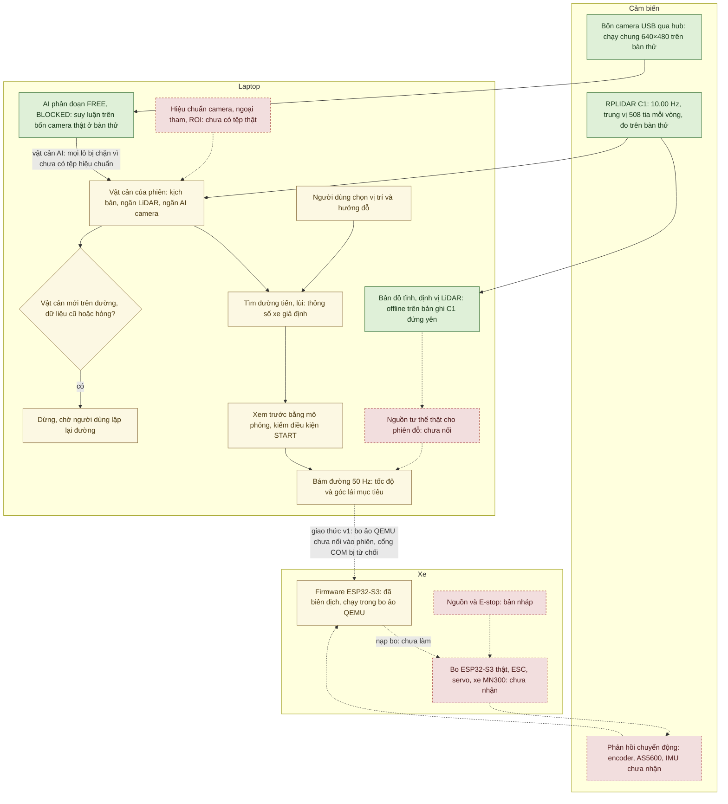

Xanh: đã có và đã kiểm/đo · Vàng: chỉ trong mô phỏng/giả lập · Đỏ viền đứt: chưa làm hoặc chưa thử trên thiết bị. Ở sơ
đồ này, xanh là khối đã chạy với thiết bị thật trên bàn thử (LiDAR C1, bốn camera, AI suy luận trên ảnh camera thật, bản
đồ tĩnh từ LiDAR thật); vàng là khối mới chạy với xe hoặc bo mô phỏng, hoặc trong bo ảo QEMU; đỏ viền đứt là phần chưa
làm (nguồn tư thế thật, ESP32-S3 thật trên bo, xe MN300 và cảm biến của xe, nguồn và E-stop, tệp hiệu chuẩn camera).
Không khối nào đã chạy trên xe.

Đọc thế nào: mũi tên liền là đoạn đã có mã và đã chạy (với thiết bị thật hoặc mô phỏng); mũi tên đứt là đoạn nối chưa có
hoặc chưa chạy. Bám đường tới ESP32-S3 nét đứt vì bo ảo QEMU chưa nối vào phiên đỗ, còn cổng COM thì Bắt đầu đỗ bị từ
chối (chưa có nguồn tư thế thật, sơ đồ 2.3). Vật cản từ cảm biến vào phiên qua `ui.lidar_app` hoặc `fusion.demo` (LiDAR
thật đứng yên, xe ảo; lần chạy thật có ghi lại là `fusion.demo` ngày 22/09/2026); vật cản AI camera bị chặn ở mọi lô vì
chưa có tệp hiệu chuẩn camera. Giai đoạn 0 đạt ở mức mô phỏng, V1 đạt 0/10 điều kiện hoàn thành (sơ đồ 8.1 và 8.3).

Chi tiết: [README](../../README.md) · [TONG_HOP_DU_AN.md](../../TONG_HOP_DU_AN.md) mục 4 ·
[kế hoạch](../../KE_HOACH_TRIEN_KHAI_XE_TU_DO_v3.1.md) mục 2.1 · [hardware_inventory.md](hardware_inventory.md) ·
[CHUYEN_MAY_BAN.md](CHUYEN_MAY_BAN.md) mục 2 (số LiDAR 29/09) · [AI_DIEU_KHIEN_XE.md](AI_DIEU_KHIEN_XE.md) ·
[GIAI_DOAN_3_CHUAN_BI.md](GIAI_DOAN_3_CHUAN_BI.md) mục 3 (lần chạy `fusion.demo`) ·
[MO_PHONG_FIRMWARE.md](MO_PHONG_FIRMWARE.md).

### 1.2. Kiến trúc lớp mô-đun

Các gói con của `autopark/autopark` và ai gọi ai lúc chạy. Trung tâm là `Session`; giao diện nạp vật cản vào phiên,
phiên gọi planner, bộ bám và mô phỏng, hoặc đi qua `VehicleLink` tới `VehicleIO`.

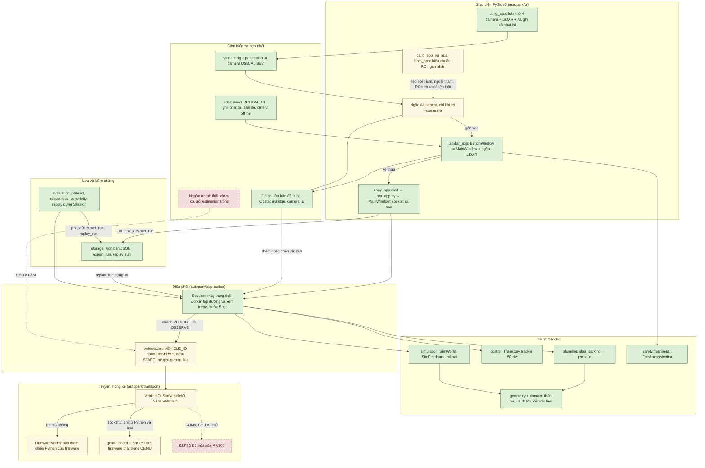

Xanh: có mã và đã kiểm trên máy tính hoặc đo trên bàn thử · Vàng: chỉ chạy với bo mô phỏng, cổng giả, bo ảo QEMU, nguồn
giả hoặc ảnh tổng hợp · Đỏ viền đứt: chưa có.

Đọc thế nào: mũi tên là lời gọi lúc chạy. `ui.lidar_app` (giao diện) và `fusion.demo` (dòng lệnh, không giao diện) nối
LiDAR vào phiên đỗ; AI camera chỉ qua `ui.lidar_app --camera-ai`; `chay_app.cmd` mở cockpit sa bàn, không nhập cảm biến.
`Session` không tự ghi đĩa: `MainWindow` và `phase0` gọi `export_run`, còn `replay_run` dựng một `Session` mới. Công cụ
riêng `lidar.live_view`, `lidar.viewer` không vẽ. Hai mô-đun gốc `image_io.py` (đọc, ghi ảnh chịu đường dẫn có dấu) và
`power_throttling.py` (tắt EcoQoS, sơ đồ 3.7) dùng chung.

Chi tiết: [hướng dẫn chạy](../README.md) mục 10 · [CHE_DO_QUAN_SAT.md](CHE_DO_QUAN_SAT.md) ·
[AI_DIEU_KHIEN_XE.md](AI_DIEU_KHIEN_XE.md) · mã: [session.py](../autopark/application/session.py),
[vehicle_link.py](../autopark/application/vehicle_link.py), [main_window.py](../autopark/ui/main_window.py),
[lidar_app.py](../autopark/ui/lidar_app.py), [demo.py](../autopark/fusion/demo.py),
[run_store.py](../autopark/storage/run_store.py), [estimation/__init__.py](../autopark/estimation/__init__.py).

### 1.3. Thiết bị, máy và cổng

#### Cảm biến cắm vào máy bàn hiện tại (29/09/2026)

Bốn camera chung một nhánh USB 2.0 qua hub; danh tính camera là cổng hub, còn index DirectShow đổi theo máy. LiDAR đi
qua bộ chuyển CP2102N; số COM đặt ở một chỗ, `configs/thiet_bi.json`.

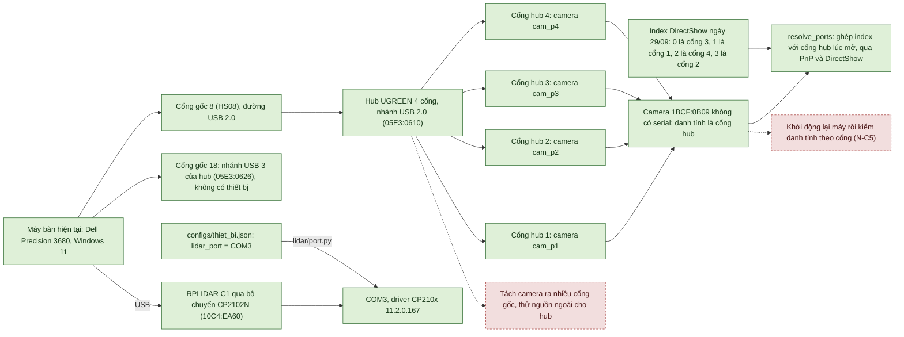

Xanh: đã có và đã kiểm/đo (đọc từ máy ngày 29/09/2026) · Đỏ viền đứt: chưa làm.

Đọc thế nào: số hub, cổng gốc và index lấy từ `usb_topology.json` của lượt `do_may_moi.cmd` ngày 29/09/2026. Chưa khởi
động lại máy để kiểm danh tính camera theo cổng; hub chưa thử nguồn ngoài; laptop trình diễn chưa có sơ đồ cổng.

Chi tiết: [usb_topology.md](usb_topology.md) ·
[usb_topology.json](evidence/chuyen_may_20260929/may_moi/usb_topology.json) · [CHUYEN_MAY_BAN.md](CHUYEN_MAY_BAN.md)
phần đầu, mục 2, 3 · [thiet_bi.json](../configs/thiet_bi.json) · mã: [lidar/port.py](../autopark/lidar/port.py),
[video/multicam.py](../autopark/video/multicam.py).

#### Máy nào đã chạy phần nào

Ba máy: máy bàn trước (tới 25/09/2026) có mọi số huấn luyện, chấm và bàn thử; máy bàn hiện tại (từ 29/09/2026) nhận bản
chép nguyên thư mục và đã kiểm lại; laptop trình diễn mới chạy mô phỏng giai đoạn 0.

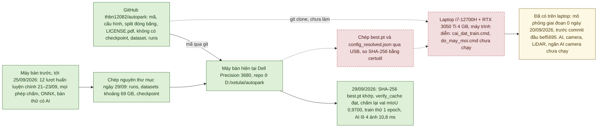

Xanh: đã có và đã kiểm/đo · Vàng: chỉ mô phỏng · Đỏ viền đứt: chưa làm (quy trình đã viết, chưa chạy trên laptop).

Đọc thế nào: 12 lượt huấn luyện chính là các thư mục `runs/ai_*` (cộng 2 lượt thử
`runs/ai_woodscape_rtx4000_v1_checks`). Kiểm lại ngày 29/09 dùng mã `b37e9ee`, lúc repo còn ở `D:\gấp`. Các số huấn
luyện, chấm, ONNX và độ trễ gốc trong [HUAN_LUYEN.md](../../HUAN_LUYEN.md) đo 21–24/09 trên máy bàn trước; số trên
laptop: CHƯA ĐO.

Chi tiết: [MAY_NOP_DO_AN.md](MAY_NOP_DO_AN.md) mục 1–2 · [CHUYEN_MAY_BAN.md](CHUYEN_MAY_BAN.md) mục 1–2 ·
[kiem_may_20260929.md](evidence/chuyen_may_20260929/kiem_may_20260929.md) · [GIAY_PHEP_DU_LIEU.md](GIAY_PHEP_DU_LIEU.md)
(danh sách lượt huấn luyện) · [tham_chieu_20260929.json](evidence/may_ban/tham_chieu_20260929.json).

## 2. Ứng dụng và phiên đỗ

### 2.1. Luồng dữ liệu một lần đỗ

Từ nguồn vật cản tới kết quả của một lần đỗ ở nhánh SIM mặc định: lập đường trong luồng nền, kiểm chứng bằng xe mô
phỏng, xem trước, rồi vòng kín bước 5 ms và bám đường 50 Hz. Xe và phản hồi ở nhánh này là mô phỏng.

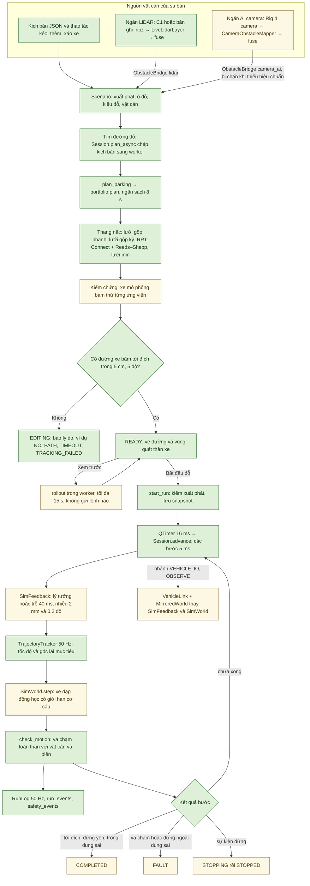

Xanh: có mã và đã kiểm trên máy tính (nguồn LiDAR: thêm một lần chạy với C1 thật đứng yên qua `fusion.demo`, 22/09/2026)
· Vàng: chỉ với xe, phản hồi hoặc bo mô phỏng, hay nguồn giả.

Đọc thế nào: kết quả COMPLETED, FAULT, STOPPED ở đây là của xe mô phỏng với thông số giả định
(`configs/vehicle_default.json`). Chi tiết các bước ở sơ đồ 3.1–3.4; nhánh qua `VehicleLink` ở sơ đồ 2.4.

Chi tiết: [BAO_CAO_GIAI_DOAN_0.md](../../BAO_CAO_GIAI_DOAN_0.md) · [GIAI_DOAN_0.md](GIAI_DOAN_0.md) ·
[AI_DIEU_KHIEN_XE.md](AI_DIEU_KHIEN_XE.md) · mã: [session.py](../autopark/application/session.py),
[portfolio.py](../autopark/planning/portfolio.py), [feedback.py](../autopark/simulation/feedback.py),
[world.py](../autopark/simulation/world.py), [tracker.py](../autopark/control/tracker.py),
[bridge.py](../autopark/fusion/bridge.py).

### 2.2. Máy trạng thái phiên

Đủ 11 trạng thái của `SessionState` và các chuyển trạng thái theo `application/session.py`, kèm tên nút trên giao diện
(`MainWindow`). Chuyển trạng thái như nhau ở ba nhánh SIM, VEHICLE_IO và OBSERVE; xem trước và lái tay luôn là mô phỏng.

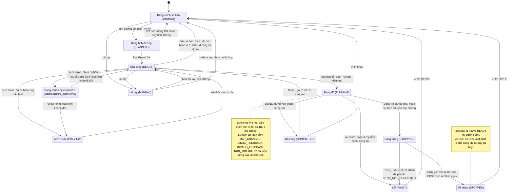

Đọc thế nào: "Dừng xe" (nút, Esc, và Space trừ khi đang quan sát OBSERVE: lúc đó Space là phanh của người lái mô phỏng)
gọi `request_stop` và giữ đường; sự kiện an toàn đi qua `_safety_stop`, hủy đường và tăng `plan_version` (sơ đồ 3.4).
Nút "Chọn lại vị trí" luôn gọi `set_start` nên đường cũ luôn bị bỏ, kể cả khi người dùng tự dừng; "Đỗ lại" dùng lại
đường cũ từ xuất phát cũ. `STOP_NOT_CONFIRMED` và kết thúc ngay khi quan sát chỉ có ở nhánh qua `VehicleLink`. Đang
STOPPING thì không đặt lại được (phải dừng hẳn).

Chi tiết: [BAO_CAO_GIAI_DOAN_0.md](../../BAO_CAO_GIAI_DOAN_0.md) mục 4 · [CHE_DO_QUAN_SAT.md](CHE_DO_QUAN_SAT.md) · mã:
[session.py](../autopark/application/session.py) (`SessionState`, `reset`, `_step_closed_loop`),
[main_window.py](../autopark/ui/main_window.py) (`_primary_dispatch`, `_return_to_editing`), test:
[test_session_run.py](../tests/test_session_run.py), [test_runtime_safety.py](../tests/test_runtime_safety.py).

### 2.3. Nhánh SIM, VEHICLE_IO, OBSERVE và thẻ Bo điều khiển

Ô "Nhánh chạy" chọn cách lần Bắt đầu đỗ tới chạy; thẻ "Bo điều khiển" chọn bo. Hôm nay đường duy nhất chạy được qua
`VehicleIO` là bo mô phỏng; chọn một cổng COM thì Bắt đầu đỗ bị từ chối trước khi mở cổng.

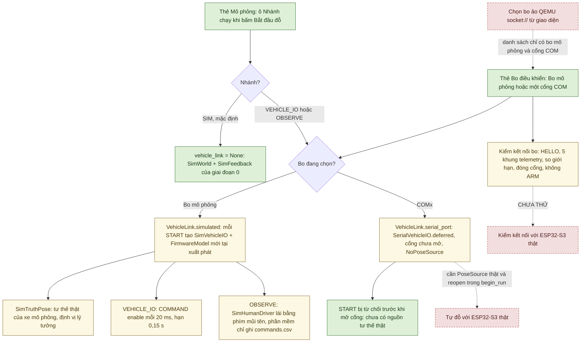

Xanh: có mã và đã kiểm trên máy tính (test giao diện và phiên, offscreen) · Vàng: chỉ với bo mô phỏng hoặc cổng serial
giả · Đỏ viền đứt: chưa làm hoặc chưa thử trên thiết bị. Xanh và vàng ở đây hẹp hơn chú giải chuẩn: nhánh SIM tô xanh vì
là đường mặc định đã kiểm, nhưng vẫn là mô phỏng; chưa lệnh nào đi tới bo hay xe thật.

Đọc thế nào: nhánh và cổng chỉ đổi được khi phiên đang EDITING hoặc READY. `SerialVehicleIO` đã nói chuyện với firmware
thật trong bo ảo QEMU qua `socket://` (30/09/2026), nhưng chỉ từ Python và test, ngoài `Session`; giao diện chưa chọn
được bo ảo và chưa có nút CLEAR_FAULT.

Chi tiết: [CHE_DO_QUAN_SAT.md](CHE_DO_QUAN_SAT.md) · [MO_PHONG_FIRMWARE.md](MO_PHONG_FIRMWARE.md) · mã:
[main_window.py](../autopark/ui/main_window.py) (`_set_drive_mode`, `_probe_board`),
[vehicle_link.py](../autopark/application/vehicle_link.py) (`VehicleLink.simulated`, `serial_port`, `probe_board`),
[vehicle_io_sim.json](../configs/vehicle_io_sim.json) · test:
[test_vehicle_board_ui.py](../tests/test_vehicle_board_ui.py),
[test_session_vehicle.py](../tests/test_session_vehicle.py).

### 2.4. Một lần chạy qua VehicleLink

Trình tự gọi hàm thật khi bấm Bắt đầu đỗ ở nhánh VEHICLE_IO hoặc OBSERVE: kiểm trước START trên trạng thái thật của bo,
rồi mỗi bước 5 ms lấy telemetry và sự kiện trước nhịp điều khiển 50 Hz.

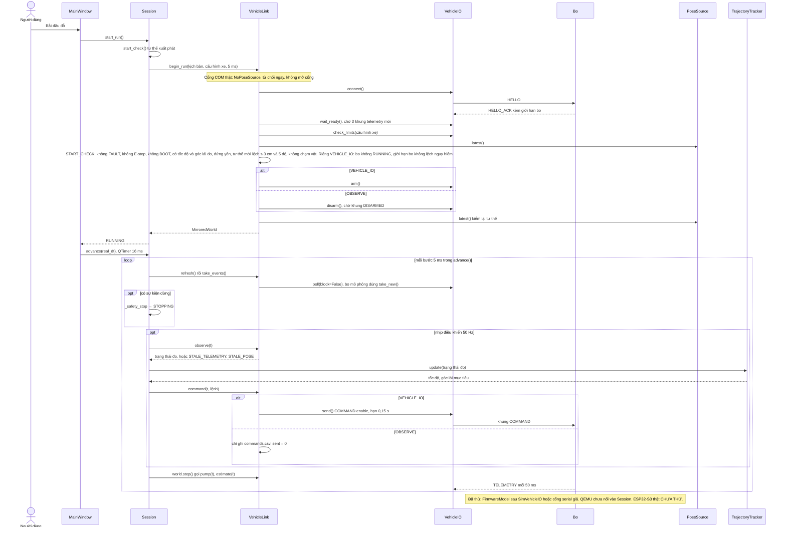

Đọc thế nào: lỗi ở bất kỳ bước nào sau khi đã gửi ARM thì `begin_run` gửi DISARM trước khi báo lỗi; lần START bị từ chối
ghi vào `start_refusals.csv`. Trạng thái xe ở nhánh này lấy từ telemetry và nguồn tư thế (thế giới gương), không tích
phân lệnh. Nguồn tư thế duy nhất hiện có là `SimTruthPose` (mô phỏng).

Chi tiết: [CHE_DO_QUAN_SAT.md](CHE_DO_QUAN_SAT.md) mục 3 · [GIAO_THUC_XE.md](GIAO_THUC_XE.md) · mã:
[vehicle_link.py](../autopark/application/vehicle_link.py) (`begin_run`, `_open_run`, `refresh`, `observe`, `command`),
[vehicle_io.py](../autopark/transport/vehicle_io.py) · test:
[test_session_vehicle.py](../tests/test_session_vehicle.py).

### 2.5. Lưu phiên và phát lại

Hai nút "Lưu phiên" và "Xuất log CSV" (cùng một hàm `_export_log`) ghi gì theo loại lần chạy, và cách `replay` dựng lại
một lần chạy SIM bằng quỹ đạo đã lưu.

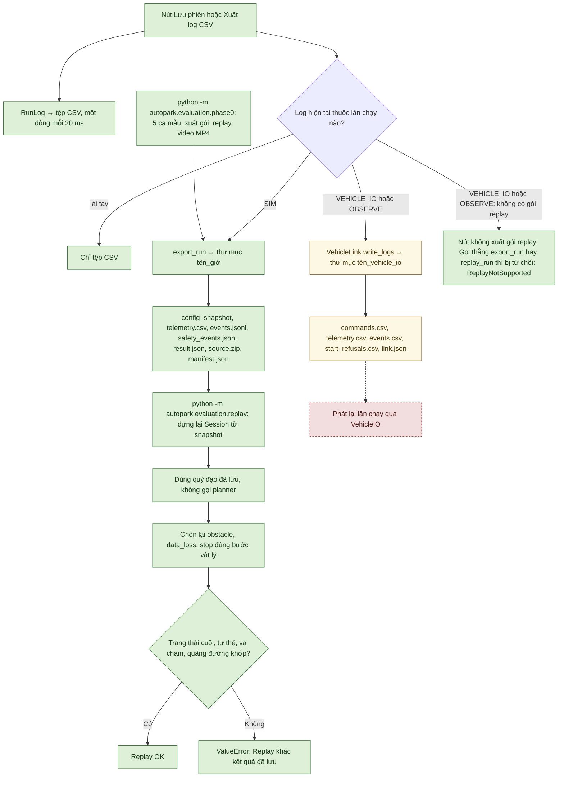

Xanh: có mã và đã kiểm trên máy tính · Vàng: chỉ với bo mô phỏng hoặc cổng giả · Đỏ viền đứt: chưa làm (việc T9 của kịch
bản nghiệm thu).

Đọc thế nào: gói `export_run` ghi `"evidence": "simulation_only"` trong `manifest.json`; replay chỉ chứng minh tái hiện
được lần chạy mô phỏng đó với cùng mã và môi trường. Ngày 29/09/2026 trên máy bàn hiện tại, `phase0` cho lại đúng năm
phiên của đợt 20/09, replay khớp cả năm.

Chi tiết: [BAO_CAO_GIAI_DOAN_0.md](../../BAO_CAO_GIAI_DOAN_0.md) mục 7 · [CHE_DO_QUAN_SAT.md](CHE_DO_QUAN_SAT.md) mục 5
· [kiem_may_20260929.md](evidence/chuyen_may_20260929/kiem_may_20260929.md) mục 2.1 · mã:
[run_store.py](../autopark/storage/run_store.py), [phase0.py](../autopark/evaluation/phase0.py),
[replay.py](../autopark/evaluation/replay.py), [main_window.py](../autopark/ui/main_window.py) (`_export_log`).

### 2.6. Tệp cấu hình và nơi đọc

Mỗi tệp trong `configs/`, `scenarios/`, `calibration/` và checkpoint ngoài Git được mô-đun nào đọc. `thiet_bi.json` là
tệp duy nhất gắn với máy; nhiều tệp còn là GIẢ ĐỊNH, tệp hiệu chuẩn thật chưa có.

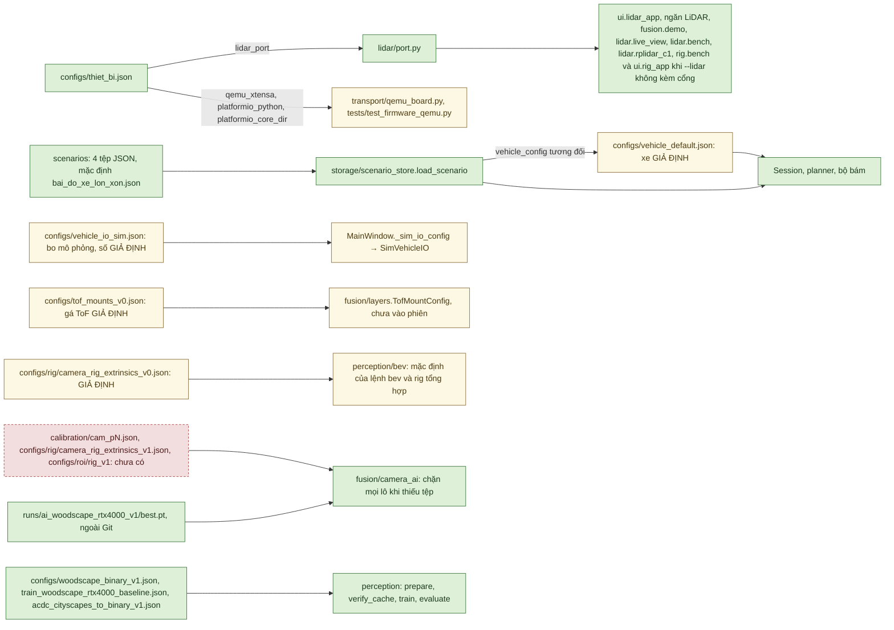

Xanh: có và đã dùng trên máy tính hoặc thiết bị thật · Vàng: số GIẢ ĐỊNH, nguồn giả hoặc chỉ giả lập · Đỏ viền đứt: tệp
chưa có.

Đọc thế nào: đổi máy chỉ sửa `configs/thiet_bi.json` (`lidar_port`, đường dẫn QEMU và PlatformIO); `rig.may_moi` luôn tự
tìm bộ chuyển CP210x. Với C1 thật, cổng đọc từ tệp này đã chạy qua `lidar.rplidar_c1 info` và `rig.bench --lidar` không
kèm cổng (29/09/2026); `ui.lidar_app` chưa chạy lại với thiết bị thật sau thay đổi này. Mặt nạ ROI của ảnh WoodScape
(`configs/roi/woodscape_v1`) chỉ dùng cho phần chấm và costmap trên ảnh WoodScape, không vẽ.

Chi tiết: [hướng dẫn chạy](../README.md) mục 7 · [CHUYEN_MAY_BAN.md](CHUYEN_MAY_BAN.md) mục 3, 5 ·
[calibration/README.md](../calibration/README.md) · [GIAI_DOAN_4_CHUAN_BI.md](GIAI_DOAN_4_CHUAN_BI.md) (thay xe giả định
bằng số đo) · [AI_DIEU_KHIEN_XE.md](AI_DIEU_KHIEN_XE.md) mục 8.2 (`camera_ai` chặn mọi lô khi phát lại o03) · mã:
[lidar/port.py](../autopark/lidar/port.py), [scenario_store.py](../autopark/storage/scenario_store.py),
[camera_ai.py](../autopark/fusion/camera_ai.py), [qemu_board.py](../autopark/transport/qemu_board.py).

## 3. Lập đường, bám đường và mô phỏng

Toàn bộ mục này chạy trên máy tính với xe và phản hồi mô phỏng; cấu hình xe `configs/vehicle_default.json` là GIẢ ĐỊNH.
Mã lập đường, bám đường, mô phỏng và hình học không đổi từ commit đầu `bef5695` (21/09/2026) tới `ff4a018`, trừ
docstring.

### 3.1. Từ nút Tìm đường đỗ tới quỹ đạo sẵn sàng

Một yêu cầu lập đường đi qua `Session` (luồng nền, hạn 8 s đồng hồ thật cho cả tìm lẫn kiểm chứng), `plan_parking`,
thang `portfolio`, các lớp kiểm va chạm trong mỗi nấc, rollout kiểm chứng, rồi phiên nhận hay bỏ kết quả.

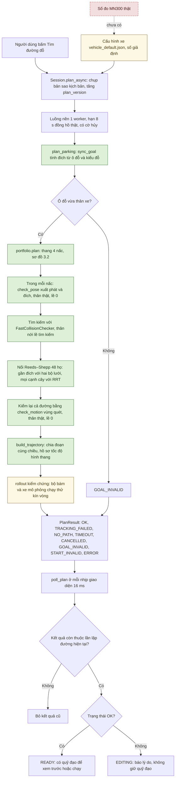

Xanh: có mã và đã kiểm trên máy tính · Vàng: chỉ với xe mô phỏng hoặc số giả định · Đỏ viền đứt: chưa có.

Đọc thế nào: TRACKING_FAILED nghĩa là có đường nhưng xe mô phỏng không bám tới đích trong dung sai, khác NO_PATH.
TIMEOUT dưới hạn giờ không chứng minh vô nghiệm (sơ đồ 3.7). Lỗi thuật toán trả ERROR, tách khỏi "không tìm được đường".

Chi tiết: [TONG_HOP_DU_AN.md](../../TONG_HOP_DU_AN.md) mục 4.1 ·
[KIEM_THU_DO_BEN_GIAI_DOAN_0.md](KIEM_THU_DO_BEN_GIAI_DOAN_0.md) · mã: [session.py](../autopark/application/session.py)
(`plan_async`, `poll_plan`, `_apply_plan`), [parking.py](../autopark/planning/parking.py),
[portfolio.py](../autopark/planning/portfolio.py), [cand_lattice_macro.py](../autopark/planning/cand_lattice_macro.py),
[cand_rrt_rs.py](../autopark/planning/cand_rrt_rs.py), [fast_collision.py](../autopark/geometry/fast_collision.py),
[trajectory.py](../autopark/planning/trajectory.py), [rollout.py](../autopark/simulation/rollout.py).

### 3.2. Thang leo nấc của portfolio và quy tắc nhận đường

Bốn nấc chạy lần lượt (không song song) với ngân sách co giãn theo T/8 s. Có hai ngưỡng khác nhau: 4 cm và 4° là mức đủ
tốt để dừng leo thang, 5 cm và 5° là mức đủ tốt để nhận (bằng dung sai nghiệm thu của đích).

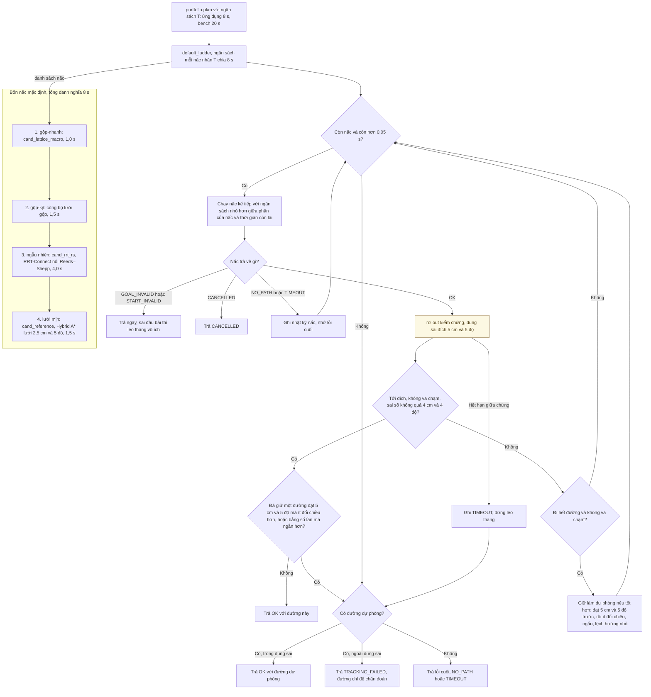

Vàng: bước chỉ chạy với xe mô phỏng (rollout). Các ô khác là logic của `portfolio.py`, đã kiểm trên máy tính.

Đọc thế nào: RRT ở nấc 3 là ngẫu nhiên, nên cùng một ca có thể ra đường khác nhau giữa các lần chạy khi thời gian còn
lại khác nhau. Portfolio chỉ ưu tiên đường ít đổi chiều hơn; giới hạn số lần đổi chiều: CHƯA CHỐT (việc T12 của kịch bản
nghiệm thu).

Chi tiết: [TONG_HOP_DU_AN.md](../../TONG_HOP_DU_AN.md) mục 4.1 ·
[KIEM_THU_DO_BEN_GIAI_DOAN_0.md](KIEM_THU_DO_BEN_GIAI_DOAN_0.md) · mã: [portfolio.py](../autopark/planning/portfolio.py)
(`PortfolioParams`, `default_ladder`, `plan`) · test:
[test_portfolio_validation.py](../tests/test_portfolio_validation.py).

### 3.3. Một nhịp mô phỏng kín vòng trong phiên

Trình tự của `Session.advance` ở nhánh SIM: bước vật lý 5 ms, bám đường 50 Hz qua phản hồi giả, giới hạn cơ cấu của xe
mô phỏng, kiểm vùng quét mỗi bước và các điều kiện kết thúc. Toàn bộ là mô phỏng.

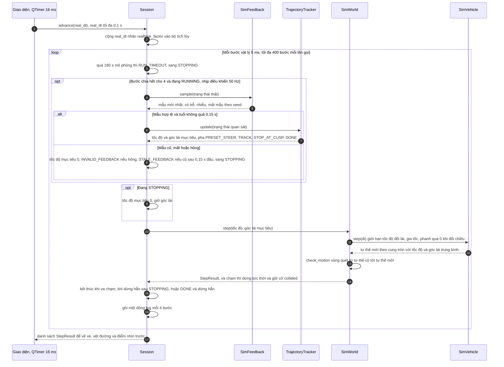

Đọc thế nào: xe mô phỏng dừng tức thời khi va chạm, xe thật thì không; đây không phải phép thử phanh. Giao diện kẹp mỗi
nhịp ở 0,1 s đồng hồ thật, nhân hệ số tốc độ tối đa 8 (tức không quá 160 bước), nên máy chậm thì mô phỏng chạy chậm hơn
đồng hồ thật mà không báo gì. Cờ `lagging` (đủ 400 bước trong một lần gọi, bỏ phần thời gian dồn) chỉ bật khi `advance`
được gọi với khoảng dài hơn 2 s mô phỏng (mã khác, hoặc nhánh bo thật chạy theo đồng hồ của `VehicleIO`, hiện chưa chạy
được), và giao diện không hiện cờ này. Nhánh qua `VehicleLink` thay `SimFeedback` và `SimWorld` bằng telemetry và thế
giới gương (sơ đồ 2.4).

Chi tiết: [GIAI_DOAN_0.md](GIAI_DOAN_0.md) · mã: [session.py](../autopark/application/session.py) (`advance`,
`_step_closed_loop`), [main_window.py](../autopark/ui/main_window.py) (`_on_tick`),
[feedback.py](../autopark/simulation/feedback.py), [tracker.py](../autopark/control/tracker.py),
[world.py](../autopark/simulation/world.py), [vehicle.py](../autopark/simulation/vehicle.py).

### 3.4. Phản ứng an toàn khi đang chạy

Mọi nguồn yêu cầu dừng khi phiên đang RUNNING, phía phiên đỗ trên laptop. Sự kiện an toàn đi qua `_safety_stop` (hủy
đường); người dùng dừng, hay dữ liệu LiDAR và AI cũ, đi qua `request_stop` (giữ đường). Lớp firmware và phần cứng ở sơ
đồ 7.1.

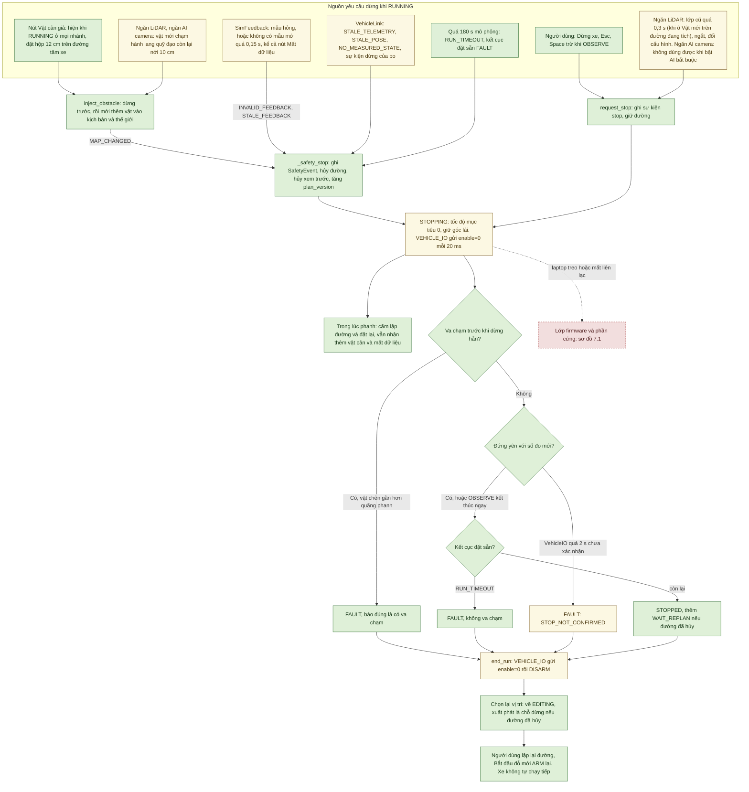

Xanh: logic của phiên, đã kiểm trên máy tính · Vàng: chỉ với xe, phản hồi hoặc bo mô phỏng, cổng giả, nguồn giả · Đỏ
viền đứt: chưa thử trên thiết bị.

Đọc thế nào: vật mới ngoài hành lang chỉ được ghi nhớ, không làm dừng xe. Nhánh "vật mới → dừng" của LiDAR đã chạy với
C1 thật đứng yên ngày 22/09/2026 nhưng chỉ ở dạng dừng giả (nhiễu, cáp, mép vật, trong lúc thêm dần các quy tắc lọc,
GIAI_DOAN_3_CHUAN_BI.md mục 3); với ngăn AI camera mới kiểm bằng nguồn giả. Chưa thử có chủ đích: đưa tay hay hộp vào
trước C1 thật, rút cáp khi xe ảo chạy. Ô "Vật mới trên đường làm xe dừng" (mặc định tích) bật nhánh chèn vật mới ở cả
hai ngăn; ở ngăn LiDAR nó bật luôn nhánh dừng khi lớp cũ quá 0,3 s. Phanh và E-stop trên xe thật: CHƯA THỬ.

Chi tiết: [BAO_CAO_GIAI_DOAN_0.md](../../BAO_CAO_GIAI_DOAN_0.md) mục 3, 5 ·
[GIAI_DOAN_3_CHUAN_BI.md](GIAI_DOAN_3_CHUAN_BI.md) · [AI_DIEU_KHIEN_XE.md](AI_DIEU_KHIEN_XE.md) ·
[CHE_DO_QUAN_SAT.md](CHE_DO_QUAN_SAT.md) · mã: [session.py](../autopark/application/session.py) (`_safety_stop`,
`inject_obstacle`, `request_stop`, `_finish_run`), [bridge.py](../autopark/fusion/bridge.py),
[lidar_dock.py](../autopark/ui/lidar_dock.py), [camera_dock.py](../autopark/ui/camera_dock.py),
[vehicle_link.py](../autopark/application/vehicle_link.py) · test:
[test_runtime_safety.py](../tests/test_runtime_safety.py), [test_phase0.py](../tests/test_phase0.py),
[test_session_vehicle.py](../tests/test_session_vehicle.py).

### 3.5. Công cụ đánh giá planner

Các công cụ dòng lệnh chấm planner khác nhau ở cách dựng sa bàn và cách chấm. `bench`, `compare`, `render` dựng sa bàn
theo chính xe đang thử; `sensitivity` giữ sa bàn cố định; đường chứng của 16 ca khó được kiểm bằng một bộ kiểm va chạm
độc lập.

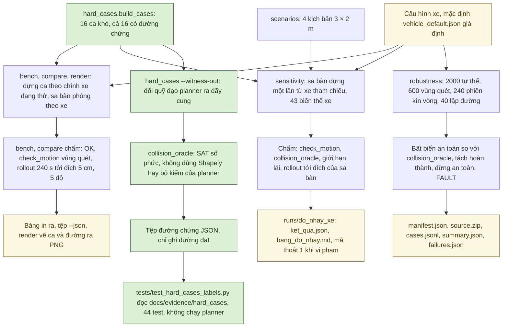

Xanh: đã kiểm trên máy tính, không phụ thuộc mô phỏng động học (hình học của đường chứng) · Vàng: kết quả cho xe giả
định, chạy trong mô phỏng.

Đọc thế nào: 44 test nhãn không chạy planner nên không phụ thuộc tải CPU. Hạn giờ mặc định của từng lệnh ở sơ đồ 3.7;
kết quả chạy dưới tải phải ghi cùng tải máy và trạng thái EcoQoS. Nhãn `feasible` của 16 ca đặt cho xe giả định; với xe
đo phải tìm và kiểm lại đường chứng.

Chi tiết: [KIEM_THU_DO_BEN_GIAI_DOAN_0.md](KIEM_THU_DO_BEN_GIAI_DOAN_0.md) ·
[DO_NHAY_KICH_THUOC_XE.md](DO_NHAY_KICH_THUOC_XE.md) · [evidence/hard_cases/](evidence/hard_cases/) · mã:
[bench.py](../autopark/evaluation/bench.py), [sensitivity.py](../autopark/evaluation/sensitivity.py),
[hard_cases.py](../autopark/evaluation/hard_cases.py),
[collision_oracle.py](../autopark/evaluation/collision_oracle.py), [robustness.py](../autopark/evaluation/robustness.py)
· test: [test_hard_cases_labels.py](../tests/test_hard_cases_labels.py).

### 3.6. Nghiệm thu giai đoạn 0

Sáu điều kiện chuyển bước của giai đoạn 0 nối với nguồn bằng chứng của đợt 20/09/2026 (laptop i7-12700H): pytest, chiến
dịch robustness và năm phiên `phase0` có replay. Kết luận là ĐẠT ở mức mô phỏng.

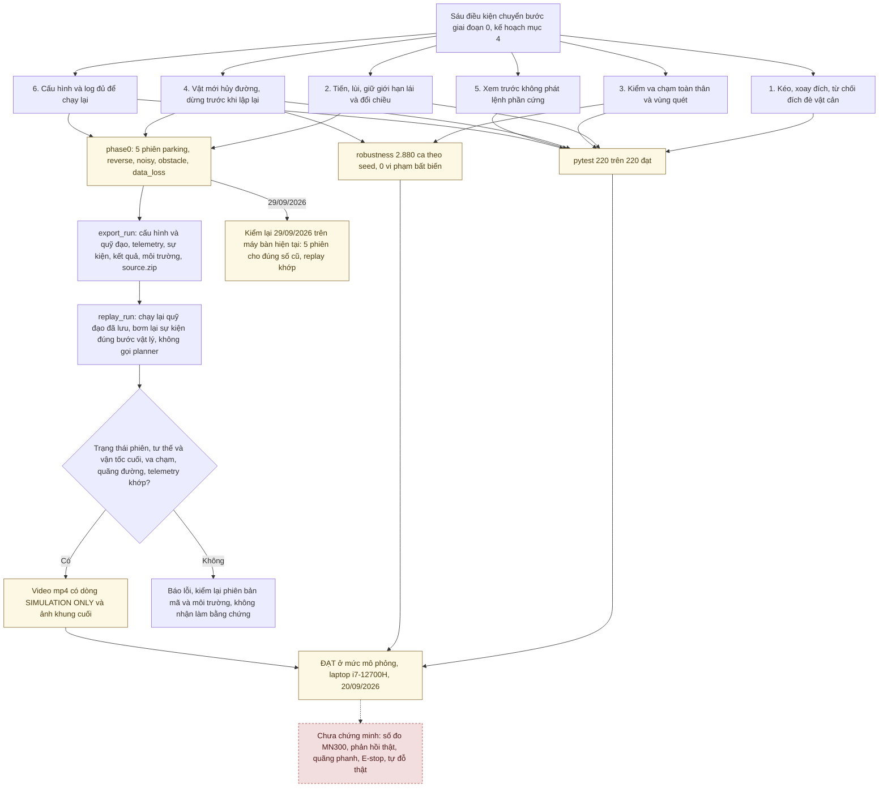

Vàng: chỉ trong mô phỏng · Đỏ viền đứt: chưa làm hoặc chưa thử trên thiết bị.

Đọc thế nào: cùng sơ đồ với báo cáo giai đoạn 0 mục 7, thêm ô kiểm lại ngày 29/09. Đây là báo cáo của đợt 20/09; các con
số chỉ áp dụng cho tập phép thử đó. Nhánh VehicleIO thêm sau đợt này nên không nằm trong 220 test. Bộ test hiện tại lớn
hơn nhiều (sơ đồ 9.2); lần kiểm lại ngày 29/09 chỉ chạy lại năm phiên `phase0`, không chạy lại chiến dịch 2.880 ca.

Chi tiết: [BAO_CAO_GIAI_DOAN_0.md](../../BAO_CAO_GIAI_DOAN_0.md) mục 1, 3, 6, 7 · [GIAI_DOAN_0.md](GIAI_DOAN_0.md) ·
[kế hoạch](../../KE_HOACH_TRIEN_KHAI_XE_TU_DO_v3.1.md) mục 4 · [environment.json](evidence/environment.json) ·
[kiem_may_20260929.md](evidence/chuyen_may_20260929/kiem_may_20260929.md) mục 2.1 · tệp gốc
`runs/phase0_after_robustness/summary.json` (git-ignore) · mã: [phase0.py](../autopark/evaluation/phase0.py),
[run_store.py](../autopark/storage/run_store.py).

### 3.7. Hạn giờ theo đồng hồ thật và EcoQoS

Vì sao TIMEOUT hay TRACKING_FAILED dưới hạn giờ không có nghĩa là vô nghiệm: mọi ngân sách tính bằng đồng hồ thật, nên
kết quả phụ thuộc tải máy và EcoQoS của Windows 11. Từ 30/09/2026 `tests/conftest.py` tắt EcoQoS cho tiến trình pytest;
ứng dụng giao diện và các lệnh đánh giá: CHƯA ĐO.

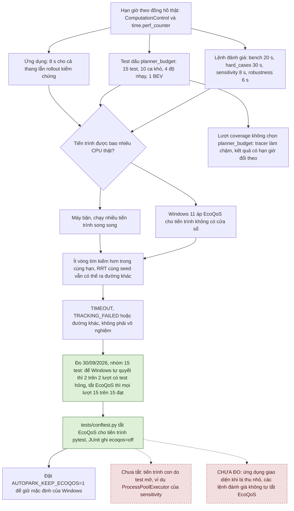

Xanh: đã đo và đã sửa trên máy bàn hiện tại · Đỏ viền đứt: chưa làm hoặc CHƯA ĐO.

Đọc thế nào: lượt để Windows tự quyết hỏng 3 và 1 test (ví dụ `uturn_w46` hết hạn 8 s), cả lệnh 107 s và 57 s; lượt tắt
EcoQoS 39 s và 43 s; ba lượt sau khi sửa `conftest.py` đạt 15/15 trong khoảng 30 s. Cơ chế cụ thể của Windows (dồn sang
lõi E hay hạ xung) chưa xác định. Bo ảo QEMU cũng tự tắt EcoQoS cho tiến trình QEMU (`qemu_board.py`).

Chi tiết: [CHUYEN_MAY_BAN.md](CHUYEN_MAY_BAN.md) mục 8 ·
[nhom_planner_budget.txt](evidence/mo_phong_20260930/ecoqos_30092026/nhom_planner_budget.txt) ·
[do_uturn_w46.txt](evidence/mo_phong_20260930/ecoqos_30092026/do_uturn_w46.txt) · mã:
[computation.py](../autopark/domain/computation.py), [power_throttling.py](../autopark/power_throttling.py),
[conftest.py](../tests/conftest.py), [pyproject.toml](../pyproject.toml) (dấu `planner_budget`).

## 4. Cảm biến và bàn thử

Mọi số đo phần cứng trong mục này là trên bàn làm việc: máy bàn trước (22–24/09/2026, LiDAR ở COM4) hoặc máy bàn hiện
tại (29/09/2026, COM3). Chưa có số nào trên xe hay trên laptop trình diễn.

### 4.1. Đường dữ liệu LiDAR

Dữ liệu LiDAR thật đi từ driver tới `LidarScan`, rồi tới các chỗ dùng nó: bàn thử, màn hình trực tiếp, bản ghi và phép
đo, bản đồ tĩnh, định vị lại, odometry offline.

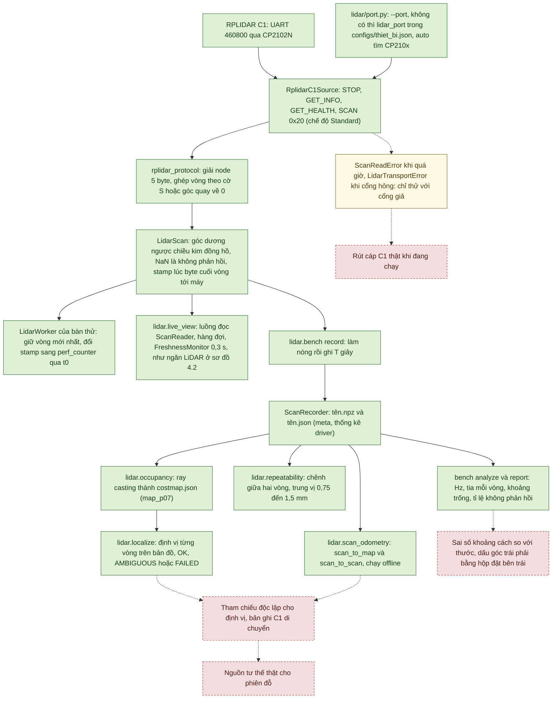

Xanh: đã đo trên thiết bị thật, hoặc chạy offline trên bản ghi thật · Vàng: chỉ thử với cổng giả · Đỏ viền đứt: chưa làm
hoặc chưa thử trên thiết bị.

Đọc thế nào: đọc scan, tạo bản đồ và định vị lại là ba kết quả riêng; độ lặp lại giữa hai vòng không phải sai số so với
thước. Bản đồ, định vị và odometry chỉ chạy trên bản ghi C1 đứng yên (và DROW), chưa có tham chiếu độc lập, chưa nối vào
phiên đỗ. Trên máy bàn hiện tại (29/09/2026, COM3): lượt tham chiếu `may_moi` 12:59 cho 10,00 Hz, trung vị 508 tia mỗi
vòng, 0 lỗi đọc; hai lượt sau cùng ngày cho 10,26 Hz (ghi 10 s, 15:08) và 9,99 Hz (`may_moi` 15:15), cùng trung vị 508
([kiem_may_20260929.md](evidence/chuyen_may_20260929/kiem_may_20260929.md) mục 2.2, 2.9).

Chi tiết: [GIAI_DOAN_1_LIDAR.md](GIAI_DOAN_1_LIDAR.md) · [DINH_VI_LIDAR.md](DINH_VI_LIDAR.md) ·
[SO_SANH_DINH_VI_SLAM.md](SO_SANH_DINH_VI_SLAM.md) · [gate_01.md](gate_01.md) · [CHUYEN_MAY_BAN.md](CHUYEN_MAY_BAN.md)
mục 2 · mã: [rplidar_c1.py](../autopark/lidar/rplidar_c1.py),
[rplidar_protocol.py](../autopark/lidar/rplidar_protocol.py), [port.py](../autopark/lidar/port.py),
[recording.py](../autopark/lidar/recording.py), [localize.py](../autopark/lidar/localize.py),
[scan_odometry.py](../autopark/lidar/scan_odometry.py).

### 4.2. Ngăn LiDAR đưa vật cản vào phiên đỗ

Ngăn LiDAR của `ui.lidar_app` làm gì ở từng trạng thái phiên. LiDAR được coi là đứng yên tại chỗ xuất phát của sa bàn.
Vật mới trên đường hủy đường (MAP_CHANGED); LiDAR cũ, ngắt hay đổi cấu hình chỉ yêu cầu dừng, giữ đường.

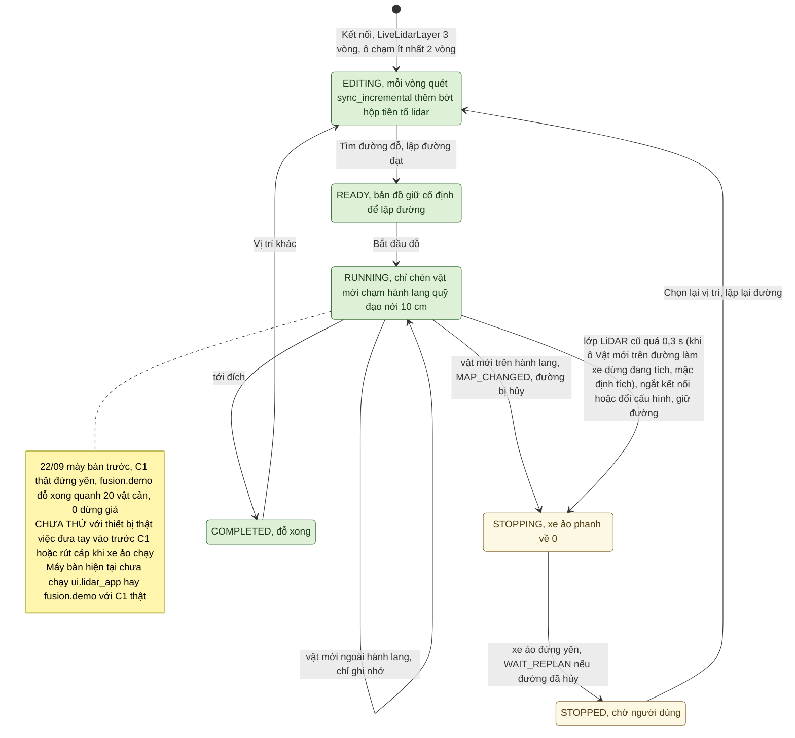

Xanh: phần phía phiên (lớp `LiveLidarLayer` 3 vòng, hành lang 10 cm, `MAP_CHANGED`) đã chạy với C1 thật đứng yên và xe
ảo qua `fusion.demo` ngày 22/09/2026 (máy bàn trước); ở EDITING, demo dùng bản đồ nền hợp 10 vòng chứ không phải
`sync_incremental`, và chính ngăn LiDAR của `ui.lidar_app` mới kiểm bằng nguồn quét kịch bản, chưa có lượt chạy thật nào
được ghi lại · Vàng: nhánh dừng, kiểm bằng nguồn quét kịch bản; với C1 thật mới gặp dừng giả ngày 22/09/2026, chưa thử
có chủ đích.

Đọc thế nào: sơ đồ rút gọn, chỉ các trạng thái ngăn LiDAR xử lý; đủ các trạng thái ở sơ đồ 2.2. Đang chạy, cầu nối
`ObstacleBridge` (tiền tố "lidar") chỉ thêm hộp, không bao giờ xóa. Với lỗi đọc, luồng đọc của giao diện hiện tên lỗi
rồi thử lại, nên xe ảo dừng khi lớp hết hạn 0,3 s, nếu ô "Vật mới trên đường làm xe dừng" đang tích (suy ra từ mã).

Chi tiết: [GIAI_DOAN_3_CHUAN_BI.md](GIAI_DOAN_3_CHUAN_BI.md) mục 2, 3, 5 · [CHUYEN_MAY_BAN.md](CHUYEN_MAY_BAN.md) mục 3
· mã: [lidar_dock.py](../autopark/ui/lidar_dock.py) (`tick`, `_stop_run`), [bridge.py](../autopark/fusion/bridge.py),
[layers.py](../autopark/fusion/layers.py), [demo.py](../autopark/fusion/demo.py) · test:
[test_lidar_dock_ui.py](../tests/test_lidar_dock_ui.py), [test_fusion_demo.py](../tests/test_fusion_demo.py).

### 4.3. Camera USB: từ khung ảnh tới bộ ảnh đồng bộ

Đường đi của một khung camera: mở theo cổng hub, kiểm đọc hỏng, khung trùng, khung bị cắt hoặc xé theo đúng thứ tự trong
mã, vòng đệm từng camera, rồi ghép bộ với quy tắc chờ theo nhịp riêng của từng camera.

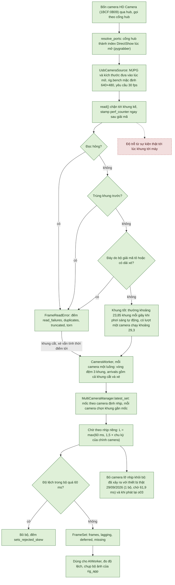

Xanh: đã đo trên thiết bị thật (bàn thử) · Đỏ viền đứt: chưa đo.

Đọc thế nào: bốn luồng chạy chung dùng được ở 640×480; ở 720p và 1080p khung bị cắt nhiều hay ít tùy cảnh, nguyên nhân
chưa xác định. Sàn 60 ms và hệ số 1,5 là lựa chọn thiết kế, chưa chốt. Trên máy bàn hiện tại chưa kiểm danh tính camera
sau khi khởi động lại máy.

Chi tiết: [GIAI_DOAN_1_CAMERA.md](GIAI_DOAN_1_CAMERA.md) · [GIAI_DOAN_2_BAN_THU.md](GIAI_DOAN_2_BAN_THU.md) mục 2, 10 ·
[kiem_may_20260929.md](evidence/chuyen_may_20260929/kiem_may_20260929.md) mục 2.7 (bộ thiếu camera chậm, camera cổng 2
chạy 29,26 khung/s; thời gian chờ 61,9 ms ở tệp gốc `runs/kiem_may_20260929/rig_bench/r_kiem.rig.json`, git-ignore) ·
[usb_topology.md](usb_topology.md) · mã: [sources.py](../autopark/video/sources.py),
[multicam.py](../autopark/video/multicam.py), [camera_bench.py](../autopark/video/camera_bench.py) · test:
[test_multicam_rig.py](../tests/test_multicam_rig.py), [test_truncated_frames.py](../tests/test_truncated_frames.py).

### 4.4. Bàn thử: luồng, hàng đợi và đầu ra

`rig.bench` (dòng lệnh) và `ui.rig_app` (giao diện) chạy trong một tiến trình, mỗi nguồn một luồng, cùng một đồng hồ
`perf_counter`. Bộ ghi có hàng đợi riêng nên luồng camera không chờ đĩa.

```mermaid
flowchart LR
    subgraph NGUON["Nguồn: thiết bị thật hoặc ReplaySession"]
        CW["4 luồng CameraWorker, vòng đệm 3 khung"]
        LW["Luồng LidarWorker, giữ vòng quét mới nhất"]
    end
    subgraph XULY["Một tiến trình, một đồng hồ perf_counter"]
        SETS["latest_set: bộ ảnh đồng bộ"]
        AI["Luồng AIWorker: làm nóng mọi cỡ lô, chấm bộ mới nhất, không xếp hàng"]
        SL["Luồng ghép bộ mỗi 5 ms khi AI tắt hoặc chưa nạp"]
        OFF["lidar_vs_set: vòng LiDAR so với mốc bộ, lấy lúc ghép bộ"]
        RM["ResourceMonitor 1 Hz: CPU, RAM, GPU qua NVML"]
        SER["Chuỗi số đo từng giây"]
    end
    subgraph RA["Đầu ra"]
        JSON["rig.bench: tên.rig.json"]
        UI["ui.rig_app: timer ảnh 40 ms, bảng số 500 ms"]
        SNAP["Chụp bộ ảnh vào runs/rig_snapshots"]
        REC["RigRecorder qua CameraTap, LidarTap: hàng đợi 192 MB, một luồng ghi"]
    end
    M29["29/09/2026 máy bàn hiện tại: 480p + LiDAR + AI 120 s, 2.861 bộ, 0 khung hỏng, 23,85 bộ AI mỗi giây"]
    LAP["Laptop RTX 3050 Ti: chưa đo bàn thử"]
    CW --> SETS
    SETS --> AI
    SETS --> SL
    AI --> OFF
    SL --> OFF
    LW --> OFF
    AI --> UI
    AI --> JSON
    OFF --> JSON
    RM --> JSON
    SER --> JSON
    UI --> SNAP
    CW -.-> REC
    LW -.-> REC
    JSON --> M29
    JSON -.-> LAP
    classDef daco fill:#dff0d8,stroke:#3c763d,color:#1b3a1b
    classDef giaLap fill:#fcf8e3,stroke:#8a6d3b,color:#4d3b12
    classDef chuaLam fill:#f2dede,stroke:#a94442,color:#4d1a1a,stroke-dasharray: 4 3
    class CW,LW,SETS,AI,SL,OFF,RM,SER,JSON,UI,SNAP,REC,M29 daco
    class LAP chuaLam
```

Xanh: đã đo trên thiết bị thật (bàn thử) · Đỏ viền đứt: chưa đo.

Đọc thế nào: mũi tên đứt tới bộ ghi nghĩa là chỉ khi bật ghi (`--record` hay nút ghi). Số đo kỹ nhất của bàn thử là của
máy bàn trước (23–24/09/2026); lượt `do_may_moi.cmd` ngày 29/09 trên máy bàn hiện tại là tham chiếu `may_moi` đang dùng.

Chi tiết: [GIAI_DOAN_2_BAN_THU.md](GIAI_DOAN_2_BAN_THU.md) · [CHUYEN_MAY_BAN.md](CHUYEN_MAY_BAN.md) mục 2 ·
[m01_480p_lidar_ai.rig.json](evidence/chuyen_may_20260929/may_moi/m01_480p_lidar_ai.rig.json) · mã:
[rig/core.py](../autopark/rig/core.py), [rig/bench.py](../autopark/rig/bench.py),
[rig_app.py](../autopark/ui/rig_app.py), [rig/recording.py](../autopark/rig/recording.py).

### 4.5. Ghi một phiên bàn thử rồi phát lại

`rig.bench --record` đẩy dữ liệu qua lớp bọc nguồn vào hàng đợi, một luồng ghi xuống thư mục; `rig.bench --replay` dùng
`ReplaySession` thay thiết bị, đồng hồ phát lại chạy sau khi AI làm nóng, và dừng khi hết bản ghi.

```mermaid
sequenceDiagram
    autonumber
    actor U as Người dùng
    participant B as rig.bench
    participant R as Rig
    participant T as CameraTap và LidarTap
    participant W as RigRecorder
    participant D as Thư mục bản ghi
    participant P as ReplaySession
    U->>B: Chạy với --record và một thư mục mới
    B->>B: Kiểm thư mục rỗng và --jpeg-quality trước khi mở thiết bị
    B->>R: Mở camera, LiDAR, nạp AI, làm nóng, đặt lại số đo
    B->>R: start_recording
    R->>W: Tạo bộ ghi, meta.json trạng thái đang ghi
    loop Mỗi khung tốt, sự kiện khung hỏng, vòng LiDAR
        T->>W: Đẩy vào hàng đợi 192 MB, luồng camera không chờ đĩa
        W->>D: JPEG q95, frames.csv, events.csv, lidar part_0000.npz
    end
    B->>R: stop_recording rồi stop
    W->>D: Ghi nốt hàng đợi, meta.json trạng thái xong hoặc lỗi
    Note over B,D: o03 tối 24/09 máy bàn trước, 60 s, 5.724 khung, 0 khung bỏ, 601 vòng LiDAR, 4,98 MB/s
    U->>B: Chạy với --replay thư mục đó
    B->>P: Đọc meta.json, frames.csv, events.csv, lidar
    P->>R: open_camera và open_lidar thay cho thiết bị
    R->>R: Nạp AI và làm nóng mọi cỡ lô
    B->>P: begin, đồng hồ phát lại bắt đầu
    P->>R: Trả khung đúng lịch, ném lại sự kiện hỏng đúng lúc
    P-->>B: finished khi hết bản ghi
    B->>B: Ghi tên.rig.json có khối replay
    Note over B,P: o06 phát lại o03, 1.432 bộ ảnh như phiên thật, độ lệch bộ trùng tới 0,1 ms
```

Đọc thế nào: phiên thật đầu tiên được ghi là o03 (tối 24/09, máy bàn trước; bản ghi nằm trong `runs/`, số tóm tắt có
trong Git). Ngày 29/09/2026 trên máy bàn hiện tại có thêm một phiên ghi 30 s (3.026 khung, 0 khung bị bỏ, 301 vòng
LiDAR) và lần phát lại đủ 3.026 khung, 301 vòng. Bản ghi phiên chưa phát lại được vào `ui.lidar_app` cùng LiDAR của
chính nó: ngăn AI camera chỉ lấy ảnh từ bản ghi.

Chi tiết: [GHI_PHAT_LAI_BAN_THU.md](GHI_PHAT_LAI_BAN_THU.md) mục 1–7 ·
[cho_nhip_rieng_ghi_phat_lai_20260924.json](evidence/rig/cho_nhip_rieng_ghi_phat_lai_20260924.json) ·
[kiem_may_20260929.md](evidence/chuyen_may_20260929/kiem_may_20260929.md) mục 2.7, 2.8 · mã:
[rig/bench.py](../autopark/rig/bench.py), [rig/recording.py](../autopark/rig/recording.py),
[rig/replay.py](../autopark/rig/replay.py) · test: [test_rig_replay.py](../tests/test_rig_replay.py).

### 4.6. Hiệu chuẩn camera → BEV → chặn trước khi AI tạo vật cản

Các tệp hiệu chuẩn (nội tham, ngoại tham v0 giả định hoặc v1 đo, ROI) nối với `bev.load_rig`, các bước dựng BEV và phép
chặn "dùng được", rồi tới nguồn vật cản `fusion.camera_ai`. Ba loại tệp thật còn thiếu nên trên dữ liệu thật mọi lô bị
chặn.

```mermaid
flowchart TD
    BOARD["Bảng in 9×6 góc trong, calibration/bang_in, tệp có sẵn"]
    PRINT["In bảng, đo cỡ ô bằng thước, chụp 20 đến 30 ảnh từ camera thật"]
    CALIB["ui.calib_app và fisheye_calib: Kannala–Brandt, tiêu chí đề xuất"]
    INTR["calibration/cam_pN.json có acceptance.all_pass"]
    EXT["ui.roi_app thẻ Ngoại tham, extrinsics_calib: bảng trên sàn ở vị trí đo bằng thước"]
    RIGV1["configs/rig/camera_rig_extrinsics_v1.json, measured true"]
    RIGV0["camera_rig_extrinsics_v0.json: GIẢ ĐỊNH, CHƯA ĐO"]
    ROI["ui.roi_app thẻ ROI, roi_tool: configs/roi/rig_v1/roi_pN.png"]
    LOAD["bev.load_rig: ghép nội tham và ngoại tham, thiếu tệp thì từ chối"]
    PROB["P(BLOCKED) từng camera từ AIWorker"]
    EVI["evidence_labels: FREE khi p ≤ t_free, OCCUPIED khi p ≥ t_blocked"]
    PROJ["project_camera: chiếu xuống sàn z = 0, che khuất theo phương vị, gỡ FREE vật mảnh"]
    MERGE["merge_views: OCCUPIED thắng, FREE khi mọi ô con FREE, dưới thân xe UNKNOWN"]
    GATE{"Mọi camera: nội tham đạt, ngoại tham đo, có ROI, không tổng hợp?"}
    BLOCK["Costmap không hợp lệ: không tạo vật cản, báo lý do theo thứ tự nội tham, ngoại tham, ROI"]
    USE["fusion.camera_ai: lưới sa bàn, lọc 2 trong 3 lô, ObstacleBridge tiền tố camera_ai"]
    SYN["Rig TỔNG HỢP: chỉ với bản ghi hoặc nguồn giả"]
    ERRM["Đo sai số BEV bằng vật đặt ở vị trí đo bằng thước"]
    BOARD --> PRINT --> CALIB --> INTR
    INTR --> EXT --> RIGV1
    INTR --> ROI
    INTR --> LOAD
    RIGV1 --> LOAD
    ROI --> LOAD
    RIGV0 -.->|mặc định của lệnh bev| LOAD
    PROB --> EVI --> PROJ
    LOAD -->|thiếu tệp| BLOCK
    LOAD --> PROJ
    PROJ --> MERGE --> GATE
    GATE -->|không| BLOCK
    GATE -->|có| USE
    SYN -.->|thử phần mềm| USE
    USE -.-> ERRM
    classDef daco fill:#dff0d8,stroke:#3c763d,color:#1b3a1b
    classDef giaLap fill:#fcf8e3,stroke:#8a6d3b,color:#4d3b12
    classDef chuaLam fill:#f2dede,stroke:#a94442,color:#4d1a1a,stroke-dasharray: 4 3
    class BOARD,LOAD,PROB,BLOCK daco
    class CALIB,EXT,RIGV0,EVI,PROJ,MERGE,GATE,USE,SYN giaLap
    class PRINT,INTR,RIGV1,ROI,ERRM chuaLam
```

Xanh: đã có và đã chạy trên dữ liệu thật (phép chặn chặn mọi lô ngay khi nạp rig, vì thiếu tệp) · Vàng: có công cụ, chỉ
kiểm trên ảnh tổng hợp, WoodScape, nguồn giả hoặc rig tổng hợp (kể cả phép chặn sau BEV) · Đỏ viền đứt: chưa làm.

Đọc thế nào: chưa có tệp `calibration/cam_p*.json`, `camera_rig_extrinsics_v1.json` hay `configs/roi/rig_v1`; ngoại tham
chỉ có bản v0 giả định. Nguồn vật cản AI camera dùng `t_blocked` 0,15 (sơ đồ 5.7); các bước sau phép chặn ở sơ đồ 5.4.

Chi tiết: [HIEU_CHUAN_CAMERA.md](HIEU_CHUAN_CAMERA.md) · [NGOAI_THAM_VA_ROI.md](NGOAI_THAM_VA_ROI.md) · [BEV.md](BEV.md)
· [AI_DIEU_KHIEN_XE.md](AI_DIEU_KHIEN_XE.md) mục 3, 8.2 · [calibration/README.md](../calibration/README.md) · mã:
[fisheye_calib.py](../autopark/perception/fisheye_calib.py),
[extrinsics_calib.py](../autopark/perception/extrinsics_calib.py), [roi_tool.py](../autopark/perception/roi_tool.py),
[bev.py](../autopark/perception/bev.py), [camera_ai.py](../autopark/fusion/camera_ai.py),
[camera_rig_extrinsics_v0.json](../configs/rig/camera_rig_extrinsics_v0.json).

### 4.7. Kiểm máy mới bằng một lệnh: do_may_moi.cmd

`do_may_moi.cmd` gọi `rig.may_moi`: sáu bước, bước lỗi được ghi lại rồi chạy tiếp, cuối cùng tóm tắt và so với tệp tham
chiếu đứng cuối theo tên (nay là tham chiếu 29/09/2026 của máy bàn hiện tại).

```mermaid
flowchart TD
    START{"do_may_moi.cmd: đã có .venv-train?"}
    NOV["Báo chạy cai_dat_train.cmd trước, dừng"]
    RUN["python -m autopark.rig.may_moi, kết quả vào runs/may_moi_ngày_giờ"]
    ENV["Bước env: CPU, RAM, Python, torch, CUDA, GPU, driver NVIDIA, OpenCV, ghi env.json"]
    USB["Bước usb: camera_bench list, ghi usb_topology.json"]
    LID["Bước lidar: tự tìm CP210x, rplidar_c1 info, ghi 15 s sau 3 s làm nóng"]
    AIL["Bước ai: 60 lô 4 ảnh 640×480 qua LiveSegmenter, ghi ai_latency.json"]
    CAMSEL["Chọn camera theo cổng hub, không có hub thì theo index DirectShow lọc 1BCF:0B09"]
    R480["Bước rig480: rig.bench 120 s, bốn camera 480p + LiDAR + AI"]
    C720["Bước cam720: rig.bench 30 s, 1280×720, không AI"]
    ERRS["Bước lỗi: ghi lỗi, chạy tiếp bước sau"]
    DIG["build_digest: đọc lại mọi tệp trong thư mục kết quả"]
    REF["Tham chiếu: tệp đứng cuối theo tên trong docs/evidence/may_ban, nay là tham_chieu_20260929.json"]
    WARN["Cảnh báo khi khác quy tắc chờ hoặc tham chiếu chưa làm nóng AI"]
    OUT["tom_tat.md và may_moi.json, mã thoát 0 khi mọi bước đạt"]
    M29["29/09/2026 máy bàn hiện tại: 202 s, không bước lỗi, COM3 10,00 Hz, AI 10,8 ms, 2.861 bộ"]
    LAP["Laptop RTX 3050 Ti: chưa chạy"]
    START -->|chưa| NOV
    START -->|có| RUN
    RUN --> ENV --> USB --> LID --> AIL --> R480 --> C720 --> DIG
    CAMSEL --> R480
    CAMSEL --> C720
    ENV & USB & LID & AIL & R480 & C720 -.-> ERRS
    DIG --> REF --> WARN --> OUT
    OUT --> M29
    OUT -.-> LAP
    classDef daco fill:#dff0d8,stroke:#3c763d,color:#1b3a1b
    classDef giaLap fill:#fcf8e3,stroke:#8a6d3b,color:#4d3b12
    classDef chuaLam fill:#f2dede,stroke:#a94442,color:#4d1a1a,stroke-dasharray: 4 3
    class START,RUN,ENV,USB,LID,AIL,CAMSEL,R480,C720,DIG,REF,WARN,OUT,M29 daco
    class LAP chuaLam
```

Xanh: đã chạy trên thiết bị thật (máy bàn hiện tại) · Đỏ viền đứt: chưa chạy. Hai ô không tô (báo chạy
`cai_dat_train.cmd` trước; bước lỗi) không có lần chạy nào được ghi trên máy bàn hiện tại: hai lượt ngày 29/09/2026
không bước nào lỗi; nhánh bước lỗi mới kiểm bằng test (`tests/test_may_moi.py`).

Đọc thế nào: lệnh luôn tự tìm cổng CP210x, không đọc `configs/thiet_bi.json`; `--lidar COMx` ghi đè. Camera nhìn cảnh
nào lúc đo không được ghi lại, nên dòng khung hỏng ở 720p chỉ so được khi cùng cảnh. Chạy với
`--out <thư mục kết quả> --steps` (không kèm bước nào) thì chỉ tóm tắt lại thư mục đó, ví dụ kết quả laptop mang về,
không mở thiết bị.

Chi tiết: [CHUYEN_MAY_BAN.md](CHUYEN_MAY_BAN.md) mục 2 · [MAY_NOP_DO_AN.md](MAY_NOP_DO_AN.md) mục 2–4 ·
[tom_tat.md](evidence/chuyen_may_20260929/may_moi/tom_tat.md) ·
[tham_chieu_20260929.json](evidence/may_ban/tham_chieu_20260929.json) · mã: [do_may_moi.cmd](../do_may_moi.cmd),
[rig/may_moi.py](../autopark/rig/may_moi.py) · test: [test_may_moi.py](../tests/test_may_moi.py).

## 5. AI nhận thức

Mô hình phân đoạn hai lớp FREE/BLOCKED (L-RASPP + MobileNetV3-Large) học trên WoodScape. Checkpoint tham chiếu
`runs/ai_woodscape_rtx4000_v1/best.pt` (ngoài Git) giữ nguyên từ 21/09/2026. Chưa chấm trên ảnh sa bàn, chưa đo trên
laptop trình diễn.

### 5.1. Từ dữ liệu tới checkpoint tham chiếu và các phép chấm

Đường thật của pipeline: ánh xạ nhãn, prepare, split đóng băng, verify_cache, benchmark, train, chấm val/test, chấm
ngoài miền, xuất ONNX. Các lượt thêm dữ liệu không thay được lượt nền.

```mermaid
flowchart TD
    WS["WoodScape: 8.234 ảnh fisheye và polygon, ngoài Git"] --> MAP["Ánh xạ nhãn woodscape_binary_v1.json: FREE 0, BLOCKED 1, IGNORE 255"]
    MAP --> PREP["prepare.py: letterbox 512×384, nhóm chống rò rỉ theo timestamp và ảnh gần trùng"]
    PREP --> FRZ["Split đóng băng trong Git: 5.764 / 1.235 / 1.235 ảnh"]
    FRZ --> VER["verify_cache: băm lại ảnh gốc, dựng lại 256 mẫu, ghi TRANSFER_READY.json"]
    VER --> BEN["benchmark.py: thử batch 8 / 16 / 32, chọn 16"]
    BEN --> TRN["train.py: L-RASPP MobileNetV3, khởi tạo torchvision COCO_WITH_VOC_LABELS_V1, AMP, 30 epoch, không đọc test"]
    TRN --> CK["best.pt tham chiếu ai_woodscape_rtx4000_v1, SHA-256 0459c3f4…0ccc, ngoài Git"]
    VER --> XTR["11 lượt khác: 2 seed, 1 trọng số lớp, 8 lượt có AVM-SS qua prepare_extra"]
    XTR --> CMP{"Có lượt nào vượt nền trên ACDC và RO21 chưa dùng để học?"}
    CMP -->|Không| CK
    CK --> VAL["evaluate val, --sweep: 0,50 theo mIoU, 0,15 theo F2"]
    VAL --> TST["evaluate test --final-test: 2 lần, ghi test_evaluations.jsonl"]
    CK --> EXT["evaluate_external: ACDC, RoadObstacle21, RoadAnomaly21"]
    CK --> ONX["export_onnx: opset 17, 12,9 MB, khớp PyTorch, chưa dùng khi chạy"]
    CK --> RE["29/09/2026 máy bàn hiện tại: chấm lại val mIoU 0,9700, train thử 1 epoch"]
    CK -.-> SAB["Chấm trên ảnh sa bàn tô tay"]
    CK -.-> LAP["Đo AI trên laptop RTX 3050 Ti"]
    classDef daco fill:#dff0d8,stroke:#3c763d,color:#1b3a1b
    classDef giaLap fill:#fcf8e3,stroke:#8a6d3b,color:#4d3b12
    classDef chuaLam fill:#f2dede,stroke:#a94442,color:#4d1a1a,stroke-dasharray: 4 3
    class WS,MAP,PREP,FRZ,VER,BEN,TRN,CK,XTR,CMP,VAL,TST,EXT,ONX,RE daco
    class SAB,LAP chuaLam
```

Xanh: đã chạy và đã chấm trên máy tính (dữ liệu công khai) · Đỏ viền đứt: chưa làm.

Đọc thế nào: val mIoU 0,9700, test mIoU 0,9692 ở ngưỡng 0,50 (máy bàn trước, 21–22/09). Tập test chỉ chấm sau khi chốt
mô hình; không dùng nó để chỉnh ngược. Số trên dữ liệu công khai không cho biết mô hình đúng tới đâu trên sa bàn.

Chi tiết: [HUAN_LUYEN.md](../../HUAN_LUYEN.md) mục 1, 2, 9, 12, 15–18 ·
[kiem_may_20260929.md](evidence/chuyen_may_20260929/kiem_may_20260929.md) mục 2.3–2.6 · mã:
[prepare.py](../autopark/perception/prepare.py), [verify_cache.py](../autopark/perception/verify_cache.py),
[benchmark.py](../autopark/perception/benchmark.py), [train.py](../autopark/perception/train.py),
[evaluate.py](../autopark/perception/evaluate.py), [evaluate_external.py](../autopark/perception/evaluate_external.py),
[export_onnx.py](../autopark/perception/export_onnx.py), [prepare_extra.py](../autopark/perception/prepare_extra.py) ·
cấu hình: [train_woodscape_rtx4000_baseline.json](../configs/train_woodscape_rtx4000_baseline.json).

### 5.2. Dữ liệu và giấy phép: bộ nào được dùng vào đâu

Quyết định 22/09/2026 (xe 1/12 trên sa bàn là nghiên cứu, thử nghiệm cá nhân) và 25/09/2026 (dùng mô hình WoodScape
trong vòng điều khiển theo cách đọc A). Quyết định là của người làm khóa luận; Valeo chưa xác nhận cách đọc.

```mermaid
flowchart TD
    WS["WoodScape: điều khoản Valeo, chỉ phi thương mại, có vế về vận hành phương tiện"] --> D22["22/09/2026: xe 1/12 trên sa bàn coi là nghiên cứu, thử nghiệm cá nhân"]
    D22 --> D25{"25/09/2026: dùng mô hình trong vòng điều khiển theo cách đọc A?"}
    D25 -->|Có| USE["Checkpoint chỉ học WoodScape, mặc định ai_woodscape_rtx4000_v1, làm nguồn vật cản"]
    D25 -.->|chưa quyết| DRF["Nhãn nháp AI khi gán nhãn sa bàn có chịu điều khoản Valeo không"]
    USE --> VLO["Valeo xác nhận cách đọc"]
    VLO -.->|nếu bị bác| FB1["Dự phòng 1: chỉ LiDAR, lidar_app không có --camera-ai"]
    VLO -.->|nếu bị bác| FB2["Dự phòng 2: huấn luyện lại bằng ảnh sa bàn --no-draft và ACDC"]
    USE --> ATT["Ghi công: link github.com/valeoai/WoodScape, hằng WOODSCAPE_ATTRIBUTION trong bev.py"]
    AVM["AVM-SS: không có giấy phép"] --> NOAVM["Quyết định không phủ 8 trong 12 lượt có AVM-SS"]
    NOAVM --> GRD["Chặn checkpoint có AVM-SS trong ngăn AI camera: đề xuất, chưa có mã"]
    ACDC["ACDC: phi thương mại, không có điều khoản phương tiện"] --> EVL["Chấm ngoài miền, cache huấn luyện thử"]
    RO["RoadObstacle21: giấy phép chưa xác minh"] --> EVL
    RA["RoadAnomaly21: giấy phép theo từng ảnh"] --> EVL
    TV["Trọng số torchvision COCO_WITH_VOC_LABELS_V1: điều khoản cần tra"] --> USE
    classDef daco fill:#dff0d8,stroke:#3c763d,color:#1b3a1b
    classDef giaLap fill:#fcf8e3,stroke:#8a6d3b,color:#4d3b12
    classDef chuaLam fill:#f2dede,stroke:#a94442,color:#4d1a1a,stroke-dasharray: 4 3
    class WS,D22,D25,ATT,AVM,NOAVM,ACDC,RA,EVL,FB1 daco
    class USE giaLap
    class VLO,GRD,TV,DRF,FB2,RO chuaLam
```

Xanh: đã có, đã ghi quyết định hoặc đã làm · Vàng: nguồn vật cản AI, quyết định đã có nhưng nguồn đó mới chạy với nguồn
giả, rig tổng hợp và bản ghi phát lại; với dữ liệu camera thật mọi lô bị chặn vì chưa hiệu chuẩn (sơ đồ 5.4) · Đỏ viền
đứt: chưa làm, chưa quyết hoặc cần tra (kể cả giấy phép chưa xác minh).

Đọc thế nào: đây là ghi chép quyết định, không phải ý kiến pháp lý. Bàn thử `ui.rig_app` hiện liệt kê mọi
`runs/*/best.pt`, kể cả lượt có AVM-SS; ngăn AI camera mặc định dùng checkpoint nền nhưng không kiểm AVM-SS.

Chi tiết: [GIAY_PHEP_DU_LIEU.md](GIAY_PHEP_DU_LIEU.md) · [DANH_MUC_DATASET.md](../datasets/DANH_MUC_DATASET.md) ·
[LICENSE.pdf của WoodScape](../datasets/woodscape_metadata/LICENSE.pdf) · mã: [bev.py](../autopark/perception/bev.py)
(`WOODSCAPE_ATTRIBUTION`), [lidar_app.py](../autopark/ui/lidar_app.py), [labels.py](../autopark/perception/labels.py).

### 5.3. Đường suy luận AI trên bàn thử và bản ghi

Ảnh camera (hay bản ghi phát lại) đi qua `MultiCameraManager`, `AIWorker`, `LiveSegmenter` thành `AIResult`; kết quả
dùng ở lớp tô chỉ để nhìn, ảnh chụp để gán nhãn, số đo của `rig.bench` và ngăn AI camera.

```mermaid
flowchart LR
    CAM["Bốn camera USB qua hub, 640×480 MJPEG, chọn theo cổng hub"] --> MCM["MultiCameraManager: ghép bộ theo nhịp riêng từng camera, loại khung hỏng"]
    REC["Bản ghi phiên runs/rig_recordings"] -->|phát lại| MCM
    MCM --> AIW["AIWorker luồng AI: lấy bộ mới nhất, làm nóng mọi cỡ lô"]
    CKP["best.pt tham chiếu, đứng đầu list_checkpoints"] --> SEG
    AIW --> SEG["LiveSegmenter.infer: letterbox 512×384, AMP fp16 trên CUDA, softmax"]
    SEG --> RES["AIResult: P(BLOCKED) từng cổng, batch_id, t_done"]
    RES --> OVL["rig_app: lớp tô theo ngưỡng kéo, chỉ để nhìn"]
    RES --> SNAP["Chụp bộ ảnh: cam_p, prob_blocked_p, meta.json vào runs/rig_snapshots"]
    RES --> BJ["Bàn thử 480p của do_may_moi 29/09 12:59, máy bàn hiện tại: 23,85 bộ AI mỗi giây, lô trung vị 14,1 ms"]
    RES --> DOCK["Ngăn AI camera của lidar_app: nguồn vật cản trong phiên đỗ"]
    SNAP --> LBL["Gán nhãn sa bàn: chưa có ảnh thật nào được gán"]
    SEG -.-> LAP["Cùng đường chạy trên laptop RTX 3050 Ti"]
    classDef daco fill:#dff0d8,stroke:#3c763d,color:#1b3a1b
    classDef giaLap fill:#fcf8e3,stroke:#8a6d3b,color:#4d3b12
    classDef chuaLam fill:#f2dede,stroke:#a94442,color:#4d1a1a,stroke-dasharray: 4 3
    class CAM,MCM,REC,AIW,CKP,SEG,RES,OVL,SNAP,BJ daco
    class DOCK giaLap
    class LBL,LAP chuaLam
```

Xanh: đã đo với camera thật trên máy bàn · Vàng: chỉ kiểm bằng nguồn giả, bản ghi phát lại hoặc rig tổng hợp · Đỏ viền
đứt: chưa làm.

Đọc thế nào: lô trung vị 14,1 ms là trong bàn thử (bốn camera + LiDAR); riêng một lô 4 ảnh ngoài bàn thử đo 10,8 ms
(bước `ai` của `do_may_moi.cmd`). Lượt `rig.bench` chạy riêng lúc 15:11 cùng ngày cho 23,86 bộ AI mỗi giây, lô trung vị
15,3 ms ([kiem_may_20260929.md](evidence/chuyen_may_20260929/kiem_may_20260929.md) mục 2.7). Lớp tô của `rig_app` không
đi vào phiên đỗ.

Chi tiết: [GIAI_DOAN_2_BAN_THU.md](GIAI_DOAN_2_BAN_THU.md) · [MAY_NOP_DO_AN.md](MAY_NOP_DO_AN.md) ·
[tom_tat.md](evidence/chuyen_may_20260929/may_moi/tom_tat.md) · mã: [rig/core.py](../autopark/rig/core.py) (`AIWorker`),
[live.py](../autopark/perception/live.py), [rig_app.py](../autopark/ui/rig_app.py),
[rig/bench.py](../autopark/rig/bench.py).

### 5.4. AI camera thành vật cản: chuỗi chặn an toàn tới phiên đỗ

Đúng thứ tự trong `CameraObstacleMapper.update`: chặn tĩnh, kiểm cỡ khung, `build_bev` với `t_blocked` 0,15, cổng "BEV
dùng được", xóa cửa sổ lọc khi hai lô cách nhau quá 0,5 s, đặt lên lưới sa bàn, che thân xe trong hệ bản đồ, lọc 2 trong
3 lô, rồi lớp, `fuse`, `ObstacleBridge` và `Session`.

```mermaid
flowchart TD
    RES["Lô AI mới nhất, đọc mỗi nhịp 50 ms của ngăn AI camera"] --> ST{"Rig nạp đủ nội tham, ngoại tham, ROI và không phải rig TỔNG HỢP với camera thật?"}
    ST -->|Không| BLK["Chặn lô: 0 ô OCCUPIED, lớp không hợp lệ, xóa cửa sổ lọc, hiện lý do"]
    ST -->|Có| SZ{"Cỡ khung trùng cỡ ảnh đã hiệu chuẩn?"}
    SZ -->|Không| BLK
    SZ -->|Có| BEV["bev.build_bev: t_blocked 0,15, t_free 0,05, che hộp thân xe nới 5 cm"]
    BEV --> GT{"BEV dùng được? Rig thật: ngoại tham measured, có ROI, all_pass đúng true, không dữ liệu TỔNG HỢP"}
    GT -->|Không| BLK
    GT -->|Có| GAP{"Lô cách lô trước quá 0,5 s?"}
    GAP -->|Có| CLR["Xóa cửa sổ lọc"]
    GAP -->|Không| MAPF
    CLR --> MAPF["vehicle_states_to_map: đặt vào lưới sa bàn theo tư thế xe hoặc chỗ đặt camera, lấy mẫu 3×3"]
    MAPF --> EGO["ego_cells: che thân xe lần hai trong hệ bản đồ, ở tư thế của lô"]
    EGO --> FLT["Lọc thời gian: OCCUPIED khi thấy ở ít nhất 2 trong 3 lô đã xét"]
    FLT --> LAY["CameraSemanticLayer, tuổi tối đa 0,5 s"]
    LAY --> FUS["fuse: Costmap hợp nhất riêng của ngăn"]
    FUS --> BRG["ObstacleBridge tiền tố camera_ai: chỉ thêm hoặc bớt hộp của AI"]
    BRG --> SES["Session: planner chỉ dùng hộp vật cản, FREE của camera không mở đường"]
    REAL["Camera thật đã hiệu chuẩn: chưa có, phát lại o03 cho 1.163 trên 1.163 lô bị chặn"] -.-> ST
    classDef daco fill:#dff0d8,stroke:#3c763d,color:#1b3a1b
    classDef giaLap fill:#fcf8e3,stroke:#8a6d3b,color:#4d3b12
    classDef chuaLam fill:#f2dede,stroke:#a94442,color:#4d1a1a,stroke-dasharray: 4 3
    class RES,ST,BLK daco
    class SZ,BEV,GT,GAP,CLR,MAPF,EGO,FLT,LAY,FUS,BRG,SES giaLap
    class REAL chuaLam
```

Xanh: đã chạy khi phát lại bản ghi thật o03 với mô hình thật và cấu hình rig thật (đường dẫn mặc định): cả 1.163 lô bị
chặn ngay ở ô chặn tĩnh vì chưa có tệp nội tham, ngoại tham đã đo và ROI · Vàng: bước kiểm cỡ khung, cổng "BEV dùng
được" và nhánh tạo vật cản, mới chạy với test, nguồn giả và rig tổng hợp (kể cả phát lại o03 với rig tổng hợp, vị trí
vật cản vô nghĩa); nhánh chặn của hai bước kiểm này mới kiểm bằng test · Đỏ viền đứt: chưa có.

Đọc thế nào: AI camera chỉ THÊM vật cản; hộp của LiDAR, của người dùng hay của kịch bản không bao giờ bị AI xóa hay sửa.
Mọi tham số (ngưỡng, cửa sổ 2/3, tuổi 0,5 s, lề 5 cm) là ĐỀ XUẤT, CHỜ CHỐT. Số 1.163 lô đo hai lần ngày 25/09/2026 khi
phát lại bản ghi o03 trên máy bàn trước: lần đầu tải máy không kiểm soát, lần chạy lại máy không chạy việc khác
([AI_DIEU_KHIEN_XE.md](AI_DIEU_KHIEN_XE.md) mục 8.2). Chưa chạy với camera thật đang mở.

Chi tiết: [AI_DIEU_KHIEN_XE.md](AI_DIEU_KHIEN_XE.md) mục 1, 3, 8.2 · [TONG_HOP_DU_AN.md](../../TONG_HOP_DU_AN.md) mục
4.16 · [BEV.md](BEV.md) · mã: [camera_ai.py](../autopark/fusion/camera_ai.py) (`CameraObstacleMapper.update`),
[fuse.py](../autopark/fusion/fuse.py), [bridge.py](../autopark/fusion/bridge.py),
[layers.py](../autopark/fusion/layers.py), [bev.py](../autopark/perception/bev.py) (`unusable_reasons`) · test:
[test_camera_ai_layer.py](../tests/test_camera_ai_layer.py).

### 5.5. Một nhịp của ngăn AI camera theo trạng thái phiên

Trình tự của `CameraAIDock.tick` (mỗi 50 ms). Lúc EDITING, hộp AI được đồng bộ; lúc READY bản đồ giữ cố định; lúc
RUNNING AI không dùng được thì chỉ cảnh báo, trừ khi bật "AI bắt buộc".

```mermaid
sequenceDiagram
    participant TM as QTimer 50 ms
    participant DK as CameraAIDock.tick
    participant AW as AIWorker
    participant MP as CameraObstacleMapper
    participant BR as ObstacleBridge camera_ai
    participant SS as Session
    TM->>DK: tick()
    DK->>AW: result()
    AW-->>DK: AIResult mới nhất
    DK->>DK: now = rig.clock(), đọc sau khi lấy lô
    DK->>MP: update(lô, tư thế xe hoặc chỗ đặt camera, now)
    MP-->>DK: MapperUpdate: dùng được hoặc lý do chặn
    alt EDITING, lô dùng được, ô Vật cản bám theo AI bật, cửa sổ lọc đủ 2 lô
        DK->>BR: sync_incremental(fuse lớp camera)
        BR->>SS: add_obstacle, remove_obstacle, chỉ hộp camera_ai
    else RUNNING, AI bị chặn, chưa có, quá 0,5 s hoặc lỗi
        alt Ô AI bắt buộc được tích
            DK->>SS: request_stop(lý do)
            SS-->>DK: RUNNING → STOPPING
        else Mặc định
            DK->>DK: cảnh báo một lần mỗi loại, giữ vật cản, xe chạy tiếp
        end
    else RUNNING, lô mới dùng được, ô Vật mới trên đường làm xe dừng bật (mặc định)
        DK->>BR: inject(fuse lớp camera)
        BR->>BR: lọc hộp mới, ngoài vật cản đã biết nới 1 ô
        alt Hộp chạm hành lang quỹ đạo còn lại nới 10 cm
            BR->>SS: inject_obstacle(hộp)
            SS->>SS: _safety_stop MAP_CHANGED, RUNNING → STOPPING
        else Ngoài hành lang
            BR->>BR: ghi nhớ vào seen, không dừng xe
        end
    end
```

Đọc thế nào: mức bằng chứng như sơ đồ 5.4, nhánh tạo vật cản chỉ kiểm bằng nguồn giả và rig tổng hợp; với dữ liệu camera
thật (phát lại o03) mọi lô bị chặn nên lúc RUNNING ngăn chỉ cảnh báo. Mặc định "AI bắt buộc" tắt vì AI chưa được chấm
trên ảnh sa bàn (ĐỀ XUẤT, CHỜ CHỐT). Các ô cấu hình bị khóa khi xe chạy; nếu cấu hình vẫn đổi thì ngăn yêu cầu dừng xe
(chốt chặn cuối).

Chi tiết: [AI_DIEU_KHIEN_XE.md](AI_DIEU_KHIEN_XE.md) mục 1, 5 · mã: [camera_dock.py](../autopark/ui/camera_dock.py)
(`tick`, `_unusable_while_driving`, `_inject`), [camera_ai.py](../autopark/fusion/camera_ai.py),
[bridge.py](../autopark/fusion/bridge.py) · test: [test_camera_dock_ui.py](../tests/test_camera_dock_ui.py).

### 5.6. Quy trình gán nhãn ảnh sa bàn và tách tập chấm

Hai luồng tách rời. Luồng huấn luyện dùng nhãn nháp từ AI và `--exclude`; luồng chấm dùng `--no-draft`, tô tay từ đầu và
`--disjoint-from`. Tới 30/09/2026 chưa có ảnh thật nào được gán nhãn.

```mermaid
flowchart TD
    CAP["rig_app bật AI, Chụp bộ ảnh ở độ cao và góc chúc thật của xe"] --> SNP["runs/rig_snapshots: phiên dùng huấn luyện"]
    CAPC["rig_app --snapshots runs/rig_snapshots_cham: phiên riêng để chấm, cách hơn 60 s"] --> SNC["runs/rig_snapshots_cham"]
    SNP --> IMP["labels import vào datasets/sa_ban_labels: nháp từ P(BLOCKED) ngưỡng 0,5, --exclude dự án chấm"]
    SNC --> IMC["labels import --no-draft vào datasets/sa_ban_cham: nháp toàn IGNORE, tô tay từ đầu"]
    IMP --> DMG["Dò khung hỏng và khung cũ: vào trạng thái loại kèm lý do"]
    IMC --> DMG
    DMG --> EDT["label_app: cọ, đa giác, tô IGNORE vùng hỏng, hoàn tác"]
    EDT --> REV{"Duyệt: đã xem cả ảnh, nhãn không toàn IGNORE, vùng hỏng đã IGNORE?"}
    REV -->|Chưa| EDT
    REV -->|Đạt| LCK["Chốt sha256 nhãn lúc duyệt, sửa sau đó thì về nháp"]
    LCK --> EXP["labels export: chỉ ảnh đã duyệt, split đóng băng theo phiên 60 s, check_cache"]
    EXP --> CTR["Cache huấn luyện datasets/prepared/sa_ban_v1"]
    EXP --> CCH["Cache chấm sa_ban_cham_v1: --ratios 0 1 0, --disjoint-from cache huấn luyện"]
    CTR --> TRN["prepare_extra combine rồi train"]
    CCH --> EVA["evaluate --manifest: từ chối ảnh trùng train của checkpoint"]
    NOW["30/09/2026: chưa gán nhãn ảnh thật, chỉ có 2 bộ ảnh 23/09 chụp khi camera nằm trên bàn"] -.-> CAP
    classDef daco fill:#dff0d8,stroke:#3c763d,color:#1b3a1b
    classDef giaLap fill:#fcf8e3,stroke:#8a6d3b,color:#4d3b12
    classDef chuaLam fill:#f2dede,stroke:#a94442,color:#4d1a1a,stroke-dasharray: 4 3
    class IMP,IMC,DMG,EDT,REV,LCK,EXP,EVA daco
    class CAP,CAPC,SNP,SNC,CTR,CCH,TRN,NOW chuaLam
```

Xanh: có công cụ và test (nhập và export đã thử với 8 ảnh của hai bộ ảnh thật trong một dự án thử ngoài repo; phần so
manifest của `evaluate` đã chạy trên dữ liệu công khai thật) · Đỏ viền đứt: ảnh, cache hay bước chưa có với ảnh sa bàn
thật (`prepare_extra combine` chưa có test).

Đọc thế nào: chốt sha256 lúc duyệt chỉ bảo đảm nhãn bị sửa sau khi duyệt phải duyệt lại; nó không chống thiên lệch neo
(người sửa từ nháp AI hay giữ nguyên nháp ở chỗ không chắc, [GAN_NHAN_SA_BAN.md](GAN_NHAN_SA_BAN.md) mục 4). Vì vậy tập
chấm phải tô tay từ đầu (`--no-draft`) ở phiên chụp riêng, không dẫn xuất từ mô hình. Việc có dùng nháp AI khi gán nhãn
hay không còn chờ quyết định giấy phép (sơ đồ 5.2).

Chi tiết: [GAN_NHAN_SA_BAN.md](GAN_NHAN_SA_BAN.md) mục 2–9 · mã: [labels.py](../autopark/perception/labels.py),
[label_app.py](../autopark/ui/label_app.py), [rig_app.py](../autopark/ui/rig_app.py),
[evaluate.py](../autopark/perception/evaluate.py) · test: [test_labels.py](../tests/test_labels.py),
[test_label_app_ui.py](../tests/test_label_app_ui.py).

### 5.7. Ngưỡng P(BLOCKED): chọn ở đâu, dùng ở đâu

Hai ngưỡng chọn trên val WoodScape ngày 22/09/2026: 0,50 theo mIoU và 0,15 theo F2 (ưu tiên ít bỏ sót). Trên test
WoodScape, hạ ngưỡng từ 0,50 xuống 0,15 giảm bỏ sót vật cản nhưng tăng báo nhầm FREE thành BLOCKED lên 3,09 %.

```mermaid
flowchart LR
    SW["evaluate --sweep trên val WoodScape, 22/09/2026"] --> MI["Tối đa mIoU: 0,50, tức argmax"]
    SW --> F2["Tối đa F2 của BLOCKED: 0,15, ưu tiên ít bỏ sót"]
    MI --> EVP["evaluate, predict, evaluate_external: mặc định 0,50"]
    MI --> OVL["rig_app lớp tô: mặc định 0,50, nút 0,15, chỉ để nhìn"]
    MI --> LBL["labels import, nhãn nháp: mặc định 0,5"]
    F2 --> CAI["camera_ai trong phiên đỗ: t_blocked 0,15, t_free 0,05"]
    BEVC["Lệnh bev: t_free 0,15, t_blocked 0,50, ở đây 0,15 là ngưỡng FREE"]
    CAI --> UNC["Giữa t_free và t_blocked là UNKNOWN, không bao giờ FREE"]
    BEVC --> UNC
    TEST["WoodScape test. Ở 0,50: bỏ sót 1,75 %, báo nhầm 1,37 %. Ở 0,15: bỏ sót 0,69 %, báo nhầm 3,09 %"]
    MI -->|chấm test 21/09/2026| TEST
    F2 -->|chấm test 22/09/2026| TEST
    CAI -.-> ACC["Ngưỡng nghiệm thu trên sa bàn: CHƯA CHỐT, cần tập chấm tô tay"]
    classDef daco fill:#dff0d8,stroke:#3c763d,color:#1b3a1b
    classDef giaLap fill:#fcf8e3,stroke:#8a6d3b,color:#4d3b12
    classDef chuaLam fill:#f2dede,stroke:#a94442,color:#4d1a1a,stroke-dasharray: 4 3
    class SW,MI,F2,EVP,OVL,LBL,TEST daco
    class CAI,BEVC,UNC giaLap
    class ACC chuaLam
```

Xanh: đã chấm trên dữ liệu công khai hoặc đã có trong mã, đã kiểm · Vàng: ngăn AI camera mới chạy với nguồn giả, rig
tổng hợp và bản ghi phát lại (chưa có hiệu chuẩn camera thật); lệnh `bev` mới chạy trên rig tổng hợp và ảnh WoodScape ·
Đỏ viền đứt: chưa chốt.

Đọc thế nào: "báo nhầm" là tỉ lệ pixel FREE bị gọi là BLOCKED (`free_as_blocked_rate`, 0,0309 ở ngưỡng 0,15); 3,97 % mà
một số tài liệu cũ ghi là 1 − precision của BLOCKED, không phải chỉ số này. "Bỏ sót" là pixel BLOCKED bị gọi là FREE. Dễ
nhầm: ở `camera_ai` 0,15 là `t_blocked`, ở lệnh `bev` 0,15 là `t_free`. Trong ngăn AI camera, `t_free` = min(0,05;
`t_blocked`/2); ô ngưỡng của ngăn chỉ nhận 0,10–0,95 nên `t_free` luôn là 0,05.

Chi tiết: [HUAN_LUYEN.md](../../HUAN_LUYEN.md) mục 10 · [NGUONG_NGHIEM_THU_DE_XUAT.md](NGUONG_NGHIEM_THU_DE_XUAT.md) mục
8 (N-A3) · [AI_DIEU_KHIEN_XE.md](AI_DIEU_KHIEN_XE.md) · tệp gốc (git-ignore):
`runs/ai_woodscape_rtx4000_v1/eval_val_sweep/threshold_sweep.json`,
`runs/ai_woodscape_rtx4000_v1/eval_test/metrics.json`, `runs/ai_woodscape_rtx4000_v1/eval_test_thr015/metrics.json` ·
mã: [engine.py](../autopark/perception/engine.py), [bev.py](../autopark/perception/bev.py),
[camera_ai.py](../autopark/fusion/camera_ai.py), [camera_dock.py](../autopark/ui/camera_dock.py),
[labels.py](../autopark/perception/labels.py).

## 6. Liên kết laptop–bo và firmware

Laptop nói với bo bằng giao thức v1: khung `COBS(thông điệp ‖ CRC-16/CCITT-FALSE) ‖ 0x00`, 7 loại thông điệp độ dài cố
định, phiên uint32 và số thứ tự uint16. Bản tham chiếu Python (`protocol.py`, `firmware_model.py`) là chuẩn. Firmware đã
biên dịch cho ESP32-S3 (29/09/2026) và chạy trong bo ảo QEMU (30/09/2026); CHƯA nạp, CHƯA chạy trên bo thật nào.

### 6.1. Kiến trúc liên kết: ba đích của cùng byte giao thức

Chuỗi `Session` → `VehicleLink` → `VehicleIO` và ba đích nhận cùng một chuỗi byte: `FirmwareModel` (bo mô phỏng hoặc sau
cổng giả), firmware thật trong bo ảo QEMU qua `socket://`, và ESP32-S3 thật qua cổng COM (chưa thử).

```mermaid
flowchart LR
    UI["Giao diện: thẻ Bo điều khiển, bo mô phỏng hoặc cổng COM"]
    S["Session: bước 5 ms, bám đường 50 Hz"]
    VL["VehicleLink: VEHICLE_IO hoặc OBSERVE"]
    VIO["VehicleIO: phiên, số thứ tự, chờ ACK, sự kiện an toàn"]
    SIM["SimVehicleIO: trễ, mất gói theo vehicle_io_sim.json"]
    FM1["FirmwareModel, bản tham chiếu Python, với cơ cấu chấp hành và xe mô phỏng"]
    SER["SerialVehicleIO: cùng byte giao thức"]
    LB["FirmwareSerialLoopback: cổng giả trong test"]
    FM2["FirmwareModel sau cổng giả"]
    SP["SocketPort: URL socket://127.0.0.1:cổng"]
    QEMU["Bo ảo QEMU 9.2.2: firmware thật env esp32s3_qemu, UART0"]
    PYS["pyserial: cổng COM thật"]
    ESP["ESP32-S3 thật: firmware env esp32s3, USB CDC"]
    ACT["ESC, servo, E-stop, cảm biến trên xe"]
    UI --> VL
    S --> VL
    VL --> VIO
    VIO --> SIM
    VIO --> SER
    SIM --> FM1
    SER --> LB --> FM2
    SER -->|chỉ từ Python và test, chưa nối vào Session| SP --> QEMU
    SER -.->|CHƯA THỬ| PYS -.-> ESP -.-> ACT
    classDef daco fill:#dff0d8,stroke:#3c763d,color:#1b3a1b
    classDef giaLap fill:#fcf8e3,stroke:#8a6d3b,color:#4d3b12
    classDef chuaLam fill:#f2dede,stroke:#a94442,color:#4d1a1a,stroke-dasharray: 4 3
    class UI,S,VL,VIO,SER,SP daco
    class SIM,FM1,LB,FM2,QEMU giaLap
    class PYS,ESP,ACT chuaLam
```

Xanh: có mã và đã kiểm trên máy tính · Vàng: bo mô phỏng, cổng giả hoặc bo ảo · Đỏ viền đứt: chưa thử trên thiết bị.

Đọc thế nào: cùng một `SerialVehicleIO` dùng cho cổng giả, bo ảo và bo thật; chỉ cổng khác. Bo ảo không có LEDC (xung
ESC, servo), GPIO vào, task watchdog kích hoạt hay USB-CDC, nên chạy được trong QEMU không chứng minh gì về bo thật.

Chi tiết: [GIAO_THUC_XE.md](GIAO_THUC_XE.md) · [MO_PHONG_FIRMWARE.md](MO_PHONG_FIRMWARE.md) ·
[CHE_DO_QUAN_SAT.md](CHE_DO_QUAN_SAT.md) · [README firmware](../firmware/esp32_vehicle/README.md) · mã:
[vehicle_io.py](../autopark/transport/vehicle_io.py), [loopback.py](../autopark/transport/loopback.py),
[socket_port.py](../autopark/transport/socket_port.py), [qemu_board.py](../autopark/transport/qemu_board.py),
[platformio.ini](../firmware/esp32_vehicle/platformio.ini).

### 6.2. Trình tự kết nối, ARM, chạy, hết hạn lệnh và mất liên lạc

Trình tự giữa phía laptop và firmware: HELLO, telemetry 20 Hz, ARM có ACK, COMMAND có hạn và không ACK khi nhận, hết hạn
lệnh dẫn tới VEHICLE_STOPPED, rồi dừng, DISARM và mất liên lạc. Phía firmware đã kiểm với `FirmwareModel`, lõi C++ qua
test host (vector) và bản build thật trong bo ảo QEMU (qua `VehicleIO`, chưa qua `Session`); các bước của `Session` và
`VehicleLink` mới chạy với `FirmwareModel` (bo mô phỏng, cổng giả).

```mermaid
sequenceDiagram
    autonumber
    participant S as Session và VehicleLink
    participant IO as VehicleIO (laptop)
    participant B as Firmware (VehicleCore)
    S->>IO: begin_run gọi connect()
    IO->>B: HELLO (session_id ngẫu nhiên khác 0, chu kỳ xin 0 = mặc định)
    Note over B: nhận phiên mới, đang ARMED hoặc RUNNING thì về DISARMED (NEW_SESSION)
    B-->>IO: HELLO_ACK (fw 1.0, boot_id, reset_reason, trạng thái, 50 ms, 8 giới hạn)
    Note over IO: chỉ nhận phiên khi 3 chu kỳ telemetry không quá 0,3 s
    loop mỗi 50 ms khi có phiên
        B-->>IO: TELEMETRY (trạng thái, lỗi, lý do dừng, cờ, last_cmd_seq, cmd_age, số đo)
    end
    S->>IO: wait_ready, check_limits(cfg), kiểm điều kiện START
    S->>IO: arm()
    IO->>B: REQUEST ARM
    B-->>IO: ACK OK (DISARMED sang ARMED)
    loop mỗi nhịp điều khiển 20 ms
        S->>IO: send(tốc độ, góc lái)
        IO->>B: COMMAND enable=1, validity 150 ms
        Note over B: nhận thì không ACK, vào RUNNING, kẹp giới hạn và dốc
    end
    Note over S,B: laptop ngừng gửi COMMAND (ví dụ vòng điều khiển treo)
    B-->>IO: TELEMETRY: ARMED, stop_reason COMMAND_TIMEOUT, dốc về 0
    IO-->>S: sự kiện VEHICLE_STOPPED (VehicleLink nâng thành STOP)
    S->>IO: stop() mỗi nhịp, rồi end_run gọi disarm()
    IO->>B: COMMAND enable=0, rồi REQUEST DISARM
    B-->>IO: ACK OK (DISARMED, HOST_DISARM)
    Note over IO,B: nếu laptop im lặng 500 ms thì bo tự về DISARMED (LINK_TIMEOUT)
```

Đọc thế nào: bo kẹp thời hạn lệnh tối đa 300 ms; laptop gửi 150 ms. Sau khi lần chạy đã dừng, `VehicleLink` không bao
giờ gửi lại enable=1: muốn chạy tiếp phải lập lại đường rồi Bắt đầu đỗ, lúc đó `arm()` mới được gọi lại. Trên bo thật:
CHƯA THỬ.

Chi tiết: [GIAO_THUC_XE.md](GIAO_THUC_XE.md) mục 4–5 · mã: [vehicle_io.py](../autopark/transport/vehicle_io.py),
[firmware_model.py](../autopark/transport/firmware_model.py), [vehicle_link.py](../autopark/application/vehicle_link.py)
· test: [test_firmware_qemu.py](../tests/test_firmware_qemu.py)
(`test_command_ramps_then_expires_and_host_silence_disarms`),
[test_session_vehicle.py](../tests/test_session_vehicle.py).

### 6.3. Trình tự lỗi, phục hồi và bo khởi động lại

Các nhánh lỗi: E-stop dẫn tới FAULT; CLEAR_FAULT bị từ chối khi nút còn nhấn; sau khi xóa lỗi vẫn phải ARM lại. Phía
laptop chốt TELEMETRY_STALE. Bo khởi động lại thì lần chạy đang dở dừng vì TELEMETRY_STALE hoặc SESSION_LOST (ACK
NO_SESSION); FIRMWARE_RESET chỉ thấy ở `connect()` của lần chạy sau và chỉ được ghi log.

```mermaid
sequenceDiagram
    participant N as Nút E-stop (chưa lắp)
    participant B as Firmware (VehicleCore)
    participant IO as VehicleIO (laptop)
    participant S as Session và VehicleLink
    N->>B: ngõ vào E-stop tích cực (hở mạch cũng là nhấn)
    Note over B: chốt FAULT ESTOP, effort 0 ngay, giữ lỗi đầu tiên
    B-->>IO: FAULT (một lần) và TELEMETRY có cờ ESTOP_INPUT
    IO-->>S: VEHICLE_FAULT (STOP), Session dừng lần chạy
    Note over IO: clear_fault() chỉ gọi được từ Python, giao diện chưa có nút (T15)
    IO->>B: REQUEST CLEAR_FAULT
    B-->>IO: ACK ESTOP_ACTIVE khi nút còn nhấn
    N->>B: nhả nút
    IO->>B: REQUEST CLEAR_FAULT (gọi lại)
    B-->>IO: ACK OK (FAULT sang DISARMED), vẫn phải ARM và COMMAND mới
    Note over IO,B: mất chiều bo sang laptop quá 0,3 s
    IO-->>S: TELEMETRY_STALE (STOP), chốt rearm_required
    IO->>B: REQUEST DISARM (không chờ ACK)
    Note over IO: send enable=1 bị từ chối tới khi arm() hoặc connect()
    Note over B: bo khởi động lại (watchdog, panic, sụt áp): mất phiên, về BOOT, ngừng telemetry
    IO->>B: REQUEST hoặc COMMAND của phiên cũ
    B-->>IO: ACK NO_SESSION
    IO-->>S: SESSION_LOST (STOP)
    S->>IO: lần chạy mới, begin_run gọi connect()
    IO->>B: HELLO
    B-->>IO: HELLO_ACK với boot_id mới và reset_reason
    IO-->>S: FIRMWARE_RESET, chỉ ghi log trước START, không dừng lần chạy mới
    S->>IO: wait_ready tới khi bo ra khỏi BOOT, kiểm điều kiện START, arm() mới (VEHICLE_IO)
```

Đọc thế nào: nhánh E-stop chỉ kiểm bằng `FirmwareModel` và test host (nút chưa lắp, `kPinEstop` còn −1). Nhánh bo khởi
động lại đã thử trong bo ảo bằng lệnh reset của QEMU (`test_chip_reset_is_seen_as_firmware_reset`), không phải bằng
watchdog hay panic thật. Lần chạy đang dở dừng vì mất telemetry hoặc SESSION_LOST, cái nào tới trước: ở mức `VehicleIO`
là TELEMETRY_STALE sau 0,3 s; trong phiên đỗ, `VehicleLink` báo STALE_TELEMETRY sau 0,15 s, trước đó (sơ đồ 3.4, 7.1).
FIRMWARE_RESET chỉ xuất hiện khi `connect()` của lần chạy sau thấy `boot_id` mới, và `VehicleLink` chỉ ghi nó vào log
(`before_start`), không làm dừng lần chạy mới.

Chi tiết: [GIAO_THUC_XE.md](GIAO_THUC_XE.md) mục 5–6 · [GIAI_DOAN_6_CHUAN_BI.md](GIAI_DOAN_6_CHUAN_BI.md) mục 3.3, 5 ·
[KICH_BAN_NGHIEM_THU.md](KICH_BAN_NGHIEM_THU.md) mục 7 (T15) · mã:
[firmware_model.py](../autopark/transport/firmware_model.py), [vehicle_io.py](../autopark/transport/vehicle_io.py)
(`check`, `_on_ack`, `connect`), [vehicle_link.py](../autopark/application/vehicle_link.py) (`_open_run`),
[main.cpp](../firmware/esp32_vehicle/src/main.cpp) · test: [test_firmware_qemu.py](../tests/test_firmware_qemu.py).

### 6.4. Máy trạng thái firmware

Trạng thái và chuyển tiếp của `VehicleCore` (C++) và `FirmwareModel` (Python), hai bản khớp nhau từng byte trên vector
chung. Đã kiểm ở bản Python và lõi C++ trên máy tính (test host), trừ vài chuyển tiếp vào, ra FAULT: vector chung (nên
cả test host) chỉ có RUNNING → FAULT và FAULT → DISARMED; test Python có thêm BOOT → FAULT và DISARMED → FAULT; ARMED →
FAULT và FAULT → BOOT mới chỉ có trong mã. Trong bo ảo QEMU mới kiểm một phần (ARM rồi COMMAND → RUNNING, hết hạn lệnh,
mất liên lạc, COMMAND khi DISARMED, reset chip); chưa kiểm trên bo thật.

```mermaid
stateDiagram-v2
    direction LR
    [*] --> BOOT : bật nguồn hoặc reset
    BOOT --> DISARMED : hết boot_hold 1000 ms
    DISARMED --> ARMED : REQUEST ARM (không E-stop, không lỗi)
    ARMED --> RUNNING : COMMAND enable=1 gửi sau ARM, đúng phiên, số thứ tự mới
    RUNNING --> ARMED : lệnh hết hạn (COMMAND_TIMEOUT) hoặc enable=0
    ARMED --> DISARMED : DISARM, HELLO mới, 500 ms không nhận thông điệp hợp lệ (LINK_TIMEOUT)
    RUNNING --> DISARMED : DISARM, HELLO mới, 500 ms không nhận thông điệp hợp lệ (LINK_TIMEOUT)
    BOOT --> FAULT : lỗi bị chốt
    DISARMED --> FAULT : lỗi bị chốt
    ARMED --> FAULT : lỗi bị chốt
    RUNNING --> FAULT : E-stop, LOOP_OVERRUN, SUPPLY_LOW, FEEDBACK_LOST, STALL
    FAULT --> DISARMED : CLEAR_FAULT khi E-stop đã nhả, SUPPLY_LOW thì khi điện áp đủ lại
    FAULT --> BOOT : CLEAR_FAULT khi chưa hết boot_hold
    note right of FAULT : effort 0 ngay, không dốc, giữ góc lái
    note left of DISARMED : COMMAND ở đây bị ACK BAD_STATE và không được nhớ
```

Đọc thế nào: LOOP_OVERRUN khi hai nhịp `step` cách nhau quá 100 ms; FEEDBACK_LOST chỉ khi cấu hình bắt buộc phản hồi tốc
độ; SUPPLY_LOW mặc định tắt (ngưỡng CHƯA CHỐT); STALL cần encoder, mà firmware chưa có mã đọc cảm biến nào. STALL,
LOOP_OVERRUN và FEEDBACK_LOST không có ngõ vào giữ chốt nên CLEAR_FAULT xóa được ngay. Rời RUNNING hay ARMED về DISARMED
thì tốc độ dốc về 0 theo `stop_decel`.

Chi tiết: [GIAO_THUC_XE.md](GIAO_THUC_XE.md) mục 6 · mã: [protocol.py](../autopark/transport/protocol.py) (`State`,
`Fault`, `StopReason`), [firmware_model.py](../autopark/transport/firmware_model.py) (`_handle_request`, `step`),
[vehicle_core.cpp](../firmware/esp32_vehicle/src/core/vehicle_core.cpp) · vector chung:
[vectors.json](../firmware/esp32_vehicle/test/vectors.json) · test:
[test_firmware_qemu.py](../tests/test_firmware_qemu.py).

### 6.5. Đường dữ liệu phía laptop: từ byte tới lệnh

Byte từ cổng qua `_pump` và `FrameParser`, lọc theo phiên và số thứ tự, tách theo loại thông điệp, thành sự kiện và chốt
STALE, rồi tới `VehicleLink.refresh`, `observe`, `command` trong vòng của `Session`.

```mermaid
flowchart TD
    A1["Byte từ socket:// (bo ảo) hoặc cổng giả trong test"]
    A2["Byte từ cổng COM tới ESP32-S3 thật"]
    P["SerialVehicleIO._pump: đọc hết byte sẵn có, tối đa 64 KB và 20 ms mỗi lần"]
    FP["FrameParser: tách ở 0x00, giải COBS, kiểm CRC-16, phiên bản, loại, độ dài"]
    ER["Bộ đếm lỗi khung: cobs, short, crc, version, type, length, oversize"]
    D1{"Đúng session_id của phiên?"}
    X1["Bỏ, đếm foreign_session"]
    D2{"ACK NO_SESSION hoặc WRONG_SESSION?"}
    SL["SESSION_LOST (STOP), connected = False"]
    D3{"Số thứ tự mới hơn khung trước?"}
    X2["Bỏ, đếm stale_or_duplicate"]
    T{"Loại thông điệp"}
    TE["TELEMETRY: đổi sang m/s, rad, số đo không hợp lệ thành None"]
    AK["ACK: trả cho REQUEST đang chờ, đo ack_rtt"]
    FA["FAULT: sự kiện VEHICLE_FAULT"]
    Q["latest() và hàng đợi poll (tối đa 512 khung)"]
    EV["Sự kiện: VEHICLE_FAULT, VEHICLE_STOPPED, COMMAND_REJECTED, TELEMETRY_RESUMED"]
    CK["check(): quá 0,3 s không có telemetry thì TELEMETRY_STALE, chốt, gửi DISARM"]
    RF["VehicleLink.refresh() đầu mỗi bước 5 ms, trước nhịp điều khiển"]
    ST["Session dừng an toàn khi có sự kiện STOP"]
    OB["VehicleLink.observe(): tốc độ, góc đo và tư thế không cũ quá 0,15 s"]
    CM["Bộ bám quỹ đạo rồi VehicleLink.command(): COMMAND hạn 150 ms"]
    A1 --> P
    A2 -.->|CHƯA THỬ| P
    P --> FP
    FP -->|khung hỏng| ER
    FP --> D1
    D1 -->|Không| X1
    D1 -->|Có| D2
    D2 -->|Có| SL
    D2 -->|Không| D3
    D3 -->|Không| X2
    D3 -->|Có| T
    T --> TE
    T --> AK
    T --> FA
    TE --> Q
    TE --> EV
    FA --> EV
    AK --> EV
    SL --> RF
    EV --> RF
    CK --> RF
    Q --> RF
    RF -->|có sự kiện STOP| ST
    RF -->|không| OB
    OB --> CM
    classDef daco fill:#dff0d8,stroke:#3c763d,color:#1b3a1b
    classDef giaLap fill:#fcf8e3,stroke:#8a6d3b,color:#4d3b12
    classDef chuaLam fill:#f2dede,stroke:#a94442,color:#4d1a1a,stroke-dasharray: 4 3
    class A1 giaLap
    class A2 chuaLam
    class P,FP,ER,X1,SL,X2,TE,AK,FA,Q,EV,CK,RF,ST,OB,CM daco
```

Xanh: có mã và đã kiểm trên máy tính · Vàng: nguồn byte là bo ảo hoặc cổng giả · Đỏ viền đứt: chưa thử.

Đọc thế nào: nguồn `socket://` (bo ảo) mới đi tới `latest()` và sự kiện của `VehicleIO` trong test; các ô `VehicleLink`
và `Session` phía dưới mới chạy với bo mô phỏng và cổng giả (sơ đồ 6.1). `VehicleLink` nâng `VEHICLE_STOPPED` và
`COMMAND_REJECTED` thành STOP ở VEHICLE_IO khi laptop chưa tự gửi lệnh dừng. CRC-16 không bảo đảm tuyệt đối (xác suất cỡ
1/65536 một khung hỏng ngẫu nhiên lọt qua); các kiểm tra phiên, số thứ tự giảm thêm nhưng không về 0.

Chi tiết: [GIAO_THUC_XE.md](GIAO_THUC_XE.md) mục 1, 4, 10 · mã: [protocol.py](../autopark/transport/protocol.py)
(`FrameParser`, `ParserStats`), [vehicle_io.py](../autopark/transport/vehicle_io.py) (`_on_message`, `check`),
[vehicle_link.py](../autopark/application/vehicle_link.py) (`refresh`, `_collect_events`, `observe`) · test:
[test_transport_protocol.py](../tests/test_transport_protocol.py),
[test_transport_vehicle_io.py](../tests/test_transport_vehicle_io.py).

### 6.6. Các tầng kiểm chứng firmware: từ bản tham chiếu Python tới bo thật

Mỗi tầng kiểm chứng và trạng thái của nó. Số test theo lượt `.venv` trên `ebbec83` (30/09/2026).

```mermaid
flowchart TD
    PY["Bản tham chiếu Python: protocol.py, firmware_model.py"]
    TP["pytest: protocol 52, firmware_model 73, vehicle_io 71 test"]
    VJ["vectors.py sinh test/vectors.json: 5 CRC, 11 COBS, 13 thông điệp, 11 luồng byte, 10 kịch bản 616 bước"]
    HT["test/host (g++ 16.1, cmake): src/core khớp từng byte, 703 check, 0 lệch"]
    HP["test_transport_firmware_host: build cmake, chạy vector, vector sai phải hỏng (2 test)"]
    SC["test_transport_firmware_source: kiểm tĩnh main.cpp và platformio.ini (11 test)"]
    PB["pio run -e esp32s3: cả firmware biên dịch, 0 cảnh báo (Arduino-ESP32 2.0.17, thử thêm 3.3.12)"]
    QB["Bo ảo QEMU, env esp32s3_qemu: 13 test, 6 trong đó chạy firmware thật trong QEMU, 10/10 lượt đạt"]
    M0["M0: nạp bo, chỉ cắm USB, PWM tắt: HELLO_ACK, telemetry 20 Hz, ARM, hết hạn, rút cáp"]
    M1["M1: máy hiện sóng hoặc logic analyzer trên chân ESC, servo: guard, watchdog, panic, E-stop"]
    M2["M2 và M3: nối ESC, servo, xe kê cao bánh rồi chạy trên sàn"]
    PY --> TP
    PY --> VJ --> HT --> HP
    SC --> PB
    HT --> PB --> QB --> M0 --> M1 --> M2
    classDef daco fill:#dff0d8,stroke:#3c763d,color:#1b3a1b
    classDef giaLap fill:#fcf8e3,stroke:#8a6d3b,color:#4d3b12
    classDef chuaLam fill:#f2dede,stroke:#a94442,color:#4d1a1a,stroke-dasharray: 4 3
    class PY,TP,VJ,HT,HP,SC,PB daco
    class QB giaLap
    class M0,M1,M2 chuaLam
```

Xanh: đã có và đã kiểm trên máy tính · Vàng: chỉ trong bo ảo · Đỏ viền đứt: chưa làm (cần bo, mức M0–M3 của
[GIAI_DOAN_6_CHUAN_BI.md](GIAI_DOAN_6_CHUAN_BI.md) mục 5.1).

Đọc thế nào: "đã biên dịch" khác "đã chạy trên bo", "bo ảo" khác "bo thật"; số đo trong QEMU không phải số đo phần cứng.
Test host bắt được cả bảy đột biến vector; máy không có cmake, g++ hay QEMU thì các test tương ứng tự bỏ qua. Các cơ chế
chỉ có trên chip (xung LEDC 50 Hz, `output_guard` 100 ms, task watchdog 1 s, móc panic, ngõ E-stop, USB-CDC): CHƯA THỬ
trên bo thật; trình giả lập mới thử được một phần ([MO_PHONG_FIRMWARE.md](MO_PHONG_FIRMWARE.md) mục 2).

Chi tiết: [README firmware](../firmware/esp32_vehicle/README.md) · [MO_PHONG_FIRMWARE.md](MO_PHONG_FIRMWARE.md) ·
[CHUYEN_MAY_BAN.md](CHUYEN_MAY_BAN.md) mục 6–7 ·
[firmware_host_20260929.txt](evidence/chuyen_may_20260929/firmware_host_20260929.txt) ·
[firmware_esp32_20260929.txt](evidence/chuyen_may_20260929/firmware_esp32_20260929.txt) ·
[chay_lap_test_bo_ao_ebbec83.txt](evidence/mo_phong_20260930/bo_ao_30092026/chay_lap_test_bo_ao_ebbec83.txt) · mã:
[vectors.py](../autopark/transport/vectors.py), [vectors.json](../firmware/esp32_vehicle/test/vectors.json),
[CMakeLists.txt](../firmware/esp32_vehicle/test/host/CMakeLists.txt) · test:
[test_transport_firmware_host.py](../tests/test_transport_firmware_host.py),
[test_transport_firmware_source.py](../tests/test_transport_firmware_source.py),
[test_firmware_qemu.py](../tests/test_firmware_qemu.py).

### 6.7. Build theo env PlatformIO và dựng bo ảo QEMU

Hai env dùng chung một mã nguồn: `esp32s3` là bản nạp vào xe (nạp qua USB: CHƯA LÀM); `esp32s3_qemu` chỉ để giả lập, ra
ảnh flash 8 MB, chạy bằng `QemuBoard`, laptop nói qua `SerialVehicleIO` với `socket://`.

```mermaid
flowchart LR
    SRC["Một mã nguồn: src/main.cpp và src/core"]
    INI["platformio.ini: espressif32 7.1.3 = Arduino-ESP32 2.0.17"]
    E1["env esp32s3 (bản nạp vào xe): Serial qua USB CDC, flash QIO, PWM tắt, cờ wrap esp_panic_handler"]
    E2["env esp32s3_qemu (chỉ giả lập): Serial qua UART0, flash DIO, cờ còn lại giống hệt"]
    B1["pio run -e esp32s3 (29/09/2026, 0 cảnh báo)"]
    U1["Nạp qua USB (pio run -t upload): chưa làm, chưa có bo"]
    ESP["ESP32-S3 thật trên xe"]
    B2["pio run -e esp32s3_qemu"]
    TA["qemu/tao_anh_flash.py: ghép bootloader, bảng phân vùng, boot_app0, app thành qemu_flash.bin 8 MB"]
    CFG["configs/thiet_bi.json: qemu_xtensa, platformio_python, platformio_core_dir"]
    QB["QemuBoard.start(): chép ảnh sang thư mục tạm, chọn cổng TCP trống, Job Object, tắt EcoQoS"]
    QM["qemu-system-xtensa -machine esp32s3: UART0 ra socket TCP, monitor HMP"]
    RD["Sẵn sàng khi firmware trả HELLO_ACK, khởi động QEMU tối đa 5 lần, thử lại tới 4 lần (lỗi espressif/qemu 175)"]
    IO["SerialVehicleIO.open(socket://127.0.0.1:cổng) qua SocketPort"]
    US["tests/test_firmware_qemu.py, lệnh qemu_board kiem và chay"]
    SRC --> INI
    INI --> E1 --> B1 --> U1 --> ESP
    INI --> E2 --> B2 --> TA --> QB
    CFG --> QB
    QB --> QM --> RD --> IO --> US
    classDef daco fill:#dff0d8,stroke:#3c763d,color:#1b3a1b
    classDef giaLap fill:#fcf8e3,stroke:#8a6d3b,color:#4d3b12
    classDef chuaLam fill:#f2dede,stroke:#a94442,color:#4d1a1a,stroke-dasharray: 4 3
    class SRC,INI,E1,E2,B1,B2,TA,CFG,IO daco
    class QB,QM,RD,US giaLap
    class U1,ESP chuaLam
```

Xanh: đã có và đã chạy trên máy tính · Vàng: chỉ trong bo ảo · Đỏ viền đứt: chưa làm.

Đọc thế nào: loại bo `esp32-s3-devkitc-1` và mọi chân vẫn là giả định (CHƯA CHỐT). Lệnh `qemu_board kiem` in số khung
telemetry: các tệp ngày 30/09 ghi "55 khung trong 2 s", thực ra gồm 16 khung nhận lúc chờ bo ra khỏi BOOT và 39 khung
trong cửa sổ 2 s; bản sửa trong cây làm việc (chưa commit) đếm riêng: 40 và 39 khung trong 2 s (≈ 20 Hz), cộng 16 khung
trước đó.

Chi tiết: [MO_PHONG_FIRMWARE.md](MO_PHONG_FIRMWARE.md) mục 1, 7 · [CHUYEN_MAY_BAN.md](CHUYEN_MAY_BAN.md) mục 7–8 ·
[kiem_bo_ao_dem_rieng.txt](evidence/mo_phong_20260930/bo_ao_30092026/kiem_bo_ao_dem_rieng.txt) · mã:
[platformio.ini](../firmware/esp32_vehicle/platformio.ini),
[tao_anh_flash.py](../firmware/esp32_vehicle/qemu/tao_anh_flash.py),
[qemu_board.py](../autopark/transport/qemu_board.py), [socket_port.py](../autopark/transport/socket_port.py),
[thiet_bi.json](../configs/thiet_bi.json).

## 7. An toàn và dừng

### 7.1. Chuỗi dừng an toàn ba lớp: phần cứng, firmware, laptop

Ba lớp dừng và trạng thái từng lớp: lớp phần cứng chưa lắp; lớp firmware có logic đã kiểm ở Python và C++ host (trong bo
ảo chỉ phần hết hạn lệnh, mất liên lạc và khởi động lại chip), còn các cơ chế chỉ có trên chip thì chưa thử; lớp laptop
đã kiểm với bo mô phỏng và cổng giả (phía phiên đỗ ở sơ đồ 3.4).

```mermaid
flowchart TD
    subgraph HW["Lớp 1: phần cứng, không qua phần mềm (chưa lắp)"]
        H1["Nhấn LA38, hoặc đứt dây điều khiển nếu chọn phương án an toàn khi hở mạch (phương án B)"] --> H2["Phần tử ngắt cắt động lực ESC (phương án A, B, C chưa chốt)"]
        H3["Điện trở kéo xuống khoảng 10 kΩ trên dây xung ESC: chân không thả nổi lúc bật nguồn, reset"]
    end
    subgraph FW["Lớp 2: firmware ESP32-S3 (đã biên dịch, chưa nạp)"]
        F1["Ngõ E-stop: NC nối GND, kéo lên, hở mạch là nhấn (kPinEstop còn -1)"] --> F2["FAULT ESTOP: effort 0 ngay, chốt tới CLEAR_FAULT"]
        F3["COMMAND hết hạn: laptop gửi 150 ms, bo kẹp 300 ms"] --> F4["ARMED, dốc về 0 theo stop_decel 600 mm/s²"]
        F5["500 ms không nhận thông điệp hợp lệ"] --> F6["DISARMED, LINK_TIMEOUT, dốc về 0"]
        F7["Hai nhịp step cách nhau quá 100 ms"] --> F8["FAULT LOOP_OVERRUN"]
        F9["Trần effort 250 ‰ và kiểm STALL 1000 ms (cần encoder)"]
        F10["output_guard (esp_timer 10 ms): loop im quá 100 ms thì ép xung ESC về 1500 µs"]
        F11["Task watchdog 1 s với Arduino 2.0.17 (300 ms nếu 3.x) gây panic"] --> F12["Móc panic và shutdown: esc_line_low_now kéo chân ESC xuống thấp"]
        F12 --> F13["Chip khởi động lại: BOOT giữ trung tính 1000 ms rồi DISARMED"]
    end
    subgraph PC["Lớp 3: laptop, phía phiên đỗ ở sơ đồ 3.4"]
        L1["TELEMETRY_STALE 0,3 s: chốt rearm_required, gửi DISARM"]
        L2["Sự kiện STOP: Session dừng, stop() gửi enable=0 mỗi nhịp, end_run gửi DISARM"]
        L3["Không tự chạy lại: lập lại đường, Bắt đầu đỗ, arm() mới"]
    end
    F2 -->|telemetry, FAULT| L2
    F4 -->|VEHICLE_STOPPED| L2
    F6 -->|telemetry| L2
    F8 -->|FAULT| L2
    F13 -->|telemetry ngừng| L1
    F13 -->|ACK NO_SESSION, SESSION_LOST| L2
    L1 --> L2 --> L3
    classDef daco fill:#dff0d8,stroke:#3c763d,color:#1b3a1b
    classDef giaLap fill:#fcf8e3,stroke:#8a6d3b,color:#4d3b12
    classDef chuaLam fill:#f2dede,stroke:#a94442,color:#4d1a1a,stroke-dasharray: 4 3
    class H1,H2,H3,F1,F10,F11,F12 chuaLam
    class F2,F3,F4,F5,F6,F7,F8,F9,L1,L2,L3 daco
    class F13 giaLap
```

Xanh: logic đã kiểm trên máy tính (lớp firmware: bản Python và lõi C++ qua test host, trong bo ảo chỉ phần hết hạn lệnh
và mất liên lạc; lớp laptop: với bo mô phỏng và cổng giả), chưa ô nào chạy trên bo thật · Vàng: chuỗi khởi động lại, mới
thấy trong bo ảo (reset chip bằng lệnh của QEMU) và trong mô phỏng · Đỏ viền đứt: chưa lắp hoặc chưa thử trên chip.

Đọc thế nào: bản nạp vào xe dùng Arduino-ESP32 2.0.17 nên task watchdog là 1 s (hằng `kTaskWatchdogMs` = 300 ms chỉ áp
dụng cho Arduino 3.x); bo ảo không kích hoạt watchdog. Watchdog và panic chỉ reset CPU, không dừng LEDC, nên cần
`output_guard`, móc panic và E-stop phần cứng; tác dụng của cả ba: CHƯA THỬ. Khi chip khởi động lại giữa lần chạy,
laptop thấy telemetry ngừng hoặc ACK `NO_SESSION` (`SESSION_LOST`), cái nào tới trước thì làm phiên dừng; với telemetry
ngừng, trong phiên đỗ `VehicleLink` báo `STALE_TELEMETRY` sau 0,15 s (sơ đồ 3.4), trước `TELEMETRY_STALE` của
`VehicleIO` sau 0,3 s (suy ra từ mã và test rút cáp giả; phiên đỗ chưa chạy với bo ảo). `FIRMWARE_RESET` (`boot_id`
mới) chỉ sinh ở `connect()` của lần chạy sau và chỉ được ghi log trước START, không làm dừng lần chạy nào. Không có
dòng nào ở đây là số đo trên thiết bị. Mũi tên ở sơ đồ này là chuỗi tác động theo thiết kế, vẽ liền cả ở đoạn chưa lắp
hay chưa thử (LA38 tới phần tử ngắt, ngõ E-stop tới FAULT ESTOP, watchdog tới móc panic và chip khởi động lại); mức
đã kiểm của từng đoạn xem ở màu ô.

Chi tiết: [GIAI_DOAN_6_CHUAN_BI.md](GIAI_DOAN_6_CHUAN_BI.md) mục 3, 5 ·
[README firmware](../firmware/esp32_vehicle/README.md) mục "An toàn" · [MO_PHONG_FIRMWARE.md](MO_PHONG_FIRMWARE.md) ·
[GIAO_THUC_XE.md](GIAO_THUC_XE.md) · mã: [main.cpp](../firmware/esp32_vehicle/src/main.cpp) (`output_guard`,
`setup_task_watchdog`, `esc_line_low_now`), [firmware_model.py](../autopark/transport/firmware_model.py),
[vehicle_io.py](../autopark/transport/vehicle_io.py) (`check`),
[vehicle_link.py](../autopark/application/vehicle_link.py).

### 7.2. Sơ đồ nguồn dự kiến giai đoạn 6

Bản nháp của giai đoạn 6: hai miền nguồn, miền logic và USB do laptop cấp, miền động lực do pin xe cấp. Mọi phần xe, bo
và nguồn đều chưa nhận; thiết bị USB đã có và đã chạy trên bàn thử, cấp điện qua USB của máy bàn, nhưng dòng tiêu thụ
chưa đo.

```mermaid
flowchart LR
    subgraph LOGIC["Miền logic và USB, laptop cấp"]
        LAP["Laptop (pin hoặc adapter)"]
        HUB["Hub UGREEN 4 cổng, bus-powered"]
        CAM["4 camera USB, dòng chưa đo"]
        LID["RPLIDAR C1 qua CP2102N, 230 đến 260 mA, khởi động 800 mA (datasheet)"]
        ESP["ESP32-S3, loại bo chưa chốt"]
        SEN["BNO085, VL53L1X, AS5600, encoder: chưa nhận"]
    end
    subgraph TRAC["Miền động lực, pin xe cấp"]
        BAT["Pin MN300, loại và điện áp chưa đo"]
        FUSE["Cầu chì, định mức chưa chốt"]
        CUT["Phần tử ngắt do LA38 tác động, chưa chốt"]
        ESC["ESC nguyên bản, nhận xung riêng hay không chưa xác nhận"]
        MOT["Motor"]
        SRV["Servo lái, nguồn BEC hay riêng chưa chốt"]
    end
    LAP -->|USB| HUB --> CAM
    LAP -->|USB| LID
    LAP -->|USB CDC, cấp nguồn cho bo chưa chốt| ESP
    ESP -->|3V3| SEN
    BAT --> FUSE --> CUT --> ESC --> MOT
    ESC -.->|BEC chưa đo| SRV
    ESP -.->|xung ga 50 Hz, chưa chốt chân| ESC
    ESP -.->|xung lái, chưa chốt chân| SRV
    classDef daco fill:#dff0d8,stroke:#3c763d,color:#1b3a1b
    classDef giaLap fill:#fcf8e3,stroke:#8a6d3b,color:#4d3b12
    classDef chuaLam fill:#f2dede,stroke:#a94442,color:#4d1a1a,stroke-dasharray: 4 3
    class HUB,CAM,LID daco
    class LAP,ESP,SEN,BAT,FUSE,CUT,ESC,MOT,SRV chuaLam
```

Xanh: thiết bị đã có và đã chạy trên bàn thử, cấp điện qua USB của máy bàn (dòng tiêu thụ chưa đo) · Đỏ viền đứt: chưa
nhận, chưa chốt hoặc chưa thử; laptop có rồi nhưng chưa lần nào cấp điện cho LiDAR, hub hay camera.

Đọc thế nào: mũi tên liền là đường nối đã định trong bản nháp, mũi tên đứt là đường chưa biết có hay không; không
đường nào đã đo. Số điện duy nhất trong repo là số datasheet của RPLIDAR C1; tổng dòng từng nhánh chưa cộng được. Hub
chạy bus-powered trong mọi phiên ngày 23/09 (máy bàn trước); nguồn ngoài cho hub CHƯA THỬ. Mười sáu kịch bản lỗi L1–L16
(mục 5 của tài liệu giai đoạn 6) đều CHƯA THỬ.

Chi tiết: [GIAI_DOAN_6_CHUAN_BI.md](GIAI_DOAN_6_CHUAN_BI.md) mục 1–2 · [hardware_inventory.md](hardware_inventory.md) ·
[mn300_inventory.md](mn300_inventory.md) · [usb_topology.md](usb_topology.md) · mã:
[main.cpp](../firmware/esp32_vehicle/src/main.cpp) (hằng chân và xung).

## 8. Tiến độ và nghiệm thu

### 8.1. Lộ trình 11 giai đoạn và trạng thái

Mỗi giai đoạn của [kế hoạch](../../KE_HOACH_TRIEN_KHAI_XE_TU_DO_v3.1.md) đang ở mức bằng chứng nào, và các nhánh phần
mềm, cảm biến, xe gặp nhau ở tích hợp (30/09/2026). "Đang làm" không có nghĩa cổng chuyển bước đã đạt.

```mermaid
flowchart TD
    subgraph SG_PM["Nhánh phần mềm"]
        G0["GĐ 0 Mô phỏng: ĐẠT ở mức mô phỏng, 20/09"]
    end
    subgraph SG_CB["Nhánh cảm biến trên bàn"]
        G1["GĐ 1 LiDAR, camera mẫu: có số đo, cổng chưa đạt"]
        G2["GĐ 2 Bốn camera, BEV: bàn thử 640×480, chưa hiệu chuẩn"]
        G3["GĐ 3 Hợp nhất trên bàn: có phần mềm, chưa có IMU, ToF, ESP32"]
    end
    subgraph SG_XE["Nhánh xe, điều khiển, nguồn"]
        G4["GĐ 4 Đo MN300: chỉ bảng đo nháp, chưa có xe"]
        P["Chuẩn bị nguồn, dừng cho thử chấp hành: bản nháp"]
        G5["GĐ 5 ESP32: firmware biên dịch, chạy trong QEMU, chưa nạp bo"]
        G6["GĐ 6 Nguồn và dừng: bản nháp, 16 kịch bản CHƯA THỬ"]
    end
    subgraph SG_TH["Tích hợp và nghiệm thu"]
        G7["GĐ 7 Gá cảm biến lên xe: chưa làm"]
        G8["GĐ 8 Hợp nhất khi xe chạy: chỉ phần mềm"]
        G9["GĐ 9 Tự đỗ thật: chưa chạy"]
        G10["GĐ 10 Nghiệm thu, khóa luận: bản nháp, V1 0/10"]
    end
    G1 --> G2 --> G3 --> G7
    G4 --> G5
    G4 --> G7
    P --> G5
    P --> G6
    G0 --> G8
    G5 --> G8
    G7 --> G8 --> G9 --> G10
    G6 --> G9
    classDef daco fill:#dff0d8,stroke:#3c763d,color:#1b3a1b
    classDef giaLap fill:#fcf8e3,stroke:#8a6d3b,color:#4d3b12
    classDef chuaLam fill:#f2dede,stroke:#a94442,color:#4d1a1a,stroke-dasharray: 4 3
    class G1,G2 daco
    class G0,G3,G5,G8 giaLap
    class G4,P,G6,G7,G9,G10 chuaLam
```

Xanh: có số đo trên thiết bị thật, cổng chưa đạt · Vàng: chỉ phần mềm, mô phỏng hoặc giả lập · Đỏ viền đứt: chưa làm,
chỉ có bản nháp hoặc chưa thử trên thiết bị.

Đọc thế nào: mũi tên là phụ thuộc theo kế hoạch mục 2.2, không có nghĩa bước đó đã xong. Phần chuẩn bị nguồn và dừng (ô
riêng) phải có trước khi thử chấp hành ở GĐ 5; GĐ 6 xác nhận nguồn và dừng toàn hệ thống, chỉ cần trước GĐ 9 (kế hoạch
mục 1.3). Giai đoạn 1 chưa đạt vì thiếu sai số khoảng cách LiDAR, định vị có tham chiếu độc lập, hiệu chuẩn và gá
camera, chấm AI trên ảnh thật có nhãn. Giai đoạn 5 có lõi C++ qua test host (703 check, 0 lệch) và bo ảo, nhưng chưa
nhận ESP32-S3. Giai đoạn 10 có dàn ý khóa luận, 37 kịch bản và ngưỡng nháp, chưa nghiệm thu.

Chi tiết: [TONG_HOP_DU_AN.md](../../TONG_HOP_DU_AN.md) mục 3 · [kế hoạch](../../KE_HOACH_TRIEN_KHAI_XE_TU_DO_v3.1.md)
mục 2.2, 4–14 · [gate_01.md](gate_01.md) · [MO_PHONG_FIRMWARE.md](MO_PHONG_FIRMWARE.md) ·
[GIAI_DOAN_6_CHUAN_BI.md](GIAI_DOAN_6_CHUAN_BI.md) · [DAN_Y_KHOA_LUAN.md](DAN_Y_KHOA_LUAN.md).

### 8.2. Sáu đợt mua, thiết bị đã nhận và giai đoạn bị chặn

Phần chính của đợt mua 1–2 đã về (RPLIDAR C1 ngày 22/09/2026, bốn camera và hub ngày 23/09/2026); đợt 3–6 chưa.
Mỗi đợt mở khóa giai đoạn nào, và vì sao giai đoạn 4 đến 9 đang chờ thiết bị.

```mermaid
flowchart LR
    subgraph SG_MUA["Sáu đợt mua, kế hoạch mục 3"]
        D1["Đợt 1: LiDAR C1 và bộ nối nhận 22/09, camera mẫu về cùng đợt 2"]
        D2["Đợt 2: đủ bốn camera và hub UGREEN nhận 23/09, chưa có gá"]
        D3["Đợt 3: BNO085, hai VL53L1X, ESP32-S3"]
        D4["Đợt 4: xe MN300 đủ pin, sạc"]
        D5["Đợt 5: AS5600, encoder, gá"]
        D6["Đợt 6: nguồn, E-stop LA38, phần tử ngắt, cầu chì"]
    end
    G0["GĐ 0 Mô phỏng: đạt ở mức mô phỏng"]
    G1["GĐ 1 LiDAR, camera mẫu: cổng chưa đạt"]
    G2["GĐ 2 Bốn camera, BEV: cổng chưa đạt"]
    G3["GĐ 3 Hợp nhất trên bàn: phần mềm"]
    G4["GĐ 4 Đo MN300"]
    G5["GĐ 5 Điều khiển phản hồi: firmware trong QEMU, chưa nạp bo"]
    G6["GĐ 6 Nguồn và dừng"]
    G7["GĐ 7 Gá lên xe"]
    G8["GĐ 8 Hợp nhất khi xe chạy: phần mềm"]
    G9["GĐ 9 Tự đỗ thật"]
    G10["GĐ 10 Nghiệm thu V1"]
    PR["Chuẩn bị nguồn, dừng cho thử chấp hành: bản nháp"]
    D1 --> G1
    D2 --> G2
    D3 --> G3
    D3 -->|ESP32-S3| G5
    D4 --> G4
    D5 --> G5
    D5 -->|gá| G7
    D6 -->|E-stop, phần tử ngắt| PR
    D6 --> G6
    PR -->|trước thử chấp hành| G5
    PR --> G6
    G1 --> G2 --> G3 --> G7
    G4 --> G5
    G4 --> G7
    G0 --> G8
    G5 --> G8
    G7 --> G8 --> G9 --> G10
    G6 --> G9
    classDef daco fill:#dff0d8,stroke:#3c763d,color:#1b3a1b
    classDef giaLap fill:#fcf8e3,stroke:#8a6d3b,color:#4d3b12
    classDef chuaLam fill:#f2dede,stroke:#a94442,color:#4d1a1a,stroke-dasharray: 4 3
    class D1,D2,G1,G2 daco
    class G0,G3,G5,G8 giaLap
    class D3,D4,D5,D6,G4,G6,G7,G9,G10,PR chuaLam
```

Xanh: đã có và đã kiểm/đo · Vàng: chỉ trong mô phỏng/giả lập · Đỏ viền đứt: chưa làm hoặc chưa thử trên thiết bị. Ở sơ
đồ này, đợt tô xanh là đã nhận phần chính, đợt tô đỏ là chưa nhận; giai đoạn tô xanh là có số đo trên thiết bị thật,
chưa phải đạt cổng; giai đoạn tô vàng mới có phần mềm, mô phỏng hoặc giả lập; bước chuẩn bị nguồn, dừng tô đỏ vì mới là
bản nháp.

Đọc thế nào: mũi tên từ đợt mua tới giai đoạn là điều kiện cần có thiết bị, không phải việc đã làm. Không có mũi tên từ
GĐ 6 sang GĐ 5: chỉ phần chuẩn bị nguồn và dừng (cần E-stop và phần tử ngắt của đợt 6) phải có trước khi thử chấp hành;
GĐ 6 xác nhận toàn hệ thống trước GĐ 9. Thực tế bốn camera về cùng lúc ngày 23/09/2026, trước khi xong phép thử camera
mẫu; đây là khác biệt so với trình tự dự kiến, không phải bằng chứng camera mẫu đã đạt. Chưa nhận MN300, ESP32-S3, IMU,
ToF, AS5600, encoder, phần nguồn và nút dừng.

Chi tiết: [kế hoạch](../../KE_HOACH_TRIEN_KHAI_XE_TU_DO_v3.1.md) mục 3 · [hardware_inventory.md](hardware_inventory.md)
· [TONG_HOP_DU_AN.md](../../TONG_HOP_DU_AN.md) mục 2.

### 8.3. Mười điều kiện hoàn thành V1 theo mức bằng chứng hiện có

V1 đạt 0/10 điều kiện của kế hoạch mục 16.4. Sơ đồ xếp mỗi điều kiện theo mức bằng chứng cao nhất hiện có cho phần chính
của điều kiện, để không đọc kết quả mô phỏng thành kết quả xe (cùng sơ đồ với kế hoạch mục 16.4).

```mermaid
flowchart TD
    V["V1: 0/10 điều kiện đạt, kế hoạch mục 16.4, 30/09/2026"]
    subgraph SG_BT["Có số đo trên thiết bị thật, chưa đạt"]
        direction TB
        C1["1 Bản đồ, định vị LiDAR: bản đồ tĩnh thật, định vị offline"]
        C2["2 Bốn camera: chạy chung trên bàn, chưa hiệu chuẩn, chưa gá"]
        C10["10 Tái hiện: replay mô phỏng, ghi và phát lại bàn thử"]
        C1 ~~~ C2 ~~~ C10
    end
    subgraph SG_MP["Chỉ mô phỏng, giả lập hoặc dữ liệu công khai"]
        direction TB
        C3["3 AI cho planner: đo trên dữ liệu công khai, chưa chấm sa bàn"]
        C4["4 Chọn đích, xem trước, bắt đầu: giao diện mô phỏng"]
        C5["5 Giới hạn lái, toàn thân xe: thông số giả định"]
        C6["6 Phản hồi tốc độ, góc: chỉ cảm biến giả của bo mô phỏng, firmware chưa có mã đọc cảm biến"]
        C8["8 Dừng khi vật cản, dữ liệu hỏng: mô phỏng, xe ảo"]
        C3 ~~~ C4 ~~~ C5 ~~~ C6 ~~~ C8
    end
    subgraph SG_CL["Chưa có bằng chứng cho phần chính"]
        direction TB
        C7["7 Bài đỗ theo tiêu chí đã chốt: tiêu chí còn nháp, chưa có xe"]
        C9["9 Nguồn, watchdog, E-stop: chưa có phần cứng nguồn và dừng"]
        C7 ~~~ C9
    end
    V --> SG_BT
    V --> SG_MP
    V --> SG_CL
    classDef daco fill:#dff0d8,stroke:#3c763d,color:#1b3a1b
    classDef giaLap fill:#fcf8e3,stroke:#8a6d3b,color:#4d3b12
    classDef chuaLam fill:#f2dede,stroke:#a94442,color:#4d1a1a,stroke-dasharray: 4 3
    class C1,C2,C10 daco
    class C3,C4,C5,C6,C8 giaLap
    class C7,C9 chuaLam
```

Màu ở sơ đồ này theo tên nhóm: Xanh: có số đo trên thiết bị thật nhưng chưa đạt · Vàng: chỉ mô phỏng, giả lập hoặc dữ
liệu công khai · Đỏ viền đứt: chưa có bằng chứng cho phần chính của điều kiện.

Đọc thế nào: điều kiện 3 xếp nhóm vàng vì sai số AI mới đo trên dữ liệu công khai; AI camera đã nối vào phiên đỗ nhưng
chặn mọi lô vì chưa có hiệu chuẩn camera thật. Điều kiện 6 xếp nhóm vàng chỉ nhờ cảm biến giả của bo mô phỏng; bo ảo
QEMU không có phản hồi tốc độ, góc: firmware chưa có mã đọc cảm biến nên telemetry báo không có số đo và vòng tốc độ
chạy hở. Điều kiện 9 xếp nhóm đỏ vì task watchdog kích hoạt, `output_guard`, móc panic và ngõ vào E-stop thật chưa
được kiểm ở đâu, kể cả trong bo ảo; riêng watchdog liên lạc (500 ms không nhận thông điệp hợp lệ thì về DISARMED,
`LINK_TIMEOUT`) đã kiểm ở bản Python, test host C++ và bo ảo QEMU, và logic chốt E-stop (vector `estop_latch`) đã
kiểm ở bản Python và test host. Ngưỡng nghiệm thu và 37 kịch bản còn là bản nháp, chờ chốt.

Chi tiết: [kế hoạch](../../KE_HOACH_TRIEN_KHAI_XE_TU_DO_v3.1.md) mục 16.4 ·
[NGUONG_NGHIEM_THU_DE_XUAT.md](NGUONG_NGHIEM_THU_DE_XUAT.md) mục 11 · [DAN_Y_KHOA_LUAN.md](DAN_Y_KHOA_LUAN.md) bảng
4.12 · [GIAI_DOAN_6_CHUAN_BI.md](GIAI_DOAN_6_CHUAN_BI.md) mục 3, 3.1 · [MO_PHONG_FIRMWARE.md](MO_PHONG_FIRMWARE.md) ·
mã: [main.cpp](../firmware/esp32_vehicle/src/main.cpp) (`read_inputs`: chưa đọc cảm biến nào).

### 8.4. Luồng một lần nghiệm thu V1 (đề xuất, chưa thực hiện)

Điều kiện trước, ba mức thử MP (mô phỏng), BT (bàn thử), XT (xe thật), cách ghi và phân loại kết quả mỗi lần chạy, theo
bản nháp [kịch bản nghiệm thu](KICH_BAN_NGHIEM_THU.md). Mọi bước ngoài mô phỏng đều chưa làm.

```mermaid
flowchart TD
    A["Duyệt ngưỡng N-… và 37 kịch bản: người dùng, GVHD"]
    B["Công cụ: T1 có, T8 và T10 một phần, T2–T7, T9, T11–T15 thiếu"]
    C["Tham chiếu độc lập: camera trên cao R1, kiểm TC-1"]
    D{"Mức thử của kịch bản"}
    MP["MP: xe ảo, bo mô phỏng, bo ảo QEMU"]
    BT["BT: DV-1, DV-2, LD-1, TC-1 trên bàn thử"]
    E["ĐK-XT: GĐ 4, 5, 7, 8 xong, GĐ 6 đạt, AT-5 và TC-1 đạt, ngưỡng đã chốt, T1–T3 có"]
    XT["XT trên xe: DO, DI, VC, NT động, CB, AT trừ AT-4, DV-3, qua mức M0 đến M3"]
    F["Mỗi lần chạy: đánh số trước, gói dữ liệu GD1–GD6, đo R1–R7"]
    G{"Kết quả lần chạy"}
    H1["THÀNH CÔNG hoặc DỪNG ĐÚNG"]
    H2["THẤT BẠI: ghi một nguyên nhân chính"]
    H3["KHÔNG TÍNH: lỗi dụng cụ đo"]
    I["Biên bản CSV ở docs/evidence, gốc ở runs/nghiem_thu, CHƯA CHỐT"]
    J["Đối chiếu ngưỡng đã chốt và 10 điều kiện V1"]
    A --> B --> C --> D
    D -->|MP| MP
    D -->|BT| BT
    D -->|XT| E --> XT
    MP -->|chỉ tiền nghiệm thu| F
    BT --> F
    XT --> F
    F --> G
    G --> H1
    G --> H2
    G --> H3
    H1 --> I
    H2 --> I
    H3 -->|chạy bù| F
    I --> J
    classDef daco fill:#dff0d8,stroke:#3c763d,color:#1b3a1b
    classDef giaLap fill:#fcf8e3,stroke:#8a6d3b,color:#4d3b12
    classDef chuaLam fill:#f2dede,stroke:#a94442,color:#4d1a1a,stroke-dasharray: 4 3
    class MP giaLap
    class A,B,C,BT,E,XT,J chuaLam
```

Vàng: làm được ngay nhưng chỉ ở mức mô phỏng hoặc giả lập · Đỏ viền đứt: chưa làm. Các ô không tô là bước quy trình đề
xuất, chưa dùng lần nào.

Đọc thế nào: kết quả mức MP chỉ là tiền nghiệm thu, không thay lần chạy trên xe. Kịch bản trên sàn chỉ làm ở mức M3 sau
khi M0–M2 của đúng tình huống đã đạt. KHÔNG TÍNH không được dùng để bỏ một lần thất bại.

Chi tiết: [KICH_BAN_NGHIEM_THU.md](KICH_BAN_NGHIEM_THU.md) mục 1, 2, 4, 7 ·
[NGUONG_NGHIEM_THU_DE_XUAT.md](NGUONG_NGHIEM_THU_DE_XUAT.md) · [GIAI_DOAN_6_CHUAN_BI.md](GIAI_DOAN_6_CHUAN_BI.md) mục
5.1.

## 9. Quy trình làm việc

### 9.1. Từ mã tới bằng chứng và tài liệu

Cách một đợt việc đi qua test, soát lại, phân mức bằng chứng, biên bản, commit, rồi chạy toàn bộ test trên commit sạch
và ghi số test bằng một commit riêng, theo đúng thứ tự thấy trong git ngày 29–30/09/2026.

```mermaid
flowchart TD
    A["Việc mới: yêu cầu người dùng hoặc mục còn mở ở biên bản"]
    B["Sửa mã, thêm test trong tests/"]
    C["Chạy test liên quan, kiểm đột biến khi cần"]
    D["Tác tử khác soát lại chỉ đọc, sửa lỗi đã xác nhận"]
    M["Đo thiết bị nếu cần: tệp gốc trong runs/, git-ignore"]
    L{"Mức bằng chứng của kết quả?"}
    L1["Thiết bị thật: LiDAR, camera, bàn thử"]
    L4["Đã kiểm trên máy tính: test, test host C++, AI trên dữ liệu công khai"]
    L2["Mô phỏng, giả lập: xe ảo, bo mô phỏng, bo ảo QEMU"]
    L3["Chưa chạy: ghi CHƯA THỬ, CHƯA LÀM hoặc CHƯA CHỐT"]
    EV["Bản rút gọn vào autopark/docs/evidence, che thư mục người dùng và mã phiên tác tử"]
    H["Biên bản chuyên đề: ngày, máy, commit, cách đo, giới hạn"]
    Q{"Câu nói về hiện trạng ở tài liệu khác còn đúng?"}
    W1["Tài liệu chính: viết lại đúng đoạn, lịch sử để ở commit và biên bản"]
    W2["Biên bản có ngày: giữ số đo và câu lịch sử, sửa thẳng câu sai về hiện tại hoặc thêm ghi chú Cập nhật dd/mm/yyyy"]
    CK["Kiểm liên kết, mục được dẫn và sơ đồ Mermaid"]
    E["Commit mã, test, tài liệu và bằng chứng của đợt"]
    F["Chạy toàn bộ test trên commit sạch: .venv rồi .venv-train, offscreen"]
    QF{"Có test hỏng?"}
    R["Chạy lại riêng lúc máy rảnh, tìm nguyên nhân, ghi biên bản"]
    G["JUnit mang mã commit và ecoqos vào docs/evidence"]
    K["Commit riêng số test vào tài liệu, push khi người dùng đồng ý"]
    A --> B --> C --> D --> L
    M --> L
    L --> L1
    L --> L4
    L --> L2
    L --> L3
    L1 --> EV
    L4 --> EV
    L2 --> EV
    EV --> H
    L3 --> H
    H --> Q
    Q -->|lỗi thời, tài liệu chính| W1
    Q -->|lỗi thời, biên bản có ngày| W2
    Q -->|còn đúng| CK
    W1 --> CK
    W2 --> CK
    CK --> E --> F --> QF
    QF -->|Có| R --> B
    QF -->|Không| G --> K
    classDef daco fill:#dff0d8,stroke:#3c763d,color:#1b3a1b
    classDef giaLap fill:#fcf8e3,stroke:#8a6d3b,color:#4d3b12
    classDef chuaLam fill:#f2dede,stroke:#a94442,color:#4d1a1a,stroke-dasharray: 4 3
    class L1 daco
    class L2 giaLap
    class L3 chuaLam
```

Bốn ô ngay dưới câu hỏi "Mức bằng chứng" là bốn mức: Xanh: đo trên thiết bị thật · ô "Đã kiểm trên máy tính" không tô
màu · Vàng: chỉ mô phỏng/giả lập · Đỏ viền đứt: chưa làm hoặc chưa thử. Các ô khác là bước quy trình, không tô màu.

Đọc thế nào: ví dụ trong git: `13b3871` (bo ảo QEMU) và `cbb218a` (EcoQoS trong test) là mã; `ebbec83` là tài liệu và
bằng chứng của đợt; `ff4a018` chỉ ghi số test trên `ebbec83`. Số test luôn ghi cho cả hai venv (đạt, bỏ qua, hỏng, thời
gian). Kết quả mô phỏng hay giả lập không bao giờ được ghi như kết quả trên bo hay xe thật.

Chi tiết: quy ước cập nhật tài liệu trong [mục lục kỹ thuật](README.md) · [CHUYEN_MAY_BAN.md](CHUYEN_MAY_BAN.md) mục 3,
8 · [MO_PHONG_FIRMWARE.md](MO_PHONG_FIRMWARE.md) mục 5, 7 · [hướng dẫn chạy](../README.md) mục 4 ·
[conftest.py](../tests/conftest.py).

### 9.2. Chạy toàn bộ test trên một commit: bo ảo, EcoQoS và JUnit

Script `chay_tren_commit.py` (trong thư mục bằng chứng) chạy lệnh `kiem` của bo ảo, chạy lặp test bo ảo 10 lượt, rồi
toàn bộ test ở hai venv; `tests/conftest.py` tắt EcoQoS, đọc lại trạng thái và ghi vào JUnit.

```mermaid
sequenceDiagram
    participant N as Người hoặc tác tử
    participant S as chay_tren_commit.py
    participant Q as qemu_board kiem
    participant P as pytest
    participant C as tests/conftest.py
    participant W as power_throttling.py
    participant J as docs/evidence
    N->>S: chạy với mã commit, cây làm việc sạch
    S->>Q: build env esp32s3_qemu, HELLO, 2 s telemetry
    Q-->>S: exit 0, số khung nhận được
    loop 10 lượt
        S->>P: pytest tests/test_firmware_qemu.py
        P-->>S: JUnit tạm, số đạt, số cảnh báo QEMU tự thoát
    end
    S->>P: toàn bộ test bằng .venv, offscreen, --junitxml
    P->>C: pytest_configure
    alt AUTOPARK_KEEP_ECOQOS khác 1
        C->>W: disable_power_throttling()
    end
    C->>W: execution_speed_throttling()
    W-->>C: off, system, on hoặc unknown
    C-->>P: fixture _ecoqos_in_junit ghi thuộc tính ecoqos vào testsuite
    P-->>J: pytest_venv_mã.xml
    S->>P: lặp lại bằng .venv-train
    P-->>J: pytest_venv_train_mã.xml
    S->>J: chay_tren_commit_mã.txt, tải CPU, số đạt, ecoqos
    N->>J: dẫn số vào tài liệu bằng commit riêng
```

Đọc thế nào: lượt mới nhất (commit `ebbec83`, cây làm việc sạch, máy bàn, 30/09/2026, offscreen, JUnit ghi
`ecoqos=off`): `.venv` 1380 đạt, 8 bỏ qua (cần torch), 0 hỏng, 365 s; `.venv-train` 1442 đạt, 0 hỏng, 400 s; bo ảo 10/10
lượt đạt, mỗi lượt 13 test, 6 trong đó chạy firmware thật trong QEMU. Script không tự checkout commit: người chạy phải ở
đúng commit với cây làm việc sạch. Mục `[tool.pytest.ini_options]` của `pyproject.toml` đặt
`tmp_path_retention_policy = "failed"`: chỉ giữ thư mục tạm của test hỏng.

Chi tiết: [chay_tren_commit.py](evidence/mo_phong_20260930/chay_tren_commit.py) ·
[chay_tren_commit_ebbec83.txt](evidence/mo_phong_20260930/chay_tren_commit_ebbec83.txt) ·
[pytest_venv_ebbec83.xml](evidence/mo_phong_20260930/pytest_venv_ebbec83.xml) ·
[pytest_venv_train_ebbec83.xml](evidence/mo_phong_20260930/pytest_venv_train_ebbec83.xml) ·
[CHUYEN_MAY_BAN.md](CHUYEN_MAY_BAN.md) mục 8 · [MO_PHONG_FIRMWARE.md](MO_PHONG_FIRMWARE.md) · mã:
[conftest.py](../tests/conftest.py), [power_throttling.py](../autopark/power_throttling.py),
[pyproject.toml](../pyproject.toml).

### 9.3. Chuẩn bị một máy mới: máy bàn thay thế hoặc laptop trình diễn

Các bước đang rải ở biên bản chuyển máy và tài liệu máy nộp đồ án, gom thành một luồng: chép hoặc clone, Python và
driver, hai venv tự sửa, cổng LiDAR, toolchain firmware tùy chọn, test, `do_may_moi.cmd`. Bước đo trên laptop chưa chạy
lần nào.

```mermaid
flowchart TD
    S["Máy mới: máy bàn thay thế hoặc laptop trình diễn"]
    Q{"Chép nguyên thư mục từ máy cũ?"}
    K1["Giữ runs/, datasets/, checkpoint đã chép"]
    K2["git clone thbn12082/autopark, chép best.pt qua USB"]
    H["So SHA-256 của best.pt với MAY_NOP_DO_AN mục 1"]
    P["Cài Python 3.12.10 và driver CP210x"]
    V1["cai_dat.cmd: kiem_venv.cmd, venv hỏng thì đổi tên, tạo .venv"]
    V2["cai_dat_train.cmd: .venv-train, torch cu128, in CUDA True"]
    C["Sửa lidar_port trong configs/thiet_bi.json"]
    F{"Cần firmware và bo ảo?"}
    FW["g++, cmake, Ninja, PlatformIO, QEMU 9.2.2, đường dẫn PlatformIO và QEMU vào thiet_bi.json"]
    SK["Không cài: test host firmware và test bo ảo tự bỏ qua"]
    PC["Traceback còn đường dẫn cũ: xóa __pycache__ ngoài venv"]
    T["Chạy toàn bộ test ở hai venv, offscreen, lưu JUnit"]
    MM["do_may_moi.cmd: 6 bước, so với tham_chieu_20260929.json"]
    R["Ghi kết quả vào CHUYEN_MAY_BAN.md hoặc MAY_NOP_DO_AN.md"]
    LB["Laptop: mang kết quả về máy bàn, may_moi --steps, CHƯA CHẠY"]
    RN["Chỉ đổi tên thư mục: pip install -e . --no-deps ở hai venv"]
    S --> Q
    Q -->|Có| K1 --> P
    Q -->|Không| K2 --> H --> P
    P --> V1 --> V2 --> C --> F
    F -->|Có| FW --> PC
    F -->|Không| SK --> PC
    PC --> T --> MM --> R
    MM -->|trên laptop| LB
    S -.->|cùng máy, chỉ đổi tên thư mục| RN
    classDef daco fill:#dff0d8,stroke:#3c763d,color:#1b3a1b
    classDef giaLap fill:#fcf8e3,stroke:#8a6d3b,color:#4d3b12
    classDef chuaLam fill:#f2dede,stroke:#a94442,color:#4d1a1a,stroke-dasharray: 4 3
    class LB chuaLam
```

Đỏ viền đứt: chưa làm. Các ô không tô màu là bước làm, không nói về trạng thái; trên máy bàn hiện tại, nhánh chép
nguyên thư mục đã làm ngày 29–30/09/2026.

Đọc thế nào: mọi tệp `.cmd` gọi `.venv\Scripts\python.exe -m ...`, không dùng launcher `.exe` trong `Scripts` (các
launcher còn trỏ đường dẫn cũ sau khi đổi tên thư mục). Laptop trình diễn đã chạy mô phỏng giai đoạn 0 (20/09); các bước
đo khác trên laptop: CHƯA CHẠY.

Chi tiết: [CHUYEN_MAY_BAN.md](CHUYEN_MAY_BAN.md) mục 1, 5–8 · [MAY_NOP_DO_AN.md](MAY_NOP_DO_AN.md) mục 1–2 ·
[hướng dẫn chạy](../README.md) mục 1, 2, 5 · tệp: [cai_dat.cmd](../cai_dat.cmd),
[cai_dat_train.cmd](../cai_dat_train.cmd), [kiem_venv.cmd](../kiem_venv.cmd), [do_may_moi.cmd](../do_may_moi.cmd),
[thiet_bi.json](../configs/thiet_bi.json).

### 9.4. Bản đồ đọc tài liệu

Thứ tự đọc cho người mới (README, tổng quan, cài và chạy, tệp sơ đồ này), rồi tài liệu chuyên đề theo việc cần làm, thư
mục bằng chứng và hai bản lịch sử.

```mermaid
flowchart TD
    R["README.md: dự án là gì, hiện trạng, bắt đầu từ đâu"]
    T["TONG_HOP_DU_AN.md: tiến độ 11 giai đoạn, đã có, còn thiếu, việc tiếp"]
    I["autopark/README.md: cài, chạy, test, lệnh thiết bị, firmware và bo ảo"]
    S["autopark/docs/SO_DO_HE_THONG.md: sơ đồ hệ thống"]
    D["autopark/docs/README.md: mục lục kỹ thuật, thuật ngữ"]
    K["KE_HOACH v3.1: thứ tự, đợt mua, cổng chuyển bước"]
    B0["BAO_CAO_GIAI_DOAN_0.md: bằng chứng mô phỏng 20/09"]
    H["HUAN_LUYEN.md: dữ liệu, huấn luyện, kết quả AI"]
    Q{"Bạn cần làm gì?"}
    subgraph CD["Biên bản chuyên đề trong autopark/docs, giữ ngày đo và lịch sử"]
        Q1["Phần cứng: hardware_inventory, gate_01"]
        Q2["Mô phỏng, lập đường: GIAI_DOAN_0, KIEM_THU_DO_BEN, DO_NHAY_KICH_THUOC_XE"]
        Q3["LiDAR, định vị: GIAI_DOAN_1_LIDAR, DINH_VI_LIDAR, SO_SANH_DINH_VI_SLAM"]
        Q4["Camera, BEV: GIAI_DOAN_1_CHUAN_BI, GIAI_DOAN_1_CAMERA, usb_topology, HIEU_CHUAN_CAMERA, NGOAI_THAM_VA_ROI, BEV"]
        Q5["Bàn thử, hợp nhất: GIAI_DOAN_2_BAN_THU, GHI_PHAT_LAI_BAN_THU, GIAI_DOAN_3_CHUAN_BI"]
        Q6["AI, dữ liệu: GIAY_PHEP_DU_LIEU, GAN_NHAN_SA_BAN, AI_DIEU_KHIEN_XE, datasets"]
        Q7["Xe, ESP32, firmware: GIAO_THUC_XE, CHE_DO_QUAN_SAT, MO_PHONG_FIRMWARE, README firmware"]
        Q8["Đo xe, nguồn, dừng: GIAI_DOAN_4_CHUAN_BI, mn300_inventory, GIAI_DOAN_6_CHUAN_BI"]
        Q9["Nghiệm thu, khóa luận: KICH_BAN_NGHIEM_THU, NGUONG_NGHIEM_THU_DE_XUAT, DAN_Y_KHOA_LUAN"]
        Q10["Đổi máy, trình diễn: CHUYEN_MAY_BAN, MAY_NOP_DO_AN"]
    end
    E["autopark/docs/evidence: log, JUnit, số đo rút gọn trong Git"]
    V9["Bản 9d68257: tên đoạn và bước N của kế hoạch mà biên bản dẫn"]
    VF["Bản ff4a018: tài liệu trước đợt biên tập 30/09"]
    R --> T
    R --> I
    R --> S
    T --> K
    T --> B0
    T --> H
    T --> D
    D --> S
    I --> Q
    D --> Q
    Q --> Q1 & Q2 & Q3 & Q4 & Q5
    Q --> Q6 & Q7 & Q8 & Q9 & Q10
    S -.->|mỗi sơ đồ dẫn tệp nguồn| CD
    CD --> E
    CD -.->|tên đoạn và số bước cũ của kế hoạch| V9
    D -.-> VF
```

Đọc thế nào: tài liệu chính ghi hiện trạng; biên bản chuyên đề giữ ngày đo và lịch sử, nên câu "hiện nay" trong biên bản
đúng tại ngày của nó. Tên đoạn và "bước N" của kế hoạch mà nhiều biên bản dẫn là theo bản kế hoạch tại `9d68257`
(<https://github.com/thbn12082/autopark/tree/9d68257>); số mục của kế hoạch giữ nguyên qua các đợt biên tập. Mũi tên
liền là thứ tự đọc gợi ý; mũi tên đứt là chỗ tra thêm khi cần, không phải đoạn nối chưa có.

Chi tiết: [README](../../README.md) · [TONG_HOP_DU_AN.md](../../TONG_HOP_DU_AN.md) mục 6 · [mục lục kỹ thuật](README.md)
· [hướng dẫn chạy](../README.md) · [kế hoạch](../../KE_HOACH_TRIEN_KHAI_XE_TU_DO_v3.1.md) ·
[README firmware](../firmware/esp32_vehicle/README.md) · [danh mục dataset](../datasets/DANH_MUC_DATASET.md) ·
[evidence/](evidence/).

## Nguồn của sơ đồ

Nguồn của từng sơ đồ ghi ở dòng "Chi tiết" ngay dưới nó. Các sơ đồ được dựng từ việc đọc mã, tài liệu chi tiết và tệp
bằng chứng ngày 30/09/2026 (mã tại `ff4a018`), rồi đối chiếu lại từng tên hàm, hằng số và con số với mã hoặc tệp nguồn
trước khi đưa vào đây. Mọi sơ đồ đã qua kiểm cú pháp bằng thư viện mermaid bản 11. Sơ đồ nào khác với mã thì mã là đúng:
sửa sơ đồ trong cùng đợt việc, theo quy ước ở [mục lục kỹ thuật](README.md).

| Mục | Mã và tài liệu chính |
|---|---|
| 1 Toàn cảnh | [README](../../README.md), [kế hoạch](../../KE_HOACH_TRIEN_KHAI_XE_TU_DO_v3.1.md), `autopark/ui`, `autopark/application`, [usb_topology.md](usb_topology.md), [MAY_NOP_DO_AN.md](MAY_NOP_DO_AN.md), [CHUYEN_MAY_BAN.md](CHUYEN_MAY_BAN.md) |
| 2 Ứng dụng và phiên đỗ | `application/session.py`, `application/vehicle_link.py`, `ui/main_window.py`, `storage/run_store.py`, [CHE_DO_QUAN_SAT.md](CHE_DO_QUAN_SAT.md) |
| 3 Lập đường và mô phỏng | `planning/parking.py`, `planning/portfolio.py`, `simulation/`, `control/tracker.py`, `evaluation/`, `tests/conftest.py`, [BAO_CAO_GIAI_DOAN_0.md](../../BAO_CAO_GIAI_DOAN_0.md), [KIEM_THU_DO_BEN_GIAI_DOAN_0.md](KIEM_THU_DO_BEN_GIAI_DOAN_0.md) |
| 4 Cảm biến và bàn thử | `lidar/`, `video/`, `rig/`, `ui/lidar_dock.py`, `fusion/demo.py`, `perception/bev.py`, [GIAI_DOAN_1_LIDAR.md](GIAI_DOAN_1_LIDAR.md), [GIAI_DOAN_2_BAN_THU.md](GIAI_DOAN_2_BAN_THU.md), [GIAI_DOAN_3_CHUAN_BI.md](GIAI_DOAN_3_CHUAN_BI.md), [GHI_PHAT_LAI_BAN_THU.md](GHI_PHAT_LAI_BAN_THU.md) |
| 5 AI nhận thức | `perception/`, `fusion/camera_ai.py`, `ui/camera_dock.py`, [HUAN_LUYEN.md](../../HUAN_LUYEN.md), [AI_DIEU_KHIEN_XE.md](AI_DIEU_KHIEN_XE.md), [GIAY_PHEP_DU_LIEU.md](GIAY_PHEP_DU_LIEU.md), [GAN_NHAN_SA_BAN.md](GAN_NHAN_SA_BAN.md) |
| 6 Liên kết và firmware | `transport/`, `firmware/esp32_vehicle/`, [GIAO_THUC_XE.md](GIAO_THUC_XE.md), [MO_PHONG_FIRMWARE.md](MO_PHONG_FIRMWARE.md) |
| 7 An toàn và dừng | `firmware/esp32_vehicle/src/main.cpp`, `transport/firmware_model.py`, [GIAI_DOAN_6_CHUAN_BI.md](GIAI_DOAN_6_CHUAN_BI.md) |
| 8 Tiến độ và nghiệm thu | [kế hoạch](../../KE_HOACH_TRIEN_KHAI_XE_TU_DO_v3.1.md), [TONG_HOP_DU_AN.md](../../TONG_HOP_DU_AN.md), [hardware_inventory.md](hardware_inventory.md), [KICH_BAN_NGHIEM_THU.md](KICH_BAN_NGHIEM_THU.md), [NGUONG_NGHIEM_THU_DE_XUAT.md](NGUONG_NGHIEM_THU_DE_XUAT.md) |
| 9 Quy trình | git log (`13b3871`, `cbb218a`, `ebbec83`, `ff4a018`), [evidence/mo_phong_20260930/](evidence/mo_phong_20260930/), [CHUYEN_MAY_BAN.md](CHUYEN_MAY_BAN.md), [mục lục kỹ thuật](README.md) |
