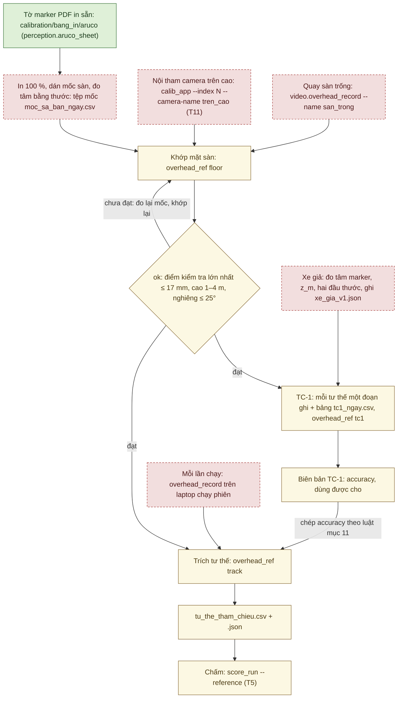

# Tham chiếu trên cao R1 và kiểm TC-1: công cụ T4 và cách làm

Tài liệu này hướng dẫn dựng tham chiếu trên cao R1 bằng công cụ T4, và kiểm độ chính xác của nó bằng TC-1. R1 là phương
pháp đo độc lập chính của [KICH_BAN_NGHIEM_THU.md](KICH_BAN_NGHIEM_THU.md) mục 3: một camera nhìn xuống sa bàn, đọc hai
marker ArUco trên xe, rồi cho quỹ đạo, tư thế cuối, khoảng hở và tốc độ của xe. TC-1 so R1 với số đo thước trên một xe
giả để biết R1 chính xác tới đâu. Tài liệu dành cho người chuẩn bị và chạy nghiệm thu; T1–T15 là các công cụ nghiệm
thu ở kịch bản mục 7.

## Hiện trạng (02/10/2026)

- **Phần mềm đã có** (đợt 2, 02/10/2026). Các mặc định theo thiết kế T4 là đề xuất, chưa chốt; ngày 02/10/2026 người
  dùng đồng ý dùng chúng (bảng ở mục 14).
- **Mới kiểm trên máy tính với ảnh tổng hợp**, dựng từ một camera ảo Kannala–Brandt đã biết (mục 13, 16).
- **Chưa thử với camera thật.** Chưa chọn camera trên cao ([KICH_BAN_NGHIEM_THU.md](KICH_BAN_NGHIEM_THU.md) mục 8),
  chưa in marker, chưa đo mốc, chưa dựng xe giả, chưa làm TC-1.
- **Chưa đo** độ trễ từ lúc chụp tới stamp của khung (mục 10).

Công cụ ghi đúng định dạng tệp tư thế tham chiếu của `evaluation/reference_pose.py` (kịch bản mục 3.8), nên công cụ
chấm T5 (`score_run --reference`) đọc thẳng được. Độ chính xác của R1 chỉ lấy từ biên bản TC-1 (mục 8, 11). Chưa có
TC-1 thì T5 ghi "không kiểm được", theo quy tắc 3 ở [NGUONG_NGHIEM_THU_DE_XUAT.md](NGUONG_NGHIEM_THU_DE_XUAT.md) mục 0.

**Cách chạy lệnh.** Mọi lệnh viết trên một dòng, chạy trong thư mục `autopark` (thư mục có `pyproject.toml`) với môi
trường `.venv`. Chỉ `video.overhead_record` và nút "Mở camera" của `ui.overhead_app` mở camera; đó là việc chạm thiết
bị, do người thao tác chạy. Các lệnh khác không mở camera hay cổng COM.

Sơ đồ dưới là chuỗi việc từ tờ marker in tới lúc chấm một lần chạy. Mỗi ô là một bước làm; mũi tên chỉ thứ tự, không
có nghĩa bước đó đã làm với camera thật.



Màu: xanh là đã có và đã kiểm trên máy tính (với tờ PDF: đọc lại hình học trong PDF, dò marker trên ảnh dựng từ PDF);
vàng là phần mềm đã có, mới kiểm trên ảnh tổng hợp; đỏ viền đứt là việc cần camera thật, người đo hay xe giả, chưa làm.

## 1. Mã và tệp

| Thành phần | Vai trò |
|---|---|
| `perception/aruco_sheet.py` | In tờ marker ArUco: PDF vector đúng cỡ, JSON mô tả, PNG tùy chọn |
| `evaluation/overhead_ref.py` | Phần lõi: tệp mốc, cấu hình marker xe, nội tham, khớp mặt sàn, tư thế từng khung, phát hiện camera dịch, đọc video và đồng hồ, ghi tệp tham chiếu. Các lệnh `survey-template`, `floor`, `track`, `tc1`, `check`, `synthetic` |
| `evaluation/overhead_tc1.py` | TC-1: so R1 với R2 (hai đầu thước), kiểm yêu cầu, tính "dùng được cho", luật chép độ chính xác |
| `evaluation/sync_video.py` | Phía video của dấu đồng bộ T14: tìm các lần nháy trong video, ghép với dòng `SYNC_MARK` |
| `video/overhead_record.py` | Ghi video camera trên cao, stamp `perf_counter` từng khung. Là mã T4 duy nhất mở camera, cùng với nút "Mở camera" của giao diện |
| `ui/overhead_app.py` | Giao diện bốn thẻ (mục 12) |
| `evaluation/overhead_synth.py` | Cảnh tổng hợp cho test và bộ thử (mục 13) |
| `evaluation/reference_pose.py`, `evaluation/score_run.py` | Định dạng tệp tham chiếu và công cụ chấm T5 (có từ commit `d3e1555`). Ba chỗ sửa ở T5 cho T4 ngày 02/10/2026: mục 9 bước 3 và mục 10 |
| `configs/tham_chieu/xe_gia_v0.json` | Mẫu cấu hình marker của xe giả, số giả định (`measured: false`) |
| `calibration/bang_in/aruco/` | Tờ in sẵn (PDF + JSON): mốc sàn mã 0–47 cạnh 100 mm, marker xe mã 48–49 cạnh 80 mm |

## 2. In marker và đo tâm

Hai tờ marker đã có sẵn ở `calibration\bang_in\aruco\` (tạo 02/10/2026); `tests/test_aruco_sheet.py` kiểm chúng trùng
với bộ tạo. Chỉ cần chạy lại lệnh dưới khi đổi cỡ hay từ điển. Không có `--out` thì lệnh ghi vào `runs\bang_in_aruco`.

```
.venv\Scripts\python.exe -X utf8 -m autopark.perception.aruco_sheet --ids 0-47 --size-mm 100 --out calibration\bang_in\aruco
.venv\Scripts\python.exe -X utf8 -m autopark.perception.aruco_sheet --ids 48,49 --size-mm 80 --out calibration\bang_in\aruco
```

- **Mốc sàn:** `aruco_DICT_4X4_50_100mm_A4_id0-47.pdf`. Ô in của marker 100 mm rộng 166 × 173 mm, gồm vùng trắng 25 mm
  mỗi bên, vạch 8 mm và dải chữ. Vì vậy một trang A4 chỉ chứa một mốc: 48 trang cho mã 0–47. Dán cả trang xuống sàn.
- **Marker xe:** `aruco_DICT_4X4_50_80mm_A4_id48-49.pdf`, hai ô trên một trang A4 ngang. Mã 48 là marker sau, 49 là
  marker trước.
- **Cách in:** in 100 % (không co giãn), dán phẳng, đo lại cạnh marker bằng thước kẹp.
- **Đo tâm:** mỗi ô in có vùng trắng rộng 1,5 ô module quanh marker, và bốn vạch giữa cạnh (8 × 0,3 mm) nằm ngoài vùng
  trắng. Dòng chữ dưới ô ghi mã, cỡ, từ điển; chữ không dấu vì phông chuẩn của PDF không có chữ tiếng Việt. Tâm marker
  là giao của hai đường nối các vạch đối diện. Đo tọa độ tâm bằng thước từ hai cạnh sa bàn đã kiểm vuông (kịch bản mục
  3.3 bước 2).
- **Cần hơn 48 mốc sàn:** dùng `--dictionary DICT_4X4_100`. Mã 0–49 của từ điển này giống hệt `DICT_4X4_50` (kiểm bằng
  OpenCV ngày 02/10/2026), nên tờ đã in vẫn dùng được; mốc sàn dùng mã 0–47 và từ 50 trở đi. Tệp mốc, lệnh `floor` và
  cấu hình marker xe phải cùng ghi từ điển đó; `track` từ chối khi cấu hình marker khác từ điển của khớp mặt sàn.
- **Tùy chọn khác:** `--png` ghi thêm mỗi trang một PNG 300 dpi (có DPI trong tệp) để xem; không commit PNG. Ngoài ra
  có `--paper A3`, `--orientation auto|portrait|landscape` (mặc định `auto`: hướng giấy chứa nhiều ô nhất) và `--dpi`.
  Marker không vừa khổ giấy, mã ngoài từ điển hay từ điển lạ thì lệnh thoát mã 2, không ghi gì.

## 3. Tệp mốc sa bàn

Tệp mốc ghi tọa độ đo bằng thước của từng mốc trên sàn. Tệp đặt thẳng trong `docs\evidence\`
(`docs\evidence\moc_sa_ban_<yyyymmdd>.csv`), vì `.gitignore` bỏ mọi CSV trừ CSV nằm thẳng ở thư mục đó. Tạo mẫu:

```
.venv\Scripts\python.exe -X utf8 -m autopark.evaluation.overhead_ref survey-template --size 3.0x2.0 --step 0.5 --check 8 --out docs\evidence\moc_sa_ban_<ngay>.csv
```

Không có `--out` thì mẫu ghi vào `runs\tren_cao\moc_sa_ban_<yyyymmdd>.csv`. Tệp đã có thì cần `--overwrite`; bản cũ
được sao lưu cạnh nó.

Mẫu mặc định có 35 mốc kiểm soát tên dạng `K_x050_y100` (vị trí danh định theo cm) và 8 điểm kiểm tra `T01…T08` ở tâm
các ô lưới trải đều. Mã ArUco gán theo hàng: mốc kiểm soát 0–34, điểm kiểm tra 35–42, bỏ qua 48 và 49 của xe. Lệnh in
ra màn hình lệnh `aruco_sheet` cho đúng các mã đó; tờ in sẵn mã 0–47 đủ cho mẫu này.

Các cột: `ten,vai_tro,x_m,y_m,z_m,ma_aruco,nguoi_do,ngay,ghi_chu`. Mẫu thêm `x_danh_dinh_m,y_danh_dinh_m`, không dùng
để khớp. Quy tắc khi đọc:

- UTF-8 (nhận BOM của Excel), dấu phẩy phân cách, dấu **chấm** thập phân. Lỗi được báo dạng "tệp mốc …: dòng N: …".
- `ten` duy nhất (A-Z a-z 0-9 _ -, tối đa 32 ký tự). `vai_tro` là `kiem_soat` (dùng để khớp) hay `kiem_tra` (chỉ để đo
  sai số).
- `x_m`, `y_m` tính bằng **mét**. Trống cả hai nghĩa là chưa đo: dòng được liệt kê nhưng không dùng. `z_m` trống nghĩa
  là 0.
- `ma_aruco` duy nhất, trong từ điển, không phải 48/49. Trống nghĩa là điểm chỉ có dấu băng dính, cần chấm tay ở giao
  diện hay qua tệp `--clicks`.
- Dòng đã đo cần `nguoi_do` và `ngay` (dd/mm/yyyy).

Hệ sa bàn theo kịch bản mục 3.3: gốc ở một góc, x dọc cạnh dài, y nằm bên **trái** khi nhìn theo +x từ trên xuống, z
hướng lên.

## 4. Nội tham camera trên cao

Camera trên cao dùng tệp nội tham Kannala–Brandt do công cụ T11 tạo ([HIEU_CHUAN_CAMERA.md](HIEU_CHUAN_CAMERA.md) mục
3, phần camera không qua hub):

```
.venv\Scripts\python.exe -X utf8 -m autopark.ui.calib_app --index N --camera-name tren_cao --size 1280x720
```

Tệp ra là `calibration\cam_tren_cao_1280x720.json`. Số N tra mỗi lần bằng `python -m autopark.video.camera_bench list`.
Bộ đọc nội tham của `overhead_ref`:

- từ chối tệp của camera cổng hub ("camera trên cao phải là camera riêng"), và từ chối ảnh, video khác cỡ ảnh của nội
  tham;
- chỉ nhận định dạng `autopark.fisheye_intrinsics/1`. Chưa có mô hình lỗ kim cho ống kính thường; bộ đọc phân nhánh
  theo khóa `format` để thêm sau. Xu hướng sai số theo bán kính (mục 6) và TC-1 cho biết mô hình Kannala–Brandt có hợp
  với camera đã chọn không;
- chỉ cảnh báo khi tệp có `acceptance.all_pass` khác true;
- với nội tham của camera ảo (bộ thử), mọi kết quả sau đó mang cờ tổng hợp.

## 5. Ghi video

Ví dụ ghi 20 s sàn trống:

```
.venv\Scripts\python.exe -X utf8 -m autopark.video.overhead_record --index N --size 1280x720 --seconds 20 --out runs\tren_cao\<ngay> --name san_trong
```

Các tùy chọn khác:

- `--camera-name` (mặc định `tren_cao`);
- `--exposure`: phơi sáng thủ công, giá trị kiểu DirectShow như `camera_bench --exposure`;
- `--focus`: nét thủ công, tắt tự lấy nét;
- `--quality` (mặc định 90) và `--codec MJPG|mp4v` (mặc định MJPG);
- `--overwrite`, `--force` (xem dưới).

Không có `--out` thì ghi vào `runs\tren_cao\<yyyymmdd>`. Mỗi lần ghi tạo các tệp `<out>\<tên>.*`:

- `<tên>.avi` (MJPG, chất lượng 90) hay `.mp4` (`mp4v`): mỗi khung tốt là một khung video.
- `<tên>.frames.csv`: cột `frame,t_perf,t_s,width,height`. `t_perf` là `perf_counter` ngay sau `read()` của
  `UsbCameraSource`, gồm cả chờ khung và giải mã; `t_s` là `t_perf` trừ `t_perf` của khung đầu. Số dòng bằng số khung
  trong video.
- `<tên>.events.csv`: cột `t_perf,kind,after_frame,message`, ghi các khung hỏng (`duplicate`, `truncated`, `torn`,
  `read_failed`). Khung hỏng không vào video.
- `<tên>.json` (`autopark.overhead_recording/1`): ghi lúc bắt đầu và lúc kết thúc, qua tệp tạm.

Tệp `<tên>.json` có:

- trạng thái: `đang ghi`, `xong`, `lỗi`, `dừng (Ctrl+C)`; giao diện có thêm `dừng (đóng cửa sổ)`;
- đồng hồ `perf_counter`, tên máy, `wall_minus_perf_s` (giờ máy − `perf_counter` lúc bắt đầu), `t_wall_start`,
  `t_wall_end`;
- camera (index, tên, mode yêu cầu và mode thật, phơi sáng, nét), codec, chất lượng;
- số khung, khung/s thật, khoảng cách khung (trung vị, p95, lớn nhất, ms), số khung hỏng theo loại;
- dung lượng ổ trống lúc đầu và lúc cuối, commit git, `synthetic`, `write_error`;
- EcoQoS: `ecoqos` là trạng thái đọc lại mỗi lần ghi JSON (`off` / `system` / `on` / `unknown`, như mọi tệp kết quả
  khác), `ecoqos_start` là trạng thái lúc bắt đầu ghi, `ecoqos_policy` là chính sách áp lúc tiến trình khởi động
  (`{request, set_ok, after}`);
- `previous_backup`: các tệp của lần ghi cũ cùng tên đã được đổi tên (xem dưới).

**Kiểm trước khi mở camera.** Tham số, tên lần ghi và ổ đĩa được kiểm trước khi mở camera:

- Tên đã có thì từ chối, trừ khi có `--overwrite` (sửa 02/10/2026). Khi đó mọi tệp cũ của tên đó (`.avi`/`.mp4`,
  `.frames.csv`, `.events.csv`, `.json`) được đổi tên thành `<tên>.bak_<ngày_giờ>.*` ngay trước khi ghi. Không mất video
  gốc nào, và bộ sao lưu vẫn đọc lại được bằng `overhead_ref`.
- Ổ đĩa: cảnh báo khi dưới 20 GB, từ chối khi dưới 5 GB trừ khi có `--force`. `--force` chỉ còn nghĩa này, không cho
  ghi đè tên.

**Khi camera thôi trả khung tốt** (rút cáp USB…), bộ ghi vẫn dừng đúng hạn khi hết `--seconds`. Quá 5 s không có khung
tốt nào thì nó đóng tệp với trạng thái `lỗi`, mã thoát 1. Sau 5 lần đọc hỏng liên tiếp, bộ ghi nghỉ 5 ms giữa các lần
đọc. Các số này là đề xuất, chưa chốt, chưa thử với camera thật. Không có khung nào trong 5 s đầu thì cũng thoát mã 1.

**EcoQoS, Ctrl+C và mã thoát.** Tiến trình tự tắt EcoQoS (chế độ tiết kiệm của Windows 11, có thể hạ tốc tiến trình)
cho chính nó; `AUTOPARK_KEEP_ECOQOS=1` giữ mặc định của Windows ([CHUYEN_MAY_BAN.md](CHUYEN_MAY_BAN.md) mục 10.1).
Ctrl+C đóng tệp đúng cách, với trạng thái `dừng (Ctrl+C)`. Mã thoát: 0 là xong; 1 là lỗi đĩa, không có khung nào hay
camera thôi trả khung tốt; 2 là tham số sai hay bị từ chối.

**Dung lượng và cách lắp camera.** Video chiếm ≈ 0,4–0,55 GB mỗi phút ở 720p MJPG chất lượng 90 (ước tính, chưa đo).
Camera trên cao cắm vào cổng gốc riêng của laptop, không qua hub của bốn camera xe. Khi có thêm camera này, kiểm lại số
khung bị cắt của bốn camera (kịch bản mục 3.4 bước 4). Khóa phơi sáng và nét nếu camera cho phép. Đề xuất phơi sáng
≤ 10 ms để bớt nhòe khi xe chạy 0,10–0,15 m/s.

## 6. Khớp mặt sàn

Khớp mặt sàn tìm tư thế của camera trên cao so với sa bàn, từ ảnh các mốc đã đo. Quay vài giây sàn trống (không có xe
hay xe giả trong ảnh) bằng lệnh của mục 5 (`--name san_trong`), rồi chạy:

```
.venv\Scripts\python.exe -X utf8 -m autopark.evaluation.overhead_ref floor --intrinsics calibration\cam_tren_cao_1280x720.json --survey docs\evidence\moc_sa_ban_<ngay>.csv --video runs\tren_cao\<ngay>\san_trong.avi --out docs\evidence\nghiem_thu\mat_san_<ngay>.json
```

Tùy chọn:

- `--image <ảnh>`: lặp được, thay hay dùng cùng `--video`;
- `--frames 30`: số khung đầu của video;
- `--clicks <json>`: điểm chấm tay, ví dụ `{"points": [{"ten": "T03", "u": 512.4, "v": 300.1}]}`;
- `--layout <bố trí>`: vẽ biên, ô đỗ, vật cản lên ảnh xem và tính độ phủ;
- `--refine contour|subpix|apriltag|none` (mặc định `contour`);
- `--dictionary`, `--floor-marker-mm 100`, `--overwrite`.

Không có `--out` thì ghi `runs\tren_cao\<yyyymmdd>\mat_san_<giờ>.json`. Khớp mặt sàn chỉ cần ảnh, nên `--video` nhận
cả video không kèm tệp của bộ ghi.

**Cách làm.** Công cụ dò marker trên các khung và lấy trung vị từng trục. Mốc thấy ở dưới 50 % số khung bị bỏ; mã thấy
hai lần trong một khung bị bỏ ở khung đó; thấy mã 48/49 thì cảnh báo xe đang nằm trong ảnh sàn trống. Sau đó công cụ
giải tư thế camera từ các mốc kiểm soát (PnP rồi tinh chỉnh theo điểm ảnh). Khi còn ≥ 8 mốc, nó loại dần các mốc
lệch > max(10 mm, 3 × trung vị), kèm lời báo "lệch X mm: đo thước sai, dán lệch hay nhận nhầm mã".

**Công cụ báo:**

- sai số dư của mốc kiểm soát (RMS, lớn nhất; mm và px), và sai số trên **điểm kiểm tra** (không dùng để khớp; RMS,
  trung vị, lớn nhất). Chỉ số trên điểm kiểm tra mới là độ chính xác của phần mặt sàn;
- mốc không dùng được và lý do: "ngoài khung hình", "quá nhỏ: ≈ 3,4 px mỗi ô, cần ≥ 4,5", "không dò được", "chỉ thấy
  ở k/n khung", "chưa đo", "chưa chấm tay";
- chẩn đoán: so với một homography trên lưới 0,1 m (mặt sàn không phẳng hay mô hình lệch); xu hướng sai số theo bán
  kính ảnh (đánh dấu khi |độ dốc × bán kính| > 0,5 px, nghi mô hình ống kính); mốc ở góc nhìn lớn hơn góc lớn nhất đã
  thấy lúc hiệu chuẩn (ngoại suy); độ phân giải trên sàn (mm/px); độ phủ của `--layout`;
- "Dùng được cho (chỉ phần mặt sàn)": N-D1 (cần ≤ 1,67 cm), N-L1 (≤ 1 cm), N-D5 (≤ 0,67 cm) theo quy tắc 3. Mục này
  chỉ để báo; TC-1 mới quyết định.

**Điều kiện đạt (`ok`):** ≥ 8 mốc kiểm soát còn dùng, ≥ 8 điểm kiểm tra thấy được, sai số lớn nhất trên điểm kiểm tra
≤ 17 mm, camera cao 1–4 m, nghiêng ≤ 25°. Không đạt thì vẫn ghi tệp (mã thoát 1), nhưng `tc1` từ chối tệp đó; `track`
cũng từ chối, trừ khi có `--cho-mat-san-chua-dat` (khi đó độ chính xác là null).

**Từ chối hẳn** (mã thoát 2, không ghi gì) khi:

- có dưới 8 mốc kiểm soát đã đo và thấy được;
- nghiệm khớp đặt camera **dưới** sàn, do tệp mốc đo theo hệ lật gương (y phải nằm bên trái x) hay mã ArUco đổi chỗ;
- độ cao vô lý (ngoài 0,3–10 m) hoặc tọa độ mốc quá 50 (tọa độ tính bằng cm, mã đổi chỗ).

**Tệp ra:** `<tên>.json` (`autopark.overhead_floor/1`, có SHA-256 của nội tham, tệp mốc, ảnh) và ảnh xem
`<tên>_xem.jpg`. Trên ảnh xem: xanh lá là mốc kiểm soát, xanh lam là điểm kiểm tra, đỏ là bị loại, xám là không thấy
(vẽ ở vị trí dự đoán); mũi tên sai số phóng ×100; lưới 0,5 m chiếu qua mô hình.

Camera bị chạm hay dời thì khớp lại, rồi làm lại TC-1, vì TC-1 gắn với SHA-256 của tệp khớp (mục 11).

## 7. Marker trên xe và xe giả

Cấu hình marker trên xe nằm ở `configs\tham_chieu\<xe>_v<k>.json` (`autopark.overhead_vehicle_markers/1`) và gồm:

- **đúng hai** marker (`role` là `sau`, `truoc`; tệp tham chiếu chỉ nhận 0..2 marker), khác mã, cùng từ điển
  (`dictionary`);
- tâm `x_m`, `y_m` trong hệ xe: x hướng trước, y hướng trái, gốc là tâm trục sau trên sàn (`point` = `tam_truc_sau`);
  độ cao mặt marker `z_m` (0–0,5 m); cạnh `side_m` (0,03–0,30 m, đơn vị mét); `yaw_deg`;
- `r2_points_m`: vị trí hai đầu thước của xe giả trong hệ xe, bắt buộc cho TC-1;
- `measured` true/false; `measured_by`, `date`, `notes`.

`xe_gia_v0.json` là mẫu với số giả định: marker ở x 0 và 0,30 m, z 0,10 m, cạnh 80 mm; thước từ (−0,15; 0,05) tới
(0,55; 0,05). Dựng xe giả theo kịch bản mục 3.2: tấm đế phẳng, thước thẳng cứng ≥ 0,65 m gắn chặt song song trục xe.
Đo thật rồi ghi bản `_v1` với `measured: true`. Khi dựng, lưu ý:

- Hai marker phải cách nhau ≥ 0,15 m; dưới 0,25 m thì có cảnh báo, vì sai số hướng ≈ √2·σ/d.
- `z_m` sai 5 mm làm vị trí lệch ≈ 0,4 cm ở r = 1,5 m, H = 2,0 m (kịch bản mục 3.6 bước 3), nên cần đo kỹ.
- Mã marker xe trùng mã một mốc sàn của tệp mốc thì `track` từ chối.

**Xử lý mỗi khung.** Hai marker được chiếu lên mặt z = `z_m` để bù thị sai. Marker có cạnh lệch cấu hình quá 10 % bị
bỏ. Khung không hợp lệ khi khoảng cách hai tâm lệch cấu hình quá 5 mm, kèm lời báo "kiểm z_m và vị trí marker". Hướng
xe lấy từ đường nối hai tâm, vị trí là trung bình của hai marker. Hướng cạnh marker lệch hướng hai tâm quá 5° chỉ được
đánh dấu trong tệp chi tiết. Mặc định cần ≥ 2 marker (kịch bản mục 3.6 bước 4), nên khung chỉ thấy một marker là không
hợp lệ. Với `--min-markers 1`, khung đó được ghi với `n_markers` 1 kèm ghi chú; hướng khi đó lấy từ cạnh marker, kém
chính xác hơn.

## 8. TC-1: kiểm độ chính xác của R1

TC-1 đặt xe giả ở nhiều tư thế, đo hai đầu thước bằng thước thép (R2) và so với tư thế R1 đọc từ video. Kết quả là biên
bản độ chính xác mà `track` chép vào tệp tham chiếu (mục 11).

**Bảng tư thế** `docs\evidence\tc1_<yyyymmdd>.csv` có các cột
`tu_the,video,t_tu_s,t_den_s,x_sau_m,y_sau_m,x_truoc_m,y_truoc_m,x_tam_m,y_tam_m,nguoi_do,ngay,ghi_chu`:

- mỗi tư thế một đoạn ghi 5–10 s bằng `overhead_record` (ví dụ `--name tc1_01`). `video` là đường dẫn tương đối so với
  tệp bảng: bảng ở `docs\evidence\`, video ở `runs\tren_cao\<ngay>\` thì ghi `../../runs/tren_cao/<ngay>/tc1_01.avi`;
- cửa sổ [`t_tu_s`, `t_den_s`] tính bằng giây từ khung đầu của đoạn. Để trống thì dùng cả đoạn, bỏ 0,5 s mỗi đầu;
- `x/y_sau_m`, `x/y_truoc_m` là hai đầu thước, đo bằng thước thép trong hệ sa bàn. `x_tam_m`, `y_tam_m` tùy chọn, để
  kiểm chéo. `nguoi_do`, `ngay` (dd/mm/yyyy) bắt buộc.

Lệnh tính TC-1:

```
.venv\Scripts\python.exe -X utf8 -m autopark.evaluation.overhead_ref tc1 --floor docs\evidence\nghiem_thu\mat_san_<ngay>.json --markers configs\tham_chieu\xe_gia_v1.json --poses docs\evidence\tc1_<ngay>.csv --kind full --out docs\evidence\nghiem_thu\tham_chieu_tren_cao_<ngay>.json
```

Tùy chọn:

- `--kind day`: TC-1 rút gọn đầu ngày;
- `--compare contour,subpix`: so các cách tinh chỉnh góc trên cùng các khung;
- `--min-frames 30`;
- `--thresholds` (mặc định `configs\nguong_nghiem_thu.json`);
- `--vehicle` (mặc định `configs\vehicle_default.json`): cho tầm tới góc thân xe của N-D5; kích thước giống
  `vehicle_nghiem_thu.json`;
- `--overwrite`.

Không có `--out` thì ghi `runs\tren_cao\<yyyymmdd>\tc1_<giờ>.json`.

**Từ chối** (mã thoát 2, không ghi biên bản), như nhau ở dòng lệnh và thẻ TC-1 của giao diện (sửa 02/10/2026), khi:

- kết quả khớp mặt sàn chưa đạt (`ok: false`);
- cấu hình marker thật chưa đo (`measured: false`, ví dụ `configs/tham_chieu/xe_gia_v0.json`);
- cấu hình thiếu `r2_points_m`;
- đoạn ghi tư thế có `.json` của bộ ghi mà cờ `synthetic` khác khớp mặt sàn, vì không trộn dữ liệu tổng hợp với dữ liệu
  thật;
- video khác cỡ ảnh của khớp mặt sàn;
- đoạn ghi của `overhead_record` bị chép thiếu `.json` hay `.frames.csv`.

Đoạn ghi AVI không kèm tệp của bộ ghi thì vẫn được nhận cho TC-1 tĩnh, vì thời gian chỉ dùng để cắt cửa sổ; biên bản
có ghi chú đồng hồ danh định.

**Tính cho mỗi tư thế.** R1 là trung vị các khung hợp lệ trong cửa sổ (cần ≥ 30 khung), kèm độ tản p95 và lớn nhất; R2
lấy từ hai đầu thước. Nếu khoảng cách hai đầu thước lệch chiều dài thước quá 15 mm (2 × 5 + 5 mm) thì ghi "kiểm lại số
đo thước". Tư thế có đoạn ghi quá ngắn hay thiếu khung hợp lệ bị loại, có ghi lý do.

**Biên bản** (`autopark.overhead_tc1/1`) có:

- sai số từng tư thế, trung vị và lớn nhất (vị trí, hướng), độ tản;
- kiểm yêu cầu. TC-1 đầy đủ cần ≥ 10 tư thế, ≥ 3 hướng cách nhau ≥ 20°, và có tư thế cách mỗi góc của hình bao các mốc
  kiểm soát ≤ 0,5 m; TC-1 rút gọn cần ≥ 3 tư thế. Thiếu thì mã thoát 1, vẫn ghi biên bản và liệt kê phần thiếu;
- `accuracy` với đúng các khóa của tệp tham chiếu (`pos_max_m`, `yaw_max_deg`, `pos_median_m`, `yaw_median_deg`,
  `source`). Đây là **cận trên**, vì sai số R2 ± 3–5 mm mỗi điểm được cộng vào;
- "dùng được cho" theo quy tắc 3, với ngưỡng của `configs\nguong_nghiem_thu.json` cho N-D1, N-D2, N-P2, N-P3, N-P5c,
  N-P6 … N-P8. N-D5 tính cả tầm tới góc thân xe như T5; N-D3 chỉ báo số. N-L1, N-L2, N-L3, N-L5 lấy từ bảng của
  [NGUONG_NGHIEM_THU_DE_XUAT.md](NGUONG_NGHIEM_THU_DE_XUAT.md), vì tệp ngưỡng chỉ nhận mã của T5;
- ngày: `t_wall_start` của các đoạn ghi nếu chúng cùng ngày; không thì ngày muộn nhất của cột `ngay`, kèm ghi chú.

TC-1 tĩnh không đo nhòe chuyển động, màn trập cuộn hay độ trễ ghi. Làm lại TC-1 khi camera dịch (sau khi khớp lại mặt
sàn) và khi đổi độ cao marker. Đầu mỗi ngày nghiệm thu làm TC-1 rút gọn với 3 tư thế (kịch bản mục 3.7 bước 5).

## 9. Mỗi lần chạy: ghi, trích tư thế, chấm

Mỗi lần chạy nghiệm thu đi qua ba bước:

1. Ghi video trên chính laptop chạy phiên, để dùng chung đồng hồ `perf_counter`:
   ```
   .venv\Scripts\python.exe -X utf8 -m autopark.video.overhead_record --index N --size 1280x720 --seconds <s> --out runs\tren_cao\<ngay> --name do1_l<lan>
   ```
2. Trích tư thế:
   ```
   .venv\Scripts\python.exe -X utf8 -m autopark.evaluation.overhead_ref track --video runs\tren_cao\<ngay>\do1_l<lan>.avi --floor docs\evidence\nghiem_thu\mat_san_<ngay>.json --markers configs\tham_chieu\<xe>_v1.json --tc1 docs\evidence\nghiem_thu\tham_chieu_tren_cao_<ngay>.json --out runs\nghiem_thu\<ngay>\do1_l<lan>\tu_the_tham_chieu.csv
   ```
   Tùy chọn: `--tc1-day <TC-1 rút gọn>`, `--tc1-chua-du`, `--window A,B` (giây từ khung đầu của video),
   `--min-markers 1`, `--flash-roi x,y,w,h --sync-marks <tệp T14>` (thêm `--first-mark n` khi chỉ có một lần nháy),
   `--sync 18.0=mark:1` (lặp được, như `score_run`), `--sync-error`, `--capture-latency-s`, `--frames-csv`,
   `--allow-nominal-fps`, `--cho-cau-hinh-chua-do`, `--cho-mat-san-chua-dat`, `--overwrite`. `--sync-error` và
   `--capture-latency-s` phải là số giây hữu hạn ≥ 0; chúng được kiểm trước khi mở video, sai thì thoát mã 2, không
   ghi gì (sửa 02/10/2026).
3. Chấm bằng lệnh T5 của kịch bản mục 2.4, ví dụ DO-1 ở mức XT:
   ```
   .venv\Scripts\python.exe -X utf8 -m autopark.evaluation.score_run --scenario DO-1 --attempt <lan> --level XT/M3 --log runs\nghiem_thu\<ngay>\do1_l<lan>\lan_chay_vehicle_io --reference runs\nghiem_thu\<ngay>\do1_l<lan>\tu_the_tham_chieu.csv --layout docs\evidence\nghiem_thu\bo_tri_do1.json --touch khong --intervention khong --methods R5 --report docs\evidence\bien_ban_nghiem_thu_<ngay>.csv
   ```
   T5 từ chối tệp tham chiếu tổng hợp ở mức BT/XT, với lời báo "tham chiếu TỔNG HỢP chỉ dùng ở mức MP" (sửa cho T4
   ngày 02/10/2026). Lệnh này chưa dùng với lần chạy thật.

**`track` từ chối** (mã thoát 2, không ghi gì) khi một trong các điều dưới xảy ra. Mọi đầu vào được kiểm trước khi xử
lý video.

- khớp mặt sàn chưa đạt (trừ khi có `--cho-mat-san-chua-dat`);
- cấu hình marker thật chưa đo (trừ khi có `--cho-cau-hinh-chua-do`);
- cấu hình marker khác từ điển của khớp mặt sàn, hay mã marker xe trùng mã một mốc sàn;
- video khác cỡ ảnh của khớp mặt sàn;
- trộn dữ liệu tổng hợp với dữ liệu thật (cờ `synthetic` của khớp mặt sàn, cấu hình marker và JSON của bộ ghi);
- video của bộ ghi bị chép thiếu tệp, hay AVI chỉ có số khung/s danh định mà không có `--allow-nominal-fps` (mục 10);
- `--flash-roi` ra ngoài ảnh, `--sync-marks` không kèm `--flash-roi`, hay `--window` có A ≥ B;
- tệp ra đã có mà không có `--overwrite`.

**Tệp ra của `track`:**

- `tu_the_tham_chieu.csv` + `.json`: một dòng cho **mỗi** khung giải mã trong cửa sổ. Khung không hợp lệ vẫn giữ số
  khung và thời điểm, nên `--event frame:<n>` của T5 dùng được;
- `tu_the_tham_chieu.chi_tiet.csv`: lý do, tâm từng marker, lệch khoảng cách hai marker, lệch cạnh, độ lệch camera, số
  mốc sàn thấy, phần ô nháy sáng.

Tệp tham chiếu được kiểm theo luật của bộ đọc và ghi qua tên tạm, trước khi chạm tới tệp chi tiết (sửa 02/10/2026). Nhờ
vậy lỗi không để lại tệp chi tiết mới cạnh tệp tham chiếu cũ. Tệp ra đã có thì cần `--overwrite`; bản cũ được sao lưu.
Mã thoát 1 khi camera dịch, khi dưới 80 % khung hợp lệ, hay khi không khung nào hợp lệ (khi đó chỉ ghi tệp chi tiết).

**Phát hiện camera dịch.** Công cụ so tâm các mốc sàn thấy được (cần ≥ 4) với lúc khớp. Nếu trung vị độ lệch > 0,7 px
trong 15 khung đo liên tiếp, thì từ khung đầu của chuỗi đó mọi dòng là không hợp lệ, kèm lời báo "khớp lại mặt sàn".
Khung thấy dưới 4 mốc không cắt chuỗi.

## 10. Đồng hồ và sai số đồng bộ

Để so tư thế R1 với log của phiên, thời điểm của từng khung video phải đổi được sang thời gian phiên. Cách đổi và sai
số phụ thuộc loại video.

**Video của `overhead_record`** (có `.frames.csv` + `.json` cạnh video). Đồng hồ là `perf_counter`; T5 đổi sang thời
gian phiên qua khóa `clock` của `link.json` (T13), không cần cặp đồng bộ. Stamp trễ hơn lúc chụp một khoảng chưa đo,
nên `sync_error_s` = `--capture-latency-s` (mặc định 0,15 s, đề xuất). Từ 02/10/2026 T5 dùng số này, và `--time-error`
của T5 thay được nó; trước đó T5 coi sai số này là 0. Vì 0,15 s lớn hơn 0,4 s / 3, N-P1 theo mốc đọc trên video R1 sẽ
"không kiểm được" tới khi có dấu nháy T14 trong khung hình.

**Ô nháy T14 trong khung hình.** `--flash-roi` đặt quanh phần **trong** của ô nháy và phải nằm trong ảnh;
`--sync-marks` cần `--flash-roi`.

- Khởi đầu nháy là khung đầu có ≥ 50 % vùng sáng hơn nền ≥ 60 mức xám. Một lần nháy dài 0,2–1,0 s; hai khởi đầu cách
  nhau ≥ 0,8 s.
- Ghép với dòng `SYNC_MARK`: với đồng hồ `perf_counter`, dấu nằm trong 0,5 s trước khung. Với đồng hồ `video`, công cụ
  tìm một độ lệch hằng trùng ± 0,1 s, cần ≥ 2 lần nháy hay `--first-mark n`.
- Kết quả là các cặp `mark`, và `sync_error_s` = ± một khung (p95 khoảng cách khung). Có cả `--sync` lẫn dấu nháy thì
  dùng `--sync`, kèm cảnh báo.
- Độ trễ hiển thị L chưa đo và nằm trong phép đổi. Với đồng hồ `perf_counter`, `source.flash_offsets` (khung đầu sáng −
  dấu) là cận trên của độ trễ chụp cộng độ trễ hiển thị.

**Video khác** (điện thoại, máy khác). Đồng hồ là `video` (stamp của tệp), cần `--sync` hay dấu nháy.

- Tệp chỉ có số khung/s danh định bị từ chối, trừ khi có `--allow-nominal-fps`; khi đó có thêm ghi chú "đồng hồ video
  theo số khung/s danh định". Từ 02/10/2026 loại này gồm mọi tệp AVI không kèm tệp của bộ ghi, vì container AVI không
  có thời điểm từng khung (vị trí khung = chỉ số / số khung/s). Loại này cũng gồm tệp khác mà vị trí khung thôi tăng
  ngặt.
- Video của `overhead_record` bị chép thiếu `.json` hay `.frames.csv` thì bị từ chối, kể cả khi chỉ ra `--frames-csv`.
  Hãy chép đủ bốn tệp của lần ghi.
- Video không có `.json` của bộ ghi mang ghi chú "không kiểm được video có phải TỔNG HỢP hay không".
- Giao diện có ô "Nhận video chỉ có số khung/s danh định", tương đương `--allow-nominal-fps`.

**T5 với đồng hồ video danh định** (sửa 02/10/2026). `score_run` đòi ≥ 2 cặp đồng bộ (`--sync` hay dấu nháy T14) để
kiểm hệ số đồng hồ (lệch ≤ 1 %). Chỉ có một cặp thì báo lỗi: một cặp chỉ cho độ lệch, nên sai số tốc độ của số khung/s
danh định sẽ lặng lẽ đi vào thời gian phiên (`tests/test_nominal_clock_and_reader_stop.py`). Đồng hồ video có thời điểm
từng khung thật vẫn nhận một cặp (hệ số 1); có ≥ 2 cặp thì kiểm hệ số như trên.

## 11. Luật chép độ chính xác

`track` chỉ chép `accuracy` của TC-1 vào tệp tham chiếu khi biên bản thỏa mọi điều kiện sau:

- cùng SHA-256 tệp khớp mặt sàn;
- cùng bộ dò (từ điển, cách tinh chỉnh góc) và cùng cờ tổng hợp;
- đủ yêu cầu, hoặc có `--tc1-chua-du` (kèm ghi chú);
- cùng cấu hình marker. Khác cấu hình thì cần `--tc1-day` với cùng cấu hình, và `z_m` lệch biên bản đầy đủ ≤ 5 mm;
- có một biên bản cùng ngày với video (kịch bản mục 3.7 bước 5). Ngày của video là `t_wall_start` của bộ ghi; không có
  thì lấy ngày sửa tệp, kèm ghi chú.

`--tc1` phải là biên bản đầy đủ (`kind` `full`). Kết quả là giá trị lớn nhất của từng trường trên các biên bản được
nhận. Thiếu điều kiện nào thì `accuracy` là null, kèm lý do ở `notes` và trên màn hình; khi đó T5 ghi "không kiểm được".
Cấu hình marker chưa đo (`--cho-cau-hinh-chua-do`) hay khớp mặt sàn chưa đạt (`--cho-mat-san-chua-dat`) luôn cho null.

## 12. Giao diện và kiểm tệp

Giao diện `ui.overhead_app` gom các bước trên vào bốn thẻ:

```
.venv\Scripts\python.exe -X utf8 -m autopark.ui.overhead_app --index N --camera-name tren_cao --size 1280x720 --intrinsics calibration\cam_tren_cao_1280x720.json --survey docs\evidence\moc_sa_ban_<ngay>.csv
```

Mọi tham số đều tùy chọn; `--index`, `--camera-name`, `--size`, `--intrinsics`, `--survey`, `--floor`, `--markers`,
`--video` nạp sẵn đầu vào. Bốn thẻ:

1. **Mặt sàn**: nạp nội tham, tệp mốc, ảnh hay video sàn trống (hoặc "Chụp từ camera (15 khung)" khi camera đang mở);
   chọn từ điển và cách tinh chỉnh góc. "Dò mốc" hiện bảng tên, vai trò, mã, nguồn, u, v, sai số. Chấm tay điểm không có
   mã: chuột trái đặt, chuột phải xóa, Esc thôi. Sau đó bấm "Khớp mặt sàn" và "Lưu kết quả khớp…" (JSON + ảnh xem). Đổi
   đầu vào nào thì kết quả khớp cũ mất hiệu lực.
2. **Trích tư thế**: chọn video, kết quả khớp, marker trên xe, biên bản TC-1 (đầy đủ, rút gọn trong ngày), số marker
   tối thiểu, cửa sổ, sai số đồng bộ, cặp đồng bộ, vùng ô nháy T14 ("Chọn trên ảnh" rồi kéo chuột) và tệp dấu đồng bộ.
   "Bắt đầu trích"/"Dừng" chạy nền, có tiến độ, xem trước, đồ thị x, y, hướng theo thời gian và dòng độ chính xác sẽ
   ghi. "Lưu tệp tư thế…" mặc định lưu vào `runs\nghiem_thu\<yyyymmdd>\<tên video>\tu_the_tham_chieu.csv`. Bốn ô đánh
   dấu tương đương các cờ dòng lệnh: dùng kết quả khớp chưa đạt, dùng cấu hình marker chưa đo, nhận TC-1 thiếu yêu cầu,
   nhận video chỉ có số khung/s danh định.
3. **TC-1**: bảng tư thế sửa được (tư thế, video, cửa sổ, hai đầu thước, tâm kiểm chéo, người đo, ngày) và cột kết quả;
   nạp/lưu bảng; chọn loại đầy đủ hay rút gọn; so các cách tinh chỉnh góc; số khung hợp lệ tối thiểu. "Tính TC-1" chạy
   nền và từ chối như lệnh `tc1` (mục 8). "Lưu biên bản TC-1…" từ chối bộ thử tổng hợp dưới `docs\evidence\`.
4. **Ghi video**: chỉ có khi chạy với `--index`. Camera chỉ mở khi bấm "Mở camera", không bao giờ mở lúc khởi động. Xem
   trực tiếp kèm độ lệch camera so với lúc khớp; "Bắt đầu ghi"/"Dừng ghi" ghi như `overhead_record`. Giao diện không
   ghi đè: tên lần ghi đã có hay ổ dưới 5 GB thì từ chối.

Trích, TC-1 và đọc camera chạy trong luồng riêng. Đóng cửa sổ thì các luồng dừng (chờ tối đa 3 s), và lần ghi đang chạy
đóng với trạng thái `dừng (đóng cửa sổ)`. Lưu đè trong giao diện cũng sao lưu bản cũ. Tiến trình giao diện tự tắt
EcoQoS và hiện trạng thái EcoQoS ở thanh trạng thái. Giao diện mới kiểm offscreen với bộ thử tổng hợp và camera giả.

**Kiểm tệp.** Lệnh `check` kiểm một tệp bất kỳ của T4: khớp mặt sàn, biên bản TC-1, cấu hình marker, JSON của bản ghi,
tệp tham chiếu, tệp mốc, bảng tư thế TC-1.

```
.venv\Scripts\python.exe -X utf8 -m autopark.evaluation.overhead_ref check <tệp>
```

Mã thoát chung của `overhead_ref`:

- 0: xong;
- 1: xong nhưng chất lượng chưa đạt;
- 2: tham số sai hay bị từ chối, không ghi gì. Ctrl+C cũng thoát mã 2, không ghi tệp kết quả;
- 3: lỗi bất ngờ, in traceback. Tệp ghi qua tên tạm nên không có tệp dở.

## 13. Bộ thử tổng hợp

Bộ thử tổng hợp cho phép chạy cả chuỗi lệnh mà không cần camera:

```
.venv\Scripts\python.exe -X utf8 -m autopark.evaluation.overhead_ref synthetic --out runs\tren_cao\tong_hop
```

Lệnh ghi một bộ dữ liệu mang nhãn "TỔNG HỢP — KHÔNG PHẢI SỐ ĐO", gồm:

- camera ảo 1280×720 (Kannala–Brandt đã biết, tiêu cự tự chọn để sa bàn vừa ảnh, f ≈ 705 px), treo cao 2,3 m;
- sa bàn 3 × 2 m với 43 marker sàn 100 mm (35 mốc kiểm soát + 8 điểm kiểm tra);
- xe giả hai marker 80 mm ở độ cao 0,10 m;
- một lần chạy 300 khung ghi qua bộ ghi với stamp xen kẽ 31/48 ms (`chay_01.*`), kèm tư thế thật `chay_01.truth.csv`;
- 10 đoạn TC-1 × 60 khung.

`README.txt` của bộ thử có chuỗi lệnh `floor` → `tc1` → `track`. Tùy chọn: `--size`, `--frames`, `--tc1-poses`,
`--tc1-frames`, `--seed`. Chạy lại vào cùng thư mục thì bộ thử được ghi lại; các tệp kết quả cũ của chuỗi lệnh cần
`--overwrite`. Bộ thử không bao giờ ghi được vào `configs\`, `calibration\` hay `docs\evidence\`, và T5 từ chối tệp tham
chiếu tổng hợp ở mức BT/XT.

**Kết quả.** Đây là số tổng hợp: hình học lý tưởng, không nhòe, không màn trập cuộn, không giấy cong. Lượt kiểm chạy
ngày 02/10/2026 trên máy bàn, với mã của đợt 2 (xem mục 16). Đầu ra ở thư mục tạm, không lưu vào repo, nhưng chạy lại
được bằng các lệnh ở đây.

| Phép | Bộ thử mặc định (lệnh `synthetic`: 1280×720, cao 2,3 m, sa bàn 3 × 2 m) | Bộ thử của test (`tests/overhead_set.py`: 960×540, cao 1,8 m, 2,5 × 1,5 m) |
|---|---|---|
| Mốc kiểm soát dùng / bị loại; điểm kiểm tra | 35 / 0; 8 | 24 / 0; 8 |
| Điểm kiểm tra: RMS / lớn nhất | 0,93 / 1,33 mm | 0,91 / 1,85 mm |
| TC-1: vị trí trung vị / lớn nhất; hướng lớn nhất | 0,9 / 1,7 mm; 0,21° (10 tư thế × 60 khung, đủ yêu cầu) | 0,7 / 1,4 mm; 0,18° (10 tư thế × 8 khung, `--min-frames 5`) |
| Lần chạy so với tư thế thật | vị trí ≤ 1,05 mm, hướng ≤ 0,28°; 294/300 khung hợp lệ (6 khung chỉ thấy một marker xe) | vị trí ≤ 0,68 mm, hướng ≤ 0,09°; 40/40 khung |
| Độ chính xác chép từ TC-1 vào tệp tham chiếu | vị trí ≤ 0,17 cm, hướng ≤ 0,21° | vị trí ≤ 0,14 cm, hướng ≤ 0,18° |

Thời gian trên máy bàn ở lượt đó, gồm cả khởi động Python: `synthetic` 29,7 s, `floor` 0,3 s, `tc1` 8,1 s cho 600
khung, `track` 3,8 s cho 300 khung 720p. Đo riêng trên 60 khung của lần chạy tổng hợp, dò ArUco mất 4,4 / 6,0 / 8,2 ms
mỗi khung ở 960×540 / 1280×720 / 1920×1080 (OpenCV 32 luồng). Lượt của người viết mã cùng ngày, chạy ở ưu tiên CPU
thấp: `synthetic` 27,8 s, `tc1` 17,4 s, `track` 8,4 s.

Góc ArUco (tinh chỉnh đường viền) nằm lõm vào trong cạnh thật ≈ 0,5–0,8 px. Vì vậy trên hai bộ thử, cạnh marker xe đo
được ngắn hơn cấu hình 2–8 % (trung vị ≈ 5 %). Phép kiểm cạnh ±10 % chịu được mức này, còn tâm và hướng không bị ảnh
hưởng vì lệch đối xứng. Bản thử trước khi viết công cụ (script tạm, không lưu trong repo, 960×540): tinh chỉnh đường
viền cho sai số điểm kiểm tra RMS/lớn nhất 1,07/1,73 mm, so với 2,39/3,01 mm của tinh chỉnh điểm ảnh con; không bù độ
cao thì xe lệch 61–63 mm.

## 14. Các mặc định (đề xuất, chưa chốt)

Bảng dưới gom các mặc định của T4. Tất cả là đề xuất, chưa chốt; ngày 02/10/2026 người dùng đồng ý dùng chúng. Cột
"Căn cứ" ghi "Đề xuất" ở chỗ mặc định chưa có căn cứ nào khác ngoài đề xuất của thiết kế T4.

| Mục | Mặc định | Căn cứ |
|---|---|---|
| Từ điển, mã | `DICT_4X4_50`; mốc sàn 0–47; xe 48 = sau, 49 = trước | Kịch bản mục 3.2 |
| Cạnh marker | Mốc sàn 100 mm; xe 80 mm | Xe: kịch bản mục 3.2; sàn: bản thử bỏ sót marker ở ≈ 3,5 px mỗi ô module |
| Mốc sàn | Marker ArUco in có vạch đo tâm; điểm chỉ có băng dính thì chấm tay | Thay dấu chữ thập băng dính của kịch bản mục 3.3 |
| Tinh chỉnh góc | Đường viền (`contour`) | Bằng chứng tổng hợp; TC-1 `--compare` quyết định |
| Ống kính | Kannala–Brandt của T11 | Chưa có mô hình lỗ kim |
| Khớp mặt sàn | Mốc kiểm soát mỗi 0,5 m, ≥ 8 điểm kiểm tra; ≥ 8 mốc dùng; loại mốc > max(10 mm, 3 × trung vị) | Kịch bản mục 3.3 + đề xuất |
| `ok` của khớp | Điểm kiểm tra lớn nhất ≤ 17 mm; cao 1–4 m; nghiêng ≤ 25° | 17 mm: kịch bản mục 3.5 bước 4 |
| Mỗi khung | ≥ 2 marker; cạnh ±10 %; khoảng cách hai marker ±5 mm; hướng cạnh 5° (chỉ đánh dấu) | ≥ 2 marker: kịch bản mục 3.6 |
| Camera dịch | > 0,7 px trong 15 khung đo liên tiếp, ≥ 4 mốc thấy | Đề xuất |
| Trích tư thế | ≥ 80 % khung hợp lệ (dưới thì mã thoát 1); độ trễ chụp 0,15 s (chưa đo) | Đề xuất |
| TC-1 | Như mục 8; ≥ 30 khung hợp lệ mỗi tư thế, bỏ 0,5 s mỗi đầu; thước lệch > 2 × 5 + 5 mm thì ghi chú; `z_m` lệch ≤ 5 mm | Kịch bản mục 3.7 + đề xuất |
| Ghi video | MJPG chất lượng 90; trên laptop chạy phiên, cổng gốc riêng | Đề xuất |
| Ổ đĩa và bản cũ | Cảnh báo dưới 20 GB, từ chối dưới 5 GB; ghi đè tên chỉ với `--overwrite` và luôn giữ bản cũ; giữ mọi video gốc tới khi chốt chỗ sao lưu | Đề xuất |
| Camera thôi trả khung tốt | Dừng ghi sau 5 s không có khung tốt; nghỉ 5 ms sau 5 lần đọc hỏng liên tiếp | Đề xuất (sửa 02/10/2026) |
| Dấu nháy T14 | Như mục 10 | Kịch bản mục 2.5 + đề xuất |

## 15. Giới hạn

- Mọi số ở tài liệu này là số tổng hợp. MJPEG thật, nhòe, ánh sáng, giấy cong và ống kính thật chưa thử. Chưa chọn
  camera trên cao, và máy ghi nó cũng chưa chốt (kịch bản mục 8).
- TC-1 tĩnh không đo nhòe chuyển động, màn trập cuộn hay độ trễ ghi. Màn trập cuộn ước tính ≈ 3 mm ở 0,10 m/s với 30 ms
  đọc cảm biến. TC-1 động là việc sau.
- Độ trễ chụp chưa đo: mặc định 0,15 s làm N-P1 theo R1 "không kiểm được" tới khi có dấu nháy T14 trong khung hình. Độ
  trễ hiển thị L của màn hình laptop cũng chưa đo.
- Cỡ ô module trên ảnh nhỏ. Ở bộ thử mặc định, tính bằng mô hình camera của kết quả khớp, mỗi ô module của marker xe
  80 mm chỉ từ ≈ 3,4 px gần góc sa bàn tới ≈ 4,3 px ở giữa. Với mốc sàn 100 mm là ≈ 3,5–4,9 px, và 33/43 mốc dưới mức
  báo "quá nhỏ" 4,5 px của công cụ. Trên ảnh tổng hợp, bộ dò vẫn thấy đủ 43 mốc nhưng mất một marker xe ở 6/300 khung;
  bản thử trước bỏ sót marker ở ≈ 3,5 px. Ảnh thật có thể tệ hơn. Khi đó cân nhắc camera 1920×1080, treo thấp hơn, ống
  kính hẹp hơn hay marker lớn hơn.
- Sai số độ cao marker lan sang vị trí ≈ Δh·r/(H − h). Phép kiểm khoảng cách hai marker chỉ bắt được sai vài cm.
- Phát hiện camera dịch cần ≥ 4 mốc ArUco thấy được; sàn chỉ có dấu băng dính thì không tự kiểm được.
- `perf_counter` chỉ so được trên cùng máy, cùng lần khởi động. T5 không kiểm được điều đó; tệp ghi tên máy và giờ máy −
  `perf_counter` để người đọc kiểm.
- Tải thêm mà việc ghi R1 trên chính laptop chạy phiên đặt lên vòng điều khiển 50 Hz chưa đo. Lượt đo vòng 50 Hz ngày
  02/10/2026 không chạy bộ ghi R1 ([CHUYEN_MAY_BAN.md](CHUYEN_MAY_BAN.md) mục 13). Nếu thấy ảnh hưởng thì ghi ở máy
  khác và đồng bộ bằng dấu T14 (đồng hồ `video`).
- Ổ đĩa: video gốc chiếm ≈ 0,4–0,55 GB mỗi phút (ước tính). `--overwrite` đổi tên bản cũ chứ không xóa, nên ổ đầy dần;
  chỗ sao lưu chưa chốt.
- Đồng hồ video danh định. Ngày 02/10/2026 đã sửa: AVI không kèm tệp của bộ ghi bị từ chối trừ khi có
  `--allow-nominal-fps`; video của bộ ghi bị chép thiếu tệp bị từ chối; test dùng AVI thật, không còn thay nguồn giả; T5
  đòi ≥ 2 cặp đồng bộ cho đồng hồ danh định (mục 10). Còn hai giới hạn: (1) AVI tổng hợp chép một mình không nhận ra
  được là tổng hợp, chỉ có ghi chú; (2) MP4 do OpenCV ghi ở số khung/s cố định (`--codec mp4v`), chép một mình, vẫn
  được nhận làm đồng hồ video, vì không phân biệt được với tệp camera thật.
- Chỉ có mô hình ống kính Kannala–Brandt; mô hình lỗ kim chưa có.
- R1 cho tư thế trong hệ sa bàn. Bản đồ LiDAR của T2 cũng dựng trong hệ sa bàn, qua các mốc neo đo bằng thước
  ([NGUON_TU_THE_LIDAR.md](NGUON_TU_THE_LIDAR.md)), nên sai số mốc neo cộng vào khi so. Công cụ so quỹ đạo định vị LiDAR
  (`localization.csv` của nguồn tư thế) với R1 (DV-3) chưa có (kịch bản mục 5.7).

## 16. Đã kiểm gì

Các test dưới chạy trên máy tính, không mở camera hay cổng nào. Số test và kết quả của lượt chạy đầy đủ ghi ở
[CHUYEN_MAY_BAN.md](CHUYEN_MAY_BAN.md).

- `tests/test_aruco_sheet.py`: cỡ trang, ô module, vạch trong PDF; PDF vẽ bằng QtPdf dò được mọi mã; vạch PNG đánh dấu
  tâm trong 1 px; tờ đã commit trùng bộ tạo; tham số sai thoát mã 2.
- `tests/test_overhead_synth.py`: bộ dựng ảnh độc lập với mô-đun đang kiểm (góc marker đúng chỗ phép chiếu, marker ở độ
  cao); lưu đệm sàn; bộ thử từ chối thư mục của dự án và mang nhãn tổng hợp; stamp 31/48 ms.
- `tests/test_overhead_ref.py`: tệp mốc, mẫu tệp mốc, cấu hình marker, nội tham (từ chối camera hub, khác cỡ), khớp mặt
  sàn; mốc đo sai bị loại đúng tên; hệ lật gương và đơn vị cm bị từ chối; lý do mốc thiếu; chấm tay; bù độ cao; sai
  `z_m` bị bắt; khung một marker; `track` ghi tệp T5 đọc được; camera dịch; đồng hồ danh định và tệp kèm thiếu; không
  ghi đè lặng lẽ; sai số đồng bộ sai bị từ chối trước khi mở video.
- `tests/test_overhead_tc1.py`: TC-1 đầy đủ, yêu cầu thiếu, thước lệch, `--compare`; từ chối khớp chưa đạt, cấu hình
  chưa đo và trộn dữ liệu tổng hợp; từ chối ghi bộ thử vào `docs\evidence\`; luật chép độ chính xác.
- `tests/test_sync_video.py`: khởi đầu nháy; lần nháy quá ngắn, quá dài, quá gần; ghép theo hai loại đồng hồ; `track`
  với ô nháy.
- `tests/test_overhead_record.py`: bộ ghi với nguồn giả: tệp ra, kiểm tên và ổ trước khi mở camera, Ctrl+C,
  `--overwrite` đổi tên bản cũ (đọc lại được, trả lại tên cũ khi lỗi), `--force` chỉ cho ổ thấp, EcoQoS đọc lúc ghi,
  dừng đúng hạn và bỏ cuộc khi camera thôi trả khung.
- `tests/test_overhead_app_ui.py`: giao diện offscreen với bộ thử: bốn thẻ, chấm tay, trích nền và dừng, TC-1 từ chối
  như dòng lệnh, ô đồng hồ danh định, camera chỉ mở khi bấm.
- `tests/test_score_run.py`, `tests/test_nominal_clock_and_reader_stop.py`: phía T5. Sai số đồng bộ khai báo của đồng
  hồ `perf_counter`; tham chiếu tổng hợp bị từ chối ở BT/XT; đồng hồ video danh định cần ≥ 2 cặp.

Lượt kiểm chuỗi lệnh ngày 02/10/2026, 19:04–19:05, trên máy bàn: `synthetic`, `floor`, `tc1 --kind full`, `track` và
`check` (khớp mặt sàn, tệp tham chiếu, JSON bản ghi) theo `README.txt` của bộ thử đều thoát mã 0 và cho các số ở
mục 13. Lượt này chạy trên cây gộp đợt 2, tức commit `63017a5` cộng các thay đổi lúc đó chưa commit; các thay đổi
đó, cùng các sửa sau đó, nay ở commit `470abb3`. Đầu ra ở thư mục tạm, không lưu. Chưa có lượt nào với camera thật.
