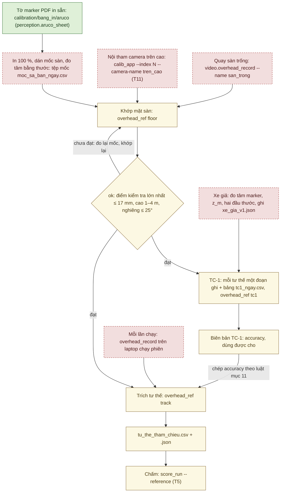

# Tham chiếu trên cao R1 và kiểm TC-1: công cụ T4 và cách làm (02/10/2026)

**Trạng thái 02/10/2026:** phần mềm đã có (đợt 2; mặc định theo thiết kế T4, người dùng giao quyết định 02/10/2026
('làm hết'), theo đề xuất). Mới **kiểm trên máy tính với ảnh TỔNG HỢP** (camera ảo Kannala–Brandt đã biết; mục 13, 16).
**CHƯA THỬ với camera thật**: chưa chọn camera trên cao ([KICH_BAN_NGHIEM_THU.md](KICH_BAN_NGHIEM_THU.md) mục 8), chưa
in marker, chưa đo mốc, chưa dựng xe giả, chưa làm TC-1. Độ trễ từ lúc chụp tới stamp của khung **CHƯA ĐO** (mục 10).
Mọi ngưỡng và mặc định ở đây là ĐỀ XUẤT – CHỜ CHỐT (bảng ở mục 14).

R1 là phương pháp đo độc lập chính của [KICH_BAN_NGHIEM_THU.md](KICH_BAN_NGHIEM_THU.md) mục 3: một camera nhìn xuống sa
bàn và hai marker ArUco trên xe cho quỹ đạo, tư thế cuối, khoảng hở và tốc độ của xe. Công cụ ghi đúng định dạng tệp tư
thế tham chiếu của `evaluation/reference_pose.py` (kịch bản mục 3.8), nên công cụ chấm T5 (`score_run --reference`) đọc
thẳng. Độ chính xác của R1 chỉ lấy từ biên bản TC-1 (mục 8, 11); chưa có TC-1 thì T5 ghi "không kiểm được" (quy tắc 3,
[NGUONG_NGHIEM_THU_DE_XUAT.md](NGUONG_NGHIEM_THU_DE_XUAT.md) mục 0).

Mọi lệnh viết trên một dòng, chạy trong thư mục `autopark` (thư mục có `pyproject.toml`), môi trường `.venv`. Chỉ
`video.overhead_record` và nút "Mở camera" của `ui.overhead_app` mở camera (lệnh chạm thiết bị: người thao tác chạy);
các lệnh khác không mở camera hay cổng COM.

Chuỗi việc từ tờ in tới lúc chấm một lần chạy. Chữ trong ô là bước làm; mũi tên không có nghĩa bước đó đã làm với camera
thật:



Xanh: đã có và đã kiểm trên máy tính (tờ PDF: đọc lại hình học trong PDF, dò marker trên ảnh dựng từ PDF) · Vàng: phần
mềm đã có, mới kiểm trên ảnh TỔNG HỢP · Đỏ viền đứt: việc cần camera thật, người đo hay xe giả, chưa làm.

## 1. Mã và tệp

| Thành phần | Vai trò |
|---|---|
| `perception/aruco_sheet.py` | In tờ marker ArUco: PDF vector đúng cỡ, JSON mô tả, PNG tùy chọn |
| `evaluation/overhead_ref.py` | Tệp mốc, cấu hình marker xe, nội tham, khớp mặt sàn, tư thế từng khung, phát hiện camera dịch, đọc video và đồng hồ, ghi tệp tham chiếu; lệnh `survey-template`, `floor`, `track`, `tc1`, `check`, `synthetic` |
| `evaluation/overhead_tc1.py` | TC-1: so R1 với R2 (hai đầu thước), yêu cầu, "dùng được cho", luật chép độ chính xác |
| `evaluation/sync_video.py` | Phía video của dấu đồng bộ T14: tìm các lần nháy trong video, ghép với dòng `SYNC_MARK` |
| `video/overhead_record.py` | Ghi video camera trên cao với stamp `perf_counter` từng khung; mã T4 duy nhất mở camera (cùng nút "Mở camera" của giao diện) |
| `ui/overhead_app.py` | Giao diện bốn thẻ (mục 12) |
| `evaluation/overhead_synth.py` | Cảnh TỔNG HỢP cho test và bộ thử (mục 13) |
| `evaluation/reference_pose.py`, `evaluation/score_run.py` | Định dạng tệp tham chiếu và công cụ chấm T5 (có từ commit `d3e1555`); ba chỗ sửa ở T5 cho T4 ngày 02/10/2026: mục 9 bước 3 và mục 10 |
| `configs/tham_chieu/xe_gia_v0.json` | Mẫu cấu hình marker của xe giả, số GIẢ ĐỊNH (`measured: false`) |
| `calibration/bang_in/aruco/` | Tờ in sẵn (PDF + JSON): mốc sàn mã 0–47 cạnh 100 mm, marker xe mã 48–49 cạnh 80 mm |

## 2. In marker và đo tâm

Hai tờ đã có ở `calibration\bang_in\aruco\` (tạo 02/10/2026; `tests/test_aruco_sheet.py` kiểm chúng trùng với bộ tạo).
Chỉ chạy lại khi đổi cỡ hay từ điển; không có `--out` thì lệnh ghi vào `runs\bang_in_aruco`:

```
.venv\Scripts\python.exe -X utf8 -m autopark.perception.aruco_sheet --ids 0-47 --size-mm 100 --out calibration\bang_in\aruco
.venv\Scripts\python.exe -X utf8 -m autopark.perception.aruco_sheet --ids 48,49 --size-mm 80 --out calibration\bang_in\aruco
```

- Mốc sàn: `aruco_DICT_4X4_50_100mm_A4_id0-47.pdf`. Ô in của marker 100 mm rộng 166 × 173 mm (vùng trắng 25 mm mỗi bên,
  vạch 8 mm, dải chữ), nên một trang A4 chỉ chứa MỘT mốc: 48 trang cho mã 0–47. Dán cả trang xuống sàn.
- Marker xe: `aruco_DICT_4X4_50_80mm_A4_id48-49.pdf`, hai ô trên một trang A4 ngang. Mã 48 = marker sau, 49 = marker
  trước.
- In 100 % (không co giãn), dán phẳng, đo lại cạnh marker bằng thước kẹp.
- Mỗi ô in có vùng trắng rộng 1,5 ô module quanh marker và bốn vạch giữa cạnh (8 × 0,3 mm) nằm ngoài vùng trắng; dòng
  chữ dưới ô ghi mã, cỡ, từ điển (không dấu vì phông chuẩn của PDF không có chữ tiếng Việt). Tâm marker = giao của hai
  đường nối các vạch đối diện. Đo tọa độ tâm bằng thước từ hai cạnh sa bàn đã kiểm vuông (kịch bản mục 3.3 bước 2).
- Cần hơn 48 mốc sàn thì dùng `--dictionary DICT_4X4_100`: mã 0–49 của từ điển này giống hệt `DICT_4X4_50` (kiểm bằng
  OpenCV 02/10/2026), nên tờ đã in vẫn dùng được; mốc sàn dùng 0–47 và từ 50 trở đi. Tệp mốc, lệnh `floor` và cấu hình
  marker xe phải cùng ghi từ điển đó (`track` từ chối khi cấu hình marker khác từ điển của khớp mặt sàn).
- `--png` ghi thêm mỗi trang một PNG 300 dpi (có DPI trong tệp) để xem; không commit PNG. Tùy chọn khác: `--paper A3`,
  `--orientation auto|portrait|landscape` (mặc định `auto`: hướng giấy chứa nhiều ô nhất), `--dpi`. Marker không vừa khổ
  giấy, mã ngoài từ điển hay từ điển lạ: mã thoát 2, không ghi gì.

## 3. Tệp mốc sa bàn

Tệp mốc đặt thẳng trong `docs\evidence\` (`docs\evidence\moc_sa_ban_<yyyymmdd>.csv`): `.gitignore` bỏ mọi CSV trừ CSV
nằm thẳng ở thư mục đó. Tạo mẫu:

```
.venv\Scripts\python.exe -X utf8 -m autopark.evaluation.overhead_ref survey-template --size 3.0x2.0 --step 0.5 --check 8 --out docs\evidence\moc_sa_ban_<ngay>.csv
```

Không có `--out` thì mẫu ghi vào `runs\tren_cao\moc_sa_ban_<yyyymmdd>.csv`; tệp đã có thì cần `--overwrite` (bản cũ được
sao lưu cạnh nó). Mẫu mặc định có 35 mốc kiểm soát tên `K_x050_y100` (vị trí danh định theo cm) và 8 điểm kiểm tra
`T01…T08` ở tâm các ô lưới trải đều; mã ArUco gán theo hàng (mốc kiểm soát 0–34, điểm kiểm tra 35–42), bỏ 48 và 49 của
xe. Lệnh in ra màn hình lệnh `aruco_sheet` cho đúng các mã đó; tờ in sẵn mã 0–47 đủ cho mẫu này.

Cột: `ten,vai_tro,x_m,y_m,z_m,ma_aruco,nguoi_do,ngay,ghi_chu` (mẫu thêm `x_danh_dinh_m,y_danh_dinh_m`, không dùng để
khớp). Quy tắc khi đọc:

- UTF-8 (nhận BOM của Excel), dấu phẩy phân cách, dấu CHẤM thập phân; lỗi báo "tệp mốc …: dòng N: …".
- `ten` duy nhất (A-Z a-z 0-9 _ -, tối đa 32 ký tự); `vai_tro` là `kiem_soat` (dùng để khớp) hay `kiem_tra` (chỉ để đo
  sai số).
- `x_m`, `y_m` tính bằng MÉT; trống cả hai = chưa đo (dòng được liệt kê, không dùng); `z_m` trống = 0.
- `ma_aruco` duy nhất, trong từ điển, không phải 48/49; trống = điểm chỉ có dấu băng dính (chấm tay ở giao diện hay tệp
  `--clicks`).
- Dòng đã đo cần `nguoi_do` và `ngay` (dd/mm/yyyy).

Hệ sa bàn như kịch bản mục 3.3: gốc ở một góc, x dọc cạnh dài, y nằm bên TRÁI khi nhìn theo +x từ trên xuống, z lên.

## 4. Nội tham camera trên cao

Dùng tệp Kannala–Brandt của T11 ([HIEU_CHUAN_CAMERA.md](HIEU_CHUAN_CAMERA.md) mục 3, phần camera không qua hub):

```
.venv\Scripts\python.exe -X utf8 -m autopark.ui.calib_app --index N --camera-name tren_cao --size 1280x720
```

Tệp ra: `calibration\cam_tren_cao_1280x720.json`; N tra mỗi lần bằng `python -m autopark.video.camera_bench list`. Bộ
đọc của `overhead_ref`:

- từ chối tệp của camera cổng hub ("camera trên cao phải là camera riêng") và ảnh, video khác cỡ ảnh của nội tham;
- chỉ nhận định dạng `autopark.fisheye_intrinsics/1`. Chưa có mô hình lỗ kim cho ống kính thường; bộ đọc phân nhánh theo
  khóa `format` để thêm sau. Xu hướng sai số theo bán kính (mục 6) và TC-1 cho biết mô hình Kannala–Brandt có hợp với
  camera đã chọn không;
- tệp có `acceptance.all_pass` không phải true chỉ sinh cảnh báo;
- nội tham của camera ảo (bộ thử) làm mọi kết quả sau đó mang cờ TỔNG HỢP.

## 5. Ghi video

```
.venv\Scripts\python.exe -X utf8 -m autopark.video.overhead_record --index N --size 1280x720 --seconds 20 --out runs\tren_cao\<ngay> --name san_trong
```

Tùy chọn khác: `--camera-name` (mặc định `tren_cao`), `--exposure` (phơi sáng thủ công, giá trị kiểu DirectShow như
`camera_bench --exposure`), `--focus` (nét thủ công, tắt tự lấy nét), `--quality` (mặc định 90), `--codec MJPG|mp4v`
(mặc định MJPG), `--overwrite`, `--force`. Không có `--out` thì ghi vào `runs\tren_cao\<yyyymmdd>`. Ghi vào
`<out>\<tên>.*`:

- `<tên>.avi` (MJPG, chất lượng 90) hay `.mp4` (`mp4v`): mỗi khung tốt một khung video.
- `<tên>.frames.csv`: `frame,t_perf,t_s,width,height`; `t_perf` = `perf_counter` ngay sau `read()` của `UsbCameraSource`
  (gồm cả chờ khung và giải mã), `t_s` = `t_perf` trừ `t_perf` của khung đầu. Số dòng = số khung trong video.
- `<tên>.events.csv`: `t_perf,kind,after_frame,message` cho khung hỏng (`duplicate`, `truncated`, `torn`,
  `read_failed`); khung hỏng không vào video.
- `<tên>.json` (`autopark.overhead_recording/1`), ghi lúc bắt đầu và lúc kết thúc, qua tệp tạm: trạng thái (`đang ghi`,
  `xong`, `lỗi`, `dừng (Ctrl+C)`; giao diện có thêm `dừng (đóng cửa sổ)`), đồng hồ `perf_counter`, tên máy,
  `wall_minus_perf_s` (giờ máy − `perf_counter` lúc bắt đầu), `t_wall_start`, `t_wall_end`, camera (index, tên, mode yêu
  cầu và mode thật, phơi sáng, nét), codec, chất lượng, số khung, khung/s thật, khoảng cách khung (trung vị, p95, lớn
  nhất, ms), số khung hỏng theo loại, dung lượng ổ trống lúc đầu và lúc cuối, commit git, `synthetic`, `write_error`.
  EcoQoS: `ecoqos` = trạng thái đọc lại mỗi lần ghi JSON (`off` / `system` / `on` / `unknown`, như mọi tệp kết quả
  khác), `ecoqos_start` = lúc bắt đầu ghi, `ecoqos_policy` = chính sách áp lúc tiến trình khởi động
  `{request, set_ok, after}`; `previous_backup` = các tệp của lần ghi cũ cùng tên đã đổi tên (dưới đây).

Tham số, tên lần ghi và ổ đĩa được kiểm TRƯỚC khi mở camera. Tên đã có thì từ chối, trừ khi `--overwrite` (sửa
02/10/2026): khi đó mọi tệp cũ của tên đó (`.avi`/`.mp4`, `.frames.csv`, `.events.csv`, `.json`) được ĐỔI TÊN thành
`<tên>.bak_<ngày_giờ>.*` ngay trước khi ghi, không mất video gốc nào, và bộ sao lưu vẫn đọc lại được bằng
`overhead_ref`. Ổ đĩa: cảnh báo dưới 20 GB, từ chối dưới 5 GB trừ khi `--force` (`--force` chỉ còn nghĩa này, không cho
ghi đè tên). Đang ghi mà camera thôi trả khung tốt (rút cáp USB…): hết `--seconds` vẫn dừng đúng hạn; quá 5 s không có
khung tốt nào thì đóng tệp với trạng thái `lỗi`, mã thoát 1; sau 5 lần đọc hỏng liên tiếp bộ ghi nghỉ 5 ms giữa các lần
đọc (ĐỀ XUẤT – CHỜ CHỐT, CHƯA THỬ với camera thật). Không có khung nào trong 5 s đầu: mã thoát 1. Tiến trình tự tắt
EcoQoS cho mình (`AUTOPARK_KEEP_ECOQOS=1` giữ mặc định của Windows; [CHUYEN_MAY_BAN.md](CHUYEN_MAY_BAN.md) mục 10.1).
Ctrl+C đóng tệp đúng cách (trạng thái `dừng (Ctrl+C)`). Mã thoát 0 xong, 1 lỗi đĩa, không có khung nào hay camera thôi
trả khung tốt, 2 tham số sai hay bị từ chối.

Dung lượng ≈ 0,4–0,55 GB mỗi phút ở 720p MJPG chất lượng 90 (ƯỚC TÍNH, CHƯA ĐO). Camera trên cao cắm vào cổng gốc riêng
của laptop, không qua hub của bốn camera xe; kiểm lại số khung bị cắt của bốn camera khi có thêm camera này (kịch bản
mục 3.4 bước 4). Khóa phơi sáng và nét nếu camera cho phép; nên phơi sáng ≤ 10 ms để bớt nhòe khi xe chạy 0,10–0,15 m/s
(ĐỀ XUẤT).

## 6. Khớp mặt sàn

Quay vài giây sàn trống (không có xe hay xe giả trong ảnh) bằng lệnh của mục 5 (`--name san_trong`), rồi:

```
.venv\Scripts\python.exe -X utf8 -m autopark.evaluation.overhead_ref floor --intrinsics calibration\cam_tren_cao_1280x720.json --survey docs\evidence\moc_sa_ban_<ngay>.csv --video runs\tren_cao\<ngay>\san_trong.avi --out docs\evidence\nghiem_thu\mat_san_<ngay>.json
```

Tùy chọn: `--image <ảnh>` (lặp được, thay hay cùng với `--video`), `--frames 30` (số khung đầu của video),
`--clicks <json>` (điểm chấm tay, ví dụ `{"points": [{"ten": "T03", "u": 512.4, "v": 300.1}]}`), `--layout <bố trí>` (vẽ
biên, ô đỗ, vật cản lên ảnh xem và tính độ phủ), `--refine contour|subpix|apriltag|none` (mặc định `contour`),
`--dictionary`, `--floor-marker-mm 100`, `--overwrite`. Không có `--out` thì ghi
`runs\tren_cao\<yyyymmdd>\mat_san_<giờ>.json`. Khớp mặt sàn chỉ cần ảnh, nên `--video` nhận cả video không kèm tệp của
bộ ghi.

Công cụ dò marker trên các khung (trung vị từng trục; mốc thấy ở dưới 50 % số khung bị bỏ; mã thấy hai lần trong một
khung bị bỏ ở khung đó; thấy mã 48/49 thì cảnh báo xe đang nằm trong ảnh sàn trống). Rồi giải tư thế camera từ các mốc
kiểm soát (PnP rồi tinh chỉnh theo điểm ảnh), loại dần mốc lệch > max(10 mm, 3 × trung vị) khi còn ≥ 8 mốc ("lệch X mm:
đo thước sai, dán lệch hay nhận nhầm mã"), và báo:

- sai số dư của mốc kiểm soát (RMS, lớn nhất; mm và px) và sai số trên **điểm kiểm tra** (không dùng để khớp; RMS, trung
  vị, lớn nhất). Chỉ số trên điểm kiểm tra mới là độ chính xác của phần mặt sàn;
- mốc không dùng được và lý do: "ngoài khung hình", "quá nhỏ: ≈ 3,4 px mỗi ô, cần ≥ 4,5", "không dò được", "chỉ thấy ở
  k/n khung", "chưa đo", "chưa chấm tay";
- chẩn đoán: so với một homography trên lưới 0,1 m (mặt sàn không phẳng hay mô hình lệch), xu hướng sai số theo bán kính
  ảnh (đánh dấu khi |độ dốc × bán kính| > 0,5 px: nghi mô hình ống kính), mốc ở góc nhìn lớn hơn góc lớn nhất đã thấy
  lúc hiệu chuẩn (ngoại suy), độ phân giải trên sàn (mm/px), độ phủ của `--layout`;
- "Dùng được cho (chỉ phần mặt sàn)": N-D1 (cần ≤ 1,67 cm), N-L1 (≤ 1 cm), N-D5 (≤ 0,67 cm) theo quy tắc 3; chỉ để báo,
  TC-1 mới quyết định.

`ok` cần ≥ 8 mốc kiểm soát còn dùng, ≥ 8 điểm kiểm tra thấy được, sai số lớn nhất trên điểm kiểm tra ≤ 17 mm, camera cao
1–4 m, nghiêng ≤ 25°. Không đạt thì vẫn ghi tệp (mã thoát 1), nhưng `tc1` từ chối nó, còn `track` từ chối nó trừ khi
`--cho-mat-san-chua-dat` (độ chính xác thành null). Từ chối hẳn (mã thoát 2, không ghi gì) khi có dưới 8 mốc kiểm soát
đã đo và thấy được, khi nghiệm khớp đặt camera DƯỚI sàn (tệp mốc đo theo hệ lật gương: y phải nằm bên TRÁI x, hay mã
ArUco đổi chỗ), hay khi độ cao vô lý (ngoài 0,3–10 m) hoặc tọa độ mốc quá 50 (tọa độ tính bằng cm, mã đổi chỗ).

Ghi `<tên>.json` (`autopark.overhead_floor/1`, có SHA-256 của nội tham, tệp mốc, ảnh) và ảnh xem `<tên>_xem.jpg` (xanh
lá: mốc kiểm soát, xanh lam: điểm kiểm tra, đỏ: bị loại, xám: không thấy, ở vị trí dự đoán; mũi tên sai số ×100; lưới
0,5 m chiếu qua mô hình). Camera bị chạm hay dời thì khớp lại, rồi làm lại TC-1 (mục 11: TC-1 gắn với SHA-256 của tệp
khớp).

## 7. Marker trên xe và xe giả

Cấu hình `configs\tham_chieu\<xe>_v<k>.json` (`autopark.overhead_vehicle_markers/1`):

- ĐÚNG hai marker (`role` là `sau`, `truoc`; tệp tham chiếu chỉ nhận 0..2 marker), khác mã, cùng từ điển (`dictionary`);
- tâm `x_m`, `y_m` trong hệ xe (x trước, y trái, gốc = tâm trục sau trên sàn, `point` = `tam_truc_sau`), độ cao mặt
  marker `z_m` (0–0,5 m), cạnh `side_m` (0,03–0,30 m, đơn vị mét), `yaw_deg`;
- `r2_points_m` = vị trí hai đầu thước của xe giả trong hệ xe (bắt buộc cho TC-1);
- `measured` true/false; `measured_by`, `date`, `notes`.

`xe_gia_v0.json` là mẫu GIẢ ĐỊNH: marker ở x 0 và 0,30 m, z 0,10 m, cạnh 80 mm; thước từ (−0,15; 0,05) tới (0,55; 0,05).
Dựng xe giả theo kịch bản mục 3.2 (tấm đế phẳng, thước thẳng cứng ≥ 0,65 m gắn chặt song song trục xe), đo thật rồi ghi
bản `_v1` với `measured: true`. Hai marker phải cách ≥ 0,15 m (dưới 0,25 m thì cảnh báo: sai số hướng ≈ √2·σ/d). `z_m`
sai 5 mm làm vị trí lệch ≈ 0,4 cm ở r = 1,5 m, H = 2,0 m (kịch bản mục 3.6 bước 3), nên đo kỹ. Mã marker xe trùng mã một
mốc sàn của tệp mốc thì `track` từ chối.

Mỗi khung: hai marker chiếu lên mặt z = `z_m` (bù thị sai), bỏ marker có cạnh lệch cấu hình quá 10 %, khung không hợp lệ
khi khoảng cách hai tâm lệch cấu hình quá 5 mm ("kiểm z_m và vị trí marker"); hướng từ đường nối hai tâm, vị trí là
trung bình của hai marker. Hướng cạnh marker lệch hướng hai tâm quá 5° chỉ được đánh dấu trong tệp chi tiết. Khung chỉ
thấy một marker không hợp lệ (mặc định ≥ 2 marker, kịch bản mục 3.6 bước 4); `--min-markers 1` thì ghi với `n_markers` 1
và ghi chú (hướng lấy từ cạnh marker, kém hơn).

## 8. TC-1

Bảng tư thế `docs\evidence\tc1_<yyyymmdd>.csv`, cột
`tu_the,video,t_tu_s,t_den_s,x_sau_m,y_sau_m,x_truoc_m,y_truoc_m,x_tam_m,y_tam_m,nguoi_do,ngay,ghi_chu`:

- mỗi tư thế một đoạn ghi 5–10 s bằng `overhead_record` (ví dụ `--name tc1_01`); `video` là đường dẫn tương đối so với
  tệp bảng (bảng ở `docs\evidence\`, video ở `runs\tren_cao\<ngay>\` thì `../../runs/tren_cao/<ngay>/tc1_01.avi`);
- cửa sổ [`t_tu_s`, `t_den_s`] tính bằng giây từ khung đầu của đoạn; trống = cả đoạn, bỏ 0,5 s mỗi đầu;
- `x/y_sau_m`, `x/y_truoc_m`: hai đầu thước đo bằng thước thép trong hệ sa bàn; `x_tam_m`, `y_tam_m` tùy chọn để kiểm
  chéo; `nguoi_do`, `ngay` (dd/mm/yyyy) bắt buộc.

```
.venv\Scripts\python.exe -X utf8 -m autopark.evaluation.overhead_ref tc1 --floor docs\evidence\nghiem_thu\mat_san_<ngay>.json --markers configs\tham_chieu\xe_gia_v1.json --poses docs\evidence\tc1_<ngay>.csv --kind full --out docs\evidence\nghiem_thu\tham_chieu_tren_cao_<ngay>.json
```

Tùy chọn: `--kind day` (TC-1 rút gọn đầu ngày), `--compare contour,subpix` (so cách tinh chỉnh góc trên cùng các khung),
`--min-frames 30`, `--thresholds` (mặc định `configs\nguong_nghiem_thu.json`), `--vehicle` (mặc định
`configs\vehicle_default.json`, cho tầm tới góc thân xe của N-D5; kích thước giống `vehicle_nghiem_thu.json`),
`--overwrite`. Không có `--out` thì ghi `runs\tren_cao\<yyyymmdd>\tc1_<giờ>.json`.

Từ chối (mã thoát 2, không ghi biên bản), như nhau ở dòng lệnh và thẻ TC-1 của giao diện (sửa 02/10/2026): kết quả khớp
mặt sàn chưa đạt (`ok: false`); cấu hình marker thật chưa đo (`measured: false`, ví dụ
`configs/tham_chieu/xe_gia_v0.json`); cấu hình thiếu `r2_points_m`; đoạn ghi tư thế có `.json` của bộ ghi mà cờ
`synthetic` khác khớp mặt sàn (không trộn TỔNG HỢP với dữ liệu thật); video khác cỡ ảnh của khớp mặt sàn. Đoạn ghi AVI
không kèm tệp của bộ ghi được nhận cho TC-1 tĩnh (thời gian chỉ dùng để cắt cửa sổ), có ghi chú đồng hồ danh định; đoạn
ghi của `overhead_record` chép thiếu `.json` hay `.frames.csv` thì bị từ chối.

Mỗi tư thế: R1 = trung vị các khung hợp lệ trong cửa sổ (cần ≥ 30), độ tản p95 và lớn nhất; R2 từ hai đầu thước; hai đầu
thước cách nhau lệch chiều dài thước quá 15 mm (2 × 5 + 5 mm) thì ghi "kiểm lại số đo thước". Tư thế có đoạn ghi quá
ngắn hay thiếu khung hợp lệ bị loại, có lý do. Biên bản (`autopark.overhead_tc1/1`) có:

- sai số từng tư thế, trung vị và lớn nhất (vị trí, hướng), độ tản;
- yêu cầu: đầy đủ ≥ 10 tư thế, ≥ 3 hướng cách nhau ≥ 20°, có tư thế cách mỗi góc của hình bao các mốc kiểm soát ≤ 0,5 m;
  rút gọn ≥ 3 tư thế. Thiếu thì mã thoát 1, vẫn ghi, liệt kê phần thiếu;
- `accuracy` đúng các khóa của tệp tham chiếu (`pos_max_m`, `yaw_max_deg`, `pos_median_m`, `yaw_median_deg`, `source`),
  là CẬN TRÊN (sai số R2 ± 3–5 mm mỗi điểm cộng vào);
- "dùng được cho" theo quy tắc 3 với ngưỡng của `configs\nguong_nghiem_thu.json` (N-D1, N-D2, N-P2, N-P3, N-P5c, N-P6 …
  N-P8; N-D5 tính cả tầm tới góc thân xe như T5; N-D3 chỉ báo số; N-L1, N-L2, N-L3, N-L5 lấy từ bảng của
  [NGUONG_NGHIEM_THU_DE_XUAT.md](NGUONG_NGHIEM_THU_DE_XUAT.md) vì tệp ngưỡng chỉ nhận mã của T5);
- ngày: `t_wall_start` của các đoạn ghi khi chúng cùng ngày, không thì ngày muộn nhất của cột `ngay` (kèm ghi chú).

TC-1 tĩnh không đo nhòe chuyển động, màn trập cuộn hay độ trễ ghi. Làm lại TC-1 khi camera dịch (sau khi khớp lại mặt
sàn), khi đổi độ cao marker, và làm TC-1 rút gọn (3 tư thế) đầu mỗi ngày nghiệm thu (kịch bản mục 3.7 bước 5).

## 9. Mỗi lần chạy

1. Ghi, trên chính laptop chạy phiên (cùng đồng hồ `perf_counter`):
   ```
   .venv\Scripts\python.exe -X utf8 -m autopark.video.overhead_record --index N --size 1280x720 --seconds <s> --out runs\tren_cao\<ngay> --name do1_l<lan>
   ```
2. Trích:
   ```
   .venv\Scripts\python.exe -X utf8 -m autopark.evaluation.overhead_ref track --video runs\tren_cao\<ngay>\do1_l<lan>.avi --floor docs\evidence\nghiem_thu\mat_san_<ngay>.json --markers configs\tham_chieu\<xe>_v1.json --tc1 docs\evidence\nghiem_thu\tham_chieu_tren_cao_<ngay>.json --out runs\nghiem_thu\<ngay>\do1_l<lan>\tu_the_tham_chieu.csv
   ```
   Tùy chọn: `--tc1-day <TC-1 rút gọn>`, `--tc1-chua-du`, `--window A,B` (giây từ khung đầu của video),
   `--min-markers 1`, `--flash-roi x,y,w,h --sync-marks <tệp T14>` (`--first-mark n` khi chỉ có một lần nháy),
   `--sync 18.0=mark:1` (lặp được, như `score_run`), `--sync-error`, `--capture-latency-s`, `--frames-csv`,
   `--allow-nominal-fps`, `--cho-cau-hinh-chua-do`, `--cho-mat-san-chua-dat`, `--overwrite`. `--sync-error` và
   `--capture-latency-s` phải là số giây hữu hạn ≥ 0, kiểm trước khi mở video (sai: mã thoát 2, không ghi gì; sửa
   02/10/2026).
3. Chấm bằng lệnh T5 của kịch bản mục 2.4, ví dụ DO-1 ở XT:
   ```
   .venv\Scripts\python.exe -X utf8 -m autopark.evaluation.score_run --scenario DO-1 --attempt <lan> --level XT/M3 --log runs\nghiem_thu\<ngay>\do1_l<lan>\lan_chay_vehicle_io --reference runs\nghiem_thu\<ngay>\do1_l<lan>\tu_the_tham_chieu.csv --layout docs\evidence\nghiem_thu\bo_tri_do1.json --touch khong --intervention khong --methods R5 --report docs\evidence\bien_ban_nghiem_thu_<ngay>.csv
   ```
   T5 từ chối tệp tham chiếu TỔNG HỢP ở mức BT/XT ("tham chiếu TỔNG HỢP chỉ dùng ở mức MP"; sửa cho T4 ngày 02/10/2026).
   Lệnh này CHƯA dùng với lần chạy thật.

`track` kiểm mọi đầu vào TRƯỚC khi xử lý video và từ chối (mã thoát 2, không ghi gì) khi: khớp mặt sàn chưa đạt (trừ
`--cho-mat-san-chua-dat`); cấu hình marker thật chưa đo (trừ `--cho-cau-hinh-chua-do`); cấu hình marker khác từ điển của
khớp mặt sàn, hay mã marker xe trùng mã một mốc sàn; video khác cỡ ảnh của khớp mặt sàn; trộn dữ liệu TỔNG HỢP với dữ
liệu thật (cờ `synthetic` của khớp mặt sàn, cấu hình marker và JSON của bộ ghi); video của bộ ghi chép thiếu tệp hay AVI
chỉ có số khung/s danh định mà không có `--allow-nominal-fps` (mục 10); `--flash-roi` ra ngoài ảnh, `--sync-marks` không
kèm `--flash-roi`, `--window` có A ≥ B; tệp ra đã có mà không `--overwrite`.

Tệp ra của `track`:

- `tu_the_tham_chieu.csv` + `.json`: một dòng cho MỖI khung giải mã trong cửa sổ; khung không hợp lệ vẫn giữ số khung và
  thời điểm, nên `--event frame:<n>` của T5 dùng được;
- `tu_the_tham_chieu.chi_tiet.csv`: lý do, tâm từng marker, lệch khoảng cách hai marker, lệch cạnh, độ lệch camera, số
  mốc sàn thấy, phần ô nháy sáng.

Tệp tham chiếu được kiểm theo luật của bộ đọc và ghi qua tên tạm TRƯỚC khi chạm tới tệp chi tiết (sửa 02/10/2026), nên
lỗi không để lại tệp chi tiết mới cạnh tệp tham chiếu cũ. Tệp ra đã có thì cần `--overwrite` (bản cũ được sao lưu). Mã
thoát 1 khi camera dịch, dưới 80 % khung hợp lệ, hay không khung nào hợp lệ (khi đó chỉ ghi tệp chi tiết).

Camera dịch: trung vị độ lệch tâm các mốc sàn thấy được (≥ 4) so với lúc khớp > 0,7 px trong 15 khung đo liên tiếp thì
từ khung đầu của chuỗi đó mọi dòng không hợp lệ ("khớp lại mặt sàn"). Khung thấy dưới 4 mốc không cắt chuỗi.

## 10. Đồng hồ và sai số đồng bộ

- Video của `overhead_record` (có `.frames.csv` + `.json` cạnh video): đồng hồ `perf_counter`; T5 đổi sang thời gian
  phiên qua khóa `clock` của `link.json` (T13), không cần cặp đồng bộ. Stamp trễ hơn lúc chụp một khoảng CHƯA ĐO, nên
  `sync_error_s` = `--capture-latency-s` (mặc định 0,15 s, ĐỀ XUẤT); từ 02/10/2026 T5 dùng số này (`--time-error` của T5
  thay được; trước đó T5 coi là 0). 0,15 s lớn hơn 0,4 s / 3, nên N-P1 theo mốc đọc trên video R1 sẽ "không kiểm được"
  tới khi có dấu nháy T14 trong khung hình.
- Ô nháy T14 trong khung hình (`--flash-roi` quanh phần TRONG của ô, phải nằm trong ảnh; `--sync-marks` cần
  `--flash-roi`): khởi đầu nháy là khung đầu có ≥ 50 % vùng sáng hơn nền ≥ 60 mức xám; lần nháy dài 0,2–1,0 s, hai khởi
  đầu cách nhau ≥ 0,8 s. Ghép với dòng `SYNC_MARK`: đồng hồ `perf_counter` thì dấu nằm trong 0,5 s trước khung; đồng hồ
  `video` thì tìm một độ lệch hằng trùng ± 0,1 s, cần ≥ 2 lần nháy hay `--first-mark n`. Kết quả là các cặp `mark`, và
  `sync_error_s` = ± một khung (p95 khoảng cách khung). Có cả `--sync` lẫn dấu nháy thì dùng `--sync` (có cảnh báo). Độ
  trễ hiển thị L CHƯA ĐO và nằm trong phép đổi; với đồng hồ `perf_counter`, `source.flash_offsets` (khung đầu sáng −
  dấu) là cận trên của độ trễ chụp + hiển thị.
- Video khác (điện thoại, máy khác): đồng hồ `video` (stamp của tệp), cần `--sync` hay dấu nháy. Tệp chỉ có số khung/s
  danh định bị từ chối trừ khi `--allow-nominal-fps` (thêm ghi chú "đồng hồ video theo số khung/s danh định"): từ
  02/10/2026 mọi tệp AVI không kèm tệp của bộ ghi đều thuộc loại này (container AVI không có thời điểm từng khung, vị
  trí khung = chỉ số / số khung/s), cùng tệp khác mà vị trí khung thôi tăng ngặt. Video của `overhead_record` chép thiếu
  `.json` hay `.frames.csv` (kể cả khi chỉ ra `--frames-csv`) bị từ chối: chép đủ bốn tệp của lần ghi. Video không có
  `.json` của bộ ghi mang ghi chú "không kiểm được video có phải TỔNG HỢP hay không". Giao diện có ô "Nhận video chỉ có
  số khung/s danh định" như `--allow-nominal-fps`.
- T5 với đồng hồ video danh định (sửa 02/10/2026): `score_run` đòi ≥ 2 cặp đồng bộ (`--sync` hay dấu nháy T14) để kiểm
  hệ số đồng hồ (lệch ≤ 1 %); chỉ một cặp thì báo lỗi, vì một cặp chỉ cho độ lệch và sẽ đổi im lặng sai tốc độ của số
  khung/s danh định sang thời gian phiên (`tests/test_nominal_clock_and_reader_stop.py`). Đồng hồ video có thời điểm
  từng khung thật vẫn nhận một cặp (hệ số 1); ≥ 2 cặp thì kiểm hệ số như trên.

## 11. Luật chép độ chính xác

`track` chỉ chép `accuracy` của TC-1 khi biên bản: cùng SHA-256 tệp khớp mặt sàn, cùng bộ dò (từ điển, cách tinh chỉnh
góc), cùng cờ tổng hợp, đủ yêu cầu (hoặc `--tc1-chua-du`, có ghi chú), cùng cấu hình marker (khác thì cần `--tc1-day`
cùng cấu hình, `z_m` lệch biên bản đầy đủ ≤ 5 mm), và có một biên bản cùng ngày với video (kịch bản mục 3.7 bước 5; ngày
của video là `t_wall_start` của bộ ghi, không có thì ngày sửa tệp, kèm ghi chú). `--tc1` phải là biên bản đầy đủ (`kind`
`full`). Kết quả = lớn nhất từng trường của các biên bản được nhận. Thiếu điều nào thì `accuracy` null kèm lý do ở
`notes` và trên màn hình: T5 ghi "không kiểm được". Cấu hình marker chưa đo (`--cho-cau-hinh-chua-do`) hay khớp mặt sàn
chưa đạt (`--cho-mat-san-chua-dat`) luôn cho null.

## 12. Giao diện và kiểm tệp

```
.venv\Scripts\python.exe -X utf8 -m autopark.ui.overhead_app --index N --camera-name tren_cao --size 1280x720 --intrinsics calibration\cam_tren_cao_1280x720.json --survey docs\evidence\moc_sa_ban_<ngay>.csv
```

Mọi tham số đều tùy chọn (`--index`, `--camera-name`, `--size`, `--intrinsics`, `--survey`, `--floor`, `--markers`,
`--video` nạp sẵn đầu vào). Bốn thẻ:

1. **Mặt sàn**: nạp nội tham, tệp mốc, ảnh hay video sàn trống (hoặc "Chụp từ camera (15 khung)" khi camera đang mở),
   chọn từ điển và cách tinh chỉnh góc; "Dò mốc" (bảng tên, vai trò, mã, nguồn, u, v, sai số); chấm tay điểm không có mã
   (chuột trái đặt, chuột phải xóa, Esc thôi); "Khớp mặt sàn"; "Lưu kết quả khớp…" (JSON + ảnh xem). Đổi đầu vào nào thì
   kết quả khớp cũ mất hiệu lực.
2. **Trích tư thế**: video, kết quả khớp, marker trên xe, biên bản TC-1 (đầy đủ, rút gọn trong ngày), số marker tối
   thiểu, cửa sổ, sai số đồng bộ, cặp đồng bộ, vùng ô nháy T14 ("Chọn trên ảnh" rồi kéo chuột) và tệp dấu đồng bộ. "Bắt
   đầu trích"/"Dừng" chạy nền có tiến độ, xem trước, đồ thị x, y, hướng theo thời gian và dòng độ chính xác sẽ ghi. "Lưu
   tệp tư thế…" (mặc định `runs\nghiem_thu\<yyyymmdd>\<tên video>\tu_the_tham_chieu.csv`). Bốn ô đánh dấu như các cờ
   dòng lệnh: dùng kết quả khớp chưa đạt, dùng cấu hình marker chưa đo, nhận TC-1 thiếu yêu cầu, nhận video chỉ có số
   khung/s danh định.
3. **TC-1**: bảng tư thế sửa được (tư thế, video, cửa sổ, hai đầu thước, tâm kiểm chéo, người đo, ngày) và cột kết quả;
   nạp/lưu bảng; loại đầy đủ hay rút gọn; so các cách tinh chỉnh góc; số khung hợp lệ tối thiểu; "Tính TC-1" chạy nền
   (từ chối như lệnh `tc1`, mục 8); "Lưu biên bản TC-1…" (bộ thử tổng hợp bị từ chối dưới `docs\evidence\`).
4. **Ghi video**: chỉ khi chạy với `--index`; camera chỉ mở khi bấm "Mở camera", không bao giờ lúc khởi động. Xem trực
   tiếp kèm độ lệch camera so với lúc khớp; "Bắt đầu ghi"/"Dừng ghi" ghi như `overhead_record`. Giao diện không ghi đè:
   tên lần ghi đã có thì từ chối; ổ dưới 5 GB thì từ chối.

Trích, TC-1 và đọc camera chạy trong luồng riêng; đóng cửa sổ thì dừng các luồng (chờ tối đa 3 s), lần ghi đang chạy
đóng với trạng thái `dừng (đóng cửa sổ)`. Lưu đè trong giao diện cũng sao lưu bản cũ. Tiến trình giao diện tự tắt EcoQoS
và có nhãn trạng thái EcoQoS ở thanh trạng thái. Chỉ kiểm offscreen với bộ thử tổng hợp và camera giả.

Kiểm một tệp bất kỳ của T4 (khớp mặt sàn, biên bản TC-1, cấu hình marker, JSON của bản ghi, tệp tham chiếu, tệp mốc,
bảng tư thế TC-1):

```
.venv\Scripts\python.exe -X utf8 -m autopark.evaluation.overhead_ref check <tệp>
```

Mã thoát chung của `overhead_ref`: 0 xong; 1 xong nhưng chất lượng chưa đạt; 2 tham số sai hay bị từ chối, không ghi gì
(Ctrl+C cũng thoát mã 2, không ghi tệp kết quả); 3 lỗi bất ngờ (in traceback; tệp ghi qua tên tạm nên không có tệp dở).

## 13. Bộ thử tổng hợp

```
.venv\Scripts\python.exe -X utf8 -m autopark.evaluation.overhead_ref synthetic --out runs\tren_cao\tong_hop
```

Ghi một bộ TỔNG HỢP — KHÔNG PHẢI SỐ ĐO: camera ảo 1280×720 (Kannala–Brandt đã biết, tiêu cự tự chọn để sa bàn vừa ảnh,
f ≈ 705 px) cao 2,3 m, sa bàn 3 × 2 m, 43 marker sàn 100 mm (35 mốc kiểm soát + 8 điểm kiểm tra), xe giả hai marker
80 mm ở 0,10 m, lần chạy 300 khung ghi qua bộ ghi với stamp xen kẽ 31/48 ms (`chay_01.*` và tư thế thật
`chay_01.truth.csv`), 10 đoạn TC-1 × 60 khung. `README.txt` của bộ thử có chuỗi lệnh `floor` → `tc1` → `track`. Tùy
chọn: `--size`, `--frames`, `--tc1-poses`, `--tc1-frames`, `--seed`. Chạy lại vào cùng thư mục thì bộ thử được ghi lại;
các tệp kết quả cũ của chuỗi lệnh cần `--overwrite`. Bộ thử không bao giờ ghi được vào `configs\`, `calibration\` hay
`docs\evidence\`, và T5 từ chối tệp tham chiếu tổng hợp ở mức BT/XT.

Kết quả (TỔNG HỢP: hình học lý tưởng, không nhòe, không màn trập cuộn, không giấy cong; lượt kiểm khi viết tài liệu này,
02/10/2026, máy bàn, cây gộp đợt 2; thư mục tạm, không lưu vào repo; chạy lại được bằng các lệnh ở đây):

| Phép | Bộ thử mặc định (lệnh `synthetic`: 1280×720, cao 2,3 m, sa bàn 3 × 2 m) | Bộ thử của test (`tests/overhead_set.py`: 960×540, cao 1,8 m, 2,5 × 1,5 m) |
|---|---|---|
| Mốc kiểm soát dùng / bị loại; điểm kiểm tra | 35 / 0; 8 | 24 / 0; 8 |
| Điểm kiểm tra: RMS / lớn nhất | 0,93 / 1,33 mm | 0,91 / 1,85 mm |
| TC-1: vị trí trung vị / lớn nhất; hướng lớn nhất | 0,9 / 1,7 mm; 0,21° (10 tư thế × 60 khung, đủ yêu cầu) | 0,7 / 1,4 mm; 0,18° (10 tư thế × 8 khung, `--min-frames 5`) |
| Lần chạy so với tư thế thật | vị trí ≤ 1,05 mm, hướng ≤ 0,28°; 294/300 khung hợp lệ (6 khung chỉ thấy một marker xe) | vị trí ≤ 0,68 mm, hướng ≤ 0,09°; 40/40 khung |
| Độ chính xác chép từ TC-1 vào tệp tham chiếu | vị trí ≤ 0,17 cm, hướng ≤ 0,21° | vị trí ≤ 0,14 cm, hướng ≤ 0,18° |

Thời gian trên máy bàn ở lượt đó (gồm khởi động Python): `synthetic` 29,7 s, `floor` 0,3 s, `tc1` 8,1 s cho 600 khung,
`track` 3,8 s cho 300 khung 720p. Đo riêng trên 60 khung của lần chạy tổng hợp: dò ArUco 4,4 / 6,0 / 8,2 ms mỗi khung ở
960×540 / 1280×720 / 1920×1080 (OpenCV 32 luồng). Lượt của người viết mã cùng ngày, chạy ở ưu tiên CPU thấp: `synthetic`
27,8 s, `tc1` 17,4 s, `track` 8,4 s.

Góc ArUco (tinh chỉnh đường viền) nằm lõm vào trong cạnh thật ≈ 0,5–0,8 px, nên cạnh marker xe đo được ngắn hơn cấu hình
2–8 % (trung vị ≈ 5 %) trên hai bộ thử; phép kiểm cạnh ±10 % chịu được, còn tâm và hướng không bị ảnh hưởng (lệch đối
xứng). Bản thử trước khi viết công cụ (script tạm, không lưu trong repo, 960×540): tinh chỉnh đường viền cho điểm kiểm
tra RMS/lớn nhất 1,07/1,73 mm, so với 2,39/3,01 mm của tinh chỉnh điểm ảnh con; không bù độ cao thì xe lệch 61–63 mm.

## 14. Mặc định (ĐỀ XUẤT – CHỜ CHỐT; người dùng giao quyết định 02/10/2026 ('làm hết'), theo đề xuất)

| Mục | Mặc định | Căn cứ |
|---|---|---|
| Từ điển, mã | `DICT_4X4_50`; mốc sàn 0–47; xe 48 = sau, 49 = trước | Kịch bản mục 3.2 |
| Cạnh marker | Mốc sàn 100 mm; xe 80 mm | Xe: kịch bản mục 3.2; sàn: bản thử bỏ sót marker ở ≈ 3,5 px mỗi ô module |
| Mốc sàn | Marker ArUco in có vạch đo tâm; điểm chỉ có băng dính thì chấm tay | Thay dấu chữ thập băng dính của kịch bản mục 3.3 |
| Tinh chỉnh góc | Đường viền (`contour`) | Bằng chứng tổng hợp; TC-1 `--compare` quyết định |
| Ống kính | Kannala–Brandt của T11 | Chưa có mô hình lỗ kim |
| Khớp mặt sàn | Mốc kiểm soát mỗi 0,5 m, ≥ 8 điểm kiểm tra; ≥ 8 mốc dùng; loại mốc > max(10 mm, 3 × trung vị) | Kịch bản mục 3.3 + ĐỀ XUẤT |
| `ok` của khớp | Điểm kiểm tra lớn nhất ≤ 17 mm; cao 1–4 m; nghiêng ≤ 25° | 17 mm: kịch bản mục 3.5 bước 4 |
| Mỗi khung | ≥ 2 marker; cạnh ±10 %; khoảng cách hai marker ±5 mm; hướng cạnh 5° (chỉ đánh dấu) | ≥ 2 marker: kịch bản mục 3.6 |
| Camera dịch | > 0,7 px trong 15 khung đo liên tiếp, ≥ 4 mốc thấy | ĐỀ XUẤT |
| Trích tư thế | ≥ 80 % khung hợp lệ (dưới thì mã thoát 1); độ trễ chụp 0,15 s (CHƯA ĐO) | ĐỀ XUẤT |
| TC-1 | Như mục 8; ≥ 30 khung hợp lệ mỗi tư thế, bỏ 0,5 s mỗi đầu; thước lệch > 2 × 5 + 5 mm thì ghi chú; `z_m` lệch ≤ 5 mm | Kịch bản mục 3.7 + ĐỀ XUẤT |
| Ghi video | MJPG chất lượng 90; trên laptop chạy phiên, cổng gốc riêng; cảnh báo dưới 20 GB, từ chối dưới 5 GB; ghi đè tên chỉ với `--overwrite` và luôn giữ bản cũ; giữ mọi video gốc tới khi chốt chỗ sao lưu | ĐỀ XUẤT |
| Camera thôi trả khung tốt | Dừng ghi sau 5 s không có khung tốt; nghỉ 5 ms sau 5 lần đọc hỏng liên tiếp | ĐỀ XUẤT (sửa 02/10/2026) |
| Dấu nháy T14 | Như mục 10 | Kịch bản mục 2.5 + ĐỀ XUẤT |

## 15. Giới hạn

- Mọi số ở đây là TỔNG HỢP; MJPEG thật, nhòe, ánh sáng, giấy cong, ống kính thật CHƯA THỬ. Chưa chọn camera trên cao,
  máy ghi nó cũng CHƯA CHỐT (kịch bản mục 8).
- TC-1 tĩnh không đo nhòe chuyển động, màn trập cuộn (≈ 3 mm ở 0,10 m/s với 30 ms đọc cảm biến, ƯỚC TÍNH) hay độ trễ
  ghi; TC-1 động là việc sau.
- Độ trễ chụp CHƯA ĐO: mặc định 0,15 s làm N-P1 theo R1 "không kiểm được" tới khi có dấu nháy T14 trong khung hình; độ
  trễ hiển thị L của màn hình laptop cũng CHƯA ĐO.
- Cỡ ô module trên ảnh nhỏ: ở bộ thử mặc định, tính bằng mô hình camera của kết quả khớp, mỗi ô module của marker xe
  80 mm chỉ ≈ 3,4 px gần góc sa bàn tới ≈ 4,3 px ở giữa, của mốc sàn 100 mm ≈ 3,5–4,9 px (33/43 mốc dưới mức báo "quá
  nhỏ" 4,5 px của công cụ). Trên ảnh tổng hợp bộ dò vẫn thấy đủ 43 mốc nhưng mất một marker xe ở 6/300 khung; bản thử
  trước bỏ sót marker ở ≈ 3,5 px. Ảnh thật có thể tệ hơn; khi đó cân nhắc camera 1920×1080, treo thấp hơn, ống kính hẹp
  hơn hay marker lớn hơn.
- Sai số độ cao marker lan sang vị trí ≈ Δh·r/(H − h); phép kiểm khoảng cách hai marker chỉ bắt được sai vài cm.
- Phát hiện camera dịch cần ≥ 4 mốc ArUco thấy được; sàn chỉ có dấu băng dính không tự kiểm được.
- `perf_counter` chỉ so được trên cùng máy, cùng lần khởi động; T5 không kiểm được điều đó (tệp ghi tên máy và giờ máy −
  `perf_counter` để người đọc kiểm).
- Ghi R1 trên chính laptop chạy phiên: tải thêm lên vòng điều khiển 50 Hz CHƯA ĐO (lượt đo vòng 50 Hz ngày 02/10/2026
  không chạy bộ ghi R1; [CHUYEN_MAY_BAN.md](CHUYEN_MAY_BAN.md) mục 13). Thấy ảnh hưởng thì ghi ở máy khác và đồng bộ
  bằng dấu T14 (đồng hồ `video`).
- Ổ đĩa: ≈ 0,4–0,55 GB mỗi phút video gốc (ƯỚC TÍNH); `--overwrite` đổi tên bản cũ chứ không xóa, nên ổ đầy dần; chỗ sao
  lưu chưa chốt.
- Đồng hồ video danh định (cập nhật 02/10/2026): AVI không kèm tệp của bộ ghi nay bị từ chối trừ khi
  `--allow-nominal-fps`, video của bộ ghi chép thiếu tệp bị từ chối, test dùng AVI thật (không còn thay nguồn giả), và
  T5 đòi ≥ 2 cặp đồng bộ cho đồng hồ danh định (mục 10). Còn lại: (1) AVI tổng hợp chép một mình không nhận ra được là
  TỔNG HỢP (chỉ có ghi chú); (2) MP4 do OpenCV ghi ở số khung/s cố định (`--codec mp4v`) chép một mình vẫn được nhận làm
  đồng hồ video vì không phân biệt được với tệp camera thật.
- Chỉ có mô hình ống kính Kannala–Brandt; mô hình lỗ kim CHƯA CÓ.
- R1 cho tư thế trong hệ sa bàn. Bản đồ LiDAR của T2 cũng dựng trong hệ sa bàn qua mốc neo đo bằng thước
  ([NGUON_TU_THE_LIDAR.md](NGUON_TU_THE_LIDAR.md)), nên sai số mốc neo cộng vào khi so; công cụ so quỹ đạo định vị LiDAR
  (`localization.csv` của nguồn tư thế) với R1 (DV-3) CHƯA CÓ (kịch bản mục 5.7).

## 16. Đã kiểm gì

Test (chạy trên máy tính, không mở camera hay cổng nào; số test và kết quả lượt đầy đủ ghi ở
[CHUYEN_MAY_BAN.md](CHUYEN_MAY_BAN.md)):

| Tệp | Kiểm |
|---|---|
| `tests/test_aruco_sheet.py` | Cỡ trang, ô module, vạch trong PDF; PDF vẽ bằng QtPdf dò được mọi mã; vạch PNG đánh dấu tâm trong 1 px; tờ đã commit trùng bộ tạo; tham số sai thoát mã 2 |
| `tests/test_overhead_synth.py` | Bộ dựng ảnh độc lập với mô-đun đang kiểm (góc marker đúng chỗ phép chiếu, marker ở độ cao), lưu đệm sàn, bộ thử từ chối thư mục của dự án và mang nhãn TỔNG HỢP, stamp 31/48 ms |
| `tests/test_overhead_ref.py` | Tệp mốc, mẫu tệp mốc, cấu hình marker, nội tham (từ chối camera hub, khác cỡ), khớp mặt sàn, mốc đo sai bị loại đúng tên, hệ lật gương và đơn vị cm bị từ chối, lý do mốc thiếu, chấm tay, bù độ cao, sai `z_m` bị bắt, khung một marker, `track` ghi tệp T5 đọc được, camera dịch, đồng hồ danh định và tệp kèm thiếu, không ghi đè lặng lẽ, sai số đồng bộ sai bị từ chối trước khi mở video |
| `tests/test_overhead_tc1.py` | TC-1 đầy đủ, yêu cầu thiếu, thước lệch, `--compare`, từ chối khớp chưa đạt, cấu hình chưa đo và trộn TỔNG HỢP, từ chối ghi bộ thử vào `docs\evidence\`, luật chép độ chính xác |
| `tests/test_sync_video.py` | Khởi đầu nháy, lần nháy quá ngắn, quá dài, quá gần, ghép theo hai loại đồng hồ, `track` với ô nháy |
| `tests/test_overhead_record.py` | Bộ ghi với nguồn giả: tệp ra, kiểm tên và ổ trước khi mở camera, Ctrl+C, `--overwrite` đổi tên bản cũ (đọc lại được, trả lại tên cũ khi lỗi), `--force` chỉ cho ổ thấp, EcoQoS đọc lúc ghi, dừng đúng hạn và bỏ cuộc khi camera thôi trả khung |
| `tests/test_overhead_app_ui.py` | Giao diện offscreen với bộ thử: bốn thẻ, chấm tay, trích nền và dừng, TC-1 từ chối như dòng lệnh, ô đồng hồ danh định, camera chỉ mở khi bấm |
| `tests/test_score_run.py`, `tests/test_nominal_clock_and_reader_stop.py` | T5: sai số đồng bộ khai báo của đồng hồ `perf_counter`; tham chiếu tổng hợp bị từ chối ở BT/XT; đồng hồ video danh định cần ≥ 2 cặp |

Lượt kiểm chuỗi lệnh khi viết tài liệu này (02/10/2026 19:04–19:05, máy bàn, cây gộp đợt 2 = commit `63017a5` cộng các
thay đổi chưa commit, đầu ra ở thư mục tạm, không lưu): `synthetic`, `floor`, `tc1 --kind full`, `track` và `check`
(khớp mặt sàn, tệp tham chiếu, JSON bản ghi) theo `README.txt` của bộ thử đều thoát mã 0, ra các số ở mục 13. Không có
lượt nào với camera thật.
