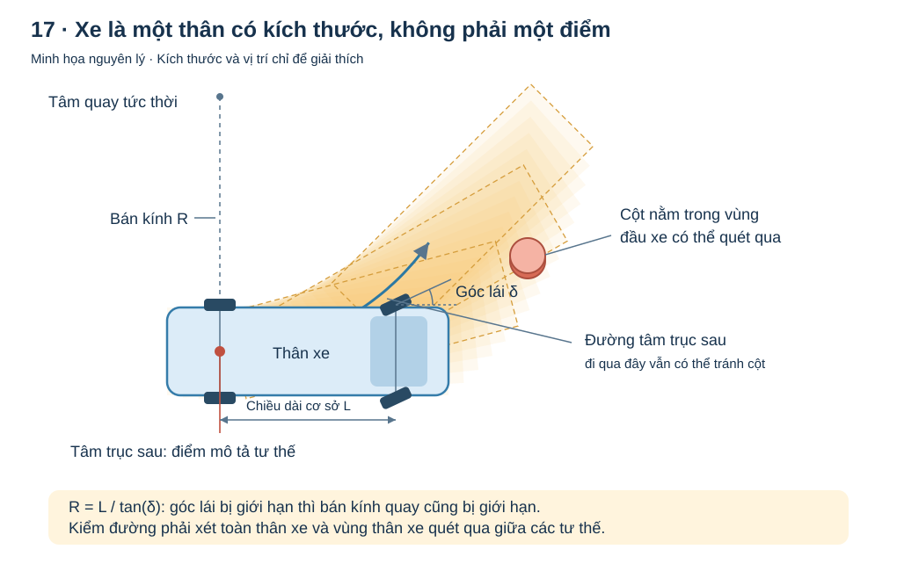
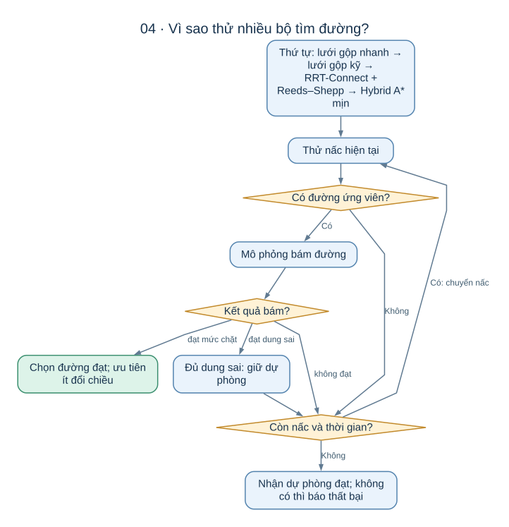
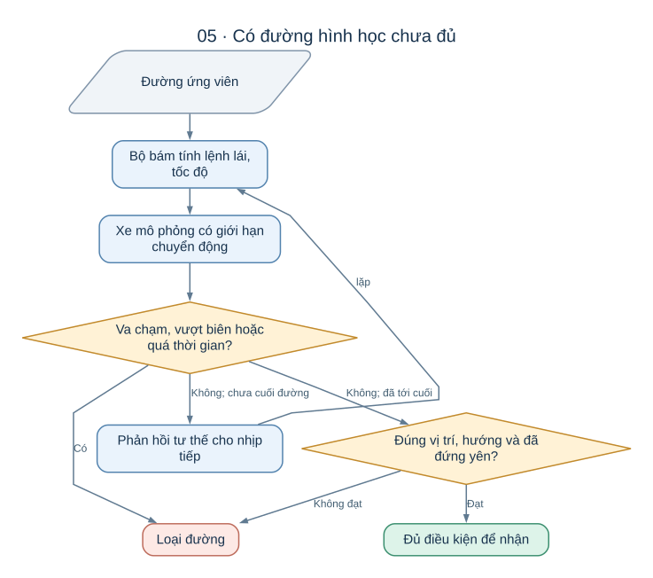

# Từ khoảng trống đến đường xe chạy được

Một chiếc xe đứng cạnh ô trống chưa có nghĩa là nó vào được ô bằng một lần đánh lái.
Nó có kích thước, không trượt ngang được, góc lái bị giới hạn và cần thời gian để phanh.
Thuật toán đỗ xe phải giải quyết đồng thời những điều đó.

Bài này đi từ vấn đề đến lựa chọn của AutoPark:
vì sao cần mô hình xe, vì sao có nhiều cách tìm đường, và vì sao phải kiểm khả năng bám trước khi nhận đường.
Bạn chỉ cần hình dung một chiếc ô tô tiến, lùi và quay đầu trong chỗ chật.

## 1. Đầu bài là một chiếc xe có hướng, không chỉ một điểm

Tư thế xe gồm ba thông tin: tọa độ ngang **x**, tọa độ dọc **y**, và góc hướng **θ**.
Góc này cho biết đầu xe đang quay về đâu trên bản đồ.
Điểm dùng để đặt tọa độ trong dự án là tâm trục sau.

Hai tư thế có cùng x và y nhưng khác θ là hai tình huống khác nhau.
Xe đã hướng vào ô có thể lùi thẳng; xe quay ngang ở cùng vị trí có thể cần nhiều lần chỉnh.
Bộ lập đường vì thế phải tìm trong cả **vị trí lẫn hướng**.

Ngoài tư thế đầu và đích, đầu bài còn cần kích thước xe, giới hạn lái, vật cản và biên khu vực được chạy.
Nếu thay xe rộng hơn nhưng giữ đường cũ, một đoạn trước đây đi lọt có thể không còn hợp lệ.

### Mô hình xe đạp giúp trả lời “đánh lái thế này thì xe đi đâu?”

Tên gọi “xe đạp” xuất phát từ cách gộp hai bánh trước thành một bánh tương đương,
hai bánh sau thành một bánh tương đương khi nhìn từ trên xuống.
Mô hình này giữ quan hệ giữa góc lái và hướng chuyển động, trong giả định bánh lăn không trượt ngang.

Với góc lái giữ nguyên, tâm trục sau đi theo cung tròn có bán kính:

**R = L / tan(δ)**

Trong đó **L** là khoảng cách giữa hai trục bánh, **δ** là góc bánh lái và **R** là bán kính quay.
Không cần tính lượng giác để hiểu hệ quả: cùng một xe, góc lái lớn hơn tạo vòng quay nhỏ hơn;
cùng một góc lái, xe có chiều dài cơ sở lớn hơn cần vòng quay rộng hơn.

Ví dụ minh họa từ cấu hình xe giả định: L = 19 cm, góc lái tối đa 30°,
cho bán kính quay của tâm trục sau khoảng 33 cm.
Đầu xe quét ra ngoài cung đó nên 33 cm không phải khoảng trống đủ cho cả xe quay.
Những số này phục vụ mô phỏng, chưa phải số đo của xe thật.

Tính chất “không thể ra lệnh đi ngang ngay lập tức” thường được gọi là **ràng buộc không toàn phương**.
Nói đơn giản: xe đi tới một vị trí bằng những thao tác có thứ tự, không chỉ bằng một hướng dịch chuyển tùy ý.

Lý do kỹ thuật để dùng mô hình này là bài toán đỗ có tốc độ thấp và cần tính thử nhiều chuyển động.
Đây là giải thích về sự phù hợp của thiết kế; dự án vẫn phải đo xe thật để kiểm độ chính xác của mô hình.

## 2. Va chạm phải được xét trên toàn thân xe

Hãy hình dung tâm trục sau đi sát một cột rồi xe đánh lái.
Tâm trục có thể không chạm, nhưng góc đầu xe hoặc đuôi xe lại quệt vào cột.
Do vậy hệ thống dùng hình dạng thân xe, gồm cả phần nhô đầu và nhô đuôi, để kiểm va chạm.

Có hai câu hỏi khác nhau:

| Phép kiểm | Câu hỏi cần trả lời |
|---|---|
| Kiểm tư thế | Ở vị trí và hướng này, thân xe có chạm vật cản hoặc vượt biên không? |
| Kiểm vùng quét | Khi chuyển từ tư thế này sang tư thế kế tiếp, có phần nào của xe chạm vật cản không? |

Trong dự án, kiểm vùng quét dùng một xấp xỉ hình học giữa các mẫu gần nhau,
có nới thêm phần bù khi xe quay.
Vì là xấp xỉ, độ nhỏ của bước chuyển động và cách kiểm tiếp trong mô phỏng vẫn quan trọng.

### Vì sao thêm lề nhưng không thể tăng lề tùy ý?

Lề là phần khoảng trống cộng thêm quanh thân xe trong quá trình tìm kiếm.
Xe rộng 14 cm đi qua khe 17 cm chỉ còn tổng cộng 3 cm dư.
Nếu cộng lề 3 cm vào mỗi bên thì xe “ảo để tìm đường” rộng 20 cm, đương nhiên không lọt.

Lề rộng giúp đường cách xa vật cản và cho bộ điều khiển chỗ sửa sai.
Lề hẹp giữ lại cơ hội tìm đường trong ô chật, nhưng làm yêu cầu định vị và bám đường khắt khe hơn.
Một số chặng tìm kiếm của dự án giảm lề khi các chặng trước thất bại.
Đường vẫn phải qua kiểm thân xe thật và mô phỏng bám; giảm lề không loại bỏ hai phép kiểm này.

## 3. Từ A* tới Hybrid A*: đưa cách chuyển động của xe vào tìm kiếm

Hình dung trải giấy ô vuông lên bãi đỗ.
Một cách tìm đường cơ bản là đi từ ô này sang ô lân cận, ưu tiên ô có vẻ đưa tới đích với tổng chi phí thấp.
Đó là trực giác của tìm kiếm A*.

Nhưng chuỗi ô có thể tạo góc gấp mà ô tô không thể quay theo.
**Hybrid A*** khắc phục điều đó bằng cách mở rộng bằng các chuyển động của xe,
chẳng hạn tiến một cung trái, lùi một cung phải hoặc đi thẳng.
Tư thế được tính liên tục; lưới vị trí và hướng giúp quản lý những trạng thái đã xét.
Đây là nguyên lý Hybrid A* được trình bày trong [bài của Dolgov và cộng sự](https://ai.stanford.edu/~ddolgov/papers/dolgov_gpp_stair08.pdf).

Hai khái niệm hay gặp có thể hiểu như sau:

- **Chi phí đã đi:** đường dài bao nhiêu, có bao nhiêu lần đổi chiều, mức thay đổi lái ra sao?
- **Ước lượng còn lại:** từ đây có vẻ còn bao nhiêu công sức để tới đích? Thuật ngữ là *heuristic*.

Trong các biến thể của dự án, ước lượng khoảng cách trên bản đồ và ước lượng theo đường Reeds–Shepp
giúp dẫn hướng tìm kiếm.
Chúng giúp chọn thứ tự thử; quyết định nhánh có đi được vẫn cần kiểm chuyển động và vật cản.

Đây là một đánh đổi: ưu tiên mạnh việc tiến gần đích có thể tìm nhanh hơn,
nhưng không nên từ đó suy ra đường trả về luôn ngắn nhất.
Các giới hạn thời gian, cách chia lưới và cách chấm chi phí cũng ảnh hưởng kết quả.

## 4. Vì sao lưới có thể bỏ sót những nhịp rất nhỏ?

Trong ô chật, một vòng nhích tới–lùi có khi chỉ làm xe dịch ngang vài xăng-ti-mét.
Nếu lưới coi hai tư thế cách nhau như vậy là cùng một trạng thái, tiến triển nhỏ đó có thể bị loại.
Máy tính tìm nhanh hơn vẫn chưa sửa được cách biểu diễn đang gộp mất tiến triển.

Cách đơn giản là làm lưới mịn hơn.
Đổi lại, số trạng thái tăng và thời gian tìm có thể tăng theo.
Dự án còn dùng một cách khác: **gộp nhiều cung thành một thao tác có ý nghĩa**.

### Một thao tác gộp giống một “nhịp chỉnh xe”

Thay vì chỉ thử từng cung ngắn riêng lẻ, thuật toán có thể thử cả chuỗi cung tiến–lùi.
Một nhóm giúp dịch ngang sau khi hoàn tất chuỗi; nhóm khác giúp đổi hướng trong diện tích hẹp.
Xe vẫn đi theo các cung hợp lệ trong suốt chuỗi, không trượt ngang hoặc quay tại chỗ theo phép màu.

Kiểm va chạm phải áp dụng dọc cả nhịp.
Hai đầu nhịp hợp lệ không đủ nếu giữa nhịp đầu xe quệt tường.
Chi phí cũng phải tính quãng đường và những lần đổi chiều bên trong nhịp đó.

Tên “lưới có thao tác gộp” trong dự án chỉ cách tìm trên lưới kết hợp các nhịp này.
Đây là biến thể được thiết kế trong kho mã; không nên hiểu nó là bản sao nguyên vẹn của mọi thuật toán
*state lattice* được mô tả trong tài liệu nghiên cứu.

Ưu điểm mong muốn là giữ việc tìm kiếm tương đối gọn nhưng vẫn biểu diễn được thao tác đỗ tinh.
Hạn chế là tập nhịp có sẵn và cách chia lưới vẫn có thể bỏ sót một cách vào ô khác.

## 5. Reeds–Shepp: nối hai tư thế bằng đường kiểu ô tô

Giả sử bỏ vật cản sang một bên và chỉ hỏi:
“Xe có bán kính quay tối thiểu này, được tiến và lùi, phải nối hai tư thế thế nào?”

Reeds–Shepp cho một tập các dạng đường ghép từ đoạn thẳng và cung tròn,
cho phép đổi chiều giữa các đoạn.
Từ hai tư thế, có thể tính các ứng viên rồi so độ dài.
Kết quả lý thuyết áp dụng cho mô hình xe lý tưởng của bài toán đó.
Nguồn gốc là [bài báo của Reeds và Shepp](https://msp.org/pjm/1990/145-2/pjm-v145-n2-p06-s.pdf).

AutoPark dùng các đường nối này để giúp tìm kiếm chạm đúng tư thế đích
và làm các cạnh nối trong bộ RRT-Connect.
Đường nối nào đi qua vật cản sẽ bị loại; thuật toán tìm kiếm phải tiếp tục tìm tư thế trung gian khác.

Đường ngắn theo mô hình Reeds–Shepp cũng chưa tự xét tốc độ đổi lái hữu hạn của cơ cấu thật.
Đó là một lý do cần bước kiểm bám ở phần sau.

## 6. RRT-Connect: thử một cách khám phá không gộp tư thế vào lưới

Hãy tưởng tượng hai mạng nhánh đường cùng phát triển: một từ chỗ xe đứng, một từ tư thế đích.
Thuật toán chọn những tư thế để thăm dò, mở rộng nhánh về phía đó rồi cố nối hai mạng lại.
Đây là trực giác của [RRT-Connect do Kuffner và LaValle đề xuất](https://www.clear.rice.edu/comp450/papers/kuffner_lavalle_00.pdf).

Trong AutoPark, các nhánh dùng Reeds–Shepp làm đường nối cục bộ.
Nhờ không gộp mọi tư thế vào một lưới cố định như các cách ở trên,
nó tránh được riêng kiểu bỏ sót do hai tư thế hữu ích rơi vào cùng ô lưới.
Nó vẫn có thể không tìm được trong thời gian cho phép, nhất là khi cần đi qua một vùng rất hẹp.

Đường thô từ việc thăm dò có thể vòng vèo hoặc đổi chiều thừa.
Dự án vì thế thử nối tắt các phần của đường, ưu tiên giảm chiều dài, số đổi chiều và những nhịp quá ngắn.
Các đoạn nối tắt vẫn phải qua kiểm va chạm.

Ngẫu nhiên giúp khám phá nhiều hướng, nhưng kết quả còn phụ thuộc hạt giống và giới hạn thời gian.
Hạt giống mặc định được cố định để thuận tiện tái hiện; tải máy vẫn có thể làm thay đổi số bước kịp xét.

## 7. Tại sao ghép thành một danh mục thuật toán?

Các cách trên có những điểm mạnh và điểm yếu khác nhau.
Ý tưởng của **portfolio**, tức danh mục thuật toán, là thử theo thứ tự và kiểm kết quả chung,
thay vì trông chờ một cách tìm kiếm xử lý tốt mọi ô đỗ.

Mặc định hiện tại có bốn nấc:

| Thứ tự | Cách tìm | Vai trò |
|---|---|---|
| 1 | Lưới có thao tác gộp, lượt nhanh | Tìm sớm một phương án nếu tình huống phù hợp |
| 2 | Lưới có thao tác gộp, lượt kỹ hơn | Cấp thêm thời gian cho cùng họ cách tìm và các chặng bên trong |
| 3 | RRT-Connect + Reeds–Shepp | Bổ sung cách thăm dò không dùng cách gộp trạng thái vào lưới |
| 4 | Hybrid A* mịn có thao tác gộp | Thử biểu diễn chi tiết hơn khi các cách trước chưa cho kết quả chấp nhận được |

Trong cấu hình mặc định, ngân sách tổng là 8 giây, chia danh nghĩa 1 / 1,5 / 4 / 1,5 giây.
Đây là tham số giới hạn tính toán; không phải lời hứa mọi bài đỗ đều được giải trong 8 giây.
Kiểm chứng đường cũng phải chịu thời gian còn lại.

Lý do lịch sử để chọn thứ tự được ghi trong phần giải thích của mã: nhịp gộp xử lý được các ca
mà cách biểu diễn cũ gặp khó; RRT bổ sung cách khám phá cho ô chật.
Một số thời gian so sánh chỉ được lưu trong chú thích mã, chưa có biên bản đo riêng để kiểm lại.
Vì vậy bài này dùng chúng để giải thích quyết định thiết kế, không coi là bảng xếp hạng hiệu năng hiện tại.

### Hai đánh đổi xuất hiện ở mọi nấc

**Dùng hết góc lái hay chừa lại khả năng sửa?**
Đường dùng góc lái tối đa có thể vào ô hẹp hơn.
Nhưng khi đang lái hết sang trái, bộ bám không còn tăng lái trái được nữa nếu xe lệch theo hướng cần sửa đó.
Giới hạn góc lái lúc lập đường giúp để lại dư địa, đổi lại có thể bỏ mất một phương án vào ô chật.

**Ít đổi chiều hay cố vào một ô rất khó?**
Đổi chiều nhiều giúp xe xoay xở nhưng kéo dài thao tác và tạo thêm thời điểm phải dừng chính xác.
Khi có các đường đều đạt yêu cầu, danh mục ưu tiên đường ít đổi chiều rồi ngắn hơn,
thay vì chỉ cố giảm thêm một chút sai số cuối.

## 8. Kiểm chứng: đường đúng hình học có bám được không?

Đường ứng viên được ghép với chính bộ bám và mô hình xe để chạy thử bằng phản hồi.
Mô hình có giới hạn tốc độ, gia tốc, phanh và tốc độ đổi góc lái.
Nó không nhảy tức thời từ tốc độ hoặc góc lái hiện tại sang giá trị yêu cầu.

Một lượt thử chỉ đạt khi xe hoàn tất trong các điều kiện cho phép, không va chạm
và sai số vị trí lẫn sai số hướng đều nằm trong dung sai.
Dự án phân biệt hai mức: một mức chặt để dừng tìm sớm và dung sai chấp nhận của đầu bài.
Một đường đạt dung sai nhưng chưa đạt mức chặt có thể được giữ lại trong khi thử thêm phương án khác.

Ví dụ, mặc định của danh mục đặt mức dừng sớm 4 cm và 4°,
còn mức chấp nhận mặc định là 5 cm và 5°.
Khi lập đường cho một sa bàn, dung sai của chính sa bàn được đưa vào phép nhận đường;
các số mặc định này không phải tiêu chuẩn chung cho mọi xe hay mọi đợt nghiệm thu.

Nếu hết thời gian, chỉ đường dự phòng đã đạt dung sai mới được nhận.
Đường đã đi hết nhưng dừng lệch quá mức là một thất bại bám đường, dù nét vẽ trên bản đồ trông hợp lý.

## 9. Bộ bám sửa lái như thế nào?

Bộ bám lấy tư thế, tốc độ và góc lái đang có, rồi tìm điểm tham chiếu trên đoạn đang chạy.
Nó tính góc lái bằng cách kết hợp ba phần:

**Góc lái yêu cầu = góc lái dự kiến + sửa lệch hướng + sửa lệch ngang.**

Góc lái dự kiến đến từ độ cong của đường, giúp xe bắt đầu quay trước khi sai số tích lũy.
Phần sửa hướng kéo hướng thân xe về hướng tham chiếu.
Phần sửa ngang kéo xe về gần đường; mức sửa được điều chỉnh theo tốc độ.

Khi lùi, cùng một góc lái làm hướng xe biến đổi khác khi tiến.
Bộ bám hiện tại đổi dấu phần phản hồi hướng theo chiều chạy và tính lệch ngang trong hệ hướng của đường.
Vì vậy không thể lấy nguyên một luật lái tiến rồi chỉ đổi dấu tốc độ mà mặc nhiên cho rằng sẽ lùi đúng.

Để bù thời gian quay bánh lái, phần góc lái dự kiến được lấy hơi trước điểm tham chiếu.
Lệnh cuối vẫn bị chặn trong giới hạn góc lái của xe.

### Pure Pursuit nằm ở đâu trong câu chuyện này?

Pure Pursuit là cách bám bằng một điểm nhìn trước trên đường rồi chọn cung hướng tới điểm đó.
Trực giác này dễ hiểu và có [tài liệu gốc của Coulter](https://publications.ri.cmu.edu/implementation-of-the-pure-pursuit-path-tracking-algorithm).
Tuy nhiên, bộ bám hiện tại của AutoPark dùng công thức kết hợp dự kiến và hai sai số mô tả ở trên.
Điểm nhìn trước phục vụ hiển thị không tham gia công thức tính góc lái này.
Nó khác với việc lấy trước góc lái dự kiến để bù thời gian quay bánh đã nói ở trên.

Phần giải thích trong mã ghi nhận Pure Pursuit thuần từng gặp vấn đề cắt cua trên cung bán kính nhỏ.
Đó là lý do được ghi lại cho việc đưa góc lái dự kiến vào bộ bám;
không phải bằng chứng mọi biến thể Pure Pursuit đều kém hơn cách hiện tại.

### Tốc độ và đổi chiều cũng là một phần của thuật toán

Quỹ đạo được chia tại các điểm đổi tiến–lùi, còn gọi là *cusp*.
Mỗi đoạn cùng chiều có tốc độ mục tiêu giới hạn theo khả năng tăng tốc và quãng đường còn lại để phanh.
Đoạn cuối có vùng tiếp cận chậm; những đoạn quá ngắn có thể chưa đạt tốc độ hành trình đã phải phanh.

Bộ bám kiểm việc dừng trước khi chuyển đoạn, và mặc định chỉnh góc lái lúc đứng yên ở đầu đoạn mới.
Trong mô hình hiện tại, điều kiện chuyển đoạn chờ tốc độ về đúng 0.
Khi đưa lên xe thật, cách đo trạng thái đứng yên và khả năng đánh lái tại chỗ cần được kiểm thực tế.

## 10. Đọc một kết quả thất bại cho đúng

| Kết quả | Điều có thể kết luận |
|---|---|
| Đầu hoặc đích không hợp lệ | Dữ liệu mô tả xe đang chồng vật cản, ra ngoài biên hoặc ô không đủ kích thước |
| Hết thời gian tìm | Cách tìm hiện tại chưa cho kết quả dùng được trong thời gian đã cấp |
| Không tìm thấy đường | Không tìm được trong không gian và cách biểu diễn đã xét |
| Có đường nhưng bám thất bại | Đường hình học chưa đáp ứng khi ghép với bộ bám và mô hình xe |
| Mô phỏng đạt | Đã đạt trong mô hình, cấu hình và tình huống được thử |

“Không tìm thấy” không đồng nghĩa “không tồn tại”.
Dự án từng có các ca bị cho là vô nghiệm, sau đó tìm được đường chứng bằng cách khác.
Hồ sơ ngày 24/09/2026 ghi cả 16 ca khó có đường chứng hình học được kiểm độc lập;
điều đó vẫn khác với việc bộ lập đường hiện tại tìm và bám được tất cả trong ngân sách mặc định.
Xem [hồ sơ kiểm độ bền](KIEM_THU_DO_BEN_GIAI_DOAN_0.md), mục 6, để đọc bằng chứng gốc.

Muốn cải thiện thuật toán, trước hết cần biết vấn đề thuộc nhóm nào:
biểu diễn chuyển động, thời gian tìm, khoảng hở hay khả năng bám.
Một thay đổi có ý nghĩa khi sửa đúng nguyên nhân và không làm những tình huống đã đạt trở nên tệ hơn.

## Nguồn để đối chiếu

Các bài báo được dẫn ở đúng phần giải thích nguyên lý; cách kết hợp và tham số cụ thể là của dự án.
Nguồn triển khai chính: [danh mục](../autopark/planning/portfolio.py), [lưới và nhịp gộp](../autopark/planning/cand_lattice_macro.py),
[RRT với Reeds–Shepp](../autopark/planning/cand_rrt_rs.py), [Hybrid A* mịn](../autopark/planning/cand_reference.py),
[quỹ đạo](../autopark/planning/trajectory.py), [bộ bám](../autopark/control/tracker.py),
[xe mô phỏng](../autopark/simulation/vehicle.py) và [vùng quét](../autopark/geometry/footprint.py).

Biên tập ngày 17/10/2026. Những giải thích về đánh đổi kỹ thuật giúp hiểu thiết kế;
chúng không thay cho số đo trên xe thật hay một phép so sánh thuật toán mới.
