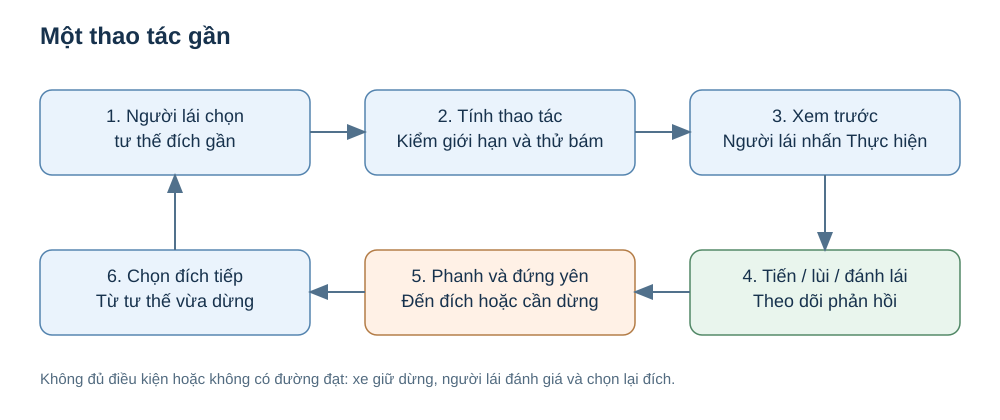
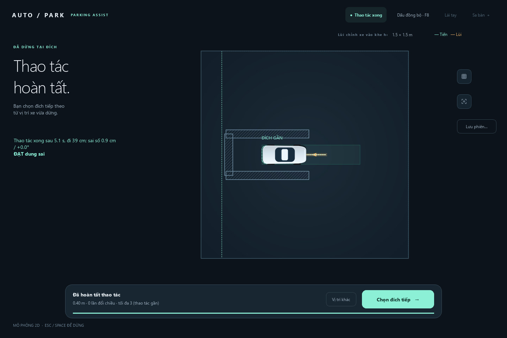

# Vận hành

## Phân biệt bản hiện có và phương án Raspberry Pi

Các thao tác giao diện bên dưới mô tả bản hiện có: người dùng chọn đích gần và xác nhận chạy. Phương án chốt ngày 13/11/2026 đặt AI/chọn chỗ/tính đường trên laptop, bộ thu cảm biến/định vị/bám đường trên Pi và điều khiển ga/lái trên ESP32. Kết nối laptop–Pi dùng Wi-Fi nội bộ. Phần phân tán và tự chọn chỗ đỗ chưa được triển khai trong đợt cập nhật tài liệu này.

Khi triển khai phương án mới, một lượt sẽ gồm: lấy dữ liệu mới → laptop đề xuất chỗ và tính đường → kiểm khả năng bám → người dùng xác nhận → Pi kiểm lại điều kiện → xe thực hiện và báo trạng thái → xác nhận đứng yên. Nếu có vật cản nguy hiểm hoặc dữ liệu quá cũ, Pi yêu cầu dừng tại xe. Sau khi xác nhận xe đứng yên, laptop có thể tính lại đường; xe chỉ chạy lượt mới khi người dùng xác nhận. ESP32 xử lý hết hạn lệnh nếu Pi mất hoạt động.

Xem [luồng tính đường đầy đủ](LUONG_TINH_DUONG.md) và [luồng gặp vật cản](LUONG_VAT_CAN.md). Đây là mô tả hành vi cần xây dựng, không phải các nút/chế độ mới đã có trong ứng dụng.

## Bản hiện có

Mỗi lượt thực hiện một chuyển động gần. Trước khi bắt đầu, xe cần đứng yên, biết đúng vị trí và có khu vực thao tác xác định.

## Trình tự thao tác

1. Chọn tình huống, kiểm vị trí xe và vật cản.
2. Đặt vị trí và hướng đích gần.
3. Tính thao tác; sửa đầu bài nếu bị từ chối.
4. Xem trước nếu muốn kiểm đường và vùng quét.
5. Xác nhận thực hiện; yêu cầu dừng khi cần.
6. Đợi xe đứng yên rồi chọn đích tiếp.

*Xem trước là mô phỏng, chưa làm xe thật chuyển động. Yêu cầu dừng bắt đầu quá trình phanh và chờ phản hồi xác nhận đứng yên.*

*Lần mô phỏng trong ảnh đã dừng tại đích; đường lập dài 40 cm, sai số vị trí cuối khoảng 0,9 cm.*

## Các chế độ

| Chế độ | Ý nghĩa |
|---|---|
| Mô phỏng | Xe và phản hồi được tạo trên máy tính |
| Điều khiển qua bo | Phần mềm gửi yêu cầu chuyển động và nhận số đo từ liên kết điều khiển |
| Quan sát | Người lái điều khiển; phần mềm chỉ tính toán và ghi nhận |

Nhánh sử dụng xe thật còn thiếu điều kiện phản hồi và đo đạc. Thay xe, đích hoặc vật cản làm phương án cũ không còn đủ điều kiện để tiếp tục dùng.

## Đọc kết quả đánh giá

Bộ thử chạy nhiều tình huống hoặc một tình huống riêng. Báo cáo giữ đầu bài, cấu hình và mọi kết quả, kể cả lượt không đạt.

| Kết quả | Cách hiểu |
|---|---|
| Hoàn thành | Xe đến đích trong sai số cho phép và đứng yên |
| Từ chối đúng | Đầu bài vi phạm điều kiện, xe chưa được phép chuyển động |
| Dừng đúng | Xe dừng theo đúng yêu cầu hoặc nguyên nhân lỗi và trong giới hạn đã đặt |
| Không đạt | Kết quả thực tế không đáp ứng kỳ vọng của tình huống |
| Chưa có số đo | Thiếu thông tin hoặc đại lượng không áp dụng; không được hiểu là bằng không |

Không gộp dừng và từ chối thành đến đích thành công. Thời gian chuyển động trong mô phỏng khác thời gian máy tính dùng để tính toán.

## Lưu và phát lại

Bản ghi giữ vị trí, hướng, tốc độ, góc lái và sự kiện. Khi lưu thất bại, bản cũ được giữ; nơi lưu chỉ đổi sau khi ghi thành công.

Phát lại đối chiếu đường và sự kiện đã ghi, kể cả một lượt thất bại. Tìm đường lại từ đầu bài cũ là phép thử mới, có thể cho kết quả khác.

Bản ghi camera và LiDAR được phát lại riêng; cần giữ đúng cấu hình và mốc thời gian. Dữ liệu xuất hiện trở lại sau lỗi không tự cho phép xe chạy tiếp.
