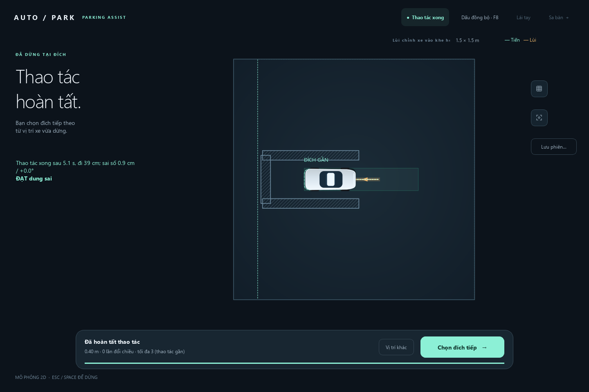

# Vận hành và phát triển

Các lệnh dưới chạy từ thư mục `autopark/`. Luồng giao diện và hai cảnh mẫu ở [README](../../README.md).

<a id="luong-thao-tac"></a>
## Một lượt thao tác


*Xem trước chỉ mô phỏng; phải bấm Thực hiện riêng. Yêu cầu dừng chuyển sang phanh/chờ phản hồi, không có nghĩa xe đứng yên tức thì.*



*Cảnh `thao_tac_lui_vao_khe.json`: đường lập lùi 0,40 m, không đổi chiều; lần chụp đạt COMPLETED, tốc độ cuối 0 và sai số vị trí khoảng 0,9 cm trong SIM.*

## Cài đặt

Windows có `cai_dat.cmd`, `chay_app.cmd`; cài thủ công với Python 3.11 trở lên:

```powershell
python -m venv .venv
.\.venv\Scripts\python.exe -m pip install -r requirements-phase0.lock
.\.venv\Scripts\python.exe -m pip install -e . --no-deps
```

Gói cơ bản: PySide6, NumPy, Shapely. Extras `".[dev]"` cho pytest, `".[lidar]"` cho C1, `".[video]"` cho camera, `".[rig]"` cho bàn thử có AI. Nhánh AI dùng `.venv-train` qua `cai_dat_train.cmd`, cần checkpoint riêng; mô phỏng không cần PyTorch.

Đổi máy: tạo lại venv, mang dữ liệu ngoài Git theo manifest, kiểm `configs/thiet_bi.json` (COM/camera/QEMU). `do_may_moi.cmd` đo bàn thử; dùng `autopark.rig.may_moi --steps` để xem các bước. Ứng dụng tự tắt EcoQoS; `AUTOPARK_KEEP_ECOQOS=1` giữ chính sách Windows khi cần đối chiếu. Số máy bàn không thay kết quả laptop.

## Kịch bản

`schema_version: 1`; các trường chính là `name`, `bounds`, `start`, `goal`, `maneuver`. `vehicle_config` và `obstacles` có mặc định. Đường tệp xe tương đối với kịch bản. [Mẫu](../scenarios/thao_tac_cua_hep.json).

Nội bộ dùng m, s, rad; JSON kịch bản dùng `yaw_deg`, `tolerance_cm`, `tolerance_deg`. `maneuver` có `max_goal_distance_m`, `area_half_extent_m`, `max_path_length_m` (hữu hạn >0) và `max_cusps` (nguyên ≥0). `maneuver: {}` nhận mặc định.

`Scenario(...)` trong Python tự có giới hạn. JSON thiếu/null `maneuver` cho `None` để nhận diện lịch sử. Parser vẫn hiểu `slot`; Session/planner từ chối kịch bản đó, kể cả khi thêm giới hạn. Đổi xe/đích/vật cản cần tính đường lại.

<a id="danh-gia-mo-phong"></a>
## Chạy và đọc bộ đánh giá

```powershell
.\.venv\Scripts\python.exe -X utf8 -m autopark.evaluation.maneuver_bench run --seeds 0,1,2
.\.venv\Scripts\python.exe -X utf8 -m autopark.evaluation.maneuver_bench list
.\.venv\Scripts\python.exe -X utf8 -m autopark.evaluation.maneuver_bench replay runs/TEN_LUOT/cases/CASE_ID_seed_0
```

Lệnh `run` ở trên chạy 44 ca × 3 seed và in đường dẫn thư mục mới trong `runs/`; không ghi đè lượt cũ. Dùng `--case ID` để chọn ca, `--out runs/TEN_MOI` để đặt đích lưu, hoặc `--case-file DUONG_DAN/case.json` để chạy một snapshot riêng. Với `--case-file`, seed lấy trong tệp: bỏ các tùy chọn `--case`/`--seeds`. Thay các tên mẫu bằng tệp/thư mục thực tế.

| Tệp | Dùng để làm gì? |
|---|---|
| `summary.json`, `summary.csv` | Kết quả và lý do đạt/không đạt của từng ca |
| `summary_groups.csv` | Mẫu số và tỷ lệ theo kỳ vọng, nhóm tình huống, seed |
| `manifest.json` | Môi trường, dấu vân tay mã nguồn, cấu hình và các đầu bài |
| `cases/ID_seed_N/` | `case.json` chứa xe/kịch bản/phản hồi/lỗi/tiêu chí; `parameters.json`, `execution.json`, `result.json` giữ tham số, quyết định và kết quả |
| `legs/leg_01/`, `leg_02/` trong mỗi ca | Trace JSON/CSV, quỹ đạo, sự kiện, log và kết quả; leg 2 chỉ có khi chọn đích tiếp |

Trong trace, `x`/`y` dùng mét; các hậu tố `_m`, `_s`, `_rad`, `_deg` chỉ đơn vị của trường tương ứng. `pass_rate` là tỷ lệ 0–1; `null`/không có nghĩa là chưa đo hoặc không áp dụng, không phải 0. `clock_s` vẫn tăng trong khoảng quan sát sau dừng, còn `sim_time_s` đứng yên; các trường `*_wall_elapsed_s` là thời gian thực trên máy.

Mã thoát của `run`: 0 đạt tiêu chí đã cấu hình; 1 có ca không đạt hoặc mã nguồn đổi giữa lượt; 2 lỗi tham số/tệp. Replay dùng quỹ đạo/mốc đã lưu, mã 0 nghĩa **tái hiện khớp**, kể cả ca gốc `FAIL`. Thêm `--replan` để tìm lại từ đầu vào cố định: mã 0 lúc này nghĩa **lượt mới đạt kỳ vọng**, không phải khớp bản ghi. Ca không có quỹ đạo chỉ replay quyết định, không chứng minh lại thời gian hết hạn. [Cách chấm và mốc kết quả](KIEM_THU_VA_LO_TRINH.md#bo-mo-phong).

## Chế độ và cảm biến

| Chế độ | Lệnh tới bo | Trạng thái |
|---|---|---|
| SIM | Không | Mô hình và phản hồi giả |
| VEHICLE_IO | COMMAND có hạn | Telemetry + nguồn tư thế |
| OBSERVE | Không COMMAND, kể cả enable=0 | Người lái, bo DISARMED; phần mềm tính/ghi |

Xem trước vẫn mô phỏng. Bo Python, QEMU và COM là ba mức thử riêng. START kiểm đường, tư thế, phản hồi, đứng yên và giới hạn bo; [điều kiện thiết bị](PHAN_CUNG_VA_HIEU_CHUAN.md).

```powershell
.\.venv\Scripts\python.exe -m autopark.ui.lidar_app
.\.venv\Scripts\python.exe -m autopark.ui.lidar_app --pose-source lidar_sim --no-connect
.\.venv-train\Scripts\python.exe -m autopark.ui.lidar_app --camera-ai --cam-ports 1 2 3 4
```

LiDAR lấy cổng từ cấu hình; `--port COMx` ghi đè. `--recording` dùng scan đã ghi. AI có `--checkpoint`, `--calibration-dir`, `--extrinsics`, `--roi-dir`; xem `--help`.

## Ghi và phát lại

Gói runtime lưu kịch bản/xe/đường/log; `evaluation.replay` chạy lại quyết định. Gói lịch sử thiếu `maneuver` hoặc có `slot` bị `ReplayNotSupported` (CLI mã 2); vẫn đọc/chấm log được.

Bản ghi cảm biến là luồng riêng, vẫn phát lại bình thường. Ngăn **Ghi cảm biến** của `ui.lidar_app` ghi camera/scan cùng đồng hồ log; bắt đầu khi xe đứng yên. Liên kết ghi `events.csv` với mã/nguồn `session_stop`, tư thế, telemetry và đồng hồ.

```powershell
.\.venv-train\Scripts\python.exe -m autopark.rig.bench --ports 1 2 3 4 --lidar --seconds 120 --name g01 --out runs/rig_bench --record runs/rig_recordings/g01
.\.venv\Scripts\python.exe -m autopark.ui.rig_app --replay runs/rig_recordings/g01 --no-ai
.\.venv-train\Scripts\python.exe -m autopark.ui.lidar_app --camera-ai --session-replay runs/session_recordings/PHIEN
```

Thay `PHIEN` bằng thư mục thật. `--session-replay` dùng một đồng hồ cho hai nguồn; `--cam-replay` và `--recording` mở riêng không bảo đảm cùng mốc. JPEG/tải máy có thể làm kết quả phát lại khác từng bit; giữ meta và số mẫu bỏ.

## Phát triển

Mã ở `autopark/`: `application` quản lý phiên; `planning/geometry/control/simulation` xử lý chuyển động; `lidar/perception/fusion/rig` xử lý cảm biến; `transport` nối firmware; `storage/evaluation/ui` lưu, chấm và giao diện.

Thư mục `maneuver_suite_*` dùng `maneuver_bench replay` ở trên; gói xuất từ giao diện dùng `evaluation.replay`, bản ghi cảm biến dùng công cụ rig tương ứng.

```powershell
.\.venv\Scripts\python.exe -m pytest tests/test_maneuver.py tests/test_maneuver_rollout_limits.py tests/test_runtime_safety.py
.\.venv\Scripts\python.exe -m autopark.evaluation.replay --help
.\.venv\Scripts\python.exe -m autopark.evaluation.score_run --help
```

Đóng góp bắt đầu từ ca tái hiện, sửa đúng phần và kiểm nhóm liên quan; test PyTorch/QEMU/thiết bị cần môi trường tương ứng. Giữ kết quả không đạt, không sửa dữ liệu gốc. [Cách đánh giá](KIEM_THU_VA_LO_TRINH.md).

Tái tạo hai ảnh app và năm sơ đồ: `.venv\Scripts\python.exe docs/images/render_docs.py`. Helper dùng SIM, kiểm tính đường/hoàn thành rồi chụp; bản PNG xem thử của SVG ghi vào thư mục tạm. Ảnh bằng chứng lịch sử được giữ nguyên.
