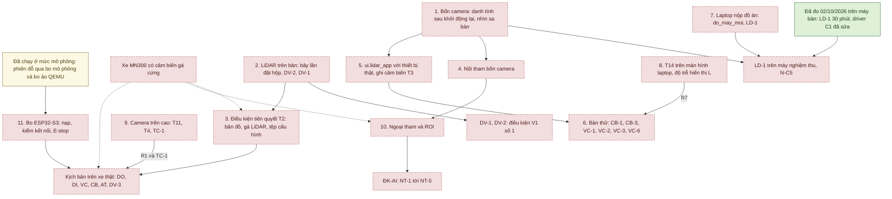

# Việc cần người ở cạnh thiết bị (02/10/2026)

*Viết 02/10/2026, cho lần tới có người ở bàn thử.* Danh sách các việc chỉ làm được khi có người ở cạnh máy bàn, bốn
camera và LiDAR C1, hay khi có thiết bị chưa ở bàn hoặc chưa có (laptop nộp đồ án, camera trên cao, xe MN300, bo
ESP32-S3), xếp theo thứ tự nên làm. Mỗi việc ghi: mục đích và kịch bản nghiệm thu nó mở khóa ([KICH_BAN_NGHIEM_THU.md](KICH_BAN_NGHIEM_THU.md);
điều kiện V1 ở [NGUONG_NGHIEM_THU_DE_XUAT.md](NGUONG_NGHIEM_THU_DE_XUAT.md) mục 11.2), điều kiện trước, các bước với lệnh,
thời gian dự kiến, nơi ghi kết quả và trạng thái ngày 02/10/2026. Lệnh chép từ tài liệu chi tiết liên kết ở từng việc và
đã đối chiếu với mã ngày 02/10/2026; giải thích đầy đủ ở tài liệu đó.

**Vì sao.** Người dùng giao quyết định 02/10/2026 ('làm hết'), theo đề xuất: được chạy LiDAR và camera khi không có người
trông, và ảnh cảnh sa bàn chỉ lưu cục bộ trong `runs/` (git bỏ qua), không commit. Ngày đó các việc chạy được từ xa đã
làm. Các việc dưới đây cần tay người (khởi động lại máy, quay camera, in và dán, đo bằng thước, đặt hay kéo vật, rút cáp)
hoặc cần thiết bị chưa có.

**Đã làm từ xa ngày 02/10/2026, không làm lại** ([CHUYEN_MAY_BAN.md](CHUYEN_MAY_BAN.md) mục 12–14):
- `camera_bench measure` bốn camera 640×480, 60 s: mỗi camera 23,8 khung/s thật, 0 khung hỏng.
- `fusion.demo` 30 s với C1 thật: COMPLETED, 0 lỗi đọc (chạy bằng driver cũ).
- LD-1 trên máy bàn: lần 3 chạy đủ 30 phút có ghi phiên (bốn camera 23,85 khung/s, LiDAR 10,008 Hz và 0 lỗi, AI 23,75
  bộ/s, ghi 4,44 MB/s, bỏ 0). Chưa phải lượt nghiệm thu LD-1: thiếu hai điều kiện của việc 1 và chưa chạy trên laptop
  (việc 7).
- Bản sửa driver C1 (đọc bỏ byte cũ ở cổng CP210x, nơi `reset_input_buffer()` không xóa gì), đã thử trên C1 thật.
- Đo vòng điều khiển 50 Hz khi cửa sổ thu nhỏ, với SIM và bo mô phỏng: để Windows tự quyết thì thời gian tính mỗi bước
  chậm 1,73–1,76 lần, ứng dụng tự tắt EcoQoS thì hết.
- Ứng dụng chạy hai lần đỗ qua bo ảo QEMU thật: firmware thật trong QEMU, xe mô phỏng phía laptop, không ai bấm.
- Kiểm tĩnh nguồn tư thế LiDAR (T2) trên C1 thật đứng yên trên bàn (cảnh phòng, chưa phải sa bàn): bản đồ một chỗ đặt
  `--anchor 0 0 0`, 269/269 vòng OK sau khởi tạo, tư thế dao động trong 3,0 mm / 2,6 mm / 0,06° (độ lặp lại tĩnh, không
  phải độ chính xác so với thước; mục 12.3 của tài liệu trên).

**Còn làm được từ xa, không thuộc danh sách này:** đọc trạng thái EcoQoS của cửa sổ `run_app.py` thật từ một tiến trình
khác (CHƯA THỬ, [CHUYEN_MAY_BAN.md](CHUYEN_MAY_BAN.md) mục 10.1); chạy lại LD-1 khi việc 1 đã quay camera nhìn sa bàn.

**Quy ước.**
- Mỗi lệnh một dòng, chạy trong thư mục `autopark` của repo (thư mục có pyproject.toml), dán được vào cmd.exe. Thay
  `<ngay>` (yyyymmdd), `<ten>`, `<lan>`… bằng giá trị thật, tên không dấu.
- Lệnh mở camera, LiDAR hay cổng COM là lệnh chạm thiết bị: người ở bàn chạy. Cổng LiDAR lấy từ `configs/thiet_bi.json`
  (máy bàn: COM3); `--port COMx` ghi đè cho một lần.
- Mã phải có các thay đổi của đợt 2 (02/10/2026), nhất là bản sửa driver C1 ([CHUYEN_MAY_BAN.md](CHUYEN_MAY_BAN.md) mục
  12.2).
- Ảnh và video camera (sa bàn, phòng, xe) chỉ để trong `runs/`; vào `docs/evidence/` chỉ chép tệp chữ, JSON, CSV. Tệp CSV
  chỉ được git giữ khi nằm thẳng trong `docs/evidence/`, không trong thư mục con ([KICH_BAN_NGHIEM_THU.md](KICH_BAN_NGHIEM_THU.md)
  mục 2.3).
- Thời gian dự kiến là ước tính khi không ghi nguồn: chưa ai làm các việc này với thiết bị thật.

## Tóm tắt và thứ tự

Sơ đồ dưới cho thấy việc nào mở khóa việc nào và kịch bản nghiệm thu nào; mũi tên đi từ việc tới điều nó mở khóa.

Xanh: đã có và đã kiểm/đo · Vàng: chỉ trong mô phỏng/giả lập · Đỏ viền đứt: chưa làm hoặc chưa thử trên thiết bị. Mũi
tên đứt: cần xe MN300 có cảm biến gá, chưa có.

| Thứ tự | Việc | Cần có | Mở khóa | Trạng thái 02/10/2026 |
|---|---|---|---|---|
| 1 | Bốn camera: danh tính và hướng sau khởi động lại; nhìn sa bàn thật | máy bàn, bốn camera, sa bàn | hai điều kiện trước phiên của LD-1 (N-C5); điều kiện V1 số 2 | CHƯA KIỂM |
| 2 | LiDAR trên bàn: bảy lần đặt hộp (p04), DV-2, DV-1 | C1, thước, hộp, xe giả có thước thẳng ≥ 0,65 m | DV-1, DV-2 (N-L0 … N-L4); ba điều kiện tiên quyết của T2; điều kiện V1 số 1 | CHƯA THỬ |
| 3 | Điều kiện tiên quyết T2: bản đồ phiên, gá LiDAR, tệp cấu hình | việc 2; sa bàn thật; xe MN300 (phần gá) | VehicleIO với bo thật (mọi kịch bản XT), CB-6, DV-3 | gá GIẢ ĐỊNH – CHƯA ĐO; bản đồ phiên CHƯA LÀM |
| 4 | Nội tham bốn camera | bảng in dán phẳng, thước | việc 10; ĐK-AI (NT-1 … NT-5); điều kiện V1 số 2, 3 | CHƯA LÀM |
| 5 | `ui.lidar_app` với C1 và camera thật, ngăn "Ghi cảm biến" (T3) | việc 1; `.venv-train` | bản ghi cảm biến GD3 của mọi kịch bản; DV-3; MB/s cảnh sa bàn | CHƯA THỬ |
| 6 | Bàn thử cần tay: CB-1, CB-3, VC-1, VC-6, VC-2, VC-3 | việc 5; hộp có dây kéo | phần BT của các kịch bản đó (điều kiện V1 số 8, mức BT) | CHƯA THỬ |
| 7 | Laptop nộp đồ án: `do_may_moi`, LD-1 | laptop, hub với bốn camera, C1 | LD-1 trên máy nghiệm thu; số N-C, N-T trên máy đó | CHƯA ĐO |
| 8 | T14 trên màn hình laptop, độ trễ hiển thị L | laptop; một camera quay màn hình | R7 của VC-1, VC-2, VC-3, CB-1, CB-3 và mọi kịch bản dùng R7 | CHƯA THỬ; L CHƯA ĐO |
| 9 | Camera trên cao: T11, T4, TC-1 | camera trên cao (CHƯA CHỐT), giá, tờ ArUco in, thước, xe giả | R1 và TC-1 (thuộc ĐK-XT); chấm DO-1 … DO-6, DV-3, NT-2 | CHƯA THỬ |
| 10 | Ngoại tham và ROI | việc 4; xe MN300 có camera gá cứng | ĐK-AI (NT-1 … NT-5), N-G1, N-G2; điều kiện V1 số 2, 3 | CHƯA LÀM |
| 11 | Bo ESP32-S3: nạp, "Kiểm kết nối bo", CLEAR_FAULT, E-stop; firmware 100 mm/s | bo ESP32-S3 | T1 với bo thật; ĐK-XT; AT-1 … AT-5, CB-4, CB-5, DI trên xe và mọi kịch bản XT; điều kiện V1 số 6, 9 | CHƯA LÀM (chưa có bo) |

Lần tới, với thiết bị đang có ở bàn: 1 → 2 → 4 → 5 → 6, và bản đồ của việc 3 khi sa bàn thật đã dựng. Mang laptop tới:
7, 8. Có camera trên cao: 9 (in tờ ArUco và đo mốc sàn làm được trước). Có xe: phần gá của việc 3 và việc 10. Có bo: 11.

## 1. Bốn camera: danh tính và hướng sau khởi động lại, nhìn sa bàn thật

**Mục đích, mở khóa.** Hai điều kiện trước phiên của LD-1 mà lượt 02/10/2026 chưa kiểm ([KICH_BAN_NGHIEM_THU.md](KICH_BAN_NGHIEM_THU.md)
mục 5.8; [CHUYEN_MAY_BAN.md](CHUYEN_MAY_BAN.md) mục 12.1): camera nhìn sa bàn thật; khởi động lại máy 3 lần, mỗi lần chụp
một bộ ảnh để kiểm từng camera đúng hướng theo cổng hub. Điều kiện thứ hai là N-C5 (tuyệt đối 4/4 đúng ở mỗi lần, ít nhất 3 lần;
[NGUONG_NGHIEM_THU_DE_XUAT.md](NGUONG_NGHIEM_THU_DE_XUAT.md) mục 6), thuộc điều kiện V1 số 2. Camera nhìn sa bàn thật còn
cần cho MB/s của cảnh sa bàn (bước 5, việc 5) và ảnh sa bàn để gán nhãn tập chấm ([GAN_NHAN_SA_BAN.md](GAN_NHAN_SA_BAN.md)).

**Điều kiện trước.** Hub UGREEN với bốn camera ở cổng hub 1–4 ([usb_topology.md](usb_topology.md)); sa bàn (ít nhất mặt
sàn) đã dựng. Cổng nào là hướng trước, sau, trái, phải: CHƯA CHỐT (ghi theo cổng khi có gá trên xe); tới lúc đó kiểm rằng
mỗi cổng hub vẫn là đúng camera, đúng cảnh.

**Các bước.**
1. Quay bốn camera nhìn sa bàn thật, mỗi camera một phía; ghi lại cổng hub nào nhìn phía nào (gợi ý: đặt trong khung mỗi
   camera một tờ giấy ghi số cổng).
2. Ghi bảng cổng hub → index OpenCV và InstanceId (lệnh tự tạo thư mục):
   `.venv\Scripts\python.exe -X utf8 -m autopark.video.camera_bench list --out docs\evidence\thiet_bi_<ngay>\usb_topology_lan0.json`
3. Chụp một bộ ảnh: mở `.venv-train\Scripts\python.exe -X utf8 -m autopark.ui.rig_app --ports 1 2 3 4 --no-ai`, bấm
   "Chụp bộ ảnh" (ảnh gốc từng camera, tên theo cổng hub, vào `runs\rig_snapshots\<ngày_giờ>\cam_p<N>.png`), đóng cửa sổ.
4. Khởi động lại máy, lặp bước 2 (tệp `usb_topology_lan<k>.json`) và bước 3. So với lần trước: InstanceId của từng cổng
   không đổi; ảnh `cam_p<N>` của mỗi cổng vẫn đúng camera, đúng cảnh. Làm 3 lần.
5. Camera đã nhìn sa bàn thì chạy lại LD-1 (không cần người ở cạnh; [KICH_BAN_NGHIEM_THU.md](KICH_BAN_NGHIEM_THU.md) mục
   5.8). Ghi thử 60 s để có MB/s của cảnh sa bàn:
   `.venv-train\Scripts\python.exe -X utf8 -m autopark.rig.bench --ports 1 2 3 4 --lidar --seconds 60 --name ld1_thu_ghi --out runs\rig_bench\<ngay> --record runs\rig_recordings\<ngay>_ld1_thu_ghi`
   rồi 30 phút, khi ổ còn trống ít nhất MB/s × 1800 cộng dư (thư mục `--record` phải chưa có hoặc rỗng):
   `.venv-train\Scripts\python.exe -X utf8 -m autopark.rig.bench --ports 1 2 3 4 --lidar --seconds 1800 --name ld1 --out runs\rig_bench\<ngay> --record runs\rig_recordings\<ngay>_ld1`
   *(Cập nhật 06/10/2026, ĐỀ XUẤT – CHỜ CHỐT.)* Chạy hai lệnh trên qua wrapper `chay_co_theo_doi.py` để có PID, mã
   thoát 32 bit, minidump nếu crash và hạn giờ (`--het-gio` 300 s cho lệnh 60 s, 2400 s cho lệnh 30 phút), ví dụ:
   `.venv\Scripts\python.exe -X utf8 docs\evidence\su_co_thoat_20261006\chay_co_theo_doi.py --ra runs\thiet_bi_<ngay>\ld1 --het-gio 2400 --theo-doi -- .venv-train\Scripts\python.exe -X utf8 -X faulthandler -m autopark.rig.bench --ports 1 2 3 4 --lidar --seconds 1800 --name ld1 --out runs\rig_bench\<ngay> --record runs\rig_recordings\<ngay>_ld1`
   Không dùng wrapper thì mở lệnh từ PowerShell, không từ Git Bash: tiến trình mở từ Git Bash mang ErrorMode 0x3 nên
   Windows Error Reporting không ghi sự kiện hay minidump khi crash. Trước khi chạy, báo các phiên tác tử Claude khác
   trên máy không dừng tiến trình python theo tên hay theo cỡ bộ nhớ: ngày 02/10/2026 một phiên như thế đã dừng nhầm
   LD-1 lần 1 ([CHUYEN_MAY_BAN.md](CHUYEN_MAY_BAN.md) mục 16). Tải CPU của `--theo-doi` CHƯA ĐO. Để `--ra` ngoài git
   (`runs\`); KHÔNG chép `theo_doi\python.csv`, `theo_doi\gpu_app.csv` hay `lenh_giet.txt` của wrapper vào
   `docs\evidence`: các tệp đó có thể chứa dòng lệnh hay tên của tiến trình khác trên máy, kể cả của dự án khác.

**Thời gian.** ≈ 30 phút cho ba lần khởi động lại; LD-1 chạy lại thêm ≈ 32 phút, không cần người.

**Ghi kết quả.** `usb_topology_lan<k>.json` và một bảng "4/4 đúng hay không" cho từng lần ở `docs\evidence\thiet_bi_<ngay>\`;
ảnh chỉ ở `runs\rig_snapshots\`. Kết luận vào [usb_topology.md](usb_topology.md) (mục "Điều chưa làm" có việc này) và một
mục mới có ngày trong [CHUYEN_MAY_BAN.md](CHUYEN_MAY_BAN.md).

**Trạng thái 02/10/2026.** CHƯA KIỂM trên máy bàn hiện tại. Lần kiểm khởi động lại duy nhất là 23/09/2026 trên máy bàn cũ:
InstanceId từng cổng giữ nguyên, index OpenCV đổi ([usb_topology.md](usb_topology.md)). Ngày 02/10/2026: cổng → index 1 → 0,
2 → 2, 3 → 1, 4 → 3 ([camera_list.txt](evidence/thiet_bi_20261002/camera_list.txt)); camera nhìn gì không ai kiểm.

## 2. LiDAR trên bàn: bảy lần đặt hộp, DV-2, DV-1

**Mục đích, mở khóa.** DV-1 (N-L0 … N-L3, N-T7) và DV-2 (N-L4) của [KICH_BAN_NGHIEM_THU.md](KICH_BAN_NGHIEM_THU.md) mục 5.7,
thuộc điều kiện V1 số 1 (cùng DV-3, cần xe). Ba điều kiện tiên quyết của T2 cho bo thật (việc 3) đến từ đây: dấu góc
trái/phải của C1 chốt bằng lần đặt hộp bên trái p04 (chưa xác minh bằng vật thật, [GIAI_DOAN_1_LIDAR.md](GIAI_DOAN_1_LIDAR.md)
mục 6b); nguyên nhân lệch hướng +4,3° giữa hai lần bật (DV-2); định vị tĩnh so với thước (DV-1).

**Điều kiện trước.** C1 ở cổng của `configs/thiet_bi.json`; mã có bản sửa driver C1. Thước thép ≥ 3 m, thước kẹp, băng
dính; hộp mặt trắng mờ rộng ≥ 30 cm và một hộp đen. Cho DV-1: "xe giả" mang C1, có dấu tâm quay và một thước thẳng cứng
≥ 0,65 m (nên 1 m) gắn song song trục hướng ([KICH_BAN_NGHIEM_THU.md](KICH_BAN_NGHIEM_THU.md) mục 3.2). Vạch 0,25 m hay
thước đo góc không đủ cho N-L2 (cần tham chiếu hướng ≤ 0,67°).

**Các bước.**
1. Bảy lần đặt hộp ([GIAI_DOAN_1_LIDAR.md](GIAI_DOAN_1_LIDAR.md) mục 6): C1 dán cố định trên bàn phẳng, đánh dấu tâm quay,
   đo bằng thước từ tâm quay tới mặt hộp. Lần đầu làm nóng 2 phút:
   `.venv\Scripts\python.exe -X utf8 -m autopark.lidar.bench record --out runs\lidar_bench\<ngay> --name p01_truoc_0.5m --seconds 15 --warmup 120 --expected-distance 0.50 --expected-angle 0`
   Sáu lần sau dùng cùng lệnh, bỏ `--warmup 120`, đổi ba tham số:

   | Lần | `--name` | `--expected-distance` | `--expected-angle` |
   |---|---|---|---|
   | p02 | `p02_truoc_1m` | 1.00 | 0 |
   | p03 | `p03_truoc_2m` | 2.00 | 0 |
   | p04 | `p04_trai_1m` | 1.00 | 90 |
   | p05 | `p05_phai_1m` | 1.00 | -90 |
   | p06 | `p06_sau_1m` | 1.00 | 180 |
   | p08 | `p08_den_truoc_1m` (hộp đen; thêm `--note "hop den"`) | 1.00 | 0 |

   Bảng kết quả: `.venv\Scripts\python.exe -X utf8 -m autopark.lidar.bench report runs\lidar_bench\<ngay>`. Ngưỡng đạt đề
   xuất (N-L0): sai số ≤ 30 mm, hướng lệch ≤ 5°, 8–12 Hz, tia/vòng trong ±5 % của 5 kHz ÷ tần số, không trống quá 3 chu
   kỳ. p04 cho góc âm thì dấu góc ngược: thêm `--mirror` và ghi lại lý do.
2. DV-2, 5 cặp phiên: C1 dán cố định, không chạm; dấu băng dính quanh đế, chụp ảnh đế trước và sau (ảnh chỉ trong `runs\`).
   Phiên một:
   `.venv\Scripts\python.exe -X utf8 -m autopark.lidar.bench record --out runs\lidar_bench\<ngay> --name dv2_c1_a --seconds 20 --warmup 5`
   chờ lệnh xong (mô-tơ dừng), rồi phiên hai với `--name dv2_c1_b`; mỗi cặp một tên riêng. Dựng bản đồ từ phiên một, định
   vị phiên hai:
   `.venv\Scripts\python.exe -X utf8 -m autopark.lidar.occupancy --recording runs\lidar_bench\<ngay>\dv2_c1_a.npz --out runs\lidar_bench\<ngay>\map_dv2`
   `.venv\Scripts\python.exe -X utf8 -m autopark.lidar.localize --map runs\lidar_bench\<ngay>\map_dv2 --recording runs\lidar_bench\<ngay>\dv2_c1_b.npz --out runs\nghiem_thu\<ngay>\dv2_b --skip-seconds 3`
   N-L4 (đề xuất): |Δθ| ≤ 0,2° giữa hai phiên liên tiếp.
3. DV-1, ≥ 6 tư thế × 2 loạt, mỗi loạt một bản đồ mới, cùng buổi với bước 1. Xe giả trên sàn sa bàn; ghi bản đồ ở gốc:
   `.venv\Scripts\python.exe -X utf8 -m autopark.lidar.bench record --out runs\lidar_bench\<ngay> --name dv1_goc --seconds 20 --warmup 5`
   `.venv\Scripts\python.exe -X utf8 -m autopark.lidar.occupancy --recording runs\lidar_bench\<ngay>\dv1_goc.npz --out runs\lidar_bench\<ngay>\map_dv1`
   Dời xe giả tới từng tư thế (ví dụ (+0,20; 0), (0; +0,20), (+0,30; −0,20) m; hướng 0°, +10°, −20°), đo tọa độ hai đầu
   thước bằng thước thép so với mốc sàn, rồi:
   `.venv\Scripts\python.exe -X utf8 -m autopark.lidar.bench record --out runs\lidar_bench\<ngay> --name dv1_d01 --seconds 15 --warmup 5`
   `.venv\Scripts\python.exe -X utf8 -m autopark.lidar.localize --map runs\lidar_bench\<ngay>\map_dv1 --recording runs\lidar_bench\<ngay>\dv1_d01.npz --out runs\nghiem_thu\<ngay>\dv1_d01 --skip-seconds 3`
   So `summary.ok_pose_median` của `localize.json` với số đo thước (hướng so theo hiệu đã quấn về ±180°). Tư thế ngoài
   bản đồ phải ra FAILED hay AMBIGUOUS, không OK sai (N-L3).

**Thời gian.** Bảy lần đặt hộp ≈ 30–45 phút; DV-2 ≈ 20 phút; DV-1 hai loạt ≈ 1–1,5 giờ; tổng ≈ 2–3 giờ.

**Ghi kết quả.** Bản ghi ở `runs\lidar_bench\<ngay>\` và `runs\nghiem_thu\<ngay>\` (git bỏ qua). Của bước 1: `*.analysis.json`,
hình vòng quét `*.png` và `report.md` vào `docs/evidence/lidar/`, cập nhật [gate_01.md](gate_01.md) ([GIAI_DOAN_1_LIDAR.md](GIAI_DOAN_1_LIDAR.md)
mục 6). Của DV-1, DV-2: `localize.json` vào `docs\evidence\thiet_bi_<ngay>\`, biên bản thước dạng CSV đặt thẳng trong
`docs\evidence\` (ví dụ `docs\evidence\dv1_thuoc_<ngay>.csv`). Trạng thái DV-1, DV-2 vào [KICH_BAN_NGHIEM_THU.md](KICH_BAN_NGHIEM_THU.md)
mục 4 và 5.7; đạt thì điền điều kiện tiên quyết ở việc 3, bước 4.

**Trạng thái 02/10/2026.** Bảy lần đặt hộp CHƯA LÀM; DV-1, DV-2 CHƯA THỬ.

## 3. Điều kiện tiên quyết T2 cho bo thật: bản đồ phiên, gá LiDAR, tệp cấu hình

**Mục đích, mở khóa.** Hôm nay Bắt đầu đỗ ở VehicleIO với bo thật luôn bị từ chối trước mọi I/O (START_POSE_UNVERIFIED)
tới khi `configs/dinh_vi_lidar_v0.json` ghi gá LiDAR đã đo và ba điều kiện tiên quyết đạt, có bằng chứng
([NGUON_TU_THE_LIDAR.md](NGUON_TU_THE_LIDAR.md) mục 1, 6). Việc này mở đường cho mọi kịch bản trên xe thật dùng nguồn tư
thế LiDAR (DO, DI, VC, CB, AT), CB-6 và DV-3; điều kiện V1 số 1. Sau đó vẫn còn chặn: T8 (firmware chưa đọc tốc độ, góc
lái, nên START_CHECK từ chối) và việc 11.

**Điều kiện trước.** Việc 2 xong. Sa bàn thật đã dựng, hệ tọa độ sa bàn đã kiểm vuông ([KICH_BAN_NGHIEM_THU.md](KICH_BAN_NGHIEM_THU.md)
mục 3.3). Phần gá: xe MN300 có C1 gá cứng (CHƯA CÓ).

**Các bước.**
1. Bản đồ của phiên trên sa bàn thật, nhiều chỗ đặt (làm được trước khi có xe; [NGUON_TU_THE_LIDAR.md](NGUON_TU_THE_LIDAR.md)
   mục 2). Mỗi chỗ đặt là một bản ghi C1 đứng yên, ví dụ:
   `.venv\Scripts\python.exe -X utf8 -m autopark.lidar.bench record --out runs\lidar_bench\<ngay> --name cho_1 --seconds 20 --warmup 5`
   Chỗ đặt 1 là mốc neo: tâm quay C1 đo bằng thước trong hệ sa bàn, hướng neo đo bằng thước thẳng ≥ 0,65 m. Dựng:
   `.venv\Scripts\python.exe -X utf8 -m autopark.lidar.map_builder --placement runs\lidar_bench\<ngay>\cho_1.npz --anchor X Y YAW_DEG --placement runs\lidar_bench\<ngay>\cho_2.npz --scenario scenarios\sa_ban_3x2_hai_hop.json --out runs\lidar_maps\<ngay>_<ten>`
   `--scenario` là tệp sa bàn ứng với sa bàn thật; thêm `--pose K X Y YAW_DEG` cho chỗ đặt có số đo thước. Bị từ chối thì
   chỉ có `map_build.json` với `ok` = false, mã thoát 1.
2. Thử nguồn tư thế với C1 đứng yên (BT):
   `.venv\Scripts\python.exe -X utf8 -m autopark.ui.lidar_app --pose-source lidar_real --lidar-map runs\lidar_maps\<ngay>_<ten>`
   rồi xem nhãn "Định vị LiDAR: …" (làm mới 5 Hz) ở thẻ "Bo điều khiển". "LiDAR thật" chỉ đi với bo COM, và Bắt đầu
   đỗ với bo COM vẫn bị từ chối (START_POSE_UNVERIFIED) tới bước 4.
3. Khi có xe: đo gá LiDAR, tức tâm quay C1 trong hệ xe (gốc ở tâm trục sau, x hướng tiến, y sang trái, yaw ngược chiều kim
   đồng hồ), bằng thước.
4. Ghi vào `configs/dinh_vi_lidar_v0.json` (tệp mã đọc mặc định; đọc chặt, khóa lạ là lỗi): `mount.x_m`, `y_m`, `yaw_deg`,
   `z_m`, `measured: true`, `measured_on`, `evidence` (đường dẫn tệp trong `docs/evidence/`); với
   `prerequisites.dau_goc_p04`, `huong_goc_dv2`, `dinh_vi_tinh_dv1`: `ok: true` kèm `evidence`. Ghi `ok` mà thiếu
   `evidence` vẫn tính là chưa đạt.

**Thời gian.** Bản đồ 3–5 chỗ đặt ≈ 30–60 phút; đo gá ≈ 15 phút khi có xe.

**Ghi kết quả.** Bản đồ ở `runs\lidar_maps\<ngay>_<ten>\` (`costmap.json`, `map_build.json`, `placements.csv`…; git bỏ qua).
Bằng chứng gá và các điều kiện vào `docs/evidence/` (thư mục có ngày); tệp cấu hình như bước 4; cập nhật
[NGUON_TU_THE_LIDAR.md](NGUON_TU_THE_LIDAR.md) mục 6, 9.

**Trạng thái 02/10/2026.** Gá GIẢ ĐỊNH – CHƯA ĐO (`measured` false: x 0,095 m, y 0, yaw 0°, giữa hai trục của xe giả định);
ba điều kiện `ok` false; bản đồ phiên trên sa bàn thật CHƯA LÀM. Nguồn tư thế LiDAR mới kiểm ở mức MP và trên bản ghi C1
đứng yên (offline).

## 4. Hiệu chuẩn nội tham bốn camera

**Mục đích, mở khóa.** `calibration/cam_p1.json` … `cam_p4.json` (chưa có tệp nào). Cần cho ngoại tham và ROI (việc 10),
BEV và để ngăn AI camera tạo vật cản (ĐK-AI của NT-1 … NT-5); điều kiện V1 số 2, 3.

**Điều kiện trước.** In `calibration/bang_in/ban_co_9x6_30mm_A3.pdf` (nên dùng nếu in được A3) hay
`ban_co_9x6_20mm_A4.pdf`: in 100 % ("Actual size", tắt "Fit to page"), dán lên tấm phẳng cứng, đo lại cỡ ô bằng thước
(8 ô một hàng chia 8, 5 ô một cột chia 5; lệch nhau quá 0,5 % thì in lại). Bốn camera ở cổng hub 1–4, mode 640×480 MJPG.
Đủ đèn, tránh lóa. Camera chưa gá: cố định bảng trên tường, cầm camera di chuyển (tương đương về hình học).

**Các bước** ([HIEU_CHUAN_CAMERA.md](HIEU_CHUAN_CAMERA.md) mục 2–4), mỗi camera một lần:
1. `.venv\Scripts\python.exe -X utf8 -m autopark.ui.calib_app --port 1 --square-mm 19.95` (đổi cổng 1..4; cỡ ô là số ĐO
   ĐƯỢC; đánh dấu "Đã đo cỡ ô bằng thước").
2. Chụp 20–30 ảnh (tay hay "Tự chụp"): phủ kín ảnh, nhất là mép và bốn góc (lưới phủ đỏ chuyển xanh); nghiêng bảng 20–45°
   quanh cả hai trục, vài ảnh nhìn thẳng ở giữa; giữ yên.
3. "Hiệu chuẩn" (≥ 8 ảnh); đọc tiêu chí đề xuất (RMS ≤ 0,5 px, ảnh tệ nhất ≤ 1,0 px, ≥ 15 ảnh dùng, phủ ≥ 70 % và đủ bốn
   khối góc, ≥ 4 ảnh nghiêng ≥ 20°, sai số chuyển đổi ≤ 0,5 px và `woodscape_intrinsic.ok`); xem ảnh nắn (cạnh bảng thẳng ở
   mọi vị trí); "Lưu".
4. Kiểm: `.venv\Scripts\python.exe -X utf8 -m autopark.perception.fisheye_calib check calibration\cam_p1.json`. So fx của
   bốn camera với nhau.

**Thời gian.** ≈ 20–30 phút mỗi camera, ≈ 1,5–2 giờ cho bốn camera.

**Ghi kết quả.** `calibration/cam_p<N>.json` (commit; bản đã commit là bản chính thức); ảnh và bản sao ở
`runs/calib/<ngày giờ>_p<N>/` (git bỏ qua). Cập nhật [HIEU_CHUAN_CAMERA.md](HIEU_CHUAN_CAMERA.md) mục 6 và
[calibration/README.md](../calibration/README.md).

**Trạng thái 02/10/2026.** CHƯA LÀM: chưa in bảng, chưa có ảnh bảng nào từ camera thật; công cụ mới kiểm trên ảnh tổng
hợp.

## 5. `ui.lidar_app` với LiDAR và camera thật, ngăn "Ghi cảm biến" (T3)

**Mục đích, mở khóa.** Ghi cảm biến trong phiên đỗ (T3) mới kiểm offscreen với nguồn giả. Cần thử với thiết bị thật trước
khi dùng bản ghi cho nghiệm thu: bản ghi cảm biến GD3 của mỗi lần chạy ([KICH_BAN_NGHIEM_THU.md](KICH_BAN_NGHIEM_THU.md)
mục 2.2), DV-3 (tái định vị offline từ bản ghi), phân tích lỗi. Cũng là lần đầu `ui.lidar_app` chạy với C1 và camera thật.
Số cần: MB/s của cảnh sa bàn, khung bị bỏ, `ecoqos_start`/`ecoqos_stop`, ảnh hưởng lên vòng 50 Hz khi bật và tắt ghi, khi
cửa sổ thu nhỏ.

**Điều kiện trước.** Việc 1 (camera nhìn sa bàn thật); `.venv-train` (AI camera cần torch); ổ chứa
`runs\session_recordings` còn ≥ 5 GB. Chưa có nội tham, ngoại tham đo và ROI nên ngăn AI camera không tạo vật cản; việc ghi
không phụ thuộc điều đó.

**Các bước** ([GHI_PHAT_LAI_BAN_THU.md](GHI_PHAT_LAI_BAN_THU.md) mục 9):
1. `.venv-train\Scripts\python.exe -X utf8 -m autopark.ui.lidar_app --camera-ai --cam-ports 1 2 3 4 --record-root runs/session_recordings --record-format jpg --jpeg-quality 95 --record-min-free-gb 5`
2. Bật AI camera, kết nối LiDAR. Ở ngăn "Ghi cảm biến": điền Tên (ví dụ `t3_sa_ban`) → "Bắt đầu ghi" → F8 (dấu đầu) → Tìm
   đường đỗ, Bắt đầu đỗ (xe ảo) → xe dừng → F8 (dấu cuối) → "Dừng ghi" → chờ dòng "XONG" → "Xuất log CSV…". Ghi khoảng
   60 s.
3. Lặp với cửa sổ thu nhỏ trong lúc ghi, và một lần chạy không ghi để so.
4. Đọc `meta.json` của bản ghi: MB/s, khung bị bỏ, `session_recording.ecoqos_start`, `ecoqos_stop`; cột `window` của
   `session/clock.csv`.
5. Phát lại thử (không mở thiết bị):
   `.venv-train\Scripts\python.exe -X utf8 -m autopark.ui.lidar_app --camera-ai --session-replay runs/session_recordings/<thư mục>`

Vòng 50 Hz khi bật và tắt ghi, khi thu nhỏ: chưa có công cụ đo trong `ui.lidar_app`. `ecoqos_gui do-chay` chỉ dựng cửa sổ
của `ui.app` với SIM hay bo mô phỏng, không camera, LiDAR hay ngăn ghi ([CHUYEN_MAY_BAN.md](CHUYEN_MAY_BAN.md) mục 13).
Tới khi có, giữ cửa sổ phóng to khi chạy.

**Thời gian.** ≈ 30–60 phút.

**Ghi kết quả.** Bản ghi ở `runs\session_recordings\` (git bỏ qua; ảnh camera không commit). Số đo (MB/s, khung bỏ,
EcoQoS, trạng thái cửa sổ) vào một mục mới có ngày trong [CHUYEN_MAY_BAN.md](CHUYEN_MAY_BAN.md) và
[GHI_PHAT_LAI_BAN_THU.md](GHI_PHAT_LAI_BAN_THU.md) mục 9.

**Trạng thái 02/10/2026.** T3 CHƯA THỬ với thiết bị thật; MB/s cảnh sa bàn CHƯA ĐO (LD-1 ngày 02/10/2026 đo 4,44–5,31
MB/s bằng `rig.bench`, ở cảnh không ai kiểm).

## 6. Bàn thử cần tay người: CB-1, CB-3, VC-1, VC-6, VC-2, VC-3

**Mục đích, mở khóa.** Tiền nghiệm thu mức BT (LiDAR, camera thật; xe ảo) của các kịch bản này
([KICH_BAN_NGHIEM_THU.md](KICH_BAN_NGHIEM_THU.md) mục 5.3, 5.5, 6); điều kiện V1 số 8 ở mức BT. Chỉ phần phát hiện là của
cảm biến thật, quãng dừng là của xe ảo; không thay được mức XT.

**Điều kiện trước.** Việc 5. Hộp ≈ 20 cm nối dây, kéo từ ngoài sa bàn. Muốn hiệu mốc video − mốc log (R7): quay video R3
có màn hình trong khung và bấm F8 (T14, việc 8); không có R7 thì hiệu đó ghi "CHƯA ĐO ĐƯỢC". Chính sách sau vật cản và việc
mất camera có làm xe dừng không vẫn CHƯA CHỐT: ghi hành vi quan sát được, không chấm đạt. Thêm
`--vehicle-config configs\vehicle_nghiem_thu.json` vào lệnh `ui.lidar_app` nếu muốn xe ảo chạy 0,10 m/s như xe nghiệm thu.

**Các bước** (lệnh ở [KICH_BAN_NGHIEM_THU.md](KICH_BAN_NGHIEM_THU.md) mục 5.3, 5.5; bật ngăn "Ghi cảm biến" của việc 5
trong các lần chạy `ui.lidar_app` để có bản ghi):
- CB-3, rút cáp LiDAR khi xe ảo đang chạy, cắm lại sau 10 s:
  `.venv\Scripts\python.exe -X utf8 -m autopark.ui.lidar_app`; chép nguyên dòng lỗi (`LidarTransportError` hay
  `ScanReadError`); xe ảo không được tự chạy lại; kiểm thêm việc kết nối lại sau khi cắm (lần đầu với driver đã sửa).
  Thêm một lần với
  `.venv\Scripts\python.exe -X utf8 -m autopark.lidar.bench record --out runs\lidar_bench\<ngay> --name cb3_rut_cap --seconds 30`
  (kỳ vọng mã thoát 1, còn `.npz` và `.analysis.json`).
- VC-1, vật chắn phía trước khi đang tiến: `.venv\Scripts\python.exe -X utf8 -m autopark.ui.lidar_app` (Kết nối → Tìm
  đường đỗ → Bắt đầu đỗ), rồi kéo hộp vào trước LiDAR, cách ≥ 40 cm; hoặc
  `.venv\Scripts\python.exe -X utf8 -m autopark.fusion.demo --seconds 30` (không có T14).
- VC-6, vật mới ngoài hành lang thân xe ≥ 20 cm: như VC-1, đặt vật ngoài đường của xe ảo; xe ảo không được dừng.
- VC-2, vật sau đuôi khi đang lùi:
  `.venv\Scripts\python.exe -X utf8 -m autopark.ui.lidar_app --scenario scenarios\sa_ban_3x2_hai_hop.json`; xem đoạn lùi
  đã lập trên màn hình, đánh dấu trên sàn một điểm của đoạn lùi còn lại, cách LiDAR ≥ 40 cm. Đoạn lùi nằm phía trước–phải
  LiDAR: KHÔNG đặt vật "phía sau LiDAR" (ở đó là ngoài hành lang, thành VC-6). Kéo vật vào khi xe ảo đang lùi, sau đuôi
  ≥ 30 cm.
- VC-3, vật bên hông vùng thân xe quét qua ở đoạn cong: cùng lệnh VC-2; đặt hộp cạnh quỹ đạo, trong vùng thân xe quét qua,
  không trên đường tâm, cách LiDAR ≥ 40 cm.
- CB-1, rút một camera rồi rút cả hub giữa phiên:
  `.venv-train\Scripts\python.exe -X utf8 -m autopark.rig.bench --ports 1 2 3 4 --lidar --seconds 60 --name cb1 --out runs\rig_bench\<ngay> --record runs\rig_recordings\cb1`
  (mỗi lần một `--name` và một thư mục `--record` mới; thêm `--sync-mark` để có dấu T14, màn hình máy chạy bàn thử trong
  khung R3; không nhấn Enter đúng lúc rút cáp để làm mốc).

Chấm (tùy chọn): `score_run --level BT --sim-truth` trên gói SIM của "Xuất log CSV…", như ghi chú của VC-1 ở
[KICH_BAN_NGHIEM_THU.md](KICH_BAN_NGHIEM_THU.md) mục 5.3.

**Thời gian.** Vài lần mỗi kịch bản ≈ 1–2 giờ; đủ số lần của [KICH_BAN_NGHIEM_THU.md](KICH_BAN_NGHIEM_THU.md) mục 4 (CB-1 10,
CB-3 10, VC-1 10, VC-2 10, VC-3 10, VC-6 5) ≈ nửa ngày.

**Ghi kết quả.** Thư mục ở `runs\` (`lidar_bench`, `rig_bench`, `rig_recordings`, `session_recordings`; git bỏ qua); log và
gói của "Xuất log CSV…". Dòng biên bản mức BT bằng `score_run` (nơi lưu biên bản CHƯA CHỐT,
[KICH_BAN_NGHIEM_THU.md](KICH_BAN_NGHIEM_THU.md) mục 2.3, 8). Trạng thái từng kịch bản vào [KICH_BAN_NGHIEM_THU.md](KICH_BAN_NGHIEM_THU.md)
mục 4, 5.

**Trạng thái 02/10/2026.** CHƯA THỬ, cả bản BT (CB-3 mới có test với cổng serial giả; VC-6: 0 dừng giả trong 202 vòng với
LiDAR đứng yên ngày 22/09/2026).

## 7. Laptop nộp đồ án: `do_may_moi`, LD-1

**Mục đích, mở khóa.** Số cho khóa luận phải đo trên máy trình diễn ([MAY_NOP_DO_AN.md](MAY_NOP_DO_AN.md)). LD-1 cần "1
lần mỗi máy" (laptop RTX 3050 Ti: CHƯA ĐO); N-C1 … N-C3, N-T4 … N-T7 đo lại trên máy nghiệm thu
([NGUONG_NGHIEM_THU_DE_XUAT.md](NGUONG_NGHIEM_THU_DE_XUAT.md) mục 12); máy chạy khi nghiệm thu do người dùng chọn
([KICH_BAN_NGHIEM_THU.md](KICH_BAN_NGHIEM_THU.md) mục 8). Điều kiện V1 số 2.

**Điều kiện trước.** Laptop có mã của đợt 2 (`git pull`; đợt 2 là commit `470abb3`, đã push ngày 06/10/2026);
checkpoint `runs\ai_woodscape_rtx4000_v1\best.pt` chép từ máy bàn; Python 3.12; mạng Internet để cài.

**Các bước** ([MAY_NOP_DO_AN.md](MAY_NOP_DO_AN.md) mục 2):
1. `git pull` trong repo trên laptop (hay `git clone https://github.com/thbn12082/autopark`).
2. Chép `best.pt` và `config_resolved.json` vào `runs\ai_woodscape_rtx4000_v1\` của thư mục `autopark`; kiểm
   `certutil -hashfile runs\ai_woodscape_rtx4000_v1\best.pt SHA256` (phải trùng mã ở [MAY_NOP_DO_AN.md](MAY_NOP_DO_AN.md)
   mục 1).
3. `autopark\cai_dat.cmd`, rồi `autopark\cai_dat_train.cmd` (cuối lệnh in `CUDA True` và tên GPU).
4. Driver CP210x nếu Device Manager chưa thấy cổng; sửa `lidar_port` trong `configs\thiet_bi.json` theo số COM của laptop,
   hoặc ghi `"auto"`.
5. Cắm hub với bốn camera ở cổng 1–4, LiDAR cắm thẳng vào laptop; camera nhìn cùng cảnh như lúc đo trên máy bàn; cắm sạc
   (laptop chạy pin và kế hoạch nguồn Balanced: CHƯA ĐO).
6. `autopark\do_may_moi.cmd` (≈ 4 phút theo [MAY_NOP_DO_AN.md](MAY_NOP_DO_AN.md); kết quả ở
   `autopark\runs\may_moi_<ngày giờ>\tom_tat.md`).
7. LD-1, ghi thử 60 s rồi 30 phút (như việc 1, bước 5):
   `.venv-train\Scripts\python.exe -X utf8 -m autopark.rig.bench --ports 1 2 3 4 --lidar --seconds 60 --name ld1_thu_ghi --out runs\rig_bench\<ngay> --record runs\rig_recordings\<ngay>_ld1_thu_ghi`
   `.venv-train\Scripts\python.exe -X utf8 -m autopark.rig.bench --ports 1 2 3 4 --lidar --seconds 1800 --name ld1 --out runs\rig_bench\<ngay> --record runs\rig_recordings\<ngay>_ld1`
   Máy bàn ngày 02/10/2026 ghi 7995–8344 MB cho 30 phút; trên laptop đọc lại chỗ trống trước.
   *(Cập nhật 06/10/2026, ĐỀ XUẤT – CHỜ CHỐT.)* Như việc 1 bước 5: chạy qua `chay_co_theo_doi.py` (`--het-gio 2400`
   cho lệnh 30 phút), hay ít nhất mở từ PowerShell; báo các phiên tác tử khác trên laptop không dừng tiến trình python
   theo tên hay theo cỡ bộ nhớ. LocalDumps (minidump của WER) trên laptop CHƯA KIỂM. Như việc 1 bước 5, KHÔNG chép
   `theo_doi\python.csv`, `theo_doi\gpu_app.csv` hay `lenh_giet.txt` của wrapper vào `docs\evidence` (có thể chứa dòng
   lệnh hay tên của tiến trình khác).
8. Tùy chọn, khi không ai chạm laptop ≈ 15 phút: đo vòng 50 Hz khi thu nhỏ trên laptop
   `.venv\Scripts\python.exe -X utf8 -m autopark.evaluation.ecoqos_gui do-chay --ra docs\evidence\ecoqos_chay_<ngay>_laptop`
   (thư mục `--ra` phải mới; [CHUYEN_MAY_BAN.md](CHUYEN_MAY_BAN.md) mục 13).

**Thời gian.** Cài đặt ≈ 30–60 phút (tùy mạng); `do_may_moi` ≈ 4 phút; LD-1 ≈ 32 phút; `do-chay` ≈ 15 phút (máy bàn
02/10/2026: 14 phút).

**Ghi kết quả.** Chép cả `runs\may_moi_<ngày giờ>\` và các `.rig.json` về máy bàn, vào `autopark\runs\`
([MAY_NOP_DO_AN.md](MAY_NOP_DO_AN.md) mục 2 bước 7); tóm tắt vào [MAY_NOP_DO_AN.md](MAY_NOP_DO_AN.md) (mục có ngày) và
`docs\evidence\` (thư mục có ngày, chỉ tệp chữ và JSON).

**Trạng thái 02/10/2026.** Laptop mới chạy giai đoạn 0 (20/09/2026); LiDAR, camera, AI và LD-1 trên laptop CHƯA ĐO.

## 8. T14 trên màn hình laptop thật, độ trễ hiển thị L

**Mục đích, mở khóa.** R7 (đồng bộ video với log) bằng dấu T14 cần màn hình laptop nằm trong khung video R3; sai số mỗi dấu
là ± một khung cộng độ trễ hiển thị L, CHƯA ĐO ([KICH_BAN_NGHIEM_THU.md](KICH_BAN_NGHIEM_THU.md) mục 2.5, 6). Mở khóa
phần thời gian video − log của VC-1, VC-2, VC-3, CB-1, CB-3 và mọi kịch bản dùng R7 (N-P1, N-P7 … N-P9).

**Điều kiện trước.** Laptop (máy nghiệm thu); một camera quay màn hình laptop (camera và cách đặt: CHƯA CHỐT); tắt khóa màn
hình khi chạy dài.

**Các bước.**
1. `.venv\Scripts\python.exe -X utf8 run_app.py scenarios\sa_ban_3x2_hai_hop.json`, phóng to cửa sổ, quay màn hình, bấm F8
   (nút "Dấu đồng bộ · F8") vài lần, cách nhau ≥ 1 s. Dấu ghi vào `runs\sync_marks\<giờ>_ui_app.csv`. Xem lại video: ô
   trắng có số hiện đủ 0,5 s và đọc được số.
2. `.venv-train\Scripts\python.exe -X utf8 -m autopark.rig.bench --ports 1 2 3 4 --lidar --seconds 60 --name t14_thu --out runs\rig_bench\<ngay> --sync-mark`
   (dấu tự động ở đầu và 1 s trước khi hết, thêm một dấu mỗi lần nhấn Enter trong cửa sổ lệnh). Kiểm trên màn hình thật:
   cửa sổ nháy không lấy tiêu điểm của cửa sổ lệnh; thanh tác vụ hay khóa màn hình không che ô.
3. L: cách đo CHƯA CHỐT. Công cụ T4 ghi một cận trên của "trễ chụp + hiển thị" (`source.flash_offsets`) khi trích tư thế từ
   video `overhead_record` quay trên chính laptop có ô nháy trong khung (`overhead_ref track --flash-roi … --sync-marks …`;
   [THAM_CHIEU_TREN_CAO.md](THAM_CHIEU_TREN_CAO.md) mục 10); chưa có lệnh đo L riêng.

**Thời gian.** ≈ 30 phút.

**Ghi kết quả.** Video và tệp dấu ở `runs\` (video có màn hình, phòng: không commit). Kết luận (ô hiện đủ không, đọc được
số không, L nếu đo) vào [KICH_BAN_NGHIEM_THU.md](KICH_BAN_NGHIEM_THU.md) mục 2.5, 6.

**Trạng thái 02/10/2026.** T14 mới kiểm offscreen; CHƯA THỬ với màn hình và camera thật; L CHƯA ĐO.

## 9. Camera trên cao: T11, T4, TC-1

**Mục đích, mở khóa.** Tham chiếu độc lập R1 và phép kiểm nó, TC-1 ([KICH_BAN_NGHIEM_THU.md](KICH_BAN_NGHIEM_THU.md) mục 3;
[THAM_CHIEU_TREN_CAO.md](THAM_CHIEU_TREN_CAO.md)). TC-1 đạt là một phần của ĐK-XT; R1 dùng để chấm DO-1 … DO-6 (quỹ đạo, tư
thế cuối), DV-3, NT-2. Chưa có TC-1 thì công cụ chấm T5 ghi "không kiểm được". Đặt C1 lên xe giả trong cùng buổi thì có
luôn tham chiếu cho DV-1 (KICH_BAN mục 3.7).

**Điều kiện trước.**
- Chọn camera trên cao và máy ghi nó (CHƯA CHỐT, [KICH_BAN_NGHIEM_THU.md](KICH_BAN_NGHIEM_THU.md) mục 8; đề xuất: ghi trên
  chính laptop chạy phiên, camera ở cổng gốc riêng, không qua hub của bốn camera xe). Giá treo cứng ở H ≈ 2 m.
- Sa bàn đã dựng.
- In 100 % `calibration/bang_in/aruco/aruco_DICT_4X4_50_100mm_A4_id0-47.pdf` (48 trang A4, một mốc sàn mỗi trang) và
  `aruco_DICT_4X4_50_80mm_A4_id48-49.pdf` (marker xe: mã 48 sau, 49 trước); dán phẳng; đo lại cạnh bằng thước kẹp.
- Thước thép, ê-ke; xe giả có thước thẳng ≥ 0,65 m (nên 1 m).

**Các bước** ([THAM_CHIEU_TREN_CAO.md](THAM_CHIEU_TREN_CAO.md) mục 2–9; [KICH_BAN_NGHIEM_THU.md](KICH_BAN_NGHIEM_THU.md) mục
3.3–3.8):
1. Hệ tọa độ sa bàn, kiểm vuông bằng tam giác 0,6 / 0,8 / 1,0 m. Tạo tệp mốc:
   `.venv\Scripts\python.exe -X utf8 -m autopark.evaluation.overhead_ref survey-template --size 3.0x2.0 --step 0.5 --check 8 --out docs\evidence\moc_sa_ban_<ngay>.csv`
   Dán mốc theo mã lệnh in ra; đo tâm từng marker bằng thước từ hai cạnh đã kiểm vuông (tâm là giao hai đường nối các vạch
   giữa cạnh đối diện); điền `x_m`, `y_m`, `nguoi_do`, `ngay`.
2. Tra index camera: `.venv\Scripts\python.exe -X utf8 -m autopark.video.camera_bench list`. Nội tham (T11):
   `.venv\Scripts\python.exe -X utf8 -m autopark.ui.calib_app --index N --camera-name tren_cao --size 1280x720`
   → `calibration\cam_tren_cao_1280x720.json`.
3. Quay sàn trống:
   `.venv\Scripts\python.exe -X utf8 -m autopark.video.overhead_record --index N --size 1280x720 --seconds 20 --out runs\tren_cao\<ngay> --name san_trong`
4. Khớp mặt sàn:
   `.venv\Scripts\python.exe -X utf8 -m autopark.evaluation.overhead_ref floor --intrinsics calibration\cam_tren_cao_1280x720.json --survey docs\evidence\moc_sa_ban_<ngay>.csv --video runs\tren_cao\<ngay>\san_trong.avi --out docs\evidence\nghiem_thu\mat_san_<ngay>.json`
   Lệnh ghi thêm ảnh xem `mat_san_<ngay>_xem.jpg` cạnh tệp JSON; đó là ảnh sa bàn: không `git add` tệp ảnh này (hay ghi
   `--out` vào `runs\tren_cao\<ngay>\` rồi chỉ chép tệp JSON).
5. Đo vị trí, độ cao hai marker trên xe giả và hai đầu thước; ghi `configs\tham_chieu\xe_gia_v1.json` từ mẫu GIẢ ĐỊNH
   `xe_gia_v0.json`, với `measured: true`.
6. TC-1: ≥ 10 tư thế xe giả (gồm các góc sa bàn, ≥ 3 hướng cách nhau ≥ 20°), mỗi tư thế một đoạn 5–10 s bằng
   `overhead_record`, đo hai đầu thước bằng thước thép; bảng `docs\evidence\tc1_<ngay>.csv`; rồi
   `.venv\Scripts\python.exe -X utf8 -m autopark.evaluation.overhead_ref tc1 --floor docs\evidence\nghiem_thu\mat_san_<ngay>.json --markers configs\tham_chieu\xe_gia_v1.json --poses docs\evidence\tc1_<ngay>.csv --kind full --out docs\evidence\nghiem_thu\tham_chieu_tren_cao_<ngay>.json`
7. Kiểm nhanh mọi tệp: `.venv\Scripts\python.exe -X utf8 -m autopark.evaluation.overhead_ref check <tệp>`.

**Thời gian.** In 49 trang; dán và đo 43 mốc ≈ 2–3 giờ; nội tham camera trên cao ≈ 30 phút; TC-1 ≥ 10 tư thế ≈ 1–2 giờ.

**Ghi kết quả.** Tệp mốc `docs\evidence\moc_sa_ban_<ngay>.csv` và bảng tư thế `docs\evidence\tc1_<ngay>.csv` (CSV nằm thẳng
trong `docs\evidence\`); khớp mặt sàn và biên bản TC-1 (JSON) ở `docs\evidence\nghiem_thu\`; cấu hình marker
`configs\tham_chieu\xe_gia_v1.json`; video ở `runs\tren_cao\<ngay>\` (không commit). Cập nhật
[THAM_CHIEU_TREN_CAO.md](THAM_CHIEU_TREN_CAO.md) và [KICH_BAN_NGHIEM_THU.md](KICH_BAN_NGHIEM_THU.md) mục 3.

**Trạng thái 02/10/2026.** Phần mềm có, mới kiểm trên ảnh TỔNG HỢP; chưa chọn camera, chưa in marker, chưa đo mốc, chưa
làm TC-1: CHƯA THỬ.

## 10. Ngoại tham và ROI

**Mục đích, mở khóa.** `configs/rig/camera_rig_extrinsics_v1.json` (vị trí, hướng camera so với xe) và
`configs/roi/rig_v1/roi_p<N>.png`. BEV chỉ đánh dấu costmap "dùng được cho lập đường" khi mọi camera được dùng có ngoại
tham đo, có ROI và nội tham đạt tiêu chí; khi đó ngăn AI camera mới tạo vật cản. Mở khóa ĐK-AI (NT-1 … NT-5), N-G1, N-G2;
điều kiện V1 số 2, 3.

**Điều kiện trước.** Việc 4 (`calibration/cam_p<N>.json`). Camera gá CỨNG lên xe MN300, chốt cổng nào là hướng nào (CHƯA
CÓ xe). Sàn phẳng, cứng; bảng in 9×6 (nên A3 ô 30 mm) dán trên tấm phẳng, đo độ dày tấm (`board_z_m`). Vạch hệ xe bằng băng
dính: gốc trên sàn ngay dưới tâm trục sau, trục x, trục y, các vạch phụ ([NGOAI_THAM_VA_ROI.md](NGOAI_THAM_VA_ROI.md) mục 3).
Không chạm xe và camera trong suốt buổi đo.

**Các bước** ([NGOAI_THAM_VA_ROI.md](NGOAI_THAM_VA_ROI.md) mục 4–6):
1. `.venv\Scripts\python.exe -X utf8 -m autopark.ui.roi_app --port 1 --live`, thẻ "Ngoại tham": mỗi camera ≥ 2 lần đặt (nên
   3–4: trái, giữa, phải, xoay ±15°), bảng nằm sát xe trước camera; đo tọa độ O, A (nên thêm B, C) trong hệ xe tới 1 mm;
   "Thêm lần đặt (ảnh hiện tại)" → "Tính ngoại tham" → kiểm bằng mắt (lưới hệ xe nằm đúng vạch băng dính) → "Ghi tệp rig".
2. Thẻ "ROI": mở ảnh của camera đã gá (640×480), vẽ đa giác "Loại" theo mép thân xe, dây, viền ống kính → "Lưu ROI". Tệp
   xem `roi_p<N>_xem.jpg` cạnh mặt nạ là ảnh camera: không commit.
3. Kiểm:
   `.venv\Scripts\python.exe -X utf8 -m autopark.perception.extrinsics_calib check configs\rig\camera_rig_extrinsics_v1.json`
   `.venv\Scripts\python.exe -X utf8 -m autopark.perception.roi_tool check configs\roi\rig_v1\roi_p1.png --image runs\rig_snapshots\<ngày_giờ>\cam_p1.png --intrinsics calibration\cam_p1.json`
   BEV trên một bộ ảnh thật (chụp bằng `ui.rig_app` có bật AI, vì lệnh đọc `prob_blocked_p*.png`):
   `.venv\Scripts\python.exe -X utf8 -m autopark.perception.bev snapshot runs\rig_snapshots\<ngày_giờ> --extrinsics configs\rig\camera_rig_extrinsics_v1.json --roi-dir configs\roi\rig_v1`

**Thời gian.** ≈ 30–45 phút mỗi camera cho ngoại tham, cộng ROI.

**Ghi kết quả.** `configs/rig/camera_rig_extrinsics_v1.json`, `configs/roi/rig_v1/roi_p<N>.png` (và `.json`); phiên đo (ảnh,
`dat_bang_p<N>.json`, `ket_qua.json`) ở `runs/extrinsics/<ngày_giờ>_p<N>/` (git bỏ qua). Cập nhật
[NGOAI_THAM_VA_ROI.md](NGOAI_THAM_VA_ROI.md) và [BEV.md](BEV.md) mục 8.

**Trạng thái 02/10/2026.** CHƯA LÀM (chưa nội tham, chưa xe, chưa gá camera); công cụ mới kiểm trên ảnh tổng hợp.

## 11. Bo ESP32-S3 (khi có bo)

**Mục đích, mở khóa.** Mọi đường bo thật: T1 với bo thật, ĐK-XT, AT-1 … AT-5, CB-4, CB-5, DI trên xe và mọi kịch bản XT;
điều kiện V1 số 6, 9. Firmware mới biên dịch, chưa nạp, chưa chạy trên bo nào ([README firmware](../firmware/esp32_vehicle/README.md)).

**Điều kiện trước.** Có bo. Chốt loại bo (`board` trong `firmware/esp32_vehicle/platformio.ini`, hiện
`esp32-s3-devkitc-1`, CHƯA CHỐT), cổng USB nào là `Serial`, chân ESC, servo, E-stop (`kPinEsc`, `kPinServo`, `kPinEstop`
đang là -1). Bản nạp đầu giữ `AP_ENABLE_PWM_OUTPUTS=0`, bo chỉ cắm USB. PlatformIO trên máy bàn ở
`D:\xetulai\_platformio\penv` ([CHUYEN_MAY_BAN.md](CHUYEN_MAY_BAN.md) mục 7).

**Các bước** (README firmware, mục "Trình tự thử trên bo"):
1. Nạp, trong `firmware\esp32_vehicle`: `D:\xetulai\_platformio\penv\Scripts\python.exe -m platformio run -e esp32s3 -t upload`
   (CHƯA CHẠY lần nào: chưa có bo).
2. `.venv\Scripts\python.exe -X utf8 run_app.py`, thẻ "Bo điều khiển": chọn cổng COM của bo (không phải cổng của LiDAR), bấm
   "Kiểm kết nối bo" (giao diện hỏi xác nhận trước khi mở cổng thật; HELLO, so giới hạn bo với cấu hình xe, đọc vài khung
   telemetry; không ARM, không gửi lệnh).
3. ARM, lệnh, hết hạn lệnh, rút cáp, cắm lại, reset: gọi `SerialVehicleIO` từ Python như README firmware; ghi log; đo
   `stats.ack_rtt_s`, `stats.cmd_echo_s` thật.
4. E-stop, khi đã chốt `kPinEstop`: rút đầu nối thì telemetry có `ESTOP_INPUT = 1` và bo FAULT; CLEAR_FAULT bị từ chối
   (`ESTOP_ACTIVE`) tới khi cắm lại (nút không gửi CLEAR_FAULT khi `ESTOP_INPUT` = 1, nên muốn thấy lời từ chối thì gọi
   `io.clear_fault()` từ Python). Cắm lại rồi bấm "Xóa lỗi bo (CLEAR_FAULT)".
5. Sau đó các bước đo chân xung bằng máy hiện sóng, rồi servo, ESC với bánh kê cao, theo README firmware.

Xe nghiệm thu: firmware biên dịch cứng `max_speed_mm_s` = 300, nên Bắt đầu đỗ ở VEHICLE_IO với
`configs/vehicle_nghiem_thu.json` (0,10 m/s) bị từ chối (LIMITS_MISMATCH, an toàn). Cần một bản firmware 100 mm/s: CHƯA LÀM.
Cổng USB CDC của bo có bị lỗi "PurgeComm không xóa gì" như cổng CP210x của C1 không: CHƯA THỬ (`SerialVehicleIO` không gọi
`reset_input_buffer`; [CHUYEN_MAY_BAN.md](CHUYEN_MAY_BAN.md) mục 12.2).

**Thời gian.** Nạp và "Kiểm kết nối bo" ≈ 30 phút; các bước sau nhiều buổi.

**Ghi kết quả.** Đầu ra nạp, log `SerialVehicleIO`, `board_actions.csv` vào `docs\evidence\` (thư mục có ngày; CSV đặt
thẳng trong `docs\evidence\`); cập nhật [README firmware](../firmware/esp32_vehicle/README.md), [GIAO_THUC_XE.md](GIAO_THUC_XE.md),
[CHE_DO_QUAN_SAT.md](CHE_DO_QUAN_SAT.md) mục 6.

**Trạng thái 02/10/2026.** CHƯA LÀM (chưa có bo); mọi đường bo thật CHƯA THỬ; bản firmware 100 mm/s CHƯA LÀM. Phần mềm phía
laptop đã chạy cả phiên đỗ qua bo ảo QEMU ([CHUYEN_MAY_BAN.md](CHUYEN_MAY_BAN.md) mục 14), không chứng minh gì về bo thật.

## Sau mỗi buổi

- Ghi một mục mới có ngày trong [CHUYEN_MAY_BAN.md](CHUYEN_MAY_BAN.md): giờ, lệnh, mã (commit), ai ở bàn, kết quả, giới hạn,
  như mục 12 của tệp đó. Tệp chữ vào `docs\evidence\thiet_bi_<ngay>\` (như
  [thiet_bi_20261002](evidence/thiet_bi_20261002/)); ảnh, video ở `runs\`.
- Sửa trạng thái ở tài liệu chi tiết của việc đó và ở [KICH_BAN_NGHIEM_THU.md](KICH_BAN_NGHIEM_THU.md) mục 4; sửa cột "Trạng
  thái" của bảng ở đầu tệp này.
- Mọi ngưỡng vẫn ĐỀ XUẤT – CHỜ CHỐT tới khi người dùng và GVHD chốt ([NGUONG_NGHIEM_THU_DE_XUAT.md](NGUONG_NGHIEM_THU_DE_XUAT.md)
  mục 12): ghi số đo, không ghi "đạt nghiệm thu".
